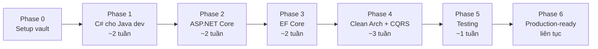

# 🗺️ Lộ trình: Java/Spring Developer → .NET Backend Engineer

> [!info] Nguyên tắc
> - Học **đối chiếu**: mỗi chủ đề mở [[Java-to-DotNet-Mental-Map]] ra trước, chỉ ghi chép phần **khác biệt**.
> - Mỗi phase kết thúc bằng **code chạy được** trong [[POC-01-Ordering-Clean-Architecture]], không chỉ đọc.
> - Note nào chưa có → chỉ tạo khi bắt đầu học chủ đề đó (Just-In-Time).
> - Thời lượng là gợi ý cho người đã có nền tảng backend, học ~1–2h/ngày.

## Phase 0 — Setup ✅
- [x] Cấu trúc thư mục vault, template, dashboard
- [ ] Init Git repo + cấu hình Obsidian Git (auto commit/backup)
- [ ] Cài .NET 10 SDK, IDE (Rider hoặc VS Code + C# Dev Kit / Visual Studio 2026)
- [ ] Cấu hình Templater, Linter (xem hướng dẫn trong [[Home]])

## Phase 1 — C# cho Java developer
- [ ] [[Value-Types-vs-Reference-Types]] — `struct`, boxing, `Span<T>` (cơ bản)
- [ ] [[CSharp-Properties-and-Records]] — property, `init`, `record`, `with`
- [ ] [[Nullable-Reference-Types]]
- [ ] [[Generics-Reified-vs-Erasure]]
- [ ] [[LINQ-vs-Stream-API]] — deferred execution, `IEnumerable` vs `IQueryable`
- [ ] [[Async-Await-Deep-Dive]] — `Task`, `ValueTask`, `CancellationToken`, state machine
- [ ] [[Delegates-Events-Lambdas]]
- [ ] Pattern matching, extension methods, `using`/`IDisposable`
- 🎯 **Output:** console app nhỏ dùng LINQ + async đọc file/HTTP.

## Phase 2 — ASP.NET Core fundamentals
- [ ] [[ASPNETCore-Hosting-and-Program]] — Generic Host, `WebApplication`
- [ ] [[Dependency-Injection-DotNet-vs-Spring]] — lifetimes, captive dependency, keyed services
- [ ] [[Configuration-and-Options-Pattern]]
- [ ] [[Middleware-Pipeline]] — thứ tự middleware, viết custom middleware
- [ ] [[Controllers-vs-Minimal-APIs]] — routing, model binding, filters
- [ ] Error handling: `IExceptionHandler` + ProblemDetails
- [ ] Logging (Serilog, structured logging)
- [ ] [[AuthN-AuthZ-in-ASPNETCore]] — JWT Bearer, policies
- [ ] OpenAPI (`Microsoft.AspNetCore.OpenApi` + Scalar)
- 🎯 **Output:** Web API CRUD in-memory, có auth JWT + ProblemDetails.

## Phase 3 — Entity Framework Core
- [ ] [[EF-Core-vs-JPA-Hibernate]] — DbContext lifetime, change tracking
- [ ] Mapping bằng Fluent API, Complex Types, Owned Types, value conversion
- [ ] Migrations (dev & deploy: SQL script, migration bundle)
- [ ] [[EF-Core-Loading-Related-Data]] — `Include`, split query, N+1
- [ ] [[EF-Core-Transactions-and-Concurrency]] — rowversion, execution strategy
- [ ] Performance: `AsNoTracking`, projection, `ExecuteUpdate/ExecuteDelete`, compiled queries
- [ ] Interceptors (audit fields, soft delete), global query filters
- [ ] [[Dapper-for-Read-Side]]
- 🎯 **Output:** POC-01 có DB SQL Server (Docker) + migrations.

## Phase 4 — Architecture (trọng tâm)
- [x] [[Clean-Architecture-in-DotNet]]
- [x] [[CQRS-and-MediatR-Pattern]]
- [ ] [[DDD-Tactical-Patterns]] — Aggregate, Value Object, Domain Service
- [ ] [[Domain-Events-and-Outbox]]
- [ ] [[Result-Pattern-vs-Exceptions]]
- [ ] [[Decorator-Pattern-with-Scrutor]] — CQRS không cần MediatR
- [ ] Specification pattern, Repository (khi nào cần / không cần)
- [ ] [[Vertical-Slice-Architecture]] — so sánh với Clean Architecture
- [ ] [[SOLID-Principles]] — chỉ ghi phần áp dụng vào .NET
- 🎯 **Output:** POC-01 hoàn chỉnh 4 tầng, 3 behaviors, architecture tests xanh.

## Phase 5 — Testing
- [ ] [[Testing-in-DotNet]] — xUnit, NSubstitute, Shouldly
- [ ] Integration test: `WebApplicationFactory<Program>` + Testcontainers (SQL Server)
- [ ] Architecture tests (NetArchTest)
- 🎯 **Output:** pipeline `dotnet test` chạy trong Jenkins/GitHub Actions.

## Phase 6 — Production-ready (học dần, Just-In-Time)
- [ ] Observability: OpenTelemetry, health checks
- [ ] Caching: `HybridCache`, Redis
- [ ] Resilience: Polly / `Microsoft.Extensions.Http.Resilience`
- [ ] [[Background-Jobs-in-DotNet]] — `BackgroundService`, Hangfire, Quartz.NET
- [ ] Messaging: RabbitMQ / Kafka client, MassTransit/Wolverine (kiểm tra license)
- [ ] Dockerfile cho .NET (multi-stage, chiseled images), deploy lên K8s → nối với kiến thức sẵn có ở `04-DevOps-Infra`
- [ ] .NET Aspire cho môi trường dev local
