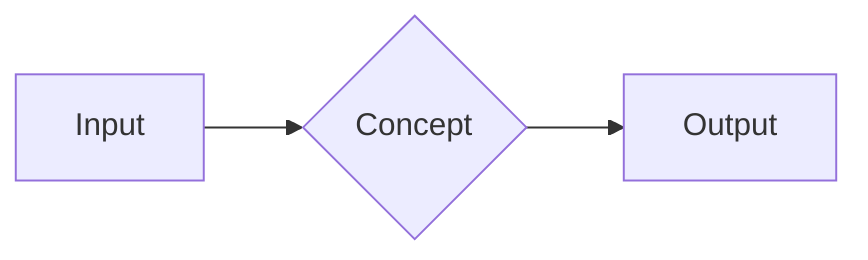

%%
HƯỚNG DẪN DÙNG TEMPLATE (phần này nằm trong %% %% nên KHÔNG hiển thị ở Reading view)

Frontmatter:
- type            : concept | pattern | style | principle | howto | comparison | moc | poc | stub
- status          : stub → draft → review → evergreen
                    (stub = mới có khung; draft = đang viết; review = cần kiểm chứng lại; evergreen = đã chín, ít sửa)
- tags            : dạng phân cấp, ví dụ: dotnet/efcore, architecture/pattern, java/spring
- topics          : chủ đề lớn mà note thuộc về, ví dụ: ["Clean Architecture", "Data Access"]
- java_equivalent : khái niệm tương đương bên Java/Spring → Dashboard sẽ tự gom thành "bảng ánh xạ"
- related         : wikilink tới note liên quan, NHỚ để trong dấu nháy: ["[[CQRS-and-MediatR-Pattern]]"]
- sources         : link tài liệu gốc (docs Microsoft, blog, sách)

Quy tắc viết:
1. Viết cho "chính mình 6 tháng sau": đọc 30 giây phần TL;DR là nhớ lại được.
2. Không chép lại kiến thức OOP căn bản — chỉ ghi phần KHÁC hoặc KHÓ.
3. Mỗi note = 1 khái niệm (atomic). Nếu dài quá 2 khái niệm → tách note + wikilink.
4. Code mẫu phải chạy được, tối giản, có comment "tại sao" chứ không chỉ "cái gì".
5. Mục 6 (Self-check) là để ôn tập chủ động (active recall) — trả lời trước khi mở callout.
%%

# <% tp.file.title %>

> [!summary] TL;DR
> - **Là gì:** <% tp.file.cursor() %>
> - **Giải quyết vấn đề gì:**
> - **Điều quan trọng nhất cần nhớ:**

---

## 1. Problem — Vấn đề cần giải quyết

### 1.1 Bối cảnh
%% Tình huống thực tế nào khiến khái niệm này xuất hiện? %%

### 1.2 Nếu không có nó thì sao? (Pain points)
- 
- 

### 1.3 Ý tưởng cốt lõi
%% Gói gọn lời giải trong 2–3 câu. %%

---

## 2. Mental Model & Diagram

> [!info] Cách hình dung (Analogy)
> %% So sánh với một thứ đời thường hoặc với thứ bạn đã biết bên Java/Spring. %%



%% Gợi ý loại sơ đồ:
- flowchart      : luồng xử lý, phụ thuộc giữa các thành phần
- sequenceDiagram: tương tác theo thời gian (request → handler → DB)
- erDiagram      : quan hệ dữ liệu
- classDiagram   : quan hệ giữa class / interface
- stateDiagram-v2: vòng đời trạng thái (Order: Draft → Submitted → Paid)
%%

---

## 3. Implementation & Minimal Code Example

### 3.1 Cài đặt

```bash
dotnet add package <PackageName>
```

### 3.2 Code tối giản

```csharp
// Mục đích: ...
// Tại sao viết như vậy: ...
```

### 3.3 Điểm cần chú ý trong code
- 

---

## 4. Comparison — Đối chiếu Java / Spring Boot

| Khía cạnh | ☕ Java / Spring Boot | 🟣 C# / ASP.NET Core | Ghi chú |
| --------- | -------------------- | ------------------- | ------- |
|           |                      |                     |         |

```java
// Code Java tương đương (nếu giúp nhớ nhanh hơn)
```

> [!warning] Bẫy khi chuyển từ Java sang .NET
> - 

---

## 5. Trade-offs & Best Practices

### ✅ Ưu điểm
- 

### ❌ Nhược điểm / Chi phí
- 

### 🎯 Khi nào dùng — khi nào KHÔNG dùng
| Nên dùng khi | Không nên dùng khi |
| ------------ | ------------------ |
|              |                    |

### 📋 Best practices
- [ ] 

### 🐞 Lỗi thường gặp
| Lỗi | Hậu quả | Cách sửa |
| --- | ------- | -------- |
|     |         |          |

---

## 6. Self-check — Câu hỏi tự kiểm tra

> [!question]- Câu hỏi 1: ...?
> Trả lời: ...

> [!question]- Câu hỏi 2 (phỏng vấn): ...?
> Trả lời: ...

---

## 7. Liên kết & Tham khảo
- **Note liên quan:** [[ ]]
- **Đọc tiếp:** 
- **Nguồn:** 
