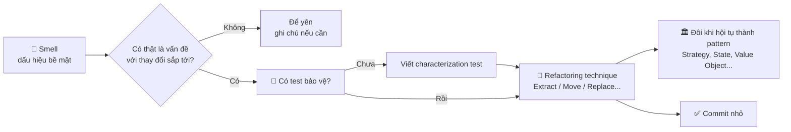
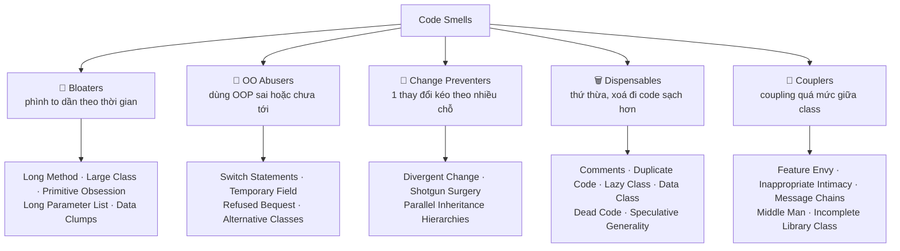
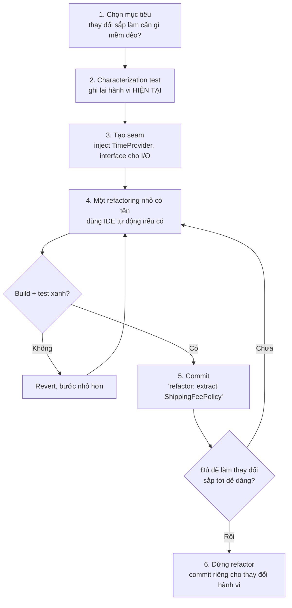
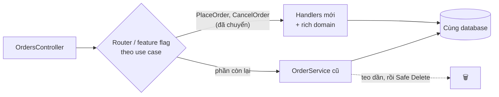
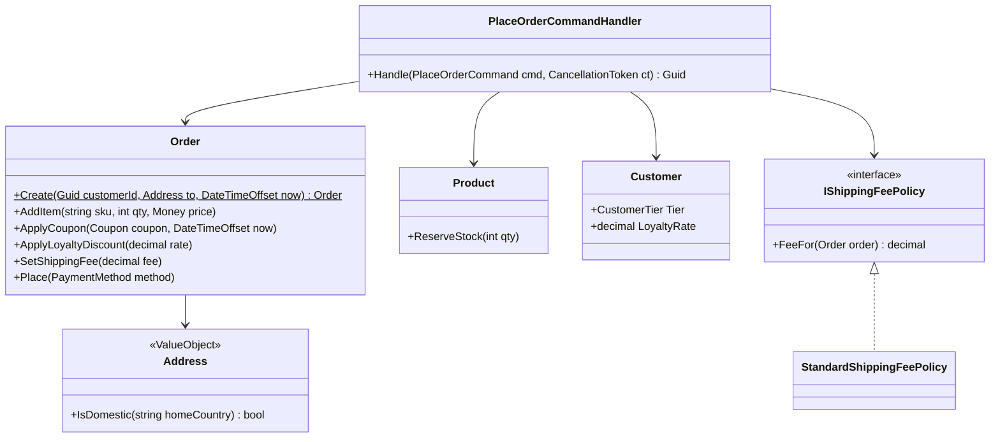

# Code Smells & Refactoring

> [!summary] TL;DR
> - **Code smell** (thuật ngữ của Kent Beck, phổ biến qua *Refactoring* của Martin Fowler): dấu hiệu bề mặt, dễ "ngửi" thấy, **thường** chỉ ra một vấn đề thiết kế sâu hơn — nhưng **không phải lúc nào cũng là bug hay lỗi**.
> - **Refactoring**: thay đổi cấu trúc bên trong **mà không đổi hành vi quan sát được**, bằng các bước nhỏ, có tên (Extract Method, Move Method, Replace Conditional with Polymorphism…).
> - Smell → refactoring technique → (đôi khi) pattern. Pattern là **điểm đến** của refactoring, không phải điểm xuất phát.
> - Không có test thì không phải refactoring, mà là "sửa code và cầu nguyện" → bắt đầu bằng **characterization test**, đi bước nhỏ, commit thường xuyên.

---

## 1. Problem — Vấn đề cần giải quyết

### 1.1 Bối cảnh

Code backend .NET hiếm khi "hỏng" một lần — nó **mục dần**: thêm một `if` cho khách VIP, thêm một tham số `bool isExpress`, copy một đoạn tính phí ship sang controller khác "cho nhanh". Mỗi bước đều hợp lý cục bộ; tổng lại thành `OrderService` 2.000 dòng mà không ai dám sửa.

### 1.2 Pain points

| Triệu chứng hằng ngày | Smell phía sau |
| --- | --- |
| Đọc 1 method phải cuộn 3 màn hình | Long Method |
| Constructor inject 12 dependency, merge conflict liên tục | Large Class / God Service |
| `status == "PAID"` rải ở 9 file, gõ sai một chỗ là bug | Primitive Obsession + Shotgun Surgery |
| Thêm 1 phương thức thanh toán phải sửa 4 `switch` | Switch Statements |
| Bug "quên gọi `Init()` trước" chỉ lộ ở production | Temporal Coupling |
| Entity chỉ có get/set, luật nằm trong service | Anemic Domain Model |

### 1.3 Ý tưởng cốt lõi

1. **Nhận diện** bằng từ vựng chung (tên smell) → review code nhanh và khách quan hơn "tôi thấy nó xấu".
2. **Sửa** bằng các refactoring có tên, mỗi bước nhỏ và giữ nguyên hành vi.
3. **Bảo vệ** bằng test trước khi động vào — và **dừng** khi code đã đủ tốt cho thay đổi sắp tới.

> [!tip] "Make the change easy, then make the easy change"
> Câu nói thường được gán cho Kent Beck. Refactor **ngay trước** khi thêm tính năng (*preparatory refactoring*) là thời điểm có ROI cao nhất: bạn biết chính xác chỗ nào cần mềm dẻo.

---

## 2. Mental Model & Diagram

> [!info] Cách hình dung (Analogy)
> Smell giống **triệu chứng** (sốt, ho); refactoring là **phác đồ điều trị** có tên; test là **máy theo dõi sinh hiệu** trong lúc mổ. Không bác sĩ nào mổ khi không có máy theo dõi — và không phải ai sốt cũng cần mổ.

### 2.1 Từ smell tới pattern



### 2.2 Năm nhóm smell

Cách nhóm dưới đây là của refactoring.guru, dựa trên taxonomy của Mäntylä và cộng sự (bản gốc 2003 có thêm vài nhóm nhỏ như *Encapsulators*; ranh giới nhóm không tuyệt đối).



### 2.3 Catalog — smell → dấu hiệu → refactoring → pattern/nguyên tắc

| Nhóm | Smell | Dấu hiệu nhận biết (.NET) | Refactoring technique | Thường dẫn tới |
| --- | --- | --- | --- | --- |
| 🎈 | **Long Method** | Method > ~30 dòng, có comment chia "bước 1, bước 2" | Extract Method, Decompose Conditional, Replace Temp with Query | Composed Method · [[SOLID-Principles#Single Responsibility Principle (SRP)]] |
| 🎈 | **Large Class** | `XxxService`/`Manager` nhiều chục method, > 7 dependency | Extract Class, Extract Interface | Handler per use case · [[CQRS-and-MediatR-Pattern]] |
| 🎈 | **Primitive Obsession** | `string` cho email/status, `decimal` + `string currency` | Replace Data Value with Object, Replace Type Code with Class/State/Strategy | Value Object · [[DDD-Tactical-Patterns]] |
| 🎈 | **Long Parameter List** | > 4 tham số, nhiều `bool` flag | Introduce Parameter Object, Preserve Whole Object | [[Creational-Patterns#Builder]], options record |
| 🎈 | **Data Clumps** | `street, city, zip, country` đi cùng nhau khắp nơi | Extract Class, Introduce Parameter Object | Value Object (`Address`) |
| 🔀 | **Switch Statements** | `switch` theo kind/type lặp ở nhiều method | Replace Conditional with Polymorphism, Replace Type Code with State/Strategy | [[Behavioral-Patterns#Strategy]] · [[Behavioral-Patterns#State]] |
| 🔀 | **Temporary Field** | Field chỉ có giá trị trong một nhánh xử lý, còn lại `null` | Extract Class, Introduce Null Object | Method object, Null Object |
| 🔀 | **Refused Bequest** | Subclass `throw new NotSupportedException()` cho method kế thừa | Replace Inheritance with Delegation, Push Down Method | LSP · composition over inheritance · [[Core-Design-Principles]] |
| 🔀 | **Alternative Classes with Different Interfaces** | `SmtpMailer.Send()` và `SendGridClient.Dispatch()` làm cùng việc | Rename Method, Extract Superclass/Interface | [[Structural-Patterns#Adapter]] |
| 🧱 | **Divergent Change** | Một class bị sửa vì nhiều lý do khác nhau (giá, email, báo cáo) | Extract Class | SRP |
| 🧱 | **Shotgun Surgery** | Một thay đổi nghiệp vụ phải sửa 6–7 file | Move Method, Move Field, Inline Class | Gom về owner · [[Coupling-and-Cohesion]] |
| 🧱 | **Parallel Inheritance Hierarchies** | Thêm `XxxOrder` lại phải thêm `XxxOrderValidator`, `XxxOrderMapper` | Move Method, Move Field | [[Structural-Patterns#Các pattern ít gặp|Bridge]] |
| 🗑️ | **Comments** | Comment giải thích *code làm gì* (thay vì *tại sao*) | Extract Method, Rename, Introduce Assertion | Tên tốt |
| 🗑️ | **Duplicate Code** | Copy-paste logic tính phí/giảm giá giữa các handler | Extract Method, Pull Up Method, Form Template Method | [[Behavioral-Patterns#Template Method]] · DRY + Rule of Three |
| 🗑️ | **Lazy Class** | Class/interface gần như không làm gì | Inline Class, Collapse Hierarchy | YAGNI |
| 🗑️ | **Data Class** | Chỉ có `{ get; set; }`, hành vi nằm nơi khác | Encapsulate Field/Collection, Move Method | Rich domain model (xem Anemic bên dưới) |
| 🗑️ | **Dead Code** | Method/nhánh không ai gọi, feature flag đã tắt vĩnh viễn | Safe Delete | — |
| 🗑️ | **Speculative Generality** | `IRepository<T>` + `IGenericService<T>` "cho sau này", 1 implementation | Collapse Hierarchy, Inline Class, Remove Parameter | YAGNI · [[Design-Thinking-Process]] |
| 🔗 | **Feature Envy** | Method dùng dữ liệu của object khác nhiều hơn của mình | Move Method, Extract Method | Tell, Don't Ask · [[Core-Design-Principles]] |
| 🔗 | **Inappropriate Intimacy** | Hai class truy cập `internal`/field của nhau, quan hệ 2 chiều | Move Method/Field, Change Bidirectional Association to Unidirectional | [[Coupling-and-Cohesion]] |
| 🔗 | **Message Chains** | `order.Customer.Address.City.Name` | Hide Delegate, Extract Method | Law of Demeter · [[Core-Design-Principles]] |
| 🔗 | **Middle Man** | Service chỉ forward 1-1 sang repository | Remove Middle Man, Inline Method | Bỏ lớp pass-through |
| 🔗 | **Incomplete Library Class** | Thư viện thiếu method cần dùng | Introduce Foreign Method, Introduce Local Extension | C# extension methods · [[Structural-Patterns#Adapter]] |
| ➕ | **Anemic Domain Model** | Entity là túi dữ liệu, mọi luật trong `XxxService` | Move Method vào entity, Encapsulate Collection | Rich aggregate · [[DDD-Tactical-Patterns]] |
| ➕ | **Temporal Coupling** | Phải gọi `Init()`/`SetX()` theo đúng thứ tự, API không thể hiện | Constructor injection, Factory, Replace setters with method | [[Creational-Patterns#Factory Method]] |

> [!info] Ấn bản 2 của *Refactoring* (2018)
> Fowler cập nhật danh sách: thêm *Mysterious Name*, *Global Data*, *Mutable Data*, *Loops*, *Repeated Switches*; đổi *Inappropriate Intimacy* thành *Insider Trading*, *Lazy Class* thành *Lazy Element*. Hai dòng ➕ cuối bảng **không** thuộc catalog gốc của Fowler — Anemic Domain Model là một anti-pattern Fowler mô tả trên bliki (2003), Temporal Coupling là "design smell" được Mark Seemann phân tích (2011).

---

## 3. Implementation — Deep-dive các smell hay gặp trong backend .NET

### Long Method

**Dấu hiệu:** comment kiểu `// 1. validate`, `// 2. tính tiền`; biến tạm sống suốt 80 dòng; không đặt nổi tên method mô tả hết việc nó làm.

```csharp
// ❌ Before: nhiều tầng trừu tượng trộn lẫn
public decimal CalculateTotal(Order order)
{
    decimal subtotal = 0;
    foreach (var i in order.Items) subtotal += i.UnitPrice.Amount * i.Quantity;
    // giảm giá thành viên
    decimal discount = 0;
    if (order.CustomerTier == "GOLD") discount = subtotal * 0.05m;
    // phí ship
    decimal shipping = order.Country == "VN" ? (subtotal > 500_000 ? 0 : 30_000) : 200_000;
    return subtotal - discount + shipping;
}

// ✅ After (Extract Method + Replace Temp with Query): đọc như một câu
public decimal CalculateTotal(Order order)
    => order.Subtotal - LoyaltyDiscount(order) + ShippingFee(order);
```

> Quy tắc ngón tay cái: khi bạn muốn viết comment để giải thích **một đoạn**, hãy Extract Method và để **tên method** thay comment.

### Large Class

Hay gặp nhất ở .NET dưới dạng **God Service**: `OrderService` có 40 method, inject `IApplicationDbContext`, `IEmailSender`, `IPaymentGateway`, `IInventoryClient`, `ILogger`, `IMapper`, `ICacheService`…

| Cách tách | Khi nào |
| --- | --- |
| **Handler per use case** (`PlaceOrderHandler`, `CancelOrderHandler`) | Service chứa nhiều use case độc lập → [[CQRS-and-MediatR-Pattern]] |
| **Đẩy luật vào aggregate** | Service toàn `if` trên field của entity → xem *Anemic Domain Model* |
| **Extract Class theo trách nhiệm** (`ShippingFeePolicy`, `InvoiceRenderer`) | Cụm method dùng chung một nhóm field/dependency riêng |

> [!tip] Phát hiện cụm cần tách
> Vẽ ma trận *method × field/dependency*: các method chỉ dùng chung một tập dependency là ứng viên Extract Class (đây chính là đo **cohesion** — xem [[Coupling-and-Cohesion]]).

### Primitive Obsession

**Dấu hiệu:** `string email`, `string status`, `decimal amount` + `string currency` đi riêng lẻ; validate cùng một định dạng ở nhiều chỗ; nhầm thứ tự hai tham số `Guid`.

```csharp
// ❌ Before: tiền là decimal trần, currency là string rời — cộng nhầm VND với USD vẫn compile
public decimal AddShipping(decimal total, string totalCurrency, decimal fee, string feeCurrency)
    => total + fee;   // quên kiểm tra currency → bug tiền tệ

// ✅ After: Money (VO đã có ở [[Clean-Architecture-in-DotNet]]) được thêm phép toán
public sealed partial record Money
{
    public static Money operator +(Money a, Money b)
    {
        // Luật "chỉ cộng cùng tiền tệ" sống trong đúng một chỗ
        if (a.Currency != b.Currency)
            throw new DomainException($"Cannot add {a.Currency} and {b.Currency}.");
        return new Money(a.Amount + b.Amount, a.Currency);
    }
}

// Strongly-typed ID: không thể truyền CustomerId vào chỗ cần OrderId
public readonly record struct OrderId(Guid Value);
public readonly record struct CustomerId(Guid Value);
```

> [!note] `partial` ở đây chỉ để minh hoạ "bổ sung vào Money hiện có"; code thật thêm thẳng operator vào record `Money`. EF Core map VO qua owned type / complex type (EF Core 8+) hoặc `HasConversion` cho strongly-typed ID.

### Switch Statements

**Dấu hiệu:** cùng một `switch (paymentMethod)` lặp lại ở `Charge`, `Refund`, `FeeFor`. Thêm `PaymentMethod.Momo` phải sửa mọi chỗ — và quên một chỗ là bug runtime.

```csharp
// ❌ Before: switch lặp lại ở nhiều method (Repeated Switches)
public async Task ChargeAsync(Order order, PaymentMethod method, CancellationToken ct)
{
    switch (method)
    {
        case PaymentMethod.Card: await _cardGateway.ChargeAsync(order.Id, order.Total, ct); break;
        case PaymentMethod.Cod:  /* không làm gì, thu tiền khi giao */ break;
        case PaymentMethod.BankTransfer: await _bank.CreateVirtualAccountAsync(order.Id, ct); break;
        default: throw new ArgumentOutOfRangeException(nameof(method));
    }
}
public decimal FeeFor(PaymentMethod method) => method switch { PaymentMethod.Card => 0.02m, /* ... */ _ => 0m };
// ... RefundAsync lại switch y hệt
```

```csharp
// ✅ After: Replace Conditional with Polymorphism → Strategy
public interface IPaymentProcessor
{
    PaymentMethod Method { get; }
    decimal FeeRate { get; }
    Task ChargeAsync(Order order, CancellationToken ct);
    Task RefundAsync(Order order, CancellationToken ct);
}

internal sealed class CardPaymentProcessor(ICardGateway gateway) : IPaymentProcessor
{
    public PaymentMethod Method => PaymentMethod.Card;
    public decimal FeeRate => 0.02m;
    public Task ChargeAsync(Order order, CancellationToken ct) => gateway.ChargeAsync(order.Id, order.Total, ct);
    public Task RefundAsync(Order order, CancellationToken ct) => gateway.RefundAsync(order.Id, ct);
}

// Chọn strategy: inject TẤT CẢ implementation, map theo Method — không cần service locator
public sealed class PaymentProcessorResolver(IEnumerable<IPaymentProcessor> processors)
{
    private readonly Dictionary<PaymentMethod, IPaymentProcessor> _byMethod =
        processors.ToDictionary(p => p.Method);   // trùng Method → lỗi ngay lúc khởi tạo, không âm thầm

    public IPaymentProcessor For(PaymentMethod method) =>
        _byMethod.TryGetValue(method, out var p) ? p : throw new NotSupportedException($"No processor for {method}.");
}

// DI: services.AddScoped<IPaymentProcessor, CardPaymentProcessor>();
//     services.AddScoped<IPaymentProcessor, CodPaymentProcessor>();
//     services.AddScoped<PaymentProcessorResolver>();
// Thay thế: keyed services (.NET 8+) — AddKeyedScoped<IPaymentProcessor, CardPaymentProcessor>(PaymentMethod.Card)
```

> [!warning] Không phải `switch` nào cũng là smell
> Một `switch` expression **duy nhất**, ở ranh giới (map enum → HTTP status, parse input), với ít nhánh ổn định là **tốt**. Smell là khi **cùng một switch lặp lại** hoặc mỗi nhánh chứa nhiều logic. Chi tiết pattern → [[Behavioral-Patterns#Strategy]].

### Feature Envy

**Dấu hiệu:** method của class A gọi `b.X`, `b.Y`, `b.Z` liên tục và gần như không dùng gì của A.

```csharp
// ❌ Before: InvoiceService "ghen tị" với dữ liệu của OrderItem
public sealed class InvoiceService
{
    public decimal LineTotal(OrderItem item)
        => item.UnitPrice.Amount * item.Quantity * (1 - item.DiscountPercent / 100m);
}

// ✅ After (Move Method): hành vi về đúng chỗ chứa dữ liệu — Tell, Don't Ask
public sealed class OrderItem
{
    // ...
    public decimal LineTotal => UnitPrice.Amount * Quantity * (1 - DiscountPercent / 100m);
}
```

> Ngoại lệ hợp lý: Strategy/Visitor **cố ý** tách hành vi khỏi dữ liệu vì hành vi đổi theo trục khác (VD: nhiều cách xuất hoá đơn). Khi đó "envy" là chủ đích, không phải smell.

### Shotgun Surgery

**Dấu hiệu:** thêm trạng thái `OnHold` cho đơn hàng → sửa controller, query báo cáo, email template, job đồng bộ, validator… vì điều kiện `status == "PAID" || status == "SHIPPED"` bị copy khắp nơi.

```csharp
// ❌ Before: tri thức "đơn nào được huỷ" nằm rải rác
// OrdersController.cs
if (order.Status == "DRAFT" || order.Status == "SUBMITTED") { /* cho phép huỷ */ }
// RefundJob.cs
var cancellable = db.Orders.Where(o => o.Status == "DRAFT" || o.Status == "SUBMITTED");
// CustomerPortalQuery.cs
CanCancel = o.Status == "DRAFT" || o.Status == "SUBMITTED",

// ✅ After (Move Method + gom về owner): một chỗ duy nhất biết luật
public enum OrderStatus { Draft, Submitted, Paid, Cancelled }

public sealed class Order : Entity
{
    // Expression dùng chung cho cả LINQ-to-SQL và in-memory → không bị lệch luật giữa đọc và ghi
    public static readonly Expression<Func<Order, bool>> IsCancellableExpr =
        o => o.Status == OrderStatus.Draft || o.Status == OrderStatus.Submitted;

    private static readonly Func<Order, bool> IsCancellableFn = IsCancellableExpr.Compile();
    public bool CanBeCancelled => IsCancellableFn(this);
}

// Query: db.Orders.Where(Order.IsCancellableExpr)   — EF dịch được sang SQL
```

> Shotgun Surgery là mặt trái của **Divergent Change**: một bên là "1 thay đổi → nhiều class", bên kia là "1 class → nhiều lý do thay đổi". Cả hai đều là vấn đề **cohesion** đặt sai chỗ → [[Coupling-and-Cohesion]]. Ý tưởng expression dùng lại được phát triển đầy đủ ở Specification pattern → [[Repository-UnitOfWork-Specification]].

### Data Clumps

**Dấu hiệu:** cùng một nhóm 3–4 field/tham số luôn đi cùng nhau. Test nhanh: **xoá một field trong nhóm, những field còn lại có còn ý nghĩa không?** Nếu không → chúng là một khái niệm.

```csharp
// ❌ Before
public void ChangeShippingAddress(Guid orderId, string street, string city, string postalCode, string country) { }
public decimal EstimateShipping(string street, string city, string postalCode, string country, decimal weightKg) => 0;

// ✅ After: Extract Class → Value Object
public sealed record Address
{
    public string Street { get; }
    public string City { get; }
    public string PostalCode { get; }
    public string Country { get; }   // ISO 3166-1 alpha-2

    public Address(string street, string city, string postalCode, string country)
    {
        if (string.IsNullOrWhiteSpace(street) || string.IsNullOrWhiteSpace(city))
            throw new DomainException("Street and city are required.");
        if (country is not { Length: 2 })
            throw new DomainException("Country must be an ISO alpha-2 code.");
        (Street, City, PostalCode, Country) = (street.Trim(), city.Trim(), postalCode.Trim(), country.ToUpperInvariant());
    }

    public bool IsDomestic(string homeCountry) => Country == homeCountry;   // hành vi bắt đầu "dính" vào VO
}

public void ChangeShippingAddress(Guid orderId, Address address) { }
public decimal EstimateShipping(Address to, decimal weightKg) => 0;
```

### Long Parameter List

**Dấu hiệu:** > 4 tham số; nhiều `bool` (*flag arguments*) — đọc `CreateShipment(id, addr, 2.5m, true, false, true)` không ai biết `true` nào là gì.

```csharp
// ❌ Before
public Shipment CreateShipment(Guid orderId, string street, string city, string zip, string country,
                               decimal weightKg, bool express, bool insured, bool fragile)
    => throw new NotImplementedException();

// ✅ After: Introduce Parameter Object + Data Clumps → VO + options record
[Flags]
public enum HandlingOptions { None = 0, Insured = 1, Fragile = 2 }

public sealed record ShipmentRequest(
    Guid OrderId,
    Address To,
    decimal WeightKg,
    ShippingSpeed Speed = ShippingSpeed.Standard,
    HandlingOptions Handling = HandlingOptions.None);

public enum ShippingSpeed { Standard, Express }

public Shipment CreateShipment(ShipmentRequest request) => throw new NotImplementedException();

// Call site tự giải thích; record + `with` thay cho Builder trong đa số trường hợp
var req = new ShipmentRequest(orderId, address, 2.5m, ShippingSpeed.Express, HandlingOptions.Fragile);
var insured = req with { Handling = req.Handling | HandlingOptions.Insured };
```

> Builder ([[Creational-Patterns#Builder]]) chỉ đáng khi việc xây dựng có **nhiều bước, có điều kiện, có validate chéo**. Với C#, named arguments + optional parameters + `required`/`init` + `with` đã giải quyết phần lớn nhu cầu mà bên Java phải dùng Lombok `@Builder`.

### Anemic Domain Model

**Dấu hiệu:** entity toàn `{ get; set; }` public, mọi luật ở `XxxService`; ai cũng `order.Status = "PAID"` được. Fowler (2003) gọi đây là anti-pattern: trả chi phí của domain model (mapping ORM) mà không nhận lợi ích — thực chất là transaction script.

```csharp
// ❌ Before: entity là túi dữ liệu
public class Order
{
    public Guid Id { get; set; }
    public string Status { get; set; } = "DRAFT";
    public List<OrderItem> Items { get; set; } = [];
}
public class OrderService(AppDbContext db)
{
    public async Task SubmitAsync(Guid id)
    {
        var order = await db.Orders.Include(o => o.Items).SingleAsync(o => o.Id == id);
        if (order.Status != "DRAFT") throw new InvalidOperationException("...");
        if (order.Items.Count == 0) throw new InvalidOperationException("...");
        order.Status = "SUBMITTED";               // service khác có thể set thẳng, bỏ qua mọi luật
        await db.SaveChangesAsync();
    }
}

// ✅ After: luật nằm trong aggregate, setter private (xem Order đầy đủ ở [[Clean-Architecture-in-DotNet]])
public sealed class Order : Entity
{
    private readonly List<OrderItem> _items = [];
    public OrderStatus Status { get; private set; }
    public IReadOnlyCollection<OrderItem> Items => _items.AsReadOnly();

    public void Submit()
    {
        if (Status != OrderStatus.Draft) throw new DomainException($"Order is {Status}.");
        if (_items.Count == 0) throw new DomainException("Cannot submit an empty order.");
        Status = OrderStatus.Submitted;
        Raise(new OrderSubmittedDomainEvent(Id));
    }
}
// Handler chỉ còn: load → order.Submit() → (UnitOfWorkBehavior) SaveChanges
```

> [!info] Anemic không phải lúc nào cũng sai
> Với CRUD đơn giản hoặc read model (DTO), "anemic" là **đúng**: không có invariant thì không cần hành vi. Smell chỉ xuất hiện khi có quy tắc nghiệp vụ mà lại nằm ngoài object sở hữu dữ liệu. → [[DDD-Tactical-Patterns]]

### Temporal Coupling

**Dấu hiệu:** object phải được gọi theo một thứ tự ngầm (`Initialize()` trước `Calculate()`), nhưng chữ ký không thể hiện → compile OK, lỗi lúc runtime.

```csharp
// ❌ Before: quên Initialize → NullReferenceException ở production
public sealed class ShippingFeeCalculator
{
    private RateTable? _rates;
    public void Initialize(RateTable rates) => _rates = rates;
    public decimal Calculate(Order order) => _rates!.FeeFor(order.Subtotal);  // "!" che giấu vấn đề
}

var calc = new ShippingFeeCalculator();
var fee = calc.Calculate(order);   // quên dòng Initialize → nổ

// ✅ After: dependency bắt buộc vào constructor → không thể tồn tại object "chưa sẵn sàng"
public sealed class ShippingFeeCalculator(RateTable rates)
{
    public decimal Calculate(Order order) => rates.FeeFor(order.Subtotal);
}
```

Biến thể hay gặp trong domain: `order.SetCustomer(...)`, `order.SetAddress(...)`, `order.Validate()`, rồi mới `order.Submit()`. Sửa bằng **factory method** nhận đủ dữ liệu (`Order.Create(customerId, address, now)`) và method nghiệp vụ tự kiểm tra tiền điều kiện. Nguyên tắc: *make illegal states unrepresentable*.

---

## 3.1 Quy trình refactor an toàn



### a) Characterization test — "khoá" hành vi hiện tại

Thuật ngữ của Michael Feathers (*Working Effectively with Legacy Code*): test ghi lại code **đang làm gì**, không phải **nên làm gì**. Cách làm: chạy code với input cố định, assert một giá trị chắc chắn sai, đọc giá trị thật từ thông báo lỗi, chép vào làm expected. Snapshot testing (thư viện **Verify**) tự động hoá việc này.

```csharp
// Characterization test cho OrderService.PlaceOrder (legacy) — dùng Verify (package Verify.Xunit)
[Fact]
public async Task PlaceOrder_gold_customer_percent_coupon_domestic()
{
    await using var db = TestDb.CreateSeeded();        // helper: SQLite in-memory + dữ liệu seed cố định
    var sut = new OrderService(db, new FakeEmailSender(), new FakePaymentGateway(),
                               NullLogger<OrderService>.Instance);

    var id = await sut.PlaceOrder(SeedData.GoldCustomerId, "1 Lê Lợi", "HCM", "700000", "VN",
        [("SKU-1", 2), ("SKU-2", 1)], "SALE10", "CARD", "tok_test");

    var order = await db.Orders.Include(o => o.Items).SingleAsync(o => o.Id == id);
    var stock = await db.Products.OrderBy(p => p.Sku).Select(p => new { p.Sku, p.Stock }).ToListAsync();

    // Lần chạy đầu tạo file .verified.txt; từ đó mọi thay đổi hành vi đều làm test đỏ
    await Verify(new { order.Total, order.Status, Items = order.Items.Count, stock });
}
```

> [!warning] Code legacy gọi `DateTime.Now` → test không ổn định
> Bước refactor **đầu tiên** thường là tạo seam: thay `DateTime.Now` bằng `TimeProvider` inject vào (thay đổi cơ học, an toàn), rồi mới viết characterization test với `FakeTimeProvider`.

### b) Bước nhỏ, commit thường xuyên

- Mỗi commit = **một** refactoring có tên, build + test xanh. Revert một bước rẻ hơn debug mười bước.
- **Không trộn** refactoring và thay đổi hành vi trong cùng commit/PR — reviewer phải biết commit nào "không được đổi kết quả".
- Prefix commit theo quy ước (VD: `refactor:` vs `feat:`) để lịch sử tự nói.

### c) Dùng IDE refactoring tự động

| Refactoring | Rider | Visual Studio | ☕ IntelliJ IDEA |
| --- | --- | --- | --- |
| Menu tổng | **Refactor This** (`Ctrl+Shift+R`, keymap VS) | **Quick Actions** (`Ctrl+.`) | Refactor This (`Ctrl+Alt+Shift+T`) |
| Extract Method | ✅ | ✅ (`Ctrl+R, Ctrl+M`) | ✅ |
| Extract Class | ✅ | Hạn chế — chắc chắn có *Extract base class*; Roslyn có provider Extract Class nhưng tuỳ phiên bản | ✅ (Extract Delegate) |
| Extract Interface | ✅ | ✅ (`Ctrl+R, Ctrl+I`) | ✅ |
| Introduce Parameter Object | **Transform Parameters** | Không có sẵn dạng này (có *Introduce parameter* và Change Signature) | ✅ |
| Change Signature | ✅ | ✅ | ✅ |
| Move Method / Move to another type | ✅ | Hạn chế (move type to file, sync namespace, move static members) | ✅ |
| Inline Method / Variable | ✅ | ✅ | ✅ |
| Pull Members Up / Push Down | ✅ | Pull members up | ✅ |
| Replace Constructor with Factory Method | ✅ | ❌ | ✅ |
| Safe Delete | ✅ | ❌ (dùng Find All References) | ✅ |

> Phím tắt thay đổi theo keymap/profile — kiểm tra lại trong IDE của bạn. Danh sách Rider lấy từ tài liệu JetBrains; Visual Studio có thêm refactoring qua Roslyn analyzers/extension.

### d) Refactor lớn: Strangler-style thay vì "big bang rewrite"

Khi cần thay cả một module (VD: `OrderService` 3.000 dòng → các handler), áp dụng tinh thần **Strangler Fig** (Fowler): xây phần mới **song song**, chuyển dần từng use case, phần cũ teo lại rồi xoá.



Kỹ thuật đi kèm: **Branch by Abstraction** (đặt interface trước code cũ, thêm implementation mới, chuyển dần), chạy song song và so sánh kết quả (*parallel run*) cho logic tính tiền nhạy cảm.

---

## 3.2 End-to-end: refactor `OrderService.PlaceOrder`

### ❌ Before — "nó chạy mà"

```csharp
public class OrderService(AppDbContext db, IEmailSender email, IPaymentGateway payments, ILogger<OrderService> logger)
{
    public async Task<Guid> PlaceOrder(Guid customerId, string street, string city, string zip, string country,
        List<(string sku, int qty)> items, string? couponCode, string paymentMethod, string cardToken)
    {
        if (items == null || items.Count == 0) throw new Exception("No items");
        var customer = await db.Customers.FindAsync(customerId);
        if (customer == null) throw new Exception("Customer not found");

        var order = new OrderEntity { Id = Guid.NewGuid(), CustomerId = customerId, Status = "NEW",
            CreatedAt = DateTime.Now, Street = street, City = city, Zip = zip, Country = country };
        decimal subtotal = 0;
        foreach (var it in items)
        {
            var p = await db.Products.FirstOrDefaultAsync(x => x.Sku == it.sku);   // N+1 query
            if (p == null) throw new Exception("Product " + it.sku);
            if (p.Stock < it.qty) throw new Exception("Out of stock");
            p.Stock -= it.qty;
            order.Items.Add(new OrderItemEntity { Sku = it.sku, Qty = it.qty, Price = p.Price });
            subtotal += p.Price * it.qty;
        }

        decimal discount = 0;
        if (!string.IsNullOrEmpty(couponCode))
        {
            var c = await db.Coupons.FirstOrDefaultAsync(x => x.Code == couponCode);
            if (c != null && c.ExpiresAt > DateTime.Now)
            {
                if (c.Type == 1) discount = subtotal * c.Value / 100;      // 1 = phần trăm
                else if (c.Type == 2) discount = c.Value;                   // 2 = số tiền
            }
        }
        if (customer.Tier == "GOLD") discount += subtotal * 0.05m;
        decimal shipping = country == "VN" ? (subtotal > 500000 ? 0 : 30000) : 200000;
        order.Total = subtotal - discount + shipping;

        if (paymentMethod == "CARD") await payments.ChargeAsync(cardToken, order.Total);   // trừ tiền TRƯỚC khi lưu!
        else if (paymentMethod != "COD") throw new Exception("Unsupported payment");
        order.Status = paymentMethod == "CARD" ? "PAID" : "NEW";

        db.Orders.Add(order);
        await db.SaveChangesAsync();
        await email.SendAsync(customer.Email, "Order placed", $"Total: {order.Total}");
        logger.LogInformation("Order {Id} placed", order.Id);
        return order.Id;
    }
}
```

### Chẩn đoán

| Smell | Ở đâu |
| --- | --- |
| Long Method | ~50 dòng, 7 trách nhiệm: validate, tồn kho, giá, coupon, loyalty, ship, thanh toán, email |
| Long Parameter List + Data Clumps | 9 tham số; `street, city, zip, country` |
| Primitive Obsession | `Status = "NEW"`, `Tier == "GOLD"`, `c.Type == 1`, `paymentMethod == "CARD"`, magic number |
| Switch Statements | `if Type == 1 / 2`, `if paymentMethod == ...` |
| Feature Envy | Sửa `p.Stock`, tính giảm giá từ field của coupon |
| Anemic Domain Model | `OrderEntity`, `Product` chỉ là túi dữ liệu |
| Hidden dependency | `DateTime.Now` → không test được hết hạn |
| (Bug thiết kế) | Trừ tiền thẻ **trước** `SaveChanges` → lưu lỗi thì khách mất tiền mà không có đơn |

### Lộ trình (mỗi dòng = 1+ commit, test xanh sau mỗi bước)

| # | Bước | Kỹ thuật | Đổi hành vi? |
| --- | --- | --- | --- |
| 1 | Inject `TimeProvider`, viết characterization tests | Introduce seam | Không |
| 2 | `PlaceOrderCommand` + `AddressDto`, `OrderLineDto` | Introduce Parameter Object | Không |
| 3 | Enum `OrderStatus`, `CustomerTier`, `DiscountKind`, `PaymentMethod` | Replace Type Code with Class | Không |
| 4 | `product.ReserveStock(qty)`, `order.AddItem(...)`, `order.ApplyCoupon(...)` | Move Method (Feature Envy → owner) | Không |
| 5 | `IShippingFeePolicy` + `ShippingOptions` cấu hình | Extract Class, Replace Magic Number | Không |
| 6 | Load product 1 query (`WHERE Sku IN (...)`) | Tối ưu (sau khi đã đúng) | Không (kết quả) |
| 7 | Thanh toán & email chuyển sang handler của `OrderPlacedDomainEvent` qua Outbox | **Thay đổi thiết kế** | **Có** — PR riêng, test mới |

> [!important] Bước 7 không phải refactoring
> Chuyển thanh toán ra sau commit làm thay đổi hành vi quan sát được (đơn CARD giờ ở `Submitted` rồi mới `Paid`). Nó phải có PR riêng, test mới, và thường cần đồng thuận nghiệp vụ. Refactoring 1–6 là **chuẩn bị** để bước 7 trở nên dễ (*make the change easy*). → [[Domain-Events-and-Outbox]]

### ✅ After

```csharp
// Application/Orders/Commands/PlaceOrder/PlaceOrderCommand.cs
public sealed record PlaceOrderCommand(
    Guid CustomerId,
    AddressDto ShippingAddress,
    IReadOnlyList<OrderLineDto> Lines,
    string? CouponCode,
    PaymentMethod PaymentMethod) : ICommand<Guid>;

public sealed record AddressDto(string Street, string City, string PostalCode, string Country)
{
    public Address ToAddress() => new(Street, City, PostalCode, Country);
}

public sealed record OrderLineDto(string Sku, int Quantity);
```

```csharp
// Application/Orders/Commands/PlaceOrder/PlaceOrderCommandHandler.cs
public sealed class PlaceOrderCommandHandler(
    IApplicationDbContext db,
    IShippingFeePolicy shippingFees,
    TimeProvider clock) : IRequestHandler<PlaceOrderCommand, Guid>
{
    public async Task<Guid> Handle(PlaceOrderCommand cmd, CancellationToken ct)
    {
        var now = clock.GetUtcNow();
        var customer = await db.Customers.FindAsync([cmd.CustomerId], ct)
            ?? throw new NotFoundException(nameof(Customer), cmd.CustomerId);

        // Mỗi dòng một tầng trừu tượng: đọc như kịch bản nghiệp vụ
        var order = Order.Create(customer.Id, cmd.ShippingAddress.ToAddress(), now);
        await AddLinesAsync(order, cmd.Lines, ct);
        await ApplyCouponIfAnyAsync(order, cmd.CouponCode, now, ct);
        order.ApplyLoyaltyDiscount(customer.LoyaltyRate);
        order.SetShippingFee(shippingFees.FeeFor(order));
        order.Place(cmd.PaymentMethod);           // Raise OrderPlacedDomainEvent → thanh toán, email (Outbox)

        db.Orders.Add(order);
        return order.Id;                          // SaveChanges: UnitOfWorkBehavior
    }

    private async Task AddLinesAsync(Order order, IReadOnlyList<OrderLineDto> lines, CancellationToken ct)
    {
        var skus = lines.Select(l => l.Sku).Distinct().ToList();
        var products = await db.Products
            .Where(p => skus.Contains(p.Sku))     // 1 query thay vì N
            .ToDictionaryAsync(p => p.Sku, ct);

        foreach (var line in lines)
        {
            var product = products.GetValueOrDefault(line.Sku)
                ?? throw new NotFoundException(nameof(Product), line.Sku);
            product.ReserveStock(line.Quantity);  // luật "đủ hàng" nằm trong Product
            order.AddItem(product.Sku, line.Quantity, product.Price);
        }
    }

    private async Task ApplyCouponIfAnyAsync(Order order, string? rawCode, DateTimeOffset now, CancellationToken ct)
    {
        if (string.IsNullOrWhiteSpace(rawCode)) return;
        var code = new CouponCode(rawCode);
        var coupon = await db.Coupons.FirstOrDefaultAsync(c => c.Code == code, ct)
            ?? throw new NotFoundException(nameof(Coupon), code.Value);
        order.ApplyCoupon(coupon, now);           // chi tiết: [[Design-Thinking-Process]]
    }
}
```

> [!warning] Hành vi coupon cũ "nuốt" mã không hợp lệ
> Code cũ bỏ qua âm thầm khi mã không tồn tại/hết hạn; code mới ném lỗi. Nếu characterization test bắt được khác biệt này, đó là **quyết định nghiệp vụ** cần hỏi PO — không tự ý "sửa luôn" trong commit refactor.

```csharp
// Application/Orders/Pricing/ShippingFeePolicy.cs — Extract Class + magic number → cấu hình
public interface IShippingFeePolicy
{
    decimal FeeFor(Order order);
}

public sealed class ShippingOptions
{
    public string HomeCountry { get; set; } = "VN";
    public decimal FreeShippingThreshold { get; set; } = 500_000m;
    public decimal DomesticFee { get; set; } = 30_000m;
    public decimal InternationalFee { get; set; } = 200_000m;
}

internal sealed class StandardShippingFeePolicy(IOptions<ShippingOptions> options) : IShippingFeePolicy
{
    private readonly ShippingOptions _o = options.Value;

    // Giữ nguyên luật cũ (so với Subtotal TRƯỚC giảm giá) — characterization test bảo vệ điều này
    public decimal FeeFor(Order order) => order.ShippingAddress.IsDomestic(_o.HomeCountry)
        ? (order.Subtotal > _o.FreeShippingThreshold ? 0m : _o.DomesticFee)
        : _o.InternationalFee;
}
// DI: services.Configure<ShippingOptions>(config.GetSection("Shipping"));
//     services.AddScoped<IShippingFeePolicy, StandardShippingFeePolicy>();
```

### Cấu trúc sau refactor



| Chỉ số | Before | After |
| --- | --- | --- |
| Dòng trong method chính | ~50 | ~12 (+ 2 private method nhỏ) |
| Tham số | 9 | 1 command |
| Magic string/number | 8+ | 0 (enum + `ShippingOptions`) |
| Query DB cho N sản phẩm | N + 3 | 3 |
| Test luật giảm giá/ship không cần DB | ❌ | ✅ (unit test domain + policy) |
| Lỗi "trừ tiền mà không có đơn" | Có | Hết (sau bước 7 + Outbox) |

---

## 4. Comparison — Đối chiếu Java / Spring Boot

| Khía cạnh | ☕ Java / Spring Boot | 🟣 C# / .NET 10 | Ghi chú |
| --- | --- | --- | --- |
| Catalog smell | Fowler *Refactoring* (ví dụ Java ở bản 1, JavaScript ở bản 2) | Dùng chung | Khái niệm không phụ thuộc ngôn ngữ |
| IDE refactor | IntelliJ IDEA (rất mạnh) | **Rider** ≈ IntelliJ (cùng JetBrains, ReSharper engine); Visual Studio (Roslyn, ít hơn) | Dân Java thấy Rider "như ở nhà" |
| Boilerplate VO/DTO | Lombok `@Value`, `@Builder`, `@Data`; Java `record` (16+) | `record`, `record struct`, `init`, `required`, `with` | C# không cần annotation processor |
| Builder cho nhiều tham số | Lombok `@Builder` | Named/optional args + `with` (thường đủ) | |
| Static analysis | SonarQube, PMD, Checkstyle, SpotBugs, Error Prone | SonarQube/SonarLint, **Roslyn analyzers** (CAxxxx, IDExxxx) trong SDK, `.editorconfig`, ReSharper inspections | Bật `<AnalysisLevel>` và `<TreatWarningsAsErrors>` trên CI |
| Đo độ phức tạp | Sonar cognitive complexity, PMD | VS *Calculate Code Metrics*; rule CA1502 (complexity), CA1506 (class coupling) | |
| Kiểm tra kiến trúc | ArchUnit | NetArchTest / ArchUnitNET | Biến "đừng để smell quay lại" thành test |
| Snapshot/approval test | ApprovalTests.Java | **Verify**, ApprovalTests.Net | Dùng cho characterization test |
| Ẩn dependency thời gian | `Instant.now()` → `Clock` | `DateTime.Now` → `TimeProvider` | |

```java
// Java: Lombok giảm boilerplate nhưng @Data dễ sinh ra Data Class + Anemic model
@Data                       // getter + SETTER cho mọi field → ai cũng sửa được trạng thái
@Entity
public class Order { @Id UUID id; String status; BigDecimal total; }

// Java 16+ record cho VO (không dùng làm JPA entity được)
public record Address(String street, String city, String postalCode, String country) {
    public Address {        // compact constructor ≈ constructor validate bên C#
        if (country == null || country.length() != 2) throw new IllegalArgumentException("country");
    }
}
```

> [!warning] Bẫy khi chuyển từ Java sang .NET
> - **`{ get; set; }` là Lombok `@Data` trá hình:** auto-property public setter là cách nhanh nhất tạo Anemic Domain Model. Mặc định `private set`/`init`.
> - **Positional record không validate:** `record Address(string Street, ...)` nhận mọi giá trị. VO cần constructor tường minh (như ví dụ) — tương tự compact constructor của Java.
> - **Record equality với collection:** record so sánh `List<T>` theo reference → hai VO "giống nhau" vẫn khác nhau.
> - **Rider vs Visual Studio:** nhiều refactoring quen tay bên IntelliJ (Extract Class, Introduce Parameter Object, Safe Delete) **không có sẵn** trong Visual Studio thuần — dùng Rider hoặc ReSharper nếu refactor nhiều.
> - **Extension method là công cụ refactoring hợp lệ** cho *Incomplete Library Class* — thứ Java không có (phải dùng static util class).
> - **Không có checked exception:** bên Java, `throws` lộ ra trong chữ ký; bên C# lỗi ẩn — refactor dễ làm đổi loại exception mà không ai thấy → characterization test nên assert cả loại exception.

---

## 5. Trade-offs & Best Practices

### ✅ Lợi ích
- Từ vựng chung cho code review: "đây là Feature Envy" ngắn và khách quan hơn "chỗ này hơi kỳ".
- Thay đổi tương lai rẻ hơn; bug ít chỗ trốn hơn.
- Refactor dần thay cho rewrite — giảm rủi ro.

### ❌ Chi phí / rủi ro
- Refactor không có test → đổi hành vi âm thầm.
- "Refactor vì thẩm mỹ" ở code không ai đụng tới → tốn công, tăng rủi ro merge.
- Áp pattern quá tay khi sửa smell → *Speculative Generality*, indirection mới.
- PR refactor khổng lồ → không ai review nổi.

### 🎯 Khi nào refactor — khi nào KHÔNG

| Nên refactor khi | Không nên refactor khi |
| --- | --- |
| Ngay trước khi thêm tính năng vào vùng đó (*preparatory*) | Code ổn định, không ai sửa trong nhiều tháng |
| Đang sửa bug và thấy cấu trúc che giấu bug | Không có test và không thể viết test hợp lý |
| Lần thứ 3 gặp trùng lặp (Rule of Three) | Sắp thay thế/xoá module đó |
| Khi code review phát hiện smell trong code mới | Sát deadline release — ghi ticket, làm sau |
| Hiểu biết domain thay đổi (tên/khái niệm sai) | Chỉ vì "không giống style của tôi" |

### 📋 Best practices
- [ ] Có test xanh **trước** khi refactor; legacy → characterization test (Verify).
- [ ] Mỗi commit một refactoring có tên; không trộn với thay đổi hành vi.
- [ ] Ưu tiên refactoring **tự động** của IDE (Rider/VS) thay cho sửa tay.
- [ ] Tạo seam cho thời gian/ngẫu nhiên/I/O trước (`TimeProvider`, interface cho gateway).
- [ ] Sửa smell bằng refactoring nhỏ nhất đủ dùng; pattern chỉ khi force đủ mạnh → [[Design-Thinking-Process]].
- [ ] Bật Roslyn analyzers + SonarLint; cân nhắc `TreatWarningsAsErrors` trên CI.
- [ ] Refactor lớn → Strangler/Branch by Abstraction, không rewrite big-bang.
- [ ] Ghi smell chưa xử lý vào backlog kèm "khi nào trả nợ".

### 🐞 Lỗi thường gặp

| Lỗi | Hậu quả | Cách sửa |
| --- | --- | --- |
| Refactor + thêm tính năng trong cùng PR | Không biết bug đến từ đâu, review khó | Tách PR: `refactor:` trước, `feat:` sau |
| "Sửa" luôn hành vi lạ khi refactor | Phá client đang dựa vào hành vi đó | Ghi lại, hỏi nghiệp vụ, đổi ở PR riêng |
| Tạo interface cho mọi class khi tách God Service | Speculative Generality, điều hướng code khó | Interface chỉ ở ranh giới (I/O, nhiều implementation) |
| Thay mọi `switch` bằng Strategy | Bùng nổ class cho 2 nhánh ổn định | Chỉ thay switch **lặp lại** hoặc hay mở rộng |
| Gộp code trùng ngay lần thứ 2 | Abstraction sai, coupling giữa hai feature khác nhau | Rule of Three; trùng *ngẫu nhiên* thì để yên |
| Characterization test assert quá chi tiết (log, thứ tự không quan trọng) | Test đỏ vì lý do vô nghĩa, team bỏ test | Assert kết quả nghiệp vụ: tổng tiền, trạng thái, tồn kho |
| Rewrite toàn bộ module | Hai hệ thống song song mãi không xong | Strangler: chuyển dần từng use case |

---

## 6. Self-check — Câu hỏi tự kiểm tra

> [!question]- Code smell có phải là bug không? Khi nào một smell nên để yên?
> Không. Smell là dấu hiệu **có thể** có vấn đề thiết kế (Fowler: "surface indication"), code vẫn chạy đúng. Để yên khi vùng code ổn định, không có thay đổi sắp tới, hoặc chi phí/rủi ro refactor (không có test) cao hơn lợi ích.

> [!question]- Shotgun Surgery và Divergent Change khác nhau thế nào?
> Shotgun Surgery: **một** thay đổi buộc sửa **nhiều** class (tri thức bị rải). Divergent Change: **một** class bị sửa vì **nhiều** lý do khác nhau (quá nhiều trách nhiệm). Cả hai là vấn đề cohesion: sửa bằng Move Method/Field gom về một owner, hoặc Extract Class tách trách nhiệm.

> [!question]- Characterization test khác unit test thông thường ở điểm nào?
> Unit test khẳng định hành vi **mong muốn**; characterization test ghi lại hành vi **hiện tại** (kể cả bug) để phát hiện mọi thay đổi khi refactor. Expected value lấy từ chính output của code, thường bằng snapshot (Verify).

> [!question]- Khi nào `switch` là smell, khi nào không?
> Là smell khi cùng một switch theo type/kind lặp lại ở nhiều nơi, hoặc mỗi nhánh chứa nhiều logic, hoặc thường xuyên thêm nhánh mới → Replace Conditional with Polymorphism (Strategy/State). Không là smell khi chỉ có một switch expression ở ranh giới (mapping, factory) với ít nhánh ổn định.

> [!question]- Vì sao bước "chuyển thanh toán ra domain event" trong ví dụ không được gọi là refactoring?
> Vì nó thay đổi hành vi quan sát được (trạng thái đơn, thời điểm trừ tiền). Refactoring theo định nghĩa phải giữ nguyên hành vi. Bước đó là thay đổi thiết kế, cần PR riêng, test mới và đồng thuận nghiệp vụ; các refactoring trước chỉ làm cho nó dễ thực hiện.

> [!question]- (Phỏng vấn) Bạn nhận một `OrderService` 3.000 dòng không có test, cần thêm phương thức thanh toán mới trong 2 sprint. Bạn làm gì?
> Không rewrite. (1) Khoanh vùng code thanh toán liên quan; (2) tạo seam (inject `TimeProvider`, interface cho gateway) bằng refactoring cơ học; (3) viết characterization test cho các luồng thanh toán hiện có; (4) Extract Method rồi Replace Conditional with Polymorphism → `IPaymentProcessor` cho các phương thức hiện tại, commit từng bước; (5) thêm phương thức mới như một strategy mới — thay đổi giờ chỉ là thêm class; (6) phần còn lại của service để nguyên, ghi backlog, chuyển dần theo Strangler khi có tính năng chạm tới.

---

## 7. Liên kết & Tham khảo
- **MOC:** [[Architecture-Design-MOC]]
- **Note liên quan:** [[Design-Thinking-Process]] · [[Coupling-and-Cohesion]] · [[SOLID-Principles]] · [[Core-Design-Principles]] · [[DDD-Tactical-Patterns]] · [[Repository-UnitOfWork-Specification]]
- **Pattern đích của refactoring:** [[Behavioral-Patterns#Strategy]] · [[Behavioral-Patterns#State]] · [[Behavioral-Patterns#Template Method]] · [[Structural-Patterns#Adapter]] · [[Structural-Patterns#Các pattern ít gặp|Bridge]] · [[Creational-Patterns#Builder]] · [[Creational-Patterns#Factory Method]]
- **Áp dụng trong codebase:** [[Clean-Architecture-in-DotNet]] · [[CQRS-and-MediatR-Pattern]] · [[Domain-Events-and-Outbox]] · [[Java-to-DotNet-Mental-Map]]
- **Đọc tiếp (chưa viết):** [[Testing-in-DotNet]] · [[EF-Core-vs-JPA-Hibernate]] · [[Dependency-Injection-DotNet-vs-Spring]]
- **Nguồn:**
  - Martin Fowler — *Refactoring* (1999, 2018); bliki *CodeSmell*, *AnemicDomainModel*, *StranglerFigApplication*
  - refactoring.guru — Code Smells catalog
  - Mäntylä, Vanhanen, Lassenius — taxonomy "bad code smells" (2003); tóm tắt qua tài liệu khoá học Duke CS308
  - Michael Feathers — *Working Effectively with Legacy Code* (characterization test)
  - Mark Seemann — *Design Smell: Temporal Coupling* (2011)
  - JetBrains Rider docs — danh sách refactorings; Microsoft Learn — Visual Studio extract/inline refactorings
