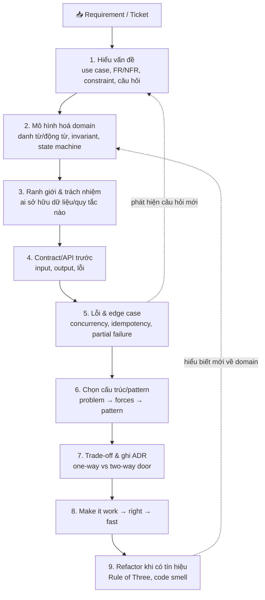
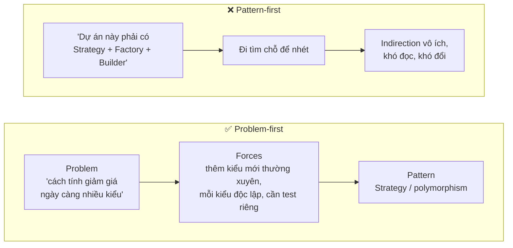
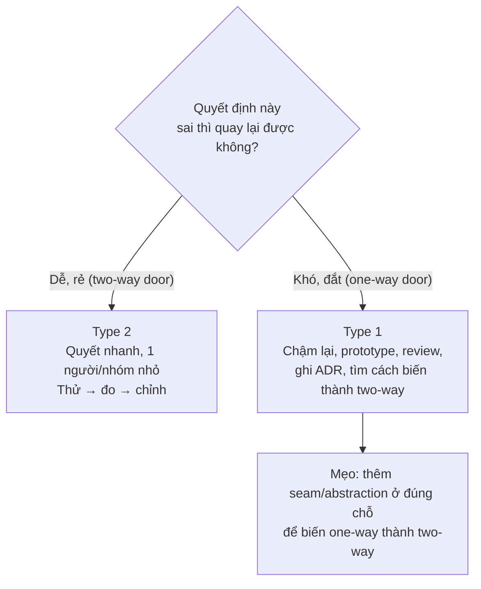
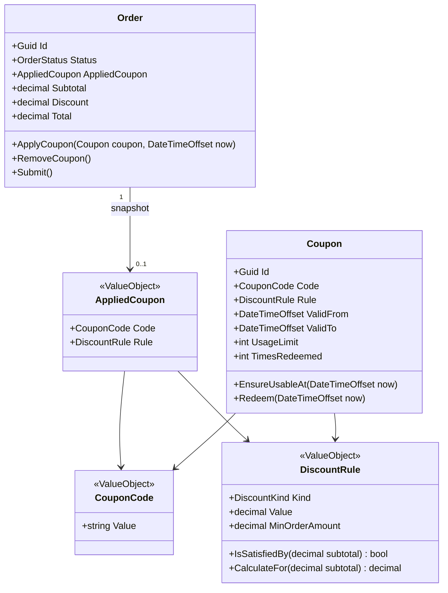
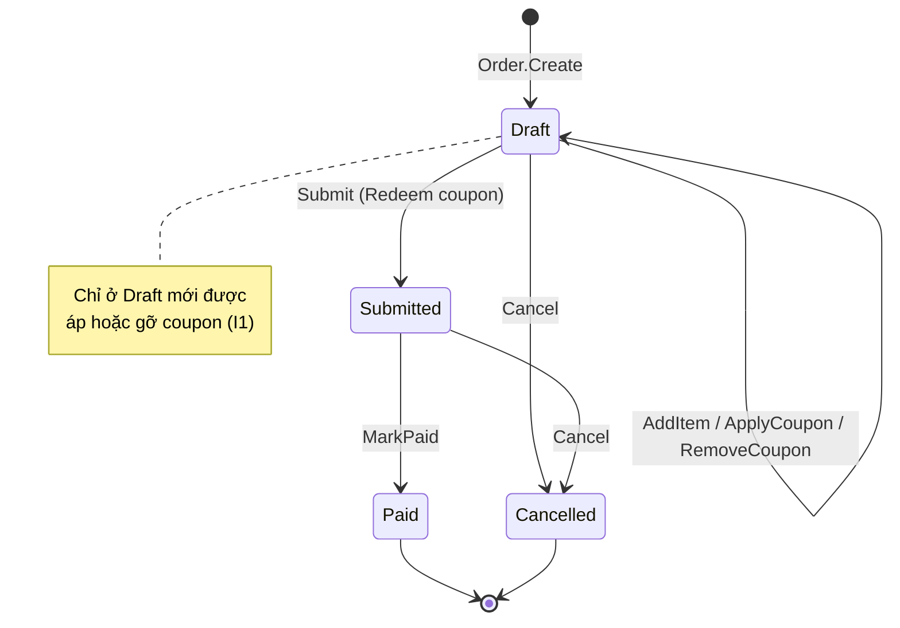
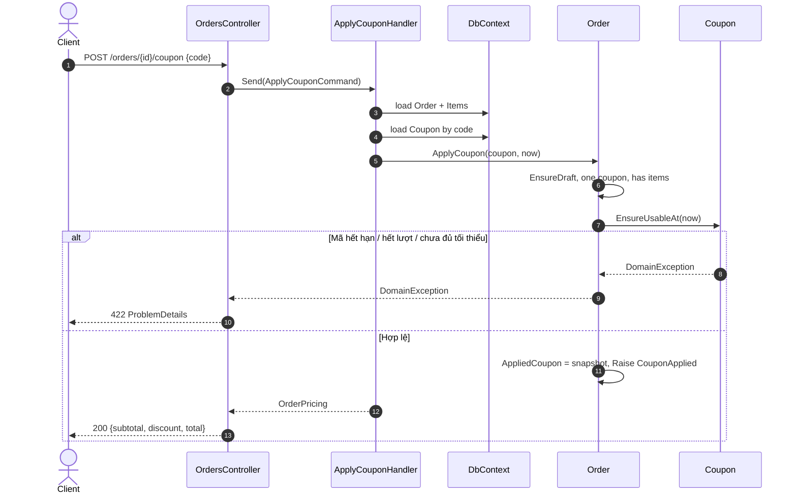

# Design Thinking Process — Logic tư duy khi thiết kế & viết code

> [!summary] TL;DR
> - **Là gì:** một quy trình tư duy lặp lại được, đi từ **requirement → domain model → ranh giới → contract → lỗi/edge case → cấu trúc/pattern → trade-off → code → refactor**.
> - **Giải quyết vấn đề gì:** tránh "nhảy vào code ngay" rồi đập đi làm lại; tránh chọn pattern trước rồi ép vấn đề vào pattern (*solution looking for a problem*).
> - **Điều quan trọng nhất:** pattern sinh ra từ **problem → forces → pattern**, không phải ngược lại. Mỗi quyết định phải trả lời được "**tại sao**" và "**sai thì quay lại có rẻ không**" (one-way vs two-way door).
> - **Cuối note:** worked example đầy đủ — thiết kế tính năng **áp mã giảm giá (coupon) cho đơn hàng** từ requirement tới C# code + test.

---

## 1. Problem — Vấn đề cần giải quyết

### 1.1 Bối cảnh

Ticket: *"Cho phép khách hàng nhập mã giảm giá khi đặt hàng."* Một dev vội sẽ:

1. Thêm cột `CouponCode`, `DiscountAmount` vào bảng `Orders`.
2. Viết `if (coupon.Type == 1) ... else if (coupon.Type == 2) ...` trong `OrderService`.
3. Merge. Hai tuần sau: "mã chỉ áp cho đơn ≥ 500k", "mỗi mã chỉ dùng 100 lần", "xoá bớt sản phẩm thì sao?", "hai người dùng lượt cuối cùng cùng lúc thì sao?"…

Mỗi yêu cầu mới là một miếng vá. Không phải vì dev kém, mà vì **bỏ qua bước suy nghĩ**: chưa hỏi đủ câu hỏi, chưa xác định ai **sở hữu** quy tắc, chưa biết **invariant** nào phải luôn đúng.

### 1.2 Pain points khi không có quy trình

| Triệu chứng | Nguyên nhân gốc |
| --- | --- |
| Code đúng ticket nhưng sai nghiệp vụ | Không làm rõ requirement, không hỏi edge case |
| Quy tắc nghiệp vụ rải khắp controller/service/SQL | Không xác định **owner** của dữ liệu & quy tắc |
| Đổi một chỗ, vỡ ba chỗ (Shotgun Surgery) | Ranh giới & trách nhiệm mơ hồ → coupling cao |
| "Kiến trúc đẹp" nhưng chậm ra tính năng | Chọn pattern trước vấn đề, over-engineering |
| Tranh cãi lặp lại "sao hồi đó làm vậy?" | Không ghi lại quyết định (thiếu ADR) |

### 1.3 Ý tưởng cốt lõi

Thiết kế là **quản lý độ phức tạp và chi phí thay đổi**. Quy trình dưới đây không phải waterfall — với một tính năng nhỏ, cả vòng có thể diễn ra trong 30 phút trên giấy. Cái quan trọng là **thứ tự câu hỏi**: hiểu → mô hình → ranh giới → hợp đồng → thất bại → cấu trúc → đánh đổi → code.

---

## 2. Mental Model & Diagram

> [!info] Cách hình dung (Analogy)
> Giống kiến trúc sư xây nhà: không ai chọn "mái Thái hay mái Nhật" trước khi biết **ai ở, mấy người, khí hậu ra sao, ngân sách bao nhiêu**. Mái nhà (pattern) là hệ quả của các ràng buộc (forces), không phải điểm xuất phát.

### 2.1 Vòng lặp tư duy từ requirement tới code



> [!tip] Không phải waterfall
> Mũi tên nét đứt là quan trọng nhất: viết code/test thường làm lộ ra câu hỏi mà bước 1 bỏ sót. Quay lại là **bình thường**, không phải thất bại.

### 2.2 Problem → Forces → Pattern (chiều đúng) vs Pattern-first (chiều sai)



**Forces** = các lực kéo ngược chiều nhau trong bối cảnh cụ thể: tần suất thay đổi, số biến thể, yêu cầu hiệu năng, kỹ năng team, deadline, ràng buộc pháp lý… Cùng một problem, forces khác → pattern khác (hoặc **không cần pattern**).

### 2.3 Phân loại quyết định: one-way door vs two-way door



Khung này đến từ thư cổ đông năm 2015 của Jeff Bezos (Type 1 / Type 2 decisions). Lỗi phổ biến nhất **không** phải quyết sai, mà là **dùng quy trình nặng của Type 1 cho mọi quyết định Type 2** → team chậm.

| Quyết định | Loại | Lý do |
| --- | --- | --- |
| Tên class, tách method, thư mục feature | Two-way | IDE rename/move trong vài giây |
| Dùng MediatR hay handler gọi trực tiếp | Two-way (gần) | Đổi được, tốn công vừa phải |
| Schema bảng có dữ liệu production | **One-way** | Migration dữ liệu thật, downtime |
| Public API contract cho client bên ngoài | **One-way** | Client đã tích hợp, versioning |
| Định dạng event đã publish lên broker | **One-way** | Consumer khác đã phụ thuộc |
| Tách microservice, chọn database | **One-way** | Dữ liệu và team bị chia theo |

---

## 3. Implementation — Quy trình từng bước

### 3.1 Bước 1 — Hiểu vấn đề

Viết ra (dù chỉ 5 dòng) trước khi mở IDE:

| Hạng mục | Câu hỏi | Ví dụ (coupon) |
| --- | --- | --- |
| **Use case** | Ai làm gì, để đạt mục tiêu gì? | Khách áp mã để được giảm tiền đơn hàng |
| **Functional req.** | Hệ thống phải làm gì? | Kiểm tra mã hợp lệ, tính tiền giảm, hiển thị tổng mới |
| **Non-functional req.** | Nhanh cỡ nào, tải bao nhiêu, bảo mật, audit? | p95 < 200ms; chống brute-force đoán mã |
| **Constraint** | Cái gì không được đổi? | DB SQL Server hiện có, đơn 1 currency |
| **Out of scope** | Cái gì **không** làm lần này? | Stack nhiều mã, mã theo sản phẩm |

> [!important] Câu hỏi cần làm rõ — thứ đáng giá nhất của một senior
> Requirement luôn thiếu. Kỹ năng là **biết hỏi gì**: biên (min/max, 0, rỗng), thời gian (hết hạn lúc nào, timezone nào), đồng thời (2 người cùng lúc), thay đổi sau đó (sửa giỏ hàng thì sao), thất bại (dịch vụ ngoài chết thì sao), làm tròn tiền, ai được làm (authorization).

### 3.2 Bước 2 — Mô hình hoá domain

1. **Danh từ → ứng viên Entity / Value Object:** Order, OrderItem, Coupon, CouponCode, Money, DiscountRule.
   - Có **identity** & vòng đời → Entity (Order, Coupon).
   - Chỉ được định nghĩa bởi giá trị, bất biến → **Value Object** (CouponCode, Money, DiscountRule).
2. **Động từ → hành vi (method):** `order.ApplyCoupon()`, `order.RemoveCoupon()`, `coupon.Redeem()` — **không phải** `SetDiscount()`.
3. **Invariant:** điều **luôn** đúng sau mọi thao tác ("tổng tiền không âm", "một đơn tối đa một mã"). Invariant quyết định **ranh giới aggregate**: những gì phải nhất quán cùng lúc thì nằm chung.
4. **State machine:** trạng thái nào cho phép hành vi nào.
5. **Data flow:** dữ liệu đi từ đâu tới đâu, ai đọc, ai ghi.

### 3.3 Bước 3 — Ranh giới & trách nhiệm (ai sở hữu cái gì)

Câu hỏi then chốt: **"Nếu quy tắc X đổi, class nào phải sửa?"** — câu trả lời nên là **một** class.

| Dữ liệu / quy tắc | Owner | Vì sao |
| --- | --- | --- |
| Mã còn hạn, còn lượt | `Coupon` aggregate | Coupon biết vòng đời của chính nó |
| Cách tính tiền giảm (%/cố định, trần) | `DiscountRule` (VO) | Thuần tính toán, không phụ thuộc gì |
| Đơn đang Draft mới áp mã, tối đa 1 mã | `Order` aggregate | Invariant của đơn hàng |
| Tìm Order + Coupon, gọi domain, lưu | Application handler | Điều phối (orchestration), không chứa luật |
| Map lỗi → HTTP 404/422 | API layer | Chi tiết giao thức |

Chi tiết cách đo "đúng chỗ" → [[Coupling-and-Cohesion]], [[SOLID-Principles#Single Responsibility Principle (SRP)]].

### 3.4 Bước 4 — Thiết kế contract/API trước

Viết **chữ ký** trước thân hàm. Contract tốt làm lộ thiết kế xấu sớm.

```http
POST /api/orders/{orderId}/coupon
{ "code": "SALE10" }

200 OK        { "subtotal": 600000, "discount": 60000, "total": 540000 }
404 Not Found  order hoặc mã không tồn tại
422 Unprocessable  mã hết hạn / hết lượt / đơn chưa đủ tối thiểu / đơn không còn Draft
DELETE /api/orders/{orderId}/coupon   → gỡ mã
```

> [!tip] Kiểm tra contract bằng 3 câu
> - Tên có nói **ý định nghiệp vụ** không? (`ApplyCoupon` ✅, `UpdateOrder` ❌)
> - Client có phải biết chi tiết nội bộ không? (gửi `discountAmount` từ client ❌ — server phải tự tính)
> - Mọi kết quả thất bại đã có mã lỗi rõ ràng chưa?

### 3.5 Bước 5 — Lỗi & edge cases

| Nhóm | Câu hỏi | Quyết định mẫu |
| --- | --- | --- |
| Input | Mã có khoảng trắng, chữ thường? | Normalize `Trim().ToUpperInvariant()` trong VO |
| Biên | Giảm cố định 100k cho đơn 80k? | Tiền giảm **≤ subtotal** → tổng ≥ 0 |
| Thời gian | Hết hạn tính theo giờ nào? | Lưu UTC (`DateTimeOffset`), lấy giờ qua `TimeProvider` |
| Thay đổi sau | Áp mã xong, xoá item làm subtotal < tối thiểu? | Tiền giảm tự về 0 (không throw khi xoá item) — ghi ADR |
| Đồng thời | 2 đơn cùng dùng lượt cuối? | Đếm lượt lúc **Submit**, optimistic concurrency trên Coupon |
| Idempotency | Client retry `POST` áp mã? | Áp cùng mã lần 2 → no-op, không lỗi |
| Bảo mật | Đoán mã bằng brute-force? | Rate limiting (`AddRateLimiter`) ở API |

Lỗi nào là **input validation** (400) và lỗi nào là **business rule** (422) → xem [[CQRS-and-MediatR-Pattern]]; dùng exception hay Result → [[Result-Pattern-vs-Exceptions]].

### 3.6 Bước 6 — Chọn cấu trúc/pattern từ vấn đề

Quy tắc: **gọi tên force trước, gọi tên pattern sau.**

| Force quan sát được | Pattern/cấu trúc gợi ý | Đọc thêm |
| --- | --- | --- |
| Nhiều biến thể thuật toán, thêm mới thường xuyên | Strategy / polymorphism | [[Behavioral-Patterns#Strategy]] |
| Hành vi đổi theo trạng thái, nhiều `if (status == …)` | State / state machine trong aggregate | [[Behavioral-Patterns#State]] |
| Thêm cross-cutting (log, cache, retry) không sửa class gốc | Decorator / pipeline behavior | [[Structural-Patterns#Decorator]] |
| Tạo object phức tạp, nhiều invariant lúc khởi tạo | Factory Method / static factory | [[Creational-Patterns#Factory Method]] |
| Quy tắc nghiệp vụ phải luôn đúng | Aggregate + Value Object | [[DDD-Tactical-Patterns]] |
| Phản ứng với sự kiện, side effect sau commit | Domain Events + Outbox | [[Domain-Events-and-Outbox]] |
| Đọc và ghi có nhu cầu khác nhau | CQRS | [[CQRS-and-MediatR-Pattern]] |
| **Chỉ có 2 biến thể, ít đổi** | **`switch` expression là đủ** | — |

> [!warning] Dòng cuối là dòng quan trọng nhất
> Một `switch` expression 2 nhánh dễ đọc hơn 1 interface + 2 class + DI registration. Pattern là **chi phí**, chỉ trả khi force đủ mạnh.

### 3.7 Bước 7 — Trade-off thinking

- **No Silver Bullet** (Fred Brooks, 1986): không có công cụ/kỹ thuật nào một mình cải thiện năng suất gấp bội — vì phần khó là *essential complexity* của bài toán, không phải *accidental complexity* của công cụ.
- Mọi lựa chọn **mua** cái gì đó bằng cách **trả** cái gì đó. Luôn viết được câu: *"Chúng ta chọn X, được A, B; trả giá C; chấp nhận vì D."*
- Ưu tiên **reversible**: nếu phân vân giữa hai cách, chọn cách dễ quay lại hơn.

#### Mini ADR (Architecture Decision Record)

Định dạng do Michael Nygard đề xuất (2011): Title, Status, Context, Decision, Consequences. Lưu dạng Markdown trong repo (`docs/adr/0007-....md`), **không sửa** ADR cũ — tạo ADR mới với status *Superseded*.

```markdown
# ADR-0007: Đếm lượt dùng coupon tại thời điểm Submit, không phải lúc Apply

- **Status:** Accepted (2026-11-18)  <!-- Proposed | Accepted | Deprecated | Superseded by ADR-xxxx -->
- **Context:** Coupon có UsageLimit. Khách có thể áp mã vào giỏ rồi bỏ đi.
  Nếu trừ lượt lúc Apply, giỏ bỏ dở sẽ "giữ chỗ" vĩnh viễn. Hai đơn có thể tranh lượt cuối.
- **Decision:** Chúng ta sẽ chỉ kiểm tra còn lượt lúc Apply (soft check) và trừ lượt (Redeem)
  lúc Submit, dùng optimistic concurrency (rowversion) trên bảng Coupons.
- **Consequences:**
  - (+) Không cần job dọn lượt bị giữ; logic đơn giản.
  - (−) Khách có thể thấy mã hợp lệ lúc Apply nhưng bị từ chối lúc Submit → UI phải xử lý.
  - (±) Khi tải cao trên cùng một mã, conflict tăng → retry; nếu thành vấn đề, xem xét reservation.
- **Loại quyết định:** two-way door (đổi sang reservation không cần migrate dữ liệu cũ).
```

### 3.8 Bước 8 — Make it work, make it right, make it fast

Câu này thường được gán cho Kent Beck (dù ý tưởng đã xuất hiện từ trước, ví dụ trong một bài năm 1983 của Johnson & Kernighan). Ý nghĩa: **thứ tự** ưu tiên.

| Giai đoạn | Mục tiêu | Tín hiệu "xong" |
| --- | --- | --- |
| **Work** | Chạy đúng cho happy path + test chứng minh | Test xanh |
| **Right** | Đúng chỗ, đúng tên, đúng owner; xử lý edge case | Đọc code hiểu nghiệp vụ; không còn smell rõ ràng |
| **Fast** | Tối ưu **chỗ đã đo** là chậm | Có số liệu profiler/APM trước & sau |

> [!warning] "Fast" không có nghĩa là bỏ qua hiệu năng tới cuối
> Những quyết định **one-way** về hiệu năng (N+1 query trong thiết kế API, chọn storage, kích thước payload event) phải nghĩ từ đầu. "Make it fast" cuối cùng là cho tối ưu **cục bộ, two-way**.

### 3.9 Bước 9 — YAGNI vs Designing for change

| | **YAGNI** | **Designing for change** |
| --- | --- | --- |
| Nguồn | Extreme Programming, Kent Beck (dự án C3) | Information hiding (Parnas), OCP |
| Nói gì | Đừng xây **tính năng** cho nhu cầu giả định | Giấu những gì **có khả năng đổi** sau ranh giới ổn định |
| Chi phí tránh được | Cost of build, delay, carry, repair (Fowler) | Shotgun surgery khi thay đổi thật xảy ra |
| Hiểu sai thường gặp | "YAGNI = không cần refactor, không cần test" | "Phải có interface cho mọi thứ" |

Hai nguyên tắc **không mâu thuẫn**: Fowler nhấn mạnh YAGNI chỉ áp dụng cho *capability* xây trước, **không** áp dụng cho việc giữ code dễ sửa (refactor, test). Chính code dễ sửa làm YAGNI an toàn: hôm nay không xây, mai cần thì thêm rẻ.

**Rule of Three** (Don Roberts, phổ biến qua *Refactoring* của Fowler): lần 1 cứ viết; lần 2 thấy trùng thì chịu đựng; **lần 3 mới trừu tượng hoá**. Lý do: với 1–2 ví dụ, bạn chưa thấy đâu là phần *thật sự* chung → abstraction sai còn đắt hơn trùng lặp.

### 3.10 Levels of abstraction — mỗi method một tầng

Một method nên đọc như một đoạn văn **cùng một độ cao**. Trộn "nghiệp vụ" và "chi tiết kỹ thuật" trong cùng method là dấu hiệu cần tách.

```csharp
// ❌ Trộn tầng: nghiệp vụ (áp mã) lẫn chi tiết (normalize string, làm tròn, so sánh ngày)
if (code.Trim().ToUpper() == c.Code && c.ValidTo > DateTime.UtcNow && sub >= c.Min)
    discount = Math.Round(sub * c.Percent / 100, 2);

// ✅ Một tầng: đọc như requirement; chi tiết bị đẩy xuống VO/method con
order.ApplyCoupon(coupon, clock.GetUtcNow());
```

| Tầng | Nói bằng ngôn ngữ của | Ví dụ |
| --- | --- | --- |
| Use case (handler) | Kịch bản | "lấy đơn, lấy mã, áp mã, lưu" |
| Domain (aggregate) | Quy tắc nghiệp vụ | "chỉ Draft mới áp mã, mỗi đơn 1 mã" |
| Value Object | Khái niệm nhỏ | "10% của 600k, tối đa bằng subtotal" |
| Infrastructure | Kỹ thuật | SQL, HTTP, rowversion |

### 3.11 Checklist trước khi gõ code

- [ ] Viết được use case trong 1–2 câu bằng ngôn ngữ nghiệp vụ?
- [ ] Đã liệt kê FR, NFR, constraint, out of scope?
- [ ] Đã hỏi các câu biên: rỗng, 0, max, trùng, hết hạn, timezone, làm tròn?
- [ ] Biết **invariant** nào phải luôn đúng và **ai** bảo vệ nó?
- [ ] Biết trạng thái nào cho phép hành vi nào (state machine)?
- [ ] Contract (input/output/lỗi) đã rõ, tên theo ý định nghiệp vụ?
- [ ] Đã nghĩ về concurrency, idempotency, partial failure (gọi dịch vụ ngoài)?
- [ ] Pattern định dùng được biện minh bằng **force cụ thể**?
- [ ] Quyết định nào là one-way door → cần ADR/review?
- [ ] Biết test nào sẽ viết **đầu tiên**?

---

## 3.12 Worked example — Áp mã giảm giá (coupon) cho đơn hàng

### a) Requirement (đã làm rõ sau buổi hỏi PO)

> Khách có thể áp **một** mã giảm giá cho đơn hàng đang ở trạng thái **Draft**. Mã có thể là giảm **%** hoặc giảm **số tiền cố định**, có thể có **giá trị đơn tối thiểu**, có **thời hạn** và **giới hạn số lượt dùng**. Tiền giảm không vượt quá tiền hàng. Có thể gỡ mã. Làm tròn tiền giảm **xuống** 2 chữ số thập phân (có lợi cho shop).

Out of scope: stack nhiều mã, mã theo từng sản phẩm/danh mục, mã theo khách hàng.

### b) Domain model



> [!info] Vì sao Order giữ **snapshot** (`AppliedCoupon`) thay vì chỉ `CouponId`?
> - Order là aggregate riêng, Coupon là aggregate riêng → tham chiếu chéo nên bằng ID hoặc bằng **giá trị**.
> - Snapshot giúp Order **tự tính** `Total` mà không cần load Coupon; và nếu marketing sửa mã sau khi khách đặt, đơn cũ không đổi giá — đúng nghiệp vụ hoá đơn.

### c) Invariants & state machine

| # | Invariant | Owner |
| --- | --- | --- |
| I1 | Chỉ đơn **Draft** mới áp/gỡ mã | Order |
| I2 | Mỗi đơn tối đa **1** mã | Order |
| I3 | `0 ≤ Discount ≤ Subtotal` → `Total ≥ 0` | DiscountRule + Order |
| I4 | Mã phải trong thời hạn và còn lượt | Coupon |
| I5 | Đơn phải có hàng và đạt tối thiểu lúc áp mã | Order + DiscountRule |
| I6 | `TimesRedeemed ≤ UsageLimit` kể cả khi đồng thời | Coupon + optimistic concurrency |



### d) C# — Value Objects

```csharp
// src/Ordering.Domain/Discounts/CouponCode.cs
using Ordering.Domain.Common;

namespace Ordering.Domain.Discounts;

public sealed record CouponCode
{
    public string Value { get; }

    public CouponCode(string value)
    {
        if (string.IsNullOrWhiteSpace(value))
            throw new DomainException("Coupon code is required.");

        // Normalize ở MỘT chỗ duy nhất → "sale10 " và "SALE10" là cùng một mã ở mọi nơi
        var normalized = value.Trim().ToUpperInvariant();
        if (normalized.Length is < 4 or > 20)
            throw new DomainException("Coupon code must be 4-20 characters.");

        Value = normalized;
    }

    public override string ToString() => Value;
}
```

```csharp
// src/Ordering.Domain/Discounts/DiscountRule.cs
using Ordering.Domain.Common;

namespace Ordering.Domain.Discounts;

public enum DiscountKind { Percentage, FixedAmount }

public sealed record DiscountRule
{
    public DiscountKind Kind { get; }
    public decimal Value { get; }            // % (0, 100] hoặc số tiền > 0
    public decimal MinOrderAmount { get; }

    private DiscountRule(DiscountKind kind, decimal value, decimal minOrderAmount)
        => (Kind, Value, MinOrderAmount) = (kind, value, minOrderAmount);

    // Factory theo ý định: không thể tạo "giảm 150%" hay "giảm -5k"
    public static DiscountRule Percentage(decimal percent, decimal minOrderAmount = 0m) =>
        percent is > 0m and <= 100m && minOrderAmount >= 0m
            ? new DiscountRule(DiscountKind.Percentage, percent, minOrderAmount)
            : throw new DomainException("Percentage must be in (0, 100] and minimum must be non-negative.");

    public static DiscountRule FixedAmount(decimal amount, decimal minOrderAmount = 0m) =>
        amount > 0m && minOrderAmount >= 0m
            ? new DiscountRule(DiscountKind.FixedAmount, amount, minOrderAmount)
            : throw new DomainException("Amount must be positive and minimum must be non-negative.");

    public bool IsSatisfiedBy(decimal subtotal) => subtotal >= MinOrderAmount;

    public decimal CalculateFor(decimal subtotal)
    {
        if (!IsSatisfiedBy(subtotal)) return 0m;

        // switch expression đủ cho 2 biến thể ổn định — chưa cần Strategy (xem mục trade-off)
        var raw = Kind switch
        {
            DiscountKind.Percentage  => subtotal * Value / 100m,
            DiscountKind.FixedAmount => Value,
            _ => throw new InvalidOperationException($"Unknown discount kind {Kind}.")
        };

        // ToZero = làm tròn có hướng về 0 (cắt bớt): quyết định nghiệp vụ "có lợi cho shop"
        var rounded = Math.Round(raw, 2, MidpointRounding.ToZero);
        return Math.Min(rounded, subtotal);  // I3: không bao giờ giảm quá tiền hàng
    }
}
```

### e) C# — Coupon aggregate & Order domain method

```csharp
// src/Ordering.Domain/Discounts/Coupon.cs
using Ordering.Domain.Common;

namespace Ordering.Domain.Discounts;

public sealed class Coupon : Entity
{
    public CouponCode Code { get; private set; } = default!;
    public DiscountRule Rule { get; private set; } = default!;
    public DateTimeOffset ValidFrom { get; private set; }
    public DateTimeOffset ValidTo { get; private set; }
    public int UsageLimit { get; private set; }
    public int TimesRedeemed { get; private set; }

    private Coupon() { } // EF Core

    public static Coupon Create(CouponCode code, DiscountRule rule,
        DateTimeOffset validFrom, DateTimeOffset validTo, int usageLimit)
    {
        if (validTo <= validFrom) throw new DomainException("ValidTo must be after ValidFrom.");
        if (usageLimit <= 0) throw new DomainException("UsageLimit must be positive.");
        return new Coupon { Code = code, Rule = rule, ValidFrom = validFrom, ValidTo = validTo, UsageLimit = usageLimit };
    }

    // "now" truyền vào thay vì DateTime.UtcNow → domain thuần, test không cần mock đồng hồ
    public void EnsureUsableAt(DateTimeOffset now)
    {
        if (now < ValidFrom || now >= ValidTo) throw new DomainException($"Coupon {Code} is not active.");
        if (TimesRedeemed >= UsageLimit) throw new DomainException($"Coupon {Code} has been fully redeemed.");
    }

    // Gọi lúc Submit (ADR-0007). Cột rowversion trên bảng Coupons bắt lỗi tranh lượt cuối (I6)
    public void Redeem(DateTimeOffset now)
    {
        EnsureUsableAt(now);
        TimesRedeemed++;
    }
}
```

```csharp
// src/Ordering.Domain/Orders/Order.cs — CHỈ phần thêm mới cho coupon
// (Entity, Money, OrderItem, Create, AddItem, EnsureDraft: xem [[Clean-Architecture-in-DotNet]])
using Ordering.Domain.Discounts;

namespace Ordering.Domain.Orders;

public sealed record AppliedCoupon(CouponCode Code, DiscountRule Rule);
public sealed record CouponAppliedDomainEvent(Guid OrderId, string CouponCode) : IDomainEvent;

public sealed partial class Order   // minh hoạ: thực tế nằm chung file Order.cs
{
    // "Color Color": property trùng tên type — C# cho phép và hiểu đúng
    public AppliedCoupon? AppliedCoupon { get; private set; }

    public decimal Subtotal => _items.Sum(i => i.LineTotal);
    // Nếu xoá bớt hàng làm subtotal < tối thiểu → giảm giá tự về 0 (quyết định đã ghi ADR)
    public decimal Discount => AppliedCoupon?.Rule.CalculateFor(Subtotal) ?? 0m;
    public decimal Total => Subtotal - Discount;

    public void ApplyCoupon(Coupon coupon, DateTimeOffset now)
    {
        EnsureDraft();                                                   // I1
        if (AppliedCoupon?.Code == coupon.Code) return;                         // idempotent khi client retry
        if (AppliedCoupon is not null) throw new DomainException("Only one coupon per order."); // I2
        if (_items.Count == 0) throw new DomainException("Add items before applying a coupon.");

        coupon.EnsureUsableAt(now);                                      // I4 — Coupon tự quyết, Order chỉ hỏi
        if (!coupon.Rule.IsSatisfiedBy(Subtotal))                        // I5
            throw new DomainException($"Order subtotal must be at least {coupon.Rule.MinOrderAmount}.");

        AppliedCoupon = new AppliedCoupon(coupon.Code, coupon.Rule);           // snapshot, không giữ reference Coupon
        Raise(new CouponAppliedDomainEvent(Id, coupon.Code.Value));
    }

    public void RemoveCoupon()
    {
        EnsureDraft();
        AppliedCoupon = null;
    }
}
```

> [!note] `partial` chỉ để minh hoạ
> Trong code thật, `Order` ở note [[Clean-Architecture-in-DotNet]] là `sealed class` thường; các member trên được thêm thẳng vào class đó, và property `Total` cũ được thay bằng bộ ba `Subtotal/Discount/Total`.

### f) C# — Application handler

```csharp
// src/Ordering.Application/Orders/Commands/ApplyCoupon/ApplyCouponCommand.cs
using FluentValidation;
using MediatR;
using Microsoft.EntityFrameworkCore;
using Ordering.Application.Common.Exceptions;
using Ordering.Application.Common.Interfaces;
using Ordering.Application.Common.Messaging;
using Ordering.Domain.Discounts;
using Ordering.Domain.Orders;

namespace Ordering.Application.Orders.Commands.ApplyCoupon;

// Ngoại lệ có chủ đích với quy ước "Command trả ít": UI cần hiển thị ngay số tiền mới,
// vẫn chỉ trả vài con số — không trả entity.
public sealed record ApplyCouponCommand(Guid OrderId, string Code) : ICommand<OrderPricing>;
public sealed record OrderPricing(decimal Subtotal, decimal Discount, decimal Total);

public sealed class ApplyCouponCommandValidator : AbstractValidator<ApplyCouponCommand>
{
    public ApplyCouponCommandValidator()
    {
        RuleFor(x => x.OrderId).NotEmpty();
        RuleFor(x => x.Code).NotEmpty().MaximumLength(20);   // input validation (400) — rule nghiệp vụ ở Domain
    }
}

public sealed class ApplyCouponCommandHandler(IApplicationDbContext db, TimeProvider clock)
    : IRequestHandler<ApplyCouponCommand, OrderPricing>
{
    public async Task<OrderPricing> Handle(ApplyCouponCommand request, CancellationToken ct)
    {
        var order = await db.Orders
            .Include(o => o.Items)          // cần Items để tính Subtotal
            .FirstOrDefaultAsync(o => o.Id == request.OrderId, ct)
            ?? throw new NotFoundException(nameof(Order), request.OrderId);

        var code = new CouponCode(request.Code);
        // Yêu cầu: CouponCode được map bằng HasConversion(c => c.Value, v => new CouponCode(v))
        // → EF dịch phép so sánh VO thành so sánh cột string
        var coupon = await db.Coupons.FirstOrDefaultAsync(c => c.Code == code, ct)
            ?? throw new NotFoundException(nameof(Coupon), code.Value);

        // Handler = nhạc trưởng: không có if/else nghiệp vụ nào ở đây
        order.ApplyCoupon(coupon, clock.GetUtcNow());

        // SaveChanges do UnitOfWorkBehavior gọi (xem [[CQRS-and-MediatR-Pattern]])
        return new OrderPricing(order.Subtotal, order.Discount, order.Total);
    }
}
```

> [!tip] `IApplicationDbContext` cần thêm `DbSet<Coupon> Coupons { get; }`; cấu hình `Rule` bằng owned type hoặc complex type (EF Core 8+) ở Infrastructure. Chi tiết mapping VO → [[EF-Core-vs-JPA-Hibernate]].

### g) Luồng end-to-end



### h) Test cần viết (theo thứ tự ưu tiên)

| Mức | Test | Vì sao |
| --- | --- | --- |
| Unit — VO | % đúng; cố định đúng; **trần = subtotal**; làm tròn xuống; dưới tối thiểu → 0 | Rẻ nhất, bao phủ phần tính tiền |
| Unit — VO | Tạo `Percentage(0)`, `Percentage(101)`, `FixedAmount(-1)` → throw | Bảo vệ "không tồn tại rule sai" |
| Unit — Order | Không Draft → throw; mã thứ 2 → throw; áp lại cùng mã → no-op; đơn rỗng → throw | Invariant I1, I2, I5 |
| Unit — Coupon | Trước `ValidFrom`, đúng `ValidTo` (biên!), hết lượt | I4, lỗi off-by-one |
| Integration | Handler: mã không tồn tại → 404; happy path lưu snapshot vào DB | Mapping EF + pipeline |
| Integration | Hai Submit song song dùng lượt cuối → một thành công, một `DbUpdateConcurrencyException` | I6 — chỉ test được với DB thật (Testcontainers) |

```csharp
// tests/Ordering.Domain.Tests/Discounts/DiscountRuleTests.cs
public class DiscountRuleTests
{
    // decimal không dùng được trong attribute [InlineData] → dùng TheoryData
    public static TheoryData<decimal, decimal, decimal> PercentageCases => new()
    {
        { 600_000m, 10m, 60_000m },
        { 99.99m, 15m, 14.99m },     // 14.9985 → làm tròn XUỐNG còn 14.99
    };

    [Theory, MemberData(nameof(PercentageCases))]
    public void Percentage_is_rounded_toward_zero(decimal subtotal, decimal percent, decimal expected)
        => Assert.Equal(expected, DiscountRule.Percentage(percent).CalculateFor(subtotal));

    [Fact]
    public void Fixed_discount_never_exceeds_subtotal()
        => Assert.Equal(80_000m, DiscountRule.FixedAmount(100_000m).CalculateFor(80_000m));

    [Fact]
    public void Below_minimum_gives_no_discount()
        => Assert.Equal(0m, DiscountRule.Percentage(10, minOrderAmount: 500_000).CalculateFor(499_999m));
}

// tests/Ordering.Domain.Tests/Orders/ApplyCouponTests.cs
public class ApplyCouponTests
{
    private static readonly DateTimeOffset Now = new(2026, 11, 18, 10, 0, 0, TimeSpan.Zero);

    private static Coupon ActiveCoupon(string code = "SALE10") =>
        Coupon.Create(new CouponCode(code), DiscountRule.Percentage(10),
            Now.AddDays(-1), Now.AddDays(1), usageLimit: 100);

    [Fact]
    public void Cannot_apply_second_coupon()
    {
        var order = Order.Create(Guid.NewGuid(), Now);
        order.AddItem("SKU-1", 1, new Money(600_000, "VND"));
        order.ApplyCoupon(ActiveCoupon("SALE10"), Now);

        var act = () => order.ApplyCoupon(ActiveCoupon("FREESHIP"), Now);

        Assert.Throws<DomainException>(act);
    }

    [Fact]
    public void Expired_exactly_at_ValidTo()   // biên: ValidTo là exclusive
    {
        var coupon = ActiveCoupon();
        Assert.Throws<DomainException>(() => coupon.EnsureUsableAt(Now.AddDays(1)));
    }
}
```

> [!tip] Test handler cần thời gian? Dùng `FakeTimeProvider` (package `Microsoft.Extensions.TimeProvider.Testing`) — tương đương `Clock.fixed(...)` bên Java.

### i) Trade-off đã cân nhắc

| Quyết định | Phương án đã chọn | Phương án bỏ | Lý do |
| --- | --- | --- | --- |
| Biến thể giảm giá | `switch` trong `DiscountRule` | Strategy (`IDiscountCalculator` × N) | Mới có 2 kiểu, ổn định; Rule of Three — tới kiểu thứ 3–4 (buy X get Y, tiered) mới tách. Two-way door. |
| Lưu coupon trên Order | Snapshot VO | Chỉ lưu `CouponId` | Order tự tính Total; hoá đơn không đổi khi marketing sửa mã |
| Thời điểm trừ lượt | Lúc Submit | Lúc Apply (reservation) | Tránh giữ chỗ vĩnh viễn — ADR-0007 |
| Subtotal tụt dưới tối thiểu | Discount tự về 0 | Throw khi xoá item / tự gỡ mã | UX mượt, không chặn thao tác giỏ hàng; Submit vẫn đúng tiền |
| Báo lỗi nghiệp vụ | `DomainException` → 422 | Result pattern | Nhất quán với codebase hiện tại → [[Result-Pattern-vs-Exceptions]] |
| Tiền | `decimal` + 1 currency/đơn | `Money` có phép toán | Constraint "đơn 1 currency"; nâng cấp khi có đa tiền tệ |

---

## 4. Comparison — Đối chiếu Java / Spring Boot

### 4.1 Một Spring dev "điển hình" sẽ làm thế nào

```java
// Cách hay gặp: anemic entity + service "biết hết"
@Entity @Getter @Setter
public class Order { @Id UUID id; String status; String couponCode; BigDecimal discount; /* ... */ }

@Service
@RequiredArgsConstructor
public class CouponService {
    private final OrderRepository orders;
    private final CouponRepository coupons;

    @Transactional
    public OrderPricing applyCoupon(UUID orderId, String code) {
        Order order = orders.findById(orderId).orElseThrow(() -> new NotFoundException("order"));
        Coupon c = coupons.findByCode(code.trim().toUpperCase()).orElseThrow(...);
        if (!"DRAFT".equals(order.getStatus())) throw new BusinessException("...");
        if (c.getValidTo().isBefore(Instant.now())) throw new BusinessException("...");  // giờ hệ thống ẩn
        BigDecimal discount = c.getType() == 1
            ? order.getSubtotal().multiply(c.getValue()).divide(BigDecimal.valueOf(100), 2, RoundingMode.DOWN)
            : c.getValue();
        order.setCouponCode(c.getCode());   // quy tắc nằm ở service, entity chỉ là túi dữ liệu
        order.setDiscount(discount.min(order.getSubtotal()));
        return new OrderPricing(...);       // Hibernate dirty-checking tự UPDATE khi commit
    }
}
```

Code chạy đúng — nhưng invariant nằm ở service, một service khác (`AdminOrderService`) có thể `setDiscount()` bỏ qua mọi quy tắc. Đó là **Anemic Domain Model** (Fowler, 2003): "trông như domain model" nhưng thực chất là transaction script. Quy trình tư duy ở note này **giống hệt** bên Spring; DDD đúng nghĩa trên Spring cũng đẩy luật vào entity. Khác biệt chủ yếu nằm ở công cụ:

### 4.2 Bảng ánh xạ công cụ

| Khía cạnh | ☕ Java / Spring Boot | 🟣 C# / .NET 10 | Ghi chú |
| --- | --- | --- | --- |
| Value Object | `record` (Java 16+) / `@Embeddable` / Lombok `@Value` | `sealed record` + EF owned/complex type | Record C# có `with`, equality theo giá trị sẵn |
| Tiền | `BigDecimal` + `RoundingMode.DOWN` | `decimal` (value type, có toán tử) + `MidpointRounding.ToZero` | Không cần `.multiply()`; vẫn tránh `double` |
| Đồng hồ inject được | `java.time.Clock` | `TimeProvider` (.NET 8+) / `FakeTimeProvider` khi test | Cả hai: đừng gọi `now()` trực tiếp trong domain |
| Use case | `@Service` method + `@Transactional` | MediatR handler + `UnitOfWorkBehavior` | [[CQRS-and-MediatR-Pattern]] |
| Lưu thay đổi | Hibernate tự flush khi commit | Phải gọi `SaveChangesAsync()` | Bẫy kinh điển |
| Optimistic lock | `@Version` | `rowversion` / `IsRowVersion()` / `IsConcurrencyToken()` | [[EF-Core-Transactions-and-Concurrency]] |
| ADR | Giống nhau (Markdown trong repo, adr-tools) | Giống nhau | Không phụ thuộc ngôn ngữ |
| Kiểm tra kiến trúc | ArchUnit | NetArchTest / ArchUnitNET | Biến ranh giới thành test |

> [!warning] Bẫy khi chuyển từ Java sang .NET
> - **Lombok reflex:** thói quen `@Getter @Setter` dễ biến thành `{ get; set; }` public mọi nơi → anemic. Mặc định dùng `private set` / `init`, chỉ mở hành vi qua method.
> - **`record` không tự validate:** positional record `record CouponCode(string Value)` cho phép tạo giá trị rác. Muốn VO luôn hợp lệ → viết constructor tường minh (như trên) hoặc static factory.
> - **`DateTime.Now` vs `DateTime.UtcNow` vs `DateTimeOffset`:** dùng `DateTimeOffset` + `TimeProvider.GetUtcNow()`; `DateTime.Now` là giờ local của server — nguồn bug hết hạn coupon sai giờ.
> - **Equality của record lồng collection:** record so sánh `List<T>` theo **reference**, không theo phần tử — VO chứa danh sách cần override `Equals` hoặc dùng kiểu khác.
> - **Không có dirty-checking tự flush:** quên `SaveChangesAsync()` → áp mã "thành công" nhưng không lưu gì.

---

## 5. Trade-offs & Best Practices

### ✅ Ưu điểm của việc có quy trình
- Câu hỏi khó lộ ra **trước** khi tốn công code.
- Quy tắc có **một owner** → thay đổi rẻ, test đơn giản.
- Quyết định có lý do được ghi lại → onboarding nhanh, ít tranh cãi lặp lại.
- Pattern được dùng **vừa đủ**, đúng chỗ.

### ❌ Chi phí / rủi ro
- **Analysis paralysis:** áp quy trình Type 1 cho quyết định Type 2.
- Mô hình hoá quá sớm khi domain chưa rõ → model sai còn cứng hơn không có model.
- ADR/diagram bị bỏ quên → tài liệu lỗi thời gây hiểu nhầm.

### 🎯 Khi nào đi đủ các bước — khi nào rút gọn

| Đi đủ (kèm ADR, review) khi | Rút gọn (vài dòng ghi chú) khi |
| --- | --- |
| Có quy tắc nghiệp vụ / tiền / dữ liệu người dùng | CRUD thuần, admin screen nội bộ |
| Quyết định one-way (schema, public API, event) | Quyết định two-way, dễ rename/move |
| Nhiều team/consumer phụ thuộc | Spike, prototype sẽ vứt đi |
| Có concurrency, tích hợp hệ thống ngoài | Script một lần |

### 📋 Best practices
- [ ] Bắt đầu từ **use case + invariant**, không bắt đầu từ bảng DB.
- [ ] Đặt tên theo **ngôn ngữ nghiệp vụ** (ubiquitous language): `ApplyCoupon`, không phải `UpdateDiscountField`.
- [ ] Mỗi quy tắc có **đúng một owner**; handler chỉ điều phối.
- [ ] Gọi tên **force** trước khi gọi tên pattern; nếu không gọi tên được → chưa cần pattern.
- [ ] Phân loại quyết định one-way/two-way; one-way → ADR + review.
- [ ] Viết test cho **biên** (`ValidTo` đúng giây hết hạn, subtotal = min, giảm = subtotal).
- [ ] Inject thời gian (`TimeProvider`), ngẫu nhiên, ID — không gọi static trong domain.
- [ ] Refactor theo tín hiệu (Rule of Three, code smell) → [[Code-Smells-and-Refactoring]].

### 🐞 Lỗi thường gặp

| Lỗi | Hậu quả | Cách sửa |
| --- | --- | --- |
| Thiết kế bắt đầu từ schema DB | Entity = bảng, luật rơi vào service | Bắt đầu từ hành vi & invariant |
| Chọn pattern vì "best practice" | Indirection vô ích, khó đọc | Problem → forces → pattern |
| Abstraction ngay từ lần đầu thấy trùng | Abstraction sai, khó gỡ | Rule of Three |
| YAGNI hiểu thành "không refactor/không test" | Code cứng, thêm tính năng đắt | YAGNI chỉ cho *capability*, không cho code health |
| Client gửi lên `discountAmount` | Khách tự đặt giá | Server luôn tự tính từ quy tắc |
| Trừ lượt coupon không có concurrency control | Vượt `UsageLimit` khi tải cao | Optimistic concurrency / atomic update |
| Không ghi lại lý do quyết định | "Sao hồi đó làm vậy?" lặp lại mỗi quý | ADR ngắn, lưu trong repo |

---

## 6. Self-check — Câu hỏi tự kiểm tra

> [!question]- "Problem → forces → pattern" nghĩa là gì? Cho một ví dụ force làm đổi lựa chọn.
> Bắt đầu từ vấn đề cụ thể, liệt kê các lực ràng buộc (tần suất thay đổi, số biến thể, hiệu năng, kỹ năng team…), rồi mới chọn cấu trúc cân bằng các lực đó. Ví dụ: cùng bài toán "tính giảm giá", nếu chỉ có 2 kiểu ổn định → `switch` expression; nếu marketing thêm kiểu mới mỗi tháng và mỗi kiểu cần test độc lập → Strategy.

> [!question]- YAGNI và "designing for change" có mâu thuẫn không?
> Không. YAGNI cấm xây **tính năng** cho nhu cầu giả định (tốn cost of build/delay/carry/repair). Designing for change là giữ code **dễ sửa** (tách owner, giấu chi tiết dễ đổi, có test) — thứ mà Fowler nói rõ YAGNI không áp dụng. Code dễ sửa chính là điều kiện để YAGNI an toàn.

> [!question]- Vì sao Order giữ snapshot `AppliedCoupon` mà không giữ reference tới `Coupon`?
> Hai aggregate khác nhau không nên giữ reference object của nhau (ranh giới transaction/consistency). Snapshot cho phép Order tự tính Total mà không load Coupon, và bảo toàn giá trị đã áp nếu Coupon bị sửa về sau.

> [!question]- One-way door và two-way door khác nhau thế nào? Cho 2 ví dụ mỗi loại trong backend.
> One-way: khó/đắt để đảo ngược — schema có dữ liệu production, public API contract, format event đã publish. Two-way: đảo ngược rẻ — tên class, cấu trúc thư mục, dùng `switch` hay Strategy. One-way cần chậm lại, prototype, ADR; two-way nên quyết nhanh và thử.

> [!question]- (Phỏng vấn) Thiết kế tính năng coupon, bạn xử lý trường hợp hai khách cùng dùng lượt cuối thế nào?
> Kiểm tra mềm lúc Apply, trừ lượt lúc Submit trong cùng transaction với việc chuyển trạng thái đơn. Bảng Coupons có cột rowversion (optimistic concurrency): request thứ hai sẽ nhận `DbUpdateConcurrencyException` → reload, kiểm tra lại, báo hết lượt. Phương án khác: `UPDATE Coupons SET TimesRedeemed = TimesRedeemed + 1 WHERE Id = @id AND TimesRedeemed < UsageLimit` rồi kiểm tra số dòng bị ảnh hưởng (atomic, không cần retry) — đánh đổi là logic rời khỏi domain model. Ghi quyết định vào ADR.

> [!question]- Khi nào "make it fast" không được để tới cuối?
> Khi quyết định hiệu năng là one-way: thiết kế API gây N+1, chọn storage, kích thước/định dạng event, chiến lược phân trang. Những thứ đó phải nghĩ từ bước contract/data flow. "Make it fast" cuối cùng dành cho tối ưu cục bộ, dựa trên số đo.

---

## 7. Liên kết & Tham khảo
- **MOC:** [[Architecture-Design-MOC]]
- **Note liên quan:** [[Coupling-and-Cohesion]] · [[SOLID-Principles]] · [[Core-Design-Principles]] · [[Code-Smells-and-Refactoring]] · [[DDD-Tactical-Patterns]] · [[Result-Pattern-vs-Exceptions]] · [[Domain-Events-and-Outbox]]
- **Pattern được nhắc tới:** [[Behavioral-Patterns#Strategy]] · [[Behavioral-Patterns#State]] · [[Structural-Patterns#Decorator]] · [[Creational-Patterns#Factory Method]]
- **Áp dụng trong codebase:** [[Clean-Architecture-in-DotNet]] · [[CQRS-and-MediatR-Pattern]] · [[POC-01-Ordering-Clean-Architecture]] · [[Java-to-DotNet-Mental-Map]]
- **Đọc tiếp (chưa viết):** [[EF-Core-vs-JPA-Hibernate]] · [[EF-Core-Transactions-and-Concurrency]] · [[Testing-in-DotNet]]
- **Nguồn:**
  - Martin Fowler — *Yagni* (bliki); *AnemicDomainModel* (bliki)
  - Michael Nygard — *Documenting Architecture Decisions* (2011)
  - Jeff Bezos — Amazon 2015 Letter to Shareholders (Type 1 / Type 2 decisions; tham khảo qua bản tóm tắt thứ cấp)
  - Fred Brooks — *No Silver Bullet: Essence and Accident in Software Engineering* (1986)
  - Martin Fowler — *Refactoring* (Rule of Three, ghi nhận Don Roberts)
  - Microsoft Learn — *TimeProvider* overview
