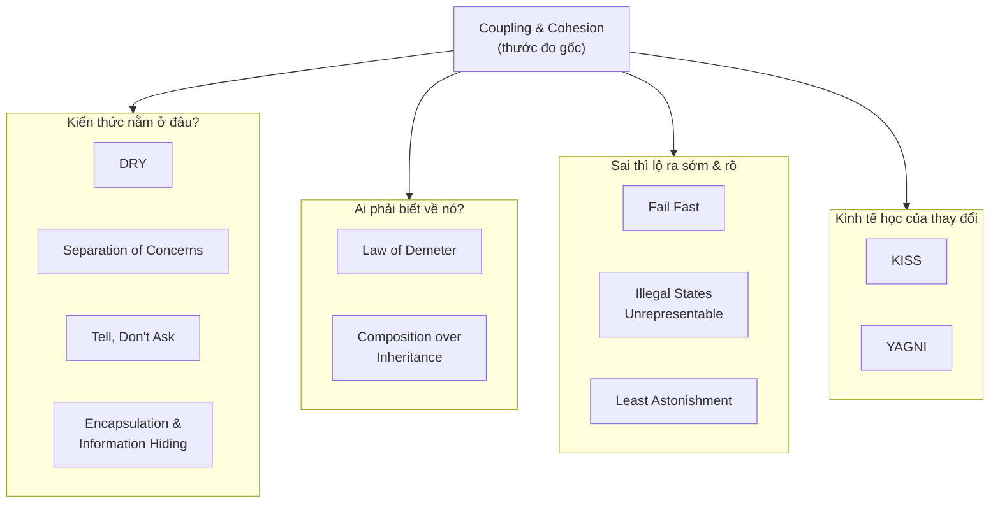
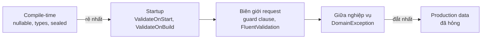
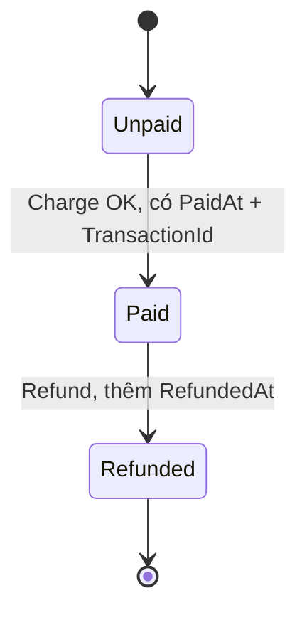
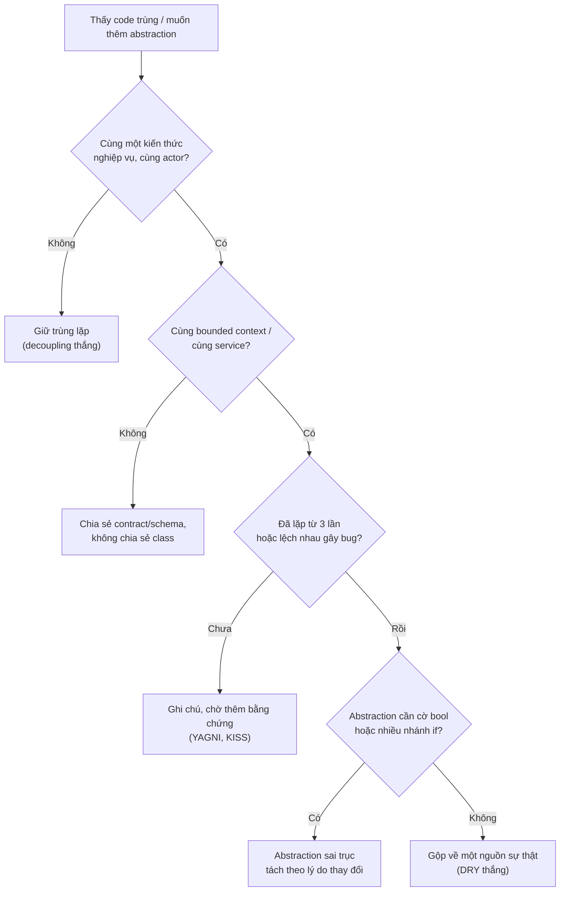

# Core Design Principles

> [!summary] TL;DR
> - 11 nguyên tắc "nền" bên cạnh [[SOLID-Principles]]: **DRY, KISS, YAGNI, SoC, Composition over Inheritance, Law of Demeter, Tell Don't Ask, Fail Fast, Least Astonishment, Make Illegal States Unrepresentable, Encapsulation & Information Hiding**.
> - Tất cả quy về hai câu hỏi của [[Coupling-and-Cohesion]]: *kiến thức này nằm ở đâu?* và *ai phải biết về nó?*
> - **DRY là về kiến thức, không phải về code giống nhau.** Hai đoạn code giống hệt nhưng phục vụ hai quy tắc nghiệp vụ khác nhau → **không** nên gộp.
> - Các nguyên tắc **mâu thuẫn** nhau (DRY ↔ decoupling, YAGNI ↔ OCP, KISS ↔ flexibility). Kỹ năng thật là biết **nguyên tắc nào thắng trong bối cảnh nào** — xem mục cuối.

---

## Tổng quan

| Nguyên tắc | Câu hỏi chẩn đoán | Nguồn gốc | Bảo vệ khỏi |
| --- | --- | --- | --- |
| **DRY** | Quy tắc này có >1 nơi định nghĩa? | Hunt & Thomas, *The Pragmatic Programmer* (1999) | Kiến thức mâu thuẫn, shotgun surgery |
| **KISS** | Có cách đơn giản hơn giải cùng bài toán? | Kỹ thuật hàng không (gắn với Kelly Johnson, Lockheed) | Độ phức tạp ngẫu nhiên |
| **YAGNI** | Hôm nay có ai cần cái này không? | Extreme Programming (Kent Beck, Ron Jeffries) | Over-engineering, chi phí mang vác |
| **SoC** | Đoạn code này đang lo mấy "mối quan tâm"? | Edsger Dijkstra (1974) | Trộn lẫn nghiệp vụ / hạ tầng / UI |
| **Composition over Inheritance** | Đây thực sự là *is-a* ổn định, hay chỉ muốn tái sử dụng code? | GoF, *Design Patterns* (1994) | Cây kế thừa giòn, fragile base class |
| **Law of Demeter** | Tôi có đang "nói chuyện với người lạ"? | Northeastern University, 1987 (Ian Holland, dự án Demeter) | Coupling vào cấu trúc bên trong |
| **Tell, Don't Ask** | Tôi đang hỏi dữ liệu rồi tự quyết thay object? | Hunt & Thomas (Pragmatic Programmers) | Logic nghiệp vụ rò ra ngoài aggregate |
| **Fail Fast** | Lỗi có bị phát hiện **muộn hơn** cần thiết? | Jim Shore, *IEEE Software* (2004) | Lỗi âm thầm, dữ liệu hỏng lan rộng |
| **Least Astonishment** | Người đọc tên/API có bị bất ngờ? | Nguyên tắc lâu đời trong thiết kế UI & ngôn ngữ | Bug do hiểu nhầm API |
| **Illegal States Unrepresentable** | Kiểu dữ liệu có cho phép trạng thái vô nghĩa? | Yaron Minsky (Jane Street, cộng đồng OCaml/ML) | Kiểm tra `if` rải rác, trạng thái mâu thuẫn |
| **Encapsulation & Information Hiding** | Quyết định thiết kế dễ đổi đã được giấu chưa? | David Parnas (1972) | Coupling vào chi tiết hiện thực |



---

## DRY

### Ý nghĩa
*Don't Repeat Yourself* — theo *The Pragmatic Programmer*: mỗi mẩu **kiến thức** phải có **một** biểu diễn duy nhất, rõ ràng, có thẩm quyền trong hệ thống. Dave Thomas từng nói rõ trong phỏng vấn (Artima, 2003) rằng hầu hết mọi người hiểu DRY là "đừng lặp code", và đó **không** phải ý định — kiến thức bao gồm cả schema DB, cấu hình, tài liệu, test plan.

- **Vi phạm DRY thật**: cùng một *quy tắc nghiệp vụ* được định nghĩa ở nhiều nơi → sửa một nơi, quên nơi khác → hệ thống tự mâu thuẫn.
- **Không phải vi phạm DRY**: hai đoạn code *trông giống nhau* nhưng biểu diễn hai kiến thức khác nhau, thay đổi vì lý do khác nhau ("trùng hợp ngẫu nhiên").

### ❌ Before / ✅ After

```csharp
// ❌ Quy tắc "đơn nào được hủy" sống ở 3 nơi — UI, API, background job
// OrdersController
if (order.Status is OrderStatus.Draft or OrderStatus.Submitted) { /* hiện nút Hủy */ }
// CancelOrderHandler
if (order.Status is not (OrderStatus.Draft or OrderStatus.Submitted)) throw new DomainException("...");
// ExpireUnpaidOrdersJob
if (order.Status == OrderStatus.Submitted) { /* hủy */ }   // ← quên Draft, ai đúng?
```

```csharp
// ✅ Một nguồn sự thật trong aggregate (trích phần liên quan của Order)
public sealed class Order : Entity
{
    // ... Items, AddItem, Submit như note Clean Architecture

    public bool CanBeCancelled => Status is OrderStatus.Draft or OrderStatus.Submitted;

    public void Cancel(string reason)
    {
        if (!CanBeCancelled) throw new DomainException($"Order is {Status}; cannot cancel.");
        Status = OrderStatus.Cancelled;
        // Raise(new OrderCancelledDomainEvent(Id, reason));
    }
}
```

> [!example] "Trùng code" nhưng KHÔNG nên gộp
> `CartItemValidator`: `Quantity <= 100` (giới hạn chống bot của Sales). `PickingTaskValidator`: `Quantity <= 100` (sức chứa một khay của Kho). Cùng số 100, cùng dòng code — nhưng **hai kiến thức, hai actor**. Gộp thành `MaxQuantity = 100` sẽ tạo coupling giả: Kho đổi khay → giỏ hàng đổi theo. (Liên hệ [[SOLID-Principles#Single Responsibility Principle (SRP)]].)

### Java analog
Giống hệt. Bẫy phổ biến ở Spring: "common-utils.jar" và `BaseService<T>` gom mọi thứ trông giống nhau → coupling toàn hệ thống.

### Khi bị áp dụng sai
- Gộp code giống nhau giữa **bounded context/service khác nhau** (`Customer` của Ordering và của Billing) → shared library → deployment coupling.
- Trừu tượng hóa quá sớm sau lần lặp đầu tiên → "wrong abstraction" với cờ `bool` ngày càng nhiều. Xem [[#Khi các nguyên tắc mâu thuẫn nhau]].

---

## KISS

### Ý nghĩa
*Keep It Simple, Stupid* — giải pháp đơn giản nhất **đáp ứng đủ yêu cầu** thường là tốt nhất. "Đơn giản" = ít phần chuyển động, ít khái niệm phải giữ trong đầu — **không** đồng nghĩa với "quen tay" hay "ít dòng nhất".

### ❌ Before / ✅ After

```csharp
// ❌ "Rule engine" tự chế cho... 3 mức phí ship
public interface IShippingRule { bool Matches(ShippingContext c); decimal Fee(ShippingContext c); int Priority { get; } }
public sealed class ShippingRuleEngine(IEnumerable<IShippingRule> rules, IShippingRuleCache cache, ILogger<ShippingRuleEngine> log)
{ /* 120 dòng: cache, sort theo Priority, fallback, logging... */ }

// ✅ Đủ dùng, đọc 5 giây là hiểu, compiler kiểm tra
public static decimal ShippingFee(decimal subtotal, bool isExpress) => (subtotal, isExpress) switch
{
    ( >= 500_000m, false) => 0m,        // miễn phí ship đơn từ 500k
    (_, true)             => 50_000m,
    _                     => 25_000m
};
```

### Java analog
Spring dễ dẫn tới phức tạp ngầm (profile, conditional bean, AOP lồng nhau). .NET minimal API + DI tường minh giúp KISS dễ hơn — nhưng MediatR + 5 behavior + AutoMapper cho CRUD 3 endpoint là vi phạm KISS kiểu .NET.

### Khi bị áp dụng sai
- Dùng KISS làm cớ bỏ qua độ phức tạp **bắt buộc** (transaction, concurrency, idempotency): code "đơn giản" nhưng sai.
- Nhầm "simple" (ít đan xen) với "easy" (quen thuộc): một `static` global quen tay nhưng không đơn giản.

---

## YAGNI

### Ý nghĩa
*You Aren't Gonna Need It* — đừng xây tính năng/khả năng mở rộng cho nhu cầu **giả định**. Martin Fowler (bliki *Yagni*) phân tích chi phí của tính năng "phòng xa": chi phí xây, chi phí trì hoãn thứ thật sự cần, chi phí **mang vác** (mọi thay đổi sau phải tính tới nó) và chi phí sửa nếu đoán sai.

> [!important] YAGNI KHÔNG áp dụng cho chất lượng code
> Fowler nhấn mạnh: YAGNI không phải lý do bỏ refactoring, test, hay thiết kế sạch — chính những thứ đó làm việc thêm tính năng *sau này* trở nên rẻ, nên mới dám "chưa làm" hôm nay.

### ❌ Before / ✅ After

```csharp
// ❌ Chỉ bán ở VN, chỉ một cổng thanh toán, nhưng…
public interface ICurrencyExchangeService { Task<Money> ConvertAsync(Money m, string to, CancellationToken ct); }
public interface IPaymentProviderPluginLoader { IEnumerable<IPaymentGateway> LoadFromDirectory(string path); }
public sealed class MultiTenantOrderNumberGenerator { /* hỗ trợ 50 tenant — hiện có 1 */ }

// ✅ Đúng thứ cần hôm nay, nhưng vẫn SẠCH để mở rộng sau
public interface IPaymentGateway   // port vẫn cần — vì đây là biên giới hạ tầng (DIP), không phải "phòng xa"
{
    Task<string> ChargeAsync(Money amount, string token, CancellationToken ct);
}
```

### Java analog
Hội chứng "enterprise Java": `AbstractFactoryFactory`, interface + `Impl` cho mọi class, module Maven cho thứ chưa tồn tại. YAGNI là phản ứng trực tiếp của XP với văn hóa đó.

### Khi bị áp dụng sai
- Bỏ qua thứ **chắc chắn** cần và tốn kém nếu thêm sau: logging/correlation id, idempotency cho payment, migration strategy, bảo mật.
- Lấy YAGNI biện minh code bẩn ("refactor làm gì, chưa cần").

---

## Separation of Concerns

### Ý nghĩa
Thuật ngữ do **Dijkstra** dùng (1974, *On the role of scientific thought*): tập trung suy nghĩ vào **một khía cạnh** tại một thời điểm. Trong phần mềm: mỗi phần code xử lý một *mối quan tâm* (nghiệp vụ, persistence, trình bày, bảo mật, logging…). SoC là gốc của layering, MVC, middleware, AOP.

### ❌ Before / ✅ After

```csharp
// ❌ Một endpoint trộn: HTTP, validation, nghiệp vụ, SQL, email, logging
app.MapPost("/orders/{id:guid}/submit", async (Guid id, SqlConnection conn, SmtpClient smtp) =>
{
    var status = await conn.ExecuteScalarAsync<int>("SELECT Status FROM Orders WHERE Id=@id", new { id });
    if (status != 0) return Results.BadRequest("Only draft");
    await conn.ExecuteAsync("UPDATE Orders SET Status=1 WHERE Id=@id", new { id });
    smtp.Send("shop@local", "sales@local", "New order", id.ToString());
    return Results.Ok();
});

// ✅ Mỗi tầng một mối quan tâm
app.MapPost("/orders/{id:guid}/submit", async (Guid id, ISender sender, CancellationToken ct) =>
{
    await sender.Send(new SubmitOrderCommand(id), ct);   // HTTP ↔ use case
    return Results.NoContent();
});
// SubmitOrderCommandHandler: điều phối · Order.Submit(): quy tắc nghiệp vụ
// ApplicationDbContext: persistence · OrderSubmitted handler: email · LoggingBehavior: logging
```

### Java analog
`@RestController` → `@Service` → `@Repository`; cross-cutting qua AOP. ASP.NET Core dùng middleware/filter/behavior thay cho AOP proxy.

### Khi bị áp dụng sai
- Tách theo **lớp kỹ thuật** quá mức: một tính năng nhỏ rải qua `Controllers/`, `Services/`, `Repositories/`, `Mappers/`, `Dtos/`, `Validators/` ở 4 project → cohesion theo tính năng rất thấp. Cân nhắc tách theo **feature** — [[Vertical-Slice-Architecture]].
- SoC có hai trục: *ngang* (layer) và *dọc* (feature/bounded context). Kiến trúc tốt dùng cả hai.

---

## Composition over Inheritance

### Ý nghĩa
GoF (1994): ưu tiên **ghép object** hơn **kế thừa class**. Kế thừa là coupling mạnh nhất giữa hai class (subclass biết cả phần `protected` và thứ tự gọi nội bộ của base — *fragile base class*). Composition cho phép thay hành vi lúc runtime và tổ hợp tự do.

### ❌ Before / ✅ After

```csharp
// ❌ Bùng nổ tổ hợp: mỗi chiều biến thể nhân đôi số class
public class Order
{
    public decimal Total { get; protected set; }
    public virtual decimal ShippingFee() => 25_000m;
    public virtual decimal Discount() => 0m;
}
public class ExpressOrder : Order { public override decimal ShippingFee() => 50_000m; }
public class VipOrder : Order { public override decimal Discount() => Total * 0.1m; }
public class VipExpressOrder : VipOrder { public override decimal ShippingFee() => 50_000m; } // copy từ ExpressOrder 😬
// + GiftWrappedVipExpressOrder ...

// ✅ Order "có" các chính sách — tổ hợp N chiều bằng N field, không phải 2^N class
public sealed record ShippingOption(string Code, decimal Fee);

public sealed class OrderPricing(IEnumerable<IDiscountRule> discountRules)
{
    public decimal Payable(decimal subtotal, DiscountContext ctx, ShippingOption shipping)
    {
        var discount = discountRules.Where(r => r.IsApplicable(ctx))
                                    .Select(r => r.Calculate(ctx))
                                    .DefaultIfEmpty(0m).Max();
        return subtotal - discount + shipping.Fee;
    }
}
```

> [!tip] Công cụ composition của C#
> `sealed` mặc định cho class không thiết kế để kế thừa · Strategy/Decorator qua DI · record với `with` để "biến thể" dữ liệu · default interface members (C# 8) cho hành vi chung nhỏ · extension methods cho API tiện ích.

### Java analog
*Effective Java* (Joshua Bloch): "Favor composition over inheritance" và "Design and document for inheritance or else prohibit it" (dùng `final`). Lưu ý: Java class mặc định **mở** để kế thừa và method mặc định **virtual**; C# method mặc định **non-virtual** — C# vốn đã an toàn hơn.

### Khi bị áp dụng sai
Kế thừa vẫn đúng khi quan hệ *is-a* ổn định và base được **thiết kế để kế thừa**: `Entity` base (Id + DomainEvents), `AbstractValidator<T>`, `ControllerBase`, `BackgroundService` (template method của framework). Cấm kế thừa tuyệt đối chỉ đẩy code lặp sang chỗ khác.

---

## Law of Demeter

### Ý nghĩa
Còn gọi *Principle of Least Knowledge*. Ra đời cuối 1987 tại Northeastern University (Ian Holland, dự án Demeter do Karl Lieberherr dẫn dắt); khẩu hiệu: **"chỉ nói chuyện với bạn thân"**. Method `M` của object `O` chỉ nên gọi method của:
1. chính `O`; 2. tham số của `M`; 3. object do `M` tạo ra; 4. field trực tiếp của `O`.

### ❌ Before / ✅ After

```csharp
// ❌ "Train wreck" — checkout biết cấu trúc Customer → Address → Country → TaxPolicy
// (model giả định có navigation đầy đủ)
var vatRate = cart.Customer.DefaultAddress.Country.TaxPolicy.VatRate;
// Đổi Address thành nhiều địa chỉ, hay thuế theo tỉnh → sửa mọi nơi có chuỗi này

// ✅ Hỏi người biết; hoặc tốt hơn — đưa thẳng dữ liệu cần vào
public sealed class TaxCalculator(ITaxRateProvider rates)
{
    public async Task<decimal> VatAsync(decimal subtotal, string countryCode, CancellationToken ct)
        => subtotal * await rates.GetVatRateAsync(countryCode, ct);   // data coupling, không struct coupling
}
```

### Java analog
Giống hệt; *Clean Code* gọi là "train wreck". Bẫy JPA: chuỗi `order.getCustomer().getAddress()` còn kích hoạt **lazy loading N+1**. EF Core cũng vậy nếu bật lazy-loading proxies.

### Khi bị áp dụng sai
- **Không phải đếm dấu chấm**: LINQ (`items.Where(...).Select(...)`), builder/fluent API (`services.AddOptions<T>().Bind(...).ValidateOnStart()`) trả về cùng "loại" object — không vi phạm.
- **DTO / data structure** (record chỉ chứa dữ liệu) được phép truy cập sâu — LoD áp dụng cho object có *hành vi*.
- Projection trong query EF (`o.Customer.Address.City` trong `Select`) là biểu thức dịch sang SQL, không phải coupling runtime giữa object.
- Thêm hàng loạt method "chuyển tiếp" (`cart.GetCustomerCountryTaxRate()`) chỉ để né LoD → class phình to. Đôi khi giải pháp đúng là **truyền dữ liệu cần thiết** vào.

---

## Tell, Don't Ask

### Ý nghĩa
Gắn với Andy Hunt & Dave Thomas: thay vì **hỏi** object dữ liệu rồi tự quyết định thay nó, hãy **bảo** object làm việc — dữ liệu và hành vi trên dữ liệu đó ở cùng một chỗ. Đây là công thức chống **anemic domain model**.

### ❌ Before / ✅ After

```csharp
// ❌ ASK: handler hỏi trạng thái coupon, tự áp quy tắc, tự sửa state (cần public setter!)
if (coupon.ExpiresAt > now && coupon.UsedCount < coupon.MaxUses && order.Total >= coupon.MinOrderTotal)
{
    discount = order.Total * coupon.Rate;
    coupon.UsedCount++;      // handler khác có thể quên kiểm tra MinOrderTotal…
}

// ✅ TELL: coupon tự bảo vệ quy tắc của nó
public sealed class Coupon
{
    public string Code { get; private set; } = default!;
    public decimal Rate { get; private set; }
    public decimal MinOrderTotal { get; private set; }
    public int MaxUses { get; private set; }
    public int UsedCount { get; private set; }
    public DateTimeOffset ExpiresAt { get; private set; }

    public decimal Redeem(decimal orderTotal, DateTimeOffset now)
    {
        if (now >= ExpiresAt) throw new DomainException("Coupon expired.");
        if (UsedCount >= MaxUses) throw new DomainException("Coupon fully redeemed.");
        if (orderTotal < MinOrderTotal) throw new DomainException("Order total below coupon minimum.");

        UsedCount++;
        return orderTotal * Rate;
    }
}
// Handler: var discount = coupon.Redeem(order.Total, clock.GetUtcNow());
```

### Java analog
Giống hệt; JPA entity với Lombok `@Data` (getter/setter mọi field) là "ask" mặc định — chính là anemic model mà DDD phản đối. Xem [[DDD-Tactical-Patterns]].

### Khi bị áp dụng sai
- Martin Fowler (bliki *TellDontAsk*) cho biết ông **không** dùng nguyên tắc này như luật, và cảnh báo "getter eradicators" — xóa sạch mọi getter. Query vẫn hợp lệ: **phía đọc** (Query handler, DTO, báo cáo) cứ "ask" thoải mái — xem [[CQRS-and-MediatR-Pattern]].
- Nhồi mọi hành vi vào entity (gửi email, gọi API) → entity phụ thuộc hạ tầng. "Tell" áp dụng cho **quy tắc nghiệp vụ trên dữ liệu của chính nó**.

---

## Fail Fast

### Ý nghĩa
Jim Shore (*IEEE Software*, 2004): khi có điều kiện sai, hệ thống nên **dừng ngay và báo rõ**, thay vì cố chạy tiếp với dữ liệu hỏng. Lỗi lộ ra càng gần nguyên nhân thì càng rẻ để sửa. Thứ tự ưu tiên: **compile-time** > **startup** > **đầu request** > giữa chừng > không bao giờ.

### ❌ Before / ✅ After

```csharp
// ❌ Fail slow: nuốt lỗi, giá trị mặc định, phát hiện cấu hình sai ở request đầu tiên lúc 2h sáng
public decimal GetVatRate(string country)
{
    try { return _rates[country]; }
    catch { return 0m; }     // bán hàng không thuế suốt 3 tháng, không ai biết
}
```

```csharp
// ✅ Compile-time: <Nullable>enable</Nullable> + TreatWarningsAsErrors cho nullable
// ✅ Đầu method: guard clause bằng throw helper của BCL (.NET 6–8+)
public static OrderItem CreateLine(string sku, int quantity, Money unitPrice)
{
    ArgumentException.ThrowIfNullOrWhiteSpace(sku);
    ArgumentOutOfRangeException.ThrowIfNegativeOrZero(quantity);
    ArgumentNullException.ThrowIfNull(unitPrice);
    // ...
}

// ✅ Startup: cấu hình sai → app KHÔNG khởi động được (thay vì lỗi ở request đầu tiên)
builder.Services.AddOptions<SmtpOptions>()
    .Bind(builder.Configuration.GetSection("Smtp"))
    .ValidateDataAnnotations()
    .ValidateOnStart();

// ✅ Startup: kiểm tra DI graph — thiếu đăng ký, scoped inject vào singleton
builder.Host.UseDefaultServiceProvider(o =>
{
    o.ValidateScopes = true;
    o.ValidateOnBuild = true;
});
```



### Java analog
`Objects.requireNonNull`, Guava `Preconditions.checkArgument`, `@Validated @ConfigurationProperties` (Spring Boot fail khi startup nếu config sai). Spring tạo singleton bean eager khi khởi động nên lỗi wiring lộ sớm; .NET container tạo **lazy** → cần `ValidateOnBuild`.

### Khi bị áp dụng sai
- **Input của người dùng**: đừng dừng ở lỗi đầu tiên — gom **tất cả** lỗi validation trả về một lần (UX). Fail fast áp dụng cho *lỗi lập trình / vi phạm hợp đồng*.
- Crash cả process vì lỗi của **một** request — fail fast ở mức request, không phải mức hệ thống.
- Hệ phân tán: fail fast = timeout ngắn + circuit breaker, **kết hợp** retry/fallback, không thay thế. Lỗi nghiệp vụ dự đoán được có thể dùng Result thay exception — [[Result-Pattern-vs-Exceptions]].

---

## Principle of Least Astonishment

### Ý nghĩa
API, tên gọi, hành vi phải khớp với **kỳ vọng hợp lý** của người dùng nó (ở đây là developer khác). Bất ngờ = bug đang chờ xảy ra.

### ❌ Before / ✅ After

```csharp
// ❌ Những điều gây bất ngờ
public Order GetOrder(Guid id) { /* nếu không có thì TẠO MỚI và lưu DB */ }
public decimal Total => _db.OrderItems.Where(i => i.OrderId == Id).Sum(i => i.Price); // property gọi DB
public bool Validate() { Status = OrderStatus.Submitted; return true; }   // tên "kiểm tra" nhưng đổi state
public Task<Order> LoadOrder(Guid id);                                    // async mà thiếu hậu tố Async

// ✅ Tên nói đúng hành vi, theo convention của .NET
public Task<Order> GetOrCreateDraftAsync(Guid customerId, CancellationToken ct);
public Task<Order?> FindOrderAsync(Guid id, CancellationToken ct);       // Find → có thể null
public Task<Order> GetOrderAsync(Guid id, CancellationToken ct);         // Get → không có thì ném NotFound
public bool TryParseSku(string input, [NotNullWhen(true)] out Sku? sku); // Try-pattern: không ném exception
public decimal Total => _items.Sum(i => i.LineTotal);                     // property: rẻ, không I/O, không side-effect
```

| Convention .NET giảm bất ngờ | Java tương ứng |
| --- | --- |
| `XxxAsync` trả `Task`/`ValueTask` | Không có convention chung (`CompletableFuture`) |
| `TryXxx(out T)` trả `bool` | `Optional<T>` |
| Property = rẻ, không side-effect; tốn kém → method | Getter `getX()` thường cũng vậy |
| `record` so sánh theo giá trị, `class` theo tham chiếu | `record` (Java 16+) tương tự |
| CQS: method trả dữ liệu không đổi state | Như nhau |

### Khi bị áp dụng sai
"Bất ngờ" phụ thuộc **khán giả**: viết C# theo convention Java (`getTotal()`, `IOrderServiceImpl`, không `Async`) chính là gây bất ngờ cho dev .NET. Theo convention của **nền tảng đang dùng**.

---

## Make Illegal States Unrepresentable

### Ý nghĩa
Câu nói phổ biến từ **Yaron Minsky** (Jane Street, cộng đồng OCaml): thiết kế kiểu dữ liệu sao cho trạng thái vô nghĩa **không thể biểu diễn được** — thay vì cho phép rồi viết `if` kiểm tra khắp nơi. Đây là Fail Fast đẩy về tận **compile-time**.

### ❌ Before / ✅ After

```csharp
// ❌ 4 field nullable → 16 tổ hợp, chỉ ~3 tổ hợp hợp lệ
public class OrderPayment
{
    public bool IsPaid { get; set; }
    public DateTimeOffset? PaidAt { get; set; }        // IsPaid = true mà PaidAt = null?
    public string? TransactionId { get; set; }
    public DateTimeOffset? RefundedAt { get; set; }    // Refunded mà chưa từng Paid?
}
```

```csharp
// ✅ Mỗi trạng thái mang ĐÚNG dữ liệu của nó (mô phỏng discriminated union bằng record)
public abstract record PaymentState
{
    private PaymentState() { }   // chỉ các record lồng bên dưới kế thừa được (kiểu private ctor)

    public sealed record Unpaid : PaymentState;
    public sealed record Paid(DateTimeOffset PaidAt, string TransactionId) : PaymentState;
    public sealed record Refunded(DateTimeOffset PaidAt, string TransactionId, DateTimeOffset RefundedAt) : PaymentState;
}

public static string Describe(PaymentState state) => state switch
{
    PaymentState.Unpaid     => "Chưa thanh toán",
    PaymentState.Paid p     => $"Đã thanh toán ({p.TransactionId})",
    PaymentState.Refunded r => $"Đã hoàn tiền lúc {r.RefundedAt:g}",
    _ => throw new UnreachableException()   // C# chưa kiểm tra exhaustive cho class hierarchy
};
```

```csharp
// ✅ Value object: không tồn tại Quantity <= 0, không tồn tại Money âm (xem Money trong Clean Architecture)
public readonly record struct Quantity
{
    public int Value { get; }
    public Quantity(int value)
    {
        ArgumentOutOfRangeException.ThrowIfNegativeOrZero(value);
        Value = value;
    }
}
// ⚠️ Bẫy struct: default(Quantity) vẫn tạo ra Value = 0 mà không qua constructor!
// Cần bất biến tuyệt đối → dùng sealed record (class) thay vì record struct.
```



### Java analog
**Java đi trước ở điểm này**: `sealed interface PaymentState permits Unpaid, Paid, Refunded` + `record` (Java 17) + pattern matching `switch` (Java 21) → compiler **kiểm tra exhaustive**, không cần nhánh `default`. C# (tính đến .NET 10) chưa có discriminated union chính thức — đang có đề xuất "unions" cho các phiên bản sau, kiểm tra lại khi nâng cấp.

```java
sealed interface PaymentState permits Unpaid, Paid, Refunded {}
record Unpaid() implements PaymentState {}
record Paid(Instant paidAt, String txId) implements PaymentState {}
record Refunded(Instant paidAt, String txId, Instant refundedAt) implements PaymentState {}

String describe(PaymentState s) {
    return switch (s) {   // compiler báo lỗi nếu thiếu case — không cần default
        case Unpaid u   -> "Chưa thanh toán";
        case Paid p     -> "Đã thanh toán " + p.txId();
        case Refunded r -> "Đã hoàn tiền";
    };
}
```

### Khi bị áp dụng sai
- Mã hóa **mọi** quy tắc vào kiểu → bùng nổ type, code khó đọc. Dùng cho **trạng thái cốt lõi** của aggregate.
- Chi phí persistence: EF Core map hierarchy (TPH + discriminator) hoặc owned types — cần cân nhắc. Xem [[EF-Core-vs-JPA-Hibernate]].

---

## Encapsulation & Information Hiding

### Ý nghĩa
Hai khái niệm liên quan nhưng **khác nhau**:
- **Encapsulation**: gói dữ liệu + hành vi, kiểm soát truy cập để object **tự bảo vệ invariant**.
- **Information Hiding** (**David Parnas**, 1972, *On the Criteria To Be Used in Decomposing Systems into Modules*): chia module theo **quyết định thiết kế dễ thay đổi** và giấu quyết định đó sau interface. Parnas cho thấy chia theo "các bước xử lý" (flowchart) tệ hơn chia theo "bí mật mà mỗi module giữ".

### ❌ Before / ✅ After

```csharp
// ❌ Getter/setter cho mọi field ≠ encapsulation
public class Order
{
    public List<OrderItem> Items { get; set; } = [];   // ai cũng Add/Clear/thay cả list được
    public OrderStatus Status { get; set; }             // nhảy thẳng Draft → Paid
}
order.Items.Add(new OrderItem { Quantity = -5 });       // invariant? không tồn tại

// ✅ Encapsulation — như Order trong note Clean-Architecture-in-DotNet
public sealed class Order : Entity
{
    private readonly List<OrderItem> _items = [];
    public IReadOnlyCollection<OrderItem> Items => _items.AsReadOnly(); // AsReadOnly: cast ngược về List cũng không sửa được
    public OrderStatus Status { get; private set; }
    public void AddItem(string sku, int quantity, Money unitPrice) { /* EnsureDraft + validate */ }
}
```

```csharp
// ✅ Information hiding ở mức module — "bí mật": ta dùng SQL Server + EF Core + Stripe
// Bên ngoài Infrastructure chỉ thấy interface; implementation là internal sealed
internal sealed class StripeGateway(HttpClient http) : IPaymentGateway { /* ... */ }

public static class DependencyInjection
{
    public static IServiceCollection AddInfrastructure(this IServiceCollection services)
    {
        services.AddHttpClient<IPaymentGateway, StripeGateway>();   // typed client, ẩn hoàn toàn Stripe
        return services;
    }
}
```

### Java analog
`private` field + method nghiệp vụ, `Collections.unmodifiableList(items)`, `package-private` cho implementation. Khác biệt: `internal` của C# là phạm vi **assembly**, `package-private` là phạm vi **package** — chi tiết ở [[Coupling-and-Cohesion]].

### Khi bị áp dụng sai
- DTO/command/query là **data structure** → public property là đúng; đừng "encapsulate" DTO.
- Trả `_items` dưới dạng `IReadOnlyCollection<T>` mà **không** `AsReadOnly()` → caller cast ngược `(List<OrderItem>)order.Items` vẫn sửa được.
- Giấu quá mức đến mức test phải dùng reflection → dấu hiệu thiết kế cần một seam (port) thay vì `InternalsVisibleTo` khắp nơi.

---

## Khi các nguyên tắc mâu thuẫn nhau

### 1. DRY ↔ Decoupling

> [!info] Sandi Metz
> "duplication is far cheaper than the wrong abstraction" — RailsConf 2014, bài blog *The Wrong Abstraction* (2016).

Kịch bản "wrong abstraction" Metz mô tả: ai đó gộp code trùng thành abstraction → yêu cầu mới *gần giống* → thêm tham số + `if` → lặp lại → abstraction thành mớ cờ điều kiện mà không ai dám sửa. Lời khuyên của bà: **inline abstraction trở lại** từng nơi gọi, xóa phần không dùng, rồi mới tìm abstraction đúng.

```csharp
// Dấu hiệu wrong abstraction sau 6 tháng
public decimal CalculatePrice(Order order, bool isInvoice, bool skipDiscount, bool roundPerLine, string? legacyMode = null)
```

| Tình huống | Ưu tiên |
| --- | --- |
| Cùng **quy tắc nghiệp vụ**, cùng actor, cùng bounded context | **DRY** — gom về một nguồn sự thật |
| Code giống nhau nhưng **khác lý do thay đổi** | **Chấp nhận trùng** |
| Giữa **service / bounded context** khác nhau | **Chấp nhận trùng** (mỗi bên model riêng); chỉ chia sẻ *contract* |
| Lần lặp thứ 2 | Ghi chú, chưa gộp — "Rule of Three" (Fowler ghi nhận từ Don Roberts trong *Refactoring*) |
| Abstraction hiện tại đầy cờ `bool` | Inline lại, rồi tách lại cho đúng |

### 2. KISS ↔ Flexibility (OCP)
- KISS: `switch` 3 nhánh. OCP: Strategy + DI.
- Quy tắc: **chọn KISS cho đến khi thay đổi thực tế chứng minh cần linh hoạt** — biến thể thứ 3 xuất hiện, hoặc cùng `switch` lặp ở ≥ 2 nơi, hoặc biến thể do team/plugin bên ngoài thêm vào.

### 3. YAGNI ↔ OCP
- OCP chỉ bảo vệ trước **biến thể đã dự đoán**; YAGNI cấm đoán bừa. Hòa giải: viết code đơn giản nhưng **sạch** (dễ refactor) → khi biến thể đầu tiên thực sự đến, chấp nhận "trúng đạn" một lần rồi mới dựng abstraction bảo vệ khỏi *loại* thay đổi đó.
- Ngoại lệ: **biên giới hạ tầng** (DB, payment, email) — interface/port gần như luôn đáng giá ngay từ đầu vì testability và vì đó là nơi biến động cao (DIP), không phải "phòng xa".

### 4. Các cặp căng thẳng khác

| Cặp | Hòa giải |
| --- | --- |
| Tell Don't Ask ↔ CQRS read side | Ghi: tell (aggregate). Đọc: ask thoải mái (projection DTO) |
| Law of Demeter ↔ class phình method chuyển tiếp | Truyền dữ liệu cần vào thay vì thêm wrapper |
| Encapsulation ↔ ORM / serializer | Private setter + private ctor cho EF; DTO riêng cho JSON |
| Fail Fast ↔ Robustness (tolerant reader) | Nội bộ: fail fast. Biên giới với hệ thống ngoài: chấp nhận lỏng (bỏ qua field lạ), validate chặt phần mình dùng |
| SoC theo layer ↔ cohesion theo feature | Layer cho Domain/Infrastructure, slice cho Application |

### 5. Decision guide



> [!tip] Thứ tự ưu tiên thực dụng khi bế tắc
> 1. **Đúng** (invariant, fail fast, illegal states) > 2. **Dễ hiểu** (KISS, least astonishment) > 3. **Dễ thay đổi** (coupling/cohesion, DRY, SOLID) > 4. **Tái sử dụng**. Tái sử dụng là *hệ quả* của thiết kế tốt, hiếm khi nên là mục tiêu.

---

## Self-check

> [!question]- Hai validator cùng `Quantity <= 100` ở Cart và Warehouse. Có vi phạm DRY không?
> Không, nếu hai con số là **hai quy tắc khác nhau** (chống bot vs sức chứa khay) thuộc hai actor. DRY là về *kiến thức*; gộp chúng tạo coupling giả. Nếu cả hai thực sự là *một* quy tắc (vd. giới hạn pháp lý) → gom về một hằng số/policy duy nhất.

> [!question]- `services.AddOptions<SmtpOptions>().Bind(...).ValidateOnStart()` có vi phạm Law of Demeter không?
> Không. Đây là fluent API — mỗi lời gọi trả về cùng builder (`OptionsBuilder<T>`), không đào vào cấu trúc nội bộ của object khác. LoD là về việc không phụ thuộc vào *cấu trúc* của "người lạ", không phải đếm dấu chấm.

> [!question]- Vì sao `readonly record struct Quantity` với constructor validate vẫn chưa "make illegal states unrepresentable" hoàn toàn?
> Vì struct luôn có `default(Quantity)` (Value = 0) — tạo được mà không qua constructor (mảng mới, field chưa gán, `default`). Muốn bất biến tuyệt đối → dùng `sealed record` (reference type) hoặc chấp nhận và kiểm tra `default` ở biên.

> [!question]- YAGNI và OCP mâu thuẫn thế nào, bạn hòa giải ra sao?
> OCP muốn dựng điểm mở rộng trước, YAGNI cấm xây cho nhu cầu giả định. Hòa giải: chỉ dựng abstraction cho biến thể **đã thấy** (hoặc biên giới hạ tầng hiển nhiên), giữ code sạch để refactor rẻ, chấp nhận thay đổi đầu tiên rồi mới bảo vệ khỏi loại thay đổi đó.

> [!question]- (Phỏng vấn) Kể một lần DRY làm hại codebase. Bạn sửa thế nào?
> Mẫu trả lời: một `PriceCalculator` dùng chung cho giỏ hàng, hóa đơn và báo cáo; mỗi yêu cầu mới thêm một cờ `bool` (`isInvoice`, `roundPerLine`…) → sửa cho Finance làm lệch báo cáo Sales. Sửa theo Sandi Metz: inline lại vào từng nơi gọi, xóa nhánh không dùng, nhận ra ba "kiến thức" khác nhau theo ba actor → ba class riêng; chỉ giữ chung phần thật sự là một quy tắc (`Order.Total`). Bài học: gộp theo *lý do thay đổi*, không theo *hình dạng code*.

> [!question]- Fail Fast có nghĩa là dừng ở lỗi validation đầu tiên của form đặt hàng?
> Không. Với input người dùng, gom **tất cả** lỗi trả một lần (FluentValidation → 400 ProblemDetails). Fail fast áp dụng cho lỗi lập trình/hợp đồng/cấu hình: guard clause, `ValidateOnStart`, `ValidateOnBuild`, nullable reference types.

---

## Liên kết & Tham khảo
- **Nền tảng:** [[Coupling-and-Cohesion]] · [[SOLID-Principles]] · [[Design-Thinking-Process]]
- **Áp dụng:** [[Code-Smells-and-Refactoring]] · [[DDD-Tactical-Patterns]] · [[Result-Pattern-vs-Exceptions]] · [[Behavioral-Patterns#Strategy]] · [[Structural-Patterns#Decorator]]
- **Kiến trúc:** [[Clean-Architecture-in-DotNet]] · [[Vertical-Slice-Architecture]] · [[CQRS-and-MediatR-Pattern]]
- **Đọc tiếp:** [[EF-Core-vs-JPA-Hibernate]] · [[Testing-in-DotNet]] · [[Java-to-DotNet-Mental-Map]]
- **MOC:** [[Architecture-Design-MOC]]
- **Nguồn:**
  - Andrew Hunt & David Thomas — *The Pragmatic Programmer* (1999; 20th Anniversary Edition 2019); phỏng vấn Dave Thomas trên Artima (2003)
  - Sandi Metz — *The Wrong Abstraction* (2016)
  - Martin Fowler — bliki *Yagni*, *TellDontAsk*; *Refactoring* (Rule of Three)
  - Gamma, Helm, Johnson, Vlissides — *Design Patterns* (1994); Joshua Bloch — *Effective Java*
  - Northeastern University — *Law of Demeter: General Formulation*
  - Jim Shore — *Fail Fast*, IEEE Software (2004)
  - David Parnas — *On the Criteria To Be Used in Decomposing Systems into Modules* (1972)
  - Microsoft Learn — *Options pattern* (ValidateOnStart), *Architectural principles*
