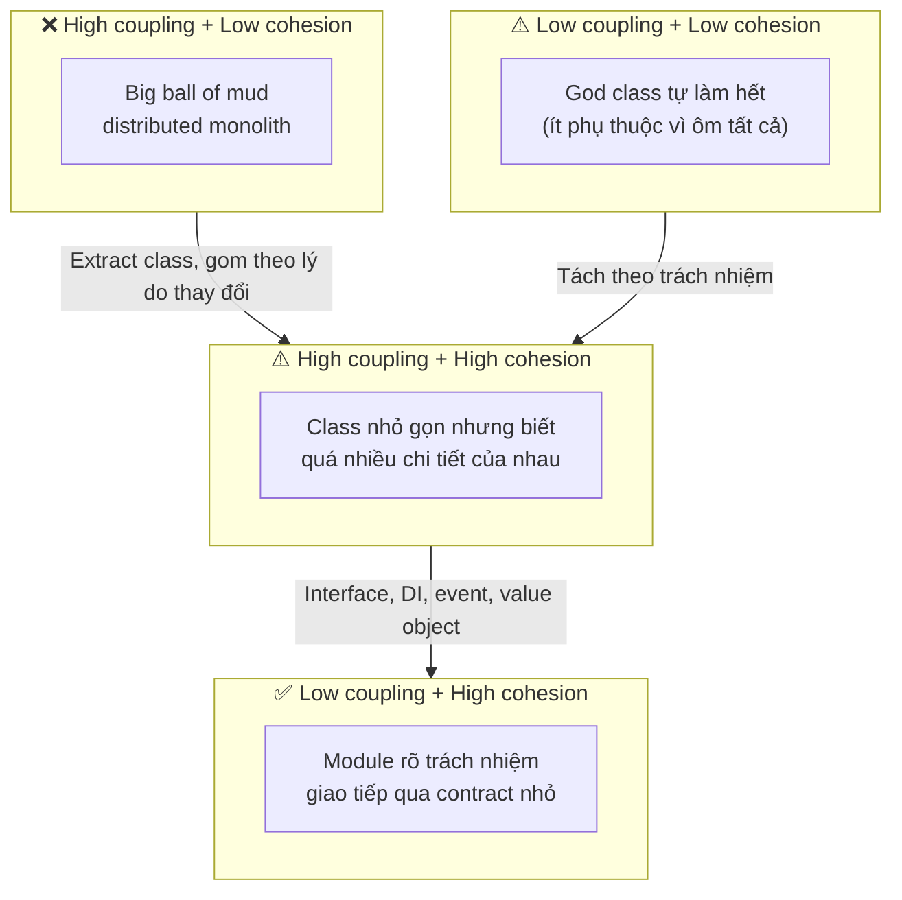
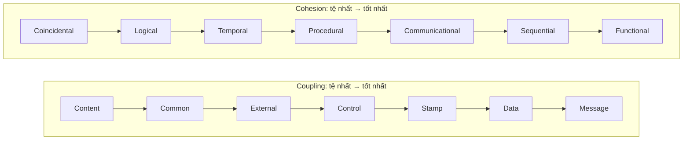
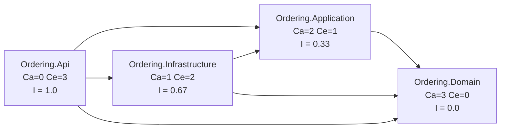
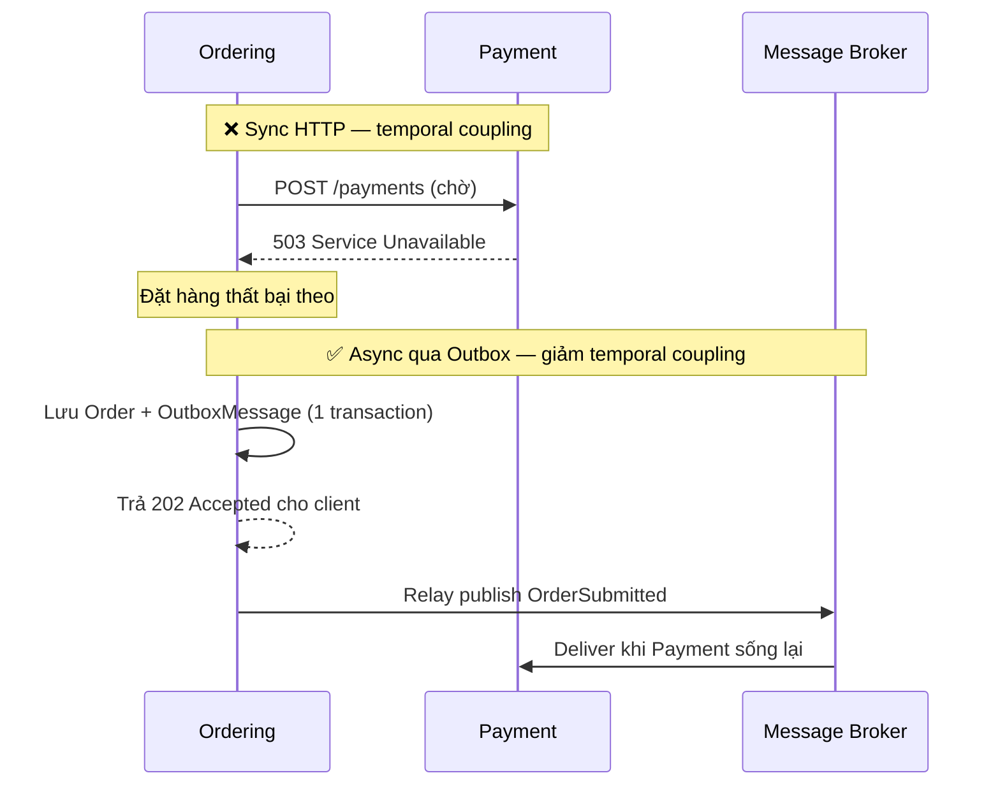

# Coupling and Cohesion

> [!summary] TL;DR
> - **Coupling** = mức độ một module *phải biết* về module khác (biết càng nhiều → đổi một bên càng dễ kéo theo bên kia). **Cohesion** = mức độ các phần tử *bên trong* một module cùng phục vụ một mục đích.
> - Mục tiêu kinh điển (Larry Constantine, *Structured Design*): **low coupling, high cohesion**. Mọi nguyên tắc (SOLID, DRY, LoD…) và mọi pattern (Strategy, Mediator, Outbox…) thực chất là *công cụ dịch chuyển coupling/cohesion*.
> - **Connascence** cho bộ từ vựng chính xác hơn: không hỏi "có coupling không" mà hỏi "coupling **loại gì** (strength), **xa đến đâu** (locality), **bao nhiêu chỗ** (degree)".
> - ⚠️ Coupling **không thể và không nên bằng 0** — hệ thống không có coupling là hệ thống không làm gì. Điều cần là coupling *đúng chỗ*: mạnh ở bên trong, yếu ở biên giới.

---

## 1. Problem — Vấn đề cần giải quyết

### 1.1 Bối cảnh

Bạn đã từng gặp: sửa một dòng trong `OrderService` → hỏng báo cáo doanh thu, hỏng email xác nhận, và phải deploy lại 3 microservice. Đó không phải xui — đó là **coupling không được quản lý**. Ngược lại, mở một class `Helpers` chứa `FormatCurrency`, `SendSms`, `ParseCsv` → không biết thay đổi gì sẽ ảnh hưởng gì: đó là **cohesion thấp**.

### 1.2 Pain points

| Triệu chứng | Gốc rễ coupling/cohesion |
| --- | --- |
| **Shotgun surgery** — 1 thay đổi nghiệp vụ, sửa 12 file | Một "mẩu kiến thức" bị rải ở nhiều nơi (cohesion thấp + coupling ngầm) |
| **Divergent change** — 1 class sửa vì 5 lý do khác nhau | Cohesion thấp (vi phạm SRP) |
| Unit test phải mock 10 dependency | Efferent coupling quá cao |
| Đổi tên cột DB → hỏng 4 service | Coupling qua shared database (common coupling ở mức service) |
| Service A down → Service B down theo | Temporal (runtime) coupling do gọi đồng bộ |
| Phải deploy cùng lúc 5 service | **Distributed monolith** — deployment coupling |

### 1.3 Ý tưởng cốt lõi

1. **Coupling đo "độ lan truyền thay đổi"** giữa các phần tử. **Cohesion đo "độ tập trung"** của một phần tử.
2. Hai đại lượng liên quan chặt: gom những thứ thay đổi cùng nhau vào một chỗ (tăng cohesion) thì tự nhiên giảm coupling giữa các chỗ.
3. Không tối ưu một con số tuyệt đối mà **cân bằng**: coupling mạnh chấp nhận được khi *gần nhau* (cùng class, cùng aggregate) và *ít thay đổi*; ở biên giới xa (module, service) phải yếu và tường minh.

---

## 2. Mental Model & Diagram

> [!info] Analogy — Phòng ban trong công ty
> - **Cohesion cao**: phòng Kế toán chỉ làm kế toán; mọi câu hỏi về thuế đều đến đúng một chỗ.
> - **Coupling thấp**: phòng Kho không cần biết Kế toán dùng phần mềm gì — chỉ cần gửi đúng mẫu phiếu xuất kho (contract).
> - **Coupling xấu**: nhân viên Kho tự mở sổ cái của Kế toán sửa số liệu (= *content coupling*).
>
> Bên Java/Spring bạn đã quen: `package-private` + interface công khai + `@Service` mỏng → chính là đang quản lý coupling.

### 2.1 Bản đồ 2 chiều



### 2.2 Thang coupling & cohesion cổ điển (Structured Design)



> [!info] Nguồn gốc
> Coupling & cohesion do **Larry Constantine** đề xuất cuối thập niên 1960, công bố trong Stevens, Myers & Constantine (1974, *IBM Systems Journal*) và sách *Structured Design* (Yourdon & Constantine, 1979). Thang đo được thiết kế cho lập trình thủ tục nhưng vẫn áp dụng tốt cho OOP và cả kiến trúc service.

---

## 3. Implementation & Code — Từng loại qua ví dụ Ordering

### 3.1 Các loại coupling cổ điển

| Loại (tệ → tốt) | Định nghĩa ngắn | Ví dụ trong Ordering | Cách giảm |
| --- | --- | --- | --- |
| **Content** | Module A chọc vào *nội bộ* của B | Dùng reflection set `_items` của `Order` | Đi qua public API (`order.AddItem`) |
| **Common** | Nhiều module đọc/ghi chung *global state* | `static class PricingContext { public static decimal DiscountRate; }` | Truyền tham số / inject `IOptions<T>` |
| **External** | Cùng phụ thuộc một format/protocol áp đặt từ bên ngoài | 3 class cùng tự parse file fixed-width của hãng vận chuyển | Gom vào 1 adapter (Anti-Corruption Layer) |
| **Control** | A truyền *cờ điều khiển* để quyết định B làm gì | `CalculateShipping(order, bool isExpress, bool isInternational)` | Strategy / tách method / polymorphism |
| **Stamp** | Truyền cả cấu trúc lớn nhưng B chỉ dùng vài field | `SendReceipt(Customer customer)` chỉ cần `Email` | Truyền đúng thứ cần, hoặc DTO hẹp |
| **Data** | Chỉ truyền dữ liệu cơ bản cần thiết | `CalculateTax(Money subtotal, string countryCode)` | ✅ mục tiêu |
| **Message** | Giao tiếp qua message/event, không gọi trực tiếp | `OrderSubmittedDomainEvent` | ✅ yếu nhất — nhưng xem bẫy ở 3.3 |

```csharp
// ❌ CONTENT coupling — "mổ bụng" aggregate, bỏ qua mọi invariant
var field = typeof(Order).GetField("_items", BindingFlags.NonPublic | BindingFlags.Instance)!;
var items = (List<OrderItem>)field.GetValue(order)!;
items.Clear();   // Order.Submit() sau đó sẽ hiểu sai, domain event không được raise

// ❌ CONTROL coupling — caller phải biết logic bên trong để chọn cờ
public decimal CalculateShipping(Order order, bool isExpress, bool isInternational)
{
    if (isExpress && isInternational) return 50m;   // 2 bool = 4 tổ hợp, có tổ hợp vô nghĩa
    if (isExpress) return 20m;
    return isInternational ? 30m : 5m;
}

// ✅ Dữ liệu thay cho cờ: caller nói "cái gì", callee tự quyết "làm thế nào"
public sealed record ShippingOption(string Code, decimal Fee);
public decimal CalculateShipping(Order order, ShippingOption option) => option.Fee;
```

```csharp
// ❌ STAMP coupling — hàm gửi biên nhận phụ thuộc cả aggregate Customer
public Task SendReceiptAsync(Customer customer, Order order, CancellationToken ct) =>
    email.SendAsync(customer.Email, "Receipt", $"Total: {order.Total}", ct);
// Customer thêm field, đổi cấu trúc Address… → hàm này phải recompile, test phải dựng cả Customer

// ✅ DATA coupling — chỉ nhận đúng thứ cần
public Task SendReceiptAsync(string toEmail, Guid orderId, decimal total, CancellationToken ct) =>
    email.SendAsync(toEmail, "Receipt", $"Order {orderId}: {total:N2}", ct);
```

> [!tip] Stamp coupling không phải lúc nào cũng xấu
> Truyền một **record nhỏ, có ý nghĩa** (`ShippingAddress`) tốt hơn truyền 6 `string` rời rạc (sẽ sinh *connascence of position*, xem 3.4). Stamp coupling chỉ xấu khi cấu trúc truyền vào **lớn và biến động** hơn nhiều so với nhu cầu.

### 3.2 Các loại coupling "hiện đại" (mức hệ thống)

| Loại | Ý nghĩa | Ví dụ | Giảm bằng |
| --- | --- | --- | --- |
| **Temporal (thứ tự)** | Phải gọi các bước theo đúng thứ tự | Phải `Init()` trước `Process()` | Constructor/factory bắt buộc trạng thái hợp lệ |
| **Temporal (runtime availability)** | A chỉ chạy được khi B *đang sống* cùng lúc | Ordering gọi HTTP đồng bộ sang Payment; Payment down → không đặt được hàng | Messaging bất đồng bộ, Outbox, cache, circuit breaker |
| **Deployment** | Phải release/deploy cùng nhau | Shared NuGet `Company.Contracts` đổi version → 5 service phải build lại | Versioned contract, tolerant reader, consumer-driven contract test |
| **Platform / Technology** | Bị trói vào cùng runtime, serializer, vendor | Hai service trao đổi bằng `BinaryFormatter` (đã bị loại bỏ trong .NET 9) | Format trung lập: JSON, Protobuf, Avro |
| **Semantic / Model** | Chia sẻ *ý nghĩa* hoặc *domain model* | Cả Shipping và Billing hiểu `status = 3` là "Paid"; dùng chung class `Order` qua thư viện | Published Language, contract riêng cho từng context (DDD) |
| **Data store** | Cùng đọc/ghi một schema DB | Reporting service query thẳng bảng `Orders` của Ordering | Database-per-service, read model, CDC/event |

> [!important] Khung nhìn mới: Balanced Coupling (Vlad Khononov, 2024)
> Cuốn *Balancing Coupling in Software Design* đề xuất đánh giá coupling theo **3 chiều**:
> 1. **Integration strength** — chia sẻ bao nhiêu *kiến thức*: intrusive (chọc nội bộ) > functional (cùng nghiệp vụ) > model (chung model) > contract (chỉ chung hợp đồng).
> 2. **Distance** — hai bên cách nhau bao xa (method → class → module → service → hệ thống khác team).
> 3. **Volatility** — phần đó có hay thay đổi không.
>
> Quy tắc gọn: *strength cao chỉ chấp nhận khi distance thấp*; *strength cao + distance cao* chỉ chịu được nếu volatility thấp. Đây cũng chính là tinh thần "locality" của Connascence.

### 3.3 Các loại cohesion

| Loại (tệ → tốt) | Gom vì… | Ví dụ C# | Đánh giá |
| --- | --- | --- | --- |
| **Coincidental** | Ngẫu nhiên, "chẳng biết để đâu" | `static class Utils { FormatCurrency(); SendSms(); ParseCsv(); }` | ❌ Tách theo chủ đề |
| **Logical** | Cùng "loại" việc, chọn bằng switch/cờ | `OrderOperations.Execute(OperationType type)` với `switch` 10 nhánh | ❌ Thường đi kèm control coupling |
| **Temporal** | Cùng xảy ra một thời điểm | `StartupTasks`: warm cache + seed DB + đăng ký cron | ⚠️ Chấp nhận ở composition root |
| **Procedural** | Các bước theo thứ tự nhưng dữ liệu khác nhau | `Checkout()`: validate giỏ → ghi audit log → gửi SMS marketing | ⚠️ |
| **Communicational** | Cùng thao tác trên **một dữ liệu** | `InvoiceBuilder` tính thuế, chiết khấu, in hóa đơn từ cùng `Order` | 🙂 Khá tốt |
| **Sequential** | Output bước trước là input bước sau | `ParseCsv → MapToOrderLines → Validate` | 🙂 Tốt (pipeline) |
| **Functional** | Tất cả phục vụ **một nhiệm vụ** duy nhất | `Money`, `ShippingFeeCalculator`, `SubmitOrderCommandHandler` | ✅ Mục tiêu |

```csharp
// ❌ LOGICAL cohesion — 1 method, 4 nghiệp vụ, chọn bằng enum
public sealed class OrderOperations(IApplicationDbContext db)
{
    public async Task ExecuteAsync(Guid orderId, OperationType op, CancellationToken ct)
    {
        var order = await db.Orders.Include(o => o.Items).FirstOrDefaultAsync(o => o.Id == orderId, ct)
                    ?? throw new NotFoundException(nameof(Order), orderId);
        switch (op)
        {
            case OperationType.Submit: order.Submit(); break;
            case OperationType.Cancel: /* ... */ break;
            case OperationType.Refund: /* gọi payment gateway ... */ break;
            case OperationType.Export: /* ghi file CSV ... */ break;   // chẳng liên quan gì tới 3 cái trên
        }
        await db.SaveChangesAsync(ct);
    }
}

// ✅ FUNCTIONAL cohesion — mỗi use case một handler; mọi dòng code đều phục vụ đúng một việc
public sealed record SubmitOrderCommand(Guid OrderId) : IRequest;
public sealed class SubmitOrderCommandHandler(IApplicationDbContext db) : IRequestHandler<SubmitOrderCommand>
{
    public async Task Handle(SubmitOrderCommand cmd, CancellationToken ct)
    {
        // Include Items: Submit() cần biết đơn có rỗng không — FindAsync sẽ không nạp collection
        var order = await db.Orders.Include(o => o.Items).FirstOrDefaultAsync(o => o.Id == cmd.OrderId, ct)
                    ?? throw new NotFoundException(nameof(Order), cmd.OrderId);
        order.Submit();   // invariant nằm trong aggregate, handler chỉ điều phối
    }
}
```

> [!tip] Đo cohesion: LCOM
> **LCOM** (Lack of Cohesion of Methods — Chidamber & Kemerer, 1994; NDepend có biến thể LCOM HS) đo xem các method có dùng chung field không. Class mà nửa method dùng field A–B, nửa kia dùng field C–D → LCOM cao → dấu hiệu nên tách làm hai.

### 3.4 Connascence — bộ từ vựng chính xác hơn

**Connascence** ("sinh ra cùng nhau") do **Meilir Page-Jones** giới thiệu năm 1992 và phát triển trong sách *What Every Programmer Should Know About Object-Oriented Design* (1996), sau đó **Jim Weirich** phổ biến lại qua các talk khoảng 2009. Định nghĩa: hai phần tử *connascent* nếu thay đổi một phần tử **buộc** phải thay đổi phần tử kia để hệ thống còn đúng.

| Nhóm | Loại (yếu → mạnh) | Ý nghĩa | Ví dụ Ordering | Refactor về loại yếu hơn |
| --- | --- | --- | --- | --- |
| **Static** (nhìn source là thấy) | **Name** | Phải thống nhất tên | Gọi `order.Submit()` | Đã yếu nhất; IDE rename lo |
| | **Type** | Phải thống nhất kiểu | Tham số `Money` | — |
| | **Meaning** (Convention) | Thống nhất *ý nghĩa của giá trị* | `if (status == 2)` nghĩa là "Paid" | `enum OrderStatus` → CoN |
| | **Position** | Thống nhất *thứ tự* | `AddItem("SKU-1", 2, 10m, "USD")` — đảo `2` và `10m` vẫn compile | Value object / named args / record |
| | **Algorithm** | Thống nhất *thuật toán* | Client và server cùng tính chữ ký HMAC cho idempotency key | Gom thuật toán vào 1 chỗ dùng chung |
| **Dynamic** (chỉ thấy lúc chạy) | **Execution** (order) | Thứ tự thực thi | Phải `AddItem` trước `Submit` | Factory/state machine làm sai thứ tự *không biểu diễn được* |
| | **Timing** | Thời điểm/độ trễ | Timeout HTTP 2s giữa Ordering ↔ Payment | Async messaging |
| | **Value** | Nhiều giá trị phải đổi cùng nhau | `MaxLength(50)` ở validator **và** `HasMaxLength(50)` ở EF config | Một hằng số chung / một nguồn sự thật |
| | **Identity** | Phải tham chiếu *cùng một instance* | Hai repository phải dùng **cùng** `DbContext` scoped để chung transaction | Unit of Work rõ ràng |

**3 thuộc tính để đánh giá:**

| Thuộc tính | Câu hỏi | Quy tắc |
| --- | --- | --- |
| **Strength** | Loại nào, khó phát hiện/refactor đến đâu? | Chuyển connascence mạnh → yếu (Meaning → Name, Position → Name) |
| **Locality** | Hai phần tử cách nhau bao xa? | Connascence mạnh **chỉ** chấp nhận khi ở gần (cùng class/method) |
| **Degree** | Bao nhiêu phần tử bị dính? | 2 chỗ khác 2.000 chỗ — giảm số lượng điểm phụ thuộc |

```csharp
// ❌ Connascence of POSITION + MEANING
order.AddItem("SKU-1", 2, 10m, "usd");        // 4 tham số cùng kiểu nguyên thủy, đảo thứ tự vẫn compile
if (order.StatusCode == 2) { /* Paid? hay Submitted? */ }

// ✅ Đổi sang Connascence of TYPE + NAME
order.AddItem(sku: "SKU-1", quantity: 2, unitPrice: new Money(10m, "USD"));
if (order.Status == OrderStatus.Paid) { /* rõ ràng */ }
```

```csharp
// ❌ Connascence of VALUE vượt biên giới layer
public sealed class CreateOrderItemValidator : AbstractValidator<CreateOrderItem>
{
    public CreateOrderItemValidator() => RuleFor(i => i.Sku).MaximumLength(50);   // 50 ở đây…
}
internal sealed class OrderItemConfiguration : IEntityTypeConfiguration<OrderItem>
{
    public void Configure(EntityTypeBuilder<OrderItem> b) => b.Property(i => i.Sku).HasMaxLength(50); // …và 50 ở đây
}

// ✅ Một nguồn sự thật trong Domain → còn lại chỉ là Connascence of NAME
public static class OrderItemRules { public const int SkuMaxLength = 50; }
```

> [!example] Weirich's rules
> - **Rule of Degree**: chuyển connascence mạnh thành dạng yếu hơn.
> - **Rule of Locality**: khoảng cách giữa hai phần tử càng xa, connascence giữa chúng càng phải yếu.
>
> → Trong một aggregate `Order`, connascence of execution (`EnsureDraft()` trước khi sửa) là bình thường. Giữa Ordering và Shipping service, chỉ nên còn connascence of **name/type** trên một contract có version.

### 3.5 Afferent / Efferent coupling & Instability (Robert C. Martin)

| Ký hiệu | Tên | Đếm gì | Trực giác |
| --- | --- | --- | --- |
| **Ca** | Afferent coupling (fan-in) | Số class **bên ngoài** phụ thuộc **vào** module này | "Bao nhiêu người sẽ khóc nếu tôi đổi" → trách nhiệm |
| **Ce** | Efferent coupling (fan-out) | Số class **bên ngoài** mà module này phụ thuộc | "Tôi sẽ khóc nếu bao nhiêu người đổi" → mức độ phụ thuộc |
| **I** | Instability = `Ce / (Ca + Ce)` | 0 → 1 | 0 = rất ổn định (khó đổi), 1 = rất bất ổn (dễ đổi) |
| **A** | Abstractness = `abstract types / total types` | 0 → 1 | Tỷ lệ interface/abstract class |
| **D** | Distance from Main Sequence = `\|A + I − 1\|` | 0 → 1 | Càng gần 0 càng cân bằng |

Hai nguyên tắc package đi kèm (trong *Agile Software Development*, 2002):
- **Stable Dependencies Principle (SDP)**: phụ thuộc theo hướng **ổn định hơn** (I giảm dần theo chiều mũi tên).
- **Stable Abstractions Principle (SAP)**: module càng ổn định thì càng phải trừu tượng (để vẫn mở rộng được — xem [[SOLID-Principles#Open/Closed Principle (OCP)]]).



*(Đếm ở mức project cho dễ hình dung; Martin gốc đếm ở mức class.)* Mũi tên luôn đi từ I cao → I thấp: đúng **SDP**, và cũng chính là **Dependency Rule** của [[Clean-Architecture-in-DotNet]].

> [!warning] "Zone of Pain" không phải lúc nào cũng đau
> Domain có I ≈ 0 nhưng chứa nhiều class cụ thể (`Order`, `Money`) → A thấp → rơi vào **zone of pain** (ổn định + cụ thể = khó đổi). Martin cũng lưu ý: thứ ổn định, cụ thể nhưng **ít biến động** (như `string`, hay một domain model đã chín) nằm ở đó là chấp nhận được. Metric là **đèn báo**, không phải bản án.

### 3.6 Các cơ chế thay đổi coupling như thế nào

| Cơ chế | Loại bỏ coupling gì | Coupling còn lại / mới sinh ra |
| --- | --- | --- |
| **Interface** | Phụ thuộc compile-time vào implementation cụ thể | CoN + CoT trên interface; interface phình to → ISP |
| **DI container** | Coupling do *khởi tạo* (`new SmtpClient(...)`, biết constructor của dependency) | Coupling vào composition root; lỗi wiring chỉ lộ lúc runtime |
| **Domain/Integration events** | Publisher không biết ai nhận (fan-out giảm) | Coupling vào **schema event** (semantic), thứ tự/độ trễ (timing), khó trace luồng |
| **Value Object** | Connascence of meaning/position (primitive obsession) | CoT vào VO — rẻ, ổn định |
| **Module boundary** (`internal`, project riêng) | Content coupling — bên ngoài không chạm được nội bộ | Coupling qua public API của module — có chủ đích |
| **Async messaging (broker)** | Temporal runtime coupling | Eventual consistency, idempotency, coupling vào broker (platform) |
| **Shared library** | Duplication | ⚠️ Deployment + model coupling giữa các service |



### 3.7 Coupling theo cấp độ: class → module → service

| Cấp | Biểu hiện coupling cao | Công cụ quản lý |
| --- | --- | --- |
| **Class** | Constructor 10 dependency, chuỗi `a.B.C.D()` ([[Core-Design-Principles#Law of Demeter]]) | SRP, DI, Tell Don't Ask |
| **Module** (trong monolith) | Module Billing truy cập `DbSet<Order>` của Ordering; dùng class `internal` qua `InternalsVisibleTo` bừa bãi | Public API module, architecture test — xem [[Modular-Monolith]] |
| **Service** | Shared DB, chuỗi gọi sync dài, shared domain library, deploy cùng lúc | Database-per-service, event, contract versioning — xem [[Microservices-Architecture]] |

> [!warning] Distributed Monolith — coupling cao nhất với chi phí cao nhất
> Tách monolith thành service **mà không giảm coupling** chỉ biến method call (nanosecond, có transaction) thành network call (millisecond, có thể fail). Dấu hiệu:
> - Không thể deploy một service mà không deploy service khác.
> - Một request người dùng → chuỗi 5–6 lời gọi HTTP đồng bộ.
> - Nhiều service cùng ghi vào một database / một bảng.
> - Thư viện `Company.Domain.Shared` chứa entity được mọi service reference.
>
> Bài học: **coupling phải giảm ở mức module TRƯỚC**, rồi mới tách service theo ranh giới module đó.

### 3.8 Ordering — Before / After tổng hợp

```csharp
// ❌ BEFORE — đủ cả content, common, control, stamp, temporal coupling + cohesion thấp
public class OrderService
{
    public static decimal GlobalDiscount = 0.1m;                    // common coupling

    public void Process(Order order, Customer customer, bool sendMail, int mode) // stamp + control
    {
        using var conn = new SqlConnection("Server=prod;...");      // coupling vào hạ tầng + config cứng
        conn.Open();
        if (mode == 1) { /* submit */ } else if (mode == 2) { /* cancel */ }   // logical cohesion
        var total = order.Total * (1 - GlobalDiscount);
        new PaymentClient("https://payment.local").Charge(customer.CardNumber, total); // sync, new trực tiếp
        if (sendMail) new SmtpClient("smtp.local").Send("shop@local", customer.Email, "OK", "..."); 
    }
}
```

```csharp
// ✅ AFTER — mỗi phần một trách nhiệm, phụ thuộc qua abstraction nhỏ, side-effect qua event
// Domain: Order tự bảo vệ invariant, raise event → không biết email hay payment tồn tại
public void Submit()
{
    EnsureDraft();
    if (_items.Count == 0) throw new DomainException("Cannot submit an empty order.");
    Status = OrderStatus.Submitted;
    Raise(new OrderSubmittedDomainEvent(Id));
}

// Application: handler chỉ phụ thuộc port (interface do Application định nghĩa)
public sealed class SubmitOrderCommandHandler(IApplicationDbContext db) : IRequestHandler<SubmitOrderCommand>
{
    public async Task Handle(SubmitOrderCommand cmd, CancellationToken ct)
    {
        // Include Items: Submit() cần biết đơn có rỗng không — FindAsync sẽ không nạp collection
        var order = await db.Orders.Include(o => o.Items).FirstOrDefaultAsync(o => o.Id == cmd.OrderId, ct)
                    ?? throw new NotFoundException(nameof(Order), cmd.OrderId);
        order.Submit();
        // SaveChanges ở UnitOfWorkBehavior; event → Outbox → Payment/Email xử lý bất đồng bộ
    }
}

// Một handler riêng cho email — thêm/bớt side-effect không chạm vào Submit
public sealed class SendOrderConfirmationEmail(IEmailSender email, ICustomerDirectory customers)
    : INotificationHandler<OrderSubmittedNotification>
{
    public async Task Handle(OrderSubmittedNotification n, CancellationToken ct)
    {
        var to = await customers.GetEmailAsync(n.CustomerId, ct);   // data coupling: chỉ lấy email
        await email.SendAsync(to, "Order received", $"Order {n.OrderId}", ct);
    }
}
public sealed record OrderSubmittedNotification(Guid OrderId, Guid CustomerId) : INotification;
public interface ICustomerDirectory { Task<string> GetEmailAsync(Guid customerId, CancellationToken ct); }
```

| Coupling | Before | After |
| --- | --- | --- |
| Common | `static GlobalDiscount` | Discount là policy inject qua DI / value object |
| Control | `bool sendMail`, `int mode` | Mỗi use case một command |
| Stamp | Nhận nguyên `Customer` (kể cả số thẻ!) | Chỉ `CustomerId`, lấy email khi cần |
| Temporal | Gọi Payment đồng bộ | Event + Outbox — xem [[Domain-Events-and-Outbox]] |
| Infrastructure | `new SqlConnection`, `new SmtpClient` | Port `IApplicationDbContext`, `IEmailSender` |

---

## 4. Comparison — Đối chiếu Java / Spring Boot

### 4.1 Công cụ đo & cưỡng chế

| Mục đích | ☕ Java / Spring | 🟣 .NET | Ghi chú |
| --- | --- | --- | --- |
| Metric Ca/Ce/I/A/D theo package | **JDepend** | **NDepend** (thương mại) | NDepend có thêm CQLinq để viết rule bằng LINQ |
| Class coupling / complexity | SonarQube, PMD (`CouplingBetweenObjects`) | **VS Code Metrics** (Class Coupling, Maintainability Index, Cyclomatic Complexity, Depth of Inheritance), analyzer **CA1506** | CA1506 mặc định: type > 95, member > 40 type tham chiếu; **không bật mặc định** |
| Architecture test | **ArchUnit** | **ArchUnitNET**, **NetArchTest.Rules** | Chạy như unit test trong CI |
| Visual dependency graph | IntelliJ Dependency Matrix, Structure101, jQAssistant | VS Code Map / Dependency diagram (bản Enterprise), NDepend Dependency Graph | |
| Module boundary của ngôn ngữ | `package-private`, JPMS `module-info.java` (`exports`) | `internal`, tách project/assembly, `InternalsVisibleTo` | .NET không có tương đương `exports` ở mức namespace |
| Spring Modulith (verify module) | `ApplicationModules.of(App.class).verify()` | Không có bản chính thức — dùng architecture test | Xem [[Modular-Monolith]] |

```csharp
// .NET — NetArchTest: Domain không được biết EF Core hay ASP.NET Core
[Fact]
public void Domain_should_not_depend_on_infrastructure_frameworks()
{
    var result = Types.InAssembly(typeof(Order).Assembly)
        .ShouldNot().HaveDependencyOnAny("Microsoft.EntityFrameworkCore", "Microsoft.AspNetCore")
        .GetResult();

    Assert.True(result.IsSuccessful);
}
```

```java
// Java — ArchUnit: cùng ý tưởng
@AnalyzeClasses(packages = "com.shop.ordering")
class ArchitectureTest {
    @ArchTest
    static final ArchRule domainIsIndependent = noClasses()
        .that().resideInAPackage("..domain..")
        .should().dependOnClassesThat().resideInAnyPackage("..infrastructure..", "org.springframework..");
}
```

```xml
<!-- Bật CA1506 (mặc định tắt) — trong .editorconfig: dotnet_diagnostic.CA1506.severity = warning -->
<!-- Đổi ngưỡng: tạo CodeMetricsConfig.txt (vd: "CA1506(Type): 60") và khai báo là AdditionalFiles -->
<ItemGroup>
  <AdditionalFiles Include="CodeMetricsConfig.txt" />
</ItemGroup>
```

### 4.2 Khác biệt cách các framework "đẩy" coupling

| Khía cạnh | Spring | ASP.NET Core |
| --- | --- | --- |
| Đăng ký dependency | Component scan → coupling ngầm theo annotation | Đăng ký tường minh trong `Program.cs`/`AddXxx()` → nhìn thấy được coupling |
| Cross-cutting | AOP proxy (`@Transactional`) — coupling ẩn vào proxy | Middleware / MediatR behavior / decorator — tường minh |
| Field injection | `@Autowired` field → che giấu số dependency | Chỉ constructor injection (primary constructor) → 10 tham số "lộ" ra ngay |
| Entity | JPA annotation trên domain class → domain coupled với persistence | Fluent API ở Infrastructure → domain sạch |

> [!warning] Bẫy khi chuyển từ Java sang .NET
> - **`internal` ≠ `package-private`**: `internal` là phạm vi **assembly** (project), không phải namespace. Muốn ranh giới module thật → tách project hoặc dùng architecture test; đừng tưởng tách namespace là đủ.
> - **`InternalsVisibleTo`** tiện cho test nhưng nếu dùng cho project production khác → content coupling hợp pháp hóa.
> - **Primary constructor che giấu số dependency?** Không — nó vẫn liệt kê hết; nhưng vì code ngắn nên dễ "quên" là class đã có 8 dependency. Đếm tham số khi review.
> - **Shared `Contracts` NuGet** giữa các service tương đương "common-dto jar" bên Java — cùng một bẫy deployment coupling.
> - **Static extension method** tạo CoN toàn cục khó mock; đừng giấu I/O (gọi DB, HTTP) trong extension method.

---

## 5. Trade-offs & Best Practices

### ✅ Ưu điểm của low coupling / high cohesion
- Thay đổi **cục bộ**: sửa một chỗ, test một chỗ, deploy một chỗ.
- Song song hóa công việc giữa các team (Conway's Law làm việc *cho* bạn).
- Test dễ: ít dependency → ít mock.
- Tái sử dụng và thay thế (đổi SMTP sang SendGrid chỉ đụng một adapter).

### ❌ Chi phí khi theo đuổi quá đà
- **Indirection**: interface cho mọi thứ, event cho mọi thứ → khó đọc luồng, khó debug.
- Event-driven giảm coupling *cú pháp* nhưng tăng coupling *ngữ nghĩa* và *thời gian* — khó thấy hơn.
- Duplication có chủ đích (mỗi service một DTO riêng) → tốn công đồng bộ thay đổi.
- Metric có thể bị "game": chia nhỏ class để giảm LCOM mà không tăng cohesion thật.

### 🎯 Khi nào cần đầu tư giảm coupling — khi nào chấp nhận

| Nên đầu tư giảm coupling khi | Chấp nhận coupling khi |
| --- | --- |
| Hai phần **xa nhau** (khác module, khác service, khác team) | Hai phần **gần nhau** (cùng class, cùng aggregate) |
| Phần bị phụ thuộc **hay thay đổi** (pricing rule, tích hợp bên thứ ba) | Phần bị phụ thuộc **rất ổn định** (BCL, `Money`, `Guid`) |
| Coupling ngầm (meaning, value, timing) — khó phát hiện | Coupling tường minh, compile-time (name, type) |
| Cần deploy độc lập | Prototype, script, CRUD nhỏ |

### 📋 Best practices
- [ ] Gom code theo **lý do thay đổi**, không theo loại kỹ thuật (feature folder > `Services/`, `Helpers/`).
- [ ] Thay primitive bằng **value object** (`Money`, `Sku`, `Email`) để triệt tiêu connascence of meaning/position.
- [ ] Hằng số, quy tắc dùng chung ở **một nguồn sự thật** (Domain) — tránh connascence of value xuyên layer.
- [ ] Ở biên giới module/service: chỉ lộ **contract nhỏ, có version**; không lộ entity.
- [ ] Ưu tiên **async messaging** giữa service khi không cần kết quả ngay.
- [ ] Viết **architecture test** (NetArchTest/ArchUnitNET) cho Dependency Rule, chạy trong CI.
- [ ] Theo dõi Class Coupling / CA1506 như **đèn báo xu hướng**, không như KPI.
- [ ] Review: constructor > 5–6 dependency → hỏi "class này có đang làm nhiều việc?".

### 🐞 Lỗi thường gặp

| Lỗi | Hậu quả | Cách sửa |
| --- | --- | --- |
| Tạo interface 1–1 cho mọi class "để giảm coupling" | Gấp đôi số file, coupling vẫn y nguyên (CoN trên interface) | Chỉ tạo interface ở **biên giới** (port) hoặc khi có ≥ 2 implementation/test seam thật |
| Shared domain library giữa các microservice | Deployment + model coupling → distributed monolith | Mỗi service sở hữu model riêng; chia sẻ **contract** (schema) chứ không chia sẻ **class** |
| Event chứa nguyên entity (`OrderSubmitted { Order Order }`) | Consumer phụ thuộc toàn bộ cấu trúc nội bộ — stamp coupling xuyên service | Event mang dữ liệu tối thiểu, có version |
| Dùng `static` service locator (`ServiceLocator.Get<T>()`) | Dependency ẩn, common coupling | Constructor injection |
| Tách service trước khi tách module | Chi phí mạng + coupling cũ vẫn còn | Modular monolith trước, đo coupling, rồi mới tách |
| Gom "Utils"/"Common" project | Coincidental cohesion, mọi project phụ thuộc vào nó (Ca khổng lồ) | Đưa hàm về đúng nơi dùng; chỉ giữ thứ thật sự generic |

---

## 6. Self-check — Câu hỏi tự kiểm tra

> [!question]- Vì sao "zero coupling" là mục tiêu sai?
> Một hệ thống có giá trị khi các phần **cộng tác** với nhau; cộng tác = coupling. Mục tiêu đúng là coupling **tường minh, yếu ở xa, mạnh chỉ ở gần**, và hướng phụ thuộc đi về phía phần ổn định (SDP).

> [!question]- Cho `CreateShipment(string street, string city, string zip, string country)`. Đó là connascence gì, sửa thế nào?
> **Connascence of position** (4 `string` liền nhau — đảo `city` và `zip` vẫn compile) và thường kèm **connascence of meaning** (format zip). Sửa: value object `ShippingAddress` (record có validate) → chỉ còn connascence of type/name.

> [!question]- Domain project có I = 0 và A thấp, tức là nằm trong "zone of pain". Có cần sửa không?
> Không nhất thiết. Zone of pain chỉ đau khi phần đó **hay thay đổi**. Domain model đã ổn định, giống như `string` trong BCL. Nếu domain thay đổi liên tục và kéo theo nhiều nơi phải sửa → khi đó mới xem xét tách abstraction hoặc thu hẹp public surface.

> [!question]- Domain event giảm coupling ở đâu và tạo ra coupling mới ở đâu?
> Giảm: publisher (`Order`) không biết handler nào tồn tại → fan-out = 0, thêm side-effect không sửa aggregate. Tạo mới: coupling vào **schema event** (semantic), **thứ tự & thời gian** xử lý (timing, eventual consistency), và chi phí truy vết luồng. Event qua broker còn thêm platform coupling vào broker.

> [!question]- (Phỏng vấn) Làm sao nhận biết một hệ microservice là "distributed monolith"? Bạn sẽ xử lý thế nào?
> Dấu hiệu: phải deploy nhiều service cùng lúc; chuỗi gọi sync dài; dùng chung DB/bảng; thư viện domain chung; một thay đổi nghiệp vụ chạm nhiều repo. Xử lý: vẽ lại ranh giới theo bounded context (cohesion nghiệp vụ), chuyển giao tiếp sang event/async với Outbox, database-per-service, contract có version + consumer-driven contract test; nếu ranh giới sai quá → cân nhắc gộp lại thành modular monolith.

> [!question]- Afferent và efferent coupling khác nhau thế nào? Module nào nên có I gần 1?
> Ca = số phần tử phụ thuộc **vào** tôi (trách nhiệm), Ce = số phần tử tôi phụ thuộc (phụ thuộc). I = Ce/(Ca+Ce). Module ở rìa ngoài — API, Infrastructure, composition root — nên có I gần 1 (dễ đổi, không ai phụ thuộc). Domain nên gần 0.

---

## 7. Liên kết & Tham khảo
- **Note liên quan:** [[SOLID-Principles]] · [[Core-Design-Principles]] · [[Clean-Architecture-in-DotNet]] · [[Code-Smells-and-Refactoring]] · [[Design-Thinking-Process]]
- **Áp dụng:** [[Modular-Monolith]] · [[Domain-Events-and-Outbox]] · [[DDD-Tactical-Patterns]] · [[Architecture-Styles-Comparison]] · [[Microservices-Architecture]] · [[Event-Driven-Architecture]]
- **MOC:** [[Architecture-Design-MOC]]
- **Nguồn:**
  - Stevens, Myers & Constantine — *Structured Design* (IBM Systems Journal, 1974); Yourdon & Constantine — *Structured Design* (1979)
  - Meilir Page-Jones — *What Every Programmer Should Know About Object-Oriented Design* (1996); connascence.io
  - Robert C. Martin — *Agile Software Development: Principles, Patterns, and Practices* (2002), chương về package metrics
  - Vlad Khononov — *Balancing Coupling in Software Design* (2024)
  - Microsoft Learn — *Code metrics values*, rule *CA1506*
