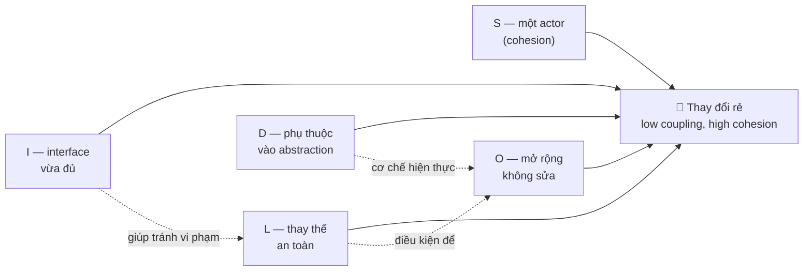
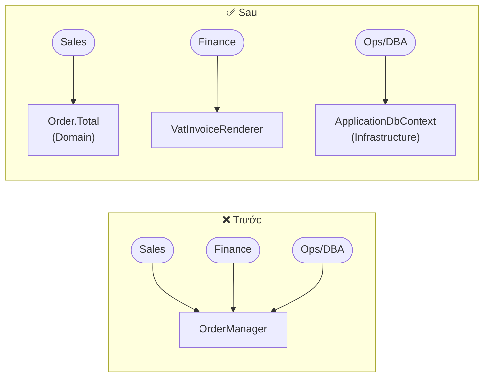
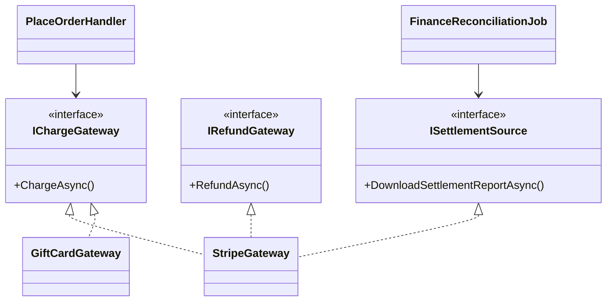
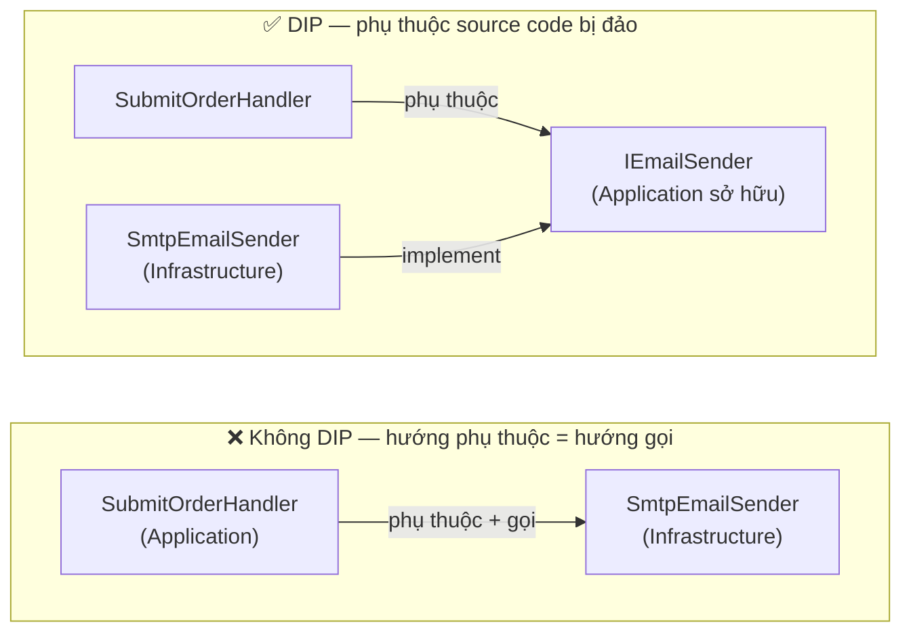
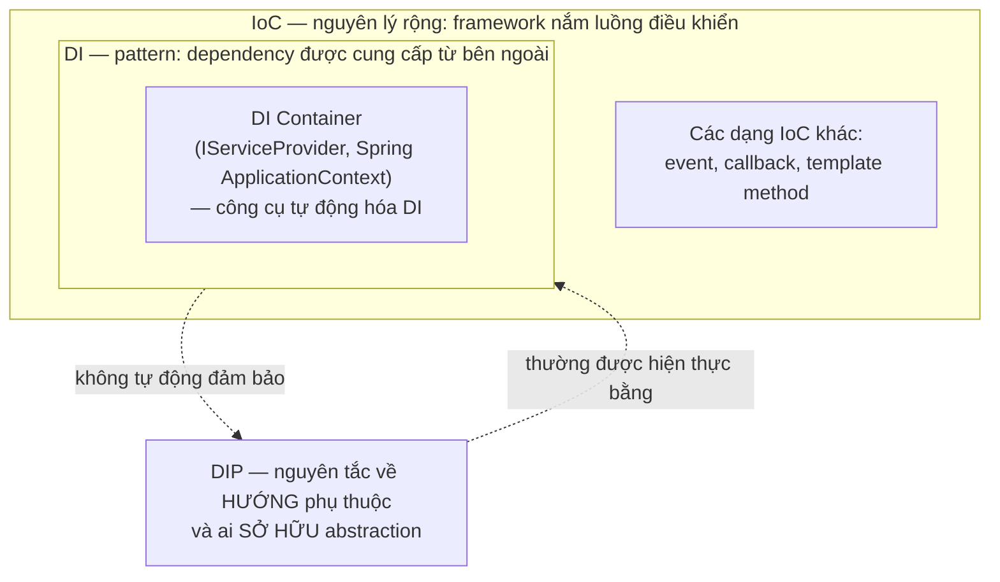
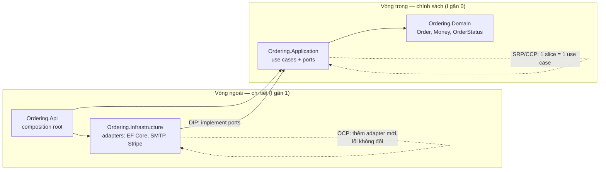

# SOLID Principles

> [!summary] TL;DR
> - **SOLID** = 5 nguyên tắc thiết kế module do Robert C. Martin tập hợp (bài *Design Principles and Design Patterns*, 2000); cái tên viết tắt do **Michael Feathers** đặt khoảng 2004. LSP gốc là của **Barbara Liskov** (1987), OCP gốc của **Bertrand Meyer** (1988).
> - Cả 5 cùng phục vụ một mục tiêu: **quản lý coupling & cohesion** để thay đổi rẻ — xem [[Coupling-and-Cohesion]].
> - Câu cần nhớ: **S** = một *actor* (nhóm người yêu cầu thay đổi); **O** = thêm hành vi bằng code mới, không sửa code cũ đã ổn định; **L** = subtype không được làm caller bất ngờ; **I** = client chỉ phụ thuộc thứ nó dùng; **D** = abstraction thuộc về *phía sử dụng*.
> - ⚠️ SOLID là **công cụ chẩn đoán**, không phải checklist bắt buộc. Áp máy móc → "interface soup", indirection vô ích, vi phạm [[Core-Design-Principles#YAGNI]].

---

## Tổng quan

| Nguyên tắc | Câu hỏi chẩn đoán | Triệu chứng khi vi phạm | Công cụ .NET hay dùng | Pattern liên quan |
| --- | --- | --- | --- | --- |
| **SRP** | "Ai (actor nào) sẽ yêu cầu sửa class này?" | Divergent change, merge conflict | Feature folder, 1 handler / 1 use case | Extract Class, Facade |
| **OCP** | "Thêm biến thể mới có phải sửa code cũ?" | `switch` theo type lan khắp nơi | `IEnumerable<T>` injection, keyed services, middleware, behaviors | Strategy, Decorator, Chain of Responsibility |
| **LSP** | "Thay subtype vào, caller có cần `if (x is ...)`?" | `NotSupportedException`, type check | `IReadOnlyList<T>`, generic variance `in`/`out` | Template Method (cẩn thận), composition |
| **ISP** | "Client có bị ép phụ thuộc method nó không gọi?" | Implement rỗng / ném exception | Role interfaces, đăng ký 1 instance cho nhiều interface | Adapter, Facade |
| **DIP** | "Ai sở hữu interface? Mũi tên phụ thuộc đi về đâu?" | Domain/Application `using` Infrastructure | Built-in DI, `TimeProvider`, `ILogger<T>` | Ports & Adapters, Abstract Factory |



> [!info] Mối quan hệ giữa các chữ cái
> OCP là **mục tiêu**, DIP là **cơ chế** (phụ thuộc vào abstraction), LSP là **điều kiện** để cơ chế đó an toàn (subtype nào cắm vào cũng chạy đúng), ISP giữ abstraction **nhỏ** để LSP dễ đạt, SRP quyết định **ranh giới** của từng module.

---

## Single Responsibility Principle (SRP)

### Định nghĩa chính xác

- Phát biểu cũ (hay bị hiểu sai): *"Một class chỉ nên có một lý do để thay đổi."*
- Martin làm rõ (blog 2014, sách *Clean Architecture* 2017): "lý do thay đổi" chính là **con người** — một **actor** (một nhóm stakeholder có cùng nhu cầu). Ý chính: *một module chỉ nên chịu trách nhiệm trước một actor duy nhất.*
- ❌ SRP **không** có nghĩa "một class chỉ làm một việc" hay "một method". Đó là nguyên tắc ở mức *function* (làm một việc) — khác hẳn.

### Vấn đề — ví dụ Ordering

Ba actor: **Sales** (cách tính tổng tiền, khuyến mãi), **Finance** (hóa đơn VAT, quy tắc làm tròn), **Ops/DBA** (lưu trữ). Tất cả dồn vào một class:

```csharp
// ❌ Một class phục vụ 3 actor
public sealed class OrderManager(ApplicationDbContext db)
{
    // Sales dùng để hiển thị tổng tiền trên giỏ hàng & dashboard doanh số
    public decimal CalculateTotal(Order order) => order.Items.Sum(LineAmount);

    // Finance dùng để xuất hóa đơn VAT
    public string RenderInvoice(Order order) =>
        string.Join('\n', order.Items.Select(i => $"{i.Sku}: {LineAmount(i):N2}"));

    // Ops quan tâm cách lưu
    public Task SaveAsync(Order order, CancellationToken ct) => db.SaveChangesAsync(ct);

    // Helper DÙNG CHUNG — quả bom hẹn giờ
    private static decimal LineAmount(OrderItem i) => i.UnitPrice.Amount * i.Quantity;
}
```

> [!example] Kịch bản hỏng (chuyện có thật ở nhiều công ty)
> Finance yêu cầu: "trên hóa đơn, làm tròn **từng dòng** về 0 chữ số thập phân theo quy định VND". Dev sửa `LineAmount` thêm `Math.Round(..., 0)`. Hóa đơn đúng — nhưng **dashboard doanh số của Sales lệch** so với cổng thanh toán, vì helper dùng chung. Sales chưa hề yêu cầu thay đổi gì. Đó chính là thứ SRP muốn ngăn.

### ✅ Sửa: tách theo actor

```csharp
// Sales sở hữu: tổng tiền theo giá niêm yết — nằm trong Domain (Order.Total)
// Finance sở hữu: quy tắc hóa đơn, kể cả làm tròn
public sealed class VatInvoiceRenderer
{
    // Làm tròn là quy định CỦA HÓA ĐƠN, không phải của Order → nằm ở đây
    private static decimal InvoiceLineAmount(OrderItem i) =>
        Math.Round(i.UnitPrice.Amount * i.Quantity, 0, MidpointRounding.AwayFromZero);

    public string Render(Order order) =>
        string.Join('\n', order.Items.Select(i => $"{i.Sku}: {InvoiceLineAmount(i):N0}"));
}

// Ops sở hữu: persistence — qua IApplicationDbContext + UnitOfWorkBehavior (xem note CQRS-and-MediatR-Pattern)
```



### .NET hỗ trợ SRP thế nào
- **Một handler / một use case** (MediatR hoặc tự viết) — mỗi file chịu trách nhiệm trước đúng một luồng nghiệp vụ.
- **Feature folder / Vertical slice** — gom theo actor & use case, không theo loại kỹ thuật → [[Vertical-Slice-Architecture]].
- **Extension method `AddOrdering()`** tách cấu hình DI khỏi `Program.cs` theo module.
- ⚠️ `partial class` **không** phải công cụ SRP — chỉ chia file, class vẫn phục vụ nhiều actor.

### Java/Spring tương đương
Giống hệt: tách `@Service` khổng lồ thành nhiều service/handler; Spring Modulith tổ chức theo module nghiệp vụ.

### Áp dụng quá đà
- Tách mỗi method thành một class (`OrderTotalCalculator`, `OrderTotalFormatter`, `OrderTotalValidator`…) dù cùng một actor → **cohesion giảm**, phải nhảy 6 file để hiểu một luồng.
- Dấu hiệu tách đúng: mỗi phần tách ra thay đổi **độc lập** theo lịch của một nhóm người. Nếu chúng luôn đổi cùng nhau → gộp lại.

---

## Open/Closed Principle (OCP)

### Định nghĩa chính xác

- **Bertrand Meyer (1988)**: module *mở để mở rộng, đóng để sửa đổi* — bản gốc dùng **kế thừa** (module đã phát hành thì đóng, mở rộng bằng subclass).
- **Martin (polymorphic OCP)**: dựa trên **abstraction** — module cấp cao phụ thuộc interface; thêm hành vi mới = thêm implementation mới.
- "Đóng" không có nghĩa *không bao giờ sửa*: bug vẫn sửa; điều cần đóng là **chính sách ổn định** trước các **biến thể dự đoán được**.

### ❌ Vi phạm — discount bằng `switch`

```csharp
public sealed class DiscountService
{
    // Mỗi chiến dịch marketing mới = sửa method này, test lại mọi nhánh, deploy lại
    public decimal Calculate(Order order, string? couponCode, bool isVip) => couponCode switch
    {
        "BLACKFRIDAY" => order.Total * 0.30m,
        "FREESHIP"    => 30_000m,
        _ when isVip  => order.Total * 0.10m,
        _             => 0m
    };
}
```

### ✅ Sửa — Strategy + `IEnumerable<T>` injection

```csharp
public sealed record DiscountContext(decimal Subtotal, string? CouponCode, bool IsVip);

public interface IDiscountRule
{
    bool IsApplicable(DiscountContext ctx);
    decimal Calculate(DiscountContext ctx);
}

public sealed class PercentageCouponRule(string code, decimal rate) : IDiscountRule
{
    public bool IsApplicable(DiscountContext ctx) =>
        string.Equals(ctx.CouponCode, code, StringComparison.OrdinalIgnoreCase);
    public decimal Calculate(DiscountContext ctx) => ctx.Subtotal * rate;
}

public sealed class VipRule : IDiscountRule
{
    public bool IsApplicable(DiscountContext ctx) => ctx.IsVip;
    public decimal Calculate(DiscountContext ctx) => ctx.Subtotal * 0.10m;
}

// Chính sách "đóng": lấy ưu đãi tốt nhất. Không biết có bao nhiêu rule, rule nào.
public sealed class DiscountCalculator(IEnumerable<IDiscountRule> rules)
{
    public decimal BestDiscount(DiscountContext ctx) =>
        rules.Where(r => r.IsApplicable(ctx))
             .Select(r => r.Calculate(ctx))
             .DefaultIfEmpty(0m)
             .Max();
}
```

```csharp
// Program.cs — "mở": thêm rule = thêm class + 1 dòng đăng ký. DiscountCalculator không đổi.
builder.Services.AddSingleton<IDiscountRule>(new PercentageCouponRule("BLACKFRIDAY", 0.30m));
builder.Services.AddSingleton<IDiscountRule, VipRule>();
builder.Services.AddSingleton<DiscountCalculator>();   // container inject MỌI IDiscountRule đã đăng ký
```

> [!tip] Composition root được phép thay đổi
> OCP đóng **module chính sách** (`DiscountCalculator`), không đóng toàn bộ chương trình. `Program.cs` là nơi "cắm" plugin — sửa nó là bình thường.

### Keyed services (.NET 8+) — chọn implementation theo key

```csharp
builder.Services.AddKeyedScoped<IPaymentGateway, CardGateway>("card");
builder.Services.AddKeyedScoped<IPaymentGateway, MomoGateway>("momo");

// Biết trước key lúc compile:
public sealed class CardRefundJob([FromKeyedServices("card")] IPaymentGateway gateway) { /* ... */ }

// Key chỉ biết lúc runtime (người dùng chọn phương thức) → bọc trong một factory nhỏ ở Infrastructure,
// để handler không phải cầm IServiceProvider (service locator).
internal sealed class PaymentGatewayResolver(IServiceProvider sp) : IPaymentGatewayResolver
{
    public IPaymentGateway For(string method) => sp.GetRequiredKeyedService<IPaymentGateway>(method);
}
```

### Các "điểm mở rộng" OCP sẵn có trong ASP.NET Core
| Điểm mở rộng | Thêm hành vi bằng cách |
| --- | --- |
| Middleware pipeline | `app.UseMiddleware<T>()` — không sửa middleware khác |
| MediatR `IPipelineBehavior<,>` / Decorator (Scrutor `Decorate`) | Bọc thêm logging, cache, retry — xem [[Structural-Patterns#Decorator]] |
| `IEnumerable<T>` injection | Thêm implementation mới — [[Behavioral-Patterns#Strategy]] |
| `IOptions<T>` / config | Đổi hành vi không cần recompile |
| Extension method | Thêm API cho type không sở hữu (LINQ trên `IEnumerable<T>`) — ⚠️ static, **không** đa hình |
| `IHostedService`, `IExceptionHandler`, `IHealthCheck` | Framework tự gọi mọi implementation đăng ký |

### Java/Spring tương đương
`List<DiscountRule>` inject mọi bean; `Map<String, PaymentGateway>` inject theo **bean name** ≈ keyed services; `@Qualifier("card")` ≈ `[FromKeyedServices("card")]`; `HandlerInterceptor`/`Filter` ≈ middleware; Spring AOP ≈ behavior/decorator.

### Áp dụng quá đà
- Dựng plugin architecture cho thứ **chưa từng có biến thể thứ hai** → vi phạm YAGNI. Quy tắc thực dụng: chấp nhận `switch` lần đầu; khi biến thể thứ 2–3 xuất hiện *và* `switch` bắt đầu lặp lại ở nhiều nơi → refactor sang Strategy.
- OCP chỉ bảo vệ trước biến thể **đã dự đoán**. Không có thiết kế nào "đóng" với mọi thay đổi.

---

## Liskov Substitution Principle (LSP)

### Định nghĩa chính xác

**Barbara Liskov** (keynote OOPSLA 1987, *Data Abstraction and Hierarchy*; hình thức hóa cùng **Jeannette Wing** năm 1994, *A Behavioral Notion of Subtyping*): nếu S là subtype của T, mọi thuộc tính *đúng* với T phải vẫn đúng khi dùng S thay T. Nói thực dụng: **caller viết theo hợp đồng của T không được bất ngờ khi nhận S**.

| Quy tắc | Ý nghĩa | Vi phạm điển hình |
| --- | --- | --- |
| **Precondition không được mạnh hơn** | Subtype chấp nhận ít nhất mọi input base chấp nhận | Override ném lỗi khi weight > 2kg dù base nhận mọi weight > 0 |
| **Postcondition không được yếu hơn** | Subtype đảm bảo ít nhất những gì base đảm bảo | Base hứa trả list không null, subtype trả null |
| **Invariant giữ nguyên** | Ràng buộc của base vẫn đúng | `Square : Rectangle` — đặt Width làm đổi Height |
| **History constraint** | Không cho phép thay đổi trạng thái mà base không cho phép | Subtype *mutable* của một type *immutable* |
| **Không ném exception mới** | Chỉ ném exception (hoặc subtype của exception) base đã khai báo/ngầm hứa | `NotSupportedException` trong override |
| **Variance chữ ký** | Tham số contravariant, kiểu trả về covariant | (C# compiler kiểm tra phần này với `in`/`out`) |

> [!important] Compiler chỉ kiểm tra **chữ ký**, không kiểm tra **hành vi**
> LSP chủ yếu là về *behavioral contract*. Code compile được vẫn có thể vi phạm LSP nặng nề.

### ❌ Vi phạm — Ordering

```csharp
public abstract class PaymentMethod
{
    public abstract Task<string> ChargeAsync(Money amount, CancellationToken ct);
    public abstract Task RefundAsync(string chargeId, Money amount, CancellationToken ct);
}

public sealed class CashOnDelivery : PaymentMethod
{
    public override Task<string> ChargeAsync(Money amount, CancellationToken ct) =>
        Task.FromResult($"COD-{Guid.NewGuid():N}");

    // Hợp đồng base nói "refund được" — subtype phá hợp đồng
    public override Task RefundAsync(string chargeId, Money amount, CancellationToken ct) =>
        throw new NotSupportedException("COD không hoàn tiền online.");
}

// Caller buộc phải biết subtype → OCP cũng vỡ theo
if (payment is not CashOnDelivery)
    await payment.RefundAsync(chargeId, amount, ct);
```

### ✅ Sửa — tách hợp đồng theo khả năng thật

```csharp
public interface IPaymentMethod
{
    Task<string> ChargeAsync(Money amount, CancellationToken ct);
}

public interface IRefundablePaymentMethod : IPaymentMethod
{
    Task RefundAsync(string chargeId, Money amount, CancellationToken ct);
}

public sealed class CardPayment : IRefundablePaymentMethod { /* Charge + Refund thật */ }
public sealed class CashOnDelivery : IPaymentMethod { /* chỉ Charge */ }

// Luồng hoàn tiền tự động CHỈ nhận IRefundablePaymentMethod → compiler chặn COD từ đầu.
public sealed class AutoRefundService(IRefundablePaymentMethod gateway) { /* ... */ }
```

> [!tip] "Capability check" tường minh khác với type check
> Khi hủy đơn cần rẽ nhánh: `if (payment is IRefundablePaymentMethod r) await r.RefundAsync(...); else CreateManualRefundTask();` — kiểm tra **khả năng** đã được mô hình hóa trong hợp đồng là chấp nhận được. Điều xấu là kiểm tra **class cụ thể** (`is CashOnDelivery`).

### Ví dụ thật trong BCL — LSP "đã thỏa hiệp"

```csharp
// 1) Mảng implement IList<T> nhưng kích thước cố định
IList<int> numbers = new[] { 1, 2, 3 };
numbers.Add(4);                         // 💥 NotSupportedException

// 2) ReadOnlyCollection<T> implement ICollection<T> / IList<T>
ICollection<string> skus = new List<string> { "SKU-1" }.AsReadOnly();
skus.Add("SKU-2");                      // 💥 NotSupportedException (docs: "always throws")

// 3) Array covariance — di sản từ thời .NET 1.0 (giống Java)
object[] items = new string[2];         // compile OK vì string[] "là" object[]
items[0] = 42;                          // 💥 ArrayTypeMismatchException lúc runtime

// ✅ Cách an toàn: interface chỉ-đọc, covariant (out T) → không có thao tác ghi để phá
IReadOnlyList<object> safe = new List<string> { "SKU-1" };   // OK, không thể ghi
```

| Ví dụ BCL | Vì sao vẫn tồn tại | Bài học |
| --- | --- | --- |
| `ReadOnlyCollection<T> : IList<T>` | `IReadOnly*` chỉ có từ .NET 4.5; giữ tương thích | Dùng `IReadOnlyList<T>` / `IReadOnlyCollection<T>` cho API mới |
| `Stream.Seek` ném `NotSupportedException` khi `CanSeek == false` (vd `NetworkStream`) | Pattern "optional feature" có chủ đích: hợp đồng **đã khai báo** cờ `CanSeek` | Nếu bắt buộc có tính năng tùy chọn, đưa cờ `CanXxx` vào hợp đồng — nhưng ưu tiên tách interface |
| Array covariance | Tương thích với Java thời 2000 | Tránh truyền mảng theo kiểu base; dùng `IEnumerable<out T>` |

> [!info] Liên hệ thiết kế `Order`
> `Order.Items` trả `IReadOnlyCollection<OrderItem>` (xem [[Clean-Architecture-in-DotNet]]) thay vì `ICollection<OrderItem>` — caller không có `Add` để gọi nhầm, nên không thể bỏ qua `Order.AddItem()` và invariant của aggregate.

### Java/Spring tương đương
- `Collections.unmodifiableList(...)`, `List.of(...)`, `Arrays.asList(...).add(...)` → `UnsupportedOperationException` — cùng thỏa hiệp như `ReadOnlyCollection<T>`. Java **không có** `IReadOnlyList` trong JDK chuẩn (Java 21 thêm `SequencedCollection` nhưng vẫn có method ghi).
- Array covariance Java: `Object[] o = new String[1]; o[0] = 1;` → `ArrayStoreException`.
- Generic variance: Java dùng wildcard tại nơi dùng (`List<? extends Item>`), C# khai báo tại interface (`IEnumerable<out T>`).

### Áp dụng quá đà / hiểu sai
- Cấm hoàn toàn kế thừa vì sợ LSP → không cần; LSP chỉ yêu cầu **giữ hợp đồng**. Nhưng đúng là composition thường an toàn hơn — xem [[Core-Design-Principles#Composition over Inheritance]].
- Hợp đồng phải được **viết ra** (XML doc, test chung cho mọi implementation — "contract test"), nếu không thì không ai biết đang vi phạm cái gì.

---

## Interface Segregation Principle (ISP)

### Định nghĩa chính xác
*Client không nên bị buộc phụ thuộc vào những method nó không dùng.* Martin rút ra từ một dự án tư vấn ở Xerox: một class `Job` khổng lồ dùng cho mọi tác vụ máy in khiến mọi thay đổi nhỏ đều phải build lại tất cả. Ý nghĩa sâu: interface thuộc về **client** (role interface), không phải bản sao public API của class (header interface).

### ❌ Vi phạm — fat interface

```csharp
public interface IPaymentGateway
{
    Task<string> ChargeAsync(Money amount, string cardToken, CancellationToken ct);
    Task RefundAsync(string chargeId, Money amount, CancellationToken ct);
    Task<string> CreateSubscriptionAsync(Guid customerId, string planId, CancellationToken ct);
    Task<byte[]> DownloadSettlementReportAsync(DateOnly day, CancellationToken ct);
}

// Gift card chỉ trừ số dư → 3/4 method là "giả" → kéo theo vi phạm LSP
public sealed class GiftCardGateway : IPaymentGateway
{
    public Task<string> ChargeAsync(Money amount, string cardToken, CancellationToken ct) => /* ... */ Task.FromResult("GC-1");
    public Task RefundAsync(string chargeId, Money amount, CancellationToken ct) => throw new NotSupportedException();
    public Task<string> CreateSubscriptionAsync(Guid c, string p, CancellationToken ct) => throw new NotSupportedException();
    public Task<byte[]> DownloadSettlementReportAsync(DateOnly d, CancellationToken ct) => throw new NotSupportedException();
}
```

### ✅ Sửa — role interfaces theo client

```csharp
public interface IChargeGateway   { Task<string> ChargeAsync(Money amount, string token, CancellationToken ct); }
public interface IRefundGateway   { Task RefundAsync(string chargeId, Money amount, CancellationToken ct); }
public interface ISettlementSource { Task<byte[]> DownloadSettlementReportAsync(DateOnly day, CancellationToken ct); }

// Một class có thể đóng nhiều vai
internal sealed class StripeGateway : IChargeGateway, IRefundGateway, ISettlementSource { /* ... */ }
internal sealed class GiftCardGateway : IChargeGateway { /* ... */ }
```

```csharp
// DI: 1 instance Scoped, lộ ra dưới nhiều "vai" — tránh tạo 3 instance StripeGateway khác nhau
builder.Services.AddScoped<StripeGateway>();
builder.Services.AddScoped<IChargeGateway>(sp => sp.GetRequiredService<StripeGateway>());
builder.Services.AddScoped<IRefundGateway>(sp => sp.GetRequiredService<StripeGateway>());
builder.Services.AddScoped<ISettlementSource>(sp => sp.GetRequiredService<StripeGateway>());

// Client chỉ thấy đúng thứ nó cần → test chỉ mock 1 method
public sealed class PlaceOrderHandler(IChargeGateway charge) { /* ... */ }
public sealed class FinanceReconciliationJob(ISettlementSource settlement) { /* ... */ }
```



### ISP trong BCL & ASP.NET Core
| Ví dụ | Bài học |
| --- | --- |
| `IEnumerable<T>` ⊂ `IReadOnlyCollection<T>` ⊂ `IReadOnlyList<T>`; tách khỏi `ICollection<T>`/`IList<T>` | Nhận tham số bằng interface **hẹp nhất** đủ dùng: method chỉ duyệt → `IEnumerable<T>`; cần `Count` → `IReadOnlyCollection<T>` |
| `IDisposable` vs `IAsyncDisposable` | Vai trò nhỏ, độc lập, class chọn implement cái nào |
| `ISender` vs `IPublisher` vs `IMediator` (MediatR) | Controller chỉ cần gửi → inject `ISender` |
| `IApplicationDbContext` chỉ lộ `DbSet<Order>` + `SaveChangesAsync` | Application không thấy `Database`, `ChangeTracker`… của `DbContext` |

### Java/Spring tương đương
Giống hệt về nguyên tắc. Spring Data cho thấy cả hai cực: `Repository<T,ID>` (marker trống) → `CrudRepository` → `JpaRepository` (rất béo). Muốn ISP, khai báo interface kế thừa `Repository<T,ID>` và chỉ định nghĩa method cần dùng.

### Áp dụng quá đà
- Mỗi interface một method cho *mọi* thứ → "interface soup", khó tìm implementation, DI đăng ký rườm rà.
- Thước đo: tách khi có **hai client khác nhau dùng hai tập method khác nhau**, hoặc khi có implementation phải ném `NotSupportedException`. Đừng tách vì "có thể sau này".

---

## Dependency Inversion Principle (DIP)

### Định nghĩa chính xác
Martin (C++ Report, 1996):
1. Module cấp cao **không** phụ thuộc module cấp thấp. Cả hai phụ thuộc vào **abstraction**.
2. Abstraction không phụ thuộc chi tiết; chi tiết phụ thuộc abstraction.

Từ "inversion" nằm ở **quyền sở hữu**: interface được định nghĩa ở phía **cấp cao** (client) — nên mũi tên phụ thuộc source code bị *đảo ngược* so với hướng gọi lúc runtime.

### ❌ Vi phạm

```csharp
// Ordering.Application — use case phụ thuộc trực tiếp hạ tầng
using Ordering.Infrastructure.Email;           // 🚩 Application → Infrastructure
using Ordering.Infrastructure.Persistence;

public sealed class SubmitOrderHandler(ApplicationDbContext db, SmtpEmailSender smtp)
{
    // Đổi SMTP sang SendGrid = sửa use case; unit test = cần SMTP server thật
}
```

### ✅ Sửa — port thuộc Application, adapter ở Infrastructure

```csharp
// Ordering.Application/Common/Interfaces/IEmailSender.cs — Application SỞ HỮU hợp đồng
public interface IEmailSender
{
    Task SendAsync(string to, string subject, string body, CancellationToken ct = default);
}

// Ordering.Infrastructure/Email/SmtpEmailSender.cs — chi tiết phụ thuộc vào abstraction
internal sealed class SmtpEmailSender(IOptions<SmtpOptions> options) : IEmailSender
{
    public async Task SendAsync(string to, string subject, string body, CancellationToken ct = default)
    {
        // System.Net.Mail chỉ là ví dụ; production thường dùng MailKit hoặc API của nhà cung cấp — đổi thoải mái vì Application không biết
        using var client = new SmtpClient(options.Value.Host, options.Value.Port);
        using var message = new MailMessage(options.Value.From, to, subject, body);
        await client.SendMailAsync(message, ct);
    }
}
public sealed class SmtpOptions { public string Host { get; init; } = ""; public int Port { get; init; } = 25; public string From { get; init; } = ""; }

// Ordering.Infrastructure/DependencyInjection.cs — composition
services.AddScoped<IEmailSender, SmtpEmailSender>();
```



> [!tip] BCL đã làm DIP sẵn cho bạn — đừng tự viết wrapper
> - Thời gian: dùng **`TimeProvider`** (.NET 8+) thay vì tự tạo `IDateTimeProvider`. Test dùng `FakeTimeProvider` (package `Microsoft.Extensions.TimeProvider.Testing`).
> - Log: `ILogger<T>`; cấu hình: `IOptions<T>`; HTTP: `IHttpClientFactory`.

### DIP vs DI vs IoC — ba khái niệm hay bị nhập làm một

| | **IoC** (Inversion of Control) | **DI** (Dependency Injection) | **DIP** (Dependency Inversion Principle) |
| --- | --- | --- | --- |
| Loại | Nguyên lý chung | Kỹ thuật / pattern | Nguyên tắc thiết kế |
| Đảo cái gì | **Luồng điều khiển**: framework gọi code của bạn ("Hollywood principle") | **Việc tạo & cung cấp dependency**: được đưa vào từ ngoài thay vì tự `new` | **Hướng phụ thuộc source code & quyền sở hữu abstraction** |
| Ví dụ .NET | ASP.NET Core gọi controller, middleware, `BackgroundService.ExecuteAsync` | Constructor injection, container `IServiceProvider` | `IEmailSender` nằm ở Application, implement ở Infrastructure |
| Có cái này mà không có cái kia? | Có IoC không DI: event handler, template method | Có DI không DIP: inject `SmtpEmailSender` (class cụ thể) | Có DIP không container: "Pure DI" — tự `new` ở `Main` |



> [!info] Nguồn gốc từ "Dependency Injection"
> Martin Fowler (bài *Inversion of Control Containers and the Dependency Injection pattern*, 2004) cho rằng "IoC" quá chung chung — framework nào cũng IoC — nên cùng cộng đồng chọn tên cụ thể hơn là **Dependency Injection**, với 3 dạng: constructor, setter, interface injection. ASP.NET Core built-in container chỉ hỗ trợ **constructor injection** (không có property injection như `@Autowired` field).

### Java/Spring tương đương
- DIP: y hệt — port là interface trong package `application`, adapter trong `infrastructure`; Hexagonal Architecture phổ biến bên Java.
- DI: Spring IoC container, constructor injection (khuyến nghị), `@Autowired` field/setter (không có ở .NET built-in).
- Xem chi tiết lifetime/scope: [[Dependency-Injection-DotNet-vs-Spring]].

### Áp dụng quá đà
- Interface 1–1 cho **mọi** class, kể cả class không có biến thể và không phải biên giới hạ tầng (`IOrderTotalCalculator` chỉ để mock) → gấp đôi file, không giảm coupling thật.
- Đặt interface ở **project của implementation** (`Infrastructure.Abstractions`) → vẫn là phụ thuộc vào phía chi tiết: chưa "inversion".
- Abstraction rò rỉ: `IOrderRepository` trả `IQueryable<Order>` → Application vẫn ngầm phụ thuộc vào khả năng dịch LINQ của EF Core. Xem [[Repository-UnitOfWork-Specification]].

---

## Tổng kết so sánh

| | SRP | OCP | LSP | ISP | DIP |
| --- | --- | --- | --- | --- | --- |
| **Mức áp dụng** | Class/module | Module/policy | Kế thừa & implementation | Interface | Hướng phụ thuộc giữa module |
| **Câu thần chú** | Một actor | Thêm, đừng sửa | Không bất ngờ | Vừa đủ dùng | Client sở hữu abstraction |
| **Dấu hiệu vi phạm** | Class đổi vì nhiều phòng ban | `switch` theo loại lặp nhiều nơi | `NotSupportedException`, `is ConcreteType` | Implement rỗng/ném lỗi | `using ...Infrastructure` trong Application |
| **Cách sửa chính** | Extract Class theo actor | Strategy/Decorator + DI | Tách hợp đồng, composition | Role interface | Port & Adapter |
| **Quá đà thành** | Class vụn | Plugin cho thứ không có biến thể | Sợ kế thừa vô lý | Interface 1 method khắp nơi | Interface cho mọi class |
| **Java ↔ .NET** | Như nhau | `List<Bean>`/`@Qualifier` ↔ `IEnumerable<T>`/keyed | `UnsupportedOperationException` ↔ `NotSupportedException` | Spring Data `Repository` ↔ role interface | Spring IoC ↔ MS.DI |

> [!warning] Bẫy khi chuyển từ Java sang .NET
> - **Không có component scan**: implementation mới (OCP) phải đăng ký tường minh — quên là lỗi runtime `Unable to resolve service`. Dùng Scrutor nếu muốn scan.
> - **Không có field injection** → mọi dependency lộ ra ở constructor: tốt cho SRP (nhìn là biết class đang ôm bao nhiêu thứ).
> - **Generic không bị erase**: `IEnumerable<IDiscountRule>`, `IValidator<CreateOrderCommand>` resolve chính xác theo kiểu — Strategy/ISP theo generic dễ hơn Java.
> - **`internal sealed`** cho adapter (ẩn hẳn implementation) — mạnh hơn `package-private` vì phạm vi là assembly.
> - **`@Qualifier` ↔ keyed services** chỉ có từ .NET 8; code cũ thường dùng factory hoặc `IEnumerable<T>` + lọc.

---

## SOLID ở mức kiến trúc

Trong *Clean Architecture* (2017), Martin chỉ ra các nguyên tắc này lặp lại ở mức component/kiến trúc:

| Nguyên tắc class | Phiên bản kiến trúc | Trong solution Ordering |
| --- | --- | --- |
| **SRP** | **Common Closure Principle** — gom những gì thay đổi cùng lúc, cùng lý do; ranh giới bounded context | Module Ordering, Billing, Shipping tách theo nghiệp vụ; feature folder trong Application |
| **OCP** | Kiến trúc dạng **plugin**: lõi không đổi khi thêm adapter | Thêm `MomoGateway` hay `SendGridEmailSender` = thêm project/class ở Infrastructure, Domain/Application không đổi |
| **LSP** | Mọi implementation của một **interface hệ thống** (REST API, message contract) phải tuân thủ cùng hợp đồng | Đổi nhà cung cấp thanh toán: adapter mới phải qua **cùng bộ contract test** |
| **ISP** | Không phụ thuộc component/framework mang theo nhiều thứ bạn không dùng | Domain không reference EF Core/ASP.NET; tránh "Shared.Common" khổng lồ |
| **DIP** | **Dependency Rule**: phụ thuộc source code chỉ hướng vào trong | Api → Infrastructure → Application → Domain; port ở trong, adapter ở ngoài |



→ Xem triển khai đầy đủ ở [[Clean-Architecture-in-DotNet]] và metric Instability/SDP ở [[Coupling-and-Cohesion]].

---

## Self-check

> [!question]- SRP nói "một lý do để thay đổi". "Lý do" ở đây cụ thể là gì? Vì sao "một class chỉ làm một việc" là hiểu sai?
> "Lý do" là một **actor** — nhóm người (phòng ban, stakeholder) yêu cầu thay đổi. Một class có thể có nhiều method, làm nhiều việc, miễn là tất cả phục vụ cùng một actor. "Làm một việc" là nguyên tắc cho **function**, không phải SRP.

> [!question]- `ReadOnlyCollection<T>` implement `IList<T>` nhưng `Add` ném `NotSupportedException`. Vi phạm nguyên tắc nào, và cách tránh trong API của bạn?
> Vi phạm **LSP** (subtype không giữ hợp đồng "có thể thêm phần tử" của `ICollection<T>`), cũng là dấu hiệu `IList<T>` quá béo (**ISP**). BCL giữ vì tương thích ngược và có cờ `IsReadOnly`. API mới: trả/nhận `IReadOnlyList<T>` / `IReadOnlyCollection<T>` / `IEnumerable<T>`.

> [!question]- Đoạn `object[] arr = new string[1]; arr[0] = 1;` compile được không? Chạy thì sao? Tại sao `IReadOnlyList<object> x = new List<string>()` lại an toàn?
> Compile được (array covariance), chạy ném `ArrayTypeMismatchException`. `IReadOnlyList<out T>` là covariant nhưng **không có thao tác ghi**, nên không thể đưa `int` vào danh sách `string` — compiler đảm bảo an toàn kiểu tĩnh.

> [!question]- (Phỏng vấn) Phân biệt DIP, DI và IoC. Có thể dùng DI container mà vẫn vi phạm DIP không?
> IoC: nguyên lý chung — framework nắm luồng điều khiển. DI: kỹ thuật cung cấp dependency từ ngoài (container chỉ là công cụ). DIP: module cấp cao và cấp thấp cùng phụ thuộc abstraction, và abstraction thuộc về phía cấp cao. **Có**: inject class cụ thể `SmtpEmailSender` vào handler bằng container vẫn là DI nhưng không DIP; hoặc đặt interface trong project Infrastructure — Application vẫn phải reference Infrastructure.

> [!question]- Khi nào KHÔNG nên refactor một `switch` theo OCP?
> Khi chỉ có 1–2 biến thể, `switch` chỉ xuất hiện ở **một** nơi, và không có dấu hiệu sẽ có biến thể mới (YAGNI). Switch expression trên enum đóng (`OrderStatus`) với pattern matching đầy đủ còn được compiler cảnh báo khi thiếu nhánh — đôi khi đó là thiết kế tốt hơn Strategy.

> [!question]- Map 5 nguyên tắc SOLID lên Clean Architecture.
> SRP → Common Closure / ranh giới module & use case; OCP → adapter dạng plugin, lõi không đổi; LSP → mọi adapter tuân thủ cùng contract (contract test); ISP → lõi không kéo framework thừa vào; DIP → Dependency Rule, port ở Application, adapter ở Infrastructure.

---

## Liên kết & Tham khảo
- **Nền tảng:** [[Coupling-and-Cohesion]] · [[Core-Design-Principles]] · [[Design-Thinking-Process]] · [[Code-Smells-and-Refactoring]]
- **Pattern hiện thực SOLID:** [[Behavioral-Patterns#Strategy]] · [[Structural-Patterns#Decorator]] · [[Structural-Patterns#Adapter]] · [[Creational-Patterns#Factory Method]] · [[Repository-UnitOfWork-Specification]]
- **Kiến trúc:** [[Clean-Architecture-in-DotNet]] · [[Vertical-Slice-Architecture]] · [[Modular-Monolith]] · [[CQRS-and-MediatR-Pattern]]
- **Đọc tiếp:** [[Dependency-Injection-DotNet-vs-Spring]] · [[Testing-in-DotNet]] · [[Java-to-DotNet-Mental-Map]]
- **MOC:** [[Architecture-Design-MOC]]
- **Nguồn:**
  - Robert C. Martin — *Design Principles and Design Patterns* (2000); *The Single Responsibility Principle* (blog, 2014); *Clean Architecture* (2017)
  - Barbara Liskov — *Data Abstraction and Hierarchy* (OOPSLA 1987); Liskov & Wing — *A Behavioral Notion of Subtyping* (1994)
  - Bertrand Meyer — *Object-Oriented Software Construction* (1988)
  - Martin Fowler — *Inversion of Control Containers and the Dependency Injection pattern* (2004)
  - Microsoft Learn — *Dependency injection in .NET* (keyed services), *ReadOnlyCollection<T>*, *Architectural principles*
