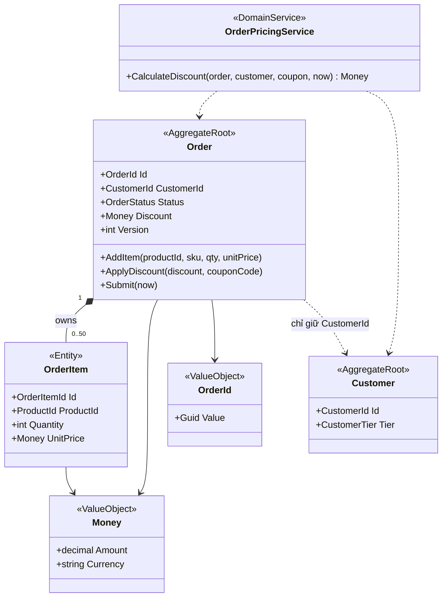
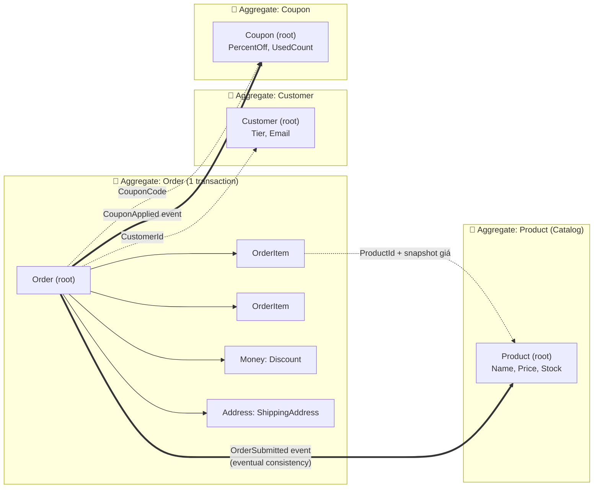
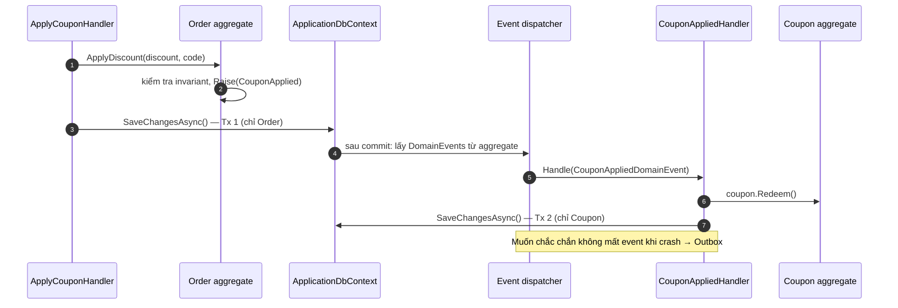
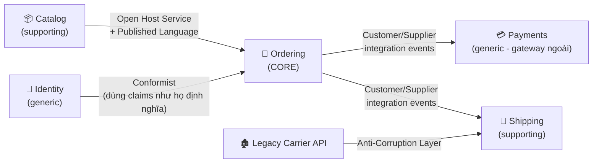

# DDD Tactical Patterns

> [!summary] TL;DR
> - **DDD tactical patterns** = bộ "khối xây dựng" để viết domain model giàu nghiệp vụ: **Entity, Value Object, Aggregate (Root), Domain Service, Factory, Repository, Domain Event** — tất cả nói bằng **Ubiquitous Language**.
> - **Aggregate** là đơn vị nhất quán (consistency boundary): invariant được bảo vệ *bên trong*, **1 transaction = 1 aggregate**, giữa các aggregate dùng **ID + eventual consistency** (4 quy tắc của Vaughn Vernon).
> - Trong .NET: Value Object = `record` (EF Core 8+ map bằng `ComplexProperty`), **strongly-typed ID** = `readonly record struct OrderId(Guid Value)` + value converter, concurrency = `rowversion`/`IsConcurrencyToken`.
> - ⚠️ DDD tactical **không** phải "thêm nhiều class cho sang" — dùng cho **core domain** có nghiệp vụ phức tạp; CRUD đơn giản thì transaction script là đủ.

---

## 1. Problem — Vấn đề cần giải quyết

### 1.1 Bối cảnh: Anemic Domain Model

Code "quen tay" từ thời Spring + JPA: entity là túi getter/setter, mọi luật nằm rải trong service.

```csharp
// ❌ Before — Anemic model: entity chỉ là "DTO có [Key]"
public class Order
{
    public Guid Id { get; set; }
    public Guid CustomerId { get; set; }
    public int Status { get; set; }              // 0 = draft, 1 = submitted… nhớ bằng niềm tin
    public decimal Discount { get; set; }
    public List<OrderItem> Items { get; set; } = [];
}

public class OrderService(AppDbContext db)
{
    public async Task ApplyCoupon(Guid orderId, string code)
    {
        var order = await db.Orders.Include(o => o.Items).FirstAsync(o => o.Id == orderId);
        if (order.Status != 0) throw new Exception("not draft");       // luật #1
        var subtotal = order.Items.Sum(i => i.Price * i.Qty);
        var coupon = await db.Coupons.FirstAsync(c => c.Code == code);
        order.Discount = subtotal * coupon.Percent / 100;                // luật #2
        coupon.UsedCount++;                                              // sửa aggregate thứ 2 cùng transaction
        await db.SaveChangesAsync();
    }
    // ... RemoveItem() quên reset Discount → discount > subtotal → Total âm 💥
}
```

### 1.2 Pain points

| Vấn đề | Hậu quả |
| --- | --- |
| **Invariant không có chủ** | "Chỉ Draft mới sửa được" lặp ở 7 service; chỗ thứ 8 quên → dữ liệu sai |
| **Setter public** | Bất kỳ ai cũng `order.Status = 3` — không ai kiểm soát vòng đời |
| **Primitive obsession** | `Guid customerId, Guid productId` dễ truyền nhầm chỗ; `decimal` không mang currency |
| **Transaction ôm nhiều thứ** | Sửa Order + Coupon + Inventory cùng lúc → lock rộng, deadlock, khó tách service sau này |
| **Ngôn ngữ lệch** | Business nói "chốt đơn", code ghi `UpdateStatus(1)` → mỗi cuộc họp là một lần dịch |

### 1.3 Ý tưởng cốt lõi

- **Eric Evans** (*Domain-Driven Design*, 2003) chia DDD thành 2 tầng: **strategic** (chia hệ thống thành Bounded Context) và **tactical** (cách viết model bên trong một context). Note này tập trung vào tactical; strategic có tóm tắt ở mục 3.10.
- **Vaughn Vernon** (*Effective Aggregate Design*, 2011; *Implementing DDD*, 2013) đúc kết các quy tắc thiết kế aggregate được dùng rộng rãi nhất hiện nay.
- Nguyên lý: **đặt hành vi cạnh dữ liệu** — model tự bảo vệ trạng thái của nó, service chỉ điều phối. Martin Fowler gọi model ngược lại là *anti-pattern* "Anemic Domain Model".

### 1.4 Ubiquitous Language — ngôn ngữ chung

Một bảng thuật ngữ **được team và business cùng chốt**, xuất hiện y nguyên trong tên class, method, event, API. Đổi thuật ngữ = refactor code.

| Thuật ngữ (code) | Nghĩa nghiệp vụ (tiếng Việt) | Ghi chú / KHÔNG gọi là |
| --- | --- | --- |
| `Order` | Đơn hàng | không gọi `Cart` — giỏ hàng là khái niệm khác (chưa cam kết) |
| `OrderItem` / order line | Dòng hàng trong đơn | không có vòng đời riêng ngoài Order |
| `Draft` → `Submit()` | Đơn nháp → **chốt đơn** | không dùng `UpdateStatus(1)` |
| `Money` | Số tiền **kèm** đơn vị tiền tệ | không dùng `decimal` trần |
| `Sku` | Mã hàng tồn kho | khác `ProductId` (định danh nội bộ) |
| `Coupon` | Mã giảm giá có điều kiện, hạn dùng | `Discount` là *kết quả* tính ra, Coupon là *nguồn* |
| `Customer.Tier` | Hạng thành viên (Standard/Silver/Gold) | ảnh hưởng tới chiết khấu |
| `Payment` | Giao dịch thanh toán cho 1 đơn | thuộc context Payments, không phải Ordering |
| `Shipment` | Lô giao hàng | 1 Order có thể tách nhiều Shipment |

> [!tip] Ngôn ngữ chỉ "chung" **trong một Bounded Context**
> "Product" ở Catalog (mô tả, ảnh, SEO) khác "Product" ở Inventory (số lượng, kho) và khác "OrderItem" ở Ordering (snapshot giá lúc mua). Đừng cố tạo một class `Product` dùng cho cả công ty → xem mục 3.10.

---

## 2. Mental Model & Diagram

> [!info] Analogy — Hồ sơ vay vốn ở ngân hàng
> - **Aggregate Root** = bộ hồ sơ có **một người phụ trách** (root). Muốn thêm giấy tờ con (Entity con) phải đưa qua người phụ trách — người này kiểm tra quy tắc rồi mới kẹp vào.
> - **Value Object** = tờ tiền 500k: bạn không quan tâm *tờ nào*, chỉ quan tâm *mệnh giá*. Hai tờ 500k thay nhau được.
> - **Entity** = chiếc xe thế chấp có số khung: sơn lại màu vẫn là *chiếc xe đó*.
> - Hồ sơ vay **tham chiếu** khách hàng bằng **số CCCD** (ID), không kẹp nguyên "người khách" vào hồ sơ.

### 2.1 Các building block và quan hệ



### 2.2 Ranh giới aggregate trong Ordering



- Nét liền trong khung = **nằm trong** aggregate, lưu cùng 1 transaction.
- Nét đứt = **tham chiếu bằng ID**, không có navigation property.
- Nét đậm = **domain event**, xử lý ở transaction khác (sau commit).

### 2.3 Bảng nhận diện nhanh

| Building block | Câu hỏi nhận diện | Ví dụ Ordering | Nằm ở |
| --- | --- | --- | --- |
| **Entity** | Có định danh xuyên suốt vòng đời? Thuộc tính đổi mà "vẫn là nó"? | `OrderItem`, `Customer` | Domain |
| **Value Object** | Chỉ quan tâm giá trị? Bất biến được? Thay thế được bằng bản sao? | `Money`, `Address`, `OrderId` | Domain |
| **Aggregate Root** | Đây có phải cửa ngõ duy nhất để giữ invariant cho một cụm object? | `Order`, `Coupon` | Domain |
| **Domain Service** | Luật nghiệp vụ không thuộc tự nhiên về 1 entity, cần nhiều aggregate? | `OrderPricingService` | Domain |
| **Application Service** | Điều phối use case: load → gọi domain → save, không chứa luật? | `ApplyCouponCommandHandler` | Application |
| **Factory** | Tạo object phức tạp/hợp lệ ngay từ đầu? | `Order.Create(...)` | Domain |
| **Repository** | Lấy/lưu **nguyên** một aggregate như collection trong bộ nhớ? | `IOrderRepository` | Port: Domain/Application; Impl: Infrastructure |
| **Domain Event** | "Điều gì đó đã xảy ra" mà phần khác quan tâm? | `OrderSubmittedDomainEvent` | Domain |

---

## 3. Implementation & Code

> Tiếp nối domain trong [[Clean-Architecture-in-DotNet]]; điểm nâng cấp: **strongly-typed ID**, base class `AggregateRoot<TId>`, concurrency token, domain service.

### 3.1 Entity vs Value Object

| | **Entity** | **Value Object** |
| --- | --- | --- |
| Equality | Theo **Id** (identity) | Theo **toàn bộ giá trị** (structural) |
| Mutability | Thay đổi qua method nghiệp vụ | **Bất biến** — "sửa" = tạo bản mới (`with`) |
| Vòng đời | Có (tạo → đổi → xoá) | Không — gắn với entity chứa nó |
| C# | `class` với `Equals` theo Id | `record` / `readonly record struct` |
| EF Core | Entity type (có key, bảng riêng hoặc chung) | **Complex type** (`ComplexProperty`, EF 8+) hoặc owned type |

```csharp
// src/Ordering.Domain/Common/Entity.cs
namespace Ordering.Domain.Common;

public interface IDomainEvent { }

public sealed class DomainException(string message) : Exception(message);

public abstract class Entity<TId> where TId : struct
{
    public TId Id { get; protected init; }

    // Entity bằng nhau khi CÙNG loại và CÙNG Id — không so sánh thuộc tính
    public override bool Equals(object? obj) =>
        obj is Entity<TId> other && other.GetType() == GetType() && other.Id.Equals(Id);

    public override int GetHashCode() => HashCode.Combine(GetType(), Id);
}

public abstract class AggregateRoot<TId> : Entity<TId> where TId : struct
{
    private readonly List<IDomainEvent> _domainEvents = [];

    // Concurrency token cấp aggregate — xem 3.4 vì sao không chỉ dựa vào rowversion
    public int Version { get; private set; }

    public IReadOnlyCollection<IDomainEvent> DomainEvents => _domainEvents.AsReadOnly();
    protected void Raise(IDomainEvent domainEvent) => _domainEvents.Add(domainEvent);
    public void ClearDomainEvents() => _domainEvents.Clear();

    // Gọi ở MỌI method làm thay đổi aggregate (kể cả khi chỉ entity con đổi)
    protected void Touch() => Version++;
}
```

```csharp
// src/Ordering.Domain/Common/Money.cs — Value Object
namespace Ordering.Domain.Common;

public sealed record Money
{
    public decimal Amount { get; }
    public string Currency { get; }

    public Money(decimal amount, string currency)
    {
        // VO tự validate trong constructor → không tồn tại Money "sai"
        if (amount < 0) throw new DomainException("Amount cannot be negative.");
        if (string.IsNullOrWhiteSpace(currency) || currency.Length != 3)
            throw new DomainException("Currency must be a 3-letter ISO code.");
        Amount = amount;
        Currency = currency.ToUpperInvariant();
    }

    public static Money Zero(string currency) => new(0m, currency);

    // Hành vi nằm trong VO: cộng khác tiền tệ là lỗi nghiệp vụ, không phải lỗi của caller
    public static Money operator +(Money a, Money b) => new(a.Amount + b.Amount, SameCurrency(a, b));
    public static Money operator -(Money a, Money b) => new(a.Amount - b.Amount, SameCurrency(a, b));
    public static Money operator *(Money m, int factor) => new(m.Amount * factor, m.Currency);

    public Money Percentage(decimal percent) =>
        new(Math.Round(Amount * percent / 100m, 2, MidpointRounding.ToEven), Currency);

    public bool IsGreaterThan(Money other)
    {
        _ = SameCurrency(this, other);   // so sánh khác tiền tệ là vô nghĩa → throw
        return Amount > other.Amount;
    }

    private static string SameCurrency(Money a, Money b) =>
        a.Currency == b.Currency ? a.Currency : throw new DomainException("Currency mismatch.");
}
```

```csharp
// Value Object nhỏ, không cần validate phức tạp → readonly record struct (không cấp phát heap)
public readonly record struct Address(string Street, string City, string Country, string PostalCode);
```

> [!warning] Bẫy của `record` khi làm Value Object
> - **Collection bên trong record so sánh theo reference**: `record Tags(IReadOnlyList<string> Items)` → hai instance cùng nội dung vẫn `!=`. Cần override `Equals`/`GetHashCode` (dùng `SequenceEqual`) hoặc tránh collection trong VO.
> - **`struct` luôn có `default`**: `default(Address)` có mọi field `null` và **bỏ qua** validation. Với VO cần đảm bảo hợp lệ (như `Money`) → dùng `sealed record` (class) + constructor validate.
> - `with` expression dùng copy constructor + `init` setter, **không** chạy constructor có validate → VO có property `init` có thể bị `with` thành trạng thái sai. `Money` ở trên chỉ có `get` nên không `with` được → buộc đi qua constructor. Đó là chủ ý.

**Map Value Object bằng EF Core** — ưu tiên **complex type** (EF Core 8+), thay vì owned type:

```csharp
builder.ComplexProperty(o => o.Discount, money =>
{
    money.Property(m => m.Amount).HasColumnName("DiscountAmount").HasPrecision(18, 2);
    money.Property(m => m.Currency).HasColumnName("DiscountCurrency").HasMaxLength(3);
});

// EF Core 10: complex type có thể là struct/record struct, optional (nullable), hoặc map vào 1 cột JSON
builder.ComplexProperty(o => o.ShippingAddress, a => a.ToJson());
```

| | `ComplexProperty` (complex type) | `OwnsOne` / `OwnsMany` (owned entity) |
| --- | --- | --- |
| Ngữ nghĩa | **Value semantics** — đúng tinh thần VO | Vẫn là entity ẩn, có key ẩn, reference semantics |
| Gán cùng instance cho 2 property | ✅ (copy giá trị) | ❌ lỗi khi SaveChanges |
| So sánh trong LINQ | So nội dung | So identity |
| `ExecuteUpdate` | ✅ | ❌ |
| Collection | Chỉ khi map JSON (`ComplexCollection(...).ToJson()`, EF 10) | `OwnsMany` → bảng riêng |
| Khi nào dùng | **Mặc định cho VO** (EF 8+) | VO collection cần bảng riêng, hoặc codebase EF cũ |

### 3.2 Strongly-typed IDs

**Vấn đề:** `void Assign(Guid orderId, Guid customerId)` — gọi ngược tham số vẫn compile. Strongly-typed ID biến lỗi này thành **lỗi compile**.

```csharp
// src/Ordering.Domain/Orders/Ids.cs
namespace Ordering.Domain.Orders;

// readonly record struct: không cấp phát heap, equality theo giá trị, ToString gọn
public readonly record struct OrderId(Guid Value)
{
    // Guid v7 (.NET 9+): tăng dần theo thời gian → index clustered ít phân mảnh
    public static OrderId New() => new(Guid.CreateVersion7());
    public override string ToString() => Value.ToString();
}

public readonly record struct OrderItemId(Guid Value)
{
    public static OrderItemId New() => new(Guid.CreateVersion7());
}

public readonly record struct CustomerId(Guid Value);
public readonly record struct ProductId(Guid Value);
public readonly record struct CouponId(Guid Value);
```

EF Core mapping — cấu hình **một lần** cho mọi property cùng kiểu (kể cả shadow FK) bằng `ConfigureConventions`:

```csharp
// src/Ordering.Infrastructure/Persistence/Converters/IdConverters.cs
using Microsoft.EntityFrameworkCore.Storage.ValueConversion;
using Ordering.Domain.Orders;

namespace Ordering.Infrastructure.Persistence.Converters;

internal sealed class OrderIdConverter() : ValueConverter<OrderId, Guid>(id => id.Value, v => new OrderId(v));
internal sealed class OrderItemIdConverter() : ValueConverter<OrderItemId, Guid>(id => id.Value, v => new OrderItemId(v));
internal sealed class CustomerIdConverter() : ValueConverter<CustomerId, Guid>(id => id.Value, v => new CustomerId(v));
internal sealed class ProductIdConverter() : ValueConverter<ProductId, Guid>(id => id.Value, v => new ProductId(v));
```

```csharp
// ApplicationDbContext
protected override void ConfigureConventions(ModelConfigurationBuilder configurationBuilder)
{
    // Áp dụng cho MỌI property kiểu OrderId (PK, FK, shadow FK "OrderId" của OrderItem)
    configurationBuilder.Properties<OrderId>().HaveConversion<OrderIdConverter>();
    configurationBuilder.Properties<OrderItemId>().HaveConversion<OrderItemIdConverter>();
    configurationBuilder.Properties<CustomerId>().HaveConversion<CustomerIdConverter>();
    configurationBuilder.Properties<ProductId>().HaveConversion<ProductIdConverter>();
}
```

```csharp
// Truy vấn: so sánh NGUYÊN giá trị ID → EF dịch được
var order = await db.Orders.SingleOrDefaultAsync(o => o.Id == orderId, ct);   // ✅
var bad   = await db.Orders.Where(o => o.Id.Value == guid).ToListAsync(ct);     // ❌ không dịch được
```

> [!warning] Bẫy strongly-typed ID
> - **Không query vào thành viên của property đã convert** (`o.Id.Value`) — EF docs ghi rõ đây là giới hạn của value converter. Luôn so sánh cả `OrderId`.
> - **Value generation**: key có converter chỉ dùng được giá trị DB sinh từ EF Core 7, và không phải mọi kiểu. Cách đơn giản nhất: **Domain tự sinh** (`OrderId.New()`) + `ValueGeneratedNever()`.
> - **JSON**: `System.Text.Json` serialize `OrderId` thành `{"value":"..."}`. Map sang `Guid` ở DTO (khuyến nghị) hoặc viết `JsonConverter<OrderId>`.
> - **Boilerplate**: nhiều ID → cân nhắc source generator như *StronglyTypedId* hoặc *Vogen* (kiểm tra license/độ trưởng thành trước khi dùng).
> - Microsoft docs có ví dụ "value objects as keys" nhưng tự ghi chú là **không phải khuyến nghị mặc định** — đây là trade-off: an toàn kiểu vs thêm cấu hình.

### 3.3 Aggregate & Aggregate Root

**Aggregate** = cụm Entity + Value Object được coi như **một đơn vị thay đổi dữ liệu**, có **một root** là cửa ngõ duy nhất. Bên ngoài chỉ giữ reference tới root.

#### 4 quy tắc thiết kế aggregate (Vaughn Vernon, *Effective Aggregate Design*)

| # | Quy tắc | Ý nghĩa thực tế | Ví dụ Ordering |
| --- | --- | --- | --- |
| 1 | **Model true invariants in consistency boundaries** | Chỉ gom vào aggregate những gì phải **nhất quán tức thì** (cùng commit) | "discount ≤ subtotal", "chỉ Draft mới sửa" → Order + OrderItem cùng aggregate |
| 2 | **Design small aggregates** | Aggregate nhỏ → load nhanh, ít xung đột concurrency, transaction ngắn | Order **không** chứa `Customer` hay `Product` |
| 3 | **Reference other aggregates by identity** | Giữ `CustomerId`, không giữ `Customer` navigation | `Order.CustomerId : CustomerId` |
| 4 | **Use eventual consistency outside the boundary** | Thay đổi aggregate khác qua domain event, transaction riêng | `CouponApplied` → tăng `Coupon.UsedCount` sau |

> [!important] 1 transaction = 1 aggregate
> Một command chỉ **sửa** một aggregate instance. Có thể **đọc** nhiều aggregate (để tính toán), nhưng chỉ **ghi** một. Mọi thay đổi lan sang aggregate khác → domain event → handler riêng → transaction riêng. Vernon cũng liệt kê một số lý do thực dụng có thể phá luật (tiện cho UI, thiếu hạ tầng messaging, query performance…) — phá có chủ đích và ghi lại quyết định.

#### ✅ After — Order là rich aggregate

```csharp
// src/Ordering.Domain/Orders/Order.cs
using Ordering.Domain.Common;

namespace Ordering.Domain.Orders;

public enum OrderStatus { Draft, Submitted, Paid, Cancelled }

public sealed record OrderCreatedDomainEvent(OrderId OrderId, CustomerId CustomerId) : IDomainEvent;
public sealed record CouponAppliedDomainEvent(OrderId OrderId, string CouponCode) : IDomainEvent;
public sealed record OrderSubmittedDomainEvent(OrderId OrderId, CustomerId CustomerId, Money Total) : IDomainEvent;

public sealed class Order : AggregateRoot<OrderId>
{
    public const int MaxLines = 50;
    private readonly List<OrderItem> _items = [];

    public CustomerId CustomerId { get; private set; }      // quy tắc 3: chỉ giữ ID
    public OrderStatus Status { get; private set; }
    public string Currency { get; private set; } = default!;
    public Money Discount { get; private set; } = default!;
    public string? CouponCode { get; private set; }
    public DateTimeOffset CreatedAt { get; private set; }
    public DateTimeOffset? SubmittedAt { get; private set; }

    public IReadOnlyCollection<OrderItem> Items => _items.AsReadOnly();
    public Money Subtotal => _items.Aggregate(Money.Zero(Currency), (sum, i) => sum + i.LineTotal);
    public Money Total => Subtotal - Discount;              // an toàn vì invariant discount ≤ subtotal

    private Order() { }                                      // EF Core materialize

    public static Order Create(CustomerId customerId, string currency, DateTimeOffset now)
    {
        if (customerId.Value == Guid.Empty) throw new DomainException("CustomerId is required.");

        var zero = Money.Zero(currency);                     // Money tự validate + chuẩn hoá currency

        var order = new Order
        {
            Id = OrderId.New(),
            CustomerId = customerId,
            Currency = zero.Currency,
            Discount = zero,
            Status = OrderStatus.Draft,
            CreatedAt = now
        };
        order.Raise(new OrderCreatedDomainEvent(order.Id, customerId));
        return order;
    }

    public void AddItem(ProductId productId, string sku, int quantity, Money unitPrice)
    {
        EnsureDraft();
        if (quantity <= 0) throw new DomainException("Quantity must be positive.");
        if (unitPrice.Currency != Currency) throw new DomainException("Currency mismatch.");

        var existing = _items.SingleOrDefault(i => i.ProductId == productId);
        if (existing is not null)
        {
            existing.IncreaseQuantity(quantity);
        }
        else
        {
            if (_items.Count >= MaxLines) throw new DomainException($"An order cannot exceed {MaxLines} lines.");
            _items.Add(new OrderItem(productId, sku, quantity, unitPrice));
        }
        Touch();
    }

    public void RemoveItem(ProductId productId)
    {
        EnsureDraft();
        var item = _items.SingleOrDefault(i => i.ProductId == productId)
                   ?? throw new DomainException("Item not found in order.");
        _items.Remove(item);

        // True invariant: discount được tính trên subtotal CŨ → không còn hợp lệ, phải gỡ
        // Đây là lý do OrderItem và Discount phải cùng một aggregate
        if (CouponCode is not null) { Discount = Money.Zero(Currency); CouponCode = null; }
        Touch();
    }

    public void ApplyDiscount(Money discount, string couponCode)
    {
        EnsureDraft();
        if (discount.IsGreaterThan(Subtotal)) throw new DomainException("Discount cannot exceed subtotal.");

        Discount = discount;
        CouponCode = couponCode;
        Raise(new CouponAppliedDomainEvent(Id, couponCode));   // quy tắc 4: Coupon cập nhật sau
        Touch();
    }

    public void Submit(DateTimeOffset now)
    {
        EnsureDraft();
        if (_items.Count == 0) throw new DomainException("Cannot submit an empty order.");

        Status = OrderStatus.Submitted;
        SubmittedAt = now;
        Raise(new OrderSubmittedDomainEvent(Id, CustomerId, Total));
        Touch();
    }

    public void Cancel()
    {
        if (Status is OrderStatus.Paid or OrderStatus.Cancelled)
            throw new DomainException($"Cannot cancel an order in status {Status}.");
        Status = OrderStatus.Cancelled;
        Touch();
    }

    private void EnsureDraft()
    {
        if (Status != OrderStatus.Draft) throw new DomainException("Only draft orders can be modified.");
    }
}
```

```csharp
// src/Ordering.Domain/Orders/OrderItem.cs — Entity con: chỉ Order tạo/sửa được (internal)
namespace Ordering.Domain.Orders;

public sealed class OrderItem : Entity<OrderItemId>
{
    public ProductId ProductId { get; private set; }
    public string Sku { get; private set; } = default!;
    public int Quantity { get; private set; }
    public Money UnitPrice { get; private set; } = default!;   // snapshot giá lúc đặt, KHÔNG đọc lại từ Catalog
    public Money LineTotal => UnitPrice * Quantity;

    private OrderItem() { }

    internal OrderItem(ProductId productId, string sku, int quantity, Money unitPrice)
    {
        Id = OrderItemId.New();
        ProductId = productId;
        Sku = sku;
        Quantity = quantity;
        UnitPrice = unitPrice;
    }

    internal void IncreaseQuantity(int quantity) => Quantity += quantity;
}
```

> [!tip] Vì sao `internal` đủ để bảo vệ boundary?
> Domain là **một assembly**; Application/Infrastructure ở assembly khác → không gọi được `new OrderItem(...)` hay `IncreaseQuantity`. Đây là "package-private" phiên bản .NET, nhưng ở **cấp assembly** chứ không phải namespace.

#### So sánh Before / After

| Tiêu chí | ❌ Anemic (1.1) | ✅ Rich aggregate |
| --- | --- | --- |
| Luật "chỉ Draft mới sửa" | Lặp trong từng service | `EnsureDraft()` một chỗ |
| Discount > subtotal sau khi xoá item | Có thể xảy ra | Không thể — `RemoveItem` tự gỡ |
| Sửa Coupon | Cùng transaction với Order | Event → transaction riêng |
| Unit test | Cần DbContext/mock | `new`/`Create` rồi gọi method, không cần DB |
| Đọc code hiểu nghiệp vụ | Phải đọc mọi service | Đọc public method của `Order` |

### 3.4 Optimistic concurrency cho aggregate

Hai người cùng sửa một đơn → người lưu sau phải bị từ chối (**lost update**). EF Core hỗ trợ concurrency token: lệnh `UPDATE ... WHERE Id = @id AND Version = @original`; 0 dòng bị ảnh hưởng → `DbUpdateConcurrencyException`.

| Cách | Cấu hình | Ưu | Nhược |
| --- | --- | --- | --- |
| **`rowversion`** (SQL Server) | `builder.Property<byte[]>("RowVersion").IsRowVersion();` | DB tự tăng, zero code | Chỉ tăng khi **dòng `Orders`** bị UPDATE — nếu chỉ `OrderItems` đổi, root không đổi → **không phát hiện xung đột cấp aggregate** |
| **Version thủ công** | `builder.Property(o => o.Version).IsConcurrencyToken();` + `Touch()` | Mọi thay đổi trong aggregate đều "chạm" root → bảo vệ **toàn bộ** aggregate | Phải nhớ gọi `Touch()` (đặt trong base, review kỹ) |

```csharp
// src/Ordering.Infrastructure/Persistence/Configurations/OrderConfiguration.cs
internal sealed class OrderConfiguration : IEntityTypeConfiguration<Order>
{
    public void Configure(EntityTypeBuilder<Order> builder)
    {
        builder.ToTable("Orders");
        builder.HasKey(o => o.Id);
        builder.Property(o => o.Id).ValueGeneratedNever();          // Domain tự sinh OrderId
        builder.Property(o => o.Status).HasConversion<string>().HasMaxLength(20);
        builder.Property(o => o.Currency).HasMaxLength(3);
        builder.Property(o => o.CouponCode).HasMaxLength(50);

        // Concurrency token cấp aggregate: OrderItem đổi → Touch() → Orders.Version đổi
        builder.Property(o => o.Version).IsConcurrencyToken();

        builder.ComplexProperty(o => o.Discount, m =>
        {
            m.Property(x => x.Amount).HasColumnName("DiscountAmount").HasPrecision(18, 2);
            m.Property(x => x.Currency).HasColumnName("DiscountCurrency").HasMaxLength(3);
        });

        builder.Ignore(o => o.DomainEvents);
        builder.Ignore(o => o.Subtotal);
        builder.Ignore(o => o.Total);

        builder.HasMany(o => o.Items).WithOne()
               .HasForeignKey("OrderId")                            // shadow FK, kiểu OrderId (converter từ conventions)
               .OnDelete(DeleteBehavior.Cascade);
        builder.Navigation(o => o.Items).UsePropertyAccessMode(PropertyAccessMode.Field);

        // KHÔNG có HasOne<Customer>() — tham chiếu aggregate khác chỉ bằng ID
        builder.HasIndex(o => o.CustomerId);
    }
}
```

> [!tip] Map exception ra HTTP
> Thêm `DbUpdateConcurrencyException => (409, "Concurrent modification")` vào `GlobalExceptionHandler` (xem [[CQRS-and-MediatR-Pattern]]). Client reload rồi thử lại. Chi tiết retry/merge → [[EF-Core-Transactions-and-Concurrency]].

### 3.5 Domain Service vs Application Service

**Tính chiết khấu** cần `Order` (subtotal), `Customer` (tier) và `Coupon` (điều kiện) → không thuộc tự nhiên về aggregate nào → **Domain Service**: stateless, thuần nghiệp vụ, không I/O.

```csharp
// Hai aggregate khác (rút gọn) — mỗi cái có repository và transaction riêng
public enum CustomerTier { Standard, Silver, Gold }

public sealed class Customer : AggregateRoot<CustomerId>
{
    public CustomerTier Tier { get; private set; }
    private Customer() { }
}

public sealed class Coupon : AggregateRoot<CouponId>
{
    public string Code { get; private set; } = default!;
    public decimal PercentOff { get; private set; }
    public Money MinimumSubtotal { get; private set; } = default!;
    public DateTimeOffset ExpiresAt { get; private set; }
    public int UsedCount { get; private set; }

    private Coupon() { }

    // Luật "coupon có áp dụng được không" thuộc về Coupon
    public bool IsApplicableTo(Money subtotal, DateTimeOffset now) =>
        now < ExpiresAt
        && subtotal.Currency == MinimumSubtotal.Currency
        && subtotal.Amount >= MinimumSubtotal.Amount;

    public void Redeem() { UsedCount++; Touch(); }   // gọi từ handler của CouponAppliedDomainEvent
}
```

```csharp
// src/Ordering.Domain/Pricing/OrderPricingService.cs
using Ordering.Domain.Common;
using Ordering.Domain.Coupons;
using Ordering.Domain.Customers;
using Ordering.Domain.Orders;

namespace Ordering.Domain.Pricing;

public sealed class OrderPricingService
{
    private const decimal GoldMemberBonusPercent = 5m;
    private const decimal MaxDiscountPercent = 30m;   // luật công ty: không giảm quá 30%

    // Nhận aggregate đã load sẵn — KHÔNG inject repository/DbContext vào domain service
    public Money CalculateDiscount(Order order, Customer customer, Coupon coupon, DateTimeOffset now)
    {
        if (order.CustomerId != customer.Id) throw new DomainException("Customer does not own this order.");

        var subtotal = order.Subtotal;
        if (!coupon.IsApplicableTo(subtotal, now)) throw new DomainException("Coupon is not applicable.");

        var percent = coupon.PercentOff
                      + (customer.Tier == CustomerTier.Gold ? GoldMemberBonusPercent : 0m);

        return subtotal.Percentage(Math.Min(percent, MaxDiscountPercent));
    }
}
```

```csharp
// src/Ordering.Application/Orders/Commands/ApplyCoupon/ApplyCouponCommandHandler.cs — Application Service
public sealed record ApplyCouponCommand(Guid OrderId, string CouponCode) : ICommand<decimal>;

public sealed class ApplyCouponCommandHandler(
    IOrderRepository orders,
    ICustomerRepository customers,
    ICouponRepository coupons,
    OrderPricingService pricing,
    TimeProvider clock) : IRequestHandler<ApplyCouponCommand, decimal>
{
    public async Task<decimal> Handle(ApplyCouponCommand request, CancellationToken ct)
    {
        // 1. Load (đọc nhiều aggregate là OK)
        var order = await orders.GetByIdAsync(new OrderId(request.OrderId), ct)
                    ?? throw new NotFoundException(nameof(Order), request.OrderId);
        var customer = await customers.GetByIdAsync(order.CustomerId, ct)
                       ?? throw new NotFoundException(nameof(Customer), order.CustomerId);
        var coupon = await coupons.GetByCodeAsync(request.CouponCode, ct)
                     ?? throw new NotFoundException(nameof(Coupon), request.CouponCode);

        // 2. Domain làm nghiệp vụ
        var discount = pricing.CalculateDiscount(order, customer, coupon, clock.GetUtcNow());
        order.ApplyDiscount(discount, coupon.Code);   // CHỈ GHI 1 aggregate

        // 3. KHÔNG gọi coupon.Redeem() ở đây → CouponAppliedDomainEvent xử lý ở transaction khác
        // 4. SaveChanges do UnitOfWorkBehavior đảm nhận
        return order.Total.Amount;
    }
}
```

| | **Domain Service** | **Application Service** (handler) |
| --- | --- | --- |
| Chứa | Luật nghiệp vụ không thuộc 1 entity | Điều phối: load, gọi domain, lưu, publish |
| Phụ thuộc | Chỉ Domain types | Repository, `TimeProvider`, domain service, port hạ tầng |
| I/O | ❌ Không | ✅ Có |
| Transaction | Không biết đến | Ranh giới transaction (qua behavior) |
| Test | Unit test thuần | Unit test với fake repo / integration test |
| Dấu hiệu sai | Tên kiểu `OrderManager`, chứa `if` về HTTP/DB | Chứa `if (order.Status == ...)` — luật bị rò rỉ khỏi domain |

> [!warning] Đừng biến mọi thứ thành Domain Service
> Nếu logic chỉ cần dữ liệu của **một** aggregate → đặt vào aggregate đó. Domain service tràn lan là con đường quay lại anemic model.

> [!question]- Coupon có giới hạn lượt dùng tuyệt đối (ví dụ 100 lượt) thì eventual consistency có làm vượt 100 không?
> Có thể vượt nhẹ trong cửa sổ trễ. Lựa chọn: (1) chấp nhận và bù trừ (business thường OK với 101 lượt); (2) **đặt chỗ** lượt dùng trước — `Coupon.Reserve()` là một command riêng, thành công mới `ApplyDiscount`; (3) nếu đây là *true invariant* nghiêm ngặt → xem lại boundary (có thể "lượt dùng coupon" là aggregate riêng nhỏ, tranh chấp qua concurrency token). Quyết định do **business** đưa ra, không phải do framework.

### 3.6 Factory

| Hình thức | Khi nào | Ví dụ |
| --- | --- | --- |
| **Static factory method** trên root | Mặc định — tạo mới có validate, raise event | `Order.Create(customerId, currency, now)` |
| **Factory method trên aggregate khác** | Object mới sinh ra từ object có sẵn | `cart.Checkout(now)` trả về `Order` (nếu Cart cùng context) |
| **Factory class** (domain) | Quy trình tạo phức tạp, nhiều biến thể, cần domain service | `OrderFactory.Reorder(previousOrder, currentPrices, now)` |
| **Reconstitution** | Load từ DB — **không** chạy luật "tạo mới", không raise event | Private ctor `Order()` cho EF |

```csharp
// Factory class khi việc tạo cần dữ liệu từ nhiều nguồn — vẫn thuần domain, nhận dữ liệu đã load
public sealed class OrderFactory
{
    public Order Reorder(Order previous, IReadOnlyDictionary<ProductId, Money> currentPrices, DateTimeOffset now)
    {
        var order = Order.Create(previous.CustomerId, previous.Currency, now);
        foreach (var line in previous.Items)
        {
            // Sản phẩm đã ngừng bán → bỏ qua thay vì làm hỏng cả đơn (luật nghiệp vụ, hỏi PO!)
            if (currentPrices.TryGetValue(line.ProductId, out var price))
                order.AddItem(line.ProductId, line.Sku, line.Quantity, price);
        }
        return order;
    }
}
```

### 3.7 Repository — một repository cho mỗi aggregate root

```csharp
// Port: Domain (hoặc Application) định nghĩa
public interface IOrderRepository
{
    Task<Order?> GetByIdAsync(OrderId id, CancellationToken ct = default);
    void Add(Order order);
    // KHÔNG có Update(): EF change tracking tự phát hiện; KHÔNG có IOrderItemRepository
}

// Impl: Infrastructure
internal sealed class OrderRepository(ApplicationDbContext db) : IOrderRepository
{
    // Luôn load NGUYÊN aggregate (Include entity con) → invariant kiểm tra trên dữ liệu đầy đủ
    public Task<Order?> GetByIdAsync(OrderId id, CancellationToken ct = default) =>
        db.Orders.Include(o => o.Items).SingleOrDefaultAsync(o => o.Id == id, ct);

    public void Add(Order order) => db.Orders.Add(order);
}
```

- Repository trả về **aggregate**, phục vụ **command side**. Màn hình đọc dùng query projection/Dapper → [[CQRS-and-MediatR-Pattern]], [[Dapper-for-Read-Side]].
- Dùng `IApplicationDbContext` trực tiếp hay repository riêng? Trade-off chi tiết + Unit of Work + Specification → [[Repository-UnitOfWork-Specification]].

### 3.8 Domain Events



- Event đặt tên ở **thì quá khứ** theo Ubiquitous Language: `OrderSubmitted`, không phải `SubmitOrderEvent`.
- Payload nhỏ, bất biến, chứa ID + dữ liệu cần thiết; không nhét nguyên aggregate.
- Dispatch trước hay sau commit, in-process hay outbox, domain event vs integration event → [[Domain-Events-and-Outbox]].

### 3.9 Anti-Corruption Layer (ACL)

Khi tích hợp hệ thống bên ngoài/legacy có model "lạ" (mã trạng thái số, field viết tắt), **không để model đó rò vào domain**. ACL = lớp dịch (adapter + translator) đứng ở Infrastructure.

```csharp
// Port nói bằng ngôn ngữ của Ordering (Application)
public interface IShippingQuoteProvider
{
    Task<Money> QuoteAsync(Address destination, decimal weightKg, string currency, CancellationToken ct);
}

// ACL ở Infrastructure: dịch model của nhà vận chuyển cũ (giả định) sang ngôn ngữ Ordering
internal sealed class LegacyCarrierQuoteProvider(LegacyCarrierClient client) : IShippingQuoteProvider
{
    public async Task<Money> QuoteAsync(Address destination, decimal weightKg, string currency, CancellationToken ct)
    {
        // Hệ thống cũ: gram, mã tỉnh 2 chữ số, giá trả về là số nguyên VND, lỗi trả về qua field "rc"
        var response = await client.GetRateAsync(
            new LegacyRateRequest(Wt: (int)(weightKg * 1000), Prov: ProvinceCodes.From(destination.City)), ct);

        if (response.Rc != 0) throw new ShippingQuoteUnavailableException(response.Rc);
        return new Money(response.Amt, "VND");   // Domain không bao giờ thấy "Rc", "Amt", "Prov"
    }
}
```

`LegacyCarrierClient`, `LegacyRateRequest`, `ProvinceCodes` là client/kiểu giả định (thường sinh từ OpenAPI/WSDL của bên thứ ba). ACL cũng là một quan hệ trong **Context Map** (mục 3.10).

### 3.10 Strategic DDD trong 5 phút

| Khái niệm | Định nghĩa ngắn | Ví dụ |
| --- | --- | --- |
| **Domain / Subdomain** | Vùng nghiệp vụ của doanh nghiệp (không gian vấn đề) | Bán hàng online |
| **Core subdomain** | Tạo lợi thế cạnh tranh → đầu tư DDD tactical | Ordering + Pricing/khuyến mãi |
| **Supporting subdomain** | Cần thiết, đặc thù nhưng không tạo khác biệt → làm đơn giản | Shipping tích hợp nhà vận chuyển |
| **Generic subdomain** | Bài toán chung → **mua/dùng sẵn** | Identity (Entra ID/Keycloak), Payments gateway, Email |
| **Bounded Context** | Ranh giới mà trong đó một model + ngôn ngữ có nghĩa nhất quán (không gian lời giải) | Ordering, Catalog, Payments, Shipping |
| **Context Map** | Bản đồ quan hệ giữa các context | Xem sơ đồ |



Các kiểu quan hệ hay gặp: **Partnership**, **Shared Kernel** (dùng chung một phần model — nguy hiểm), **Customer/Supplier**, **Conformist**, **Anti-Corruption Layer**, **Open Host Service**, **Published Language**, **Separate Ways**.

> [!tip] Bounded Context ↔ Module ↔ Service
> Mỗi Bounded Context là ứng viên tự nhiên cho **một module** trong [[Modular-Monolith]] và sau này có thể là **một microservice** ([[Microservices-Architecture]]). Aggregate nằm **trong** một Bounded Context; không có aggregate nào trải qua hai context.

---

## 4. Comparison — Đối chiếu Java / Spring Boot

| Khái niệm | ☕ Java / Spring Boot | 🟣 C# / .NET | Ghi chú |
| --- | --- | --- | --- |
| Entity | JPA `@Entity` | Class thường + Fluent API config | .NET giữ Domain sạch attribute |
| Value Object | `@Embeddable` + `@Embedded` (Hibernate 6.2+ hỗ trợ Java `record` làm embeddable) | `record` + `ComplexProperty` (EF 8+) | Cả hai map thành cột trong bảng chủ |
| Strongly-typed ID | `@EmbeddedId` với record/class, hoặc Hibernate custom type; **`AttributeConverter` không áp dụng cho `@Id` theo spec JPA** | `readonly record struct` + `ValueConverter` | .NET làm dễ hơn |
| Aggregate root marker | jMolecules `@AggregateRoot` / interface `AggregateRoot<T, ID>` | Base class tự viết `AggregateRoot<TId>` | jMolecules còn có `@Entity`, `@ValueObject`, `@Identity`, `@Repository`, `@Factory`, `@Service`, `@BoundedContext`, `@Module`, và `Association<T, ID>` |
| Tham chiếu aggregate bằng ID | `UUID customerId` hoặc jMolecules `Association<Customer, CustomerId>` | `CustomerId CustomerId` | |
| Repository per aggregate | Spring Data `Repository<Order, OrderId>`; **Spring Data JDBC** thiết kế xoay quanh aggregate (lưu/xoá nguyên aggregate, không lazy loading) | `IOrderRepository` tự viết hoặc `DbSet<Order>` | Đừng tạo repository cho entity con ở cả hai phía |
| Domain events | `AbstractAggregateRoot.registerEvent()` + `@DomainEvents`, publish khi gọi `repository.save()` | `Raise()` + dispatch trong `SaveChangesInterceptor`/behavior | |
| Optimistic lock | `@Version` | `IsConcurrencyToken()` / `IsRowVersion()` | Hibernate thường tăng version root khi *collection* của root đổi (thêm/xoá phần tử), nhưng sửa field của entity con thì không → lỗ hổng tương tự mục 3.4 (kiểm tra với mapping cụ thể) |
| Kiểm tra quy tắc DDD | jMolecules + ArchUnit rules | NetArchTest / ArchUnitNET (tự viết rule) | |

```java
// ☕ Rich aggregate với JPA + Spring Data + jMolecules
@Embeddable
public record OrderId(UUID value) implements Serializable {
    public static OrderId newId() { return new OrderId(UUID.randomUUID()); }
}

@Entity
@Table(name = "orders")
@org.jmolecules.ddd.annotation.AggregateRoot
public class Order extends AbstractAggregateRoot<Order> {   // Spring Data: hỗ trợ registerEvent()

    @EmbeddedId private OrderId id;
    private UUID customerId;                                // tham chiếu aggregate khác bằng ID
    @Enumerated(EnumType.STRING) private OrderStatus status;

    @OneToMany(cascade = CascadeType.ALL, orphanRemoval = true)
    @JoinColumn(name = "order_id")
    private List<OrderItem> items = new ArrayList<>();

    @Version private long version;

    protected Order() { }                                   // JPA bắt buộc no-arg constructor (public/protected)

    public static Order create(UUID customerId) {
        var order = new Order();
        order.id = OrderId.newId();
        order.customerId = customerId;
        order.status = OrderStatus.DRAFT;
        return order;
    }

    public void submit() {
        if (status != OrderStatus.DRAFT) throw new DomainException("Only draft orders can be submitted");
        if (items.isEmpty()) throw new DomainException("Cannot submit an empty order");
        status = OrderStatus.SUBMITTED;
        registerEvent(new OrderSubmitted(id, customerId));  // chỉ được publish khi gọi repository.save(order)
    }

    public List<OrderItem> getItems() { return Collections.unmodifiableList(items); }
}
```

> [!warning] Bẫy khi chuyển từ Java sang .NET
> - **JPA ép model "kém giàu"**: cần no-arg constructor, class/method không `final` để Hibernate tạo proxy lazy-loading, field không `final`. EF Core **không cần proxy** (trừ khi bật lazy-loading proxies) → class có thể `sealed`, constructor `private`, setter `private` — tận dụng điều đó.
> - **Domain event của Spring Data chỉ publish khi gọi `save()`**. Trong Hibernate, nhiều người dựa vào dirty checking mà không gọi `save()` → event "biến mất". Ở .NET, nếu dispatch qua interceptor của `SaveChanges` thì không có bẫy này, nhưng có bẫy ngược: quên `SaveChanges` → không gì xảy ra.
> - **Encapsulation khác cấp**: Java package-private theo **package**; C# `internal` theo **assembly**. Đặt Domain thành một project riêng để `internal` có ý nghĩa.
> - **`equals/hashCode` của entity**: bên Java thường tranh luận Id null trước khi persist; ở đây Domain tự sinh `OrderId.New()` nên Id có ngay từ lúc tạo → equality theo Id an toàn.
> - **Lazy loading mặc định**: Hibernate `@OneToMany` mặc định LAZY; EF Core mặc định **không** load navigation → repository phải `Include` đủ aggregate, nếu không `Order.Items` rỗng và invariant tính sai.

---

## 5. Trade-offs & Best Practices

### ✅ Ưu điểm
- Luật nghiệp vụ **tập trung, được bảo vệ, test được** không cần DB.
- Ubiquitous Language giảm "dịch thuật" giữa business và code.
- Aggregate nhỏ + tham chiếu bằng ID → transaction ngắn, ít lock, **dễ tách module/service** sau này.
- Strongly-typed ID và Value Object loại bỏ cả một lớp bug (nhầm tham số, sai tiền tệ).

### ❌ Nhược điểm / Chi phí
- Nhiều class, nhiều cấu hình EF (converter, complex type, backing field).
- Eventual consistency giữa aggregate → phải xử lý trễ, retry, idempotency, UI hiển thị trạng thái "đang xử lý".
- Thiết kế boundary sai thì đắt để sửa (migration dữ liệu).
- Đòi hỏi tiếp cận được domain expert; thiếu họ thì DDD dễ thành "đặt tên cho kêu".

### 🎯 Khi nào dùng — khi nào KHÔNG dùng

| Nên dùng khi | Không nên dùng khi |
| --- | --- |
| Core domain có nhiều luật, trạng thái, tính toán (giá, khuyến mãi, quy trình duyệt) | CRUD quản trị danh mục, form nhập liệu thuần |
| Nhiều người/tiến trình cùng sửa một đối tượng → cần invariant + concurrency | Báo cáo, dashboard (đó là read side — dùng query) |
| Hệ thống sống lâu, sẽ tách module/service | Prototype, MVP sống vài tháng |
| Có domain expert để xây Ubiquitous Language | Team không thể nói chuyện với business |

### 📋 Best practices
- [ ] Chốt **glossary** với business trước khi đặt tên class; cập nhật khi ngôn ngữ đổi.
- [ ] Setter `private`, thay đổi trạng thái qua **method có tên nghiệp vụ**.
- [ ] Bắt đầu với aggregate **nhỏ nhất** có thể; chỉ gom thêm khi có **true invariant**.
- [ ] Tham chiếu aggregate khác **bằng ID**; không navigation property chéo aggregate.
- [ ] **1 command = ghi 1 aggregate**; lan truyền bằng domain event.
- [ ] Repository load **nguyên** aggregate (`Include` đủ entity con).
- [ ] Concurrency token ở root và **chạm root** mỗi lần aggregate đổi.
- [ ] VO tự validate trong constructor; ưu tiên `ComplexProperty` (EF 8+) thay vì `OwnsOne`.
- [ ] Domain không reference EF Core, MediatR, logging.
- [ ] Unit test aggregate bằng **Given–When–Then** trên method public + kiểm tra event được raise.

### 🐞 Lỗi thường gặp

| Lỗi | Hậu quả | Cách sửa |
| --- | --- | --- |
| Aggregate "khổng lồ" (Customer chứa mọi Order) | Load chậm, xung đột concurrency liên tục | Tách theo true invariant; tham chiếu bằng ID |
| Navigation `Order.Customer` | Vô tình sửa Customer trong transaction của Order; coupling | Chỉ giữ `CustomerId` |
| Sửa 2 aggregate trong 1 handler | Transaction rộng, khó tách service | Domain event + handler riêng |
| Quên `Include(o => o.Items)` | `Items` rỗng → invariant tính sai, có thể xoá nhầm dữ liệu | Repository luôn load đủ aggregate |
| `rowversion` trên root nhưng chỉ sửa entity con | Lost update không bị phát hiện | Version thủ công + `Touch()` |
| Query `o.Id.Value == guid` | Exception "could not be translated" | So sánh `o.Id == new OrderId(guid)` |
| Value Object mutable (`set;`) | Chia sẻ instance → sửa một chỗ đổi nhiều chỗ | `record` bất biến, "sửa" bằng tạo mới |
| Domain service inject `DbContext` | Domain phụ thuộc hạ tầng, khó test | Handler load dữ liệu, truyền vào domain service |
| Trả aggregate ra API | Lộ cấu trúc nội bộ, JSON vòng lặp, ID thành `{"value":…}` | Trả DTO |

---

## 6. Self-check — Câu hỏi tự kiểm tra

> [!question]- Entity và Value Object khác nhau ở điểm cốt lõi nào? Cho ví dụ một khái niệm có thể là cả hai.
> Entity được xác định bởi **identity** xuyên suốt vòng đời; Value Object được xác định bởi **giá trị** và bất biến. `Address` là VO trong Ordering (địa chỉ giao của đơn — chỉ cần giá trị), nhưng có thể là Entity trong context quản lý sổ địa chỉ của khách (khách sửa "địa chỉ nhà riêng" mà vẫn là cùng một bản ghi). Phụ thuộc vào **context**, không phải vào dữ liệu.

> [!question]- Nêu 4 quy tắc thiết kế aggregate của Vernon và vì sao "1 transaction chỉ ghi 1 aggregate".
> (1) Model true invariants in consistency boundaries, (2) design small aggregates, (3) reference other aggregates by identity, (4) use eventual consistency outside the boundary. Ghi một aggregate/transaction giúp transaction ngắn, lock hẹp, ít xung đột, và quan trọng: boundary của transaction trùng boundary của consistency — sau này tách aggregate sang service khác không phải phá vỡ transaction phân tán.

> [!question]- Vì sao `rowversion` trên bảng `Orders` có thể không đủ để chống lost update cho aggregate Order?
> `rowversion` chỉ đổi khi dòng `Orders` bị UPDATE. Nếu hai request cùng chỉ thêm/sửa `OrderItems` thì dòng `Orders` không đổi → EF không phát hiện xung đột ở cấp aggregate. Giải pháp: concurrency token ở root được "chạm" (tăng `Version`) mỗi khi bất kỳ phần nào của aggregate thay đổi.

> [!question]- Logic tính chiết khấu dựa trên Order, Customer tier và Coupon nên đặt ở đâu? Có được inject `IApplicationDbContext` vào đó không?
> Đặt trong **Domain Service** (`OrderPricingService`) vì nó cần nhiều aggregate và không thuộc tự nhiên về aggregate nào. Không inject DbContext/repository: Application handler load aggregate rồi truyền vào → domain service thuần, test được không cần DB.

> [!question]- Strongly-typed ID mang lại gì và có những cái giá nào trong EF Core?
> Lợi: lỗi truyền nhầm ID thành lỗi compile, code tự mô tả. Giá: phải cấu hình value converter (nên dùng `ConfigureConventions`), không query vào `.Value`, value generation từ DB bị hạn chế (nên để domain tự sinh Guid v7), JSON serialize ra object nên cần map sang `Guid` ở DTO hoặc viết converter.

> [!question]- (Phỏng vấn) Bạn thấy một codebase Spring/.NET với entity toàn getter/setter public và `OrderService` 3000 dòng. Bạn sẽ refactor theo DDD thế nào mà không "big bang"?
> Gợi ý trả lời: (1) xác định core domain đáng đầu tư (không phải mọi chỗ); (2) xây glossary với business; (3) chọn một luồng đau nhất (ví dụ áp coupon), đưa invariant vào entity — setter thành private dần, thêm method nghiệp vụ, giữ test xanh (Strangler trong code); (4) thay `decimal`/`Guid` trần bằng `Money`/ID types ở biên mới; (5) tách các thay đổi chéo aggregate thành domain event; (6) thêm concurrency token; (7) dùng architecture test để ngăn tái phạm. Nhấn mạnh trade-off: không áp DDD cho phần CRUD.

---

## 7. Liên kết & Tham khảo
- **Note liên quan:** [[Clean-Architecture-in-DotNet]] · [[CQRS-and-MediatR-Pattern]] · [[Java-to-DotNet-Mental-Map]] · [[POC-01-Ordering-Clean-Architecture]]
- **Cùng nhóm pattern:** [[Repository-UnitOfWork-Specification]] · [[Domain-Events-and-Outbox]] · [[Result-Pattern-vs-Exceptions]] (trả lỗi nghiệp vụ thay vì throw `DomainException`)
- **Nguyên lý nền:** [[Coupling-and-Cohesion]] · [[SOLID-Principles]] · [[Core-Design-Principles]] · [[Code-Smells-and-Refactoring]] (Primitive Obsession, Feature Envy)
- **Kiến trúc:** [[Modular-Monolith]] · [[Vertical-Slice-Architecture]] · [[Architecture-Styles-Comparison]] · [[Microservices-Architecture]]
- **Đọc tiếp (planned):** [[EF-Core-vs-JPA-Hibernate]] · [[EF-Core-Transactions-and-Concurrency]] · [[Testing-in-DotNet]]
- **MOC:** [[Architecture-Design-MOC]]
- **Nguồn:**
  - Eric Evans — *Domain-Driven Design: Tackling Complexity in the Heart of Software* (2003)
  - Vaughn Vernon — *Effective Aggregate Design* Part I–III (dddcommunity.org, 2011); *Implementing Domain-Driven Design* (2013), chương 10
  - Martin Fowler — bliki *DDD_Aggregate*, *ValueObject*, *AnemicDomainModel*, *BoundedContext*
  - Microsoft Learn — *.NET Microservices: Architecture for Containerized .NET Applications* (DDD-oriented microservice, value objects)
  - EF Core docs — *Complex types*, *What's new in EF Core 10*, *Value conversions*, *Handling concurrency conflicts*
  - jMolecules (GitHub xmolecules/jmolecules); Spring Data Commons — *Publishing events from aggregate roots*
