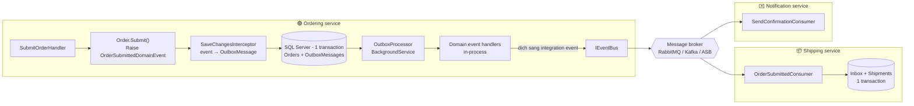
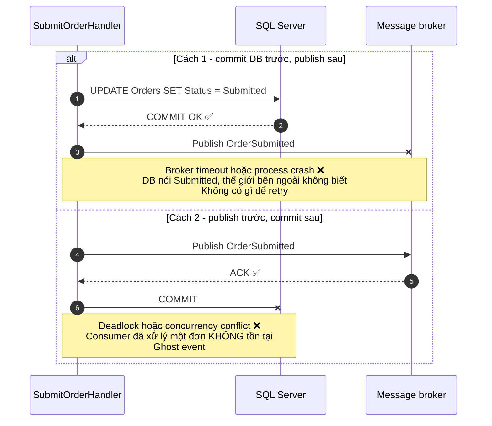
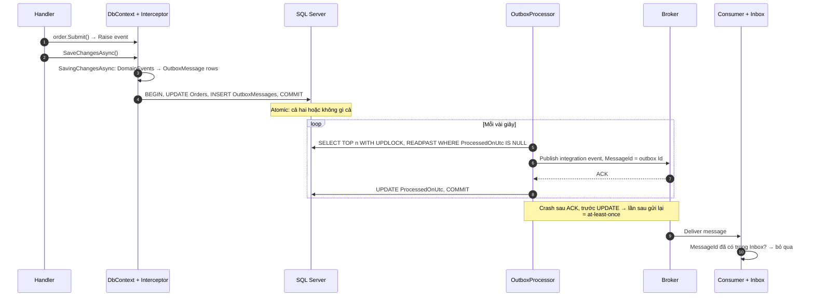
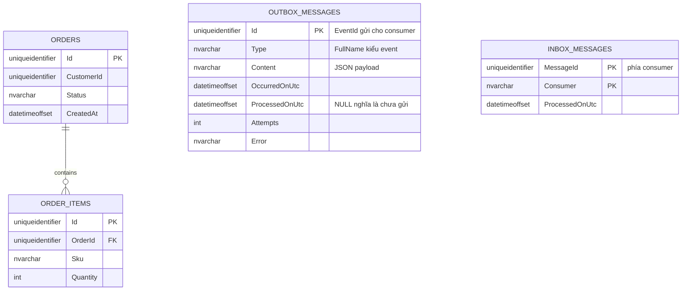
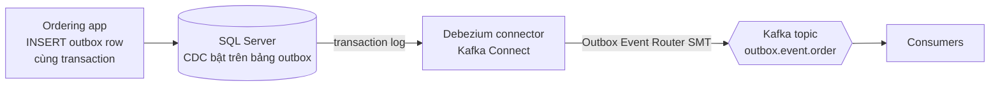
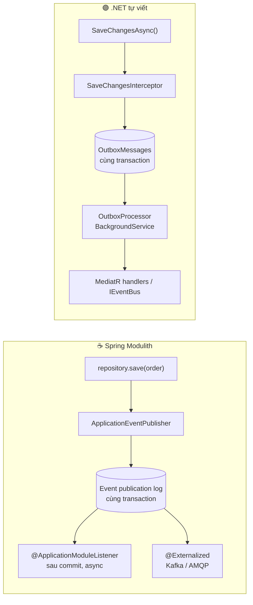

# Domain Events & Transactional Outbox

> [!summary] TL;DR
> - **Domain event** = "điều quan trọng đã xảy ra *bên trong* bounded context" (`OrderSubmitted`), xử lý **in-process**. **Integration event** = hợp đồng công khai gửi qua **message broker** cho service/module khác, xử lý **bất đồng bộ**.
> - **Dual-write problem**: ghi DB và publish lên broker là **2 hệ thống, không có transaction chung** → một bên thành công, bên kia thất bại = dữ liệu lệch vĩnh viễn.
> - **Transactional Outbox**: ghi event vào bảng `OutboxMessages` **trong cùng transaction** với dữ liệu nghiệp vụ; một **processor nền** đọc bảng và publish → đảm bảo **at-least-once**. Bên nhận dùng **Inbox / idempotent consumer** để chịu được bản trùng.
> - Trong .NET: aggregate `Raise()` event → `SaveChangesInterceptor` chuyển event thành outbox row → `BackgroundService` poll (`UPDLOCK, READPAST`) và dispatch. Hoặc dùng sẵn: MassTransit (v9 thương mại), Wolverine, DotNetCore.CAP, CDC (Debezium).

---

## 1. Problem — Vấn đề cần giải quyết

### 1.1 Bối cảnh

Handler `SubmitOrder` trong [[Clean-Architecture-in-DotNet]] (bản tối giản) làm thế này:

```csharp
order.Submit();                       // Domain raise OrderSubmittedDomainEvent (nhưng chưa ai dùng)
await db.SaveChangesAsync(ct);        // ① ghi DB — COMMIT
await email.SendAsync(..., ct);       // ② side-effect bên ngoài — có thể fail
// Sắp tới: ③ báo Shipping service, ④ trừ tồn kho, ⑤ cộng điểm loyalty…
```

### 1.2 Pain points

| Vấn đề | Hậu quả |
| --- | --- |
| **Coupling**: handler `SubmitOrder` phải biết email, shipping, inventory, loyalty | Mỗi tính năng mới phản ứng với "đơn đã submit" = sửa handler cũ (vi phạm OCP) |
| **Dual write**: ① commit xong, ② fail (SMTP timeout, process crash, deploy giữa chừng) | Đơn đã Submitted nhưng khách không nhận email, Shipping không biết → **lệch vĩnh viễn**, không có gì retry |
| **Đảo thứ tự cũng không cứu được**: gửi ② trước rồi mới commit ① | ① fail (deadlock, concurrency) → email "đã đặt hàng" cho một đơn **không tồn tại** (ghost event) |
| **Distributed transaction (2PC/MSDTC)** | Broker hiện đại (Kafka, RabbitMQ, Azure Service Bus) không tham gia XA/2PC thực tế; chậm, khoá lâu, phức tạp vận hành |
| **Retry ngây thơ** | Retry cả handler → `order.Submit()` lần 2 ném "only Draft orders…" hoặc gửi email 2 lần |

### 1.3 Domain Event vs Integration Event

| Tiêu chí | 🟡 Domain Event | 🔵 Integration Event |
| --- | --- | --- |
| Ý nghĩa | Sự thật nghiệp vụ trong **một** bounded context | Thông báo cho **context/service khác** |
| Ví dụ | `OrderSubmittedDomainEvent(OrderId)` | `OrderSubmittedIntegrationEvent(EventId, OrderId, CustomerId, Total, Currency, OccurredAt)` |
| Phạm vi | In-process (cùng app, cùng DbContext) | Out-of-process qua broker (RabbitMQ, Kafka, ASB) |
| Đồng bộ? | Thường **đồng bộ** (cùng request) hoặc qua outbox nội bộ | **Bất đồng bộ**, eventual consistency |
| Transaction | Có thể chung transaction với aggregate | **Không bao giờ** chung transaction với bên nhận |
| Payload | Có thể tham chiếu kiểu Domain (`Money`, enum nội bộ) | **DTO phẳng**, ổn định, versioned — là *public contract* |
| Thay đổi | Đổi thoải mái khi refactor | Đổi = breaking change với consumer → cần versioning |
| Nằm ở | `Ordering.Domain` | Project/package `Ordering.Contracts` dùng chung |
| Tên | Thì quá khứ, ngôn ngữ domain | Thì quá khứ, thường kèm tên context |

> [!important] Domain event ≠ Integration event
> Đừng publish thẳng domain event ra broker: nó lộ cấu trúc nội bộ, và mỗi lần refactor Domain là phá consumer. Một **handler** của domain event sẽ *dịch* sang integration event (Anti-Corruption giữa trong và ngoài).

### 1.4 Ý tưởng cốt lõi

1. Aggregate chỉ **ghi nhận** event (`Raise`) — không biết ai nghe, không publish (Domain zero dependency).
2. Hạ tầng **thu gom** event khi `SaveChanges` và lưu thành **outbox row trong cùng transaction** → "dữ liệu đổi" và "có event cần gửi" **cùng commit hoặc cùng rollback**.
3. Một **relay** (polling publisher hoặc transaction-log tailing/CDC) gửi outbox row đi, đánh dấu đã gửi; crash giữa chừng → gửi lại → **at-least-once**.
4. Consumer **idempotent** (Inbox table / unique constraint) → bản trùng vô hại → hiệu quả "exactly-once processing".

---

## 2. Mental Model & Diagram

### 2.1 Toàn cảnh



> [!info] Analogy — Sổ "việc cần làm" của thư ký
> Giám đốc ký hợp đồng (commit DB) và **trong cùng lúc** ghi vào sổ của thư ký: "gửi bản sao cho phòng kế toán" (outbox row). Thư ký (processor) cứ vài phút xem sổ, gửi đi, gạch tên. Nếu thư ký nghỉ ốm giữa chừng, người thay thế đọc sổ và gửi tiếp — có thể gửi **trùng** một bản, nên phòng kế toán phải có **sổ nhận** (inbox) để bỏ qua bản đã có.
> Không có sổ? Giám đốc phải tự gọi điện kế toán ngay sau khi ký — và nếu máy bận thì… quên luôn.

### 2.2 Dual-write problem



### 2.3 Transactional Outbox



---

## 3. Implementation & Code

### 3.1 Raise event trong aggregate (nhắc lại)

Base class từ [[Clean-Architecture-in-DotNet]] — giữ nguyên:

```csharp
// src/Ordering.Domain/Common/Entity.cs (đã có)
public interface IDomainEvent { }

public abstract class Entity
{
    private readonly List<IDomainEvent> _domainEvents = [];
    public Guid Id { get; protected init; } = Guid.CreateVersion7();
    public IReadOnlyCollection<IDomainEvent> DomainEvents => _domainEvents.AsReadOnly();
    protected void Raise(IDomainEvent domainEvent) => _domainEvents.Add(domainEvent);
    public void ClearDomainEvents() => _domainEvents.Clear();
}

// Order.Submit() đã có: Status = Submitted; Raise(new OrderSubmittedDomainEvent(Id));
```

> [!tip] Vì sao "ghi nhận" chứ không "publish ngay" trong aggregate?
> - Domain **không phụ thuộc** MediatR/broker (zero dependency).
> - Event chỉ có ý nghĩa **nếu transaction commit** — publish ngay trong `Submit()` thì nếu `SaveChanges` sau đó fail, event đã bay đi (ghost event).
> - Gom event tới lúc `SaveChanges` cho phép quyết định **chiến lược dispatch** ở hạ tầng (mục 3.2).

Wrapper để publish qua MediatR mà Domain không cần biết `INotification`:

```csharp
// src/Ordering.Application/Common/Events/DomainEventNotification.cs
using MediatR;
using Ordering.Domain.Common;

namespace Ordering.Application.Common.Events;

// EventId: định danh ổn định của lần xảy ra event → dùng làm khoá idempotency phía consumer
public sealed record DomainEventNotification<TEvent>(TEvent DomainEvent, Guid EventId) : INotification
    where TEvent : IDomainEvent;

public static class DomainEventNotificationFactory
{
    // Kiểu runtime của event quyết định handler nào chạy → phải dựng generic bằng reflection
    public static INotification Create(IDomainEvent domainEvent, Guid eventId)
    {
        var type = typeof(DomainEventNotification<>).MakeGenericType(domainEvent.GetType());
        return (INotification)Activator.CreateInstance(type, domainEvent, eventId)!;
    }
}
```

```csharp
// Handler domain event — 1 event, N handler, mỗi handler 1 trách nhiệm
public sealed class ReserveStockOnOrderSubmitted(IApplicationDbContext db)
    : INotificationHandler<DomainEventNotification<OrderSubmittedDomainEvent>>
{
    public Task Handle(DomainEventNotification<OrderSubmittedDomainEvent> notification, CancellationToken ct)
    {
        // ... cập nhật aggregate Stock trong cùng DB
        return Task.CompletedTask;
    }
}
```

### 3.2 Ba chiến lược dispatch

| Chiến lược | Hook EF Core | Handler chạy… | ✅ | ❌ | Dùng cho |
| --- | --- | --- | --- | --- | --- |
| **A. Trước SaveChanges** (in-process) | `SavingChangesAsync` | trong cùng transaction, trước khi ghi | Thay đổi của handler (aggregate khác) **commit cùng lúc**, atomic | Side-effect ngoài DB (email, HTTP) **không rollback được**; transaction dài hơn | Phối hợp **nhiều aggregate trong cùng DB** (eventual → immediate consistency có chủ đích) |
| **B. Sau SaveChanges** (in-process) | `SavedChangesAsync` | sau khi ghi | Dữ liệu đã có trong DB | Handler fail → event **mất**, không retry; nếu đang trong transaction tường minh thì "saved" ≠ "committed" | Việc **không quan trọng** (cache invalidation, metrics) |
| **C. Transactional Outbox** | `SavingChangesAsync` → chỉ *lưu* event | **sau**, bởi processor nền | **Bền vững**, retry, at-least-once, an toàn cho side-effect ngoài | Độ trễ (giây), thêm bảng + worker, consumer phải idempotent | Email, gọi service khác, **integration event** — mọi thứ "phải xảy ra" |

> [!info] Tranh luận kinh điển: 1 transaction hay eventual consistency giữa các aggregate?
> Evans và Vaughn Vernon ủng hộ "**1 transaction = 1 aggregate**", các aggregate khác cập nhật qua event (eventual). Jimmy Bogard chấp nhận side-effect của cùng một command nằm chung transaction (dispatch *ngay trước* commit). eBook *.NET Microservices* của Microsoft nhận định cả hai đều đúng tuỳ yêu cầu nghiệp vụ, và eShop chọn chiến lược A vì đơn giản nhất với EF Core + RDBMS. Quyết định thuộc về domain expert: "hai thay đổi này **bắt buộc** phải nhất quán tức thì không?"

Chữ ký interceptor (EF Core docs):

```csharp
// Trước khi gửi lệnh xuống DB
ValueTask<InterceptionResult<int>> SavingChangesAsync(
    DbContextEventData eventData, InterceptionResult<int> result, CancellationToken cancellationToken = default);

// Sau khi SaveChanges thành công (result = số dòng bị ảnh hưởng)
ValueTask<int> SavedChangesAsync(
    SaveChangesCompletedEventData eventData, int result, CancellationToken cancellationToken = default);
```

**Chiến lược A** — dispatch in-process trước khi lưu:

```csharp
// src/Ordering.Infrastructure/Persistence/Interceptors/DispatchDomainEventsInterceptor.cs
using MediatR;
using Microsoft.EntityFrameworkCore;
using Microsoft.EntityFrameworkCore.Diagnostics;
using Ordering.Application.Common.Events;
using Ordering.Domain.Common;

namespace Ordering.Infrastructure.Persistence.Interceptors;

internal sealed class DispatchDomainEventsInterceptor(IPublisher publisher) : SaveChangesInterceptor
{
    public override async ValueTask<InterceptionResult<int>> SavingChangesAsync(
        DbContextEventData eventData, InterceptionResult<int> result, CancellationToken cancellationToken = default)
    {
        if (eventData.Context is not null)
            await DispatchAsync(eventData.Context, cancellationToken);

        return await base.SavingChangesAsync(eventData, result, cancellationToken);
    }

    private async Task DispatchAsync(DbContext context, CancellationToken ct)
    {
        // Lặp: handler có thể sửa aggregate khác và raise THÊM event → xử lý tới khi hết
        while (true)
        {
            var entities = context.ChangeTracker.Entries<Entity>()
                .Select(e => e.Entity)
                .Where(e => e.DomainEvents.Count != 0)
                .ToList();
            if (entities.Count == 0) return;

            var events = entities.SelectMany(e => e.DomainEvents).ToList();
            entities.ForEach(e => e.ClearDomainEvents());   // clear TRƯỚC khi publish → không xử lý lặp

            foreach (var domainEvent in events)
                await publisher.Publish((object)DomainEventNotificationFactory.Create(domainEvent, Guid.CreateVersion7()), ct);
        }
    }
}
```

> [!warning] Chiến lược A + side-effect ngoài DB = dual write trá hình
> Handler `SendConfirmationEmail` chạy trong `SavingChangesAsync` → email gửi rồi, sau đó `SaveChanges` fail vì concurrency → email cho đơn không tồn tại. **Quy tắc:** handler chạy ở chiến lược A chỉ được **sửa dữ liệu trong cùng DbContext**. Mọi thứ ra ngoài process → chiến lược C.

### 3.3 Outbox — entity, cấu hình, schema

```csharp
// src/Ordering.Infrastructure/Outbox/OutboxMessage.cs
using System.Text.Json;
using Ordering.Domain.Common;

namespace Ordering.Infrastructure.Outbox;

public sealed class OutboxMessage
{
    public Guid Id { get; private set; }                       // = EventId gửi cho consumer (idempotency key)
    public string Type { get; private set; } = default!;       // tên kiểu event — là HỢP ĐỒNG, đừng đổi tuỳ tiện
    public string Content { get; private set; } = default!;    // JSON payload
    public DateTimeOffset OccurredOnUtc { get; private set; }
    public DateTimeOffset? ProcessedOnUtc { get; private set; } // NULL = chưa gửi
    public int Attempts { get; private set; }
    public string? Error { get; private set; }

    private OutboxMessage() { } // EF Core

    public static OutboxMessage From(IDomainEvent domainEvent, DateTimeOffset now) => new()
    {
        Id = Guid.CreateVersion7(),                            // v7 có thứ tự thời gian → index ít phân mảnh
        Type = domainEvent.GetType().FullName!,
        // Serialize theo KIỂU RUNTIME — nếu dùng typeof(IDomainEvent) sẽ ra "{}"
        Content = JsonSerializer.Serialize(domainEvent, domainEvent.GetType(), OutboxJson.Options),
        OccurredOnUtc = now
    };

    public void MarkProcessed(DateTimeOffset now) { ProcessedOnUtc = now; Error = null; }
    public void MarkFailed(string error) { Attempts++; Error = error.Length > 2000 ? error[..2000] : error; }
}

internal static class OutboxJson
{
    public static readonly JsonSerializerOptions Options = new(JsonSerializerDefaults.Web);
}
```

```csharp
// src/Ordering.Infrastructure/Persistence/Configurations/OutboxMessageConfiguration.cs
internal sealed class OutboxMessageConfiguration : IEntityTypeConfiguration<OutboxMessage>
{
    public void Configure(EntityTypeBuilder<OutboxMessage> builder)
    {
        builder.ToTable("OutboxMessages");
        builder.HasKey(m => m.Id);
        builder.Property(m => m.Id).ValueGeneratedNever();
        builder.Property(m => m.Type).HasMaxLength(300).IsRequired();
        builder.Property(m => m.Content).IsRequired();                 // nvarchar(max)
        builder.Property(m => m.Error).HasMaxLength(2000);

        // Filtered index: chỉ chứa các dòng CHƯA gửi → poll nhanh dù bảng có hàng triệu dòng đã xử lý
        builder.HasIndex(m => m.OccurredOnUtc)
               .HasFilter("[ProcessedOnUtc] IS NULL")
               .HasDatabaseName("IX_OutboxMessages_Unprocessed");
    }
}

// ApplicationDbContext: thêm DbSet NỘI BỘ Infrastructure (không đưa lên IApplicationDbContext)
public DbSet<OutboxMessage> OutboxMessages => Set<OutboxMessage>();
```



> `ORDERS` và `OUTBOX_MESSAGES` **không có FK** với nhau — điểm chung duy nhất là chúng được ghi trong **cùng một transaction**.

### 3.4 Interceptor: domain events → outbox rows

```csharp
// src/Ordering.Infrastructure/Persistence/Interceptors/ConvertDomainEventsToOutboxInterceptor.cs
using Microsoft.EntityFrameworkCore;
using Microsoft.EntityFrameworkCore.Diagnostics;
using Ordering.Domain.Common;
using Ordering.Infrastructure.Outbox;

namespace Ordering.Infrastructure.Persistence.Interceptors;

internal sealed class ConvertDomainEventsToOutboxInterceptor(TimeProvider clock) : SaveChangesInterceptor
{
    public override ValueTask<InterceptionResult<int>> SavingChangesAsync(
        DbContextEventData eventData, InterceptionResult<int> result, CancellationToken cancellationToken = default)
    {
        if (eventData.Context is not null)
            AddOutboxMessages(eventData.Context);

        // Outbox row vừa Add sẽ được INSERT trong CHÍNH lần SaveChanges này → cùng transaction với Orders
        return base.SavingChangesAsync(eventData, result, cancellationToken);
    }

    private void AddOutboxMessages(DbContext context)
    {
        var now = clock.GetUtcNow();
        var messages = new List<OutboxMessage>();

        foreach (var entry in context.ChangeTracker.Entries<Entity>())
        {
            var entity = entry.Entity;
            if (entity.DomainEvents.Count == 0) continue;

            messages.AddRange(entity.DomainEvents.Select(e => OutboxMessage.From(e, now)));
            // Clear ngay: nếu SaveChanges bị gọi lại (retry, hoặc handler gọi 2 lần) sẽ không sinh row trùng.
            // Nếu SaveChanges fail, các OutboxMessage vẫn ở trạng thái Added trong ChangeTracker → lần retry vẫn ghi đủ.
            entity.ClearDomainEvents();
        }

        if (messages.Count != 0)
            context.Set<OutboxMessage>().AddRange(messages);
    }
}
```

Đăng ký — interceptor lấy từ DI (vì cần `TimeProvider`, có thể cần `ICurrentUser`…):

```csharp
// src/Ordering.Infrastructure/DependencyInjection.cs (trích)
services.AddSingleton(TimeProvider.System);
services.AddScoped<ISaveChangesInterceptor, ConvertDomainEventsToOutboxInterceptor>();

services.AddDbContext<ApplicationDbContext>((sp, options) =>
{
    options.UseSqlServer(connectionString, sql => sql.EnableRetryOnFailure());
    // Overload (sp, options) → lấy interceptor từ container cho mỗi DbContext (options mặc định là Scoped)
    options.AddInterceptors(sp.GetServices<ISaveChangesInterceptor>());
});

services.AddHostedService<OutboxProcessor>();
```

> [!note] Interceptor chạy ở **mọi** `SaveChanges`
> Kể cả `SaveChanges` trong `UnitOfWorkBehavior`, trong job, trong test. Đó chính là điểm mạnh: **không ai "quên" publish event** — nhược điểm "dễ quên publish" mà microservices.io nêu về outbox được hạ tầng gánh hộ.

### 3.5 `OutboxProcessor` — `BackgroundService` polling (SQL Server)

```csharp
// src/Ordering.Infrastructure/Outbox/OutboxProcessor.cs
using System.Text.Json;
using MediatR;
using Microsoft.EntityFrameworkCore;
using Microsoft.Extensions.DependencyInjection;
using Microsoft.Extensions.Hosting;
using Microsoft.Extensions.Logging;
using Ordering.Application.Common.Events;
using Ordering.Domain.Common;
using Ordering.Infrastructure.Persistence;

namespace Ordering.Infrastructure.Outbox;

internal sealed class OutboxProcessor(
    IServiceScopeFactory scopeFactory, TimeProvider clock, ILogger<OutboxProcessor> logger) : BackgroundService
{
    private const int BatchSize = 20;
    private const int MaxAttempts = 10;
    private static readonly TimeSpan PollInterval = TimeSpan.FromSeconds(2);

    protected override async Task ExecuteAsync(CancellationToken stoppingToken)
    {
        using var timer = new PeriodicTimer(PollInterval);
        do
        {
            try
            {
                int count;
                // Còn việc (batch đầy) → làm tiếp ngay, không đợi tick — giảm độ trễ khi có burst
                do { count = await ProcessBatchAsync(stoppingToken); }
                while (count == BatchSize && !stoppingToken.IsCancellationRequested);
            }
            catch (Exception ex) when (ex is not OperationCanceledException)
            {
                // Từ .NET 6, exception thoát khỏi ExecuteAsync mặc định DỪNG cả host → luôn bắt ở vòng ngoài
                logger.LogError(ex, "Outbox polling cycle failed");
            }
        }
        while (await timer.WaitForNextTickAsync(stoppingToken));
    }

    private async Task<int> ProcessBatchAsync(CancellationToken ct)
    {
        // DbContext là Scoped, BackgroundService là Singleton → tự tạo scope cho mỗi batch
        await using var scope = scopeFactory.CreateAsyncScope();
        var db = scope.ServiceProvider.GetRequiredService<ApplicationDbContext>();
        var publisher = scope.ServiceProvider.GetRequiredService<IPublisher>();

        // EnableRetryOnFailure + transaction tự mở → BẮT BUỘC chạy trong execution strategy
        var strategy = db.Database.CreateExecutionStrategy();
        return await strategy.ExecuteAsync(async () =>
        {
            await using var tx = await db.Database.BeginTransactionAsync(ct);

            // UPDLOCK : giữ khoá update trên các dòng đã chọn tới hết transaction → instance khác không "claim" trùng
            // READPAST: bỏ qua dòng đang bị instance khác khoá thay vì chờ → nhiều replica chạy song song (competing workers)
            // ROWLOCK : gợi ý khoá mức dòng để hạn chế leo thang khoá
            // FromSql với chuỗi nội suy → tham số hoá (@p0, @p1), không phải nối chuỗi
            var messages = await db.OutboxMessages
                .FromSql($"""
                    SELECT TOP ({BatchSize}) *
                    FROM dbo.OutboxMessages WITH (UPDLOCK, READPAST, ROWLOCK)
                    WHERE ProcessedOnUtc IS NULL AND Attempts < {MaxAttempts}
                    ORDER BY OccurredOnUtc
                    """)
                .ToListAsync(ct);

            foreach (var message in messages)
            {
                try
                {
                    var domainEvent = DomainEventTypes.Deserialize(message.Type, message.Content);
                    // EventId = outbox Id → mọi lần retry gửi CÙNG một Id → consumer dedupe được
                    await publisher.Publish((object)DomainEventNotificationFactory.Create(domainEvent, message.Id), ct);
                    message.MarkProcessed(clock.GetUtcNow());
                }
                catch (Exception ex) when (ex is not OperationCanceledException)
                {
                    message.MarkFailed(ex.ToString());
                    logger.LogWarning(ex, "Outbox message {MessageId} ({Type}) failed, attempt {Attempts}",
                        message.Id, message.Type, message.Attempts);
                    // Muốn giữ thứ tự nghiêm ngặt → "break;" ở đây (head-of-line blocking) — xem 3.6
                }
            }

            await db.SaveChangesAsync(ct);
            await tx.CommitAsync(ct);   // nhả khoá
            return messages.Count;
        });
    }
}

internal static class DomainEventTypes
{
    // Map tên → Type dựng 1 lần. Đổi tên/namespace một event = dữ liệu outbox cũ không đọc được
    // → coi "Type" là hợp đồng (hoặc dùng attribute tên ổn định, VD [EventName("order.submitted.v1")])
    private static readonly Dictionary<string, Type> Map = typeof(IDomainEvent).Assembly.GetTypes()
        .Where(t => t is { IsAbstract: false, IsInterface: false } && typeof(IDomainEvent).IsAssignableFrom(t))
        .ToDictionary(t => t.FullName!, t => t);

    public static IDomainEvent Deserialize(string typeName, string json)
    {
        if (!Map.TryGetValue(typeName, out var type))
            throw new InvalidOperationException($"Unknown domain event type '{typeName}'.");
        return (IDomainEvent)JsonSerializer.Deserialize(json, type, OutboxJson.Options)!;
    }
}
```

> [!warning] Giữ khoá trong lúc gọi broker
> Cách trên giữ transaction + row lock trong khi publish → batch phải **nhỏ**, publish phải có **timeout**. Biến thể phổ biến khi publish chậm: (1) transaction ngắn để *claim* (`UPDATE ... SET LockedUntil = now + 30s OUTPUT inserted.*`), (2) publish ngoài transaction, (3) cập nhật `ProcessedOnUtc`. Lease hết hạn → dòng tự được claim lại.

### 3.6 Retry, thứ tự, poison message, dọn dẹp

| Vấn đề | Giải pháp |
| --- | --- |
| **Retry** | `Attempts` + `Error`; poll lại dòng có `Attempts < MaxAttempts`. Nâng cao: cột `NextAttemptAtUtc` cho **exponential backoff** |
| **Poison message** (luôn fail: payload lỗi, type không còn) | Vượt `MaxAttempts` → nằm lại với `Error` → **alert** + công cụ replay thủ công. Không được chặn cả hàng đợi mãi mãi |
| **Thứ tự** | `ORDER BY OccurredOnUtc` + 1 worker = có thứ tự toàn cục, nhưng **nhiều worker + READPAST phá thứ tự**. Thực tế chỉ cần thứ tự **theo aggregate**: thêm cột `AggregateId`, dùng làm **partition key** của Kafka/session id của ASB; consumer bỏ qua event cũ hơn version đã xử lý |
| **Nhiều handler cho 1 event** | Publish qua MediatR tới 3 handler: handler 1 OK, handler 3 fail → retry cả message → handler 1 chạy lại. ⇒ Handler **phải idempotent**, hoặc tách **mỗi handler một outbox row** (cách Wolverine/MassTransit làm) |
| **Dọn dẹp** | Job định kỳ: `DELETE TOP (5000) FROM OutboxMessages WHERE ProcessedOnUtc < @cutoff` (xoá theo lô để tránh khoá lớn và phình transaction log) |
| **Độ trễ** | Poll 1–2s là đủ cho đa số; cần thấp hơn → "nudge" processor ngay sau commit (Channel/SemaphoreSlim) hoặc dùng CDC |
| **Giám sát** | Metric: số dòng chưa xử lý, tuổi dòng cũ nhất (*outbox lag*), số dòng vượt MaxAttempts |

### 3.7 Integration event & publish ra broker

```csharp
// src/Ordering.Contracts/OrderSubmittedIntegrationEvent.cs — project/NuGet chia sẻ cho consumer
namespace Ordering.Contracts;

// DTO phẳng, primitive, ổn định. Thêm field = OK (consumer bỏ qua field lạ). Đổi/xoá field = version mới.
public sealed record OrderSubmittedIntegrationEvent(
    Guid EventId, Guid OrderId, Guid CustomerId, decimal Total, string Currency, DateTimeOffset OccurredAt);
```

```csharp
// src/Ordering.Application/Common/Interfaces/IEventBus.cs — port; adapter RabbitMQ/ASB/Kafka ở Infrastructure
public interface IEventBus
{
    Task PublishAsync<T>(T integrationEvent, CancellationToken ct = default) where T : class;
}

// src/Ordering.Application/Orders/Events/PublishOrderSubmittedIntegrationEvent.cs
public sealed class PublishOrderSubmittedIntegrationEvent(IApplicationDbContext db, IEventBus bus, TimeProvider clock)
    : INotificationHandler<DomainEventNotification<OrderSubmittedDomainEvent>>
{
    public async Task Handle(DomainEventNotification<OrderSubmittedDomainEvent> notification, CancellationToken ct)
    {
        // Domain event chỉ mang OrderId → làm giàu dữ liệu cho consumer (tránh consumer phải gọi ngược lại Ordering)
        var snapshot = await db.Orders
            .Where(o => o.Id == notification.DomainEvent.OrderId)
            .Select(o => new
            {
                o.CustomerId,
                Total = o.Items.Sum(i => i.UnitPrice.Amount * i.Quantity),
                Currency = o.Items.Select(i => i.UnitPrice.Currency).FirstOrDefault() ?? "USD"
            })
            .SingleAsync(ct);

        await bus.PublishAsync(new OrderSubmittedIntegrationEvent(
            notification.EventId,                 // = outbox Id → ổn định qua các lần retry
            notification.DomainEvent.OrderId,
            snapshot.CustomerId, snapshot.Total, snapshot.Currency,
            clock.GetUtcNow()), ct);
    }
}
```

> [!tip] Snapshot lúc *xử lý* hay lúc *xảy ra*?
> Đọc lại DB trong handler cho dữ liệu **tại thời điểm processor chạy** (có thể đã đổi). Nếu consumer cần chính xác trạng thái *lúc event xảy ra* → đưa đủ dữ liệu vào **domain event** ngay khi `Raise` (event "béo" hơn nhưng bất biến).

### 3.8 Inbox — idempotent consumer

**At-least-once** ⇒ consumer **sẽ** nhận trùng (outbox retry, broker redelivery, consumer crash trước khi ack). Hai cách chống trùng:

1. **Idempotent tự nhiên**: unique constraint nghiệp vụ (`Shipments.OrderId UNIQUE`), `UPSERT`, "set status = X" thay vì "tăng thêm".
2. **Inbox table**: ghi `MessageId` đã xử lý **trong cùng transaction** với thay đổi nghiệp vụ.

```csharp
// Shipping service
public sealed record InboxMessage(Guid MessageId, string Consumer, DateTimeOffset ProcessedOnUtc);
// Configuration: builder.HasKey(i => new { i.MessageId, i.Consumer });  ← composite PK chặn trùng ở mức DB

public sealed class OrderSubmittedConsumer(ShippingDbContext db, TimeProvider clock)
{
    private const string ConsumerName = nameof(OrderSubmittedConsumer);

    public async Task HandleAsync(OrderSubmittedIntegrationEvent message, CancellationToken ct)
    {
        var duplicate = await db.InboxMessages
            .AnyAsync(i => i.MessageId == message.EventId && i.Consumer == ConsumerName, ct);
        if (duplicate) return;   // đã xử lý → ACK và bỏ qua

        db.Shipments.Add(Shipment.CreateFor(message.OrderId, message.CustomerId));
        db.InboxMessages.Add(new InboxMessage(message.EventId, ConsumerName, clock.GetUtcNow()));

        // CÙNG một SaveChanges = cùng transaction: hoặc có cả Shipment + Inbox, hoặc không gì cả.
        // Hai instance xử lý song song cùng message → instance sau vi phạm PK → DbUpdateException
        // → bắt riêng lỗi duplicate key và coi như đã xử lý.
        await db.SaveChangesAsync(ct);
    }
}
```

| Ngữ nghĩa giao nhận | Cách đạt | Rủi ro |
| --- | --- | --- |
| **At-most-once** | Publish rồi mới ghi DB / ack trước khi xử lý | Mất message |
| **At-least-once** | Outbox + retry; ack **sau** khi xử lý | Trùng message → cần idempotency |
| **"Exactly-once"** | Không tồn tại ở tầng mạng phân tán; đạt **hiệu quả** bằng at-least-once **+** idempotent consumer | Phải thiết kế dedupe đúng |

### 3.9 Lựa chọn thay thế: CDC & thư viện

**Change Data Capture (Debezium)** — *transaction log tailing* thay vì polling:



- Debezium **Outbox Event Router** (`io.debezium.transforms.outbox.EventRouter`) mong đợi bảng có các cột `id`, `aggregatetype`, `aggregateid`, `type`, `payload`; route theo `aggregatetype` → topic mặc định `outbox.event.<aggregatetype>`, `aggregateid` thành message key (giữ thứ tự theo aggregate trong partition).
- SMT chỉ quan tâm `INSERT` (bỏ qua `DELETE`) → có thể xoá row sớm để bảng không phình; event vẫn nằm trong transaction log.
- ✅ Độ trễ thấp, không polling app-side. ❌ Cần Kafka Connect + vận hành Debezium; SQL Server phải bật CDC.

**Thư viện .NET:**

| Thư viện | Outbox/Inbox | Ghi chú giấy phép (👉 kiểm tra điều khoản hiện hành) |
| --- | --- | --- |
| **MassTransit** | *Bus Outbox* + *Consumer Outbox/Inbox* với EF Core (3 bảng `InboxState`, `OutboxMessage`, `OutboxState`), hỗ trợ SQL Server/Postgres/MySQL | **v8: Apache 2.0** (MassTransit cho biết vẫn nhận bản vá bảo mật/critical tới ít nhất hết 2026). **v9: thương mại** (Massient), cần license key lúc runtime |
| **Wolverine** (JasperFx) | Durable inbox/outbox, tích hợp EF Core & Marten; `UseDurableOutboxOnAllSendingEndpoints()`, `PersistMessagesWithSqlServer(...)` | MIT |
| **DotNetCore.CAP** | Outbox + event bus; `ICapPublisher` publish trong `Database.BeginTransaction(capBus, autoCommit)`; `[CapSubscribe("topic")]`; storage SQL Server/MySQL/Postgres/Mongo; transport RabbitMQ/Kafka/ASB/SQS/NATS/Redis Streams/Pulsar | MIT |
| **NServiceBus** | Outbox + dedupe tích hợp | Thương mại |
| **Tự viết** (note này) | Như mục 3.3–3.8 | Toàn quyền; tự chịu edge case |

```csharp
// MassTransit (v8 API) — Bus Outbox với EF Core
services.AddMassTransit(x =>
{
    x.AddEntityFrameworkOutbox<ApplicationDbContext>(o =>
    {
        o.UseSqlServer();
        o.UseBusOutbox();          // IPublishEndpoint.Publish trong request → ghi vào outbox, gửi sau khi SaveChanges
    });
    x.UsingRabbitMq((ctx, cfg) => cfg.ConfigureEndpoints(ctx));
});
// OnModelCreating: modelBuilder.AddInboxStateEntity(); modelBuilder.AddOutboxMessageEntity(); modelBuilder.AddOutboxStateEntity();
// Consumer outbox/inbox (idempotent consumer): trên receive endpoint gọi e.UseEntityFrameworkOutbox<ApplicationDbContext>(context)
```

---

## 4. Comparison — Đối chiếu Java / Spring Boot

### 4.1 Bảng ánh xạ

| Khái niệm | ☕ Java / Spring | 🟣 .NET | Ghi chú |
| --- | --- | --- | --- |
| Ghi nhận event trong aggregate | `AbstractAggregateRoot.registerEvent(...)` / `@DomainEvents` (Spring Data) | `Entity.Raise(...)` + `DomainEvents` | Spring Data publish khi gọi `repository.save()` |
| Thu gom & dispatch khi lưu | Spring Data tự gọi `ApplicationEventPublisher` lúc `save()` | `SaveChangesInterceptor` (tự viết) | |
| Listener sau commit | `@TransactionalEventListener(phase = AFTER_COMMIT)` (mặc định là AFTER_COMMIT) | `SavedChangesAsync` (≈, nhưng "saved" ≠ "committed" nếu có transaction ngoài) | Spring biết ranh giới transaction tốt hơn |
| Listener trong transaction | `@TransactionalEventListener(BEFORE_COMMIT)` / `@EventListener` | `SavingChangesAsync` (chiến lược A) | |
| Outbox bền vững | **Spring Modulith Event Publication Registry** (bảng event publication, ghi trong transaction gốc, đánh dấu complete khi listener thành công) | Outbox tự viết / MassTransit / Wolverine / CAP | Modulith = outbox cho listener **nội bộ** |
| Xuất event ra broker | Modulith `@Externalized("topic::key")` + `spring-modulith-events-kafka/amqp/jms` | `IEventBus` + handler dịch sang integration event | |
| Republish khi khởi động | `spring.modulith.events.republish-outstanding-events-on-restart=true` | Processor tự poll dòng `ProcessedOnUtc IS NULL` | |
| Dọn dẹp | `spring.modulith.events.completion-mode=UPDATE/DELETE/ARCHIVE` | Job `DELETE` theo lô | |
| CDC | Debezium (Java-native) + Outbox Event Router | Debezium (chạy riêng, ngôn ngữ app không quan trọng) | |
| Framework đầy đủ | Axon, Eventuate Tram | MassTransit, Wolverine, NServiceBus, CAP | |

### 4.2 Java tương đương

```java
// Aggregate — Spring Data thu event và publish khi repository.save(order)
@Entity
public class Order extends AbstractAggregateRoot<Order> {
    @Id private UUID id;
    @Enumerated(EnumType.STRING) private OrderStatus status;

    public void submit() {
        if (status != OrderStatus.DRAFT) throw new IllegalStateException("Only draft orders can be submitted");
        status = OrderStatus.SUBMITTED;
        registerEvent(new OrderSubmitted(id));   // ≈ Raise(...)
    }
}

// Integration event được "externalize" ra Kafka; key = orderId → giữ thứ tự theo aggregate
@Externalized("orders.submitted::#{#this.orderId()}")
public record OrderSubmitted(UUID orderId) {}

@Component
class ShippingListener {
    // = @Async + @Transactional(REQUIRES_NEW) + @TransactionalEventListener
    // Có Event Publication Registry: entry ghi trong transaction gốc, chỉ "complete" khi listener chạy xong
    @ApplicationModuleListener
    void on(OrderSubmitted event) { /* tạo shipment */ }
}
```

```properties
# application.properties
spring.modulith.events.republish-outstanding-events-on-restart=true
spring.modulith.events.completion-mode=DELETE
```



> [!warning] Bẫy khi chuyển từ Java sang .NET
> - **Không có `@TransactionalEventListener`**: EF Core không có "sau commit" built-in gắn với transaction ambient. `SavedChangesAsync` chạy sau `SaveChanges` — nhưng nếu bạn đang ở trong `TransactionBehavior` (transaction tường minh), dữ liệu **chưa commit**. Đừng gửi side-effect ở đó.
> - **`AFTER_COMMIT` của Spring cũng không bền**: app crash ngay sau commit → event mất. Đó là lý do Spring Modulith thêm Event Publication Registry — tức là… outbox. Hai bên hội tụ về cùng một lời giải.
> - **MediatR `Publish` mặc định chạy tuần tự, cùng scope, cùng DbContext** với request — không phải `@Async`. Handler chậm làm chậm request (chiến lược A/B).
> - **Spring tự publish khi `save()`**; EF không có `save()` theo entity → phải dựa vào interceptor ở mức `SaveChanges` (toàn bộ ChangeTracker).
> - **BackgroundService là Singleton** — không inject `DbContext` trực tiếp (lỗi *Cannot consume scoped service*); dùng `IServiceScopeFactory`. Tương đương bên Spring: `@Scheduled` bean singleton nhưng `EntityManager` là proxy thread-bound nên bạn không gặp lỗi này.

---

## 5. Trade-offs & Best Practices

### ✅ Ưu điểm
- **Tách coupling**: thêm phản ứng mới với `OrderSubmitted` = thêm handler, không sửa handler cũ (OCP).
- **Atomic**: thay đổi nghiệp vụ và "nghĩa vụ phải báo cho thế giới" commit cùng nhau — hết dual write.
- **Bền vững**: crash, deploy, broker down → event vẫn nằm trong DB, gửi lại sau.
- **Không cần 2PC**; hoạt động với mọi broker.
- **Audit miễn phí**: bảng outbox là nhật ký "chuyện gì đã xảy ra".

### ❌ Nhược điểm / Chi phí
- **Eventual consistency**: consumer thấy thay đổi sau vài giây; UI/nghiệp vụ phải chấp nhận.
- **Trùng message là chắc chắn** → mọi consumer phải idempotent.
- **Thêm hạ tầng**: bảng, index, worker, cleanup, monitoring outbox lag.
- **Thứ tự** khó với nhiều worker; cần partition key theo aggregate.
- **Tải DB**: polling liên tục; bảng phình nếu quên dọn.
- **Debug khó hơn**: luồng không còn tuyến tính; cần correlation id + distributed tracing.

### 🎯 Khi nào dùng — khi nào KHÔNG dùng

| Nên dùng khi | Không nên dùng khi |
| --- | --- |
| Có side-effect ngoài DB **bắt buộc phải xảy ra** (email xác nhận, thanh toán, báo service khác) | Monolith nhỏ, mọi phản ứng đều là ghi DB cùng context → chiến lược A là đủ |
| Microservices / modular monolith giao tiếp bằng event | Side-effect "best effort" (metrics, cache) → chiến lược B |
| Không thể chấp nhận mất event | Yêu cầu nhất quán **tức thì** giữa hai hệ thống (xem lại ranh giới, có thể cần gộp context) |
| Muốn audit trail các event đã phát | Team chưa sẵn sàng vận hành idempotency + eventual consistency |

### 📋 Best practices
- [ ] Aggregate chỉ `Raise`, không publish; Domain không reference MediatR/broker.
- [ ] Domain event (nội bộ) **tách** khỏi integration event (contract, versioned, project `Contracts`).
- [ ] Outbox row ghi **trong cùng `SaveChanges`/transaction** với dữ liệu nghiệp vụ (interceptor).
- [ ] `EventId` ổn định (= outbox Id) đi kèm message → consumer dedupe.
- [ ] Consumer idempotent: Inbox table (PK `MessageId + Consumer`) hoặc unique constraint nghiệp vụ.
- [ ] Processor: scope per batch, execution strategy, `UPDLOCK, READPAST`, batch nhỏ, timeout khi publish.
- [ ] Filtered index trên dòng chưa xử lý; job dọn dẹp theo lô.
- [ ] `MaxAttempts` + alert poison message; metric *outbox lag*.
- [ ] Partition key = `AggregateId` khi cần thứ tự theo aggregate.
- [ ] Handler chạy trong `SavingChangesAsync` **không** gọi ra ngoài process.
- [ ] Propagate `traceparent`/correlation id vào outbox row để trace xuyên service.

### 🐞 Lỗi thường gặp

| Lỗi | Hậu quả | Cách sửa |
| --- | --- | --- |
| Gửi email/HTTP trong handler chạy ở `SavingChangesAsync` | Email cho đơn bị rollback | Chuyển sang outbox (chiến lược C) |
| Serialize `JsonSerializer.Serialize<IDomainEvent>(e)` | Payload `{}` — mất dữ liệu | Serialize theo `e.GetType()` |
| Không `ClearDomainEvents()` | Event bị ghi/xử lý lặp ở lần `SaveChanges` sau | Clear ngay khi đã chuyển thành outbox row |
| Inject `ApplicationDbContext` vào `BackgroundService` | *Cannot consume scoped service from singleton* | `IServiceScopeFactory.CreateAsyncScope()` mỗi batch |
| Tự mở transaction khi bật `EnableRetryOnFailure` mà không dùng execution strategy | `InvalidOperationException` từ EF | `CreateExecutionStrategy().ExecuteAsync(...)` |
| Exception thoát `ExecuteAsync` | Host dừng (.NET 6+ mặc định `StopHost`) | Bắt ở vòng lặp ngoài, log |
| Nhiều replica poll không có `READPAST/UPDLOCK` | Gửi trùng hàng loạt hoặc chờ khoá lẫn nhau | Hint khoá như mục 3.5 hoặc lease column |
| Consumer không idempotent | Tạo 2 shipment, trừ kho 2 lần | Inbox / unique constraint |
| Đổi tên namespace của event class | Processor không deserialize được dòng cũ | Tên kiểu ổn định (attribute/map), migration dữ liệu outbox |
| Không bao giờ xoá outbox | Bảng hàng trăm triệu dòng, backup/index chậm | Cleanup job, filtered index |

---

## 6. Self-check — Câu hỏi tự kiểm tra

> [!question]- Domain event và integration event khác nhau ở những điểm nào? Vì sao không publish thẳng domain event lên broker?
> Domain event: nội bộ một bounded context, in-process, có thể dùng kiểu Domain, đổi tự do. Integration event: hợp đồng công khai, qua broker, bất đồng bộ, DTO phẳng, versioned. Publish thẳng domain event làm lộ cấu trúc nội bộ và biến mọi refactor Domain thành breaking change với consumer — nên dùng handler để dịch domain event → integration event.

> [!question]- Mô tả dual-write problem bằng 2 kịch bản thất bại.
> (1) Commit DB xong, publish broker fail/crash → DB đã đổi nhưng hệ thống khác không bao giờ biết. (2) Publish trước, commit DB sau và commit fail → consumer xử lý một sự kiện không tồn tại (ghost event). Gốc rễ: hai tài nguyên không có transaction chung, và 2PC không thực tế với broker hiện đại.

> [!question]- Tại sao outbox chỉ đảm bảo at-least-once, và phía consumer phải làm gì?
> Processor có thể crash sau khi broker ACK nhưng trước khi đánh dấu `ProcessedOnUtc` → lần sau gửi lại; broker cũng có thể redeliver. Consumer phải idempotent: lưu `MessageId` vào Inbox trong cùng transaction với thay đổi nghiệp vụ (PK chặn trùng), hoặc dựa vào unique constraint/upsert nghiệp vụ.

> [!question]- `UPDLOCK, READPAST` giải quyết vấn đề gì khi chạy nhiều instance processor? Có mất gì không?
> `UPDLOCK` giữ khoá trên dòng đã chọn tới hết transaction nên instance khác không claim trùng; `READPAST` cho instance khác bỏ qua dòng đang bị khoá thay vì chờ → các worker chia nhau batch song song. Cái giá: mất thứ tự toàn cục (worker B có thể gửi event mới hơn trước khi worker A gửi event cũ) → nếu cần thứ tự, đảm bảo theo aggregate (partition key) hoặc chỉ chạy một worker.

> [!question]- Trong EF Core, gửi email ở `SavedChangesAsync` có an toàn không?
> Không hoàn toàn. Nếu handler fail thì không có retry (event mất). Và nếu `SaveChanges` đang nằm trong transaction tường minh (VD `TransactionBehavior`), "saved" chưa phải "committed" — transaction ngoài vẫn có thể rollback sau khi email đã gửi. Side-effect bắt buộc → outbox.

> [!question]- (Phỏng vấn) So sánh Transactional Outbox tự viết (polling) với CDC/Debezium và với Spring `@TransactionalEventListener(AFTER_COMMIT)`.
> `AFTER_COMMIT` chạy sau commit nhưng không bền: crash giữa commit và listener là mất event (Spring Modulith bổ sung Event Publication Registry để khắc phục — bản chất là outbox). Polling outbox: đơn giản, chỉ cần DB + worker, độ trễ theo chu kỳ poll, tải DB do polling. CDC/Debezium: đọc transaction log, độ trễ thấp, không polling, giữ thứ tự theo key, nhưng cần Kafka Connect và vận hành phức tạp. Cả hai cách outbox đều at-least-once → consumer phải idempotent.

---

## 7. Liên kết & Tham khảo
- **Bản đồ:** [[Architecture-Design-MOC]]
- **Note liên quan:** [[Clean-Architecture-in-DotNet]] (`Entity.Raise`, `SaveChangesInterceptor`) · [[CQRS-and-MediatR-Pattern]] (`INotification`, `TransactionBehavior`, mục 3.8) · [[DDD-Tactical-Patterns]] (Aggregate, Domain Event) · [[Repository-UnitOfWork-Specification]] · [[Result-Pattern-vs-Exceptions]]
- **Pattern nền:** [[Behavioral-Patterns#Observer]] · [[Behavioral-Patterns#Mediator]] · [[Coupling-and-Cohesion]] · [[Modular-Monolith]]
- **Đọc tiếp:** [[Event-Driven-Architecture]] · [[Microservices-Architecture]] · [[EF-Core-Transactions-and-Concurrency]] · [[Testing-in-DotNet]] · [[Java-to-DotNet-Mental-Map]]
- **Nguồn:**
  - Microsoft Learn — *EF Core Interceptors* (`SaveChangesInterceptor`); *Domain events: design and implementation* (.NET Microservices eBook)
  - Chris Richardson — *Pattern: Transactional outbox* (microservices.io)
  - Debezium docs — *Outbox Event Router*
  - Spring Modulith reference — *Working with Application Events* (Event Publication Registry, Externalization)
  - MassTransit docs (Transactional Outbox, v9 announcement); Wolverine docs (Durable messaging); GitHub `dotnetcore/CAP`
