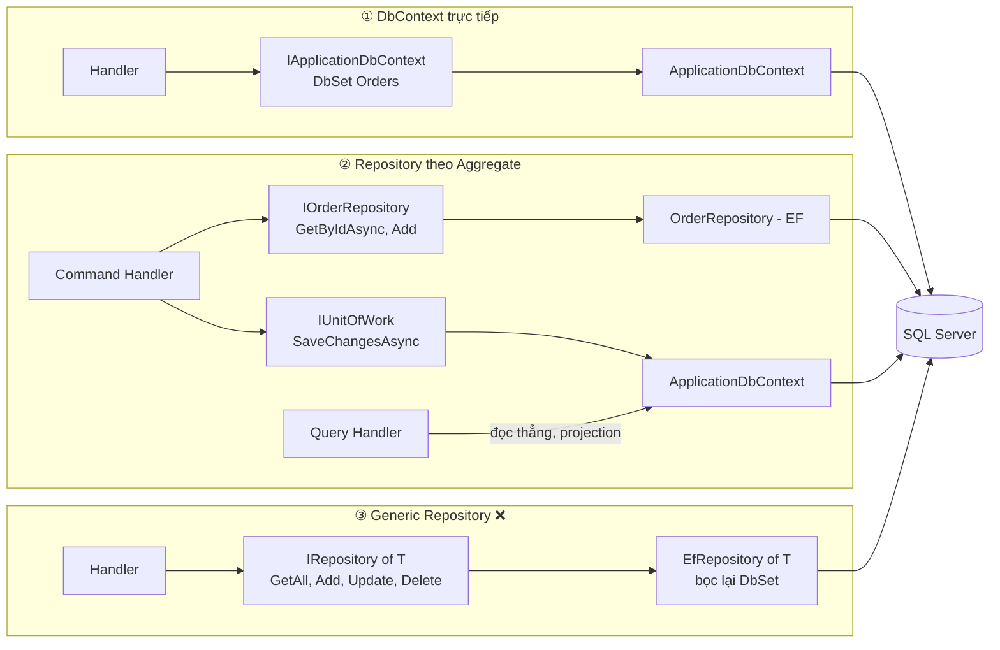
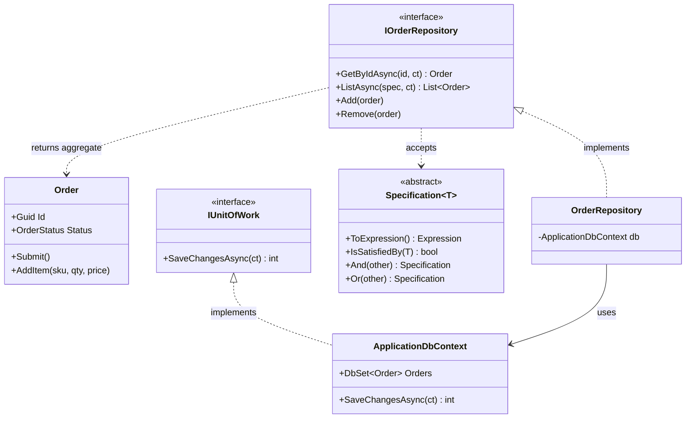
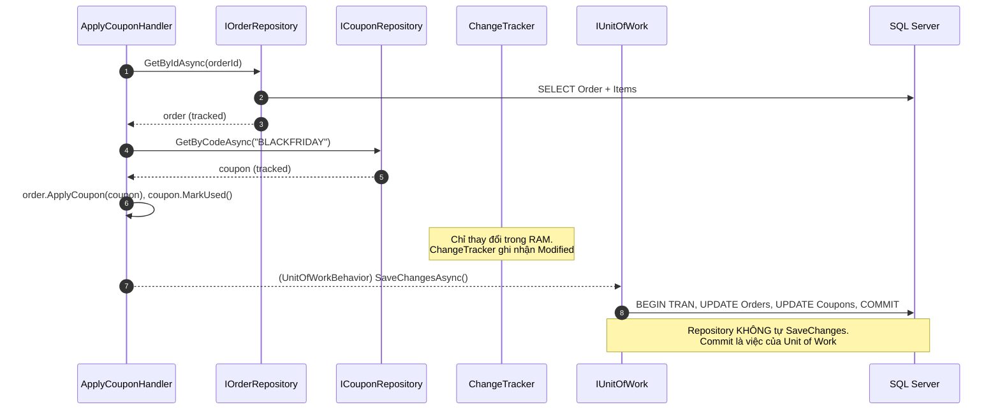
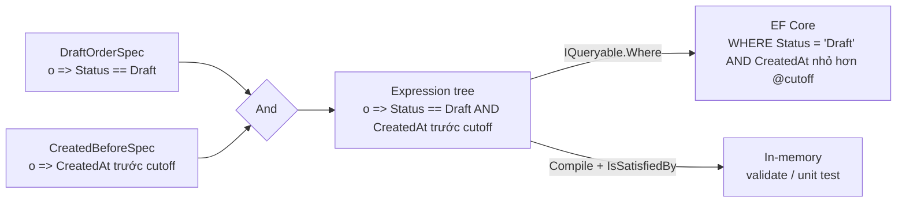
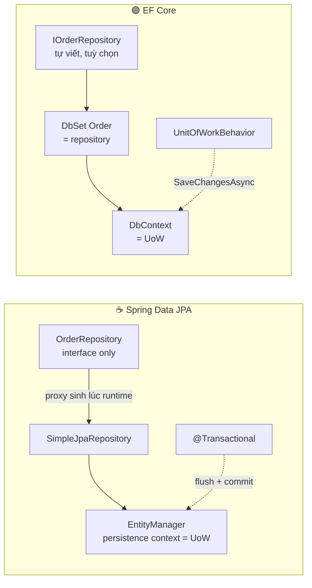

# Repository, Unit of Work & Specification

> [!summary] TL;DR
> - **Repository** (Fowler): lớp trung gian giữa domain và tầng data mapping, cho cảm giác thao tác với **một collection trong bộ nhớ**. **Unit of Work**: theo dõi mọi thay đổi trong một "giao dịch nghiệp vụ" rồi ghi xuống DB **một lần**.
> - Trong .NET: **`DbContext` đã là Unit of Work, `DbSet<T>` đã là Repository** (chính Microsoft ghi trong API docs). Bọc thêm `IRepository<T>` generic gần như luôn là **anti-pattern**.
> - Repository **đáng viết** khi: là **repository theo Aggregate** (DDD, phía write), cần **gói query phức tạp có tên nghiệp vụ**, cần đổi nguồn dữ liệu, hoặc muốn Application không biết EF tồn tại.
> - **Specification**: đóng gói một điều kiện (hoặc cả một "query object": where + include + order + paging) thành class tái sử dụng, kết hợp được (`And/Or`), test được in-memory. Thư viện phổ biến: **Ardalis.Specification**.

---

## 1. Problem — Vấn đề cần giải quyết

### 1.1 Bối cảnh

Bạn đến từ Spring Boot: mọi entity đều có một `XxxRepository extends JpaRepository<Xxx, UUID>`, gần như phản xạ. Sang .NET, bạn mở template Clean Architecture thì thấy… hai trường phái cãi nhau:

| Trường phái | Ví dụ | Lập luận |
| --- | --- | --- |
| "Không cần repository" | Jason Taylor template, Jimmy Bogard | `DbContext` đã là Repository + UoW; bọc thêm chỉ mất tính năng EF (`Include`, projection, `AsNoTracking`) |
| "Repository theo aggregate" | eShopOnContainers, Ardalis template, DDD thuần | Domain/Application không biết ORM; chỉ aggregate root có repository; query đặt tên theo nghiệp vụ |

Note này giúp bạn **chọn có lý do**, không theo phản xạ Java.

### 1.2 Nếu làm sai thì sao? (Pain points)

| Triệu chứng | Nguyên nhân gốc |
| --- | --- |
| `IRepository<T>` có `GetAll()` trả `IEnumerable<T>` → load cả bảng lên RAM rồi mới `Where` | Generic repo che mất `IQueryable`, dev không biết query chạy ở đâu |
| Repo phình: `GetByCustomerAndStatusAndDateRangePagedSortedWithItems(...)` | Mỗi màn hình đọc mới = thêm 1 method repo |
| `repo.Update(order)` gọi `SaveChanges` bên trong; handler gọi 3 repo → 3 transaction | Nhầm lẫn trách nhiệm Repository vs Unit of Work |
| Logic "đơn nháp quá 7 ngày" copy ở 4 chỗ (job dọn dẹp, báo cáo, API, email nhắc) | Điều kiện nghiệp vụ không có "tên" và không có nhà |
| Mock `IRepository<Order>` trả list giả → test pass, production fail vì LINQ không dịch được sang SQL | Test in-memory không chứng minh được query đúng với provider thật |

### 1.3 Định nghĩa gốc (Fowler, *Patterns of Enterprise Application Architecture*, 2002)

| Pattern | Ý chính (diễn giải) | Từ khoá cần nhớ |
| --- | --- | --- |
| **Repository** | Trung gian giữa domain và data mapping, cung cấp giao diện **giống collection** để truy cập domain object. Client mô tả *cái cần lấy*, repository lo *cách lấy*. | *collection-like interface* |
| **Unit of Work** | Ghi nhận mọi object bị ảnh hưởng (thêm/sửa/xoá) trong một giao dịch nghiệp vụ, rồi **tính toán và ghi thay đổi một lần**, xử lý xung đột concurrency. | *track changes → commit once* |
| **Specification** (Evans & Fowler, 1997; *DDD* 2003) | Một predicate nghiệp vụ được đặt tên, trả lời "object này có thoả điều kiện không?" — dùng để **validate**, **chọn lọc** (query) và **xây dựng theo yêu cầu**. | `IsSatisfiedBy(candidate)` |

### 1.4 Sự thật quan trọng: `DbContext` đã là UoW + Repository

> [!important] Microsoft nói thẳng điều này
> - API docs của `DbContext`: *"DbContext is a combination of the Unit Of Work and Repository patterns."* (Microsoft Learn, `DbContext` class remarks)
> - eBook *.NET Microservices Architecture*: EF `DbContext` hiện thực cả Repository và Unit of Work; UoW được "thực thi" khi gọi `SaveChanges`.
>
> | Khái niệm Fowler | EF Core |
> | --- | --- |
> | Unit of Work | `DbContext` + `ChangeTracker` + `SaveChangesAsync()` |
> | Repository (collection-like) | `DbSet<T>` (`Add`, `Remove`, LINQ `Where/FirstOrDefaultAsync`) |
> | Identity Map | Change tracker (cùng key → cùng instance trong 1 context) |
> | Query Object | `IQueryable<T>` / Expression tree |

⇒ Câu hỏi đúng **không phải** "có cần Repository không?" mà là "**có cần một abstraction NỮA trên Repository sẵn có không, và abstraction đó mang lại gì?**"

---

## 2. Mental Model & Diagram

### 2.1 Ba lựa chọn kiến trúc truy cập dữ liệu



> [!info] Analogy — Thủ thư và kho sách
> - **Repository** = thủ thư: bạn nói "cho tôi cuốn *DDD* của Evans", thủ thư biết kệ nào, tầng nào. Bạn không cần biết kho được sắp xếp ra sao.
> - **Unit of Work** = phiếu mượn/trả: bạn mượn 3 cuốn, trả 1 cuốn, gia hạn 1 cuốn — tất cả ghi vào **một phiếu**, cuối buổi thủ thư cập nhật sổ **một lần**.
> - **Specification** = "phiếu tiêu chí tìm sách" có tên: *"sách lập trình xuất bản sau 2020, chưa ai mượn"* — đưa cho thủ thư nào cũng hiểu, dùng lại được, kết hợp được.
> - **Generic repository** = thuê một người đứng giữa bạn và thủ thư, chỉ biết chuyển lời "lấy sách", "trả sách" — nhưng lại không chuyển được câu "lấy kèm phụ lục" (Include).

### 2.2 Quan hệ giữa các thành phần (Repository theo aggregate + Specification)



### 2.3 Unit of Work trong một command: nhiều thay đổi → 1 transaction



---

## 3. Implementation & Code

### 3.1 ❌ Anti-pattern: Generic Repository bọc `DbSet<T>`

```csharp
// ❌ Before — "quen tay từ Java": một repo generic cho mọi entity
public interface IRepository<T> where T : class
{
    Task<T?> GetByIdAsync(Guid id);
    Task<IEnumerable<T>> GetAllAsync();                 // load CẢ BẢNG?
    Task<IEnumerable<T>> FindAsync(Func<T, bool> pred);  // Func, không phải Expression → lọc trong RAM!
    Task AddAsync(T entity);
    Task UpdateAsync(T entity);                          // tự SaveChanges bên trong?
    Task DeleteAsync(T entity);
}

public class EfRepository<T>(ApplicationDbContext db) : IRepository<T> where T : class
{
    public async Task<IEnumerable<T>> FindAsync(Func<T, bool> pred)
        => (await db.Set<T>().ToListAsync()).Where(pred);  // 💥 SELECT * rồi mới lọc

    public async Task UpdateAsync(T entity)
    {
        db.Set<T>().Update(entity);   // đánh dấu MỌI cột Modified, kể cả không đổi
        await db.SaveChangesAsync();  // 💥 mỗi lần Update = 1 transaction riêng
    }
    // ...
}
```

**Vì sao đây là anti-pattern trong EF Core:**

| Vấn đề | Giải thích |
| --- | --- |
| **Trùng lặp abstraction** | `DbSet<T>` đã là repository generic. Bạn đang viết lại nó, kém hơn. |
| **Mất sức mạnh EF** | Không có `Include`, `AsNoTracking`, `Select` projection, `AsSplitQuery`, `TagWith`… hoặc phải thêm tham số lỉnh kỉnh. |
| **Leak hoặc bóp nghẹt** | Trả `IQueryable<T>` → abstraction rò rỉ (caller vẫn viết LINQ-to-EF). Không trả → phải load hết hoặc thêm method vô hạn. |
| **Sai ngữ nghĩa DDD** | Mọi entity đều có repo, kể cả `OrderItem` → phá vỡ ranh giới aggregate (ai cũng sửa được `OrderItem` không qua `Order`). |
| **Phá Unit of Work** | `UpdateAsync` tự `SaveChanges` → một use case = nhiều transaction, mất atomicity. |
| **`Update()` không cần thiết** | Entity đã được track → chỉ cần sửa property; `Update()` còn đánh dấu mọi cột là Modified. |
| **Test giả tạo** | Mock `FindAsync` trả list → không bao giờ phát hiện LINQ không dịch được sang SQL. |

> [!tip] Ngoại lệ hợp lý cho "generic"
> Một **base class generic** để giảm code lặp *bên trong Infrastructure* (ví dụ `EfRepository<TAggregate> where TAggregate : Entity, IAggregateRoot`) là OK — miễn **interface công khai** là `IOrderRepository` theo aggregate, và **không** lộ `Update/GetAll` vô nghĩa. Microsoft eShop làm đúng kiểu này: `IRepository<T> where T : IAggregateRoot` chỉ là ràng buộc "chỉ aggregate root mới có repository".

### 3.2 Khi nào Repository THẬT SỰ đáng giá?

| Lý do | Giá trị mang lại | Ví dụ Ordering |
| --- | --- | --- |
| **Repository theo Aggregate (DDD, phía write)** | Cưỡng chế "chỉ load/lưu cả aggregate qua root"; luôn `Include` đủ con để invariant đúng | `IOrderRepository.GetByIdAsync` luôn load `Items` → `order.Submit()` kiểm "đơn rỗng" chính xác |
| **Đóng gói query phức tạp, đặt tên nghiệp vụ** | Handler đọc như văn xuôi; SQL/hint tối ưu ở 1 chỗ | `ListAbandonedDraftsAsync(cutoff)` |
| **Đổi / trộn nguồn dữ liệu** | Application không đổi khi chuyển sang Dapper, Cosmos, API ngoài | `ICustomerRepository` đọc từ CRM service |
| **Application không phụ thuộc EF** | Application không cần package `Microsoft.EntityFrameworkCore` (khác `IApplicationDbContext` lộ `DbSet<T>`) | Purist Clean Architecture |
| **Testability của handler** | Fake repository đơn giản hơn dựng DbContext | Unit test handler `SubmitOrder` với `FakeOrderRepository` |
| **Decorator cho cross-cutting** | Caching, logging bọc quanh repo bằng Decorator | `CachedCustomerRepository` → [[Structural-Patterns#Decorator]] |

> [!warning] Testability là lý do *yếu nhất*
> Query vẫn cần **integration test với DB thật** (Testcontainers SQL Server) — mock repo không chứng minh được SQL đúng. Nếu lý do duy nhất là "để mock", hãy cân nhắc test handler với SQLite in-memory/Testcontainers + `IApplicationDbContext` thay vì thêm một tầng. → [[Testing-in-DotNet]]

### 3.3 ✅ `IOrderRepository` + EF Core implementation

```csharp
// src/Ordering.Domain/Orders/IOrderRepository.cs
// Interface đặt ở Domain (hoặc Application) — bên SỬ DỤNG sở hữu port (DIP)
namespace Ordering.Domain.Orders;

public interface IOrderRepository
{
    // Trả về AGGREGATE đầy đủ (kèm Items) — không bao giờ trả "nửa aggregate"
    Task<Order?> GetByIdAsync(Guid id, CancellationToken ct = default);

    // Query có tên nghiệp vụ, không phải Find(Func<...>)
    Task<IReadOnlyList<Order>> ListAbandonedDraftsAsync(DateTimeOffset createdBefore, CancellationToken ct = default);

    // Không có Update(): entity đã được track, chỉ cần gọi method nghiệp vụ rồi UoW commit
    void Add(Order order);
    void Remove(Order order);
}
```

```csharp
// src/Ordering.Application/Common/Interfaces/IUnitOfWork.cs
namespace Ordering.Application.Common.Interfaces;

public interface IUnitOfWork
{
    Task<int> SaveChangesAsync(CancellationToken cancellationToken = default);
}
```

```csharp
// src/Ordering.Infrastructure/Persistence/Repositories/OrderRepository.cs
using Microsoft.EntityFrameworkCore;
using Ordering.Domain.Orders;

namespace Ordering.Infrastructure.Persistence.Repositories;

internal sealed class OrderRepository(ApplicationDbContext db) : IOrderRepository
{
    // Một chỗ duy nhất định nghĩa "aggregate Order gồm những gì" → không ai quên Include
    private IQueryable<Order> Aggregate => db.Orders.Include(o => o.Items);

    public Task<Order?> GetByIdAsync(Guid id, CancellationToken ct = default)
        => Aggregate.FirstOrDefaultAsync(o => o.Id == id, ct);

    public async Task<IReadOnlyList<Order>> ListAbandonedDraftsAsync(DateTimeOffset createdBefore, CancellationToken ct = default)
        => await Aggregate
            .Where(o => o.Status == OrderStatus.Draft && o.CreatedAt < createdBefore)
            .OrderBy(o => o.CreatedAt)
            .TagWith("OrderRepository.ListAbandonedDrafts")   // dễ tìm câu SQL trong log/Query Store
            .ToListAsync(ct);

    // Add/Remove chỉ đổi trạng thái trong ChangeTracker — KHÔNG SaveChanges
    public void Add(Order order) => db.Orders.Add(order);
    public void Remove(Order order) => db.Orders.Remove(order);
}
```

```csharp
// src/Ordering.Infrastructure/Persistence/ApplicationDbContext.cs (trích)
// DbContext.SaveChangesAsync(CancellationToken) đã khớp chữ ký → implement IUnitOfWork "miễn phí"
public sealed class ApplicationDbContext(DbContextOptions<ApplicationDbContext> options)
    : DbContext(options), IApplicationDbContext, IUnitOfWork
{
    public DbSet<Order> Orders => Set<Order>();
    // ...
}

// src/Ordering.Infrastructure/DependencyInjection.cs (trích)
services.AddScoped<IUnitOfWork>(sp => sp.GetRequiredService<ApplicationDbContext>());   // CÙNG instance scoped
services.AddScoped<IOrderRepository, OrderRepository>();
```

Handler phía write — không biết EF tồn tại:

```csharp
// src/Ordering.Application/Orders/Commands/SubmitOrder/SubmitOrderCommandHandler.cs
using MediatR;
using Ordering.Application.Common.Exceptions;
using Ordering.Application.Common.Messaging;
using Ordering.Domain.Orders;

namespace Ordering.Application.Orders.Commands.SubmitOrder;

public sealed record SubmitOrderCommand(Guid OrderId) : ICommand<Unit>;

public sealed class SubmitOrderCommandHandler(IOrderRepository orders) : IRequestHandler<SubmitOrderCommand, Unit>
{
    public async Task<Unit> Handle(SubmitOrderCommand request, CancellationToken ct)
    {
        var order = await orders.GetByIdAsync(request.OrderId, ct)
                    ?? throw new NotFoundException(nameof(Order), request.OrderId);

        order.Submit();   // invariant "không submit đơn rỗng" đúng vì repo luôn load Items
        return Unit.Value; // UnitOfWorkBehavior sẽ SaveChanges (xem [[CQRS-and-MediatR-Pattern]])
    }
}
```

> [!note] `UnitOfWorkBehavior` dùng interface nào?
> Note CQRS cho behavior phụ thuộc `IApplicationDbContext`. Nếu team chọn Repository, đổi sang `IUnitOfWork` — cùng một instance `ApplicationDbContext` scoped, hành vi y hệt. Phía **Query** vẫn đọc thẳng `IApplicationDbContext`/Dapper với projection — CQRS cho phép điều đó (Microsoft eShop cũng làm vậy).

### 3.4 Unit of Work: interface tường minh hay dùng `DbContext`?

| Cách | Code | Ưu | Nhược |
| --- | --- | --- | --- |
| **A. Dùng `DbContext` qua `IApplicationDbContext`** | `db.SaveChangesAsync()` | Ít code nhất, rõ ràng | Application thấy `DbSet<T>` (phụ thuộc package EF abstraction) |
| **B. `IUnitOfWork` tách riêng** (khuyến nghị nếu có repository) | `uow.SaveChangesAsync()` | Application không biết EF; repo và UoW tách bạch | Thêm 1 interface |
| **C. Repository tự commit** ❌ | `repo.UpdateAsync()` → `SaveChanges` bên trong | — | Mất atomicity khi use case chạm >1 aggregate/repo |
| **D. UoW "god object"** ❌ | `uow.Orders`, `uow.Customers`, `uow.Commit()` | Quen thuộc từ EF6-era tutorial | Mọi handler phụ thuộc mọi repo, vi phạm ISP; thực chất là viết lại `DbContext` |

> [!warning] Transaction tường minh vẫn cần đôi khi
> `SaveChangesAsync()` đã tự bọc transaction. Chỉ khi một use case gọi `SaveChanges` **nhiều lần** (hoặc trộn EF + Dapper trên cùng connection) mới cần `BeginTransactionAsync` + execution strategy — xem `TransactionBehavior` trong [[CQRS-and-MediatR-Pattern]] và [[EF-Core-Transactions-and-Concurrency]].

### 3.5 Specification pattern — tự viết, dựa trên `Expression<Func<T,bool>>`

**Tại sao phải là `Expression` chứ không phải `Func`?** `Func<T,bool>` là code đã biên dịch → EF không "đọc" được → buộc lọc trong RAM. `Expression<Func<T,bool>>` là **cây biểu thức** (dữ liệu) → EF dịch thành `WHERE` SQL, và vẫn `Compile()` được để chạy in-memory.

#### ❌ Before — điều kiện nghiệp vụ copy khắp nơi

```csharp
// Job dọn dẹp
var stale = await db.Orders.Where(o => o.Status == OrderStatus.Draft && o.CreatedAt < now.AddDays(-7)).ToListAsync(ct);
// Báo cáo
var count = await db.Orders.CountAsync(o => o.Status == OrderStatus.Draft && o.CreatedAt < now.AddDays(-7), ct);
// Email nhắc — ai đó sửa thành -5 ngày ở chỗ này nhưng quên 2 chỗ kia… 🐛
```

#### ✅ After — base class kết hợp được

```csharp
// src/Ordering.Domain/Common/Specifications/Specification.cs
using System.Linq.Expressions;

namespace Ordering.Domain.Common.Specifications;

public abstract class Specification<T>
{
    private Func<T, bool>? _compiled;   // cache: Compile() tốn kém, chỉ làm 1 lần / instance

    public abstract Expression<Func<T, bool>> ToExpression();

    // Dùng in-memory: validate một entity, hoặc unit test
    public bool IsSatisfiedBy(T candidate) => (_compiled ??= ToExpression().Compile())(candidate);

    public Specification<T> And(Specification<T> other) => new AndSpecification<T>(this, other);
    public Specification<T> Or(Specification<T> other) => new OrSpecification<T>(this, other);
    public Specification<T> Not() => new NotSpecification<T>(this);

    // Cho phép viết db.Orders.Where(spec) — EF nhận Expression, dịch ra SQL
    public static implicit operator Expression<Func<T, bool>>(Specification<T> spec) => spec.ToExpression();
}

internal sealed class AndSpecification<T>(Specification<T> left, Specification<T> right) : Specification<T>
{
    public override Expression<Func<T, bool>> ToExpression()
    {
        var l = left.ToExpression();
        var r = right.ToExpression();
        // Hai lambda có 2 ParameterExpression KHÁC nhau (o và x). Phải "nối dây" cho r dùng tham số của l,
        // nếu không EF báo lỗi "parameter 'x' was not bound". Expression.Invoke thì không phải provider nào cũng dịch được.
        var body = Expression.AndAlso(l.Body, ParameterReplacer.Replace(r.Body, r.Parameters[0], l.Parameters[0]));
        return Expression.Lambda<Func<T, bool>>(body, l.Parameters[0]);
    }
}

internal sealed class OrSpecification<T>(Specification<T> left, Specification<T> right) : Specification<T>
{
    public override Expression<Func<T, bool>> ToExpression()
    {
        var l = left.ToExpression();
        var r = right.ToExpression();
        var body = Expression.OrElse(l.Body, ParameterReplacer.Replace(r.Body, r.Parameters[0], l.Parameters[0]));
        return Expression.Lambda<Func<T, bool>>(body, l.Parameters[0]);
    }
}

internal sealed class NotSpecification<T>(Specification<T> inner) : Specification<T>
{
    public override Expression<Func<T, bool>> ToExpression()
    {
        var e = inner.ToExpression();
        return Expression.Lambda<Func<T, bool>>(Expression.Not(e.Body), e.Parameters[0]);
    }
}

internal sealed class ParameterReplacer(ParameterExpression from, ParameterExpression to) : ExpressionVisitor
{
    public static Expression Replace(Expression body, ParameterExpression from, ParameterExpression to)
        => new ParameterReplacer(from, to).Visit(body);

    protected override Expression VisitParameter(ParameterExpression node)
        => node == from ? to : base.VisitParameter(node);
}
```

Các spec nghiệp vụ — nằm trong **Domain**, có tên theo *ngôn ngữ chung* (ubiquitous language):

```csharp
// src/Ordering.Domain/Orders/Specifications/OrderSpecs.cs
using System.Linq.Expressions;
using Ordering.Domain.Common.Specifications;

namespace Ordering.Domain.Orders.Specifications;

public sealed class DraftOrderSpec : Specification<Order>
{
    public override Expression<Func<Order, bool>> ToExpression() => o => o.Status == OrderStatus.Draft;
}

public sealed class CreatedBeforeSpec(DateTimeOffset cutoff) : Specification<Order>
{
    // cutoff được "capture" thành tham số SQL (@__cutoff_0) → plan cache tốt, không SQL injection
    public override Expression<Func<Order, bool>> ToExpression() => o => o.CreatedAt < cutoff;
}

public sealed class HighValueOrderSpec(decimal threshold) : Specification<Order>
{
    // KHÔNG dùng o.Total (property tính toán, không map) → EF không dịch được. Viết lại bằng cột thật.
    public override Expression<Func<Order, bool>> ToExpression()
        => o => o.Items.Sum(i => i.UnitPrice.Amount * i.Quantity) >= threshold;
}

// Spec "hợp thành" có tên riêng — đây mới là thứ team nói với nhau hằng ngày
public static class OrderSpecs
{
    public static Specification<Order> AbandonedDraft(DateTimeOffset now)
        => new DraftOrderSpec().And(new CreatedBeforeSpec(now.AddDays(-7)));
}
```

Dùng:

```csharp
var abandoned = OrderSpecs.AbandonedDraft(clock.GetUtcNow());

var list  = await db.Orders.Where(abandoned).ToListAsync(ct);          // implicit → Expression → SQL WHERE
var count = await db.Orders.CountAsync(abandoned.ToExpression(), ct);  // tường minh cũng được
bool isAbandoned = abandoned.IsSatisfiedBy(order);                     // in-memory, không DB
```



### 3.6 Query Specification + Evaluator: where + include + order + paging

Spec của Evans chỉ là **predicate**. Cộng đồng .NET (Ardalis) mở rộng thành **Query Object**: gói cả `Include`, `OrderBy`, `Skip/Take`, `AsNoTracking`. Spec vẫn **không phụ thuộc EF** — nó chỉ *mô tả*; một **Evaluator** ở Infrastructure mới *áp dụng* lên `IQueryable`.

```csharp
// src/Ordering.Domain/Common/Specifications/QuerySpecification.cs
using System.Linq.Expressions;

namespace Ordering.Domain.Common.Specifications;

public abstract class QuerySpecification<T> where T : class
{
    public Expression<Func<T, bool>>? Criteria { get; private set; }
    public List<Expression<Func<T, object>>> Includes { get; } = [];
    public Expression<Func<T, object>>? OrderBy { get; private set; }
    public Expression<Func<T, object>>? OrderByDescending { get; private set; }
    public int? Skip { get; private set; }
    public int? Take { get; private set; }
    public bool AsNoTracking { get; private set; }

    // API "protected" kiểu builder — chỉ spec con được cấu hình chính nó
    protected void Where(Expression<Func<T, bool>> criteria) => Criteria = criteria;
    protected void Include(Expression<Func<T, object>> include) => Includes.Add(include);
    protected void OrderByAsc(Expression<Func<T, object>> key) => OrderBy = key;
    protected void OrderByDesc(Expression<Func<T, object>> key) => OrderByDescending = key;
    protected void ReadOnly() => AsNoTracking = true;

    protected void Page(int page, int pageSize)
    {
        ArgumentOutOfRangeException.ThrowIfLessThan(page, 1);
        ArgumentOutOfRangeException.ThrowIfGreaterThan(pageSize, 100);   // chặn client xin 1 triệu dòng
        Skip = (page - 1) * pageSize;
        Take = pageSize;
    }
}
```

```csharp
// src/Ordering.Domain/Orders/Specifications/OrdersOfCustomerSpec.cs
public sealed class OrdersOfCustomerSpec : QuerySpecification<Order>
{
    public OrdersOfCustomerSpec(Guid customerId, int page, int pageSize)
    {
        Where(o => o.CustomerId == customerId);
        Include(o => o.Items);
        OrderByDesc(o => o.CreatedAt);
        Page(page, pageSize);
        ReadOnly();
    }
}
```

```csharp
// src/Ordering.Infrastructure/Persistence/Specifications/SpecificationEvaluator.cs
using Microsoft.EntityFrameworkCore;
using Ordering.Domain.Common.Specifications;

namespace Ordering.Infrastructure.Persistence.Specifications;

internal static class SpecificationEvaluator
{
    // criteriaOnly = true: dùng cho CountAsync khi phân trang — đếm tổng KHÔNG được áp Skip/Take/Include
    public static IQueryable<T> GetQuery<T>(IQueryable<T> source, QuerySpecification<T> spec, bool criteriaOnly = false)
        where T : class
    {
        var query = source;
        if (spec.Criteria is not null) query = query.Where(spec.Criteria);
        if (criteriaOnly) return query;

        query = spec.Includes.Aggregate(query, (q, include) => q.Include(include));

        if (spec.OrderBy is not null) query = query.OrderBy(spec.OrderBy);
        else if (spec.OrderByDescending is not null) query = query.OrderByDescending(spec.OrderByDescending);

        // Skip/Take PHẢI sau OrderBy — phân trang không có thứ tự là kết quả không xác định
        if (spec.Skip is int skip) query = query.Skip(skip);
        if (spec.Take is int take) query = query.Take(take);

        if (spec.AsNoTracking) query = query.AsNoTracking();
        return query;
    }
}
```

```csharp
// OrderRepository — thêm 2 method nhận spec thay vì 20 method "GetByXAndY"
public async Task<IReadOnlyList<Order>> ListAsync(QuerySpecification<Order> spec, CancellationToken ct = default)
    => await SpecificationEvaluator.GetQuery(db.Orders, spec).ToListAsync(ct);

public Task<int> CountAsync(QuerySpecification<Order> spec, CancellationToken ct = default)
    => SpecificationEvaluator.GetQuery(db.Orders, spec, criteriaOnly: true).CountAsync(ct);
```

> [!warning] Đừng dùng Specification để thay projection ở phía Query
> Spec trả **entity** (có thể kèm Include). Màn hình danh sách chỉ cần 5 cột → handler Query nên `Select` thẳng ra DTO (CQRS cấp 1). Spec hợp nhất ở **write side** (load aggregate theo điều kiện) và cho các **điều kiện nghiệp vụ dùng chung** (`Where(spec)` vẫn kết hợp được với `Select`).

### 3.7 Ardalis.Specification — thư viện "chuẩn de facto"

```bash
dotnet add src/Ordering.Domain         package Ardalis.Specification                       # chỉ abstraction, không phụ thuộc EF
dotnet add src/Ordering.Infrastructure package Ardalis.Specification.EntityFrameworkCore   # evaluator + RepositoryBase<T>
```

> [!warning] Phiên bản & giấy phép — kiểm tra trước khi dùng
> - Tại thời điểm viết, bản ổn định là dòng **9.x** (9.3.x), giấy phép trên NuGet/GitHub là **MIT**.
> - README GitHub có thông báo dự án **"moving to a commercial license"** — chưa rõ áp dụng từ version nào. 👉 **Kiểm tra điều khoản hiện hành** trên GitHub/NuGet trước khi đưa vào dự án công ty (giống tình huống MediatR 13+, AutoMapper 15).
> - v9 có danh sách breaking changes (GitHub issue #427) — đọc nếu nâng cấp từ v7/v8.

**Định nghĩa spec** (fluent API qua property `Query`):

```csharp
using Ardalis.Specification;
using Ordering.Domain.Orders;

namespace Ordering.Domain.Orders.Specifications;

public sealed class OrdersOfCustomerArdalisSpec : Specification<Order>
{
    public OrdersOfCustomerArdalisSpec(Guid customerId, int page, int pageSize)
    {
        Query.Where(o => o.CustomerId == customerId)
             .Include(o => o.Items)
             .OrderByDescending(o => o.CreatedAt)
             .Skip((page - 1) * pageSize)
             .Take(pageSize)
             .AsNoTracking();
    }
}

// Spec trả về đúng 1 phần tử → dùng với SingleOrDefaultAsync (compile-time chặn dùng nhầm với ListAsync cho query đơn)
public sealed class OrderByIdSpec : SingleResultSpecification<Order>
{
    public OrderByIdSpec(Guid id) => Query.Where(o => o.Id == id).Include(o => o.Items);
}
```

**Cách 1 — dùng thẳng với `DbContext`** (không cần repository):

```csharp
var orders = await db.Orders
    .WithSpecification(new OrdersOfCustomerArdalisSpec(customerId, page: 1, pageSize: 20))
    .ToListAsync(ct);
```

**Cách 2 — `RepositoryBase<T>`** (built-in, ở package EF Core):

```csharp
// Application/Domain: interface repository chỉ cho aggregate root
public interface IAggregateRoot;   // marker
public interface IRepository<T> : IRepositoryBase<T> where T : class, IAggregateRoot;
public interface IReadRepository<T> : IReadRepositoryBase<T> where T : class, IAggregateRoot;

// Infrastructure
internal sealed class EfRepository<T>(ApplicationDbContext db)
    : RepositoryBase<T>(db), IRepository<T>, IReadRepository<T>
    where T : class, IAggregateRoot;

// DI: open generic
services.AddScoped(typeof(IRepository<>), typeof(EfRepository<>));
services.AddScoped(typeof(IReadRepository<>), typeof(EfRepository<>));

// Handler
var order = await repo.SingleOrDefaultAsync(new OrderByIdSpec(id), ct);
var page  = await repo.ListAsync(new OrdersOfCustomerArdalisSpec(customerId, 1, 20), ct);
var total = await repo.CountAsync(new OrdersOfCustomerArdalisSpec(customerId, 1, 20), ct); // Count chỉ áp criteria
```

Một số method của `RepositoryBase<T>` (đã kiểm tra trên source GitHub): `GetByIdAsync<TId>`, `FirstOrDefaultAsync(spec)`, `SingleOrDefaultAsync(ISingleResultSpecification<T>)`, `ListAsync(spec)`, `ListAsync<TResult>(ISpecification<T,TResult>)` (projection), `CountAsync(spec)`, `AnyAsync(spec)`, `AsAsyncEnumerable(spec)`, `AddAsync`, `UpdateAsync`, `DeleteAsync`, `DeleteRangeAsync(spec)`, `SaveChangesAsync`.

> [!warning] Bẫy lớn: `RepositoryBase.AddAsync/UpdateAsync/DeleteAsync` **tự gọi `SaveChangesAsync`**
> Nếu bạn dùng `UnitOfWorkBehavior` (SaveChanges 1 lần cuối command) thì mỗi `AddAsync` đã commit giữa chừng → **mất atomicity**, và domain events/outbox (interceptor) bị kích hoạt nhiều lần.
> Cách xử lý: ở write side chỉ dùng **phần đọc** của repo (`SingleOrDefaultAsync(spec)`) + tự `db.Orders.Add(...)`, hoặc override các method ghi trong `EfRepository<T>` để không SaveChanges, hoặc chấp nhận quy ước "repo commit" và **bỏ** `UnitOfWorkBehavior`. Thống nhất **một** quy ước.

**Các tính năng khác** (theo docs): `Search` (LIKE), `Select`/`WithProjectionOf` (spec có projection `Specification<T, TResult>`), `IgnoreQueryFilters`, `AsSplitQuery`, `TagWith`, `AsNoTrackingWithIdentityResolution`, `PostProcessingAction`, và `spec.IsSatisfiedBy(entity)` (chỉ dùng phần `Where`/`Search`).

### 3.8 Test specification in-memory

```csharp
// tests/Ordering.Domain.UnitTests/Orders/OrderSpecsTests.cs
using Ordering.Domain.Orders;
using Ordering.Domain.Orders.Specifications;

public class OrderSpecsTests
{
    private static readonly DateTimeOffset Now = new(2026, 11, 18, 0, 0, 0, TimeSpan.Zero);

    [Fact]
    public void AbandonedDraft_matches_only_drafts_older_than_7_days()
    {
        var oldDraft = Order.Create(Guid.NewGuid(), Now.AddDays(-10));
        var freshDraft = Order.Create(Guid.NewGuid(), Now.AddDays(-1));
        var oldSubmitted = Order.Create(Guid.NewGuid(), Now.AddDays(-10));
        oldSubmitted.AddItem("SKU-1", 1, new Money(10m, "USD"));
        oldSubmitted.Submit();

        var spec = OrderSpecs.AbandonedDraft(Now);

        Assert.True(spec.IsSatisfiedBy(oldDraft));
        Assert.False(spec.IsSatisfiedBy(freshDraft));
        Assert.False(spec.IsSatisfiedBy(oldSubmitted));
    }

    [Fact]
    public void Ardalis_spec_can_filter_a_list_in_memory()
    {
        var customerId = Guid.NewGuid();
        List<Order> orders = [Order.Create(customerId, Now), Order.Create(Guid.NewGuid(), Now)];

        // Evaluate() chạy LINQ-to-Objects; các tính năng ORM (Include, AsNoTracking) bị bỏ qua
        var result = new OrdersOfCustomerArdalisSpec(customerId, 1, 20).Evaluate(orders);

        Assert.Single(result);
    }
}
```

> [!important] Test in-memory ≠ chứng minh SQL đúng
> | In-memory (LINQ-to-Objects) | SQL Server thật |
> | --- | --- |
> | So sánh chuỗi phân biệt hoa/thường | Phụ thuộc **collation** (thường *không* phân biệt) |
> | Gọi được mọi method C# (`o.Total`, `IsVip()`) | Method không dịch được → `InvalidOperationException ... could not be translated` lúc **runtime** |
> | `null` theo ngữ nghĩa C# | `NULL` 3-valued logic (EF bù trừ phần lớn, nhưng không phải tất cả) |
>
> ⇒ Unit test spec cho **logic nghiệp vụ**; thêm **integration test** (Testcontainers) cho spec dùng trong query quan trọng.

---

## 4. Comparison — Đối chiếu Java / Spring Boot

### 4.1 Bảng ánh xạ

| Khía cạnh | ☕ Java / Spring Boot | 🟣 C# / ASP.NET Core | Ghi chú |
| --- | --- | --- | --- |
| Repository sẵn có | `JpaRepository<T, ID>` (Spring Data sinh implementation lúc runtime) | `DbSet<T>` | Spring Data là **framework repository**; EF Core không có thứ tương đương "interface tự sinh impl" |
| Query theo tên method | **Derived query**: `findByCustomerIdAndStatus(...)` | Không có — viết LINQ (`Where(...)`) | LINQ type-safe, refactor-safe hơn chuỗi tên method |
| Query tuỳ biến | `@Query("select o from Order o ...")` (JPQL/native) | LINQ, `FromSql($"...")`, Dapper | |
| Specification | `JpaSpecificationExecutor<T>` + `Specification<T>` (`toPredicate(Root, CriteriaQuery, CriteriaBuilder)`) | `Expression<Func<T,bool>>` tự viết / **Ardalis.Specification** | Criteria API dài dòng, kiểu "chuỗi"; Expression tree gọn và type-safe |
| Kết hợp spec | `spec1.and(spec2)`, `.or(...)`, `Specification.not(...)` | `.And()/.Or()/.Not()` tự viết hoặc nhiều `WithSpecification` | Spring Data JPA 4.0 thêm `PredicateSpecification<T>` |
| Unit of Work | Hibernate `Session`/`EntityManager` (persistence context) + **`@Transactional`** | `DbContext` + `SaveChangesAsync()` | |
| Flush | **Tự động** khi commit (dirty checking) | **Phải gọi** `SaveChangesAsync()` | Bẫy #1 khi chuyển sang .NET |
| Paging | `Pageable`, `Page<T>`, `Slice<T>` | `Skip/Take` + tự viết `PagedList<T>` | Không có `Pageable` built-in |
| Projection | Interface/record projection, `select new` | `Select(o => new OrderDto(...))` | |
| Repository theo aggregate | Spring Data JDBC (aggregate-oriented), jMolecules | `IOrderRepository` tự viết | Spring Data JDBC gần tinh thần DDD hơn JPA |

### 4.2 Spring Data Specification tương đương

```java
// Specifications — static factory trả về lambda (Criteria API)
public final class OrderSpecs {
    public static Specification<Order> isDraft() {
        return (root, query, cb) -> cb.equal(root.get("status"), OrderStatus.DRAFT);
    }
    public static Specification<Order> createdBefore(Instant cutoff) {
        return (root, query, cb) -> cb.lessThan(root.get("createdAt"), cutoff);   // "createdAt" là chuỗi → typo = lỗi runtime
    }
    public static Specification<Order> abandonedDraft(Instant now) {
        return isDraft().and(createdBefore(now.minus(7, ChronoUnit.DAYS)));
    }
}

public interface OrderRepository extends JpaRepository<Order, UUID>, JpaSpecificationExecutor<Order> {
    List<Order> findByCustomerIdAndStatus(UUID customerId, OrderStatus status);   // derived query
}

// Service — @Transactional = Unit of Work, Hibernate tự flush khi commit
@Service
class CleanupService {
    private final OrderRepository orders;
    CleanupService(OrderRepository orders) { this.orders = orders; }

    @Transactional
    public void cancelAbandoned(Instant now) {
        Page<Order> page = orders.findAll(OrderSpecs.abandonedDraft(now),
                PageRequest.of(0, 100, Sort.by("createdAt")));
        page.forEach(Order::cancel);   // không cần save(): dirty checking
    }
}
```

> [!tip] Muốn type-safe như LINQ bên Java?
> Dùng **JPA Static Metamodel** (`Order_.status`) hoặc **Querydsl** (`QOrder.order.status.eq(...)`). LINQ + Expression tree của C# cho bạn điều đó **mặc định**, không cần code generation.



> [!warning] Bẫy khi chuyển từ Java sang .NET
> - **Phản xạ "mỗi entity một repository"** → sang .NET thành generic repo bọc `DbSet`. Hãy bắt đầu từ `DbContext`; chỉ thêm repo **theo aggregate** khi có lý do ở mục 3.2.
> - **Không có auto-flush**: sửa entity tracked mà quên `SaveChangesAsync()` → không có gì được ghi, **không có lỗi**.
> - **Không có derived query** → đừng cố mô phỏng bằng reflection/tên method; LINQ đã đủ biểu đạt.
> - **`Func` vs `Expression`**: tham số `Func<T,bool>` trong repo sẽ âm thầm kéo cả bảng về RAM. Spring không có bẫy tương đương vì Criteria API luôn build query.
> - **`Update()` không phải `save()`**: Spring `save()` = persist/merge. EF `Update()` đánh dấu **mọi cột** là Modified — với entity đã tracked thì **không cần gọi**.
> - **Lazy loading**: Hibernate lazy-load mặc định với `@OneToMany`; EF Core **không** lazy-load trừ khi bật proxies → quên `Include` = collection rỗng, invariant sai âm thầm. Repository theo aggregate giải quyết bằng `Include` cố định.

---

## 5. Trade-offs & Best Practices

### ✅ Ưu điểm
- **Repository theo aggregate**: cưỡng chế ranh giới aggregate, luôn load đủ để invariant đúng; handler đọc như ngôn ngữ nghiệp vụ.
- **IUnitOfWork tách riêng**: Application không phụ thuộc EF; một chỗ commit duy nhất.
- **Specification**: điều kiện nghiệp vụ có **tên + nhà**, tái sử dụng giữa query và validate, test in-memory nhanh, kết hợp `And/Or`.
- Ardalis.Specification: giảm số method repo, có projection, paging, `IsSatisfiedBy`, `Evaluate` sẵn.

### ❌ Nhược điểm / Chi phí
- Thêm tầng indirection; repo dễ phình nếu không dùng spec.
- Abstraction "leaky": sớm muộn cần `AsSplitQuery`, `IgnoreQueryFilters`, hint → phải mở rộng interface.
- Generic repo: mất tính năng EF, phá UoW, sai ngữ nghĩa DDD.
- Spec tự viết: phải hiểu Expression tree (ParameterReplacer); dễ viết spec không dịch được sang SQL.
- Thư viện bên thứ ba: rủi ro giấy phép thay đổi (theo dõi Ardalis.Specification).

### 🎯 Decision table — chọn cách truy cập dữ liệu

| Tiêu chí | **DbContext trực tiếp** (`IApplicationDbContext`) | **Repository per Aggregate** + `IUnitOfWork` | **Generic Repository** | **Specification** (+ Ardalis) |
| --- | --- | --- | --- | --- |
| Lượng code | ⭐ ít nhất | ⭐⭐ vừa | ⭐⭐ vừa nhưng vô ích | ⭐⭐ thêm class spec |
| Application phụ thuộc EF? | Có (abstraction `DbSet`) | **Không** | Không | Không (core package) |
| Bảo vệ ranh giới aggregate | Yếu (ai cũng `db.OrderItems`?) | **Mạnh** | Yếu | Trung bình |
| Query phức tạp / read side | **Rất linh hoạt** | Repo phình (trừ khi + spec) | Kém | Tốt (không thay projection) |
| Tái sử dụng điều kiện nghiệp vụ | Kém (copy lambda) | Trung bình | Kém | **Tốt nhất** |
| Phù hợp | CRUD vừa, học tập, CQRS read side | DDD write side, domain phức tạp | **Gần như không bao giờ** | Nhiều điều kiện lặp lại, filter động |

| Nên dùng khi | Không nên dùng khi |
| --- | --- |
| Domain phức tạp, aggregate rõ ràng → **repo theo aggregate** | CRUD đơn giản, admin tool → dùng `DbContext` |
| Điều kiện nghiệp vụ lặp ở ≥ 2 nơi → **Specification** | Filter dùng đúng 1 lần → lambda inline là đủ |
| Muốn Application độc lập ORM thật sự | Chỉ để "mock cho dễ" (hãy test với DB thật) |
| Nguồn dữ liệu không phải EF (API, Dapper, Cosmos) | Repo chỉ để chuyển tiếp `DbSet` (pass-through) |

### 📋 Best practices
- [ ] Repository **chỉ cho aggregate root** (`IOrderRepository`, không có `IOrderItemRepository`).
- [ ] Repository **không** gọi `SaveChanges`; commit ở **một** chỗ (UoW/behavior).
- [ ] Repository trả **aggregate đầy đủ** (Include cố định) hoặc **không trả gì** — không "nửa aggregate".
- [ ] Không lộ `IQueryable<T>` ra khỏi repository (hoặc chấp nhận dùng `DbContext` luôn cho thật thà).
- [ ] Tham số lọc luôn là `Expression<Func<T,bool>>`/Specification, **không bao giờ** `Func<T,bool>`.
- [ ] Phía Query (CQRS) đọc thẳng `DbContext`/Dapper + projection, không ép qua repository.
- [ ] Spec đặt tên theo ngôn ngữ nghiệp vụ (`AbandonedDraft`, `EligibleForFreeShipping`), nằm ở Domain.
- [ ] Phân trang: luôn `OrderBy` trước `Skip/Take`; giới hạn `pageSize` tối đa; `Count` chỉ áp criteria.
- [ ] Integration test (Testcontainers) cho spec/query quan trọng — không chỉ test in-memory.
- [ ] Nếu dùng Ardalis `RepositoryBase`, quyết định rõ về việc nó tự `SaveChanges`.

### 🐞 Lỗi thường gặp

| Lỗi | Hậu quả | Cách sửa |
| --- | --- | --- |
| Repo nhận `Func<T,bool>` | `SELECT *` cả bảng, lọc trong RAM → chậm, OOM | Dùng `Expression<Func<T,bool>>` hoặc spec |
| `repo.UpdateAsync()` tự `SaveChanges` | Use case nhiều bước không atomic, outbox/event bắn nhiều lần | Repo chỉ track, UoW commit 1 lần |
| Quên `Include(o => o.Items)` khi load aggregate | `order.Submit()` thấy `Items` rỗng → ném "empty order" sai | Include cố định trong repo (`Aggregate` property) |
| Spec dùng property không map (`o.Total`) | Runtime: *could not be translated* | Viết spec bằng cột thật; integration test |
| Combine expression bằng `Expression.AndAlso(l.Body, r.Body)` không thay tham số | *The LINQ expression … parameter 'x' was not bound* | `ParameterReplacer` (mục 3.5) |
| `Skip/Take` không có `OrderBy` | Trang trùng/thiếu dòng ngẫu nhiên; EF cảnh báo | Luôn OrderBy theo khoá ổn định (`CreatedAt`, `Id`) |
| `CountAsync` dùng spec đã có `Skip/Take` | Tổng số bản ghi = pageSize | Đếm chỉ với criteria (`criteriaOnly`/Ardalis tự làm) |
| UoW "god object" (`uow.Orders`, `uow.Customers`…) | Mọi handler phụ thuộc mọi repo, khó test | Inject repo cụ thể + `IUnitOfWork` riêng |

---

## 6. Self-check — Câu hỏi tự kiểm tra

> [!question]- Theo Fowler, Repository và Unit of Work khác nhau ở trách nhiệm nào?
> **Repository**: giao diện kiểu collection để *lấy/thêm/xoá* domain object, che giấu cách truy vấn. **Unit of Work**: *theo dõi thay đổi* của các object trong một giao dịch nghiệp vụ và *ghi một lần* (kèm xử lý concurrency). Repository không nên commit; UoW không nên chứa logic truy vấn.

> [!question]- Vì sao nói `IRepository<T>` generic bọc `DbSet<T>` là anti-pattern trong EF Core?
> Vì `DbSet<T>` đã là repository và `DbContext` đã là UoW (Microsoft docs). Bọc thêm làm mất `Include`/projection/`AsNoTracking`, thường kéo theo `Func` (lọc trong RAM) hoặc lộ `IQueryable` (abstraction rò rỉ), tạo repo cho cả entity con (phá aggregate), và hay tự `SaveChanges` (phá UoW). Ngoại lệ: base class generic nội bộ Infrastructure phục vụ các repo theo aggregate.

> [!question]- Tại sao Specification dùng `Expression<Func<T,bool>>` thay vì `Func<T,bool>`? Combine hai expression cần chú ý gì?
> Expression là cây dữ liệu → EF dịch được sang SQL `WHERE`, và vẫn `Compile()` để chạy in-memory. `Func` là code đã biên dịch → EF không đọc được → lọc trong RAM. Khi `And/Or` hai lambda, phải thay `ParameterExpression` của lambda thứ hai bằng tham số của lambda thứ nhất (ExpressionVisitor), nếu không EF báo tham số không được bind.

> [!question]- Dùng `RepositoryBase<T>` của Ardalis cùng `UnitOfWorkBehavior` có vấn đề gì?
> `AddAsync/UpdateAsync/DeleteAsync` của `RepositoryBase<T>` tự gọi `SaveChangesAsync`. Kết hợp với behavior commit cuối command → commit giữa chừng, mất atomicity, interceptor (domain events/outbox) chạy nhiều lần. Phải chọn một quy ước: override các method ghi, hoặc chỉ dùng phần đọc của repo, hoặc bỏ behavior.

> [!question]- (Phỏng vấn) Team bạn tranh luận "có nên dùng Repository với EF Core không". Bạn trả lời thế nào?
> "Tuỳ mục đích." EF Core đã cho Repository + UoW. Với CRUD/read side: dùng `DbContext` trực tiếp + projection (CQRS). Với domain phức tạp kiểu DDD: **repository theo aggregate root** ở write side để cưỡng chế ranh giới aggregate và load đầy đủ, `IUnitOfWork` commit 1 lần, query side vẫn đọc thẳng. Tránh generic repository. Điều kiện nghiệp vụ dùng lại nhiều nơi → Specification. Testability không phải lý do chính — query vẫn cần integration test với DB thật.

> [!question]- Spring Data `JpaSpecificationExecutor` và Ardalis.Specification khác nhau ở điểm nào đáng kể?
> Spring dùng Criteria API (`toPredicate(Root, CriteriaQuery, CriteriaBuilder)`), tên thuộc tính dạng chuỗi (trừ khi dùng metamodel), chỉ là predicate; paging/sort qua `Pageable`. Ardalis dùng Expression tree type-safe, và spec là **query object** đầy đủ (Where + Include + OrderBy + Skip/Take + AsNoTracking + projection), áp lên `IQueryable` bằng evaluator, test in-memory bằng `Evaluate`/`IsSatisfiedBy`.

---

## 7. Liên kết & Tham khảo
- **Bản đồ:** [[Architecture-Design-MOC]]
- **Note liên quan:** [[Clean-Architecture-in-DotNet]] (mục 4.6 — `IApplicationDbContext` vs Repository) · [[CQRS-and-MediatR-Pattern]] (`UnitOfWorkBehavior`) · [[DDD-Tactical-Patterns]] (Aggregate) · [[Domain-Events-and-Outbox]]
- **Pattern nền:** [[Structural-Patterns#Decorator]] (CachedRepository) · [[Behavioral-Patterns#Strategy]] · [[SOLID-Principles]] · [[Coupling-and-Cohesion]]
- **Đọc tiếp:** [[EF-Core-vs-JPA-Hibernate]] · [[EF-Core-Transactions-and-Concurrency]] · [[Dapper-for-Read-Side]] · [[Testing-in-DotNet]] · [[LINQ-vs-Stream-API]] · [[Java-to-DotNet-Mental-Map]]
- **Nguồn:**
  - Martin Fowler — *Patterns of Enterprise Application Architecture*: Repository, Unit of Work (martinfowler.com/eaaCatalog)
  - Eric Evans & Martin Fowler — *Specifications* (1997); Eric Evans — *Domain-Driven Design* (2003)
  - Microsoft Learn — `DbContext` class (remarks); *Designing the infrastructure persistence layer* (.NET Microservices eBook)
  - Ardalis.Specification docs (specification.ardalis.com) & GitHub `ardalis/Specification` (`RepositoryBaseOfT.cs`)
  - Spring Data JPA reference — *Specifications*
