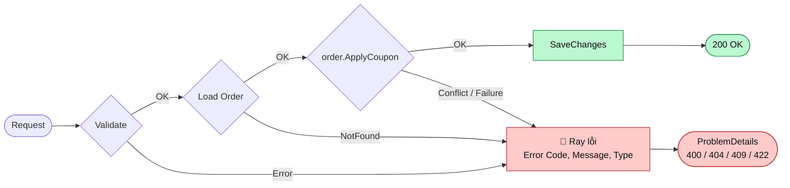
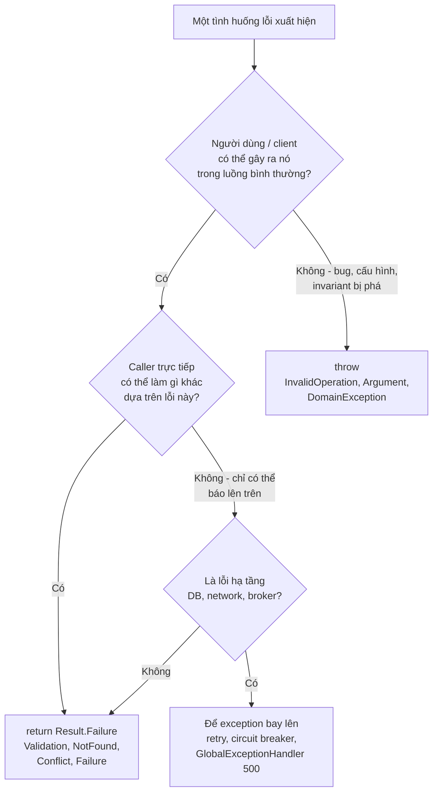
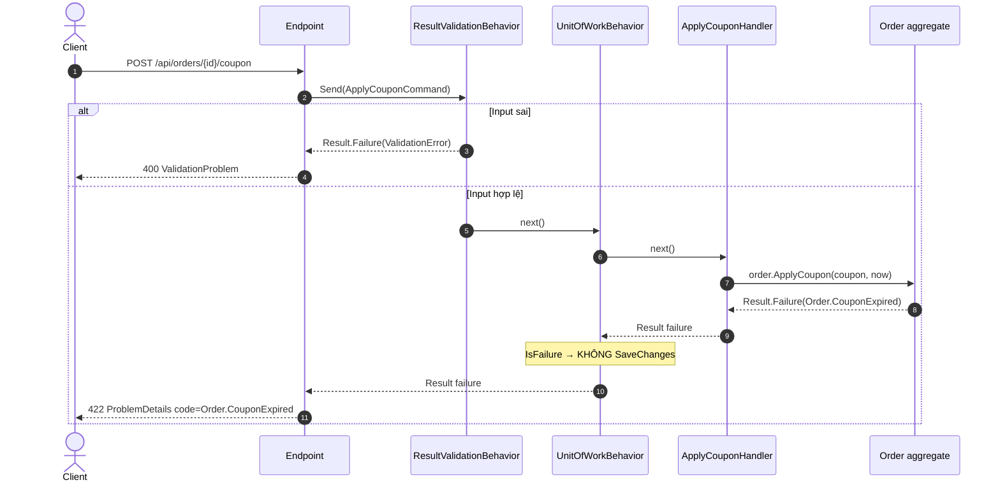

# Result Pattern vs Exceptions

> [!summary] TL;DR
> - **Exception** dành cho tình huống **bất thường** mà code hiện tại *không thể xử lý*: DB sập, timeout, bug lập trình, invariant bị phá. **Result** dành cho **thất bại nghiệp vụ dự kiến**: không tìm thấy, coupon hết hạn, trùng dữ liệu, input sai.
> - Result làm lỗi **hiện lên chữ ký method** (`Result<Guid>`), tránh "goto ẩn" và chi phí stack-unwinding; luồng xử lý thành **đường ray đôi** (railway): thành công đi tiếp, thất bại trượt sang ray lỗi.
> - Tự viết tối giản: `Error(Code, Message, Type)` + `Result`/`Result<T>` + map `ErrorType` → HTTP **ProblemDetails** (400/404/409/422). Thư viện: **ErrorOr**, **FluentResults**, **OneOf**.
> - Khuyến nghị **hybrid**: Result cho lỗi nghiệp vụ dự kiến ở Application/Domain; exception cho hạ tầng + bug + invariant guard; **`GlobalExceptionHandler` vẫn giữ** làm lưới an toàn (tương thích note [[CQRS-and-MediatR-Pattern]]).

---

## 1. Problem — Vấn đề cần giải quyết

### 1.1 Bối cảnh

Note [[CQRS-and-MediatR-Pattern]] hiện xử lý lỗi **hoàn toàn bằng exception**:

| Exception | Ném ở đâu | Map HTTP (GlobalExceptionHandler) |
| --- | --- | --- |
| `FluentValidation.ValidationException` | `ValidationBehavior` | 400 |
| `NotFoundException` | Query/Command handler | 404 |
| `DomainException` | Entity/Value Object | 422 |
| mọi thứ khác | — | 500 |

Cách này **đơn giản và chạy tốt**. Nhưng khi hệ thống lớn lên, vài vấn đề xuất hiện.

### 1.2 Pain points của "exception cho mọi thứ"

| Vấn đề | Giải thích |
| --- | --- |
| **Control flow ẩn** | `Task<Guid> Handle(...)` không nói gì về việc có thể "not found", "coupon hết hạn". Người gọi phải đọc code bên trong (hoặc đoán). Exception là một **`goto` xuyên nhiều tầng**. |
| **Không có kiểm tra lúc compile** | C# **không có checked exception** (khác Java). Quên bắt → 500 thay vì 409. |
| **Chi phí runtime** | Throw = cấp phát object + **capture stack trace** + **unwind** stack qua các frame. Microsoft khuyến nghị trong *ASP.NET Core Best Practices*: exception nên **hiếm**, đừng dùng cho luồng bình thường. Rẻ với 1 request, đắt khi bị spam 10.000 request "coupon sai" mỗi giây. |
| **Nhiễu observability** | APM/OpenTelemetry đếm exception → "error rate" tăng vọt vì người dùng gõ sai mã giảm giá, che mất lỗi thật. |
| **Khó gom nhiều lỗi** | Exception dừng ở lỗi đầu tiên; muốn trả "3 lỗi cùng lúc" phải chế `AggregateException`/custom. |
| **Dùng exception như giá trị trả về** | `try { ... } catch (NotFoundException) { return null; }` — vòng vo, chậm, khó đọc. |

> [!info] .NET 9+ đã làm exception nhanh hơn — nhưng chưa "miễn phí"
> .NET 9 viết lại cơ chế xử lý exception của runtime (port từ NativeAOT), Microsoft công bố nhanh hơn đáng kể so với .NET 8. Dù vậy, throw/catch vẫn đắt hơn **nhiều bậc** so với `return` một object — và vấn đề lớn hơn là **thiết kế** (luồng ẩn), không chỉ hiệu năng.

### 1.3 Phân loại lỗi — câu hỏi quan trọng nhất

| Loại | Ví dụ Ordering | Có "dự kiến" không? | Ai xử lý được? | Công cụ |
| --- | --- | --- | --- | --- |
| **Input validation** | `Quantity = 0`, email sai format | ✅ Thường xuyên | Client (sửa input) | **Result** (hoặc ValidationException) |
| **Không tìm thấy** | `OrderId` không tồn tại | ✅ | Client | **Result** |
| **Xung đột / quy tắc nghiệp vụ** | Submit đơn đã Paid, coupon hết hạn, trùng SKU | ✅ | Client / người dùng | **Result** |
| **Lỗi hạ tầng** | SQL timeout, broker down, HTTP 503 từ payment gateway | ❌ Bất thường | Retry/circuit breaker/ops | **Exception** |
| **Lỗi lập trình (bug)** | `null` không mong đợi, index sai, cấu hình thiếu | ❌ | Developer | **Exception** (để crash to, sửa code) |
| **Invariant domain bị phá** | `new Money(-5, "USD")` từ code nội bộ | ❌ (tầng trên lẽ ra đã chặn) | Developer | **Exception** (`DomainException` guard) |
| **Concurrency** | `DbUpdateConcurrencyException` | ⚠️ Tuỳ | Retry hoặc báo 409 | Exception → bắt ở biên, có thể đổi thành Result |

### 1.4 Ý tưởng cốt lõi

1. **Thất bại dự kiến là một *giá trị*, không phải một *sự kiện bất thường*** → trả về nó như mọi giá trị khác.
2. **Chữ ký method nói thật**: `Result<Guid> CreateOrder(...)` = "có thể thất bại, hãy kiểm tra".
3. **Railway Oriented Programming** (Scott Wlaschin): ghép các bước bằng `Bind/Map`; lỗi ở bước nào thì "trượt ray" sang nhánh lỗi, các bước sau tự bỏ qua.
4. **Biên hệ thống (API) chuyển `Error` → HTTP** ở *một* chỗ duy nhất.

---

## 2. Mental Model & Diagram

### 2.1 Railway — hai đường ray



> [!info] Analogy — Phiếu khám bệnh vs còi báo cháy
> - **Result** = phiếu kết quả xét nghiệm: "âm tính" hay "dương tính" đều là kết quả **bình thường** của quy trình; bác sĩ đọc và quyết định bước tiếp.
> - **Exception** = **còi báo cháy**: mọi người dừng việc đang làm, sơ tán theo quy trình khẩn cấp. Bấm còi mỗi khi bệnh nhân dương tính thì bệnh viện tê liệt.

### 2.2 Cây quyết định: throw hay return?



### 2.3 Luồng Result qua pipeline MediatR tới HTTP



---

## 3. Implementation & Code

### 3.1 `Error` + `ErrorType`

```csharp
// src/Ordering.Domain/Common/Results/Error.cs
// Đặt ở Domain (hoặc project SharedKernel) vì Domain cũng trả Result — vẫn zero dependency
namespace Ordering.Domain.Common.Results;

public enum ErrorType
{
    Failure,     // quy tắc nghiệp vụ bị vi phạm (dự kiến) → 422
    Validation,  // input không hợp lệ → 400
    NotFound,    // → 404
    Conflict     // trạng thái hiện tại không cho phép / trùng lặp → 409
}

public record Error(string Code, string Message, ErrorType Type = ErrorType.Failure)
{
    // "Không có lỗi" — dùng cho Result thành công, tránh null
    public static readonly Error None = new(string.Empty, string.Empty);

    public static Error Failure(string code, string message) => new(code, message, ErrorType.Failure);
    public static Error Validation(string code, string message) => new(code, message, ErrorType.Validation);
    public static Error NotFound(string code, string message) => new(code, message, ErrorType.NotFound);
    public static Error Conflict(string code, string message) => new(code, message, ErrorType.Conflict);
}

// Lỗi validation mang theo danh sách lỗi theo field → map thẳng ra HttpValidationProblemDetails
public sealed record ValidationError(IReadOnlyDictionary<string, string[]> Errors)
    : Error("Validation.General", "One or more validation errors occurred.", ErrorType.Validation);
```

> [!tip] `Code` là hợp đồng với client, `Message` là cho con người
> Client (FE, mobile) **switch theo `Code`** (`"Order.CouponExpired"`) để hiển thị đúng thông báo/đa ngôn ngữ. Đừng bắt client parse `Message`. Đặt code theo dạng `Aggregate.Reason`, coi như API công khai (không đổi tuỳ tiện).

### 3.2 `Result` và `Result<T>`

```csharp
// src/Ordering.Domain/Common/Results/Result.cs
namespace Ordering.Domain.Common.Results;

// "Static abstract interface member" (C# 11): cho code generic (pipeline behavior) TẠO được
// một Result thất bại đúng kiểu TResponse mà không cần reflection — xem mục 3.6
public interface IResultFactory<TSelf> where TSelf : IResultFactory<TSelf>
{
    static abstract TSelf FromError(Error error);
}

public class Result : IResultFactory<Result>
{
    protected Result(bool isSuccess, Error error)
    {
        // Result tự bảo vệ invariant của chính nó
        if (isSuccess && error != Error.None)
            throw new ArgumentException("A successful result cannot carry an error.", nameof(error));
        if (!isSuccess && error == Error.None)
            throw new ArgumentException("A failed result must carry an error.", nameof(error));

        IsSuccess = isSuccess;
        Error = error;
    }

    public bool IsSuccess { get; }
    public bool IsFailure => !IsSuccess;
    public Error Error { get; }

    public static Result Success() => new(true, Error.None);
    public static Result Failure(Error error) => new(false, error);
    public static Result<TValue> Success<TValue>(TValue value) => new(value, true, Error.None);
    public static Result<TValue> Failure<TValue>(Error error) => new(default, false, error);

    public static Result FromError(Error error) => Failure(error);

    // Cho phép "return OrderErrors.NotDraft;" trong method trả Result
    public static implicit operator Result(Error error) => Failure(error);
}

public sealed class Result<TValue> : Result, IResultFactory<Result<TValue>>
{
    private readonly TValue? _value;

    internal Result(TValue? value, bool isSuccess, Error error) : base(isSuccess, error) => _value = value;

    // Đọc Value của Result thất bại = bug lập trình → exception là ĐÚNG ở đây
    public TValue Value => IsSuccess
        ? _value!
        : throw new InvalidOperationException($"Cannot access Value of a failed result ({Error.Code}).");

    public static new Result<TValue> FromError(Error error) => Failure<TValue>(error);

    // "return order.Id;" và "return OrderErrors.NotFound(id);" đều compile trong method trả Result<Guid>
    // Lưu ý: C# không áp dụng implicit conversion khi TValue là interface → khi đó gọi Result.Success(value)
    public static implicit operator Result<TValue>(TValue value) => Success(value);
    public static implicit operator Result<TValue>(Error error) => Failure<TValue>(error);
}
```

Combinator tối thiểu cho "railway":

```csharp
// src/Ordering.Domain/Common/Results/ResultExtensions.cs
namespace Ordering.Domain.Common.Results;

public static class ResultExtensions
{
    // Map: biến đổi giá trị nếu thành công (hàm KHÔNG thể thất bại)
    public static Result<TOut> Map<TIn, TOut>(this Result<TIn> result, Func<TIn, TOut> map)
        => result.IsSuccess ? Result.Success(map(result.Value)) : Result.Failure<TOut>(result.Error);

    // Bind: nối bước tiếp theo CÓ THỂ thất bại — đây chính là "bẻ ghi" railway
    public static Result<TOut> Bind<TIn, TOut>(this Result<TIn> result, Func<TIn, Result<TOut>> next)
        => result.IsSuccess ? next(result.Value) : Result.Failure<TOut>(result.Error);

    public static async Task<Result<TOut>> BindAsync<TIn, TOut>(this Result<TIn> result, Func<TIn, Task<Result<TOut>>> next)
        => result.IsSuccess ? await next(result.Value) : Result.Failure<TOut>(result.Error);

    // Match: thoát khỏi Result ở biên hệ thống (endpoint)
    public static TOut Match<TIn, TOut>(this Result<TIn> result, Func<TIn, TOut> onSuccess, Func<Error, TOut> onFailure)
        => result.IsSuccess ? onSuccess(result.Value) : onFailure(result.Error);

    public static TOut Match<TOut>(this Result result, Func<TOut> onSuccess, Func<Error, TOut> onFailure)
        => result.IsSuccess ? onSuccess() : onFailure(result.Error);
}
```

> [!warning] Đừng biến C# thành F#
> Chuỗi `.Bind().Bind().Map().BindAsync()` dài 10 bước khó debug (stack trace, breakpoint) với team quen OOP. Trong handler, **early return** (`if (r.IsFailure) return r.Error;`) thường dễ đọc hơn. Dùng combinator ở chỗ thật sự gọn.

### 3.3 Domain: khi nào trả `Result`, khi nào vẫn `throw`?

Mở rộng `Order` (từ [[Clean-Architecture-in-DotNet]]) với coupon:

```csharp
// src/Ordering.Domain/Orders/OrderErrors.cs — "danh mục lỗi" của aggregate, một chỗ duy nhất
using Ordering.Domain.Common.Results;

namespace Ordering.Domain.Orders;

public static class OrderErrors
{
    public static Error NotFound(Guid id) => Error.NotFound("Order.NotFound", $"Order '{id}' was not found.");
    public static readonly Error NotDraft = Error.Conflict("Order.NotDraft", "Only draft orders can be modified.");
    public static readonly Error CouponAlreadyApplied = Error.Conflict("Order.CouponAlreadyApplied", "A coupon has already been applied.");
    public static readonly Error CouponExpired = Error.Failure("Order.CouponExpired", "The coupon has expired.");
    public static readonly Error BelowCouponMinimum = Error.Failure("Order.BelowCouponMinimum", "Order total is below the coupon minimum.");
}
```

```csharp
// src/Ordering.Domain/Orders/Order.cs (trích — phần thêm mới)
public string? AppliedCouponCode { get; private set; }
public decimal DiscountPercent { get; private set; }

// Người dùng hoàn toàn có thể nhập coupon hết hạn → đây là kết quả DỰ KIẾN → Result
public Result ApplyCoupon(Coupon coupon, DateTimeOffset now)
{
    if (Status != OrderStatus.Draft) return OrderErrors.NotDraft;
    if (AppliedCouponCode is not null) return OrderErrors.CouponAlreadyApplied;
    if (coupon.ExpiresAt <= now) return OrderErrors.CouponExpired;
    if (Total < coupon.MinimumOrderAmount) return OrderErrors.BelowCouponMinimum;

    AppliedCouponCode = coupon.Code;
    DiscountPercent = coupon.Percent;
    return Result.Success();
}

// Giữ nguyên AddItem: quantity <= 0 đã bị FluentValidation chặn ở biên.
// Nếu vẫn tới được Domain = BUG hoặc đường vào khác (job, test) bỏ qua validation → throw là đúng (fail fast)
public void AddItem(string sku, int quantity, Money unitPrice)
{
    EnsureDraft();
    if (quantity <= 0) throw new DomainException("Quantity must be positive.");
    // ...
}
```

> [!important] Quy tắc ngón tay cái cho Domain
> - **Guard / invariant** (giá trị không bao giờ được phép tồn tại: `Money` âm, `Quantity` ≤ 0) → `throw DomainException`. Constructor & Value Object **luôn** throw — không có "Money thất bại".
> - **Quyết định nghiệp vụ người dùng có thể kích hoạt** (coupon hết hạn, hết hàng, vượt hạn mức) → `Result`.
> - Đừng làm cả hai cho cùng một luật. Viết rõ quy ước vào README của Domain.

### 3.4 Handler trả `Result`

```csharp
// src/Ordering.Application/Orders/Commands/ApplyCoupon/ApplyCouponCommand.cs
using MediatR;
using Microsoft.EntityFrameworkCore;
using Ordering.Application.Common.Interfaces;
using Ordering.Application.Common.Messaging;
using Ordering.Domain.Common.Results;
using Ordering.Domain.Orders;

namespace Ordering.Application.Orders.Commands.ApplyCoupon;

public sealed record ApplyCouponCommand(Guid OrderId, string CouponCode) : ICommand<Result>;

public sealed class ApplyCouponCommandHandler(IApplicationDbContext db, TimeProvider clock)
    : IRequestHandler<ApplyCouponCommand, Result>
{
    public async Task<Result> Handle(ApplyCouponCommand request, CancellationToken ct)
    {
        // Giả sử IApplicationDbContext có thêm DbSet<Coupon> Coupons
        var order = await db.Orders.Include(o => o.Items).FirstOrDefaultAsync(o => o.Id == request.OrderId, ct);
        if (order is null) return OrderErrors.NotFound(request.OrderId);          // implicit Error → Result

        var coupon = await db.Coupons.FirstOrDefaultAsync(c => c.Code == request.CouponCode, ct);
        if (coupon is null) return CouponErrors.NotFound(request.CouponCode);

        return order.ApplyCoupon(coupon, clock.GetUtcNow());                      // truyền nguyên Result của Domain
    }
}
```

```csharp
// Phiên bản Result của CreateOrderCommand (note CQRS dùng ICommand<Guid> + exception).
// Giả sử IApplicationDbContext có thêm DbSet<Customer> Customers.
public sealed record CreateOrderCommand(Guid CustomerId, IReadOnlyList<CreateOrderItem> Items) : ICommand<Result<Guid>>;

public sealed class CreateOrderCommandHandler(IApplicationDbContext db, TimeProvider clock)
    : IRequestHandler<CreateOrderCommand, Result<Guid>>
{
    public async Task<Result<Guid>> Handle(CreateOrderCommand request, CancellationToken ct)
    {
        var customerExists = await db.Customers.AnyAsync(c => c.Id == request.CustomerId, ct);
        if (!customerExists) return CustomerErrors.NotFound(request.CustomerId);

        var order = Order.Create(request.CustomerId, clock.GetUtcNow());
        foreach (var i in request.Items)
            order.AddItem(i.Sku, i.Quantity, new Money(i.UnitPrice, i.Currency));

        db.Orders.Add(order);
        return order.Id;                                                          // implicit Guid → Result<Guid>
    }
}
```

`UnitOfWorkBehavior` **phải biết** Result — nếu không, thay đổi dở dang của một nghiệp vụ *thất bại* vẫn bị commit:

```csharp
// src/Ordering.Application/Common/Behaviors/UnitOfWorkBehavior.cs (phiên bản tương thích Result)
public async Task<TResponse> Handle(TRequest request, RequestHandlerDelegate<TResponse> next, CancellationToken ct)
{
    if (request is not ICommandBase) return await next();

    var response = await next();

    // Thất bại nghiệp vụ → KHÔNG commit. Với exception, việc này "tự động" vì throw bỏ qua SaveChanges;
    // với Result, ta phải nói rõ ra.
    if (response is Result { IsFailure: true }) return response;

    await db.SaveChangesAsync(ct);
    return response;
}
```

### 3.5 Map `Result` → HTTP (ProblemDetails, RFC 9457)

| `ErrorType` | HTTP | Lý do |
| --- | --- | --- |
| `Validation` | **400** Bad Request (`HttpValidationProblemDetails` + `errors`) | Input sai cú pháp/ràng buộc |
| `NotFound` | **404** Not Found | Resource không tồn tại |
| `Conflict` | **409** Conflict | Trạng thái hiện tại không cho phép / trùng |
| `Failure` | **422** Unprocessable Entity | Input đúng cú pháp nhưng vi phạm quy tắc nghiệp vụ — **khớp `DomainException → 422`** trong note CQRS |
| *(exception không bắt)* | **500** | Qua `GlobalExceptionHandler`, không lộ chi tiết |

```csharp
// src/Ordering.Api/Infrastructure/ResultHttpExtensions.cs
using Ordering.Domain.Common.Results;

namespace Ordering.Api.Infrastructure;

public static class ResultHttpExtensions
{
    public static IResult ToProblem(this Error error)
    {
        if (error is ValidationError validation)
            return TypedResults.ValidationProblem(validation.Errors, title: validation.Message);   // 400 + errors{}

        var status = error.Type switch
        {
            ErrorType.NotFound => StatusCodes.Status404NotFound,
            ErrorType.Conflict => StatusCodes.Status409Conflict,
            ErrorType.Failure  => StatusCodes.Status422UnprocessableEntity,
            ErrorType.Validation => StatusCodes.Status400BadRequest,
            _ => StatusCodes.Status500InternalServerError
        };

        return TypedResults.Problem(
            detail: error.Message,
            statusCode: status,
            title: error.Code,
            extensions: new Dictionary<string, object?> { ["errorCode"] = error.Code });   // client switch theo đây
    }

    public static IResult ToHttp(this Result result) => result.Match<IResult>(() => TypedResults.NoContent(), ToProblem);
}
```

**Minimal API** — dùng `Results<...>` để OpenAPI biết mọi response có thể có:

```csharp
// src/Ordering.Api/Endpoints/OrderEndpoints.cs
using MediatR;
using Microsoft.AspNetCore.Http.HttpResults;

public static class OrderEndpoints
{
    public static void MapOrderEndpoints(this IEndpointRouteBuilder app)
    {
        var group = app.MapGroup("/api/orders");

        group.MapPost("/", async Task<Results<Created<Guid>, ProblemHttpResult, ValidationProblem>> (
            CreateOrderCommand command, ISender sender, CancellationToken ct) =>
        {
            var result = await sender.Send(command, ct);
            if (result.IsSuccess)
                return TypedResults.Created($"/api/orders/{result.Value}", result.Value);

            // Pattern matching thay vì ToProblem() để giữ kiểu cụ thể cho Results<...>
            return result.Error switch
            {
                ValidationError v => TypedResults.ValidationProblem(v.Errors),
                var e => TypedResults.Problem(detail: e.Message, statusCode: e.Type switch
                {
                    ErrorType.NotFound => 404,
                    ErrorType.Conflict => 409,
                    _ => 422
                }, title: e.Code)
            };
        });

        group.MapPost("/{id:guid}/coupon", async (Guid id, ApplyCouponRequest body, ISender sender, CancellationToken ct) =>
            (await sender.Send(new ApplyCouponCommand(id, body.Code), ct)).ToHttp());   // trả IResult — gọn
    }
}

public sealed record ApplyCouponRequest(string Code);
```

**Controllers** — từ ASP.NET Core 7, action trả `IResult` được hỗ trợ, nên dùng lại cùng extension:

```csharp
[HttpPost("{id:guid}/coupon")]
public async Task<IResult> ApplyCoupon(Guid id, ApplyCouponRequest body, CancellationToken ct)
    => (await sender.Send(new ApplyCouponCommand(id, body.Code), ct)).ToHttp();

// Hoặc "kiểu MVC" thuần: ControllerBase.Problem(...) / ValidationProblem(new ValidationProblemDetails(dict))
```

Response mẫu khi coupon hết hạn:

```json
{
  "type": "https://tools.ietf.org/html/rfc4918#section-11.2",
  "title": "Order.CouponExpired",
  "status": 422,
  "detail": "The coupon has expired.",
  "errorCode": "Order.CouponExpired"
}
```

### 3.6 MediatR: `ValidationBehavior` trả `Result` thay vì throw

**Vấn đề:** behavior là generic `<TRequest, TResponse>`. Khi validation fail, nó cần trả về **một `TResponse` thất bại** — nhưng không biết `TResponse` là `Result`, `Result<Guid>` hay `Result<OrderDto>`.

**Các cách giải:**

| Cách | Mô tả | Đánh giá |
| --- | --- | --- |
| Reflection | `typeof(Result).GetMethod("Failure", 1, [typeof(Error)]).MakeGenericMethod(...)` | Chạy được, xấu, chậm hơn (cache được) |
| `dynamic` | `(TResponse)(dynamic)...` | Dễ vỡ, mất type-safety |
| ✅ **Static abstract + generic constraint** | `where TResponse : IResultFactory<TResponse>` → `TResponse.FromError(error)` | Type-safe, không reflection, C# 11+ |

```csharp
// src/Ordering.Application/Common/Behaviors/ResultValidationBehavior.cs
using FluentValidation;
using FluentValidation.Results;
using MediatR;
using Ordering.Domain.Common.Results;

namespace Ordering.Application.Common.Behaviors;

public sealed class ResultValidationBehavior<TRequest, TResponse>(IEnumerable<IValidator<TRequest>> validators)
    : IPipelineBehavior<TRequest, TResponse>
    where TRequest : notnull
    where TResponse : IResultFactory<TResponse>   // ← "mẹo constraint": chỉ áp cho request trả Result/Result<T>
{
    public async Task<TResponse> Handle(TRequest request, RequestHandlerDelegate<TResponse> next, CancellationToken ct)
    {
        if (!validators.Any()) return await next();

        var context = new ValidationContext<TRequest>(request);
        var failures = new List<ValidationFailure>();
        foreach (var validator in validators)                     // tuần tự — lý do như note CQRS (DbContext scoped)
            failures.AddRange((await validator.ValidateAsync(context, ct)).Errors);

        if (failures.Count == 0) return await next();

        var errors = failures
            .GroupBy(f => f.PropertyName)
            .ToDictionary(g => g.Key, g => g.Select(f => f.ErrorMessage).Distinct().ToArray());

        return TResponse.FromError(new ValidationError(errors));  // gọi static abstract — không throw, không reflection
    }
}
```

```csharp
// DependencyInjection.cs — hybrid: request trả Result dùng behavior mới, phần còn lại giữ behavior cũ
services.AddMediatR(cfg =>
{
    cfg.RegisterServicesFromAssembly(assembly);
    cfg.AddOpenBehavior(typeof(LoggingBehavior<,>));
    cfg.AddOpenBehavior(typeof(ResultValidationBehavior<,>));  // chỉ "khớp" khi TResponse : IResultFactory<TResponse>
    cfg.AddOpenBehavior(typeof(ValidationBehavior<,>));        // behavior cũ (throw) — xem lưu ý bên dưới
    cfg.AddOpenBehavior(typeof(UnitOfWorkBehavior<,>));
});
```

> [!warning] Ba điều cần biết về "constraint trick"
> 1. **MS.DI bỏ qua** implementation open-generic không thoả constraint khi resolve `IEnumerable<IPipelineBehavior<Q, OrderDto>>` (hành vi của container hiện đại, .NET 5+) → query trả DTO thường không bị ảnh hưởng. Container khác (Autofac…) có thể xử lý khác — kiểm tra.
> 2. Behavior cũ (`ValidationBehavior` throw) **cũng** khớp với request trả `Result` → sẽ validate **2 lần** và throw. Thêm dòng đầu vào behavior cũ: `if (typeof(Result).IsAssignableFrom(typeof(TResponse))) return await next();`.
> 3. `Result<TValue>` vừa kế thừa `IResultFactory<Result>` (từ base) vừa implement `IResultFactory<Result<TValue>>` — vì vậy cần `static new FromError` trong lớp con.

### 3.7 Thư viện có sẵn — so sánh nhanh

| Thư viện | Kiểu chính | Điểm mạnh | Lưu ý |
| --- | --- | --- | --- |
| **ErrorOr** (Amichai Mantinband, MIT) | `ErrorOr<T>` = giá trị **hoặc** `List<Error>` | `Error.Validation/NotFound/Conflict/Failure/Unexpected/Unauthorized/Forbidden(code, description)`, `ErrorType` enum, `Match/Switch/Then/Else/FailIf`, implicit conversion | Rất gần với bản tự viết ở trên; phổ biến trong template Clean Arch |
| **FluentResults** (MIT) | `Result` / `Result<T>` với `Reasons` (`IError`, `ISuccess`) | `Result.Ok/Fail`, `Bind/Map/Merge/Try`, metadata, chuỗi "caused by" | Không có `ErrorType` sẵn → tự quy ước metadata để map HTTP |
| **OneOf** (MIT) | `OneOf<T0,T1,...>` — discriminated union tổng quát | `Match/Switch` bắt buộc xử lý **mọi** case (thêm case → lỗi compile ở mọi chỗ gọi); `OneOfBase` + source generator | Không phải "Result" chuyên dụng; hợp với trả nhiều kiểu kết quả có tên |
| *(khác)* Ardalis.Result, LanguageExt | — | Ardalis.Result có map sang ASP.NET; LanguageExt là functional toàn diện (`Either`, `Fin`) | LanguageExt rất nặng về FP |

```csharp
// ErrorOr — chú ý namespace: ErrorOr.Error trùng tên với Error tự viết
using ErrorOr;

public ErrorOr<Guid> PlaceOrder(Cart cart)
{
    if (cart.IsEmpty) return Error.Validation("Order.Empty", "Cart is empty.");
    return Guid.CreateVersion7();                       // implicit T → ErrorOr<T>
}

var result = PlaceOrder(cart);
IResult http = result.Match<IResult>(       // chỉ rõ kiểu: Ok<Guid> và ProblemHttpResult không có kiểu chung
    id => TypedResults.Ok(id),
    errors => TypedResults.Problem(title: errors[0].Code, detail: errors[0].Description));
```

```csharp
// FluentResults
using FluentResults;

Result<decimal> CalculateShipping(Order order) =>
    order.Items.Count == 0
        ? Result.Fail<decimal>(new Error("Order has no items").WithMetadata("Code", "Order.Empty"))
        : Result.Ok(order.Total > 100m ? 0m : 5m);
```

```csharp
// OneOf — mỗi kết quả là một kiểu có tên; Match buộc xử lý đủ
using OneOf;

public sealed record OrderNotFound(Guid Id);
public sealed record OrderLocked(OrderStatus Status);

OneOf<OrderDto, OrderNotFound, OrderLocked> result = await service.GetEditableAsync(id, ct);
IResult http = result.Match<IResult>(
    dto => TypedResults.Ok(dto),
    notFound => TypedResults.NotFound(),
    locked => TypedResults.Conflict(new { locked.Status }));
```

> [!tip] Tự viết hay dùng thư viện?
> Bản tự viết ~100 dòng, bạn kiểm soát hoàn toàn và không lo license. Dùng **ErrorOr** nếu muốn sẵn API phong phú và quy ước phổ biến. Dù chọn gì, **chỉ chọn một** cho cả solution. (Theo dõi: đề xuất *union types* cho C# đang được thảo luận ở repo `dotnet/csharplang` — có thể thay đổi cách làm trong tương lai.)

---

## 4. Comparison — Đối chiếu Java / Spring Boot

### 4.1 Bảng ánh xạ

| Khía cạnh | ☕ Java / Spring Boot | 🟣 C# / ASP.NET Core | Ghi chú |
| --- | --- | --- | --- |
| Lỗi "phải xử lý" lúc compile | **Checked exception** (`throws OrderNotFoundException`) | **Không có** checked exception | Result là cách C# đưa lỗi vào chữ ký |
| Lỗi runtime | Unchecked (`RuntimeException`) | Mọi exception | |
| Result/Either | **Vavr** `Either<L,R>`, `Try<T>`, `Validation` | ErrorOr, FluentResults, OneOf, tự viết | Không có trong BCL ở cả hai bên |
| Discriminated union bản địa | **Java 21**: `sealed interface` + `record` + `switch` pattern (exhaustive) | `abstract record` + `switch` expression (không exhaustive thật sự) / OneOf | Java hiện "tiến" hơn ở điểm exhaustiveness |
| Response có status | `ResponseEntity<T>` | `IResult` / `TypedResults` / `ActionResult<T>` | |
| Problem Details (RFC 9457) | `ProblemDetail`, `ErrorResponseException` (Spring 6+) | `ProblemDetails`, `TypedResults.Problem`, `AddProblemDetails()` | |
| Xử lý exception tập trung | `@RestControllerAdvice` + `@ExceptionHandler` | `IExceptionHandler` + `UseExceptionHandler()` | |
| Validation | Bean Validation → `MethodArgumentNotValidException` → 400 | FluentValidation → `ValidationException` hoặc `ValidationError` Result | |

### 4.2 Java tương đương

```java
// Java 21 — "Result" bằng sealed interface + record; switch BẮT BUỘC xử lý đủ case
public sealed interface ApplyCouponResult
        permits ApplyCouponResult.Applied, ApplyCouponResult.OrderNotFound, ApplyCouponResult.CouponExpired {
    record Applied(UUID orderId) implements ApplyCouponResult {}
    record OrderNotFound(UUID orderId) implements ApplyCouponResult {}
    record CouponExpired(String code) implements ApplyCouponResult {}
}

@RestController
@RequestMapping("/api/orders")
class OrderController {
    private final CouponService service;
    OrderController(CouponService service) { this.service = service; }

    @PostMapping("/{id}/coupon")
    ResponseEntity<?> apply(@PathVariable UUID id, @RequestBody ApplyCouponRequest req) {
        return switch (service.apply(id, req.code())) {
            case ApplyCouponResult.Applied a -> ResponseEntity.noContent().build();
            case ApplyCouponResult.OrderNotFound nf -> ResponseEntity
                    .of(ProblemDetail.forStatusAndDetail(HttpStatus.NOT_FOUND, "Order not found")).build();
            case ApplyCouponResult.CouponExpired ce -> ResponseEntity
                    .of(ProblemDetail.forStatusAndDetail(HttpStatus.UNPROCESSABLE_ENTITY, "Coupon expired")).build();
        };   // thêm case mới vào sealed interface → lỗi compile ở đây (exhaustive)
    }
}

// Vavr — railway kiểu functional
Either<AppError, Order> result = findOrder(id)          // Either<AppError, Order>
        .flatMap(order -> order.applyCoupon(coupon));    // ≈ Bind (applyCoupon trả Either<AppError, Order>)
String msg = result
        .map(Order::id)                                   // ≈ Map
        .fold(err -> "Failed: " + err.code(), orderId -> "OK " + orderId);   // ≈ Match
```

> [!warning] Bẫy khi chuyển từ Java sang .NET
> - **Không có checked exception**: thói quen Java "compiler nhắc mình bắt lỗi" không tồn tại. Nếu muốn lỗi lộ ra chữ ký → **Result**.
> - **`switch` trên record hierarchy không exhaustive thật sự** trong C# (compiler chỉ cảnh báo thiếu `_` với một số trường hợp) — khác Java `sealed`. Muốn exhaustive → OneOf hoặc enum `ErrorType` + `switch` đầy đủ.
> - **`catch (Exception)` nuốt `OperationCanceledException`** → hủy request trở thành 500. Luôn để cancellation bay lên.
> - Spring dev hay "ném `ResponseStatusException` từ service" — tương đương .NET là ném exception chứa status code từ Application → **Application biết HTTP** = vi phạm Clean Architecture. Dùng `ErrorType` trung lập, map ra HTTP ở API.
> - `throw ex;` làm **mất stack trace** (giống Java khi tạo exception mới không gắn cause). Dùng `throw;`.

---

## 5. Trade-offs & Best Practices

### ✅ Ưu điểm của Result
- Lỗi **hiện trên chữ ký** → tự document, code review dễ, caller buộc phải nghĩ tới nhánh lỗi.
- Không tốn chi phí stack-unwinding cho lỗi thường gặp; observability sạch (exception = thật sự có sự cố).
- Gom nhiều lỗi (validation) tự nhiên; `Code` ổn định làm hợp đồng với client.
- Test dễ: `Assert.Equal(OrderErrors.CouponExpired, result.Error)` thay vì `Assert.Throws`.

### ❌ Nhược điểm / Chi phí
- **Verbose**: `if (r.IsFailure) return r.Error;` lặp lại; C# chưa có toán tử `?` như Rust.
- **Có thể bị phớt lờ**: không có gì bắt buộc kiểm tra `IsFailure` (khác exception luôn "nổ"). Gọi `Result` rồi bỏ qua = lỗi im lặng.
- Hai cơ chế song song (Result + exception) → team phải có **quy ước rõ ràng**.
- Pipeline (UnitOfWork, Transaction, Logging) phải **biết** Result để không commit/không log sai.
- Interop với thư viện bên ngoài (EF, HttpClient) vẫn là exception → cần "biên dịch" ở rìa.

### 🎯 Decision guide

| Tình huống | Dùng | Ví dụ |
| --- | --- | --- |
| Input không hợp lệ từ client | Result (`Validation`) — hoặc giữ `ValidationException` nếu đang dùng | Thiếu `CustomerId` |
| Không tìm thấy resource theo id client gửi | Result (`NotFound`) | `GET /orders/{id}` sai id |
| Quy tắc nghiệp vụ người dùng có thể vi phạm | Result (`Failure`/`Conflict`) | Coupon hết hạn, submit đơn đã Paid |
| Invariant/guard trong constructor, Value Object | **Exception** (`DomainException`, `ArgumentException`) | `new Money(-1, "USD")` |
| DB/network/broker lỗi | **Exception** + retry/circuit breaker | `SqlException` timeout |
| Bug, trạng thái "không thể xảy ra" | **Exception** (`InvalidOperationException`, `UnreachableException`) | `switch` rơi vào nhánh không thể |
| Optimistic concurrency | Exception → bắt ở handler/behavior → Result `Conflict` (409) | `DbUpdateConcurrencyException` |
| Thư viện/infrastructure code dùng lại nhiều nơi | Theo quy ước .NET: exception + `Try*` pattern | `TryParse` |

| Nên dùng Result khi | Không nên dùng Result khi |
| --- | --- |
| Lỗi là một phần **bình thường** của nghiệp vụ | Lỗi là bất thường, caller không làm gì được ngoài báo lên |
| Cần trả nhiều lỗi/mã lỗi ổn định cho client | Code nội bộ đơn giản, CRUD nhỏ — exception + handler toàn cục là đủ |
| Lỗi xảy ra thường xuyên (hiệu năng, observability) | Constructor / Value Object (không có "object thất bại") |
| Muốn handler tự document các nhánh thất bại | Team chưa thống nhất — trộn lung tung còn tệ hơn chỉ dùng exception |

> [!important] Khuyến nghị **hybrid** cho vault này (tương thích [[CQRS-and-MediatR-Pattern]])
> 1. **Giữ** `GlobalExceptionHandler` + `NotFoundException`/`DomainException`/`ValidationException` → nó là **lưới an toàn** và vẫn đúng cho code hiện có.
> 2. Với use case **mới** có thất bại nghiệp vụ rõ ràng: handler trả `Result`/`Result<T>`; Domain method "quyết định" trả `Result`; endpoint map bằng `ToProblem()`. Status code **trùng** với mapping exception (400/404/409/422) → client không thấy khác biệt.
> 3. Domain **guard/invariant** vẫn `throw DomainException` (422 qua handler toàn cục).
> 4. Hạ tầng/bug: exception → 500.
> 5. Pipeline: `ResultValidationBehavior` cho request trả Result, `UnitOfWorkBehavior` không commit khi `IsFailure`.
> 6. Migrate dần theo feature — không cần "big bang".

### 📋 Best practices
- [ ] Mỗi aggregate có lớp `XxxErrors` tập trung; `Code` dạng `Aggregate.Reason`, coi như public API.
- [ ] `ErrorType` trung lập (không chứa HTTP status) — map HTTP **chỉ** ở tầng API.
- [ ] Không bao giờ `.Value` khi chưa kiểm tra `IsSuccess` (bản tự viết ném `InvalidOperationException` để lộ bug sớm).
- [ ] `UnitOfWorkBehavior`/`TransactionBehavior` **không commit** khi Result thất bại.
- [ ] LoggingBehavior: log Result failure ở mức **Information/Warning**, exception ở mức **Error**.
- [ ] Không bọc exception hạ tầng thành `Result.Failure("Something went wrong")` rồi nuốt — mất stack trace, mất retry.
- [ ] Không trả message nội bộ (SQL, stack) trong `detail` của 500.
- [ ] Unit test assert theo `Error.Code`/`Error` record, không theo message.
- [ ] Một thư viện Result duy nhất cho toàn solution.

### 🐞 Lỗi thường gặp

| Lỗi | Hậu quả | Cách sửa |
| --- | --- | --- |
| UnitOfWorkBehavior commit dù handler trả failure | Thay đổi dở dang được lưu (VD đã đánh dấu coupon used) | `if (response is Result { IsFailure: true }) return response;` |
| Gọi hàm trả `Result` rồi bỏ qua kết quả | Lỗi im lặng, dữ liệu sai | Code review, analyzer (VD rule "must use return value"), đặt tên rõ |
| `catch (Exception) { return Result.Failure(...) }` khắp nơi | Nuốt bug & lỗi hạ tầng, mất stack trace, retry không chạy | Chỉ bắt exception **cụ thể** có ý nghĩa nghiệp vụ |
| Value Object trả `Result` từ constructor | Object "nửa hợp lệ" tồn tại; code rối | Constructor throw; thêm factory `Money.TryCreate(...)` trả Result nếu thật cần |
| Map `Failure` → 500 | Client tưởng server lỗi, retry vô ích | `Failure` (nghiệp vụ) → 422; 500 chỉ cho exception |
| Hai ValidationBehavior cùng chạy | Validate 2 lần, request Result vẫn bị throw | Behavior cũ bỏ qua khi `TResponse` là `Result` |
| Trộn ErrorOr + FluentResults + tự viết | Ba kiểu lỗi, ba cách map HTTP | Một quy ước, ghi vào ADR |

---

## 6. Self-check — Câu hỏi tự kiểm tra

> [!question]- Phân biệt "thất bại dự kiến" và "tình huống bất thường". Cho 2 ví dụ mỗi loại trong domain Ordering.
> **Dự kiến** (Result): coupon hết hạn; submit đơn đã Paid; OrderId không tồn tại; input thiếu SKU. **Bất thường** (exception): SQL Server timeout; `new Money(-5, "USD")` từ code nội bộ (bug/invariant); cấu hình connection string thiếu; message broker không kết nối được.

> [!question]- Tại sao `UnitOfWorkBehavior` phải được sửa khi chuyển sang Result?
> Với exception, throw tự động bỏ qua `SaveChangesAsync()`. Với Result, handler **return bình thường** dù nghiệp vụ thất bại → behavior sẽ commit các thay đổi dở dang trong ChangeTracker. Phải kiểm tra `response is Result { IsFailure: true }` và không SaveChanges.

> [!question]- Làm sao một pipeline behavior generic tạo được `TResponse` thất bại mà không dùng reflection?
> Dùng **static abstract interface member** (C# 11): `IResultFactory<TSelf> { static abstract TSelf FromError(Error) }`, `Result` và `Result<T>` implement nó; behavior đặt constraint `where TResponse : IResultFactory<TResponse>` rồi gọi `TResponse.FromError(...)`. MS.DI bỏ qua behavior này cho request có `TResponse` không thoả constraint.

> [!question]- `ErrorType.Failure` nên map sang HTTP nào và vì sao không phải 500?
> 422 Unprocessable Entity (hoặc 400 tuỳ quy ước) — request đúng cú pháp nhưng vi phạm quy tắc nghiệp vụ; đó là lỗi **phía client/nghiệp vụ**, retry y nguyên sẽ thất bại tiếp. 500 nghĩa là server có sự cố, khiến client/gateway retry vô ích và làm nhiễu cảnh báo vận hành. Đồng thời khớp `DomainException → 422` trong note CQRS.

> [!question]- (Phỏng vấn) "Exceptions are slow, so we should never throw them." Bạn phản biện thế nào?
> Nửa đúng. Throw/catch đắt hơn nhiều so với return (stack trace, unwinding), nên **không dùng cho luồng thường xuyên**. Nhưng lý do chính để dùng Result là **thiết kế**: lỗi hiện trên chữ ký, không có goto ẩn, observability sạch. Exception vẫn là công cụ đúng cho lỗi bất thường — bug, hạ tầng, invariant — nơi fail-fast và stack trace là thứ ta cần. Giải pháp hợp lý là hybrid với quy ước rõ ràng.

> [!question]- Java có checked exception, C# thì không. Điều đó ảnh hưởng gì tới việc chọn Result?
> Checked exception buộc caller xử lý/khai báo lỗi lúc compile — một phần mục đích của Result. C# bỏ checked exception (lo ngại versioning và "throws creep"), nên lỗi không hiện trên chữ ký; Result lấp khoảng trống đó. Bên Java hiện đại, nhiều team cũng chuyển sang unchecked + sealed interface/Vavr `Either` vì checked exception không hợp với lambda/stream.

---

## 7. Liên kết & Tham khảo
- **Bản đồ:** [[Architecture-Design-MOC]]
- **Note liên quan:** [[CQRS-and-MediatR-Pattern]] (`GlobalExceptionHandler`, `ValidationBehavior`, `UnitOfWorkBehavior`) · [[Clean-Architecture-in-DotNet]] (`DomainException`, `Order`) · [[DDD-Tactical-Patterns]] (invariant, Value Object)
- **Pattern nền:** [[Behavioral-Patterns#Chain of Responsibility]] (pipeline) · [[Core-Design-Principles]] · [[Code-Smells-and-Refactoring]]
- **Đọc tiếp:** [[Repository-UnitOfWork-Specification]] · [[Domain-Events-and-Outbox]] · [[Testing-in-DotNet]] · [[Async-Await-Deep-Dive]] (exception trong `Task`, `OperationCanceledException`) · [[Java-to-DotNet-Mental-Map]]
- **Nguồn:**
  - Microsoft Learn — *Best practices for exceptions*; *ASP.NET Core Best Practices* (Minimize exceptions); *Create responses in Minimal API apps*; API `TypedResults.Problem` / `ValidationProblem`
  - Scott Wlaschin — *Railway Oriented Programming* (fsharpforfunandprofit.com/rop)
  - GitHub: `amantinband/error-or`, `altmann/FluentResults`, `mcintyre321/OneOf`
  - Vavr docs; Spring Framework reference — *Error Responses* (`ProblemDetail`)
