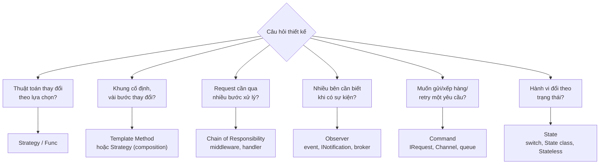
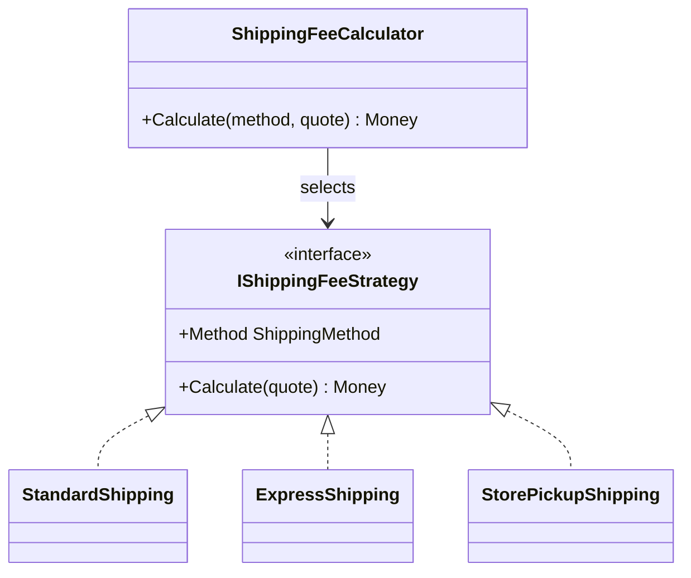
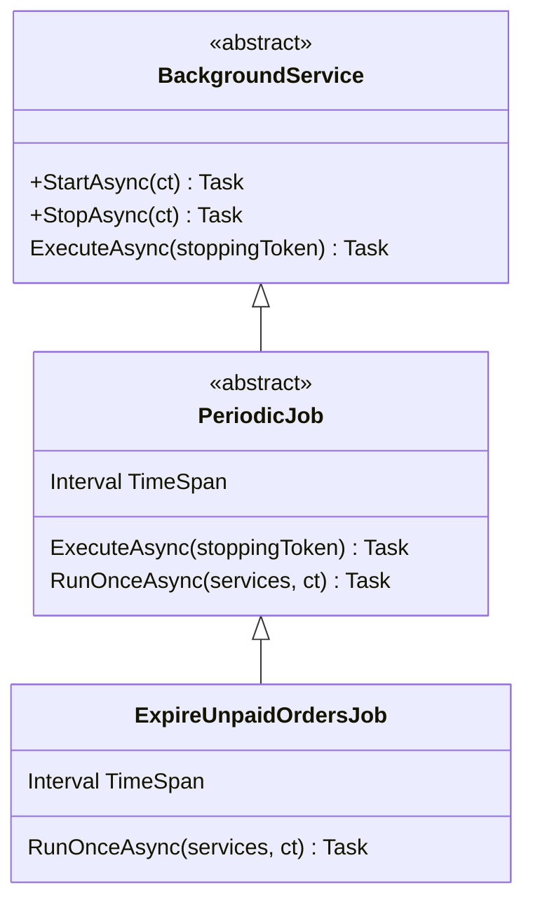
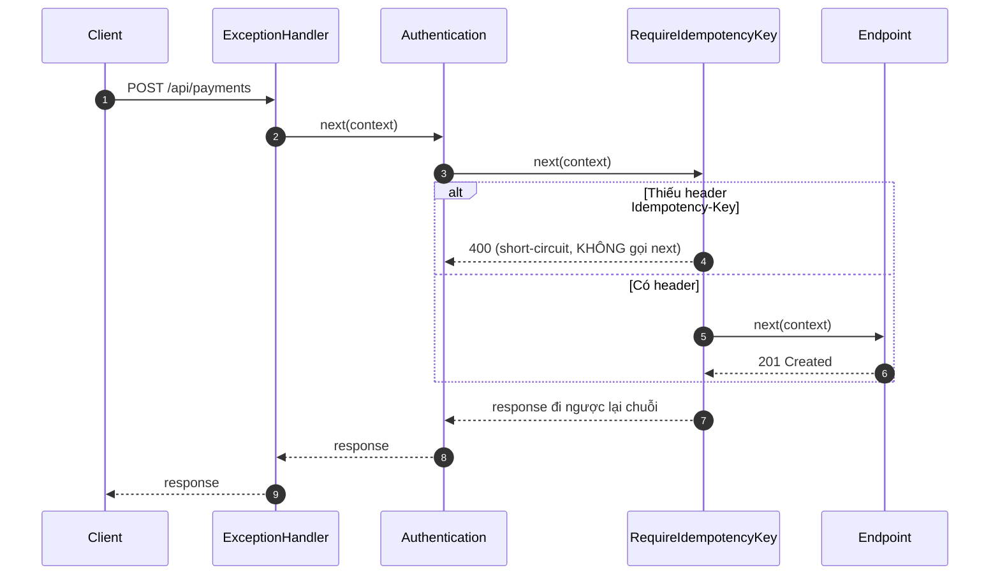
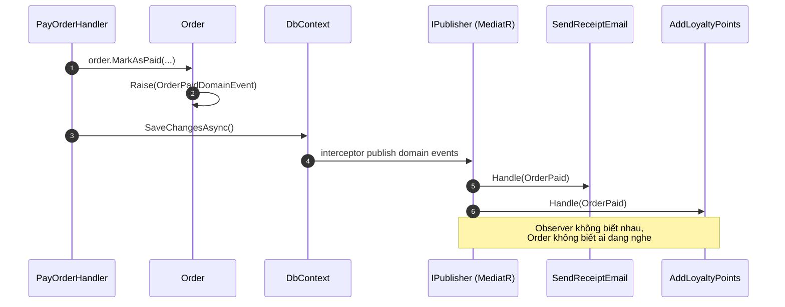
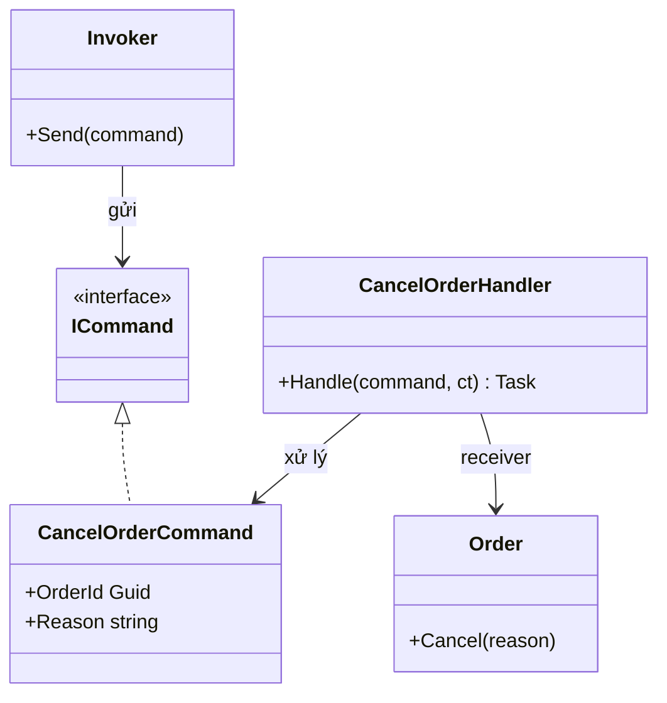
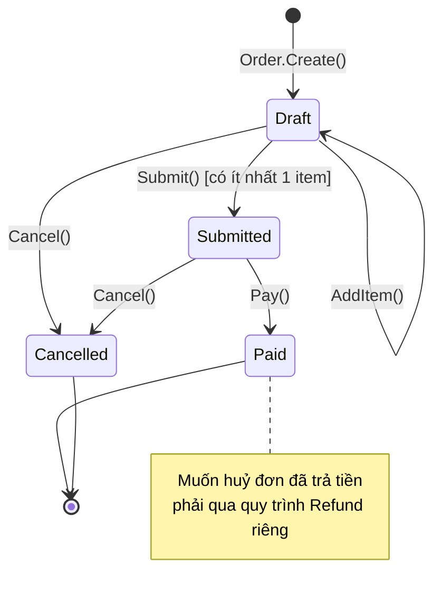
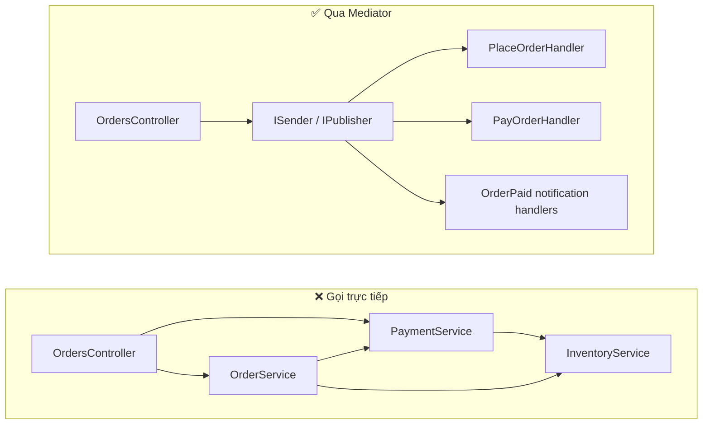
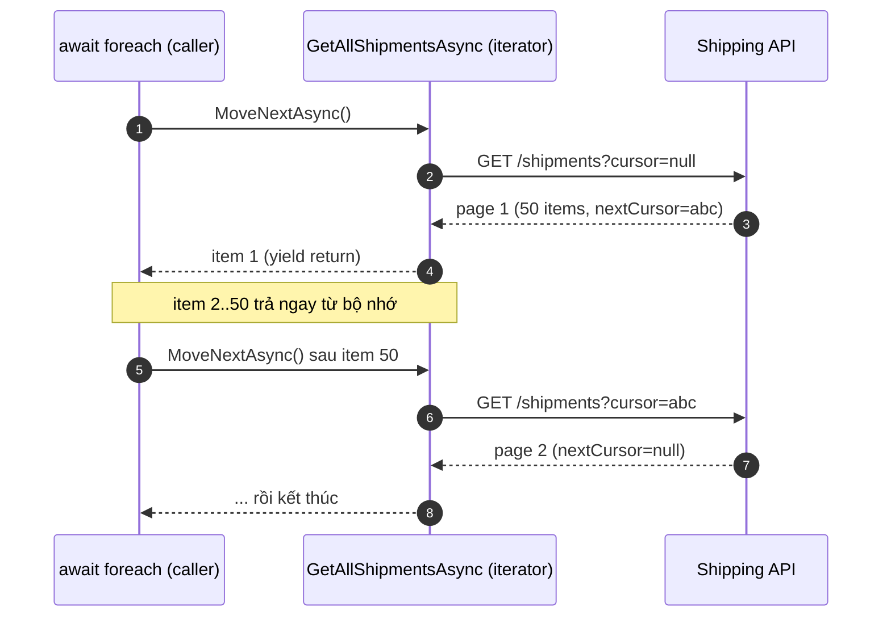

# Behavioral Patterns — Mẫu hành vi trong .NET hiện đại

> [!summary] TL;DR
> - **Behavioral patterns** nói về cách object **phân chia trách nhiệm và giao tiếp**: ai quyết định thuật toán, ai xử lý request, ai được báo khi có sự kiện.
> - Trong ASP.NET Core bạn **đang dùng** chúng mỗi ngày: middleware & `DelegatingHandler` (**Chain of Responsibility**), `BackgroundService.ExecuteAsync` (**Template Method**), MediatR `IRequest` (**Command**) / `INotification` (**Observer**) / `ISender` (**Mediator**), `IEnumerable` + `yield return` (**Iterator**).
> - Pattern bạn **tự viết** nhiều nhất: **Strategy** (phí ship, giảm giá — chọn qua `IEnumerable<T>` + selector hoặc **keyed services** .NET 8) và **State** (vòng đời `Order`). Khi biến thể chỉ là một hàm, `Func<>` thay được cả hệ class.
> - ⚠️ Khác Java: enum C# **không có method/thân riêng** → state machine kiểu "Java enum với abstract method" phải viết bằng `switch` expression, class, hoặc thư viện (Stateless).

---

## 0. Tổng quan

### 0.1 Bảng tổng quan

| Pattern | Ý định (1 dòng) | Đã có sẵn trong .NET | ☕ Spring / Java | Mức độ hay gặp |
| --- | --- | --- | --- | --- |
| [[#Strategy]] | Đóng gói các thuật toán thay thế được cho nhau, chọn lúc runtime | `IComparer<T>`, `StringComparer`, `JsonNamingPolicy`, `IPasswordHasher<T>` | `Comparator`, `PasswordEncoder`, `Map<String,T>` injection | ⭐⭐⭐⭐⭐ |
| [[#Template Method]] | Lớp cha cố định **khung** thuật toán, lớp con điền **bước** | `BackgroundService.ExecuteAsync`, `DbContext.OnModelCreating`, `AuthorizationHandler<T>` | `OncePerRequestFilter.doFilterInternal`, `AbstractRoutingDataSource` | ⭐⭐⭐⭐ (dùng) / ⭐⭐ (tự viết) |
| [[#Chain of Responsibility]] | Request đi qua chuỗi handler, mỗi handler xử lý hoặc chuyển tiếp/dừng | Middleware, `DelegatingHandler`, MediatR behavior | Servlet `FilterChain`, `HandlerInterceptor`, Spring Security filter chain | ⭐⭐⭐⭐⭐ |
| [[#Observer]] | Một bên phát sự kiện, nhiều bên đăng ký nhận mà không phụ thuộc nhau | C# `event`, `IObservable<T>`, `IOptionsMonitor.OnChange`, MediatR `INotification` | `ApplicationEventPublisher` + `@EventListener`, Reactor | ⭐⭐⭐⭐ |
| [[#Command]] | Đóng gói một yêu cầu thành **object** → gửi, xếp hàng, log, retry, undo | MediatR `IRequest`, `Channel<T>`, Hangfire job | `Runnable`/`Callable`, Axon `CommandGateway` | ⭐⭐⭐⭐⭐ |
| [[#State]] | Hành vi object đổi theo trạng thái nội tại | (thư viện) Stateless | Spring Statemachine, enum có thân | ⭐⭐⭐⭐ |
| [[#Mediator]] | Một object trung gian điều phối tương tác, các bên không gọi nhau trực tiếp | MediatR `ISender`/`IPublisher` | Không có sẵn, PipelinR | ⭐⭐⭐ |
| [[#Iterator]] | Duyệt tập hợp mà không lộ cấu trúc bên trong | `IEnumerable<T>`, `yield return`, `IAsyncEnumerable<T>` | `Iterator`/`Iterable`, `Stream`, `Flux` | ⭐⭐⭐⭐⭐ (dùng) |

### 0.2 Bản đồ: pattern nào trả lời câu hỏi nào?



---

## Strategy

### 🧩 Vấn đề

Phí vận chuyển tính khác nhau theo phương thức: Tiêu chuẩn (free ship đơn ≥ 500k), Hoả tốc (theo cân nặng), Nhận tại cửa hàng (0đ). Viết `switch` ngay trong service → mỗi hãng/chính sách mới là một lần sửa class lõi, test phải đi qua mọi nhánh.

```csharp
// ❌ Before
public Money CalculateShippingFee(ShippingMethod method, decimal weightKg, decimal subtotal) => method switch
{
    ShippingMethod.Standard => subtotal >= 500_000m ? new Money(0m, "VND") : new Money(30_000m, "VND"),
    ShippingMethod.Express => new Money(50_000m + 10_000m * Math.Ceiling(weightKg), "VND"),
    ShippingMethod.StorePickup => new Money(0m, "VND"),
    _ => throw new NotSupportedException()
    // + mai thêm "Giao hàng tiết kiệm", "Ahamove"... + mỗi cái cần gọi API báo giá riêng
};
```



### ✅ After — Cách 1: `IEnumerable<IStrategy>` + selector

```csharp
public enum ShippingMethod { Standard, Express, StorePickup }
public sealed record ShippingQuote(decimal WeightKg, string ToProvince, decimal Subtotal);

public interface IShippingFeeStrategy
{
    ShippingMethod Method { get; }        // strategy tự khai báo nó phục vụ key nào
    Money Calculate(ShippingQuote quote);
}

internal sealed class StandardShipping : IShippingFeeStrategy
{
    public ShippingMethod Method => ShippingMethod.Standard;
    public Money Calculate(ShippingQuote q) => new(q.Subtotal >= 500_000m ? 0m : 30_000m, "VND");
}

internal sealed class ExpressShipping : IShippingFeeStrategy
{
    public ShippingMethod Method => ShippingMethod.Express;
    public Money Calculate(ShippingQuote q) => new(50_000m + 10_000m * Math.Ceiling(q.WeightKg), "VND");
}

public sealed class ShippingFeeCalculator(IEnumerable<IShippingFeeStrategy> strategies)
{
    // ToDictionary ném ngay nếu 2 strategy trùng Method → lỗi cấu hình lộ ra sớm, không âm thầm chọn sai
    private readonly Dictionary<ShippingMethod, IShippingFeeStrategy> _byMethod =
        strategies.ToDictionary(s => s.Method);

    public Money Calculate(ShippingMethod method, ShippingQuote quote) =>
        _byMethod.TryGetValue(method, out var strategy)
            ? strategy.Calculate(quote)
            : throw new NotSupportedException($"Shipping method {method} is not configured.");
}

// DI: thêm phương thức mới = thêm 1 class + 1 dòng (hoặc Scrutor scan tự động)
services.AddSingleton<IShippingFeeStrategy, StandardShipping>();   // strategy không state → singleton
services.AddSingleton<IShippingFeeStrategy, ExpressShipping>();
services.AddSingleton<IShippingFeeStrategy, StorePickupShipping>();
services.AddSingleton<ShippingFeeCalculator>();
```

> [!tip] Biến thể: strategy tự quyết "có áp dụng không"
> Thay `Method` bằng `bool CanHandle(context)` rồi `strategies.First(s => s.CanHandle(ctx))` — hữu ích khi điều kiện chọn phức tạp hơn một key (vùng miền, khối lượng, khung giờ). Nhưng thứ tự đăng ký lúc đó **có ý nghĩa** → ghi chú rõ.

### ✅ After — Cách 2: Keyed services (.NET 8+)

```csharp
services.AddKeyedSingleton<IShippingFeeStrategy, StandardShipping>(ShippingMethod.Standard);
services.AddKeyedSingleton<IShippingFeeStrategy, ExpressShipping>(ShippingMethod.Express);
services.AddKeyedSingleton<IShippingFeeStrategy, StorePickupShipping>(ShippingMethod.StorePickup);

// Key biết lúc compile-time → inject thẳng
public sealed class ExpressSlaMonitor([FromKeyedServices(ShippingMethod.Express)] IShippingFeeStrategy express) { }

// Minimal API cũng hỗ trợ [FromKeyedServices] trên tham số
app.MapGet("/api/shipping/express-fee", (decimal weightKg, decimal subtotal,
        [FromKeyedServices(ShippingMethod.Express)] IShippingFeeStrategy express) =>
    express.Calculate(new ShippingQuote(weightKg, "HCM", subtotal)));

// Key biết lúc runtime → IServiceProvider.GetRequiredKeyedService (gói trong factory, xem Creational-Patterns)
```

### ✅ After — Cách 3: `Func<>` khi strategy chỉ là **một hàm thuần**

```csharp
// Không cần interface + class + DI cho một công thức một dòng
public static class DiscountPolicies
{
    public static readonly Func<decimal, decimal> None = _ => 0m;
    public static Func<decimal, decimal> Percent(decimal p) => subtotal => subtotal * p / 100m;
    public static Func<decimal, decimal> FixedAmount(decimal amount) => subtotal => Math.Min(subtotal, amount);
}

decimal Checkout(decimal subtotal, Func<decimal, decimal> discountPolicy) => subtotal - discountPolicy(subtotal);
var total = Checkout(1_200_000m, DiscountPolicies.Percent(10));
```

| Tiêu chí | `IEnumerable` + selector | Keyed services | `Func<>` |
| --- | --- | --- | --- |
| Strategy cần dependency (HTTP, DB, logger) | ✅ | ✅ | ⚠️ phải closure |
| Liệt kê mọi strategy (UI dropdown, health check) | ✅ dễ | ⚠️ `GetKeyedServices(KeyedService.AnyKey)` | ❌ |
| Chọn theo điều kiện phức tạp (`CanHandle`) | ✅ | ❌ chỉ theo key | ✅ |
| Ceremony | Trung bình | Thấp | Rất thấp |
| Phù hợp | Mặc định cho nghiệp vụ | Key cố định, ít biến thể | Công thức thuần, nội bộ |

### 🏠 Đã có sẵn trong .NET

`List<T>.Sort(IComparer<T>)` / `Comparison<T>` delegate, `StringComparer.OrdinalIgnoreCase` (`IEqualityComparer<string>` cho `Dictionary`), `JsonSerializerOptions.PropertyNamingPolicy = JsonNamingPolicy.SnakeCaseLower`, `IPasswordHasher<TUser>`, authentication scheme handlers, Polly resilience strategies.

### ☕ Spring / Java tương đương

```java
@Component
public class ShippingFeeCalculator {
    private final Map<ShippingMethod, ShippingFeeStrategy> byMethod;

    // Spring inject mọi bean implement interface; Collectors.toMap ném khi trùng key — giống ToDictionary
    public ShippingFeeCalculator(List<ShippingFeeStrategy> strategies) {
        this.byMethod = strategies.stream().collect(Collectors.toMap(ShippingFeeStrategy::method, s -> s));
    }
}
```

`Comparator<T>`, `PasswordEncoder` (`DelegatingPasswordEncoder` = strategy chọn theo prefix `{bcrypt}`), `@Qualifier("express")` ≈ `[FromKeyedServices("express")]`.

### ⚠️ Khi nào KHÔNG dùng / Bẫy

- ❌ Chỉ 2 nhánh, gần như không bao giờ đổi → một `if` hoặc `switch` expression rõ ràng hơn (xem [[Core-Design-Principles]]).
- ❌ Strategy cần quá nhiều input khác nhau → "context object" phình to, dấu hiệu các strategy không thật sự cùng một họ.
- ⚠️ Strategy **singleton** inject service **scoped** → captive dependency ([[Creational-Patterns#Singleton]]).
- ⚠️ Chọn strategy theo `GetType().Name` hay chuỗi magic → refactor tên class là vỡ.

---

## Template Method

### 🧩 Vấn đề

Nhiều job nền có **cùng khung**: chạy định kỳ, mỗi lần tạo DI scope, bắt lỗi để job không chết, log. Chỉ **bước nghiệp vụ** khác nhau (huỷ đơn chưa thanh toán, đồng bộ tồn kho, gửi lại outbox). Copy-paste khung → sửa bug một chỗ, quên năm chỗ.



`BackgroundService` **chính là** Template Method: `StartAsync` (khung do framework viết) gọi `ExecuteAsync` (bước bạn override). Ta thêm một tầng template nữa cho job định kỳ:

```csharp
public abstract class PeriodicJob(IServiceScopeFactory scopes, ILogger logger) : BackgroundService
{
    protected abstract TimeSpan Interval { get; }
    protected abstract Task RunOnceAsync(IServiceProvider services, CancellationToken ct);   // "bước" thay đổi

    // Template method: KHUNG cố định. sealed để lớp con không vô tình phá vỡ (quên scope, quên try/catch)
    protected sealed override async Task ExecuteAsync(CancellationToken stoppingToken)
    {
        using var timer = new PeriodicTimer(Interval);
        do
        {
            try
            {
                // Scope mới mỗi lần chạy → DbContext mới, không captive dependency trong singleton hosted service
                await using var scope = scopes.CreateAsyncScope();
                await RunOnceAsync(scope.ServiceProvider, stoppingToken);
            }
            catch (Exception ex) when (ex is not OperationCanceledException)
            {
                logger.LogError(ex, "{Job} failed, will retry next tick", GetType().Name);   // job không chết vì 1 lần lỗi
            }
        }
        while (await timer.WaitForNextTickAsync(stoppingToken));
    }
}

internal sealed class ExpireUnpaidOrdersJob(IServiceScopeFactory scopes, ILogger<ExpireUnpaidOrdersJob> logger)
    : PeriodicJob(scopes, logger)
{
    protected override TimeSpan Interval => TimeSpan.FromMinutes(5);

    protected override Task RunOnceAsync(IServiceProvider services, CancellationToken ct) =>
        services.GetRequiredService<ISender>().Send(new ExpireUnpaidOrdersCommand(), ct);
}

// builder.Services.AddHostedService<ExpireUnpaidOrdersJob>();
```

### 🏠 Đã có sẵn trong .NET — "hook method" bạn override hằng ngày

| Lớp cha (khung) | Bước bạn override | Ghi chú |
| --- | --- | --- |
| `BackgroundService` | `ExecuteAsync(CancellationToken)` | |
| `DbContext` | `OnModelCreating(ModelBuilder)`, `OnConfiguring`, `ConfigureConventions` | Với `IdentityDbContext` **phải** gọi `base.OnModelCreating(builder)` |
| `AuthorizationHandler<TRequirement>` | `HandleRequirementAsync(context, requirement)` | |
| `JsonConverter<T>` | `Read`, `Write` | |
| `DelegatingHandler` | `SendAsync` | Đồng thời là Chain of Responsibility |
| `ControllerBase`/`Controller` | `OnActionExecuting` (Controller) | Ít dùng, ưu tiên filter |

```csharp
// Hook method thường gặp nhất trong dự án Clean Architecture
protected override void OnModelCreating(ModelBuilder modelBuilder)
{
    base.OnModelCreating(modelBuilder);   // vô hại với DbContext thường, BẮT BUỘC với IdentityDbContext
    modelBuilder.ApplyConfigurationsFromAssembly(typeof(ApplicationDbContext).Assembly);
}
```

> [!important] "Favor composition over inheritance" (GoF)
> Chính GoF khuyên ưu tiên composition. Template Method dùng **kế thừa** → lớp con bị khoá vào lớp cha (fragile base class), C# chỉ đơn kế thừa. Phương án composition: tách "bước" thành interface (**Strategy**) và để một host generic điều phối:
> ```csharp
> public interface IPeriodicTask { Task RunOnceAsync(CancellationToken ct); }
> // PeriodicTaskHost<TTask> : BackgroundService — mỗi tick tạo scope, resolve TTask, gọi RunOnceAsync
> // services.AddScoped<ExpireUnpaidOrdersTask>();
> // services.AddHostedService<PeriodicTaskHost<ExpireUnpaidOrdersTask>>();
> ```
> Quy tắc ngón tay cái: **framework** dùng Template Method (bạn override hook); **code nghiệp vụ** của bạn ưu tiên Strategy.

### ☕ Spring / Java tương đương

`OncePerRequestFilter.doFilterInternal(...)`, `AbstractRoutingDataSource.determineCurrentLookupKey()`, `AbstractMessageConverter`, Spring Batch `ItemReader`/`ItemProcessor` (thực ra composition). `JdbcTemplate` tên là "template" nhưng dùng **callback** (`RowMapper`) — tức Strategy, không phải kế thừa.

### ⚠️ Khi nào KHÔNG dùng / Bẫy

- ❌ Quên gọi `base.Xxx()` khi lớp cha có logic (`IdentityDbContext.OnModelCreating`) → mất cấu hình, lỗi migration khó hiểu.
- ❌ Hierarchy 3–4 tầng template lồng nhau → đọc code phải nhảy qua lại liên tục.
- ⚠️ Lớp cha gọi method `virtual`/`abstract` trong **constructor** → lớp con chưa khởi tạo xong field (giống Java).

---

## Chain of Responsibility

### 🧩 Vấn đề

Một HTTP request cần: bắt exception, xác thực, phân quyền, rate limit, kiểm tra idempotency key… Mỗi bước có thể **dừng** request (401, 429, 400) hoặc **chuyển tiếp**. Hard-code tất cả trong controller → lặp lại ở mọi endpoint.



### 💻 Code — middleware (chuỗi phía server)

```csharp
public sealed class RequireIdempotencyKeyMiddleware(RequestDelegate next)
{
    public async Task InvokeAsync(HttpContext context)
    {
        if (HttpMethods.IsPost(context.Request.Method)
            && context.Request.Path.StartsWithSegments("/api/payments")
            && !context.Request.Headers.ContainsKey("Idempotency-Key"))
        {
            context.Response.StatusCode = StatusCodes.Status400BadRequest;
            await context.Response.WriteAsJsonAsync(new { error = "Idempotency-Key header is required." });
            return;   // short-circuit: handler sau (kể cả endpoint) không chạy
        }

        await next(context);   // chuyển cho mắt xích tiếp theo
    }
}

// Program.cs — THỨ TỰ = thứ tự trong chuỗi
app.UseExceptionHandler();
app.UseAuthentication();
app.UseAuthorization();
app.UseMiddleware<RequireIdempotencyKeyMiddleware>();
app.MapControllers();
```

### 💻 Code — `DelegatingHandler` (chuỗi phía client `HttpClient`)

```csharp
internal sealed class BearerTokenHandler(ITokenProvider tokens) : DelegatingHandler
{
    protected override async Task<HttpResponseMessage> SendAsync(HttpRequestMessage request, CancellationToken ct)
    {
        request.Headers.Authorization = new AuthenticationHeaderValue("Bearer", await tokens.GetTokenAsync(ct));
        return await base.SendAsync(request, ct);   // chuyển cho InnerHandler kế tiếp
    }
}

services.AddTransient<BearerTokenHandler>();      // BẮT BUỘC transient — handler không dùng chung giữa pipeline
services.AddHttpClient<IShippingApiClient, ShippingApiClient>()
    .AddHttpMessageHandler<BearerTokenHandler>()  // chạy trước
    .AddStandardResilienceHandler();              // Microsoft.Extensions.Http.Resilience
```

> [!warning] Scope của `DelegatingHandler` ≠ scope của request
> `IHttpClientFactory` tạo handler trong **DI scope riêng** và pool handler theo vòng đời riêng (mặc định 2 phút). Inject một service **scoped** (vd. "current user") vào handler sẽ **không** nhận đúng instance của request hiện tại. Cần dữ liệu request → `IHttpContextAccessor` hoặc truyền qua `HttpRequestMessage.Options`.

> [!info] Chain of Responsibility hay Decorator?
> GoF CoR "thuần": mỗi handler **hoặc** xử lý **hoặc** chuyển tiếp. Middleware ASP.NET Core là bản lai: có thể làm gì đó trước + sau `next` (giống [[Structural-Patterns#Decorator]]) **và** có thể không gọi `next` (giống CoR). MediatR pipeline behavior cũng vậy — xem [[CQRS-and-MediatR-Pattern]].

### ☕ Spring / Java tương đương

```java
@Component
public class RequireIdempotencyKeyFilter extends OncePerRequestFilter {   // Template Method + CoR
    @Override
    protected void doFilterInternal(HttpServletRequest req, HttpServletResponse res, FilterChain chain)
            throws ServletException, IOException {
        if ("POST".equals(req.getMethod()) && req.getHeader("Idempotency-Key") == null) {
            res.sendError(HttpServletResponse.SC_BAD_REQUEST, "Idempotency-Key header is required.");
            return;                         // short-circuit
        }
        chain.doFilter(req, res);           // ≈ await next(context)
    }
}
```

| ☕ Spring | 🟣 ASP.NET Core |
| --- | --- |
| Servlet `Filter` + `FilterChain.doFilter` | Middleware + `next(context)` |
| `HandlerInterceptor.preHandle` trả `false` | Endpoint filter / action filter short-circuit |
| Spring Security `SecurityFilterChain` | `UseAuthentication` + `UseAuthorization` + policies |
| `ClientHttpRequestInterceptor` / `ExchangeFilterFunction` | `DelegatingHandler` |
| `@Order` trên filter | **Thứ tự dòng code** trong `Program.cs` |

### ⚠️ Khi nào KHÔNG dùng / Bẫy

- ❌ Sai **thứ tự** middleware: `UseAuthorization` trước `UseAuthentication`, exception handler không ở đầu → lỗi không được bắt.
- ❌ Middleware quên `await next(context)` (không cố ý) → response rỗng, endpoint không chạy.
- ❌ Ghi header/status **sau** khi `next` đã bắt đầu gửi response → `InvalidOperationException` (headers đã gửi). Kiểm tra `context.Response.HasStarted`.
- ❌ `DelegatingHandler` đăng ký singleton/scoped → `InvalidOperationException` khi pipeline được dựng lại.
- ⚠️ Logic nghiệp vụ (tính giá, kiểm tồn kho) **không** thuộc middleware — middleware dành cho concern HTTP/hạ tầng.

---

## Observer

### 🧩 Vấn đề

Khi đơn được thanh toán: gửi email, cộng điểm thành viên, báo kho xuất hàng, đẩy analytics. Nếu `Order`/handler gọi trực tiếp cả 4 service → coupling chặt, thêm phản ứng mới phải sửa code trung tâm. Observer: **subject** phát sự kiện, **observers** tự đăng ký.

### 4 "cấp độ" Observer trong .NET

| Cơ chế | Phạm vi | Đặc điểm | Dùng khi |
| --- | --- | --- | --- |
| C# `event` / delegate | Trong 1 object graph | Đồng bộ, gắn trực tiếp, cần `-=` để huỷ | Thư viện, UI, callback nội bộ |
| `IObservable<T>` / `IObserver<T>` (+ System.Reactive) | Stream sự kiện theo thời gian | `OnNext/OnError/OnCompleted`, `Subscribe` trả `IDisposable`, có operator (filter, buffer, throttle) | Luồng dữ liệu liên tục: giá, telemetry |
| MediatR `INotification` / domain event | Trong process, theo use case | 0..N handler qua DI, chạy trong cùng request | Phản ứng nghiệp vụ trong monolith |
| Message broker (RabbitMQ, Kafka, Service Bus) | Giữa các service | Bất đồng bộ, bền vững, at-least-once | Tích hợp giữa service → [[Event-Driven-Architecture]] |



### 💻 Code

```csharp
// 1) C# event — Observer "nguyên thuỷ" của ngôn ngữ
public sealed record PaymentReceivedArgs(Guid OrderId, decimal Amount);   // TEventArgs không cần kế thừa EventArgs (từ .NET 4.5)

public sealed class PaymentWebhookListener
{
    public event EventHandler<PaymentReceivedArgs>? PaymentReceived;

    public void OnWebhook(Guid orderId, decimal amount) =>
        PaymentReceived?.Invoke(this, new PaymentReceivedArgs(orderId, amount));   // ?. : không ai đăng ký thì bỏ qua
}

// Đăng ký / huỷ — publisher sống lâu giữ tham chiếu tới subscriber → QUÊN -= LÀ RÒ RỈ BỘ NHỚ
listener.PaymentReceived += OnPaymentReceived;
listener.PaymentReceived -= OnPaymentReceived;
```

```csharp
// 2) Observer có sẵn trong framework: theo dõi thay đổi cấu hình
public sealed class ShippingRatesWatcher : IDisposable
{
    private readonly IDisposable? _subscription;
    public ShippingRateOptions Current { get; private set; }

    public ShippingRatesWatcher(IOptionsMonitor<ShippingRateOptions> monitor)
    {
        Current = monitor.CurrentValue;
        _subscription = monitor.OnChange(updated => Current = updated);   // trả IDisposable để huỷ đăng ký
    }

    public void Dispose() => _subscription?.Dispose();
}
```

```csharp
// 3) Backend idiom: domain event + MediatR notification (chi tiết: Domain-Events-and-Outbox)
public sealed record OrderPaidDomainEvent(Guid OrderId) : IDomainEvent, INotification;

public sealed class AddLoyaltyPoints(IApplicationDbContext db) : INotificationHandler<OrderPaidDomainEvent>
{
    public Task Handle(OrderPaidDomainEvent e, CancellationToken ct) => Task.CompletedTask; // cộng điểm...
}
```

> [!warning] Domain layer phụ thuộc MediatR?
> Cho `IDomainEvent` kế thừa `INotification` khiến Domain tham chiếu package MediatR. Nhiều team chấp nhận; team khắt khe hơn bọc event trong wrapper ở Application (`DomainEventNotification<T>`). Xem [[Domain-Events-and-Outbox]] và [[Clean-Architecture-in-DotNet]].

### ☕ Spring / Java tương đương

```java
// Publisher
applicationEventPublisher.publishEvent(new OrderPaidEvent(orderId));

// Observer — chỉ chạy SAU khi transaction commit: .NET không có sẵn, phải tự làm bằng interceptor/Outbox
@TransactionalEventListener(phase = TransactionPhase.AFTER_COMMIT)
public void on(OrderPaidEvent event) { /* gửi email */ }
```

- `java.util.Observable`/`Observer` đã **deprecated** từ Java 9; thay bằng `PropertyChangeListener`, `java.util.concurrent.Flow`, Reactor `Flux` (≈ `IObservable<T>`/Rx.NET).

### ⚠️ Khi nào KHÔNG dùng / Bẫy

- ❌ Quên huỷ đăng ký event trên publisher sống lâu (singleton) → subscriber không bao giờ được GC.
- ❌ Một handler ném exception → với C# event đồng bộ và MediatR publish tuần tự mặc định, các handler sau **không chạy**.
- ❌ Gửi email/gọi API trong notification handler **trước** khi transaction commit → commit fail nhưng email đã gửi → dùng Outbox.
- ⚠️ Không giả định **thứ tự** giữa các observer; observer phụ thuộc thứ tự là dấu hiệu nên gộp hoặc dùng Command/Saga.
- ⚠️ "Event soup": quá nhiều event lồng nhau → luồng nghiệp vụ không ai lần theo được.

---

## Command

### 🧩 Vấn đề

Ta muốn coi một **yêu cầu** là **dữ liệu**: gửi qua mediator, đưa vào hàng đợi xử lý sau, log/audit, retry, thậm chí undo. Gọi method trực tiếp (`orderService.Cancel(id, reason)`) không cho làm những điều đó.



### 💻 Code

```csharp
// 1) Command = record bất biến, đặt tên theo Ý ĐỊNH nghiệp vụ (MediatR: xem CQRS-and-MediatR-Pattern)
public sealed record CancelOrderCommand(Guid OrderId, string Reason) : IRequest;

// Invoker = ISender; Receiver = Order aggregate; Handler nối hai bên
// await sender.Send(new CancelOrderCommand(id, "Khách đổi ý"), ct);
```

```csharp
// 2) Command xếp hàng: Channel<T> + BackgroundService (producer/consumer trong process)
public sealed record SendOrderConfirmation(Guid OrderId, string Email);

public sealed class EmailCommandQueue
{
    // Bounded + Wait: khi hàng đợi đầy, producer phải chờ → back-pressure, không ăn hết RAM
    private readonly Channel<SendOrderConfirmation> _channel = Channel.CreateBounded<SendOrderConfirmation>(
        new BoundedChannelOptions(1_000) { FullMode = BoundedChannelFullMode.Wait });

    public ValueTask EnqueueAsync(SendOrderConfirmation command, CancellationToken ct) =>
        _channel.Writer.WriteAsync(command, ct);

    public IAsyncEnumerable<SendOrderConfirmation> DequeueAllAsync(CancellationToken ct) =>
        _channel.Reader.ReadAllAsync(ct);
}

internal sealed class EmailCommandWorker(EmailCommandQueue queue, IServiceScopeFactory scopes) : BackgroundService
{
    protected override async Task ExecuteAsync(CancellationToken stoppingToken)
    {
        await foreach (var cmd in queue.DequeueAllAsync(stoppingToken))
        {
            await using var scope = scopes.CreateAsyncScope();
            var email = scope.ServiceProvider.GetRequiredService<IEmailSender>();
            await email.SendAsync(cmd.Email, "Xác nhận đơn hàng", $"Đơn {cmd.OrderId} đã được ghi nhận.", stoppingToken);
        }
    }
}

// services.AddSingleton<EmailCommandQueue>(); services.AddHostedService<EmailCommandWorker>();
```

> [!warning] Hàng đợi in-memory mất dữ liệu khi process restart
> `Channel<T>` phù hợp cho việc "mất cũng không sao" hoặc có cơ chế bù. Command quan trọng → lưu bền: **Outbox** ([[Domain-Events-and-Outbox]]), Hangfire, hoặc message broker. Lưu ý giấy phép: MassTransit từ v9 chuyển sang mô hình thương mại — kiểm tra điều khoản hiện hành trước khi chọn.

```csharp
// 3) Undo — Command giữ đủ thông tin để đảo ngược (vd. chỉnh giỏ hàng trong phiên làm việc)
public interface IUndoableCartCommand { void Execute(Cart cart); void Undo(Cart cart); }

public sealed record AddToCart(string Sku, int Quantity) : IUndoableCartCommand
{
    public void Execute(Cart cart) => cart.Add(Sku, Quantity);
    public void Undo(Cart cart) => cart.Remove(Sku, Quantity);
}

public sealed class CartEditor(Cart cart)
{
    private readonly Stack<IUndoableCartCommand> _history = new();
    public void Run(IUndoableCartCommand cmd) { cmd.Execute(cart); _history.Push(cmd); }
    public void UndoLast() { if (_history.TryPop(out var cmd)) cmd.Undo(cart); }
}
```

> [!tip] "Undo" trong hệ phân tán = compensating action
> Đã trừ tiền rồi không "undo" được; thay vào đó phát lệnh **bù** (`RefundPayment`). Đây là ý tưởng của Saga — xem [[Microservices-Architecture]].

### 🏠 Đã có sẵn trong .NET

MediatR `IRequest`/`IRequestHandler`, `System.Threading.Channels`, Hangfire `BackgroundJob.Enqueue(...)` (lời gọi được serialize thành job), WPF/MAUI `ICommand`, NServiceBus/MassTransit `Send` (command, 1 người nhận) vs `Publish` (event, nhiều người nhận).

### ☕ Spring / Java tương đương

`Runnable`/`Callable` gửi vào `ExecutorService` (command + invoker), `@Async`, Axon `CommandGateway.send(...)`, `RabbitTemplate.convertAndSend(...)` cho command qua broker.

### ⚠️ Khi nào KHÔNG dùng / Bẫy

- ❌ `UpdateOrderCommand` với 20 field nullable → mất ý định nghiệp vụ; tách `ChangeShippingAddress`, `ApplyCoupon`.
- ❌ Command chứa **service/DbContext** bên trong → không serialize/queue được; command chỉ chứa **dữ liệu**.
- ⚠️ Command có thể bị xử lý **lại** (retry, at-least-once) → handler phải idempotent.

---

## State

### 🧩 Vấn đề

`Order` có vòng đời: **Draft → Submitted → Paid**, và có thể **Cancelled** khi chưa thanh toán. Mỗi method (`AddItem`, `Submit`, `Pay`, `Cancel`) hợp lệ hay không phụ thuộc trạng thái. Rải `if (Status == ...)` khắp nơi → dễ sót một chuyển trạng thái sai (huỷ đơn đã thanh toán mà không hoàn tiền).



### Cách A — enum + bảng chuyển trạng thái bằng `switch` expression (mặc định nên dùng)

```csharp
public enum OrderTrigger { Submit, Pay, Cancel }

// "partial" chỉ để minh hoạ phần THÊM vào Order của Clean-Architecture-in-DotNet — thực tế viết thẳng trong Order.cs
public sealed partial class Order
{
    // MỘT chỗ duy nhất mô tả mọi chuyển trạng thái hợp lệ — đọc như bảng, test như bảng
    private static OrderStatus Next(OrderStatus current, OrderTrigger trigger) => (current, trigger) switch
    {
        (OrderStatus.Draft, OrderTrigger.Submit) => OrderStatus.Submitted,
        (OrderStatus.Submitted, OrderTrigger.Pay) => OrderStatus.Paid,
        (OrderStatus.Draft or OrderStatus.Submitted, OrderTrigger.Cancel) => OrderStatus.Cancelled,
        _ => throw new DomainException($"Cannot {trigger} an order in {current} state.")
    };

    public void Pay(Money amount)
    {
        if (amount.Amount != Total) throw new DomainException("Paid amount does not match order total.");
        Status = Next(Status, OrderTrigger.Pay);
        Raise(new OrderPaidDomainEvent(Id));
    }

    public void Cancel(string reason)
    {
        Status = Next(Status, OrderTrigger.Cancel);
        Raise(new OrderCancelledDomainEvent(Id, reason));
    }
}
```

### Cách B — State pattern GoF (mỗi trạng thái một class)

```csharp
// Trạng thái không giữ dữ liệu riêng → dùng instance tĩnh dùng chung (Flyweight)
internal abstract class OrderState
{
    public abstract OrderStatus Status { get; }
    public virtual OrderState Submit(Order order) => throw Invalid("submit");
    public virtual OrderState Pay(Order order) => throw Invalid("pay");
    public virtual OrderState Cancel(Order order) => throw Invalid("cancel");

    protected DomainException Invalid(string action) => new($"Cannot {action} an order in {Status} state.");

    // EF Core vẫn lưu enum; state object được "dựng lại" từ enum khi cần
    public static OrderState From(OrderStatus status) => status switch
    {
        OrderStatus.Draft => DraftState.Instance,
        OrderStatus.Submitted => SubmittedState.Instance,
        OrderStatus.Paid => PaidState.Instance,
        OrderStatus.Cancelled => CancelledState.Instance,
        _ => throw new ArgumentOutOfRangeException(nameof(status))
    };
}

internal sealed class DraftState : OrderState
{
    public static readonly DraftState Instance = new();
    public override OrderStatus Status => OrderStatus.Draft;
    public override OrderState Submit(Order order) =>
        order.Items.Count > 0 ? SubmittedState.Instance : throw new DomainException("Cannot submit an empty order.");
    public override OrderState Cancel(Order order) => CancelledState.Instance;
}

internal sealed class SubmittedState : OrderState
{
    public static readonly SubmittedState Instance = new();
    public override OrderStatus Status => OrderStatus.Submitted;
    public override OrderState Pay(Order order) => PaidState.Instance;
    public override OrderState Cancel(Order order) => CancelledState.Instance;
}

internal sealed class PaidState : OrderState
{
    public static readonly PaidState Instance = new();
    public override OrderStatus Status => OrderStatus.Paid;
}

internal sealed class CancelledState : OrderState
{
    public static readonly CancelledState Instance = new();
    public override OrderStatus Status => OrderStatus.Cancelled;
}

// Trong Order: public void Submit() { Status = OrderState.From(Status).Submit(this).Status; Raise(...); }
```

### Cách C — thư viện **Stateless** (`dotnet add package Stateless`)

```csharp
using Stateless;

public sealed partial class Order
{
    private StateMachine<OrderStatus, OrderTrigger> Machine()
    {
        // Constructor nhận getter/setter → state vẫn nằm trong property Status mà EF Core map
        var m = new StateMachine<OrderStatus, OrderTrigger>(() => Status, s => Status = s);

        m.Configure(OrderStatus.Draft)
            .PermitIf(OrderTrigger.Submit, OrderStatus.Submitted, () => _items.Count > 0, "has at least one item")
            .Permit(OrderTrigger.Cancel, OrderStatus.Cancelled);

        m.Configure(OrderStatus.Submitted)
            .Permit(OrderTrigger.Pay, OrderStatus.Paid)
            .Permit(OrderTrigger.Cancel, OrderStatus.Cancelled);

        // Mặc định trigger không hợp lệ ném InvalidOperationException → đổi sang lỗi domain
        m.OnUnhandledTrigger((state, trigger) =>
            throw new DomainException($"Cannot {trigger} an order in {state} state."));
        return m;
    }

    public bool CanCancel => Machine().CanFire(OrderTrigger.Cancel);   // UI/API dùng để ẩn/hiện nút
}
```

| Tiêu chí | A. enum + `switch` | B. State classes | C. Stateless |
| --- | --- | --- | --- |
| Số trạng thái phù hợp | ≤ ~6, logic mỗi trạng thái đơn giản | Hành vi **khác nhau nhiều** giữa các trạng thái | Nhiều trạng thái, guard, entry/exit action, sub-state |
| Đọc toàn cảnh chuyển trạng thái | ✅ một bảng | ❌ rải qua nhiều class | ✅ cấu hình tập trung, xuất được đồ thị (DOT) |
| Persistence với EF Core | ✅ enum map thẳng | ⚠️ map enum ↔ object | ✅ qua getter/setter |
| Phụ thuộc ngoài trong Domain | Không | Không | Có (package Stateless) |
| Gợi ý | **Mặc định** cho aggregate | Khi mỗi trạng thái có nhiều logic riêng | Workflow phức tạp (duyệt nhiều cấp, đổi trả) |

### ☕ Spring / Java tương đương

```java
// Java enum có THÂN riêng cho từng hằng — C# KHÔNG làm được điều này
public enum OrderStatus {
    DRAFT     { OrderStatus submit() { return SUBMITTED; } OrderStatus cancel() { return CANCELLED; } },
    SUBMITTED { OrderStatus pay()    { return PAID; }      OrderStatus cancel() { return CANCELLED; } },
    PAID, CANCELLED;

    OrderStatus submit() { throw new IllegalStateException("Cannot submit from " + this); }
    OrderStatus pay()    { throw new IllegalStateException("Cannot pay from " + this); }
    OrderStatus cancel() { throw new IllegalStateException("Cannot cancel from " + this); }
}
```

- **Spring Statemachine** ≈ Stateless (nặng hơn, có persistence, region, listener).

> [!warning] Bẫy khi chuyển từ Java sang .NET
> - Enum C# chỉ là **số nguyên có tên**: không field, không method, không thân riêng; `(OrderStatus)42` vẫn hợp lệ về mặt kiểu → luôn có nhánh `_ =>` trong `switch`. Muốn "enum giàu hành vi" → `switch` expression, extension method, State class, hoặc thư viện "smart enum" (ví dụ Ardalis.SmartEnum).
> - EF Core mặc định lưu enum dạng **int**; muốn lưu chuỗi dùng `HasConversion<string>()` (tương tự `@Enumerated(EnumType.STRING)`).

### ⚠️ Khi nào KHÔNG dùng / Bẫy

- ❌ State pattern đầy đủ cho 3 trạng thái tuyến tính → enum + `switch` đủ dùng.
- ❌ Cho phép set `Status` từ ngoài (`public set`) → mọi bảo vệ trạng thái vô nghĩa.
- ⚠️ Chuyển trạng thái đồng thời (2 request cùng `Pay`) → cần **optimistic concurrency** (`RowVersion`), xem [[EF-Core-Transactions-and-Concurrency]].

---

## Mediator

### 🧩 Vấn đề & ý tưởng

Khi N object gọi nhau trực tiếp, số liên kết tăng theo N². **Mediator** gom việc điều phối vào một object trung gian: các "colleague" chỉ biết mediator, không biết nhau.



- **MediatR** mang tên pattern này, nhưng trong thực tế nó chủ yếu đóng vai **command/query dispatcher** (Command pattern) + **pipeline** (Chain of Responsibility/Decorator) + **in-process pub/sub** (Observer). Chi tiết, ví dụ đầy đủ và lưu ý giấy phép MediatR 13+ (thương mại, có bản Community — kiểm tra điều khoản hiện hành): [[CQRS-and-MediatR-Pattern]].
- Lựa chọn khác: `Mediator` (martinothamar, source generator, MIT), Wolverine, hoặc tự viết dispatcher nhỏ.

### ☕ Spring / Java tương đương

Không có sẵn MediatR trong Spring; tự viết `CommandBus`, dùng PipelinR hoặc Axon. `ApplicationEventPublisher` đóng vai mediator cho **sự kiện**.

### ⚠️ Khi nào KHÔNG dùng / Bẫy

- ❌ Handler gọi `Send()` handler khác lồng nhau → mediator thành "service locator", luồng và transaction rối.
- ❌ Mediator tự chứa logic nghiệp vụ → God object.
- ⚠️ Indirection: Ctrl+Click vào `Send(command)` không tới handler → đặt command + handler cùng thư mục feature ([[Vertical-Slice-Architecture]]).

---

## Iterator

### 🧩 Vấn đề & ý tưởng

Client cần duyệt phần tử mà **không biết** cấu trúc bên trong (list, cây, trang API, cursor DB). .NET đưa Iterator vào **ngôn ngữ**: `IEnumerable<T>`/`IEnumerator<T>` + `foreach` + `yield return` (compiler sinh state machine). Bản bất đồng bộ: `IAsyncEnumerable<T>` + `await foreach`.



### 💻 Code

```csharp
// 1) Che chuyện phân trang của API bên ngoài — caller chỉ thấy một luồng phần tử
using System.Runtime.CompilerServices;   // [EnumeratorCancellation]

public sealed class ShipmentReader(IShippingApi api)
{
    public async IAsyncEnumerable<ShipmentDto> GetAllShipmentsAsync(
        [EnumeratorCancellation] CancellationToken ct = default)   // để WithCancellation(...) truyền token vào đây
    {
        string? cursor = null;
        do
        {
            var page = await api.GetShipmentsPageAsync(cursor, ct);
            foreach (var shipment in page.Items)
                yield return shipment;      // trả từng phần tử, không gom cả triệu bản ghi vào RAM
            cursor = page.NextCursor;
        }
        while (cursor is not null);
    }
}

// await foreach (var s in reader.GetAllShipmentsAsync(ct)) { ... }
```

```csharp
// 2) Stream dữ liệu lớn từ EF Core thẳng ra HTTP response (System.Text.Json serialize IAsyncEnumerable dần dần)
app.MapGet("/api/orders/export", (IApplicationDbContext db) =>
    db.Orders
        .AsNoTracking()
        .Where(o => o.Status == OrderStatus.Paid)
        .Select(o => new OrderExportRow(o.Id, o.CustomerId, o.CreatedAt))
        .AsAsyncEnumerable());

public sealed record OrderExportRow(Guid Id, Guid CustomerId, DateTimeOffset CreatedAt);
```

```csharp
// 3) Bẫy deferred execution: validate trong iterator chỉ chạy khi BẮT ĐẦU duyệt
public static IEnumerable<Order> Overdue(IEnumerable<Order> orders, DateTimeOffset now)
{
    ArgumentNullException.ThrowIfNull(orders);   // ✅ ném NGAY khi gọi, vì method này không chứa yield
    return Iterate();

    IEnumerable<Order> Iterate()                  // local function chứa yield → chạy lười
    {
        foreach (var o in orders)
            if (o.Status == OrderStatus.Submitted && now - o.CreatedAt > TimeSpan.FromDays(3))
                yield return o;
    }
}
```

### ☕ Spring / Java tương đương

| ☕ Java | 🟣 .NET | Khác biệt |
| --- | --- | --- |
| `Iterable<T>` / `Iterator<T>` | `IEnumerable<T>` / `IEnumerator<T>` | Java không có `yield` → phải tự viết class iterator |
| `Stream<T>` | LINQ trên `IEnumerable<T>` | `Stream` dùng **một lần**; `IEnumerable` duyệt lại được (và **chạy lại** query!) |
| Spring Data `Stream<T>` repository method | `AsAsyncEnumerable()` | Spring yêu cầu transaction mở + đóng stream |
| Reactor `Flux<T>` | `IAsyncEnumerable<T>` (pull) / `IObservable<T>` (push) | |

Chi tiết LINQ ↔ Stream: [[LINQ-vs-Stream-API]]; async: [[Async-Await-Deep-Dive]].

### ⚠️ Khi nào KHÔNG dùng / Bẫy

- ❌ **Multiple enumeration**: duyệt một `IEnumerable` từ query 2 lần (`.Count()` rồi `foreach`) → chạy query/iterator **2 lần**. Cần dùng nhiều lần → `.ToList()`.
- ❌ Trả `IQueryable`/`IEnumerable` lười ra ngoài phạm vi `DbContext` → `ObjectDisposedException` khi caller duyệt.
- ❌ Giữ `IAsyncEnumerable` từ EF quá lâu → giữ connection DB suốt thời gian duyệt.
- ⚠️ Exception và validation trong method có `yield` bị **trì hoãn** → tách bằng local function như ví dụ 3.

---

## Các pattern ít gặp

| Pattern | Ý định 1 dòng | Ví dụ trong .NET | Mức độ hay gặp |
| --- | --- | --- | --- |
| **Visitor** | Thêm thao tác mới trên cây object mà không sửa các class trong cây | `ExpressionVisitor` (LINQ provider dịch expression tree), Roslyn `CSharpSyntaxWalker`; C# pattern matching `switch` thường thay được Visitor | ⭐⭐ |
| **Memento** | Chụp và khôi phục trạng thái object mà không phá encapsulation | Snapshot bằng `record` + `with`; EF Core `OriginalValues`; Event Sourcing (dựng lại state từ event) | ⭐ |
| **Interpreter** | Biểu diễn và đánh giá một "ngôn ngữ" nhỏ | Expression tree, `Regex`, Specification biên dịch thành `Expression<Func<T,bool>>` ([[Repository-UnitOfWork-Specification]]), biểu thức cron | ⭐ |
| **Null Object** (ngoài GoF) | Object "không làm gì" thay cho `null` | `NullLogger.Instance`, `Task.CompletedTask`, `Discount.None` ([[Creational-Patterns#Static Factory Method & Named Constructors]]) | ⭐⭐⭐ |

---

## Chọn pattern nào?

| Tình huống | Chọn | Cách làm trong .NET |
| --- | --- | --- |
| Công thức/thuật toán thay đổi theo lựa chọn (phí ship, giảm giá, cổng thanh toán) | **Strategy** | `IEnumerable<IStrategy>` + selector · keyed services · `Func<>` nếu chỉ là hàm thuần |
| Khung xử lý cố định, vài bước khác nhau | **Template Method** (framework) / Strategy (code của bạn) | Override hook (`ExecuteAsync`, `OnModelCreating`); code nghiệp vụ ưu tiên composition |
| Request HTTP vào cần qua nhiều bước, có thể dừng sớm | **Chain of Responsibility** | Middleware, endpoint filter |
| Request HTTP ra cần thêm auth/log/retry | **Chain of Responsibility** | `DelegatingHandler` + resilience handler |
| Một sự kiện, nhiều phản ứng độc lập | **Observer** | Domain event + `INotification` (in-process), broker + Outbox (giữa service) |
| Yêu cầu cần gửi qua mediator, xếp hàng, retry, audit | **Command** | MediatR `IRequest`, `Channel<T>`, Hangfire, broker |
| Hành vi phụ thuộc vòng đời trạng thái | **State** | enum + `switch` (mặc định) · State classes · Stateless |
| Giảm coupling giữa controller và nhiều use case | **Mediator** | MediatR / Mediator (source gen) / dispatcher tự viết |
| Duyệt dữ liệu lớn/phân trang mà không load hết | **Iterator** | `yield return`, `IAsyncEnumerable<T>`, `AsAsyncEnumerable()` |

---

## Self-check — Câu hỏi tự kiểm tra

> [!question]- Strategy và Template Method giải cùng bài toán "thuật toán có phần thay đổi". Khác nhau ở đâu, nên chọn cái nào?
> Template Method dùng **kế thừa**: lớp cha giữ khung, lớp con override bước — quyết định lúc compile-time, coupling chặt với lớp cha. Strategy dùng **composition**: object nhận strategy qua constructor/DI, đổi được lúc runtime, test riêng từng strategy. Code nghiệp vụ nên ưu tiên Strategy; Template Method hợp khi **framework** cho bạn hook (`BackgroundService.ExecuteAsync`, `DbContext.OnModelCreating`).

> [!question]- Có 3 cách chọn strategy trong ASP.NET Core. Khi nào dùng keyed services, khi nào `IEnumerable<T>`?
> Keyed services (`AddKeyedScoped<I, T>(key)` + `[FromKeyedServices(key)]` hoặc `GetRequiredKeyedService<I>(key)`, có từ .NET 8) hợp khi chọn theo **một key** rõ ràng. `IEnumerable<IStrategy>` + selector hợp khi cần **liệt kê** tất cả strategy hoặc chọn theo **điều kiện phức tạp** (`CanHandle`). `Func<>` hợp khi strategy chỉ là một hàm thuần không dependency.

> [!question]- (Phỏng vấn) Middleware ASP.NET Core là pattern gì? So sánh với Servlet Filter và `HandlerInterceptor` của Spring.
> Là **Chain of Responsibility** (mỗi middleware có thể short-circuit bằng cách không gọi `next`) kết hợp **Decorator** (làm việc trước và sau `next`). Tương đương Servlet `Filter` + `FilterChain.doFilter`; `HandlerInterceptor.preHandle` trả `false` cũng là short-circuit nhưng chỉ ở tầng MVC. Khác biệt: thứ tự middleware .NET là **thứ tự dòng code** trong `Program.cs`, còn Spring dùng `@Order`/`FilterRegistrationBean`; phía client, `DelegatingHandler` ≈ `ClientHttpRequestInterceptor`.

> [!question]- Vì sao inject service scoped vào `DelegatingHandler` thường cho kết quả sai?
> `IHttpClientFactory` dựng chuỗi handler trong **DI scope riêng** và pool handler theo vòng đời của nó (mặc định 2 phút), không gắn với scope của HTTP request đang xử lý. Vì vậy service scoped inject vào handler không phải instance của request hiện tại. Cần dữ liệu request (user, correlation id) → dùng `IHttpContextAccessor` hoặc `HttpRequestMessage.Options`.

> [!question]- Với vòng đời `Order` (Draft → Submitted → Paid, Cancelled), khi nào enum + `switch` là đủ và khi nào nên dùng State classes hoặc Stateless?
> Enum + `switch` expression trên tuple `(state, trigger)` là đủ khi số trạng thái ít và mỗi trạng thái chủ yếu chỉ khác ở "được phép chuyển đi đâu" — một bảng duy nhất, EF map enum thẳng. State classes khi **hành vi** ở mỗi trạng thái khác nhau nhiều (mỗi trạng thái có nhiều rule riêng). Stateless khi workflow phức tạp: guard, entry/exit action, sub-state, cần xuất sơ đồ — đổi lại Domain phụ thuộc thêm một package.

> [!question]- C# `event`, `IObservable<T>` và MediatR `INotification` đều là Observer. Chọn cái nào cho "đơn đã thanh toán → gửi email + cộng điểm"?
> Dùng **domain event + `INotification`** (hoặc dispatcher tương tự): handler được DI tạo, sống theo scope request, dễ test, dễ thêm handler mới. C# `event` gắn trực tiếp publisher–subscriber, đồng bộ, dễ rò rỉ bộ nhớ — hợp cho thư viện/UI. `IObservable<T>` hợp với **luồng** sự kiện liên tục cần operator. Nếu phản ứng là side-effect ngoài DB (email) hoặc ở service khác → đi qua **Outbox**/broker để không gửi khi transaction fail.

---

## Liên kết & Tham khảo

- **Cùng series GoF:** [[Creational-Patterns]] · [[Structural-Patterns]]
- **Nguyên tắc nền:** [[SOLID-Principles]] · [[Core-Design-Principles]] · [[Coupling-and-Cohesion]] · [[Code-Smells-and-Refactoring]] · [[Design-Thinking-Process]]
- **Áp dụng:** [[CQRS-and-MediatR-Pattern]] (Command, Mediator, pipeline) · [[Domain-Events-and-Outbox]] (Observer) · [[DDD-Tactical-Patterns]] (State trong aggregate) · [[Result-Pattern-vs-Exceptions]] · [[Vertical-Slice-Architecture]] · [[Clean-Architecture-in-DotNet]]
- **Đọc tiếp:** [[LINQ-vs-Stream-API]] · [[Async-Await-Deep-Dive]] · [[Event-Driven-Architecture]] · [[Microservices-Architecture]] · [[EF-Core-Transactions-and-Concurrency]] · [[Testing-in-DotNet]] · [[Java-to-DotNet-Mental-Map]]
- **MOC:** [[Architecture-Design-MOC]]
- **Nguồn:**
  - Gamma, Helm, Johnson, Vlissides — *Design Patterns* (1994)
  - refactoring.guru — *Behavioral Design Patterns*
  - Microsoft Learn — *Dependency injection in .NET* (keyed services), *ASP.NET Core Middleware*, *IHttpClientFactory* (DelegatingHandler)
  - Stateless (GitHub, dotnet-state-machine) — README; MediatR (GitHub, jbogard)
