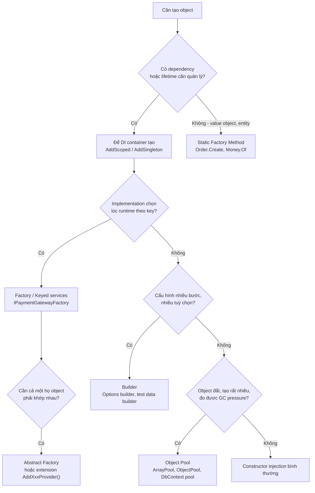
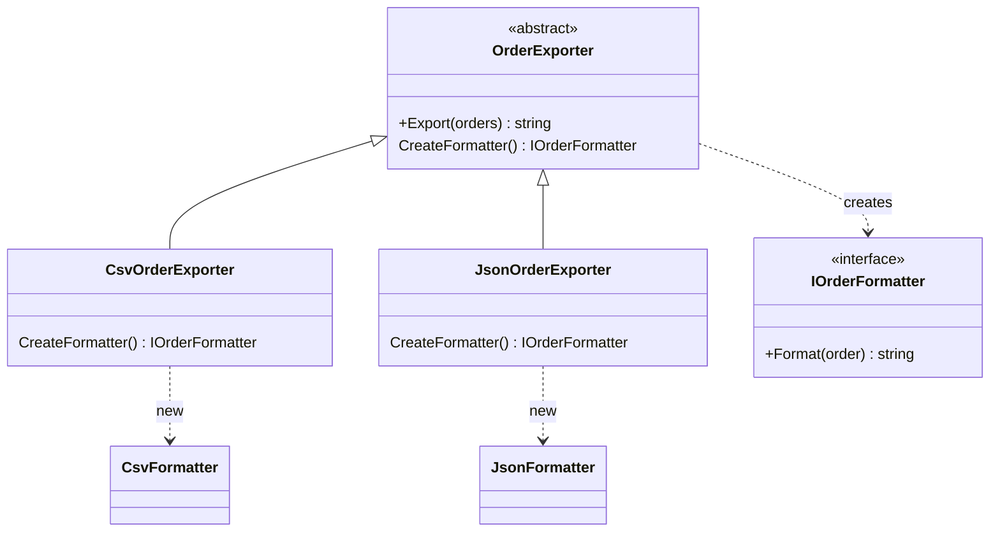
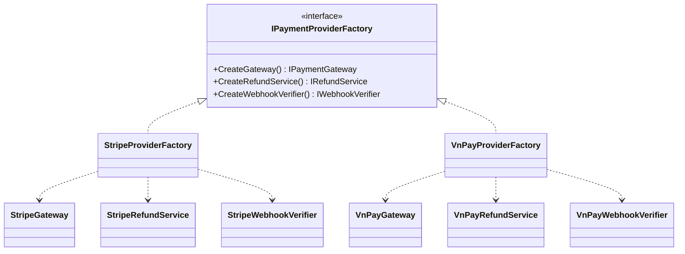
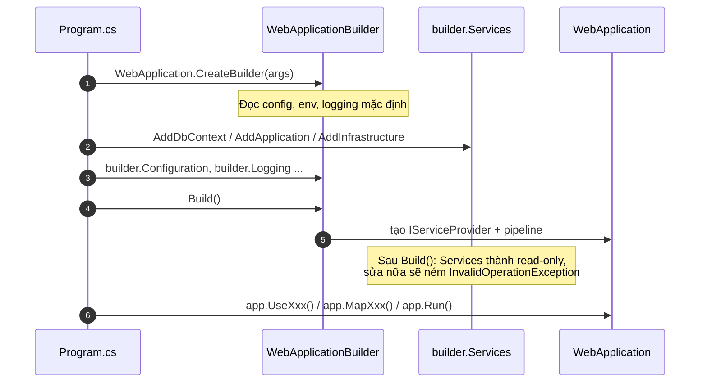
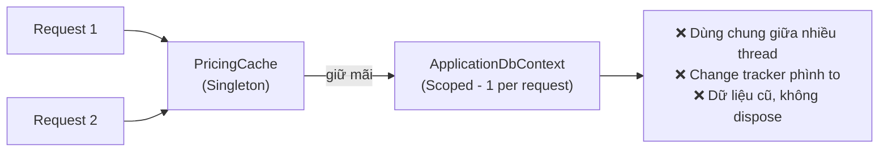
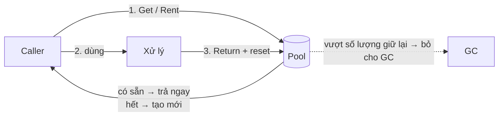

# Creational Patterns — Mẫu khởi tạo trong .NET hiện đại

> [!summary] TL;DR
> - **Creational patterns** trả lời câu hỏi: *ai* tạo object, *khi nào*, và *bằng cách nào* — để code nghiệp vụ không phải `new` trực tiếp class cụ thể.
> - Trong ASP.NET Core, **DI container là "siêu factory"**: phần lớn Factory/Singleton kiểu GoF giờ là **một dòng đăng ký** (`AddSingleton`, `AddKeyedScoped`, factory delegate `sp => ...`).
> - Pattern bạn **tự viết** nhiều nhất: **Static Factory Method** (`Order.Create`, `Money.Zero`), **Builder** cho test data, **Factory** chọn implementation theo runtime key. Pattern bạn **dùng** nhiều nhất: `WebApplicationBuilder`, `IHttpClientFactory`, `ILoggerFactory`, `ArrayPool<T>`.
> - ⚠️ Singleton trong .NET = **lifetime trong DI**, không phải `static Instance`. Bẫy lớn nhất: **captive dependency** (singleton giữ `DbContext` scoped) — Spring tự lo bằng scoped proxy, .NET thì **không**.

---

## 0. Tổng quan

### 0.1 Bảng tổng quan

| Pattern | Ý định (1 dòng) | Đã có sẵn trong .NET | ☕ Spring / Java | Mức độ hay gặp |
| --- | --- | --- | --- | --- |
| [[#Factory Method]] | Uỷ quyền việc "tạo object nào" cho một method/implementation khác | `IHttpClientFactory`, `ILoggerFactory`, `IDbContextFactory<T>`, factory delegate trong DI | `FactoryBean<T>`, `@Bean` method, `ObjectProvider<T>` | ⭐⭐⭐⭐⭐ |
| [[#Abstract Factory]] | Tạo **một họ** object liên quan, đảm bảo chúng "khớp" nhau | `DbProviderFactory`, `DbDataSource` | `DocumentBuilderFactory`, `@Configuration` + `@Profile` | ⭐⭐ |
| [[#Builder]] | Dựng object phức tạp **từng bước**, kết thúc bằng `Build()` | `WebApplicationBuilder`, `DbContextOptionsBuilder`, `StringBuilder`, `ResiliencePipelineBuilder` | Lombok `@Builder`, `WebClient.builder()`, `UriComponentsBuilder` | ⭐⭐⭐⭐⭐ (dùng) / ⭐⭐⭐ (tự viết) |
| [[#Singleton]] | Đúng **một instance** dùng chung | `AddSingleton`, `TimeProvider.System` | singleton scope (mặc định của bean) | ⭐⭐⭐⭐⭐ (qua DI) |
| [[#Static Factory Method & Named Constructors]] | Method `static` có **tên nghiệp vụ** thay cho constructor | `TimeSpan.FromSeconds`, `Guid.CreateVersion7`, `TypedResults.Ok` | `List.of`, `Optional.of`, `ResponseEntity.ok()` | ⭐⭐⭐⭐⭐ |
| [[#Object Pool]] | Tái sử dụng object đắt thay vì tạo mới/GC | `ArrayPool<T>`, `ObjectPool<T>`, `AddDbContextPool`, connection pool | HikariCP, Commons Pool2 | ⭐⭐ (tự viết) / ⭐⭐⭐⭐⭐ (dùng ngầm) |

> [!info] Analogy — Nhà hàng
> - **Factory Method**: bạn gọi "1 món chay", bếp tự quyết nấu món gì.
> - **Abstract Factory**: chọn "set menu Nhật" → khai vị, món chính, tráng miệng đều kiểu Nhật, không lẫn món Ý.
> - **Builder**: gọi phở "không hành, thêm trứng, nước trong" — từng tuỳ chọn rồi mới "chốt đơn".
> - **Singleton**: cả nhà hàng chỉ có 1 máy POS.
> - **Object Pool**: bát đĩa rửa xong dùng lại, không phát bát mới cho mỗi khách.

### 0.2 Sơ đồ chọn nhanh



---

## Factory Method

### 🧩 Vấn đề

`CheckoutService` cần cổng thanh toán khác nhau tùy `PaymentMethod` chọn **lúc runtime**. Cách ngây thơ: `switch` + `new` ngay trong code nghiệp vụ.

```csharp
// ❌ Before: code nghiệp vụ biết MỌI class cụ thể và cách khởi tạo chúng
public sealed class CheckoutService(IConfiguration config)
{
    public async Task PayAsync(Order order, PaymentMethod method, CancellationToken ct)
    {
        IPaymentGateway gateway = method switch
        {
            PaymentMethod.Card => new StripeCardGateway(config["Stripe:ApiKey"]!),   // đọc secret ở tầng nghiệp vụ
            PaymentMethod.BankTransfer => new BankTransferGateway(new HttpClient()), // new HttpClient → socket exhaustion
            PaymentMethod.CashOnDelivery => new CodGateway(),
            _ => throw new NotSupportedException($"{method} is not supported.")
        };

        await gateway.ChargeAsync(order.Id, new Money(order.Total, "VND"), ct);
    }
}
```

Pain points: thêm phương thức thanh toán → sửa `CheckoutService` (vi phạm OCP — xem [[SOLID-Principles]]); không mock được gateway; mỗi `new` phải tự lo dependency (HttpClient, config, logger).

### 📐 Cấu trúc GoF kinh điển

GoF định nghĩa Factory Method là: lớp cha khai báo method tạo object, **lớp con quyết định** tạo class cụ thể nào.



```csharp
// Dạng kinh điển (dựa trên kế thừa) — ít gặp trong code ứng dụng .NET hiện đại
public abstract class OrderExporter
{
    public string Export(IEnumerable<Order> orders) =>
        string.Join(Environment.NewLine, orders.Select(CreateFormatter().Format));

    // "Factory Method": lớp con quyết định formatter cụ thể
    protected abstract IOrderFormatter CreateFormatter();
}

public sealed class CsvOrderExporter : OrderExporter
{
    protected override IOrderFormatter CreateFormatter() => new CsvOrderFormatter();
}
```

> [!tip] Phân biệt 3 thứ hay bị gọi chung là "Factory"
> | Tên | Bản chất | Ví dụ |
> | --- | --- | --- |
> | **Simple Factory** (không thuộc GoF) | 1 class/method có `switch` trả về implementation | `PaymentGatewayFactory.Create(method)` |
> | **Factory Method** (GoF) | Method *ảo/abstract*, lớp con override để quyết định | `CreateFormatter()` ở trên |
> | **Abstract Factory** (GoF) | Interface có **nhiều** method tạo **một họ** object | `DbProviderFactory` |
>
> Trong thực tế .NET, "factory" thường là Simple Factory **đứng trên DI container** — và thế là đủ.

### ✅ After — cách .NET hiện đại: factory + keyed services (.NET 8+)

```csharp
// Application: chỉ biết abstraction
public enum PaymentMethod { Card, BankTransfer, CashOnDelivery }

public interface IPaymentGateway
{
    Task<PaymentResult> ChargeAsync(Guid orderId, Money amount, CancellationToken ct);
}

public interface IPaymentGatewayFactory
{
    IPaymentGateway Create(PaymentMethod method);
}
```

```csharp
// Infrastructure: factory mỏng, uỷ quyền việc khởi tạo cho DI
internal sealed class PaymentGatewayFactory(IServiceProvider sp) : IPaymentGatewayFactory
{
    // Dùng IServiceProvider ở ĐÂY là chấp nhận được: factory nằm sát composition root.
    // Đừng để IServiceProvider lọt vào handler/domain (Service Locator anti-pattern).
    public IPaymentGateway Create(PaymentMethod method) =>
        sp.GetRequiredKeyedService<IPaymentGateway>(method);   // key là enum — mọi object có Equals đúng đều được
}

// DependencyInjection.cs (Infrastructure)
services.AddHttpClient<BankTransferGateway>();   // typed client: HttpClient do IHttpClientFactory quản lý
services.AddKeyedScoped<IPaymentGateway, StripeCardGateway>(PaymentMethod.Card);
services.AddKeyedScoped<IPaymentGateway>(PaymentMethod.BankTransfer,
    (sp, _) => sp.GetRequiredService<BankTransferGateway>());
services.AddKeyedScoped<IPaymentGateway, CodGateway>(PaymentMethod.CashOnDelivery);
services.AddScoped<IPaymentGatewayFactory, PaymentGatewayFactory>();
```

```csharp
// Code nghiệp vụ sạch: không switch, không new, thêm phương thức mới = thêm 1 dòng đăng ký
public sealed class CheckoutService(IPaymentGatewayFactory gateways)
{
    public Task<PaymentResult> PayAsync(Order order, PaymentMethod method, CancellationToken ct) =>
        gateways.Create(method).ChargeAsync(order.Id, new Money(order.Total, "VND"), ct);
}
```

> [!example] Khi key cố định lúc compile-time → inject thẳng, khỏi cần factory
> ```csharp
> public sealed class CodReconciliationJob([FromKeyedServices(PaymentMethod.CashOnDelivery)] IPaymentGateway cod) { /* ... */ }
> ```

#### Biến thể nhẹ hơn: `Func<>` làm factory

```csharp
// Không cần interface riêng — delegate CHÍNH LÀ factory method
services.AddScoped<Func<PaymentMethod, IPaymentGateway>>(sp =>
    method => sp.GetRequiredKeyedService<IPaymentGateway>(method));

public sealed class CheckoutService(Func<PaymentMethod, IPaymentGateway> gatewayFor) { /* gatewayFor(method) */ }
```

| | Interface `IPaymentGatewayFactory` | `Func<PaymentMethod, IPaymentGateway>` |
| --- | --- | --- |
| Đọc code | Tên rõ nghĩa, Ctrl+Click được | "Func gì đây?" — cần đọc chỗ đăng ký |
| Mock trong test | `Substitute.For<...>()` | Truyền lambda `_ => fake` — còn dễ hơn |
| Mở rộng (thêm `CanHandle`, log...) | Dễ | Khó |
| Gợi ý | API công khai giữa các tầng | Nội bộ, 1–2 chỗ dùng |

> [!info] Mọi đăng ký `sp => ...` đều là Factory Method
> `services.AddScoped<IApplicationDbContext>(sp => sp.GetRequiredService<ApplicationDbContext>())` (xem [[Clean-Architecture-in-DotNet]]) chính là một factory method nhỏ mà container gọi mỗi khi cần.

### 🏠 Đã có sẵn trong .NET / ASP.NET Core

| API | Tạo ra gì | Vì sao là factory |
| --- | --- | --- |
| `IHttpClientFactory.CreateClient(name)` | `HttpClient` | Ẩn việc pool/xoay vòng `HttpMessageHandler` (mặc định 2 phút) → tránh socket exhaustion và DNS cũ |
| `ILoggerFactory.CreateLogger(category)` | `ILogger` | Chọn provider (Console, OpenTelemetry, Serilog…) mà caller không biết |
| `IDbContextFactory<T>.CreateDbContext()` | `DbContext` | Dùng trong Blazor Server / background job khi cần **nhiều** context ngắn hạn (`AddDbContextFactory`) |
| `IServiceScopeFactory.CreateScope()` | `IServiceScope` | Tạo scope DI thủ công trong `BackgroundService` |
| `IMeterFactory.Create(...)` (.NET 8) | `Meter` | Metrics gắn với DI, test được |
| `Channel.CreateBounded<T>(...)` | `Channel<T>` | Static factory chọn implementation nội bộ theo options |

### ☕ Spring / Java tương đương

```java
// Spring tự inject Map<beanName, bean> — gần giống keyed services của .NET 8
@Component
public class PaymentGatewayFactory {
    private final Map<String, PaymentGateway> gateways;   // key = tên bean: "card", "bankTransfer", "cod"

    public PaymentGatewayFactory(Map<String, PaymentGateway> gateways) { this.gateways = gateways; }

    public PaymentGateway create(PaymentMethod method) {
        var gateway = gateways.get(method.beanName());
        if (gateway == null) throw new IllegalArgumentException("Unsupported: " + method);
        return gateway;
    }
}

// @Bean method trong @Configuration = factory method do container gọi
@Configuration
class PaymentConfig {
    @Bean("card") PaymentGateway cardGateway(StripeProperties p) { return new StripeCardGateway(p.apiKey()); }
}
```

- `FactoryBean<T>` (`getObject()`, `getObjectType()`) ≈ đăng ký `sp => ...` phức tạp.
- `ObjectProvider<T>` ≈ `Func<T>` / `IServiceProvider.GetService<T>()` lười.

### ⚠️ Khi nào KHÔNG dùng / Bẫy

- ❌ Factory chỉ bọc đúng một `new` không có biến thể → thêm indirection vô ích; cứ constructor injection.
- ❌ Inject `IServiceProvider` khắp nơi "cho tiện" → Service Locator: dependency bị giấu, test khó.
- ⚠️ **Ai dispose?** Object tạo từ factory (đặc biệt `IDbContextFactory`) **không** được container dispose → caller phải `await using`.
- ⚠️ Factory **singleton** resolve service **scoped** từ root provider → captive dependency (xem [[#Singleton]]). Factory nên cùng lifetime với thứ nó tạo, hoặc tự tạo scope.

---

## Abstract Factory

### 🧩 Vấn đề

Mỗi nhà cung cấp thanh toán (Stripe, VNPay…) cần **một bộ** object đi cùng nhau: gateway thu tiền, dịch vụ hoàn tiền, bộ xác thực webhook. Ghép nhầm `StripeGateway` với `VnPayWebhookVerifier` → bug tinh vi (chữ ký webhook không bao giờ khớp).



### 💻 Code

```csharp
public interface IPaymentProviderFactory
{
    string Provider { get; }                       // "stripe", "vnpay"
    IPaymentGateway CreateGateway();
    IRefundService CreateRefundService();
    IWebhookVerifier CreateWebhookVerifier();      // đảm bảo cùng secret/thuật toán ký với gateway
}

internal sealed class StripeProviderFactory(IOptions<StripeOptions> options, IHttpClientFactory http)
    : IPaymentProviderFactory
{
    public string Provider => "stripe";
    public IPaymentGateway CreateGateway() => new StripeGateway(http.CreateClient("stripe"), options.Value);
    public IRefundService CreateRefundService() => new StripeRefundService(http.CreateClient("stripe"), options.Value);
    public IWebhookVerifier CreateWebhookVerifier() => new StripeWebhookVerifier(options.Value.WebhookSecret);
}
```

> [!tip] Cách ".NET-idiomatic" hơn: Abstract Factory "tan" vào composition root
> Thay vì class factory, viết **một extension method đăng ký cả họ** — đổi họ = đổi 1 dòng/1 config:
> ```csharp
> public static IServiceCollection AddStripePayments(this IServiceCollection services, IConfiguration config)
> {
>     services.Configure<StripeOptions>(config.GetSection("Stripe"));
>     services.AddHttpClient("stripe");
>     services.AddScoped<IPaymentGateway, StripeGateway>();
>     services.AddScoped<IRefundService, StripeRefundService>();
>     services.AddSingleton<IWebhookVerifier, StripeWebhookVerifier>();
>     return services;
> }
> // Program.cs: builder.Services.AddStripePayments(builder.Configuration);
> ```
> Chỉ cần class Abstract Factory thật sự khi **nhiều họ cùng tồn tại** và chọn lúc runtime (ví dụ: mỗi tenant một nhà cung cấp) — khi đó kết hợp với keyed services: `AddKeyedScoped<IPaymentProviderFactory, StripeProviderFactory>("stripe")`.

### 🏠 Đã có sẵn trong .NET

- **`DbProviderFactory`** (ADO.NET) — ví dụ sách giáo khoa: `CreateConnection()`, `CreateCommand()`, `CreateParameter()` trả về một họ object cùng provider (`SqlClientFactory.Instance`, `NpgsqlFactory.Instance`). Đăng ký/tra qua `DbProviderFactories`.
- **`DbDataSource`** (.NET 7+) — `CreateConnection()`, `CreateCommand()`; Npgsql dùng `NpgsqlDataSource` làm điểm vào chính.

### ☕ Spring / Java tương đương

- `javax.xml.parsers.DocumentBuilderFactory`, `javax.xml.transform.TransformerFactory` — Abstract Factory chuẩn JDK.
- Spring: một `@Configuration` + `@Profile("stripe")` (hoặc `@ConditionalOnProperty`) khai báo nhiều `@Bean` cùng họ ≈ extension `AddStripePayments()`.

### ⚠️ Khi nào KHÔNG dùng / Bẫy

- ❌ Chỉ có **một** họ → YAGNI, xem [[Core-Design-Principles]].
- ⚠️ Thêm **loại sản phẩm mới** (vd. `CreatePayoutService()`) → phải sửa **mọi** factory. Abstract Factory mở rộng dễ theo chiều "thêm họ", khó theo chiều "thêm sản phẩm".
- ⚠️ Factory `new` thủ công các object có dependency → mất lợi ích DI (lifetime, dispose). Ưu tiên `ActivatorUtilities.CreateInstance<T>(sp, extraArgs)` nếu cần trộn tham số runtime với dependency từ DI.

---

## Builder

### 🧩 Vấn đề

Object có nhiều tham số tuỳ chọn, cần cấu hình **nhiều bước** và chỉ hợp lệ khi "chốt" — constructor 9 tham số (telescoping constructor) vừa khó đọc vừa dễ truyền nhầm vị trí.



### 🏠 Bạn đang dùng Builder mỗi ngày

| Builder | Sản phẩm | Ghi chú |
| --- | --- | --- |
| `WebApplication.CreateBuilder(args)` → `WebApplicationBuilder` | `WebApplication` | Tách rõ pha "cấu hình" và pha "chạy" |
| `Host.CreateApplicationBuilder(args)` → `HostApplicationBuilder` | `IHost` | Worker service / console |
| `DbContextOptionsBuilder` (trong `AddDbContext(o => o.UseSqlServer(...))`) | `DbContextOptions` | Fluent, mỗi provider thêm extension `UseXxx` |
| `ModelBuilder` / `EntityTypeBuilder<T>` | EF model | Fluent API trong `OnModelCreating`/`IEntityTypeConfiguration<T>` |
| `StringBuilder` | `string` | Builder trên buffer mutable — tránh tạo N chuỗi trung gian |
| `ConfigurationBuilder`, `UriBuilder` | `IConfigurationRoot`, `Uri` | |
| `ResiliencePipelineBuilder` (Polly v8) | `ResiliencePipeline` | Ghép retry/timeout/circuit breaker theo thứ tự |

```csharp
// Polly v8 — builder ghép các strategy, Build() trả về pipeline bất biến, thread-safe để dùng chung
ResiliencePipeline pipeline = new ResiliencePipelineBuilder()
    .AddRetry(new RetryStrategyOptions
    {
        MaxRetryAttempts = 3,
        BackoffType = DelayBackoffType.Exponential,
        ShouldHandle = new PredicateBuilder().Handle<HttpRequestException>()
    })
    .AddTimeout(TimeSpan.FromSeconds(5))
    .Build();
```

### 💻 Ordering: Test Data Builder (nơi bạn sẽ tự viết Builder nhiều nhất)

```csharp
// tests/Ordering.Domain.Tests/Builders/OrderBuilder.cs
namespace Ordering.Domain.Tests.Builders;

public sealed class OrderBuilder
{
    // Giá trị mặc định HỢP LỆ → test chỉ khai báo phần nó quan tâm
    private Guid _customerId = Guid.NewGuid();
    private DateTimeOffset _now = new(2026, 11, 18, 9, 0, 0, TimeSpan.Zero);
    private readonly List<(string Sku, int Quantity, Money UnitPrice)> _items = [];
    private bool _submitted;

    public static OrderBuilder AnOrder() => new();

    public OrderBuilder ForCustomer(Guid customerId) { _customerId = customerId; return this; }
    public OrderBuilder CreatedAt(DateTimeOffset now) { _now = now; return this; }

    public OrderBuilder WithItem(string sku = "SKU-001", int quantity = 1, decimal unitPrice = 100_000m)
    {
        _items.Add((sku, quantity, new Money(unitPrice, "VND")));
        return this;
    }

    public OrderBuilder Submitted() { _submitted = true; return this; }

    public Order Build()
    {
        // Đi qua CHÍNH các method domain → object tạo ra luôn thoả invariant,
        // không "lách" bằng reflection hay set private field.
        var order = Order.Create(_customerId, _now);
        foreach (var (sku, quantity, price) in _items)
            order.AddItem(sku, quantity, price);

        if (_submitted)
        {
            if (_items.Count == 0) order.AddItem("SKU-DEFAULT", 1, new Money(1m, "VND"));
            order.Submit();
        }
        return order;
    }
}
```

```csharp
[Fact]
public void Submitted_order_cannot_accept_new_items()
{
    var order = OrderBuilder.AnOrder().WithItem().Submitted().Build();   // đọc như câu tiếng Anh

    var act = () => order.AddItem("SKU-002", 1, new Money(50_000m, "VND"));

    Assert.Throws<DomainException>(act);
}
```

> [!tip] Khi nào C# làm Builder trở nên thừa
> - **DTO / options / command**: object initializer + `required` + `init` đã đủ rõ ràng và an toàn:
>   ```csharp
>   public sealed record ShippingQuoteRequest
>   {
>       public required string FromProvince { get; init; }
>       public required string ToProvince { get; init; }
>       public decimal WeightKg { get; init; } = 0.5m;
>       public bool Express { get; init; }
>   }
>   var req = new ShippingQuoteRequest { FromProvince = "HN", ToProvince = "HCM", Express = true };
>   var sameButHeavier = req with { WeightKg = 3m };   // record "with" = tạo biến thể mà không cần builder
>   ```
> - **Named + optional arguments**: `new Coupon(code: "SALE10", percent: 10, expiresAt: null)` — hết telescoping constructor.
> - Giữ Builder cho: test data, object cần **nhiều bước có thứ tự**, hoặc API thư viện fluent.

### ☕ Spring / Java tương đương

```java
@Builder(toBuilder = true)          // Lombok sinh OrderRequestBuilder
public record OrderRequest(UUID customerId, @Singular List<Item> items, boolean express) {}

var req = OrderRequest.builder().customerId(id).item(item1).item(item2).express(true).build();
```

- Java **không có** object initializer/named argument → Builder (Lombok) phổ biến hơn hẳn bên C#.
- `SpringApplicationBuilder` ≈ `WebApplicationBuilder`; `WebClient.builder()`, `RestClient.builder()`, `UriComponentsBuilder`, `MockMvcRequestBuilders`.

### ⚠️ Khi nào KHÔNG dùng / Bẫy

- ❌ Builder cho **entity domain** set thẳng field (`Lombok @Builder` trên JPA entity là bẫy kinh điển) → bỏ qua invariant. Entity dùng [[#Static Factory Method & Named Constructors]].
- ⚠️ Builder là **mutable** → không chia sẻ giữa thread, không đăng ký builder làm singleton.
- ⚠️ Gọi `builder.Services.AddXxx()` **sau** `builder.Build()` → exception (collection đã read-only).
- ⚠️ Quên validate trong `Build()` → object "nửa vời" lọt ra ngoài.

---

## Singleton

### 🧩 Vấn đề

Một số thứ chỉ nên có **một** instance trong process: cache tỷ giá, `TimeProvider`, `HttpMessageHandler` pool, client SDK thread-safe, `ResiliencePipeline` đã build.

### ❌ Singleton kiểu GoF (static) vs ✅ Singleton qua DI

```csharp
// ❌ Before: static Instance — global state, dependency ẩn, không thay được trong test
public sealed class ExchangeRateCache
{
    // Lazy<T> mặc định LazyThreadSafetyMode.ExecutionAndPublication:
    // factory chạy ĐÚNG 1 lần kể cả khi nhiều thread truy cập đồng thời.
    private static readonly Lazy<ExchangeRateCache> _instance = new(() => new ExchangeRateCache());
    public static ExchangeRateCache Instance => _instance.Value;

    private ExchangeRateCache() { }
    public decimal GetRate(string from, string to) => /* gọi API thật! */ 0m;
}

public sealed class PriceCalculator
{
    // Không nhìn constructor thì không biết class này gọi API tỷ giá
    public decimal ToUsd(decimal vnd) => vnd * ExchangeRateCache.Instance.GetRate("VND", "USD");
}
```

```csharp
// ✅ After: "một instance" là quyết định của composition root, không phải của class
public interface IExchangeRateProvider { ValueTask<decimal> GetRateAsync(string from, string to, CancellationToken ct); }

internal sealed class CachedExchangeRateProvider(HttpClient http, TimeProvider clock) : IExchangeRateProvider
{
    // Singleton dùng chung giữa MỌI request → state phải thread-safe
    private readonly ConcurrentDictionary<(string, string), (decimal Rate, DateTimeOffset At)> _cache = new();

    public async ValueTask<decimal> GetRateAsync(string from, string to, CancellationToken ct)
    {
        if (_cache.TryGetValue((from, to), out var hit) && clock.GetUtcNow() - hit.At < TimeSpan.FromMinutes(5))
            return hit.Rate;

        var rate = await http.GetFromJsonAsync<decimal>($"rates?from={from}&to={to}", ct);
        _cache[(from, to)] = (rate, clock.GetUtcNow());
        return rate;
    }
}

// Program.cs / DependencyInjection.cs
services.AddSingleton(TimeProvider.System);   // test thay bằng FakeTimeProvider
services.AddHttpClient<IExchangeRateProvider, CachedExchangeRateProvider>(c => c.BaseAddress = new("https://rates.example/"));
```

> [!warning] Đoạn trên có bẫy — bạn thấy không?
> `AddHttpClient<TClient, TImpl>` đăng ký typed client là **transient**, nên `_cache` **không** được chia sẻ! Muốn cache dùng chung: tách cache ra service singleton riêng (hoặc dùng `IMemoryCache`/`HybridCache` vốn đã singleton), để typed client chỉ lo gọi HTTP. Bài học: *"singleton" là thuộc tính của **đăng ký**, không phải của class.*

### Lifetimes .NET ↔ Spring

| .NET (`Microsoft.Extensions.DependencyInjection`) | ☕ Spring | Khác biệt đáng nhớ |
| --- | --- | --- |
| `AddSingleton` | `singleton` (**mặc định**) | .NET **bắt buộc chọn** lifetime khi đăng ký; Spring mặc định singleton |
| `AddScoped` (1 instance / HTTP request hoặc / scope) | `request` scope (web) | `DbContext` mặc định là **scoped** |
| `AddTransient` | `prototype` | Transient `IDisposable` resolve từ root sống tới khi app tắt → rò rỉ |
| `AddKeyedSingleton(key)` | bean có tên + `@Qualifier` | Keyed services có từ .NET 8 |

### 🪤 Captive dependency — bẫy số 1



```csharp
// ❌ Singleton "bắt giữ" scoped
internal sealed class PricingCache(ApplicationDbContext db) { /* ... */ }
services.AddSingleton<PricingCache>();

// ✅ Cách 1: tạo scope cho mỗi lần làm việc
internal sealed class PricingCache(IServiceScopeFactory scopes)
{
    public async Task RefreshAsync(CancellationToken ct)
    {
        await using var scope = scopes.CreateAsyncScope();
        var db = scope.ServiceProvider.GetRequiredService<IApplicationDbContext>();
        // ... đọc giá, cập nhật cache
    }
}

// ✅ Cách 2: IDbContextFactory<T> (AddDbContextFactory) — tạo context ngắn hạn, tự dispose
// ✅ Cách 3: hạ lifetime PricingCache xuống Scoped nếu nó không thật sự cần sống lâu
```

> [!important] Phát hiện sớm
> Ở môi trường **Development**, host mặc định bật **scope validation**: resolve scoped từ root hoặc inject scoped vào singleton sẽ ném `InvalidOperationException` ("Cannot consume scoped service ... from singleton ..."). Bật thêm cho mọi môi trường khi build/test:
> ```csharp
> builder.Host.UseDefaultServiceProvider(o => { o.ValidateScopes = true; o.ValidateOnBuild = true; });
> ```

### ☕ Spring / Java tương đương

```java
@Service                                   // singleton mặc định
public class PricingCache {
    private final ObjectProvider<CartContext> cartContext;  // request-scoped → lấy lười mỗi lần dùng
    public PricingCache(ObjectProvider<CartContext> cartContext) { this.cartContext = cartContext; }
}

@Component
@Scope(value = WebApplicationContext.SCOPE_REQUEST, proxyMode = ScopedProxyMode.TARGET_CLASS)
public class CartContext { /* Spring inject PROXY vào singleton, proxy tìm instance thật theo request */ }
```

> [!warning] Bẫy khi chuyển từ Java sang .NET
> - Spring cho phép inject bean request-scoped vào singleton nhờ **scoped proxy** — chạy đúng. **MS DI không có scoped proxy**: hoặc ném exception (Development), hoặc âm thầm captive ở Production nếu tắt validation.
> - Spring singleton là "1 instance / `ApplicationContext`"; `AddSingleton` là "1 instance / `ServiceProvider`" — trong integration test với `WebApplicationFactory`, mỗi factory có singleton riêng (tốt cho cô lập test).
> - Thói quen Java `private static final Foo INSTANCE` cho service → trong .NET hãy đăng ký DI; chỉ giữ `static` cho thứ **thuần, bất biến** (`Money.Zero(...)`, cache regex `[GeneratedRegex]`).

### ⚠️ Khi nào KHÔNG dùng / Bẫy

- ❌ Singleton có **state mutable không đồng bộ** (`List<T>`, `Dictionary` thường) → race condition dưới tải. Dùng `ConcurrentDictionary`, immutable collections, hoặc `lock` trên `System.Threading.Lock` (.NET 9+).
- ❌ Singleton giữ dữ liệu **per-user/per-request** (current user, tenant) → rò dữ liệu giữa người dùng.
- ❌ `new HttpClient()` mỗi request (socket exhaustion) **và** `static HttpClient` không cấu hình `PooledConnectionLifetime` (không thấy DNS đổi) → dùng `IHttpClientFactory`.

---

## Static Factory Method & Named Constructors

> Không thuộc 23 pattern GoF — phổ biến nhờ Joshua Bloch (*Effective Java*, Item 1: "consider static factory methods instead of constructors"). Đây là creational pattern bạn sẽ viết **nhiều nhất** trong Domain layer.

### 🧩 Vấn đề

Constructor không có **tên**, không thể trả về instance **cache sẵn** hoặc **kiểu con**, và khó diễn đạt "cách tạo hợp lệ" theo ngôn ngữ nghiệp vụ. `new Money(0, "VND")` vs `Money.Zero("VND")`; `new Order(...)` vs `Order.Create(...)` (bắn domain event, set `Status = Draft`).

### 💻 Code — Ordering domain

```csharp
namespace Ordering.Domain.Orders;

// Biến thể Money với constructor private: MỌI đường tạo đều qua factory có tên
public sealed record Money
{
    public decimal Amount { get; }
    public string Currency { get; }

    private Money(decimal amount, string currency) => (Amount, Currency) = (amount, currency);

    public static Money Of(decimal amount, string currency)
    {
        if (amount < 0) throw new DomainException("Amount cannot be negative.");
        if (currency is not { Length: 3 }) throw new DomainException("Currency must be a 3-letter ISO code.");
        return new Money(amount, currency.ToUpperInvariant());
    }

    public static Money Zero(string currency) => Of(0m, currency);
    public static Money Vnd(decimal amount) => Of(amount, "VND");   // ngôn ngữ của team: "giá 150 nghìn VND"

    public Money Add(Money other) =>
        other.Currency == Currency ? new Money(Amount + other.Amount, Currency)
                                   : throw new DomainException("Currency mismatch.");
}
```

```csharp
// Named constructors trả về KIỂU CON — caller không cần biết class cụ thể
public abstract record Discount
{
    public static Discount Percentage(decimal percent) =>
        percent is > 0 and <= 100 ? new PercentageDiscount(percent)
                                  : throw new DomainException("Percent must be in (0, 100].");

    public static Discount FixedAmount(Money amount) => new FixedAmountDiscount(amount);
    public static Discount None { get; } = new NoDiscount();   // instance cache sẵn — Null Object

    public abstract Money ApplyTo(Money subtotal);
}

internal sealed record PercentageDiscount(decimal Percent) : Discount
{
    public override Money ApplyTo(Money subtotal) =>
        Money.Of(subtotal.Amount * (1 - Percent / 100m), subtotal.Currency);
}

internal sealed record FixedAmountDiscount(Money Amount) : Discount
{
    public override Money ApplyTo(Money subtotal) =>
        Money.Of(Math.Max(0, subtotal.Amount - Amount.Amount), subtotal.Currency);
}

internal sealed record NoDiscount : Discount
{
    public override Money ApplyTo(Money subtotal) => subtotal;
}
```

> [!tip] Factory trả `Result` thay vì throw
> Khi lỗi tạo object là chuyện **bình thường** (input người dùng), cho factory trả `Result<T>`: `Coupon.TryCreate(code, now)` → `Result<Coupon>`. Xem [[Result-Pattern-vs-Exceptions]].

#### Static abstract interface members (C# 11) — "factory method" ở mức kiểu

```csharp
using System.Diagnostics.CodeAnalysis;

// Minimal API tự bind route value vào kiểu có static TryParse → value object dùng thẳng làm tham số
public readonly record struct OrderNumber(string Value) : IParsable<OrderNumber>
{
    public static OrderNumber Parse(string s, IFormatProvider? provider) =>
        TryParse(s, provider, out var result) ? result : throw new FormatException($"Invalid order number '{s}'.");

    public static bool TryParse([NotNullWhen(true)] string? s, IFormatProvider? provider, out OrderNumber result)
    {
        if (s is { Length: 12 } && s.StartsWith("ORD-", StringComparison.Ordinal))
        {
            result = new OrderNumber(s);
            return true;
        }
        result = default;
        return false;
    }
}

// app.MapGet("/orders/{number}", (OrderNumber number, ISender sender) => ...);   // sai format → 400 tự động
```

### 🏠 Đã có sẵn trong .NET

`TimeSpan.FromMinutes(5)`, `Guid.CreateVersion7()`, `DateTimeOffset.FromUnixTimeSeconds(...)`, `Task.FromResult(x)`, `ValueTask.CompletedTask`, `TypedResults.Ok(dto)` / `Results.NotFound()`, `ImmutableArray.Create(...)`, `Channel.CreateUnbounded<T>()`, `Encoding.UTF8`.

### ☕ Spring / Java tương đương

`List.of(...)`, `Optional.of/empty()`, `LocalDate.of(...)`, `BigDecimal.valueOf(...)`, `Duration.ofMinutes(5)`, `ResponseEntity.ok(body)`, `ProblemDetail.forStatus(...)`. Quy ước tên Java (`of`, `from`, `valueOf`, `getInstance`, `newInstance`) ≈ .NET (`Create`, `From...`, `Parse/TryParse`).

### ⚠️ Khi nào KHÔNG dùng / Bẫy

- ❌ Static factory **gọi I/O** (DB, HTTP) → không mock được, không async-friendly. Static factory chỉ cho **logic thuần**; thứ có dependency để DI tạo.
- ⚠️ Constructor `private` → nhớ chừa constructor cho EF Core (`private Order() { }`) và kiểm tra serializer (System.Text.Json cần `[JsonConstructor]` nếu không có ctor public).
- ⚠️ Đừng tạo song song cả `public` constructor lẫn factory với logic validate khác nhau → hai "cửa" tạo object, một cửa thủng.

---

## Object Pool

### 🧩 Vấn đề

Một số object **đắt** để tạo (buffer lớn, connection, context nặng) và được dùng **liên tục**. Tạo mới mỗi lần → tốn CPU khởi tạo + **GC pressure** (đặc biệt buffer ≥ 85 KB vào Large Object Heap).



### 🏠 Đã có sẵn trong .NET (bạn đang dùng mà không biết)

| Pool | Ở đâu | Ghi chú |
| --- | --- | --- |
| **ADO.NET connection pool** | `Microsoft.Data.SqlClient`, Npgsql | `SqlConnection.Open()` lấy từ pool, `Dispose()` trả về — đừng giữ connection lâu |
| **`HttpMessageHandler` pool** | `IHttpClientFactory` | Handler xoay vòng (mặc định 2 phút) |
| **`AddDbContextPool<T>()`** | EF Core | Tái dùng instance `DbContext`, reset state khi trả |
| **`ArrayPool<T>.Shared`** | `System.Buffers` | Buffer tạm cho I/O, serialization |
| **`ObjectPool<T>`** | `Microsoft.Extensions.ObjectPool` | Pool tổng quát, thread-safe, ASP.NET Core dùng cho `StringBuilder` |

### 💻 Code

```csharp
// ArrayPool: xác thực chữ ký webhook thanh toán mà không cấp phát buffer mới mỗi request
using System.Buffers;
using System.Security.Cryptography;
using System.Text;

public static class WebhookSignature
{
    public static bool IsValid(ReadOnlySpan<char> payload, ReadOnlySpan<byte> expectedSignature, byte[] secret)
    {
        byte[] rented = ArrayPool<byte>.Shared.Rent(Encoding.UTF8.GetMaxByteCount(payload.Length));
        try
        {
            // Rent có thể trả mảng DÀI HƠN yêu cầu → luôn làm việc với đúng số byte đã ghi
            int written = Encoding.UTF8.GetBytes(payload, rented);

            Span<byte> hash = stackalloc byte[32];
            HMACSHA256.HashData(secret, rented.AsSpan(0, written), hash);

            // So sánh constant-time để không lộ thông tin qua timing attack
            return CryptographicOperations.FixedTimeEquals(hash, expectedSignature);
        }
        finally
        {
            // clearArray: payload thanh toán là dữ liệu nhạy cảm → xoá trước khi người khác Rent lại
            ArrayPool<byte>.Shared.Return(rented, clearArray: true);
        }
    }
}
```

```csharp
// ObjectPool<StringBuilder> qua DI (package Microsoft.Extensions.ObjectPool)
using System.Text;
using Microsoft.Extensions.DependencyInjection.Extensions;
using Microsoft.Extensions.ObjectPool;

builder.Services.TryAddSingleton<ObjectPoolProvider, DefaultObjectPoolProvider>();
builder.Services.TryAddSingleton<ObjectPool<StringBuilder>>(sp =>
    sp.GetRequiredService<ObjectPoolProvider>().Create(new StringBuilderPooledObjectPolicy()));

public sealed class OrderCsvExporter(ObjectPool<StringBuilder> pool)
{
    public string Export(IEnumerable<Order> orders)
    {
        var sb = pool.Get();
        try
        {
            foreach (var o in orders) sb.Append(o.Id).Append(',').Append(o.Total).AppendLine();
            return sb.ToString();
        }
        finally { pool.Return(sb); }   // policy tự Clear() khi trả về
    }
}
```

```csharp
// DbContext pooling — một dòng, lợi ích đo được ở API throughput cao
builder.Services.AddDbContextPool<ApplicationDbContext>(o => o.UseSqlServer(connectionString));
```

> [!warning] DbContext pooling có điều kiện
> Instance được tái dùng giữa các request → **không** giữ state per-request trong field của `DbContext` và **không** trông vào việc inject service scoped qua constructor của context (constructor chỉ nên nhận `DbContextOptions<T>`). Cần tenant/user → truyền qua service scoped khác hoặc interceptor. Kiểm tra mục *DbContext pooling* trong docs EF Core phiên bản bạn dùng.

### ☕ Spring / Java tương đương

- **HikariCP** — connection pool mặc định của Spring Boot ≈ ADO.NET connection pool (bên .NET nằm sẵn trong driver, không cấu hình bean riêng).
- **Apache Commons Pool2** (`GenericObjectPool`) ≈ `ObjectPool<T>`; Netty `PooledByteBufAllocator` ≈ `ArrayPool<byte>`.

### ⚠️ Khi nào KHÔNG dùng / Bẫy

- ❌ Pool object **rẻ** → lấy từ pool còn chậm hơn `new` (Microsoft khuyến cáo: chỉ pool khi đã **đo** bằng kịch bản thực tế).
- ❌ Dùng object **sau khi Return** → hai caller cùng ghi một buffer, bug cực khó tái hiện.
- ❌ Quên reset state → dữ liệu request trước rò sang request sau (nguy hiểm với dữ liệu thanh toán).
- ⚠️ `ObjectPool` giới hạn số object **giữ lại**, không giới hạn số object **tạo ra** — nó không phải semaphore giới hạn tài nguyên.

---

## Các pattern ít gặp

| Pattern | Ý định 1 dòng | Ví dụ trong .NET | Mức độ hay gặp |
| --- | --- | --- | --- |
| **Prototype** | Tạo object mới bằng cách **clone** object mẫu | `record` + `with` (shallow copy có sửa đổi), `MemberwiseClone()`; `ICloneable` **không** nói rõ deep hay shallow → nên tránh trong API public | ⭐⭐ |
| **Multiton** | Mỗi key đúng một instance | Keyed singleton `AddKeyedSingleton(key)`, named options `IOptionsMonitor<T>.Get(name)`, named `HttpClient` | ⭐⭐ |
| **Lazy Initialization** | Trì hoãn tạo object đắt tới khi cần | `Lazy<T>`, `LazyInitializer.EnsureInitialized`, `AsyncLazy` tự viết | ⭐⭐⭐ |
| **Service Locator** (anti-pattern) | Lấy dependency từ registry toàn cục | `IServiceProvider.GetService<T>()` trong code nghiệp vụ — chỉ chấp nhận trong factory/infrastructure | ⭐ (nên tránh) |
| **DI Container** | "Factory của mọi factory" — tạo object + quản lý lifetime + dispose | `IServiceCollection` / `IServiceProvider`; xem [[Dependency-Injection-DotNet-vs-Spring]] | ⭐⭐⭐⭐⭐ |

---

## Chọn pattern nào?

| Tình huống | Chọn | Cách làm trong .NET |
| --- | --- | --- |
| Entity/Value Object cần cách tạo hợp lệ, có tên nghiệp vụ | **Static Factory Method** | `Order.Create(...)`, `Money.Of(...)`, `Discount.Percentage(10)` |
| Implementation chọn **lúc runtime** theo key (phương thức thanh toán, hãng vận chuyển) | **Factory** + keyed services | `AddKeyedScoped<I, T>(key)` + `IXxxFactory` hoặc `Func<TKey, I>` |
| Key biết **lúc compile-time** | Không cần factory | `[FromKeyedServices(key)]` |
| Cần **một họ** service khớp nhau, đổi cả họ | **Abstract Factory** | Thường là extension `AddStripePayments()`; class factory khi chọn họ lúc runtime |
| Object nhiều tuỳ chọn, cấu hình nhiều bước | **Builder** | Dùng builder có sẵn; DTO thì `required`/`init` + `with` |
| Test cần object domain hợp lệ với vài chi tiết khác nhau | **Test Data Builder** | `OrderBuilder.AnOrder().WithItem().Submitted().Build()` |
| Service thread-safe, dùng chung toàn app | **Singleton (DI)** | `AddSingleton`; **không** `static Instance` |
| Object đắt, tạo liên tục, profiler chỉ ra GC pressure | **Object Pool** | `ArrayPool<T>.Shared`, `ObjectPool<T>`, `AddDbContextPool` |
| Bản sao có sửa đổi của object bất biến | Prototype "kiểu C#" | `record with { ... }` |

---

## Self-check — Câu hỏi tự kiểm tra

> [!question]- Factory Method (GoF), Simple Factory và Abstract Factory khác nhau thế nào?
> **Simple Factory**: một method/class có `switch` trả về implementation — không thuộc GoF. **Factory Method**: method ảo/abstract trong lớp cha, lớp con override để quyết định class cụ thể (dựa trên kế thừa). **Abstract Factory**: một interface với **nhiều** method tạo ra **một họ** object phải khớp nhau (vd. `DbProviderFactory` tạo connection + command + parameter cùng provider). Trong .NET hiện đại, factory thường là Simple Factory mỏng đứng trên DI/keyed services.

> [!question]- Vì sao trong ASP.NET Core không nên viết Singleton bằng `static Instance`?
> Vì dependency bị **giấu** (không xuất hiện trên constructor), không thay bằng fake trong test, không quản lý được dispose, và tạo global state. `AddSingleton` cho cùng đảm bảo "một instance" nhưng quyết định nằm ở composition root, class vẫn là POCO test được. `static` chỉ nên dùng cho dữ liệu thuần, bất biến.

> [!question]- (Phỏng vấn) Captive dependency là gì? .NET và Spring xử lý khác nhau ra sao?
> Là khi service sống lâu (singleton) giữ tham chiếu tới service sống ngắn (scoped/transient) → service ngắn bị "giam" sống quá vòng đời: `DbContext` bị dùng chung giữa nhiều request/thread, dữ liệu cũ, không dispose. **.NET**: scope validation (bật mặc định ở Development, hoặc `ValidateScopes = true`) ném `InvalidOperationException`; cách sửa là `IServiceScopeFactory.CreateAsyncScope()`, `IDbContextFactory<T>`, hoặc hạ lifetime. **Spring**: cho phép inject bean request-scoped vào singleton qua **scoped proxy** (`proxyMode = TARGET_CLASS`) hoặc `ObjectProvider<T>` — MS DI không có cơ chế proxy này.

> [!question]- `Lazy<T>` mặc định có thread-safe không? Factory có thể chạy hai lần không?
> Có. Constructor `Lazy<T>(Func<T>)` dùng `LazyThreadSafetyMode.ExecutionAndPublication`: chỉ một thread chạy factory, các thread khác chờ và nhận cùng giá trị. Chế độ `PublicationOnly` cho phép factory chạy nhiều lần nhưng chỉ một kết quả được publish; `None` không thread-safe. Lưu ý: ở `ExecutionAndPublication`, nếu factory ném exception thì exception được **cache** — mọi lần truy cập sau đều ném lại.

> [!question]- Khi nào Builder trong C# là thừa, trong khi bên Java lại gần như bắt buộc?
> C# có object initializer, `required`/`init` members, named + optional arguments và `record with` — đủ để tạo DTO/options rõ ràng, bất biến mà không cần builder. Java (không dùng Lombok) không có các tính năng này nên Builder là cách duy nhất để tránh telescoping constructor. Trong C#, giữ Builder cho test data, quy trình nhiều bước có thứ tự, hoặc API fluent của thư viện.

> [!question]- Dùng `ArrayPool<byte>.Shared.Rent(1000)` có những bẫy gì?
> (1) Mảng trả về có thể **dài hơn** 1000 → phải dùng đúng số byte đã ghi (`AsSpan(0, written)`), không dùng `rented.Length`. (2) Phải `Return` trong `finally`, và **không** dùng mảng sau khi return. (3) Dữ liệu cũ vẫn còn trong mảng → dữ liệu nhạy cảm cần `clearArray: true`. (4) Chỉ đáng dùng ở hot path đã đo được GC pressure.

---

## Liên kết & Tham khảo

- **Cùng series GoF:** [[Structural-Patterns]] · [[Behavioral-Patterns]]
- **Nguyên tắc nền:** [[SOLID-Principles]] · [[Core-Design-Principles]] · [[Coupling-and-Cohesion]] · [[Design-Thinking-Process]] · [[Code-Smells-and-Refactoring]]
- **Áp dụng:** [[Clean-Architecture-in-DotNet]] (`Order.Create`, đăng ký DI) · [[DDD-Tactical-Patterns]] (factory cho aggregate) · [[Result-Pattern-vs-Exceptions]] · [[Repository-UnitOfWork-Specification]]
- **Đọc tiếp:** [[Dependency-Injection-DotNet-vs-Spring]] · [[EF-Core-vs-JPA-Hibernate]] · [[Testing-in-DotNet]] · [[Java-to-DotNet-Mental-Map]]
- **MOC:** [[Architecture-Design-MOC]]
- **Nguồn:**
  - Gamma, Helm, Johnson, Vlissides — *Design Patterns: Elements of Reusable Object-Oriented Software* (1994)
  - Joshua Bloch — *Effective Java* (3rd ed.), Item 1–2 (static factory, builder)
  - refactoring.guru — *Creational Design Patterns*
  - Microsoft Learn — *Dependency injection in .NET* (keyed services, scope validation), *Make HTTP requests using IHttpClientFactory*, *Object reuse with ObjectPool in ASP.NET Core*
