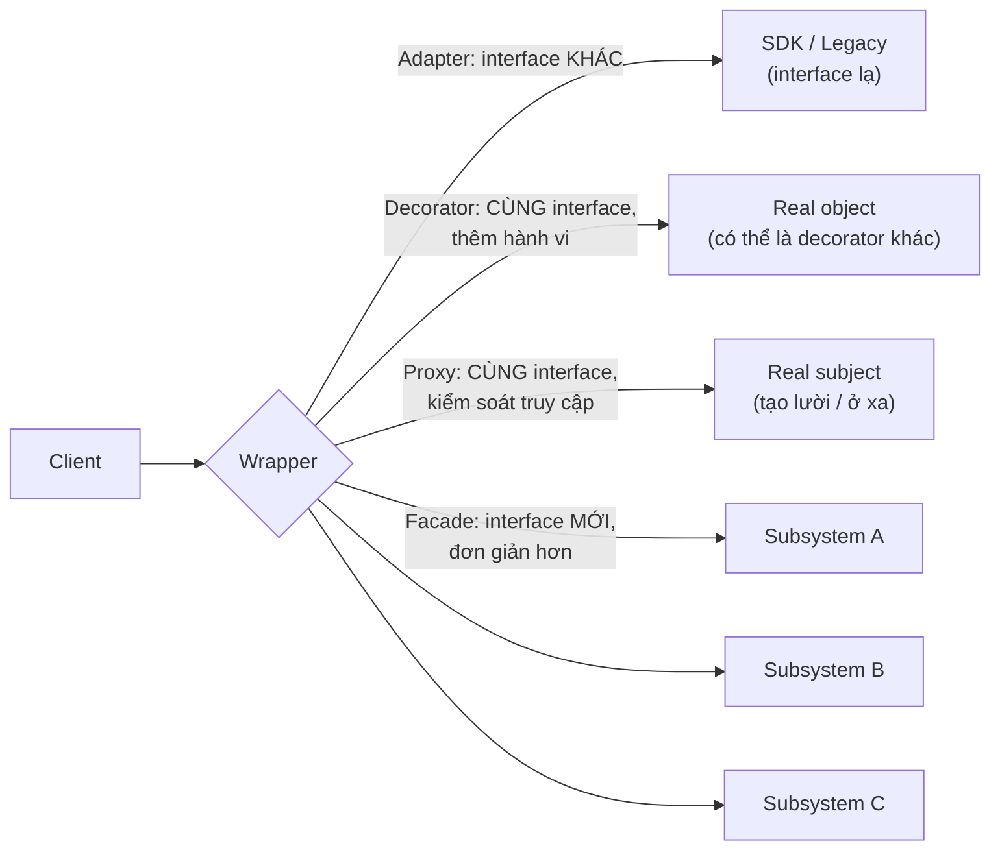
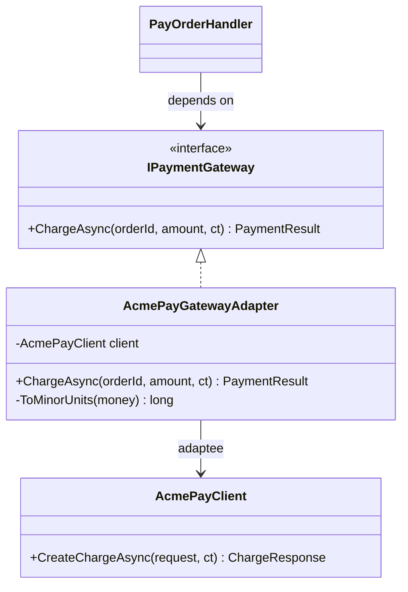
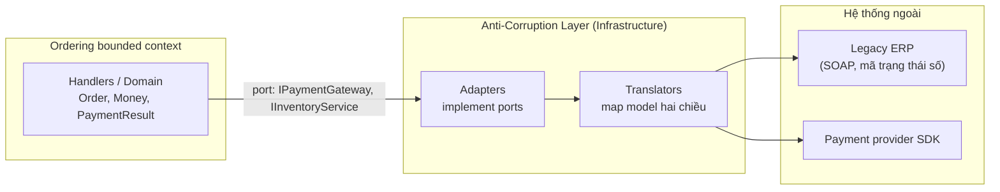
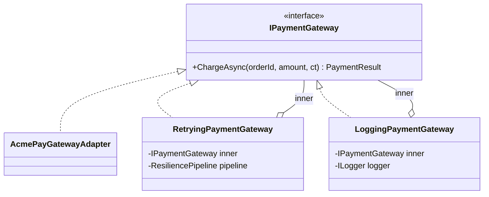
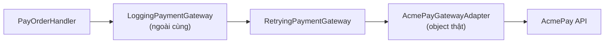
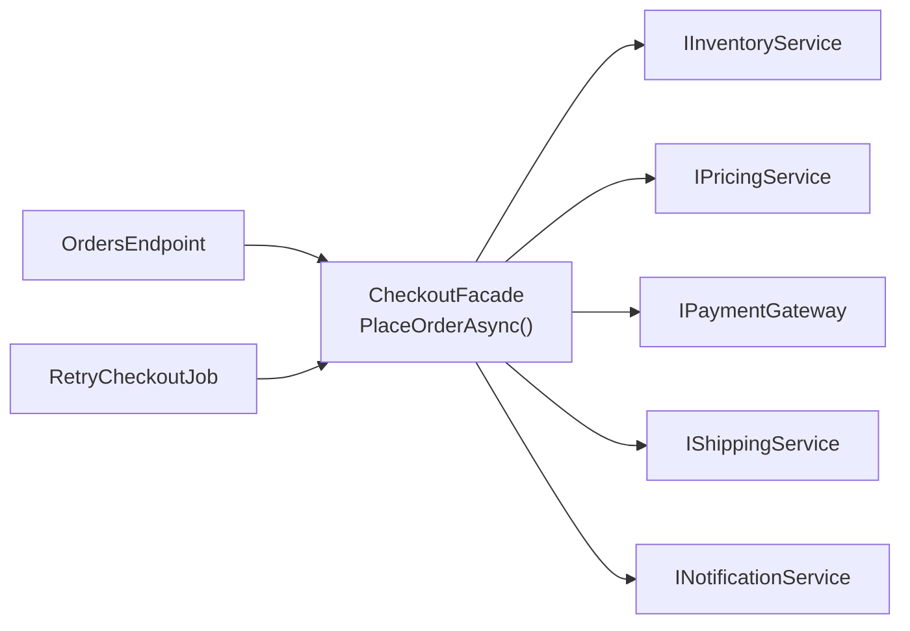
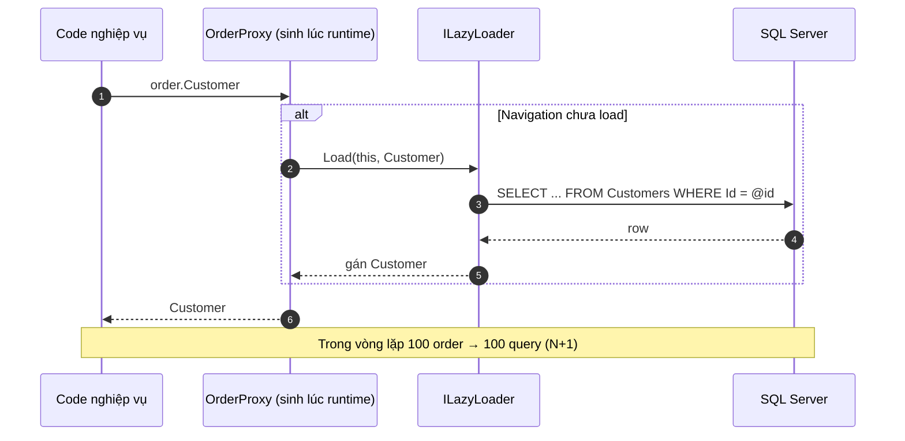
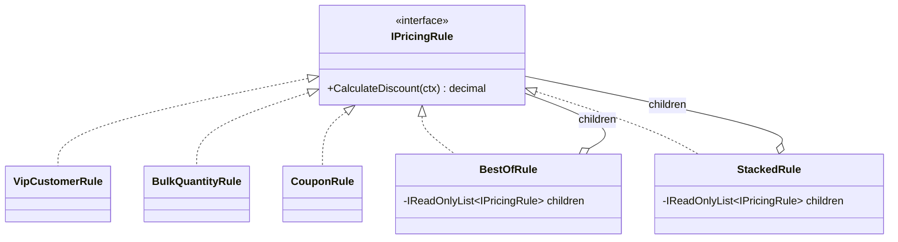
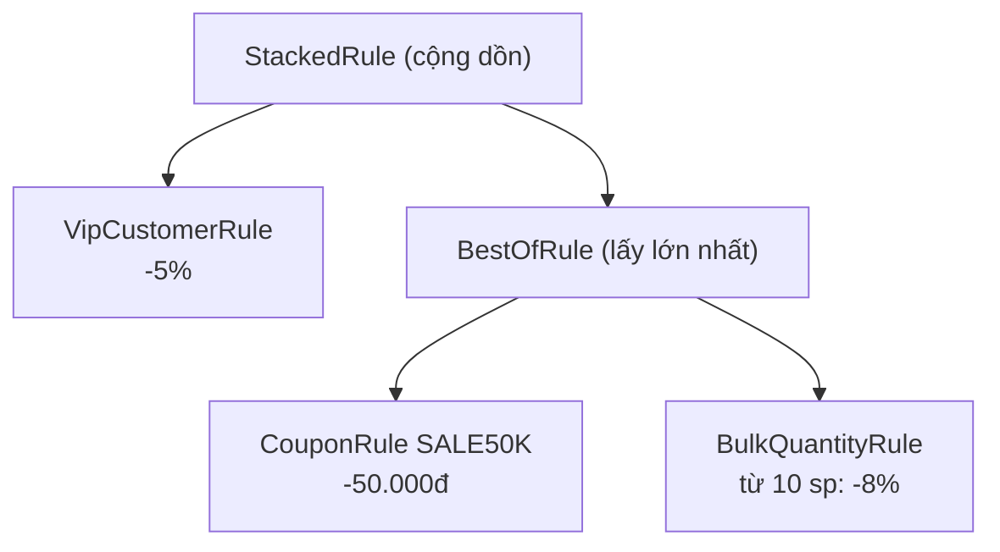

```mermaid
flowchart LR
    subgraph MW["Middleware = decorator quanh RequestDelegate"]
        direction LR
        E["ExceptionHandler"] --> AU["Authentication"] --> AZ["Authorization"] --> EP["Endpoint"]
    end
    subgraph MB["MediatR = decorator quanh Handler"]
        direction LR
        LB["Logging"] --> VB["Validation"] --> UB["UnitOfWork"] --> HD["Handler"]
    end
    subgraph DH["HttpClient = decorator quanh HttpMessageHandler"]
        direction LR
        AH["AuthHeaderHandler"] --> RH["Resilience handler"] --> SH["SocketsHttpHandler"]
    end
    EP --> LB
    HD --> AH
```

# Structural Patterns — Mẫu cấu trúc trong .NET hiện đại

> [!summary] TL;DR
> - **Structural patterns** nói về cách **ghép** object/class lại với nhau: bọc (wrap), chuyển đổi interface, gom nhóm — để thêm hành vi hoặc che độ phức tạp mà **không sửa** code gốc.
> - Bộ "wrapper" cần phân biệt: **Adapter** đổi interface · **Decorator** giữ interface, thêm hành vi · **Proxy** giữ interface, kiểm soát truy cập · **Facade** tạo interface mới đơn giản hơn cho cả subsystem.
> - **Decorator là pattern quan trọng nhất** cho backend .NET: caching/logging/retry quanh repository hay `IPaymentGateway`; MS DI **không** có sẵn API decorate → đăng ký tay hoặc **Scrutor `services.Decorate<,>()`**. Middleware, `DelegatingHandler`, MediatR behavior đều là "họ hàng" của Decorator.
> - ⚠️ Khác Java: method C# **mặc định không `virtual`** → proxy dựa trên kế thừa (Castle, EF lazy-loading) chỉ chặn được member `virtual`. Spring AOP "tự nhiên" bao nhiêu thì .NET **tường minh** bấy nhiêu.

---

## 0. Tổng quan

### 0.1 Bảng tổng quan

| Pattern | Ý định (1 dòng) | Đã có sẵn trong .NET | ☕ Spring / Java | Mức độ hay gặp |
| --- | --- | --- | --- | --- |
| [[#Adapter]] | Chuyển interface của class có sẵn (SDK, legacy) sang interface mà code của ta mong đợi | `StreamReader` (Stream → TextReader), Serilog → `ILogger`, `TaskCompletionSource` | `InputStreamReader`, `HandlerAdapter` | ⭐⭐⭐⭐⭐ |
| [[#Decorator]] | Bọc object để **thêm hành vi**, giữ nguyên interface, xếp chồng được | `GZipStream`, `BufferedStream`, `DelegatingHandler`, middleware | `java.io` streams, Spring AOP `@Cacheable`/`@Retryable` | ⭐⭐⭐⭐⭐ |
| [[#Facade]] | Một "cửa" đơn giản che cả subsystem phức tạp | `WebApplication`, `DbContext`, `HttpClient`, `AddControllers()` | `JdbcTemplate`, `RestClient`, Spring Boot starters | ⭐⭐⭐⭐ |
| [[#Proxy]] | Vật thế chỗ **kiểm soát truy cập** tới object thật (lười, từ xa, phân quyền) | EF lazy-loading proxy, `DispatchProxy`, Castle DynamicProxy, Refit, gRPC client | Spring AOP proxy, Hibernate proxy, OpenFeign | ⭐⭐⭐⭐ (dùng) / ⭐⭐ (tự viết) |
| [[#Composite]] | Cây object mà **lá và nhánh** dùng chung một interface | `CompositeFileProvider`, `CompositeChangeToken`, `IConfiguration` sections, expression tree | `CompositeHealthContributor`, `CompositeCacheManager` | ⭐⭐⭐ |

### 0.2 Họ "wrapper" — cùng hình dạng, khác ý định



> [!info] Analogy — Đi du lịch
> - **Adapter**: củ sạc đổi chân cắm Mỹ sang ổ Việt Nam.
> - **Decorator**: ốp lưng + dán cường lực + ví đựng thẻ — vẫn là cái điện thoại, chỉ thêm tính năng.
> - **Proxy**: lễ tân khách sạn — muốn gặp khách phải qua lễ tân (kiểm soát truy cập).
> - **Facade**: công ty du lịch trọn gói — một cuộc gọi lo vé máy bay, khách sạn, xe đưa đón.
> - **Composite**: tour gồm nhiều chặng, mỗi chặng gồm nhiều điểm — giá tour = tổng giá các phần, tính theo cùng một cách.

---

## Adapter

### 🧩 Vấn đề

Ta tích hợp một SDK thanh toán bên thứ ba (ví dụ dưới đây là **SDK giả định** `AcmePay.Sdk`). SDK có "ngôn ngữ" riêng: số tiền tính bằng đơn vị nhỏ nhất (`long`), mã tiền tệ chữ thường, trạng thái là chuỗi, lỗi là `AcmePayException`. Nếu gọi thẳng SDK trong handler, kiểu dữ liệu của nhà cung cấp **lan khắp** Application/Domain → đổi nhà cung cấp = sửa toàn bộ.

```csharp
// SDK bên thứ ba (GIẢ ĐỊNH, chỉ để minh hoạ) — ta không sửa được
namespace AcmePay.Sdk;

public sealed record ChargeRequest(long AmountMinor, string Currency, string Reference, string IdempotencyKey);
public sealed record ChargeResponse(string ChargeId, string Status, string? FailureCode);
public sealed class AcmePayException(string code, string message) : Exception(message)
{
    public string Code { get; } = code;
}
public sealed class AcmePayClient(HttpClient http, string apiKey)
{
    public Task<ChargeResponse> CreateChargeAsync(ChargeRequest request, CancellationToken ct = default)
        => throw new NotImplementedException();   // gọi REST API của nhà cung cấp
}
```

```csharp
// ❌ Before: handler Application phụ thuộc trực tiếp vào SDK
public sealed class PayOrderHandler(IApplicationDbContext db, AcmePayClient acme) : IRequestHandler<PayOrderCommand>
{
    public async Task Handle(PayOrderCommand cmd, CancellationToken ct)
    {
        var order = await db.Orders.FirstAsync(o => o.Id == cmd.OrderId, ct);
        var res = await acme.CreateChargeAsync(
            new ChargeRequest((long)(order.Total * 100), "vnd", order.Id.ToString(), Guid.NewGuid().ToString()), ct);
        //                    ^ sai với VND (không có đơn vị lẻ)       ^ idempotency key ngẫu nhiên → retry = trừ tiền 2 lần
        if (res.Status == "succeeded") { /* ... */ }   // magic string của nhà cung cấp lọt vào Application
    }
}
```

### 📐 Cấu trúc



### ✅ After

```csharp
// Application sở hữu port + kiểu kết quả của RIÊNG mình
public enum PaymentStatus { Succeeded, Pending, Declined }

public sealed record PaymentResult(PaymentStatus Status, string? TransactionId, string? DeclineReason)
{
    public static PaymentResult Succeeded(string transactionId) => new(PaymentStatus.Succeeded, transactionId, null);
    public static PaymentResult Pending(string transactionId) => new(PaymentStatus.Pending, transactionId, null);
    public static PaymentResult Declined(string reason) => new(PaymentStatus.Declined, null, reason);
}

public interface IPaymentGateway
{
    Task<PaymentResult> ChargeAsync(Guid orderId, Money amount, CancellationToken ct);
}
```

```csharp
// Infrastructure: Adapter dịch qua lại giữa "ngôn ngữ" của ta và của nhà cung cấp
using AcmePay.Sdk;

internal sealed class AcmePayGatewayAdapter(AcmePayClient client) : IPaymentGateway
{
    public async Task<PaymentResult> ChargeAsync(Guid orderId, Money amount, CancellationToken ct)
    {
        var request = new ChargeRequest(
            AmountMinor: ToMinorUnits(amount),
            Currency: amount.Currency.ToLowerInvariant(),
            Reference: orderId.ToString("N"),
            IdempotencyKey: $"order-{orderId:N}");   // khoá ổn định theo order → retry KHÔNG trừ tiền 2 lần

        try
        {
            var response = await client.CreateChargeAsync(request, ct);
            return response.Status switch
            {
                "succeeded" => PaymentResult.Succeeded(response.ChargeId),
                "requires_action" => PaymentResult.Pending(response.ChargeId),
                _ => PaymentResult.Declined(response.FailureCode ?? "unknown")
            };
        }
        catch (AcmePayException ex) when (ex.Code is "card_declined" or "insufficient_funds")
        {
            // Lỗi "nghiệp vụ" của nhà cung cấp → kết quả bình thường; lỗi hạ tầng vẫn để exception bay lên
            return PaymentResult.Declined(ex.Code);
        }
    }

    // VND/JPY là "zero-decimal currency"; USD/EUR có 2 chữ số lẻ
    private static long ToMinorUnits(Money money) => money.Currency switch
    {
        "VND" or "JPY" => (long)money.Amount,
        _ => (long)decimal.Round(money.Amount * 100m, MidpointRounding.AwayFromZero)
    };
}

public sealed class AcmePayOptions { public string ApiKey { get; set; } = ""; }   // bind từ config/secret store

// DI
services.Configure<AcmePayOptions>(configuration.GetSection("AcmePay"));
// Typed client dựng bằng factory vì SDK cần thêm apiKey (DI không tự resolve được string)
services.AddHttpClient<AcmePayClient>((http, sp) =>
    new AcmePayClient(http, sp.GetRequiredService<IOptions<AcmePayOptions>>().Value.ApiKey));
services.AddScoped<IPaymentGateway, AcmePayGatewayAdapter>();
```

### 🛡️ Adapter ở quy mô lớn: Anti-Corruption Layer (ACL)

Khi tích hợp cả một hệ thống (ERP cũ, API đối tác) có **mô hình khác** mô hình domain của ta, Eric Evans (DDD) gọi lớp dịch này là **Anti-Corruption Layer**: Adapter + Translator + (thường) Facade, đặt ở biên bounded context.



### 🏠 Đã có sẵn trong .NET

- `StreamReader`/`StreamWriter`: adapt `Stream` (byte) thành `TextReader`/`TextWriter` (ký tự).
- Serilog `AddSerilog()`/`UseSerilog()`: adapt Serilog thành provider của `Microsoft.Extensions.Logging.ILogger`.
- `TaskCompletionSource<T>`: adapt API callback/event cũ thành `Task`.
- `ConfigurationBinder` (`config.GetSection("Stripe").Get<StripeOptions>()`): adapt cây key-value thành object có kiểu.

### ☕ Spring / Java tương đương

- `InputStreamReader` ≈ `StreamReader` (giống hệt ý tưởng).
- Spring MVC `HandlerAdapter`: `DispatcherServlet` gọi mọi loại handler (`@Controller` method, `HttpRequestHandler`…) qua cùng một interface — Adapter kinh điển trong framework.
- `MessageListenerAdapter` (Spring JMS/AMQP): biến POJO thành listener.

### ⚠️ Khi nào KHÔNG dùng / Bẫy

- ❌ Adapter **trả về kiểu của SDK** (`ChargeResponse`) → chưa adapt gì cả, chỉ đổi tên class.
- ❌ Adapter "phình" logic nghiệp vụ (tính giảm giá, quyết định hoàn tiền) → logic đó thuộc Domain/Application.
- ❌ Adapter cho thư viện **ổn định, chuẩn mực** đã là abstraction (`ILogger`, `HttpClient`, `TimeProvider`) → bọc thêm chỉ thêm code.
- ⚠️ Nhớ dịch cả **exception** và **đơn vị** (tiền tệ, múi giờ, mã trạng thái) — đây là nơi bug tích hợp hay nấp nhất.

---

## Decorator

### 🧩 Vấn đề

Cần thêm **caching**, **logging/metrics**, **retry** quanh `IProductCatalog` hay `IPaymentGateway`. Sửa thẳng class gốc → trộn nhiều concern (vi phạm SRP); kế thừa (`CachedLoggedRetryingCatalog`) → bùng nổ tổ hợp class. Decorator: mỗi concern một class nhỏ **cùng implement interface**, bọc lẫn nhau như búp bê Nga.





### 💻 Code — ba decorator thực tế

```csharp
// 1) Caching decorator quanh catalog sản phẩm (đọc nhiều, ít đổi)
public interface IProductCatalog
{
    Task<Money?> GetPriceAsync(string sku, CancellationToken ct);
}

internal sealed class CachedProductCatalog(IProductCatalog inner, IMemoryCache cache) : IProductCatalog
{
    public Task<Money?> GetPriceAsync(string sku, CancellationToken ct) =>
        cache.GetOrCreateAsync($"price:{sku}", entry =>
        {
            // TTL ngắn: chấp nhận giá cũ tối đa 5 phút để giảm tải DB — quyết định NGHIỆP VỤ, ghi rõ ra
            entry.AbsoluteExpirationRelativeToNow = TimeSpan.FromMinutes(5);
            return inner.GetPriceAsync(sku, ct);
        });
}
```

> [!tip] .NET 9+: cân nhắc `HybridCache`
> `HybridCache` (package `Microsoft.Extensions.Caching.Hybrid`) gộp cache in-memory + distributed và có **chống cache stampede** (nhiều request cùng miss chỉ gọi `inner` một lần) — điều `IMemoryCache.GetOrCreateAsync` không đảm bảo.

```csharp
// 2) Logging/metrics decorator
internal sealed class LoggingPaymentGateway(IPaymentGateway inner, ILogger<LoggingPaymentGateway> logger)
    : IPaymentGateway
{
    public async Task<PaymentResult> ChargeAsync(Guid orderId, Money amount, CancellationToken ct)
    {
        var start = Stopwatch.GetTimestamp();
        var result = await inner.ChargeAsync(orderId, amount, ct);
        // Không log số thẻ/token — chỉ log định danh và kết quả
        logger.LogInformation("Charge {OrderId} {Amount} {Currency} → {Status} in {ElapsedMs:0} ms",
            orderId, amount.Amount, amount.Currency, result.Status, Stopwatch.GetElapsedTime(start).TotalMilliseconds);
        return result;
    }
}

// 3) Retry decorator dùng Polly v8
internal sealed class RetryingPaymentGateway(IPaymentGateway inner) : IPaymentGateway
{
    private static readonly ResiliencePipeline Pipeline = new ResiliencePipelineBuilder()
        .AddRetry(new RetryStrategyOptions
        {
            MaxRetryAttempts = 2,
            BackoffType = DelayBackoffType.Exponential,
            ShouldHandle = new PredicateBuilder().Handle<HttpRequestException>()   // chỉ lỗi mạng tạm thời
        })
        .Build();

    // ⚠️ AN TOÀN chỉ vì adapter gửi idempotency key ổn định theo orderId (xem Adapter)
    public async Task<PaymentResult> ChargeAsync(Guid orderId, Money amount, CancellationToken ct) =>
        await Pipeline.ExecuteAsync(async token => await inner.ChargeAsync(orderId, amount, token), ct);
}
```

### 🔧 Đăng ký decorator trong MS DI

**Cách 1 — thủ công (không thư viện):**

```csharp
services.AddScoped<AcmePayGatewayAdapter>();   // đăng ký object thật theo KIỂU CỤ THỂ
services.AddScoped<IPaymentGateway>(sp =>
{
    IPaymentGateway gateway = sp.GetRequiredService<AcmePayGatewayAdapter>();
    // ActivatorUtilities: lấy dependency còn lại (ILogger...) từ DI, "inner" truyền tay
    gateway = ActivatorUtilities.CreateInstance<RetryingPaymentGateway>(sp, gateway);  // lớp trong
    gateway = ActivatorUtilities.CreateInstance<LoggingPaymentGateway>(sp, gateway);   // lớp ngoài cùng
    return gateway;
});
```

**Cách 2 — Scrutor (MIT):**

```bash
dotnet add src/Ordering.Infrastructure package Scrutor
```

```csharp
services.AddScoped<IPaymentGateway, AcmePayGatewayAdapter>();
services.Decorate<IPaymentGateway, RetryingPaymentGateway>();   // bọc registration hiện có
services.Decorate<IPaymentGateway, LoggingPaymentGateway>();    // gọi SAU → nằm NGOÀI cùng

services.AddScoped<IProductCatalog, SqlProductCatalog>();
services.Decorate<IProductCatalog, CachedProductCatalog>();

// (Thay cho dòng Decorate<IProductCatalog, CachedProductCatalog> ở trên — gọi cả hai sẽ bọc 2 lớp cache)
// Decorator cần tham số tuỳ biến → overload nhận factory
services.Decorate<IProductCatalog>((inner, sp) =>
    new CachedProductCatalog(inner, sp.GetRequiredService<IMemoryCache>()));
```

> [!info] Scrutor API cần nhớ
> - `Decorate<TService, TDecorator>()` — **ném `DecorationException`** nếu chưa có registration nào cho `TService` → luôn đăng ký service **trước** khi decorate.
> - `TryDecorate<...>()` — như trên nhưng trả `bool` thay vì ném.
> - `Decorate<TService>(Func<TService, IServiceProvider, TService>)` — tự dựng decorator.
> - `Decorate(Type serviceType, Type decoratorType)` — overload non-generic, thường dùng cho **open generic** như `typeof(ICommandHandler<,>)` (kiểm tra hỗ trợ open generic với phiên bản Scrutor bạn dùng).
> - Decorator đăng ký **sau** nằm **ngoài**. Thứ tự = thứ tự thực thi từ ngoài vào trong.

### 🧬 Decorator "ẩn mình" khắp ASP.NET Core

| Cơ chế | Bọc cái gì | Hình dạng | Ghi chú |
| --- | --- | --- | --- |
| `GZipStream`, `BufferedStream`, `CryptoStream` | `Stream` | Decorator OOP kinh điển | Ví dụ ngay bên dưới |
| `DelegatingHandler` (`AddHttpMessageHandler<T>()`) | `HttpMessageHandler` | Decorator, xếp theo thứ tự đăng ký | Handler phải đăng ký **transient** |
| **Middleware** | `RequestDelegate` | Decorator dạng **hàm**: `Func<RequestDelegate, RequestDelegate>` | Có thể không gọi `next` → cũng là Chain of Responsibility, xem [[Behavioral-Patterns#Chain of Responsibility]] |
| **MediatR `IPipelineBehavior<,>`** | mọi `IRequestHandler<,>` | Decorator **generic** áp cho mọi request | Xem [[CQRS-and-MediatR-Pattern]] |
| Endpoint filter (`IEndpointFilter`), MVC action filter | endpoint/action | Decorator theo endpoint | |
| Scrutor `Decorate(typeof(ICommandHandler<,>), ...)` | handler tự viết | Decorator generic **không cần MediatR** | Cách làm CQRS "không thư viện thương mại" |

```csharp
// BCL: decorator xếp chồng trên Stream — mỗi lớp thêm một khả năng, vẫn là Stream
await using var file = File.Create("orders-2026-11.csv.gz");
await using var gzip = new GZipStream(file, CompressionLevel.Optimal);   // + nén
await using var writer = new StreamWriter(gzip, Encoding.UTF8);          // Adapter: Stream → TextWriter
await writer.WriteLineAsync("OrderId,Total,Status");
// BufferedStream hữu ích khi bọc NetworkStream/stream không tự buffer; FileStream đã có buffer nội bộ.
```



### ☕ Spring / Java tương đương

```java
// java.io — Decorator kinh điển, y hệt Stream của .NET
try (var out = new GZIPOutputStream(new BufferedOutputStream(new FileOutputStream("orders.csv.gz")))) { /* ... */ }

// Spring không có API "decorate" → dùng @Primary + @Qualifier
@Service @Qualifier("acme")
class AcmePayGateway implements PaymentGateway { /* ... */ }

@Service @Primary   // ai inject PaymentGateway sẽ nhận decorator này
class LoggingPaymentGateway implements PaymentGateway {
    private final PaymentGateway inner;
    LoggingPaymentGateway(@Qualifier("acme") PaymentGateway inner) { this.inner = inner; }
    public PaymentResult charge(UUID orderId, Money amount) { /* log */ return inner.charge(orderId, amount); }
}
```

- Thực tế Spring hay giải bài toán này bằng **AOP annotation**: `@Cacheable`, `@Retryable` (Spring Retry), `@Timed`, `@Transactional` — proxy sinh tự động thay vì class decorator viết tay.
- `ClientHttpRequestInterceptor` (RestClient/RestTemplate), `ExchangeFilterFunction` (WebClient) ≈ `DelegatingHandler`.

> [!warning] Bẫy khi chuyển từ Java sang .NET
> - Không có `@Cacheable`/`@Retryable` "miễn phí": .NET ưu tiên **decorator tường minh** (Scrutor), MediatR behavior, hoặc resilience handler cho HttpClient (`AddStandardResilienceHandler()` trong `Microsoft.Extensions.Http.Resilience`).
> - Spring `@Primary` + `@Qualifier` ≈ MS DI: đăng ký object thật theo **kiểu cụ thể**, interface trỏ tới decorator. Đăng ký hai lần cùng interface → `GetService` lấy **cái cuối cùng**, `IEnumerable<T>` lấy **tất cả** (dễ gây gọi trùng).

### ⚠️ Khi nào KHÔNG dùng / Bẫy

- ❌ **Retry quanh thao tác không idempotent** (trừ tiền, gửi email) → thực hiện 2 lần. Chỉ retry khi có idempotency key hoặc thao tác vốn idempotent.
- ❌ **Lifetime lệch**: decorator singleton (để giữ cache) bọc repository scoped → captive dependency (xem [[Creational-Patterns#Singleton]]). Cache nên nằm trong `IMemoryCache` (singleton), decorator cùng lifetime với inner.
- ❌ Interface "béo" 20 method → mỗi decorator phải chuyển tiếp 20 method → dấu hiệu cần tách interface (ISP, xem [[SOLID-Principles]]) hoặc dùng behavior generic.
- ⚠️ **Thứ tự** quan trọng: Logging ngoài Retry → 1 log/lần gọi; Retry ngoài Logging → 1 log/lần thử. Chọn có chủ đích.
- ⚠️ Caching decorator: phải có **chiến lược invalidation** (khi đổi giá → xoá `price:{sku}`), và đừng cache theo dữ liệu người dùng mà quên user id trong key.

---

## Facade

### 🧩 Vấn đề

Đặt hàng cần: kiểm tồn kho, tính giá + giảm giá, giữ hàng, thu tiền, tạo vận đơn, gửi email. Nếu controller/endpoint tự điều phối 6 service, mỗi client mới (mobile API, admin, job) lại copy chuỗi gọi đó.



### 💻 Code

```csharp
public sealed record CheckoutRequest(Guid CustomerId, IReadOnlyList<CartLine> Lines, string? CouponCode, PaymentMethod Method);
public sealed record CartLine(string Sku, int Quantity);

public interface ICheckoutFacade
{
    Task<Guid> PlaceOrderAsync(CheckoutRequest request, CancellationToken ct);
}

internal sealed class CheckoutFacade(
    IInventoryService inventory,
    IPricingService pricing,
    IPaymentGatewayFactory payments,
    IShippingService shipping,
    IApplicationDbContext db,
    TimeProvider clock) : ICheckoutFacade
{
    public async Task<Guid> PlaceOrderAsync(CheckoutRequest request, CancellationToken ct)
    {
        // Facade chỉ ĐIỀU PHỐI thứ tự; quy tắc nghiệp vụ vẫn ở Domain (Order) và các service chuyên trách
        await inventory.ReserveAsync(request.Lines, ct);

        var order = Order.Create(request.CustomerId, clock.GetUtcNow());
        foreach (var line in request.Lines)
            order.AddItem(line.Sku, line.Quantity, await pricing.GetUnitPriceAsync(line.Sku, ct));

        var amount = await pricing.ApplyCouponAsync(order, request.CouponCode, ct);
        await payments.Create(request.Method).ChargeAsync(order.Id, amount, ct);
        order.Submit();

        db.Orders.Add(order);
        await db.SaveChangesAsync(ct);
        await shipping.CreateShipmentAsync(order.Id, ct);   // side-effect ngoài DB → thực tế nên qua Outbox
        return order.Id;
    }
}
```

> [!important] Facade trong Clean Architecture / CQRS
> Một **command handler** (`PlaceOrderCommandHandler`) về bản chất *là* Facade cho một use case — controller chỉ thấy `sender.Send(command)`. Ở cấp module, **public API của module** trong [[Modular-Monolith]] (ví dụ `IOrderingModule`) cũng là Facade che toàn bộ nội bộ module. Side-effect ngoài DB nên đi qua [[Domain-Events-and-Outbox]].

### 🏠 Đã có sẵn trong .NET

- `WebApplication`: một object che host, DI, config, routing, middleware pipeline.
- `DbContext`: che change tracker, query pipeline, connection, transaction, migrations.
- `HttpClient`: che chuỗi `HttpMessageHandler`, connection pool, serialization helper (`GetFromJsonAsync`).
- `File.ReadAllTextAsync`: che `FileStream` + `StreamReader` + encoding detection.
- Extension `services.AddControllers()` / `AddAuthentication()`: một dòng đăng ký hàng chục service.

### ☕ Spring / Java tương đương

`JdbcTemplate` (che `Connection`/`PreparedStatement`/`ResultSet`/exception translation), `RestClient`/`RestTemplate`, `JavaMailSender`, **Spring Boot starters + auto-configuration** (≈ `AddXxx()` extension), `@Service` application service điều phối nhiều repository.

### ⚠️ Khi nào KHÔNG dùng / Bẫy

- ❌ **God Facade**: `ShopFacade` với 40 method cho mọi thứ → tách theo use case / module.
- ❌ Facade **pass-through** 1:1 (`GetOrder` gọi đúng `orderService.GetOrder`) → lớp thừa.
- ❌ Đưa logic nghiệp vụ vào facade → Anemic Domain Model; facade chỉ điều phối.
- ⚠️ Không chặn "cửa sau": client nâng cao vẫn có thể cần subsystem trực tiếp — Facade **đơn giản hoá**, không **cấm đoán**.

---

## Proxy

### 🧩 Vấn đề

Cần một vật **thế chỗ** có cùng interface với object thật để: tạo lười (**virtual proxy**), gọi qua mạng như gọi local (**remote proxy**), kiểm tra quyền (**protection proxy**), hoặc chèn hành vi mà không viết từng class (**dynamic/interception proxy**).

> [!tip] Proxy hay Decorator?
> Cấu trúc **giống hệt** (cùng interface, giữ tham chiếu tới object thật). Khác ở **ý định & ai tạo**: Decorator do *bạn* xếp chồng để **thêm** hành vi; Proxy thường do *framework/container* sinh ra để **kiểm soát truy cập/vòng đời** object thật, client không biết mình đang cầm proxy.

### 📐 Virtual proxy — EF Core lazy loading



```csharp
// dotnet add package Microsoft.EntityFrameworkCore.Proxies
services.AddDbContext<ApplicationDbContext>(o => o
    .UseLazyLoadingProxies()            // EF sinh lớp con của entity lúc runtime
    .UseSqlServer(connectionString));

public class Order                       // KHÔNG được sealed — proxy là lớp con
{
    public virtual Customer Customer { get; private set; } = null!;   // navigation phải virtual
}
```

> [!warning] Lazy-loading proxy xung đột với thiết kế domain của ta
> `Order` trong [[Clean-Architecture-in-DotNet]] là `sealed`, navigation không `virtual` — cố ý. Bật proxy buộc phải "mở" entity cho kế thừa, và dễ gây **N+1** (docs EF Core cũng cảnh báo). Khuyến nghị: tắt lazy loading, dùng `Include` có chủ đích ở command side và **projection** ở query side. Xem [[EF-Core-vs-JPA-Hibernate]].

### 💻 Dynamic proxy với `DispatchProxy` (BCL, chỉ cho interface)

```csharp
using System.Diagnostics;
using System.Reflection;
using System.Runtime.ExceptionServices;

// Proxy đo thời gian cho BẤT KỲ interface nào — không viết decorator cho từng interface
public class TimingProxy<T> : DispatchProxy where T : class
{
    private T _target = default!;
    private ILogger _logger = default!;

    public static T Wrap(T target, ILogger logger)
    {
        T proxy = Create<T, TimingProxy<T>>();          // T bắt buộc là interface; TimingProxy không được sealed
        var self = (TimingProxy<T>)(object)proxy;
        self._target = target;
        self._logger = logger;
        return proxy;
    }

    protected override object? Invoke(MethodInfo? targetMethod, object?[]? args)
    {
        ArgumentNullException.ThrowIfNull(targetMethod);
        var start = Stopwatch.GetTimestamp();
        try
        {
            // ⚠️ Với method async, dòng này chỉ đo thời gian TẠO Task, không phải thời gian chạy xong
            return targetMethod.Invoke(_target, args);
        }
        catch (TargetInvocationException ex) when (ex.InnerException is not null)
        {
            ExceptionDispatchInfo.Throw(ex.InnerException);   // bóc lớp vỏ reflection, giữ stack trace gốc
            throw;                                            // không tới được, chỉ để compiler hài lòng
        }
        finally
        {
            _logger.LogDebug("{Type}.{Method} took {Ms:0.0} ms",
                typeof(T).Name, targetMethod.Name, Stopwatch.GetElapsedTime(start).TotalMilliseconds);
        }
    }
}

// var gateway = TimingProxy<IPaymentGateway>.Wrap(realGateway, logger);
```

> [!info] Vì sao code ứng dụng hiếm khi tự viết proxy động
> Reflection chậm hơn gọi trực tiếp, xử lý async rắc rối, không thân thiện với trimming/Native AOT. Với vài interface → **decorator tường minh** (Scrutor). Với mọi request → **MediatR behavior/middleware**. Dynamic proxy để dành cho thư viện (mocking, ORM, AOP framework).

### 🏠 Proxy đã có sẵn trong hệ sinh thái .NET

| Loại | Ví dụ | Ghi chú |
| --- | --- | --- |
| Virtual | EF Core lazy-loading proxies, `Lazy<T>` | Proxy EF dựa trên Castle.Core |
| Interception (class/interface) | **Castle DynamicProxy** — nền của Moq, NSubstitute, Autofac interceptors | Class proxy chỉ chặn được member `virtual` |
| Interception (interface) | `System.Reflection.DispatchProxy` | Có sẵn trong BCL |
| Remote | **Refit** (`AddRefitClient<IOrderApi>()`), gRPC generated client | Gọi HTTP/gRPC như gọi method |
| Protection | Authorization policy/filter (thường không làm bằng proxy) | |

```csharp
// Refit — remote proxy: interface + attribute, thư viện sinh implementation gọi HTTP
public interface IShippingApi
{
    [Post("/shipments")]
    Task<ShipmentDto> CreateShipmentAsync([Body] CreateShipmentRequest request, CancellationToken ct);
}

services.AddRefitClient<IShippingApi>()                       // package Refit.HttpClientFactory
    .ConfigureHttpClient(c => c.BaseAddress = new Uri("https://shipping.example"));
```

### ☕ Spring / Java tương đương

| Java / Spring | .NET | Ghi chú |
| --- | --- | --- |
| JDK dynamic proxy (`java.lang.reflect.Proxy` + `InvocationHandler`) | `DispatchProxy` | Cả hai chỉ cho **interface** |
| CGLIB / ByteBuddy (subclass proxy) | Castle DynamicProxy class proxy | Java: method virtual mặc định → chặn được gần hết. **C#: chỉ `virtual`** |
| Spring AOP (`@Transactional`, `@Cacheable`…) | Không có tương đương "ngầm" trong MS DI | Spring Boot mặc định dùng CGLIB (`proxyTargetClass=true`) |
| Hibernate lazy proxy | EF Core lazy-loading proxy | Cả hai đều gây N+1 nếu bất cẩn |
| Spring Cloud OpenFeign, `@HttpExchange` interface client | Refit, gRPC client | Remote proxy |

> [!warning] Bẫy khi chuyển từ Java sang .NET
> - Java: mọi method non-final đều override được → CGLIB proxy "tự nhiên". C#: method **non-virtual mặc định**, class hay `sealed` → class proxy **lặng lẽ không chặn** method không virtual (Moq: setup method không virtual sẽ báo lỗi).
> - **Self-invocation**: Spring AOP không áp dụng khi gọi `this.method()`. Tương tự, decorator/proxy .NET không chặn được lời gọi nội bộ bên trong object thật.
> - Đừng tìm "`@Transactional` của .NET" dưới dạng proxy — idiom là **pipeline tường minh** (MediatR behavior, middleware, decorator).

### ⚠️ Khi nào KHÔNG dùng / Bẫy

- ❌ Lazy loading cho aggregate trong DDD → ranh giới aggregate mờ, N+1, exception khi context đã dispose.
- ❌ Tự viết dynamic proxy cho 2–3 interface → decorator tường minh rõ ràng hơn, debug dễ hơn.
- ⚠️ Proxy dựa trên reflection không thân thiện **Native AOT/trimming**.
- ⚠️ Remote proxy làm lời gọi mạng **trông như** gọi local → dễ quên timeout, retry, lỗi mạng ("fallacies of distributed computing").

---

## Composite

### 🧩 Vấn đề

Quy tắc giảm giá có cấu trúc **cây**: "áp mã coupon **hoặc** giảm theo số lượng, lấy cái lợi hơn; **cộng thêm** ưu đãi VIP". Nếu code `if/else` lồng nhau, mỗi chiến dịch marketing mới là một lần sửa logic rối. Composite: lá (rule đơn) và nhánh (nhóm rule) cùng interface → client tính chiết khấu cho cả cây bằng **một lời gọi**.





### 💻 Code

```csharp
namespace Ordering.Application.Pricing;

public sealed record PricingContext(decimal Subtotal, int TotalQuantity, bool IsVipCustomer, string? CouponCode);

public interface IPricingRule
{
    decimal CalculateDiscount(PricingContext ctx);   // số tiền giảm (≥ 0), cùng đơn vị tiền với Subtotal
}

// ---- Lá ----
public sealed class VipCustomerRule(decimal percent = 5m) : IPricingRule
{
    public decimal CalculateDiscount(PricingContext ctx) => ctx.IsVipCustomer ? ctx.Subtotal * percent / 100m : 0m;
}

public sealed class BulkQuantityRule(int minQuantity = 10, decimal percent = 8m) : IPricingRule
{
    public decimal CalculateDiscount(PricingContext ctx) =>
        ctx.TotalQuantity >= minQuantity ? ctx.Subtotal * percent / 100m : 0m;
}

public sealed class CouponRule(string code, decimal amount) : IPricingRule
{
    public decimal CalculateDiscount(PricingContext ctx) =>
        string.Equals(ctx.CouponCode, code, StringComparison.OrdinalIgnoreCase) ? amount : 0m;
}

// ---- Nhánh ----
public sealed class BestOfRule(IReadOnlyList<IPricingRule> children) : IPricingRule
{
    public decimal CalculateDiscount(PricingContext ctx) =>
        children.Count == 0 ? 0m : children.Max(r => r.CalculateDiscount(ctx));
}

public sealed class StackedRule(IReadOnlyList<IPricingRule> children) : IPricingRule
{
    // Chặn trần: tổng giảm không vượt quá subtotal — invariant đặt ở MỘT chỗ cho cả nhánh
    public decimal CalculateDiscount(PricingContext ctx) =>
        Math.Min(ctx.Subtotal, children.Sum(r => r.CalculateDiscount(ctx)));
}
```

```csharp
// Lắp cây (có thể đọc từ config/DB để marketing tự cấu hình chiến dịch)
IPricingRule campaign = new StackedRule(
[
    new VipCustomerRule(),
    new BestOfRule([ new CouponRule("SALE50K", 50_000m), new BulkQuantityRule() ])
]);

var discount = campaign.CalculateDiscount(new PricingContext(
    Subtotal: 1_200_000m, TotalQuantity: 12, IsVipCustomer: true, CouponCode: "SALE50K"));
// VIP 60.000 + max(50.000, 96.000) = 156.000
```

> [!warning] Bẫy DI với Composite
> Đăng ký composite là `IPricingRule` **và** inject `IEnumerable<IPricingRule>` vào chính nó → composite chứa chính nó → circular dependency. Tách interface: lá là `IPricingRule`, client dùng `IPricingEngine` (composite gốc), hoặc lắp cây bằng factory như trên.

### 🏠 Đã có sẵn trong .NET

- `CompositeFileProvider` (gộp nhiều `IFileProvider`), `CompositeChangeToken`.
- `IConfiguration` / `IConfigurationSection`: cây section, mỗi node đều là `IConfiguration`.
- Expression tree: `BinaryExpression` chứa các `Expression` con — LINQ provider duyệt cây này (cùng với Visitor).
- Logging: một `ILogger` của `LoggerFactory` phát tới **mọi** provider đã đăng ký (console, OpenTelemetry…) như một composite.
- **Specification** kết hợp `And`/`Or`/`Not` — xem [[Repository-UnitOfWork-Specification]].

### ☕ Spring / Java tương đương

`CompositeHealthContributor` (Actuator), `CompositeCacheManager`, `CompositePropertySource`, `HandlerMethodArgumentResolverComposite`, `WebMvcConfigurerComposite`; Swing/AWT `Container`/`Component` là ví dụ giáo khoa.

### ⚠️ Khi nào KHÔNG dùng / Bẫy

- ❌ Danh sách **phẳng** không lồng nhau → `IEnumerable<IRule>` + `Sum()` là đủ, không cần Composite.
- ⚠️ **Chu trình** trong cây (nhánh chứa tổ tiên) → đệ quy vô hạn; validate khi lắp cây từ config.
- ⚠️ Ngữ nghĩa gộp (sum, max, first-match) phải **rõ ràng** và test kỹ — đây là logic nghiệp vụ thật sự.
- ⚠️ "Transparent" composite (lá cũng có `Add/Remove` ném `NotSupportedException`) vi phạm LSP → ưu tiên lá bất biến, nhánh nhận children qua constructor như trên.

---

## Các pattern ít gặp

| Pattern | Ý định 1 dòng | Ví dụ trong .NET | Mức độ hay gặp |
| --- | --- | --- | --- |
| **Bridge** | Tách **abstraction** khỏi **implementation** để hai chiều biến đổi độc lập | `ILogger` (abstraction) × `ILoggerProvider` (Console, OTel, Serilog); ADO.NET `DbConnection` × provider; loại thông báo (xác nhận đơn, giao hàng) × kênh gửi (email/SMS/push) | ⭐⭐ (thường "vô tình" có qua DI) |
| **Flyweight** | Chia sẻ phần state bất biến giữa rất nhiều object để tiết kiệm bộ nhớ | `string.Intern`, `Task.CompletedTask`, instance tĩnh `Encoding.UTF8`, `Discount.None`; enum/value object cache | ⭐ |
| **Private Class Data / Wrapper DTO** | Gói dữ liệu để hạn chế quyền ghi | `IReadOnlyCollection<T>` expose từ `List<T>` private (như `Order.Items`) | ⭐⭐⭐ |

---

## Chọn pattern nào?

| Bạn muốn… | Chọn | Cách làm trong .NET |
| --- | --- | --- |
| Dùng SDK/legacy có interface "lạ" mà không để nó lan vào domain | **Adapter** (ACL ở quy mô lớn) | Port ở Application, adapter `internal` ở Infrastructure |
| Thêm caching/logging/retry/metrics cho **một vài** interface | **Decorator** | Scrutor `Decorate<,>()` hoặc factory đăng ký tay |
| Thêm cross-cutting cho **mọi** request/use case | Decorator generic | MediatR behavior, middleware, endpoint filter, Scrutor open generic |
| Thêm hành vi cho mọi lời gọi `HttpClient` | Decorator | `DelegatingHandler` + `AddHttpMessageHandler<T>()`, resilience handler |
| Che một chuỗi thao tác phức tạp sau một method | **Facade** | Command handler / application service / module API |
| Trì hoãn, gọi từ xa, hoặc framework chèn hành vi trong suốt | **Proxy** | Refit/gRPC client; tránh lazy-loading proxy cho aggregate |
| Xử lý cây lá/nhánh đồng nhất | **Composite** | Rule tree, Specification `And/Or`, `CompositeFileProvider` |
| So sánh nhanh 4 wrapper | Adapter đổi interface · Decorator thêm hành vi · Proxy kiểm soát truy cập · Facade đơn giản hoá | |

---

## Self-check — Câu hỏi tự kiểm tra

> [!question]- Adapter, Decorator, Proxy và Facade đều "bọc" object. Phân biệt bằng một câu mỗi cái?
> **Adapter**: interface bên ngoài *khác* interface object bên trong — mục đích là tương thích. **Decorator**: *cùng* interface, thêm hành vi, xếp chồng được, do bạn lắp. **Proxy**: *cùng* interface, kiểm soát truy cập/vòng đời object thật (lười, từ xa, phân quyền), thường do framework sinh. **Facade**: interface *mới, đơn giản hơn* che *nhiều* object của một subsystem.

> [!question]- MS DI không có API decorate. Có những cách nào, và thứ tự lớp bọc được quyết định ra sao?
> (1) Đăng ký tay: đăng ký object thật theo kiểu cụ thể, rồi `AddScoped<IService>(sp => ...)` tự `new`/`ActivatorUtilities.CreateInstance` các decorator — thứ tự là thứ tự bạn lồng trong code. (2) **Scrutor** `services.Decorate<IService, TDecorator>()` — mỗi lần gọi bọc registration hiện có, nên decorator gọi **sau** nằm **ngoài**; gọi khi chưa đăng ký service sẽ ném `DecorationException` (`TryDecorate` thì trả `false`). (3) Với mọi request: MediatR behavior hoặc middleware.

> [!question]- (Phỏng vấn) Pipeline behavior của MediatR, middleware ASP.NET Core và Decorator liên quan nhau thế nào?
> Cả ba cùng ý tưởng "bọc lời gọi bên trong bằng lớp có cùng chữ ký". Decorator là dạng OOP cho một interface. MediatR behavior là decorator **generic** áp cho mọi `IRequestHandler<,>`. Middleware là decorator dạng **hàm** quanh `RequestDelegate` (`Func<RequestDelegate, RequestDelegate>`); vì middleware có thể **không gọi `next`** (short-circuit) nên nó cũng là Chain of Responsibility. Spring tương ứng: AOP `@Around`, servlet `Filter`/`HandlerInterceptor`.

> [!question]- Vì sao gắn retry decorator quanh `IPaymentGateway` có thể gây thiệt hại thật? Làm sao an toàn?
> Nếu lần gọi đầu đã thành công ở phía nhà cung cấp nhưng response bị timeout/mất mạng, retry sẽ **trừ tiền lần hai**. An toàn khi: gửi **idempotency key ổn định** (vd. theo `orderId`) để nhà cung cấp loại trùng, chỉ retry lỗi tạm thời (lỗi mạng, 5xx/429), giới hạn số lần, và log đủ để đối soát.

> [!question]- Tại sao Castle DynamicProxy/EF lazy-loading proxy "kén" entity hơn CGLIB/Hibernate bên Java?
> Class proxy hoạt động bằng cách sinh **lớp con** và override member. Java mặc định method có thể override (trừ `final`), nên proxy chặn được hầu hết. C# mặc định method **non-virtual** và hay dùng `sealed` → proxy chỉ chặn được member `virtual` trên class không `sealed`. Vì vậy EF yêu cầu navigation `virtual` và entity không `sealed` khi dùng `UseLazyLoadingProxies()`.

> [!question]- Composite và một `List<IRule>` + `Sum()` khác nhau ở đâu? Khi nào cần Composite thật?
> `List` + `Sum` chỉ biểu diễn được một cấp và một cách gộp. Composite cho phép **lồng** nhóm trong nhóm với **cách gộp khác nhau** (cộng dồn, lấy lớn nhất, first-match) mà client vẫn gọi một method duy nhất. Cần Composite khi cấu trúc nghiệp vụ thật sự là cây (chiến dịch khuyến mãi lồng nhau, bundle sản phẩm, quyền theo nhóm); nếu chỉ là danh sách phẳng thì không cần.

---

## Liên kết & Tham khảo

- **Cùng series GoF:** [[Creational-Patterns]] · [[Behavioral-Patterns]]
- **Nguyên tắc nền:** [[SOLID-Principles]] · [[Core-Design-Principles]] · [[Coupling-and-Cohesion]] · [[Code-Smells-and-Refactoring]]
- **Áp dụng:** [[CQRS-and-MediatR-Pattern]] (pipeline behavior = decorator) · [[Clean-Architecture-in-DotNet]] (port & adapter) · [[DDD-Tactical-Patterns]] · [[Repository-UnitOfWork-Specification]] · [[Domain-Events-and-Outbox]] · [[Modular-Monolith]]
- **Đọc tiếp:** [[Dependency-Injection-DotNet-vs-Spring]] · [[EF-Core-vs-JPA-Hibernate]] · [[Microservices-Architecture]] · [[Java-to-DotNet-Mental-Map]]
- **MOC:** [[Architecture-Design-MOC]]
- **Nguồn:**
  - Gamma, Helm, Johnson, Vlissides — *Design Patterns* (1994); Eric Evans — *Domain-Driven Design* (2003), Anti-Corruption Layer
  - refactoring.guru — *Structural Design Patterns*
  - Scrutor (GitHub, khellang) — README và `ServiceCollectionExtensions.Decoration.cs`
  - Microsoft Learn — *ASP.NET Core Middleware*, *IHttpClientFactory*, *EF Core Lazy Loading*, *DispatchProxy class*
