# Architecture Styles Comparison — Chọn kiến trúc nào?

> [!summary] TL;DR
> - Có **2 trục khác nhau** hay bị trộn lẫn: (1) **tổ chức code bên trong một deployable** — Layered, Hexagonal, Onion, Clean, Vertical Slice; (2) **chia hệ thống thành bao nhiêu deployable và giao tiếp thế nào** — Monolith, Modular Monolith, Microservices, Event-Driven, Serverless. Bạn chọn **một thứ trên mỗi trục**.
> - **Hexagonal / Onion / Clean** cùng một ý tưởng gốc: *lõi nghiệp vụ không phụ thuộc hạ tầng* (Dependency Inversion). Khác nhau chủ yếu ở **từ vựng** và **mức độ quy định cấu trúc bên trong lõi**.
> - Mặc định hợp lý cho đa số dự án mới: **Modular Monolith**, bên trong mỗi module là **Clean/VSA hybrid**. Tách microservice **khi có lý do đo được** (team, scale, deploy độc lập) — "MonolithFirst" (Fowler).
> - Kiến trúc là **trade-off giữa quality attributes**, và chịu ảnh hưởng mạnh từ **cấu trúc team** (Conway's Law). Không có "best architecture", chỉ có "phù hợp nhất với ràng buộc hiện tại".

---

## 1. Problem — Vì sao phải "chọn" kiến trúc?

### 1.1 Bối cảnh

Hệ thống **Ordering** bắt đầu với 3 dev, 20 endpoint. Hai năm sau: 5 team, Payment cần PCI compliance, Catalog bị đọc 50 lần nhiều hơn ghi, Shipping tích hợp 4 hãng vận chuyển, Black Friday tải gấp 20 lần. Câu hỏi không còn là "viết code thế nào" mà là:
- Code của mỗi team đặt ở đâu để **không giẫm chân nhau**?
- Phần nào cần **deploy / scale độc lập**?
- Khi Payment chết, khách còn **xem được đơn hàng** không?

### 1.2 Pain points khi chọn sai

| Chọn sai | Hậu quả |
| --- | --- |
| Microservices quá sớm (3 dev, domain chưa rõ) | Trả "microservice premium" — network, eventual consistency, observability — mà không thu lại lợi ích; ranh giới sai nên phải gộp/tách lại liên tục |
| Big ball of mud (không có cấu trúc) | Mọi thứ phụ thuộc mọi thứ, sửa 1 chỗ vỡ 3 chỗ, không tách được về sau |
| Clean Architecture "đầy đủ" cho CRUD admin | 4 project, 6 file cho 1 endpoint, ceremony > giá trị |
| Microservices nhưng chung DB, deploy cùng lúc | **Distributed monolith** — nhận *cả* nhược điểm của monolith *và* của distributed system |

### 1.3 Ý tưởng cốt lõi

1. Tách 2 câu hỏi: **code organization** (bên trong) vs **deployment topology** (bên ngoài).
2. Xuất phát từ **quality attributes** quan trọng nhất (thay đổi nhanh? scale? availability? chi phí?) và **cấu trúc team**, không từ trend.
3. Chọn kiến trúc **đơn giản nhất đáp ứng được ràng buộc hiện tại**, nhưng giữ **modularity** để tiến hoá được (xem [[Design-Thinking-Process]]).

---

## 2. Bản đồ tổng quan

| Style | Trục | Ý tưởng một câu | Tác giả / nguồn gốc |
| --- | --- | --- | --- |
| **Layered (N-tier)** | Bên trong | Chia theo tầng kỹ thuật, tầng trên gọi tầng dưới | Truyền thống (POSA, Fowler PoEAA) |
| **Hexagonal** | Bên trong | Lõi ứng dụng giao tiếp với thế giới qua **ports**, công nghệ cụ thể là **adapters** | Alistair Cockburn (2005) |
| **Onion** | Bên trong | Vòng tròn đồng tâm, Domain Model ở tâm, mọi coupling hướng vào tâm | Jeffrey Palermo (2008) |
| **Clean** | Bên trong | Tổng hợp Hexagonal/Onion/…, thêm tầng Use Case, **Dependency Rule** | Robert C. Martin (2012) |
| **Vertical Slice** | Bên trong | Chia theo feature/request, "minimize coupling between slices" | Jimmy Bogard (2018) |
| **Modular Monolith** | Bên ngoài | 1 deployable, nhiều module có ranh giới rõ | Thực hành lâu đời; Spring Modulith, Kamil Grzybek… |
| **Microservices** | Bên ngoài | Nhiều service nhỏ, deploy độc lập, sở hữu dữ liệu riêng | Lewis & Fowler (2014) phổ biến hoá |
| **Event-Driven** | Bên ngoài (giao tiếp) | Thành phần giao tiếp qua event bất đồng bộ | Pub/sub, EIP (Hohpe & Woolf) |
| **Serverless** | Bên ngoài (hosting) | Code chạy theo sự kiện trên nền tảng được quản lý hoàn toàn | AWS Lambda (2014), Azure Functions |

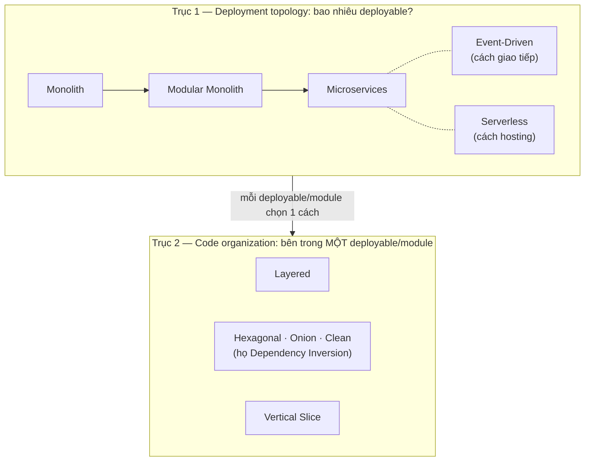

> [!important] Kết hợp, không loại trừ
> "Microservices **hay** Clean Architecture?" là câu hỏi sai. Một microservice có thể bên trong là Clean, VSA, hoặc Layered. Một Modular Monolith có thể module Ordering dùng Clean + DDD, module Reporting dùng VSA + Dapper.

---

## Layered (N-tier)

**Bản chất:** chia ứng dụng thành các tầng theo trách nhiệm kỹ thuật — Presentation → Business Logic → Data Access → DB. Mỗi tầng chỉ gọi tầng ngay dưới (strict) hoặc mọi tầng dưới (relaxed). *Layer* là phân chia logic; *tier* là phân chia vật lý (máy/process). Đây là mô hình mặc định của hầu hết tutorial Spring Boot và ASP.NET MVC.

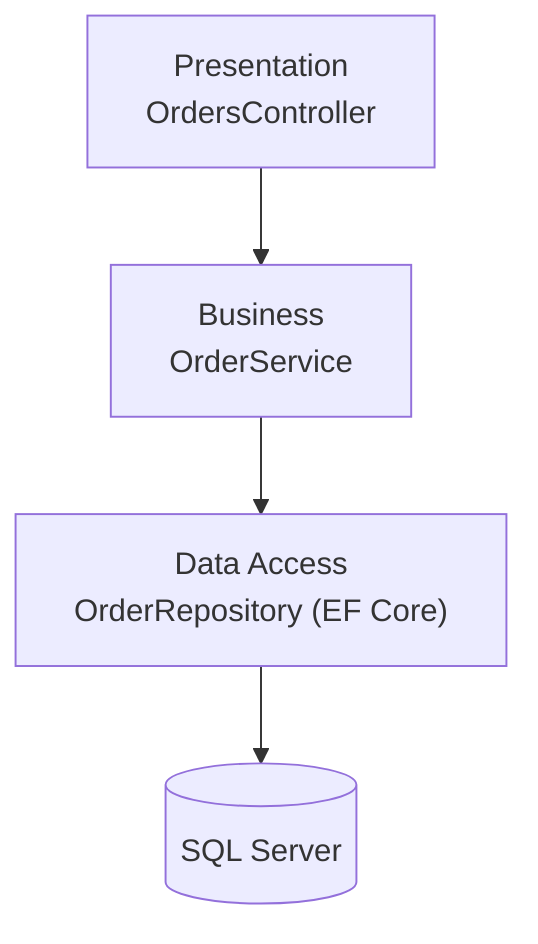

| ✅ Điểm mạnh | ❌ Chi phí |
| --- | --- |
| Ai cũng hiểu, onboarding nhanh | **Business phụ thuộc Data Access** → nghiệp vụ dính ORM, khó test |
| Ít project, ít ceremony | Một feature chạm mọi tầng (low cohesion theo feature) |
| Hợp CRUD, ứng dụng nội bộ | Dễ thành anemic model + "God Service" |
| Tách vật lý (tier) để scale web riêng | Tầng "pass-through" vô nghĩa (Service chỉ gọi Repository) |

- **.NET:** ASP.NET Core MVC + Services + EF Core trong 1–3 project.
- **Java:** Spring Boot `controller/ service/ repository/` — package-by-layer.
- **Bẫy:** gọi đây là "Clean Architecture" chỉ vì có 3 project. Khác biệt mấu chốt là **chiều phụ thuộc** (xem mục 3).

---

## Hexagonal (Ports & Adapters)

**Bản chất:** Alistair Cockburn (2005) muốn ứng dụng **được điều khiển như nhau** bởi người dùng, chương trình khác, test tự động hay batch script, và **phát triển/test tách biệt** khỏi DB và thiết bị thật. Ứng dụng chỉ có **bên trong** (logic) và **bên ngoài** (mọi công nghệ). Giao tiếp qua **port** (API có mục đích, do bên trong định nghĩa); công nghệ cụ thể là **adapter** cắm vào port. Hình lục giác chỉ để vẽ nhiều port — con số 6 không có ý nghĩa.

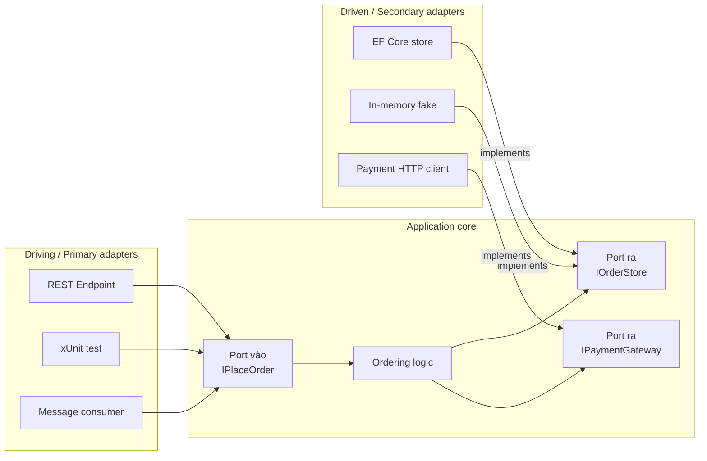

| ✅ Điểm mạnh | ❌ Chi phí |
| --- | --- |
| Đối xứng: test harness là "một adapter nữa" → test lõi không cần UI/DB | Nhiều interface; dễ over-abstract mọi thứ |
| Thay công nghệ (DB, broker, payment provider) cục bộ ở adapter | Không nói gì về cấu trúc **bên trong** lõi → mỗi team tự diễn giải |
| Rất hợp với DDD (lõi = domain) | Mapping giữa model lõi và model adapter tốn công |

- **.NET:** `Ordering.Core` (ports) + `Ordering.Adapters.Persistence`, `Ordering.Adapters.Web`…
- **Java:** multi-module Maven/Gradle, sách *Get Your Hands Dirty on Clean Architecture* (Tom Hombergs) minh hoạ hexagonal với Spring; jMolecules có annotation cho port/adapter.

---

## Onion

**Bản chất:** Jeffrey Palermo (2008) mô tả các **vòng đồng tâm**: Domain Model ở tâm, quanh nó là Domain Services, rồi Application Services; UI, Infrastructure, Tests ở vòng ngoài. Nguyên tắc: *mọi coupling hướng vào tâm* — vòng trong không biết vòng ngoài. **Interface repository nằm trong lõi**, implementation nằm ở vòng ngoài (Infrastructure). Palermo nói rõ: hợp cho ứng dụng nghiệp vụ phức tạp, sống lâu; không dành cho website nhỏ.

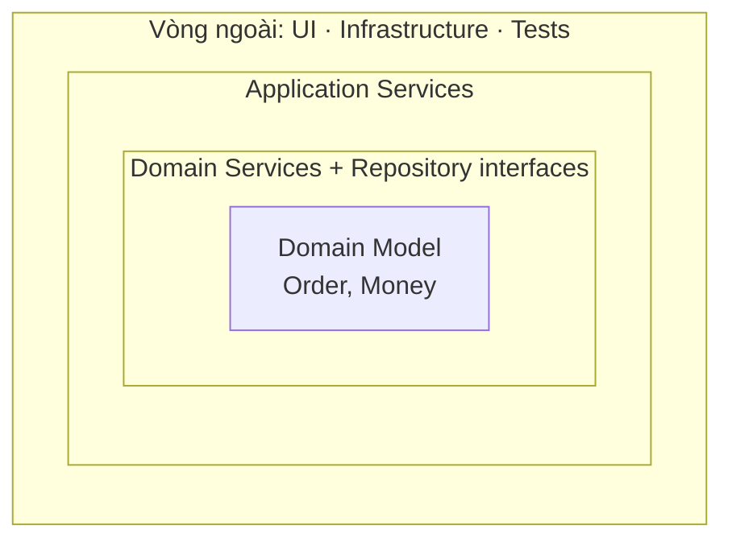

| ✅ Điểm mạnh | ❌ Chi phí |
| --- | --- |
| Quy định rõ hơn Hexagonal về **các lớp bên trong** lõi | Dễ thành "lasagna" — quá nhiều vòng cho domain đơn giản |
| Domain Model là trung tâm, không phụ thuộc gì | Ranh giới Domain Service vs Application Service hay gây tranh cãi |
| Là "tổ tiên" trực tiếp của hầu hết template .NET "Clean Architecture" | Như mọi kiến trúc vòng: một feature vẫn chạm nhiều vòng |

---

## Clean Architecture

**Bản chất:** Robert C. Martin (2012) tổng hợp Hexagonal, Onion, DCI, BCE… thành các vòng: **Entities** → **Use Cases** → **Interface Adapters** → **Frameworks & Drivers**, với một luật duy nhất: **Dependency Rule** — source code dependency chỉ hướng vào trong. Điểm mới so với Onion: tầng **Use Case (interactor)** tường minh, cùng các *input/output boundary* và presenter. Chi tiết .NET: [[Clean-Architecture-in-DotNet]].

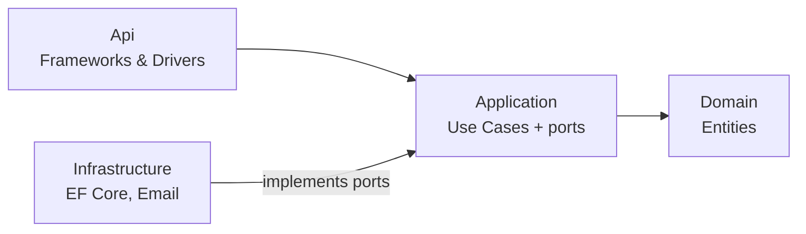

| ✅ Điểm mạnh | ❌ Chi phí |
| --- | --- |
| Compiler canh Dependency Rule (project reference) | Ceremony: 4+ project, nhiều file cho use case đơn giản |
| Domain + Application test được không cần DB/web | Abstraction "phòng khi" (repository cho mọi entity) |
| Nhiều template .NET trưởng thành (Jason Taylor, Ardalis) | Một feature vẫn rải qua nhiều project — khắc phục bằng tổ chức feature bên trong Application |

---

## Vertical Slice

**Bản chất:** Jimmy Bogard (2018) — tổ chức theo **request/use case**: mỗi slice chứa endpoint, validator, handler, data access. *"Minimize coupling between slices, and maximize coupling in a slice."* Mỗi slice tự chọn cách cài đặt (Transaction Script, domain model, Dapper). Chi tiết: [[Vertical-Slice-Architecture]].

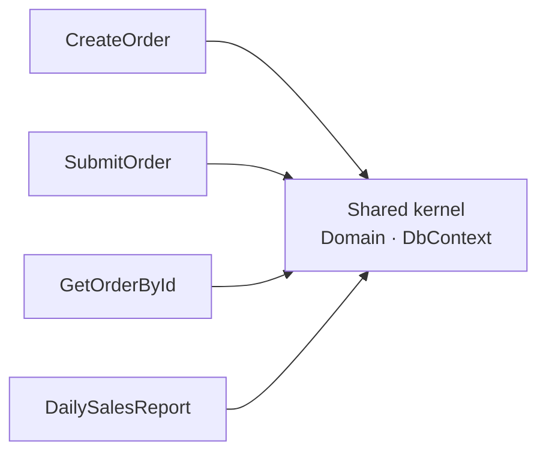

| ✅ Điểm mạnh | ❌ Chi phí |
| --- | --- |
| High cohesion theo feature, thêm feature = thêm file | Đòi hỏi kỹ năng refactor, dễ trùng lặp tri thức |
| Ít ceremony, CQRS tự nhiên | Ranh giới mềm (quy ước + architecture test) |
| Tự do kỹ thuật theo slice | Domain dễ bị bỏ quên nếu thiếu kỷ luật |

---

## Modular Monolith

**Bản chất:** **một** deployable, nhưng chia thành **module theo business capability / bounded context** (Ordering, Payments, Shipping, Catalog) với ranh giới được **cưỡng chế**: module chỉ giao tiếp qua **public API** (interface/contract) hoặc **event in-process**; mỗi module **sở hữu dữ liệu riêng** (schema riêng), không join chéo bảng của module khác. Đây là "microservices về mặt logic, monolith về mặt vận hành". Chi tiết: [[Modular-Monolith]].

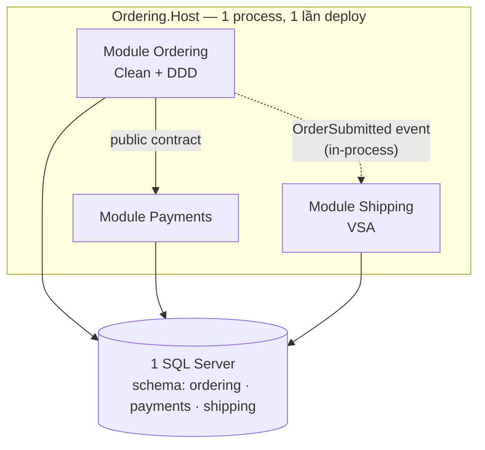

| ✅ Điểm mạnh | ❌ Chi phí |
| --- | --- |
| Ranh giới rõ như microservices, nhưng gọi hàm in-process (nhanh, transaction được nếu cần) | Vẫn deploy/scale chung một khối |
| Vận hành đơn giản: 1 pipeline, 1 process, debug dễ | Ranh giới **xói mòn** nếu không có architecture test |
| Refactor ranh giới rẻ (đổi trong 1 repo) | Một module lỗi bộ nhớ/CPU có thể kéo cả app |
| Con đường tách microservice sau này rõ ràng | Cần kỷ luật dữ liệu: không join chéo schema |

- **.NET:** mỗi module 1–3 project, `internal` mặc định, `DbContext` riêng mỗi module với `HasDefaultSchema("ordering")`, giao tiếp qua contract project + in-process bus (MediatR notification, Wolverine…), NetArchTest/ArchUnitNET canh ranh giới.
- **Java:** **Spring Modulith** — mỗi sub-package trực tiếp dưới package gốc là một module, `ApplicationModules.of(App.class).verify()` kiểm tra vi phạm, có event publication registry hỗ trợ event giữa module đáng tin cậy.

---

## Microservices

**Bản chất:** hệ thống gồm nhiều service nhỏ, mỗi service hiện thực **một business capability trong một bounded context**, **tự sở hữu dữ liệu**, giao tiếp qua API/message, **deploy và scale độc lập**, thường do một team sở hữu. Theo Azure Architecture Center, các ràng buộc cốt lõi: một trách nhiệm, độc lập với service khác, dữ liệu private (không chia sẻ DB). Đổi lại: service discovery, consistency dữ liệu, quản lý hệ phân tán — cần DevOps trưởng thành.

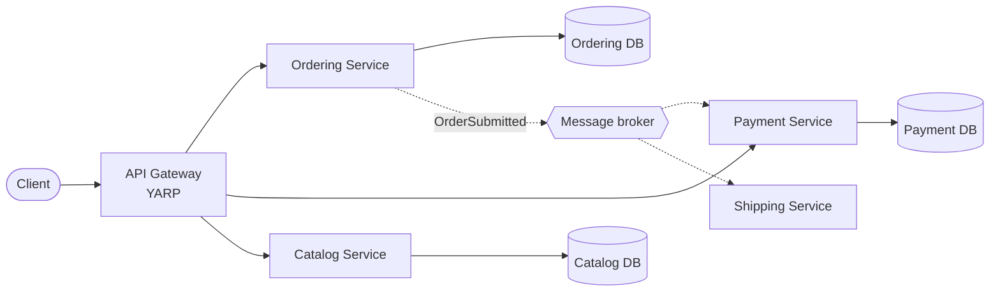

| ✅ Điểm mạnh | ❌ Chi phí ("microservice premium") |
| --- | --- |
| Deploy độc lập → nhiều team release song song | Network: latency, partial failure, retry, timeout, circuit breaker |
| Scale từng phần (Catalog đọc nhiều scale riêng) | Eventual consistency, saga thay cho transaction |
| Cô lập lỗi (nếu thiết kế async đúng) | Observability bắt buộc: distributed tracing, log tập trung |
| Tự do công nghệ theo service | CI/CD × N, versioning API, contract testing |
| Ranh giới vật lý khó xói mòn | Refactor ranh giới **rất đắt** (di chuyển dữ liệu giữa DB) |

- **.NET stack điển hình:** ASP.NET Core (Minimal API/gRPC), **Aspire** cho orchestration local + service defaults, **YARP** gateway, **OpenTelemetry**, Polly / `Microsoft.Extensions.Http.Resilience`, MassTransit / Wolverine / NServiceBus / Dapr, Kubernetes hoặc Azure Container Apps.
- **Java:** Spring Cloud (Gateway, Config, OpenFeign, LoadBalancer), Resilience4j, Micrometer Tracing, Kubernetes. Chi tiết pattern → [[Microservices-Architecture]].

---

## Event-Driven

**Bản chất:** thành phần **phát event** ("điều gì đã xảy ra": `OrderSubmitted`) lên broker; các consumer **tự đăng ký** và phản ứng. Producer không biết consumer → coupling thấp về thời gian và về danh tính. Thường là *cách giao tiếp* bên trong Microservices hoặc giữa module của Modular Monolith, không đứng một mình. Chi tiết → [[Event-Driven-Architecture]], [[Domain-Events-and-Outbox]].

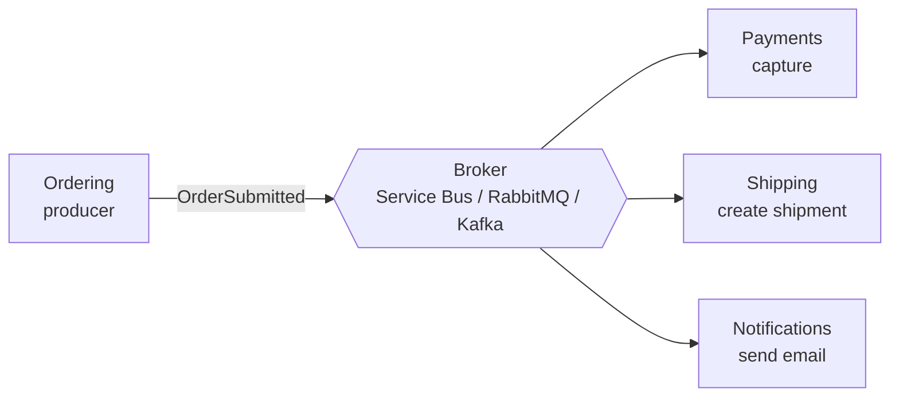

- ✅ Thêm consumer mới không sửa producer; hấp thụ tải đột biến (queue làm buffer); cô lập lỗi theo thời gian.
- ❌ Khó lần theo luồng nghiệp vụ; eventual consistency; at-least-once → consumer phải **idempotent**; thứ tự event; cần **Outbox** để không mất event khi DB commit mà publish thất bại.
- **.NET:** Azure Service Bus / RabbitMQ / Kafka (Confluent.Kafka) + MassTransit (v9 đã chuyển sang license thương mại, v8 vẫn Apache 2.0 — kiểm tra điều khoản hiện hành), Wolverine, NServiceBus (thương mại), Brighter. **Java:** Spring Cloud Stream, Spring for Apache Kafka, Axon.

---

## Serverless

**Bản chất:** viết **function** chạy theo trigger (HTTP, queue, timer, blob); nền tảng lo provisioning, scale (kể cả về 0), trả tiền theo lần chạy. Hợp cho workload **rời rạc, theo sự kiện, tải thất thường**: xử lý ảnh upload, webhook, job định kỳ, glue code.

- ✅ Không quản lý server; scale tự động; chi phí gần 0 khi không có tải.
- ❌ Cold start; giới hạn thời gian chạy/bộ nhớ; vendor lock-in; khó test/debug local; state phải đẩy ra ngoài (hoặc dùng Durable Functions); chi phí có thể **cao hơn** container khi tải đều và lớn.
- **.NET:** Azure Functions **isolated worker model** (mô hình in-process đã hết hỗ trợ từ 10/11/2026 — dùng isolated cho .NET 10), Durable Functions cho workflow; AWS Lambda .NET. **Java:** Spring Cloud Function, AWS Lambda (SnapStart giảm cold start).

---

## 3. Hexagonal vs Onion vs Clean — khác nhau ở đâu thật sự?

> [!important] Câu trả lời ngắn
> **Giống nhau ~90%.** Cả ba đều: (1) đặt nghiệp vụ ở trung tâm, (2) đẩy DB/UI/framework ra ngoài, (3) dùng **Dependency Inversion** — lõi định nghĩa interface, bên ngoài implement. Khác biệt nằm ở **hình ảnh ẩn dụ**, **từ vựng**, và **mức độ quy định cấu trúc bên trong lõi**.

| Khía cạnh | Hexagonal (2005) | Onion (2008) | Clean (2012) |
| --- | --- | --- | --- |
| Ẩn dụ | Lục giác: **trong / ngoài** | Củ hành: vòng đồng tâm | Vòng đồng tâm + Dependency Rule |
| Cấu trúc bên trong lõi | **Không quy định** | Domain Model → Domain Services → Application Services | Entities → Use Cases (interactor) |
| Từ vựng chính | Port, Adapter, driving/driven (primary/secondary) | Layer, "coupling toward center" | Entity, Use Case, Interface Adapter, Boundary, Presenter |
| Nhấn mạnh | **Đối xứng** — test, UI, batch đều là adapter ngang hàng | Domain Model là trung tâm, repository interface trong lõi | Use case tường minh, luật phụ thuộc duy nhất |
| Bên ngoài | Adapters (cả hai phía) | UI, Infrastructure, Tests (cùng vòng ngoài) | Interface Adapters + Frameworks & Drivers (2 vòng) |
| Quan hệ | Gốc của ý tưởng | Thêm phân lớp bên trong cho Hexagonal | Tổng hợp Hexagonal, Onion, DCI, BCE… |

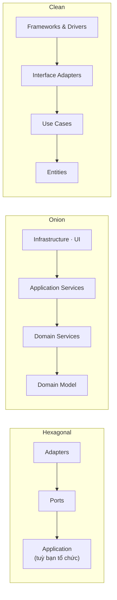

**Trong thực tế .NET:**
- Template "Clean Architecture" phổ biến (Jason Taylor, Ardalis) với Domain / Application / Infrastructure / Web **thực chất là Onion + CQRS**, gọi tên là Clean. Không ai hiện thực đủ Presenter + Output Boundary như sách.
- Hexagonal hay dùng khi muốn nhấn mạnh **nhiều adapter cho cùng port** (REST + gRPC + consumer, SQL + fake) và test lõi qua port.
- 👉 Khi phỏng vấn: nói được **điểm chung (DIP, lõi độc lập)** quan trọng hơn liệt kê khác biệt từ vựng. Hiểu thêm DIP: [[SOLID-Principles]].

---

## 4. Bảng so sánh tổng hợp

| Style | Độ phức tạp | Team size phù hợp | Deployability | Scalability | Testability | Coupling | Chi phí vận hành | .NET stack điển hình |
| --- | --- | --- | --- | --- | --- | --- | --- | --- |
| **Layered** | ⭐ | 1–5 dev | 1 khối | Scale cả khối | Trung bình (business dính DAL) | Cao giữa tầng, thấp cohesion theo feature | Thấp | MVC + Services + EF Core |
| **Hexagonal/Onion/Clean** | ⭐⭐⭐ | 3–15 dev | 1 khối | Scale cả khối | **Cao** cho lõi | Thấp từ lõi ra hạ tầng | Thấp | Multi-project + MediatR/Mediator + EF Core + NetArchTest |
| **Vertical Slice** | ⭐⭐ | 2–15 dev | 1 khối | Scale cả khối | Cao (integration-first) | Thấp giữa slice | Thấp | Minimal API + Carter/FastEndpoints + EF/Dapper |
| **Modular Monolith** | ⭐⭐⭐ | 5–50 dev (nhiều team, 1 repo) | 1 khối, ranh giới logic | Scale cả khối (có thể tách worker) | Cao theo module | Thấp giữa module (nếu cưỡng chế) | Thấp–trung bình | Module projects + DbContext/schema riêng + in-process bus + ArchUnitNET |
| **Microservices** | ⭐⭐⭐⭐⭐ | Nhiều team độc lập (thường 20+ dev) | **Độc lập từng service** | **Theo từng service** | Cao trong service, khó end-to-end | Thấp nếu async, cao nếu sync chain | **Cao** | ASP.NET Core + Aspire + YARP + gRPC + broker + K8s/ACA + OpenTelemetry |
| **Event-Driven** | ⭐⭐⭐⭐ | Tuỳ hệ thống nền | Độc lập producer/consumer | Rất cao (queue buffer) | Khó (async, thứ tự) | Rất thấp về thời gian | Trung bình–cao | Service Bus/RabbitMQ/Kafka + MassTransit/Wolverine + Outbox |
| **Serverless** | ⭐⭐ (code) / ⭐⭐⭐ (hệ thống) | Bất kỳ | Theo function | Tự động, về 0 | Unit dễ, integration khó | Thấp (qua trigger) | Thấp khi tải nhỏ/thất thường | Azure Functions isolated + Durable Functions |

> [!tip] Đọc bảng thế nào
> Các cột "bên trong" (Layered/Clean/VSA) **không** quyết định deployability hay scalability — chúng nằm trong 1 deployable. Muốn deploy/scale độc lập → phải đổi trục **topology**.

---

## 5. Decision flowchart — Chọn kiến trúc nào?

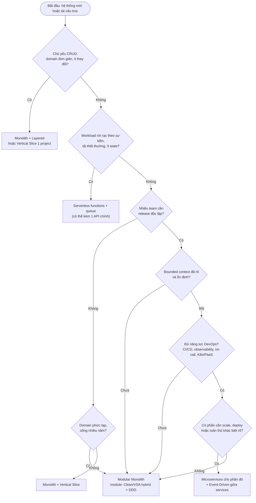

> [!info] Câu hỏi "kiểm tra thực tế" trước khi chọn Microservices
> - Có thể **deploy một service mà không deploy service khác** không? Nếu không → bạn chưa cần (hoặc chưa làm đúng) microservices.
> - Mỗi service **có team sở hữu** không? Một team 5 người giữ 12 service là dấu hiệu xấu.
> - Bạn có **distributed tracing** xuyên service ngay từ ngày đầu không?
> - Bạn đã có **Modular Monolith với ranh giới ổn định** chưa? Nếu module trong monolith còn gọi chéo lung tung, tách ra chỉ biến function call thành network call.

---

## 6. Lộ trình tiến hoá: Monolith → Modular Monolith → Microservices

Martin Fowler (*MonolithFirst*, 2015): hầu hết câu chuyện microservices thành công **bắt đầu từ một monolith** đã lớn quá rồi được tách ra; còn hệ thống làm microservices từ đầu thường gặp rắc rối nghiêm trọng. *MicroservicePremium* (2015): microservices có một "phí bảo hiểm" về chi phí và rủi ro (deploy tự động, monitoring, xử lý lỗi, eventual consistency) — chỉ đáng trả khi hệ thống **đủ phức tạp** để monolith trở thành gánh nặng.

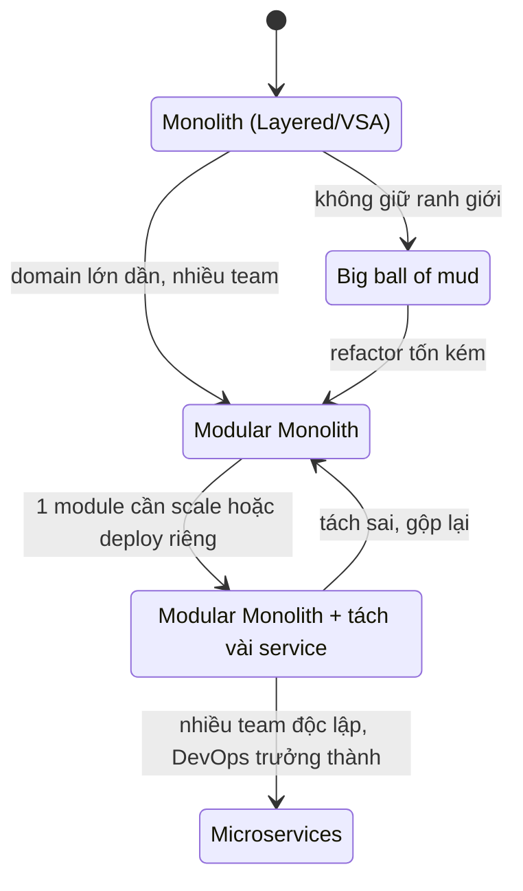

**Các bước tách một module ra service (Strangler Fig):**
1. Module đã có **public contract** và **schema riêng**, không ai join vào bảng của nó.
2. Chuyển giao tiếp in-process sang **event/message** (vẫn trong monolith) — kiểm chứng async ổn.
3. Dựng service mới, **chuyển dữ liệu** schema đó sang DB riêng.
4. Gateway/route chuyển traffic dần sang service mới; module cũ bị gỡ.
5. Lặp lại **chỉ khi** có lý do (scale, team, compliance) — không tách "cho đủ bộ".

> [!warning] Fowler cũng lưu ý
> Tách monolith chỉ suôn sẻ khi monolith **đã có thiết kế module tốt**. Monolith rối thì tách ra thành microservices rối hơn. Vì vậy bước "Modular Monolith" không phải tuỳ chọn — đó là bước chuẩn bị.

---

## 7. Conway's Law & Team Topologies

**Conway's Law** (Melvin Conway, 1968): tổ chức thiết kế hệ thống sẽ tạo ra thiết kế **phản chiếu cấu trúc giao tiếp** của chính tổ chức đó. Fowler (bliki *ConwaysLaw*): đừng chống lại nó — thiết kế phân rã hệ thống **cùng lúc** với cấu trúc team.

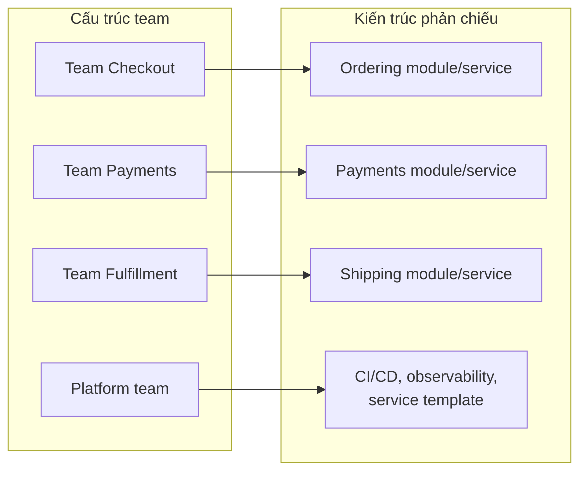

| Khái niệm | Ý nghĩa thực tế |
| --- | --- |
| **Conway's Law** | 1 team frontend + 1 team backend + 1 team DBA → kiến trúc 3 tầng. 3 team theo nghiệp vụ → 3 module/service theo nghiệp vụ. |
| **Inverse Conway Maneuver** | Chủ động tổ chức team theo kiến trúc mong muốn (thuật ngữ của Jonny LeRoy & Matt Simons, 2010). Không tự sửa được hệ thống cứng nhắc có sẵn. |
| **Team Topologies** (Skelton & Pais, 2019) | 4 loại team: *stream-aligned*, *platform*, *enabling*, *complicated-subsystem*; 3 kiểu tương tác: *collaboration*, *X-as-a-Service*, *facilitating*. Tiêu chí chính: **cognitive load** của team. |
| Hệ quả cho kiến trúc | Ranh giới module/service nên khớp **ranh giới team stream-aligned**. Một service cần 3 team phối hợp mỗi lần đổi → ranh giới sai. |

> [!tip] Team nhỏ thì sao?
> Fowler nhận xét: team nhỏ (một hai chục người) giao tiếp không chính thức hiệu quả và tự nhiên sẽ ra monolith — điều đó **tốt**. Microservices chủ yếu giải bài toán **tổ chức nhiều team**, không phải bài toán kỹ thuật.

---

## 8. Quality Attributes & tư duy trade-off

Kiến trúc = tập hợp quyết định **đánh đổi** giữa các quality attribute (non-functional requirements). Phương pháp **ATAM** (Architecture Tradeoff Analysis Method, SEI/CMU) hệ thống hoá việc này: liệt kê kịch bản chất lượng theo độ ưu tiên (*utility tree*), rồi phân tích từng quyết định kiến trúc để tìm **sensitivity point**, **trade-off point**, **risk**.

### 8.1 Từ vựng ATAM bằng lời thường

| Thuật ngữ | Lời thường | Ví dụ Ordering |
| --- | --- | --- |
| **Quality attribute scenario** | "Khi X xảy ra, trong điều kiện Y, hệ thống phải phản ứng Z, đo bằng W" | Black Friday 20× đơn, p95 tạo đơn < 300 ms |
| **Utility tree** | Cây ưu tiên: attribute → kịch bản cụ thể, chấm (quan trọng, khó) | (High, High): checkout chịu 20× tải |
| **Sensitivity point** | Quyết định mà thay đổi nhỏ ảnh hưởng **lớn tới 1** attribute | Kích thước connection pool tới SQL Server → latency |
| **Trade-off point** | Quyết định ảnh hưởng **nhiều attribute theo hướng ngược nhau** | Payment gọi async qua queue: ↑ availability, ↓ consistency tức thời, ↑ độ phức tạp |
| **Risk / Non-risk** | Quyết định có thể dẫn tới hậu quả xấu / đã đánh giá là an toàn | Chung DB giữa 2 service = risk |

### 8.2 Câu hỏi trade-off nên hỏi (kiểu ATAM, không cần hội thảo 3 ngày)

| Attribute | Câu hỏi | Style giúp | Style làm khó |
| --- | --- | --- | --- |
| **Modifiability** | "Thêm phương thức thanh toán mới chạm bao nhiêu chỗ / bao nhiêu team?" | VSA, Modular Monolith, Clean | Layered rối, distributed monolith |
| **Deployability** | "Sửa 1 dòng ở Shipping phải deploy lại những gì?" | Microservices, Serverless | Monolith (mọi thay đổi = deploy cả khối) |
| **Scalability** | "Phần nào chịu tải trước khi tải ×10? Có scale riêng được không?" | Microservices, Event-Driven, Serverless | Monolith (scale cả khối, vẫn được nhưng tốn hơn) |
| **Availability** | "Payment provider chết 10 phút thì khách thấy gì?" | Event-Driven (queue buffer), cô lập lỗi | Chuỗi gọi đồng bộ dài |
| **Consistency** | "Đơn đã trả tiền nhưng tồn kho chưa trừ — chấp nhận bao lâu?" | Monolith (1 transaction) | Microservices/EDA (eventual, saga) |
| **Testability** | "Test quy tắc giảm giá có cần DB/Docker không?" | Clean/Hexagonal (lõi thuần) | Layered (business dính EF) |
| **Observability** | "Request chậm — tìm ra service nào trong 5 phút được không?" | Monolith (1 process) | Microservices thiếu tracing |
| **Cost** | "Chi phí hạ tầng + người vận hành / tháng?" | Monolith, Serverless (tải thấp) | Microservices (N pipeline, N DB, K8s) |
| **Time-to-market** | "Feature đầu tiên lên production trong mấy tuần?" | Monolith + VSA | Microservices từ ngày 0 |

> [!important] Quy tắc vàng
> Mỗi lần chọn một style, hãy viết ra **"đổi được gì — trả bằng gì"**. Nếu không nêu được cái phải trả, bạn chưa hiểu đủ quyết định đó. Lưu lại bằng **ADR** (Architecture Decision Record) để 1 năm sau còn biết *tại sao*.

---

## 9. Anti-pattern: Distributed Monolith

**Định nghĩa:** hệ thống được **deploy như microservices** nhưng **coupling như monolith** — các service không thể thay đổi/deploy độc lập. Bạn trả toàn bộ microservice premium mà không nhận được lợi ích chính (deploy độc lập, cô lập lỗi).

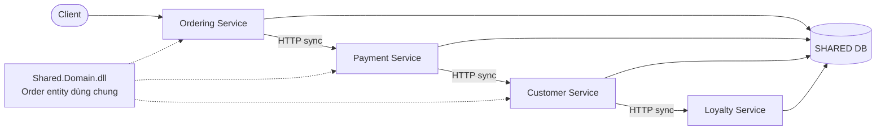

| Triệu chứng | Vì sao xấu | Cách sửa |
| --- | --- | --- |
| **Shared database** giữa các service | Đổi schema = đổi tất cả; không ai thật sự sở hữu dữ liệu | Database-per-service (ít nhất schema-per-service + chỉ owner được ghi) |
| **Deploy lockstep** ("phải deploy A, B, C cùng lúc") | Mất deploy độc lập — lý do số 1 để có microservices | Versioning contract, backward compatibility, consumer-driven contract tests |
| **Chuỗi gọi đồng bộ dài** A→B→C→D | Availability = tích các availability; latency cộng dồn | Event/async, cache dữ liệu cần thiết cục bộ, gộp service quá vụn |
| **Shared domain library** (entity dùng chung qua NuGet) | Một thay đổi model buộc mọi service cập nhật | Mỗi service model riêng; chỉ chia sẻ **contract** (message/DTO) có version |
| **Chatty** — 1 màn hình gọi 15 service | Latency, khó debug | Đặt lại ranh giới theo bounded context, BFF/aggregation |
| **Ranh giới theo tầng kỹ thuật** (Data Service, Validation Service) | Mọi feature chạm mọi service | Ranh giới theo **business capability** |

> [!question]- Tự kiểm tra nhanh: hệ thống của bạn có phải distributed monolith?
> Nếu câu trả lời "có" cho ≥ 2 câu sau thì rất có thể: (1) Không thể deploy service A mà không deploy B? (2) Service đọc/ghi trực tiếp bảng của service khác? (3) Một service down kéo theo phần lớn chức năng down? (4) Một user story thường xuyên cần sửa ≥ 3 service?

---

## 10. Đối chiếu Java / Spring Boot

| Style | 🟣 .NET | ☕ Java / Spring | Ghi chú |
| --- | --- | --- | --- |
| Layered | ASP.NET Core MVC + Services + EF Core | Spring Boot `@RestController` → `@Service` → `JpaRepository` | Mặc định của cả hai hệ sinh thái |
| Hexagonal / Onion / Clean | Multi-project `.csproj` + project reference + NetArchTest | Multi-module Maven/Gradle + ArchUnit, jMolecules | .NET: compiler chặn qua project reference; Java: module dependency + ArchUnit |
| Vertical Slice | Minimal API + `IEndpoint`/Carter/FastEndpoints | Package-by-feature, `RouterFunction` | Xem [[Vertical-Slice-Architecture]] |
| Modular Monolith | Module projects + `internal` + DbContext/schema riêng + ArchUnitNET | **Spring Modulith** (`ApplicationModules.verify()`, event publication registry) | Spring có framework chính thức, .NET chủ yếu dựa quy ước + test |
| Microservices | Aspire, YARP, gRPC, Polly/Http.Resilience, OpenTelemetry | Spring Cloud Gateway/Config/OpenFeign, Resilience4j, Micrometer Tracing | |
| Event-Driven | MassTransit / Wolverine / NServiceBus / Brighter + Outbox | Spring Cloud Stream, Spring Kafka, Axon, Debezium outbox | |
| Serverless | Azure Functions isolated worker, AWS Lambda .NET | Spring Cloud Function, AWS Lambda + SnapStart | |

> [!warning] Bẫy khi chuyển từ Java sang .NET
> - **`internal` là phạm vi assembly**, không phải package. Muốn ranh giới module mạnh như package-private + Spring Modulith → mỗi module là **project riêng**, mặc định `internal`, chỉ public contract.
> - **Không có Spring Modulith tương đương chính thức** trong .NET: tự dựng bằng project structure + NetArchTest/ArchUnitNET + in-process bus. Đừng tưởng "để chung thư mục" là đủ.
> - **Không có Spring Cloud "trọn gói"**: .NET lắp từ nhiều mảnh (Aspire cho dev/orchestration local, YARP, Polly, OpenTelemetry). Aspire **không** thay thế Kubernetes ở production; nó giúp mô tả và chạy app phân tán, rồi xuất manifest/triển khai.
> - **Licensing**: MediatR 13+, MassTransit v9, AutoMapper 15 đã thương mại hoá — khác cảm giác "Spring cho tất cả miễn phí". Kiểm tra điều khoản hiện hành trước khi đưa vào kiến trúc nền.
> - **Transaction**: `@Transactional` xuyên module rất tiện trong Spring monolith và cũng là cái bẫy — nó che giấu coupling giữa module. Trong .NET modular monolith, ưu tiên mỗi module tự `SaveChanges` + event/outbox giữa module ngay từ đầu để sau này tách dễ.

---

## 11. Trade-offs & Best Practices

### ✅ Điểm mạnh của việc chọn kiến trúc có chủ đích
- Đội ngũ có **ngôn ngữ chung** ("đây là adapter", "đây là module public contract").
- Quyết định gắn với **quality attribute** cụ thể → dễ bảo vệ trước stakeholder.
- **Tiến hoá được**: modularity tốt cho phép chuyển trục topology mà không viết lại.

### ❌ Chi phí / rủi ro
- **Resume-driven architecture**: chọn microservices/EDA vì thị trường, không vì nhu cầu.
- **Purity over pragmatism**: áp toàn bộ Clean/Hexagonal cho CRUD đơn giản.
- **Kiến trúc trên giấy**: không có architecture test → ranh giới xói mòn trong vài tháng.

### 🎯 Khi nào dùng — khi nào KHÔNG dùng

| Style | Nên dùng khi | Không nên dùng khi |
| --- | --- | --- |
| Layered | CRUD, nội bộ, prototype, team nhỏ | Domain phức tạp, sống lâu |
| Clean/Onion/Hexagonal | Domain phức tạp, cần test lõi độc lập, nhiều adapter | Service CRUD vài endpoint |
| Vertical Slice | Nhiều use case độc lập, thay đổi thường xuyên | Team chưa quen refactor |
| Modular Monolith | **Mặc định** cho sản phẩm mới có domain đáng kể | Hệ thống thật sự cần deploy/scale độc lập từ đầu (hiếm) |
| Microservices | Nhiều team, bounded context rõ, DevOps trưởng thành, cần scale/deploy riêng | Startup tìm product-market fit, team < ~15 người, domain chưa rõ |
| Event-Driven | Nhiều consumer cho cùng sự kiện, cần buffer tải, tích hợp lỏng | Cần nhất quán tức thời, luồng đơn giản request-response |
| Serverless | Tải thất thường, job rời rạc, glue code | Tải cao ổn định, xử lý lâu, cần latency thấp ổn định |

### 📋 Best practices
- [ ] Viết **quality attribute scenarios** (đo được) trước khi chọn style.
- [ ] Tách rõ 2 quyết định: **code organization** và **deployment topology**.
- [ ] Bắt đầu **Modular Monolith**; tách service khi có lý do đo được (team, scale, compliance).
- [ ] Ranh giới module/service theo **business capability / bounded context**, khớp với team.
- [ ] Mỗi module/service **sở hữu dữ liệu**; không join/ghi chéo.
- [ ] Cưỡng chế ranh giới bằng **architecture tests** chạy trong CI.
- [ ] Ghi mọi quyết định lớn bằng **ADR** (bối cảnh, lựa chọn, hệ quả).
- [ ] Giao tiếp giữa module ưu tiên **event + outbox** để sau này tách không đổi semantics.
- [ ] Đầu tư **observability** (OpenTelemetry) trước khi phân tán.
- [ ] Định kỳ xem lại: kiến trúc là quyết định **sống**, không phải một lần.

### 🐞 Lỗi thường gặp

| Lỗi | Hậu quả | Cách sửa |
| --- | --- | --- |
| Microservices từ ngày đầu, domain chưa rõ | Ranh giới sai, gộp/tách liên tục, chi phí vận hành lớn | MonolithFirst → Modular Monolith → tách dần |
| Microservices chung DB | Distributed monolith | Database/schema-per-service + event |
| Gọi 3 project là "Clean Architecture" nhưng Domain reference EF | Không có lợi ích của Dependency Rule | Domain zero dependency, NetArchTest |
| Nhầm Vertical Slice là "không cần domain model" | Logic nghiệp vụ copy khắp slice | Đẩy invariant xuống aggregate |
| Modular Monolith không có architecture test | Ranh giới xói mòn → big ball of mud | ArchUnitNET/NetArchTest trong CI |
| Ranh giới service theo tầng kỹ thuật | Mọi feature chạm mọi service | Theo business capability |
| Chọn Serverless cho API tải cao ổn định | Chi phí cao, cold start, giới hạn runtime | Container (App Service, ACA, K8s) |
| Event-driven nhưng consumer không idempotent | Xử lý trùng (trừ tiền 2 lần) | Idempotency key, inbox pattern |

---

## 12. Self-check — Câu hỏi tự kiểm tra

> [!question]- Hai "trục" lựa chọn kiến trúc là gì? Cho ví dụ kết hợp.
> Trục code organization (Layered, Hexagonal/Onion/Clean, VSA) — tổ chức code bên trong một deployable/module. Trục deployment topology (Monolith, Modular Monolith, Microservices, + Event-Driven làm cách giao tiếp, Serverless làm cách hosting). Ví dụ: Modular Monolith với module Ordering theo Clean + DDD, module Reporting theo VSA + Dapper, giao tiếp module qua event in-process.

> [!question]- (Phỏng vấn) Hexagonal, Onion và Clean khác nhau ở đâu thật sự?
> Cùng ý tưởng gốc: lõi nghiệp vụ độc lập với hạ tầng nhờ Dependency Inversion. Hexagonal (Cockburn 2005) chỉ phân biệt trong/ngoài qua port & adapter, nhấn mạnh tính đối xứng (test cũng là adapter), không quy định cấu trúc trong lõi. Onion (Palermo 2008) quy định các vòng bên trong: Domain Model → Domain Services → Application Services, repository interface nằm trong lõi. Clean (Martin 2012) tổng hợp các ý trên, thêm tầng Use Case tường minh và phát biểu thành Dependency Rule. Trong .NET, template "Clean" phổ biến thực chất là Onion + CQRS.

> [!question]- Vì sao Fowler khuyên MonolithFirst? "Microservice premium" là gì?
> Vì hầu hết câu chuyện microservices thành công bắt đầu từ monolith đã quá lớn; còn làm microservices từ đầu thường gặp rắc rối do chưa hiểu ranh giới domain, mà đổi ranh giới giữa service rất đắt. Microservice premium là chi phí và rủi ro cộng thêm (deploy tự động, monitoring, xử lý lỗi mạng, eventual consistency) — chỉ đáng trả khi độ phức tạp hệ thống đủ cao.

> [!question]- Distributed monolith là gì? Nêu 3 triệu chứng và cách sửa.
> Hệ thống deploy như microservices nhưng coupling như monolith: không thể deploy/thay đổi độc lập. Triệu chứng: chung database, phải deploy nhiều service cùng lúc, chuỗi gọi HTTP đồng bộ dài, shared domain library. Sửa: database-per-service, contract có version và backward compatible, chuyển sang event bất đồng bộ, đặt lại ranh giới theo business capability (có khi gộp service lại).

> [!question]- Conway's Law ảnh hưởng thế nào tới việc chọn giữa Modular Monolith và Microservices?
> Kiến trúc sẽ phản chiếu cấu trúc giao tiếp của tổ chức. Một team nhỏ giao tiếp tốt → monolith/modular monolith tự nhiên và hiệu quả. Nhiều team stream-aligned cần release độc lập → ranh giới service khớp ranh giới team. Có thể dùng Inverse Conway Maneuver: tổ chức team theo kiến trúc mong muốn, nhưng cần làm cùng lúc với thay đổi hệ thống.

> [!question]- Trade-off point khác sensitivity point thế nào? Cho ví dụ trong Ordering.
> Sensitivity point: quyết định mà thay đổi nhỏ tác động mạnh tới **một** quality attribute (kích thước connection pool → latency). Trade-off point: quyết định tác động tới **nhiều** attribute theo hướng ngược nhau (gọi Payment qua queue: tăng availability và khả năng chịu tải, nhưng mất nhất quán tức thời và tăng độ phức tạp).

---

## 13. Liên kết & Tham khảo

- **Note liên quan:** [[Clean-Architecture-in-DotNet]] · [[Vertical-Slice-Architecture]] · [[Modular-Monolith]] · [[CQRS-and-MediatR-Pattern]] · [[Coupling-and-Cohesion]] · [[SOLID-Principles]] · [[DDD-Tactical-Patterns]] · [[Design-Thinking-Process]] · [[Java-to-DotNet-Mental-Map]]
- **Đọc tiếp:** [[Microservices-Architecture]] · [[Event-Driven-Architecture]] · [[Domain-Events-and-Outbox]] · [[Testing-in-DotNet]] · [[Roadmap-DotNet]]
- **MOC:** [[Architecture-Design-MOC]]
- **Nguồn:**
  - Alistair Cockburn — *Hexagonal Architecture* (2005)
  - Jeffrey Palermo — *The Onion Architecture, part 1* (2008)
  - Robert C. Martin — *The Clean Architecture* (2012)
  - Jimmy Bogard — *Vertical Slice Architecture* (2018)
  - Martin Fowler — *MonolithFirst*, *MicroservicePremium* (2015), *ConwaysLaw* (2022)
  - Microsoft — Azure Architecture Center, *Architecture styles*
  - Spring Modulith reference — *Fundamentals*
  - SEI/CMU — ATAM (tóm lược qua Wikipedia và tài liệu SEI)
  - Matthew Skelton & Manuel Pais — *Team Topologies* (2019)
