# Microservices Architecture (Kiến trúc vi dịch vụ)

> [!summary] TL;DR
> - **Là gì:** hệ thống gồm nhiều service nhỏ, mỗi service = **một business capability / một bounded context**, **tự sở hữu dữ liệu**, giao tiếp qua mạng (HTTP/gRPC/message), **deploy độc lập**, thường do một team sở hữu trọn vòng đời.
> - **Giải quyết vấn đề gì:** nhiều team không bước lên chân nhau khi release; scale/cô lập lỗi theo từng phần; ranh giới vật lý khó bị xói mòn như module trong monolith.
> - **Cái giá ("microservice premium"):** mọi lời gọi hàm thành lời gọi mạng → timeout, retry, circuit breaker, eventual consistency, saga, distributed tracing, N pipeline CI/CD.
> - **Điều quan trọng nhất cần nhớ:** tiêu chí số 1 là **independent deployability**. Nếu không deploy độc lập được → bạn có **distributed monolith** (tệ hơn cả monolith). Mặc định: bắt đầu bằng [[Modular-Monolith]], tách service khi có lý do cụ thể.

---

## 1. Problem — Vấn đề cần giải quyết

### 1.1 Bối cảnh

Hệ thống Ordering đã lớn: 6 team, 1 solution, 1 database SQL Server. Mỗi lần release là "release train" 2 tuần, merge conflict liên miên, một lỗi memory leak ở module báo cáo kéo sập cả checkout. Catalog bị đọc gấp 50 lần Ordering nhưng phải scale cả khối. Đây là lúc câu hỏi "có nên tách service?" trở nên hợp lý — **không phải trước đó**.

So sánh tổng quan giữa các style (Layered, Modular Monolith, Microservices…) đã có ở [[Architecture-Styles-Comparison#Microservices]]. Note này đi sâu vào **cách làm microservices đúng trong .NET**.

### 1.2 Định nghĩa — 9 đặc điểm (Lewis & Fowler, 2014)

James Lewis và Martin Fowler (bài *Microservices*, 25/03/2014) không đưa ra định nghĩa hình thức mà mô tả **các đặc điểm chung**:

| # | Đặc điểm | Ý nghĩa thực tế | Hệ quả trong .NET |
| --- | --- | --- | --- |
| 1 | **Componentization via Services** | Component = process deploy riêng, không phải thư viện in-process | Mỗi service 1 ASP.NET Core host, 1 container image |
| 2 | **Organized around Business Capabilities** | Team đa chức năng theo nghiệp vụ, không theo tầng (UI team, DB team) | `Ordering`, `Payment`… chứ không phải `DataService` |
| 3 | **Products not Projects** | "You build it, you run it" — team sở hữu cả vận hành | Team tự trực on-call, tự xem dashboard |
| 4 | **Smart endpoints and dumb pipes** | Logic ở service; hạ tầng truyền tin đơn giản (HTTP, broker) — không ESB thông minh | RabbitMQ/Kafka chỉ chuyển message; không nhét business rule vào gateway |
| 5 | **Decentralized Governance** | Mỗi team chọn công cụ phù hợp | Có thể 1 service Go, 1 service .NET — nhưng đừng lạm dụng |
| 6 | **Decentralized Data Management** | Mỗi service sở hữu DB riêng, chấp nhận eventual consistency | Database per Service (mục 3.3) |
| 7 | **Infrastructure Automation** | CI/CD, IaC, test tự động là bắt buộc | Pipeline riêng mỗi service, `dotnet publish` ra image |
| 8 | **Design for Failure** | Mọi dependency có thể chết bất cứ lúc nào | Polly / `AddStandardResilienceHandler()`, health checks |
| 9 | **Evolutionary Design** | Ranh giới đặt quanh những thứ thay đổi cùng nhau; service có thể bị thay thế | Contract versioning, Strangler Fig |

### 1.3 Microservice premium

Fowler (bliki *MicroservicePremium*, 05/2015): microservices đòi một khoản "phí bảo hiểm" về độ phức tạp (deploy tự động, monitoring, xử lý lỗi, eventual consistency) → làm chậm team **cho tới khi** hệ thống đủ phức tạp để lợi ích vượt chi phí. Lời khuyên đi kèm: hầu hết hệ thống nên bắt đầu là monolith có modular tốt; chỉ cân nhắc microservices khi monolith đã quá phức tạp để quản lý.

> [!warning] 8 Fallacies of Distributed Computing (Peter Deutsch và đồng nghiệp ở Sun, thập niên 1990)
> Mọi lập trình viên mới làm hệ phân tán đều ngầm giả định sai:
> 1. Mạng luôn tin cậy → **thực tế:** packet loss, connection reset → cần retry + idempotency.
> 2. Latency bằng 0 → mỗi hop ~ms; chuỗi 5 hop đồng bộ cộng dồn p99.
> 3. Bandwidth vô hạn → đừng trả về 10 000 dòng JSON qua mạng.
> 4. Mạng an toàn → cần TLS/mTLS, authn giữa service.
> 5. Topology không đổi → pod chết/sinh liên tục, IP đổi → cần service discovery.
> 6. Chỉ có một admin → nhiều team, nhiều cluster, nhiều cloud account.
> 7. Chi phí truyền tải bằng 0 → serialize/deserialize tốn CPU, egress tốn tiền.
> 8. Mạng đồng nhất → khác version, khác protocol, khác ngôn ngữ.
>
> Mỗi pattern trong mục 3 tồn tại để vá **ít nhất một** fallacy ở trên.

### 1.4 Pain points nếu làm sai
- **Distributed monolith**: deploy lockstep, shared DB, chuỗi gọi sync dài — trả premium mà không có lợi ích (chi tiết triệu chứng ở [[Architecture-Styles-Comparison]], mục *Anti-pattern: Distributed Monolith*).
- **Nano-services**: 40 service cho 8 dev → mỗi feature chạm 6 repo.
- **Không có observability**: lỗi xảy ra ở "đâu đó giữa 7 service", log rời rạc, không trace ID.
- **Dual-write**: ghi DB xong publish event, process crash ở giữa → mất event, dữ liệu lệch vĩnh viễn.

### 1.5 Ý tưởng cốt lõi
Chia hệ thống theo **ranh giới nghiệp vụ** sao cho mỗi phần **thay đổi, deploy, scale và hỏng độc lập**; dữ liệu là private; giao tiếp ưu tiên **bất đồng bộ qua event**; mọi lời gọi mạng được **bọc resilience** và **trace được**.

---

## 2. Mental Model & Diagram

> [!info] Analogy — Food court thay vì một nhà hàng lớn
> Monolith là một nhà hàng với một bếp chung: đầu bếp chạm tay nhau, bếp trưởng nghỉ là cả nhà hàng dừng. Microservices là **food court**: mỗi quầy (service) có bếp, kho nguyên liệu (database), menu (API) riêng; quầy phở đóng cửa thì quầy cơm vẫn bán. Nhưng giờ bạn cần **bảng chỉ dẫn** (gateway), **hệ thống gọi số** (broker), **camera chung** (observability) — và khách muốn "combo phở + trà sữa" thì phải phối hợp giữa hai quầy (saga).

### 2.1 Toàn cảnh Ordering system dạng microservices

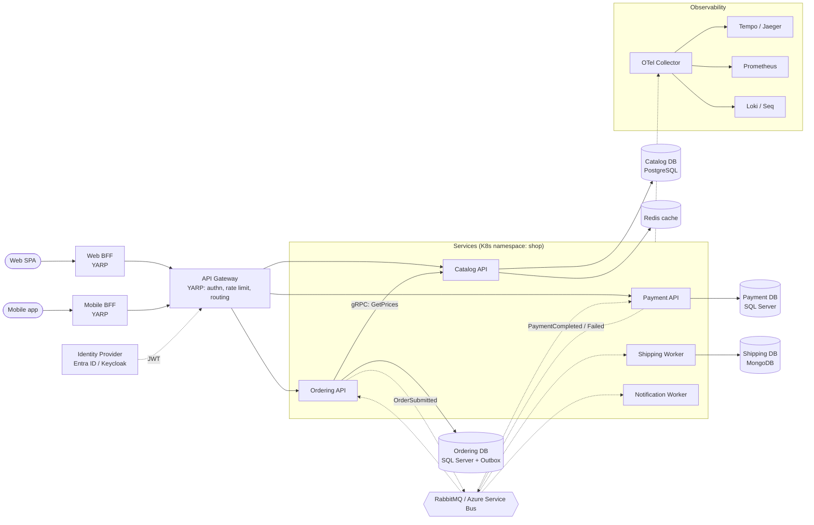

### 2.2 Service decomposition — chia theo đâu?

| Chiến lược | Cách làm | Ví dụ Ordering | Ghi chú |
| --- | --- | --- | --- |
| **By business capability** | Liệt kê "doanh nghiệp làm được gì" (bán hàng, thu tiền, giao hàng) | Catalog, Ordering, Payment, Shipping, Notification | Ổn định theo thời gian vì capability ít đổi hơn quy trình |
| **By subdomain (DDD)** | Core / Supporting / Generic subdomain → mỗi **bounded context** là ứng viên service | Ordering = core; Notification = generic (có thể mua SaaS) | Ngôn ngữ chung (ubiquitous language) không bị lẫn — xem [[DDD-Tactical-Patterns]] |
| ❌ **By technical layer** | "UserDataService", "ValidationService" | — | Mọi feature chạm mọi service → distributed monolith |
| ❌ **By entity (CRUD service)** | `ProductService`, `OrderLineService` | — | Anemic, chatty, mất invariant của aggregate |

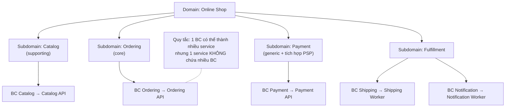

**Heuristics về kích thước:**
- **Không nhỏ hơn một aggregate** (invariant của `Order` phải nằm gọn trong 1 service, 1 transaction).
- **Không lớn hơn một bounded context.** Nếu trong service có 2 nghĩa khác nhau cho chữ "Product" → nên tách.
- **Một team (khoảng "two-pizza") sở hữu được** — Conway's Law sẽ ép kiến trúc theo cấu trúc team dù bạn muốn hay không.
- **Thay đổi cùng nhau thì ở cùng nhau** (high cohesion — [[Coupling-and-Cohesion]]). Nếu 80 % user story chạm cả A và B → A và B nên là một.
- **Lý do tách phải viết ra được**: scale khác biệt, tần suất release khác biệt, yêu cầu bảo mật/compliance khác (PCI cho Payment), công nghệ khác.

**Dấu hiệu ranh giới sai:**

| Triệu chứng | Chẩn đoán |
| --- | --- |
| Một request người dùng gây 10+ lời gọi sync nội bộ (**chatty**) | Ranh giới cắt ngang một use case; nên gộp hoặc nhân bản dữ liệu |
| Hai service luôn deploy cùng nhau | Thực chất là một service |
| Cần distributed transaction thường xuyên | Invariant bị xé đôi → ranh giới cắt qua aggregate |
| Vòng phụ thuộc A → B → A | Thiếu một khái niệm, hoặc nên đảo chiều bằng event |
| Service "Shared"/"Common" mà ai cũng gọi | Shared kernel trá hình, single point of failure |

> [!tip] Tách từ Modular Monolith
> Nếu đã có [[Modular-Monolith]] với module độc lập, `DbContext`/schema riêng và giao tiếp qua integration event, thì "tách module thành service" chủ yếu là việc hạ tầng (đổi in-process bus → broker, schema → DB riêng). Xem mục 3.9 của note đó. Đây là lý do "Modular Monolith first" an toàn hơn "Microservices first".

### 2.3 Database per Service & consistency

**Quy tắc:** chỉ service sở hữu mới được đọc/ghi trực tiếp dữ liệu của nó. Service khác lấy dữ liệu qua **API** hoặc **event**. Không join chéo DB, không `linked server`, không shared schema "tạm thời".

Mức cô lập từ nhẹ đến nặng: *private tables* (cùng server, khác bảng, quy ước) → *schema per service* (khác schema, khác login) → *database per service* → *DB server per service*. Mức tối thiểu chấp nhận được: **schema per service + login riêng không có quyền sang schema khác**.

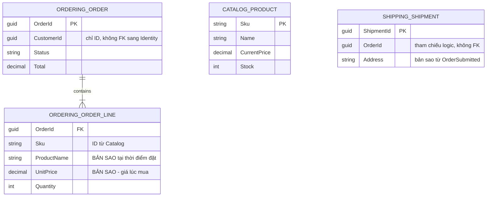

- **Data duplication là chủ ý, không phải lỗi:** `OrderLine.ProductName/UnitPrice` là *snapshot* — đúng nghiệp vụ (giá lúc mua không đổi khi Catalog đổi giá).
- **Eventual consistency:** Shipping biết địa chỉ sau vài trăm ms khi nhận `OrderSubmitted`. UI phải thiết kế cho điều đó ("Đơn hàng đang xử lý").
- **Tham chiếu chéo = ID, không FK.** Xoá/đổi ở service gốc lan truyền qua event (`ProductDiscontinued`).

**Query xuyên service — hai lựa chọn:**

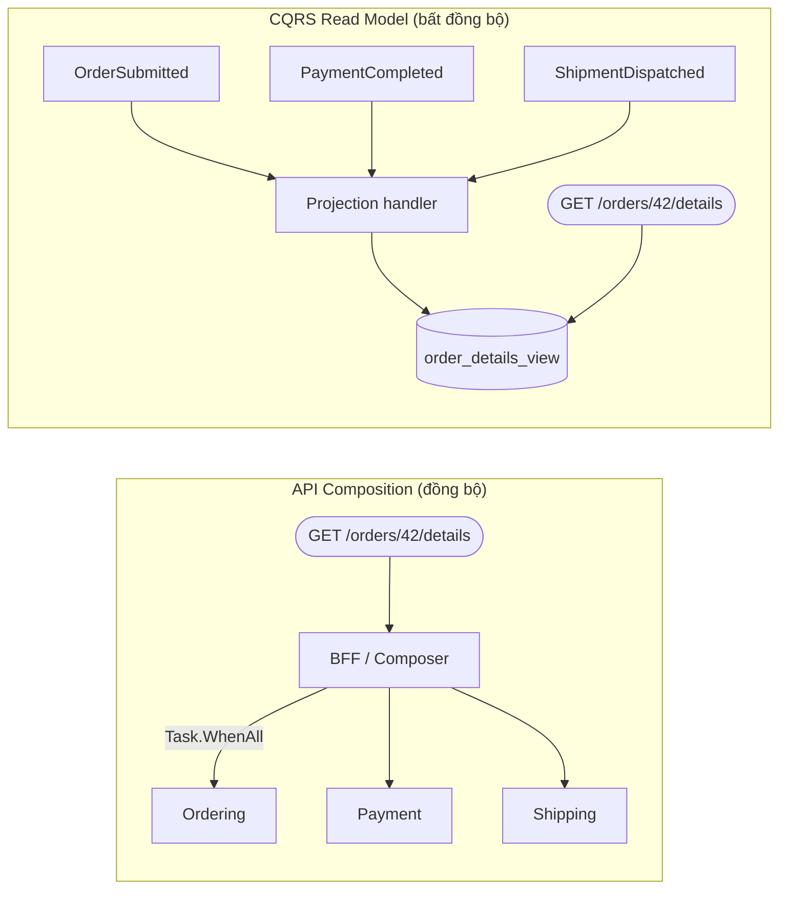

| | API Composition | CQRS read model (materialized view) |
| --- | --- | --- |
| Độ tươi dữ liệu | Real-time | Trễ (eventual) |
| Availability | = tích availability các service được gọi | Chỉ phụ thuộc view store |
| Hiệu năng/join lớn, phân trang, sort | Kém (join in-memory) | Tốt |
| Độ phức tạp | Thấp | Cao: projection, replay, xử lý event trùng/sai thứ tự |
| Dùng khi | Trang chi tiết 1 entity, ít service | Search/list/dashboard xuyên nhiều service |

Read model trong một service là CQRS cấp 3 — xem [[CQRS-and-MediatR-Pattern]].

```csharp
// API Composition trong BFF — gọi song song, chịu được lỗi từng phần
app.MapGet("/orders/{id:guid}/details", async (
    Guid id, OrderingClient ordering, PaymentClient payment, ShippingClient shipping, CancellationToken ct) =>
{
    var orderTask    = ordering.GetAsync(id, ct);
    var paymentTask  = payment.GetByOrderAsync(id, ct);
    var shipmentTask = shipping.GetByOrderAsync(id, ct);

    var order = await orderTask;                      // Ordering là nguồn chính: lỗi → 5xx
    if (order is null) return Results.NotFound();

    // Payment/Shipping là "phụ": lỗi → trả null + cờ degraded thay vì làm hỏng cả trang
    var payment  = await TryGet(paymentTask);
    var shipment = await TryGet(shipmentTask);

    return Results.Ok(new OrderDetailsView(order, payment, shipment,
        Degraded: payment is null || shipment is null));
});

static async Task<T?> TryGet<T>(Task<T?> task) where T : class
{
    try { return await task; }
    catch (Exception ex) when (ex is HttpRequestException or Polly.Timeout.TimeoutRejectedException) { return null; }
}
```

---

## 3. Implementation & Code — Patterns catalog

### Solution Layout & Aspire AppHost

```text
Shop.sln
├── src/
│   ├── Shop.AppHost/              ← Aspire: orchestration local (không deploy prod)
│   ├── Shop.ServiceDefaults/      ← OTel, health, resilience, service discovery dùng chung
│   ├── Gateways/Web.Bff/          ← YARP
│   ├── Catalog/Catalog.Api/
│   ├── Ordering/Ordering.Api/  Ordering.Domain/  Ordering.Infrastructure/
│   ├── Payment/Payment.Api/
│   ├── Shipping/Shipping.Worker/
│   ├── Notification/Notification.Worker/
│   └── Contracts/Shop.Contracts.Ordering/   ← CHỈ message contract, có version
└── tests/ ...
```

> [!important] Mono-repo hay poly-repo?
> Cả hai đều được. Điều bắt buộc là **pipeline độc lập**: commit vào `src/Payment/**` chỉ build/test/deploy Payment (Jenkins: `when { changeset "src/Payment/**" }`). Project `Shop.Contracts.*` phát hành dạng **NuGet có version**, không `ProjectReference` chéo service — nếu không bạn vừa tạo lại shared library coupling.

```csharp
// src/Shop.AppHost/AppHost.cs — Aspire: chạy toàn bộ hệ thống local bằng F5
var builder = DistributedApplication.CreateBuilder(args);

var sql      = builder.AddSqlServer("sql").WithDataVolume();
var orderingDb = sql.AddDatabase("orderingdb");
var paymentDb  = sql.AddDatabase("paymentdb");
var catalogDb  = builder.AddPostgres("pg").AddDatabase("catalogdb");
var rabbit   = builder.AddRabbitMQ("messaging").WithManagementPlugin();
var redis    = builder.AddRedis("cache");

var catalog = builder.AddProject<Projects.Catalog_Api>("catalog")
    .WithReference(catalogDb).WithReference(redis).WaitFor(catalogDb);

var ordering = builder.AddProject<Projects.Ordering_Api>("ordering")
    .WithReference(orderingDb).WithReference(rabbit)
    .WithReference(catalog)                       // inject service discovery config cho "catalog"
    .WaitFor(orderingDb).WaitFor(rabbit);

builder.AddProject<Projects.Payment_Api>("payment").WithReference(paymentDb).WithReference(rabbit).WaitFor(rabbit);
builder.AddProject<Projects.Shipping_Worker>("shipping").WithReference(rabbit).WaitFor(rabbit);

builder.AddProject<Projects.Web_Bff>("web-bff")
    .WithReference(catalog).WithReference(ordering)
    .WithExternalHttpEndpoints();

builder.Build().Run();
```

Aspire tự dựng container (SQL Server, RabbitMQ…), inject connection string + endpoint qua biến môi trường, và mở **Aspire Dashboard** (traces/metrics/logs qua OTLP). Spring tương đương gần nhất: Spring Boot Docker Compose support / Testcontainers at development time — nhưng không có dashboard telemetry tích hợp.

### API Gateway & BFF

**Vấn đề:** client không nên biết 5 địa chỉ service, không nên tự lo authn/CORS/rate-limit cho từng service, và mobile cần payload khác web. **Gateway** = một cửa vào, xử lý cross-cutting ở biên. **BFF (Backend for Frontend)** = mỗi loại client một gateway riêng, có thể làm API composition.

```csharp
// src/Gateways/Web.Bff/Program.cs
var builder = WebApplication.CreateBuilder(args);
builder.AddServiceDefaults();

builder.Services.AddReverseProxy()
    .LoadFromConfig(builder.Configuration.GetSection("ReverseProxy"))
    .AddServiceDiscoveryDestinationResolver();     // Microsoft.Extensions.ServiceDiscovery.Yarp: resolve "https+http://catalog"

builder.Services.AddAuthentication().AddJwtBearer();   // cấu hình Authority/Audience qua appsettings
builder.Services.AddAuthorization(o => o.AddPolicy("customer", p => p.RequireAuthenticatedUser()));
builder.Services.AddRateLimiter(o => o.AddFixedWindowLimiter("per-client", l =>
{
    l.PermitLimit = 100; l.Window = TimeSpan.FromSeconds(10);
}));

var app = builder.Build();
app.UseAuthentication();
app.UseAuthorization();
app.UseRateLimiter();
app.MapReverseProxy();
app.MapDefaultEndpoints();
app.Run();
```

```json
{
  "ReverseProxy": {
    "Routes": {
      "catalog": {
        "ClusterId": "catalog",
        "Match": { "Path": "/api/catalog/{**rest}" },
        "Transforms": [ { "PathPattern": "/api/{**rest}" } ]
      },
      "orders": {
        "ClusterId": "ordering",
        "AuthorizationPolicy": "customer",
        "RateLimiterPolicy": "per-client",
        "Match": { "Path": "/api/orders/{**rest}" }
      }
    },
    "Clusters": {
      "catalog":  { "Destinations": { "d1": { "Address": "https+http://catalog" } } },
      "ordering": { "Destinations": { "d1": { "Address": "https+http://ordering" } } }
    }
  }
}
```

| | YARP | Ocelot | Spring Cloud Gateway |
| --- | --- | --- | --- |
| Bản chất | **Thư viện** reverse proxy của Microsoft, chạy trong ASP.NET Core pipeline | Thư viện gateway cộng đồng, nhiều tính năng "đóng gói sẵn" | Gateway trên Spring (bản WebFlux và bản Server MVC) |
| Mở rộng | Middleware ASP.NET Core, transforms, config provider tùy biến | Delegating handlers, config JSON | Predicates + Filters, Java DSL |
| Hiệu năng / hỗ trợ | Microsoft dùng nội bộ, docs trên Learn; eShop dùng cho BFF | Cộng đồng nhỏ hơn — kiểm tra nhịp release trước khi chọn | Hệ sinh thái Spring |
| Khuyến nghị | **Mặc định cho dự án mới** | Dự án cũ đang dùng | — |

> [!warning] Gateway phải "dumb"
> Gateway chỉ làm routing, authn, rate limit, TLS, header transform. **Không** nhét business logic (tính giá, kiểm tra tồn kho) vào gateway — đó là vi phạm "smart endpoints, dumb pipes" và biến gateway thành monolith mới. Ở môi trường cloud, gateway có thể là managed service (AWS API Gateway, Azure API Management) đứng trước YARP BFF.

### Service Discovery

**Vấn đề (fallacy 5):** pod có IP thay đổi liên tục. Client cần gọi bằng **tên logic**.

| Cơ chế | Cách hoạt động | Khi nào |
| --- | --- | --- |
| **Kubernetes DNS + Service** | `http://catalog.shop.svc.cluster.local` → ClusterIP → kube-proxy load balance | Chạy trên K8s: **đủ cho 90 % trường hợp**, không cần registry riêng |
| **Aspire / `Microsoft.Extensions.ServiceDiscovery`** | `https+http://catalog` → đọc config `services__catalog__https__0` (Aspire inject) hoặc DNS SRV trên K8s | Code giống nhau giữa local (Aspire) và K8s |
| **Consul** | Service tự đăng ký, client query registry + health | VM/hybrid, không có K8s |
| **Eureka (Spring)** | Registry Netflix, client-side LB qua Spring Cloud LoadBalancer | Hệ Spring cũ trên VM |

```csharp
// Shop.ServiceDefaults/Extensions.cs (rút gọn từ template Aspire)
builder.Services.AddServiceDiscovery();
builder.Services.ConfigureHttpClientDefaults(http =>
{
    http.AddStandardResilienceHandler();   // mọi HttpClient đều có resilience
    http.AddServiceDiscovery();            // mọi HttpClient hiểu "https+http://catalog"
});
```

Scheme `https+http://` nghĩa là "ưu tiên HTTPS, fallback HTTP"; endpoint có tên dùng cú pháp `https://_grpc.catalog`. Trên K8s có thể đăng ký `AddDnsSrvServiceEndpointProvider()` để resolve qua DNS SRV của headless Service.

> [!tip] Java → .NET
> Trên K8s, đừng mang thói quen Eureka sang. K8s Service đã là registry + load balancer. Spring Cloud Kubernetes và .NET service discovery đều chỉ là "lớp mỏng" trên DNS của K8s.

### Synchronous Communication

**REST với typed client** — tương đương OpenFeign nhưng tường minh (không sinh proxy từ interface; muốn kiểu Feign thì có Refit).

```csharp
// Ordering.Infrastructure/Catalog/CatalogClient.cs
public sealed record ProductPrice(string Sku, decimal Price, string Currency);

public sealed class CatalogClient(HttpClient http)
{
    public async Task<IReadOnlyList<ProductPrice>> GetPricesAsync(IEnumerable<string> skus, CancellationToken ct)
    {
        var query = string.Join("&", skus.Select(s => $"sku={Uri.EscapeDataString(s)}"));
        return await http.GetFromJsonAsync<List<ProductPrice>>($"/api/products/prices?{query}", ct) ?? [];
    }
}

// Program.cs — IHttpClientFactory quản lý pool HttpMessageHandler (tránh socket exhaustion + DNS cũ)
builder.Services.AddHttpClient<CatalogClient>(c => c.BaseAddress = new("https+http://catalog"));
```

**gRPC** — dùng cho lời gọi nội bộ cần hiệu năng, contract chặt (Protobuf), streaming.

```protobuf
// Catalog.Api/Protos/catalog.proto
syntax = "proto3";
option csharp_namespace = "Catalog.Grpc";
service CatalogGrpc {
  rpc GetPrices (GetPricesRequest) returns (GetPricesReply);
}
message GetPricesRequest { repeated string skus = 1; }
message GetPricesReply   { repeated PriceItem items = 1; }
message PriceItem { string sku = 1; string price = 2; string currency = 3; } // decimal → string để không mất chính xác
```

```csharp
// Server (Catalog.Api): <Protobuf Include="Protos\catalog.proto" GrpcServices="Server" />
builder.Services.AddGrpc();
app.MapGrpcService<CatalogGrpcService>();

public sealed class CatalogGrpcService(CatalogDbContext db) : CatalogGrpc.CatalogGrpcBase
{
    public override async Task<GetPricesReply> GetPrices(GetPricesRequest request, ServerCallContext context)
    {
        var items = await db.Products.Where(p => request.Skus.Contains(p.Sku))
            .Select(p => new PriceItem { Sku = p.Sku, Price = p.Price.ToString(CultureInfo.InvariantCulture), Currency = p.Currency })
            .ToListAsync(context.CancellationToken);
        return new GetPricesReply { Items = { items } };
    }
}

// Client (Ordering.Api): <Protobuf Include="..\..\Catalog\Catalog.Api\Protos\catalog.proto" GrpcServices="Client" />
builder.Services.AddGrpcClient<CatalogGrpc.CatalogGrpcClient>(o => o.Address = new("https://catalog"))
    .AddStandardResilienceHandler();   // cần Grpc.Net.ClientFactory >= 2.64.0
```

REST (JSON, OpenAPI) cho public API qua gateway; gRPC (Protobuf, HTTP/2, contract-first, browser cần gRPC-Web) cho nội bộ service-to-service. ☕ Tương đương: OpenFeign / `@HttpExchange` và grpc-java (+ grpc-spring).

> [!warning] Sync call = temporal coupling
> Ordering gọi Catalog đồng bộ → Catalog chết thì đặt hàng chết. Quy tắc: **lệnh ghi xuyên service đi bằng message**; sync chỉ cho truy vấn cần dữ liệu tươi, và luôn có timeout + fallback. Cân nhắc **cache cục bộ** dữ liệu tham chiếu (giá, tên sản phẩm) được cập nhật qua event `ProductPriceChanged`.

### Asynchronous Messaging

**Vấn đề:** cần thông báo "điều đã xảy ra" cho nhiều bên mà không phụ thuộc họ đang sống. **Integration event** (khác *domain event* in-process — xem [[Domain-Events-and-Outbox]]) đi qua broker.

| Broker | Mô hình | Điểm mạnh | Lưu ý |
| --- | --- | --- | --- |
| **RabbitMQ** | Queue + exchange (push) | Routing linh hoạt, dễ vận hành, phổ biến | Message bị xoá sau khi ack — không replay |
| **Kafka** | Log phân vùng (pull) | Throughput cao, **replay**, event streaming | Ordering chỉ trong partition; vận hành nặng hơn |
| **Azure Service Bus / AWS SQS+SNS** | Managed queue/topic | Không tự vận hành, dead-letter, sessions | Lock-in cloud |

Thư viện .NET:

| | MassTransit | Wolverine | Raw client (`RabbitMQ.Client`, `Confluent.Kafka`) |
| --- | --- | --- | --- |
| Giấy phép | **v8: Apache 2.0** (Massient cam kết patch tới ít nhất hết 2026). **v9: thương mại** (Massient, Inc.) | **MIT** (JasperFx) | OSS |
| Có sẵn | Consumer, retry, redelivery, outbox/inbox EF, saga state machine, nhiều transport, OTel | Handler theo convention, outbox/inbox, saga, transport, tích hợp Marten/EF | Không gì cả — tự viết serialize, retry, DLQ, outbox |
| Hợp khi | Team đã quen, chấp nhận license | Muốn OSS, thích "low ceremony" | Kafka streaming thuần, cần kiểm soát tuyệt đối |

**Contract & versioning:**

```csharp
// Shop.Contracts.Ordering (NuGet riêng, SemVer)
namespace Shop.Contracts.Ordering;

// Integration event: thì quá khứ, bất biến, chỉ chứa dữ liệu consumer cần (không phải entity!)
public sealed record OrderSubmitted(
    Guid OrderId,
    Guid CustomerId,
    decimal Total,
    string Currency,
    IReadOnlyList<OrderSubmittedLine> Lines,
    DateTimeOffset SubmittedAt)
{
    // v1.1: thêm field mới phải NULLABLE/có default → consumer cũ vẫn đọc được (additive change)
    public string? CouponCode { get; init; }
}

public sealed record OrderSubmittedLine(string Sku, int Quantity, decimal UnitPrice);
```

> [!important] Quy tắc tiến hoá contract
> - **Thêm** field optional: OK (backward compatible). **Đổi tên / xoá / đổi kiểu**: breaking → tạo `OrderSubmittedV2`, publish **song song** cả hai trong giai đoạn chuyển tiếp, gỡ V1 khi mọi consumer đã chuyển.
> - Consumer phải **tolerant reader**: bỏ qua field lạ, không fail khi thiếu field optional.
> - Với Kafka + Avro/Protobuf: dùng **Schema Registry** với chế độ compatibility (BACKWARD) để CI chặn breaking change.

```csharp
// Payment.Api — MassTransit consumer (API v8)
public sealed class OrderSubmittedConsumer(PaymentDbContext db, IPaymentGateway psp)
    : IConsumer<OrderSubmitted>
{
    public async Task Consume(ConsumeContext<OrderSubmitted> context)
    {
        var msg = context.Message;
        var result = await psp.ChargeAsync(msg.CustomerId, msg.Total, msg.Currency,
            idempotencyKey: msg.OrderId.ToString(),            // PSP cũng phải idempotent
            context.CancellationToken);

        db.Payments.Add(Payment.From(msg.OrderId, result));
        await (result.Succeeded
            ? context.Publish(new PaymentCompleted(msg.OrderId, result.TransactionId))
            : context.Publish(new PaymentFailed(msg.OrderId, result.Reason)));
        await db.SaveChangesAsync(context.CancellationToken);   // với EF outbox: publish + save cùng 1 transaction
    }
}

// Program.cs
builder.Services.AddMassTransit(x =>
{
    x.AddConsumer<OrderSubmittedConsumer>();
    x.AddEntityFrameworkOutbox<PaymentDbContext>(o =>
    {
        o.UseSqlServer();
        o.UseBusOutbox();          // Publish() ghi vào bảng outbox thay vì gửi thẳng broker
    });
    x.AddConfigureEndpointsCallback((ctx, name, cfg) =>
    {
        cfg.UseMessageRetry(r => r.Exponential(5, TimeSpan.FromSeconds(1), TimeSpan.FromSeconds(30), TimeSpan.FromSeconds(2)));
        cfg.UseEntityFrameworkOutbox<PaymentDbContext>(ctx);   // inbox: chống xử lý trùng
    });
    x.UsingRabbitMq((ctx, cfg) =>
    {
        cfg.Host(new Uri(builder.Configuration.GetConnectionString("messaging")!));
        cfg.ConfigureEndpoints(ctx);
    });
});
```

Wolverine tương đương (convention-based, không cần interface):

```csharp
public static class OrderSubmittedHandler
{
    // Wolverine tìm handler theo tên/method; giá trị trả về được publish như message (cascading)
    public static async Task<object> Handle(OrderSubmitted msg, IPaymentGateway psp, CancellationToken ct)
    {
        var r = await psp.ChargeAsync(msg.CustomerId, msg.Total, msg.Currency, msg.OrderId.ToString(), ct);
        return r.Succeeded ? new PaymentCompleted(msg.OrderId, r.TransactionId) : new PaymentFailed(msg.OrderId, r.Reason);
    }
}
```

☕ **Spring:** Spring Cloud Stream (binder Kafka/Rabbit, `Function<OrderSubmitted, PaymentResult>`), Spring for Apache Kafka (`@KafkaListener`, `KafkaTemplate`), Spring AMQP (`@RabbitListener`). Spring không có outbox/saga sẵn trong core — thường dùng Spring Modulith event publication registry (trong monolith), Debezium CDC, Eventuate Tram, hoặc Axon.

### Saga

**Vấn đề:** "Đặt hàng" cần Ordering + Payment + Shipping nhất quán, nhưng mỗi service có DB riêng → **không có ACID transaction xuyên service** (2PC/XA không khả thi với broker + nhiều DB + availability yêu cầu). **Saga** = chuỗi **local transaction**; nếu bước sau thất bại thì chạy **compensating transaction** để "hoàn tác về mặt nghiệp vụ" các bước trước (hoàn tiền, huỷ đơn — không phải rollback kỹ thuật).

**Choreography** — không ai điều phối, mỗi service phản ứng với event:

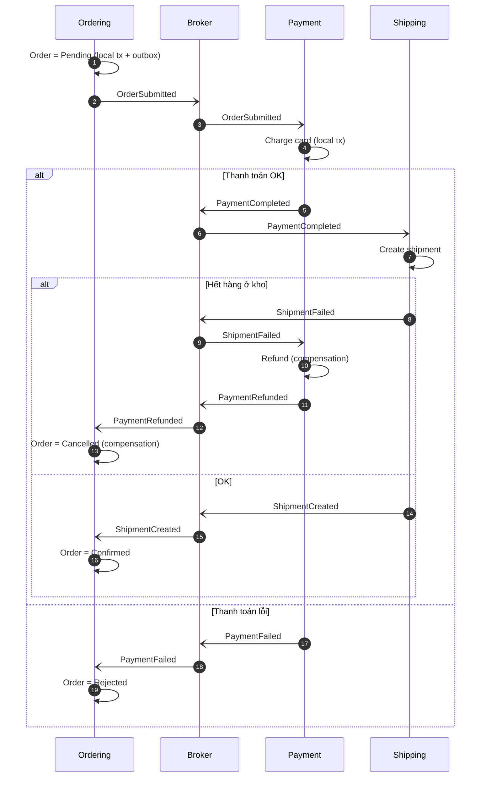

**Orchestration** — một orchestrator (thường đặt trong Ordering) giữ trạng thái và ra lệnh:

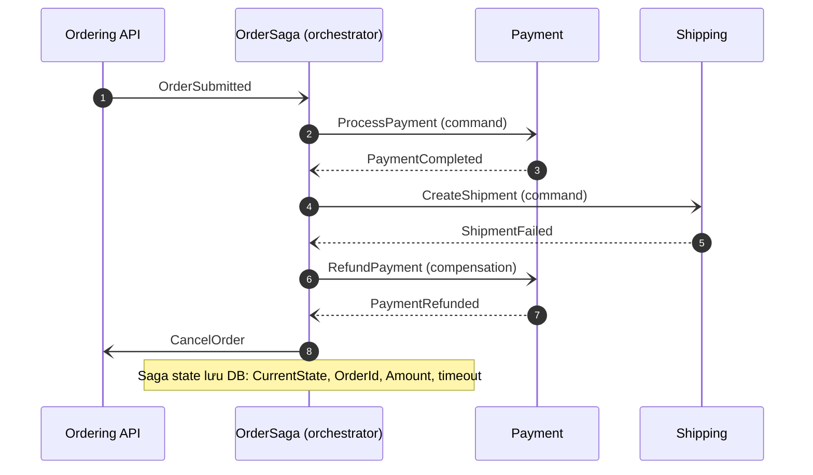

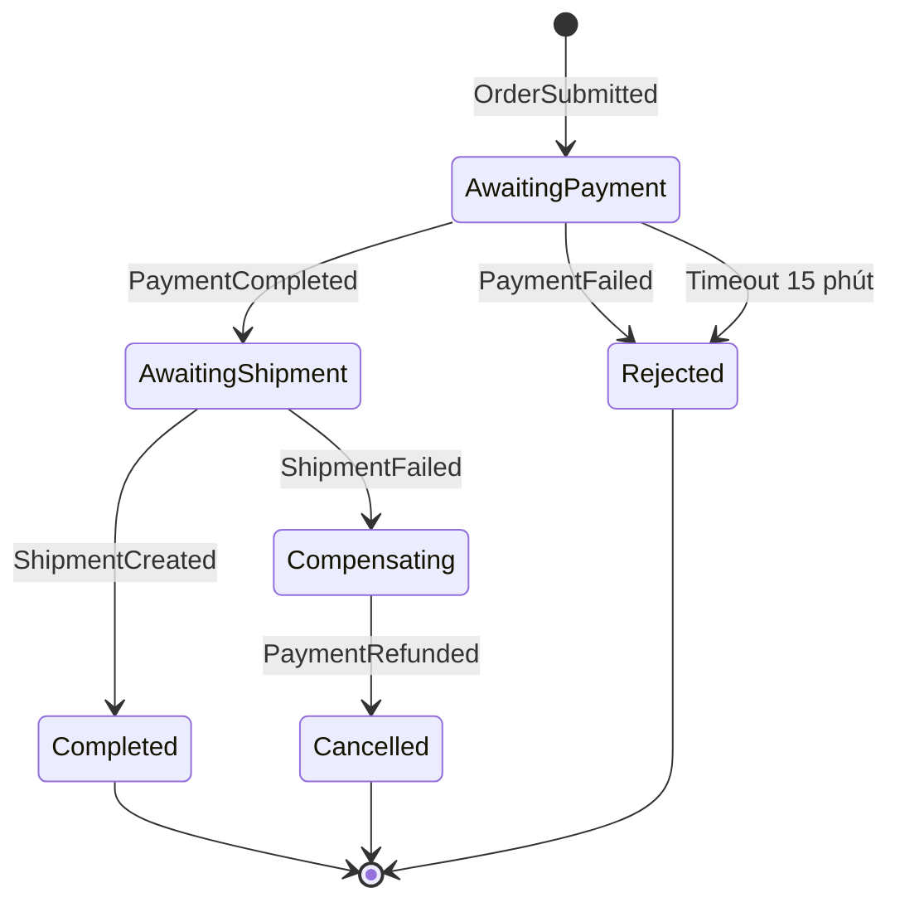

```csharp
// Ordering.Infrastructure/Sagas/OrderStateMachine.cs — MassTransit state machine (rút gọn)
public sealed class OrderState : SagaStateMachineInstance
{
    public Guid CorrelationId { get; set; }          // = OrderId
    public string CurrentState { get; set; } = null!;
    public decimal Amount { get; set; }
    public string Currency { get; set; } = null!;
    public byte[]? RowVersion { get; set; }           // optimistic concurrency
}

public sealed class OrderStateMachine : MassTransitStateMachine<OrderState>
{
    public State AwaitingPayment { get; private set; } = null!;
    public State AwaitingShipment { get; private set; } = null!;
    public State Compensating { get; private set; } = null!;

    public Event<OrderSubmitted> Submitted { get; private set; } = null!;
    public Event<PaymentCompleted> Paid { get; private set; } = null!;
    public Event<PaymentFailed> PaymentFailed { get; private set; } = null!;
    public Event<ShipmentCreated> Shipped { get; private set; } = null!;
    public Event<ShipmentFailed> ShipmentFailed { get; private set; } = null!;
    public Event<PaymentRefunded> Refunded { get; private set; } = null!;

    public OrderStateMachine()
    {
        InstanceState(x => x.CurrentState);
        Event(() => Submitted,      e => e.CorrelateById(c => c.Message.OrderId));
        Event(() => Paid,           e => e.CorrelateById(c => c.Message.OrderId));
        Event(() => PaymentFailed,  e => e.CorrelateById(c => c.Message.OrderId));
        Event(() => Shipped,        e => e.CorrelateById(c => c.Message.OrderId));
        Event(() => ShipmentFailed, e => e.CorrelateById(c => c.Message.OrderId));
        Event(() => Refunded,       e => e.CorrelateById(c => c.Message.OrderId));

        Initially(
            When(Submitted)
                .Then(c => { c.Saga.Amount = c.Message.Total; c.Saga.Currency = c.Message.Currency; })
                .Publish(c => new ProcessPayment(c.Saga.CorrelationId, c.Saga.Amount, c.Saga.Currency))
                .TransitionTo(AwaitingPayment));

        During(AwaitingPayment,
            When(Paid)
                .Publish(c => new CreateShipment(c.Saga.CorrelationId))
                .TransitionTo(AwaitingShipment),
            When(PaymentFailed)
                .Publish(c => new RejectOrder(c.Saga.CorrelationId, c.Message.Reason))
                .Finalize());

        During(AwaitingShipment,
            When(Shipped)
                .Publish(c => new ConfirmOrder(c.Saga.CorrelationId))
                .Finalize(),
            When(ShipmentFailed)
                .Publish(c => new RefundPayment(c.Saga.CorrelationId, c.Saga.Amount, c.Saga.Currency))
                .TransitionTo(Compensating));

        During(Compensating,
            When(Refunded)
                .Publish(c => new CancelOrder(c.Saga.CorrelationId, "Out of stock"))
                .Finalize());

        SetCompletedWhenFinalized();   // xoá instance khi kết thúc
    }
}

// Đăng ký: x.AddSagaStateMachine<OrderStateMachine, OrderState>()
//              .EntityFrameworkRepository(r => { r.ConcurrencyMode = ConcurrencyMode.Optimistic; r.ExistingDbContext<OrderingDbContext>(); r.UseSqlServer(); });
```

| | Choreography | Orchestration |
| --- | --- | --- |
| Coupling | Thấp — service chỉ biết event | Orchestrator biết mọi bước |
| Hiểu luồng | Khó: logic rải rác, phải đọc nhiều service | Dễ: 1 file state machine |
| Phù hợp | 2–3 bước, ít nhánh | ≥ 4 bước, nhiều nhánh, timeout, cần theo dõi trạng thái |
| Rủi ro | Vòng event, "ai chịu trách nhiệm compensation?" | Orchestrator phình thành "god service" |

> [!example] Thiết kế bước saga
> - **Compensable** (hoàn tác được: trừ tiền → hoàn tiền), **pivot** (điểm không quay lại: đã giao hàng), **retriable** (sau pivot, chỉ được retry tới khi thành công: gửi email). Đặt bước khó hoàn tác **càng muộn càng tốt**.
> - Thiếu isolation (saga không có "I" trong ACID) → dùng **semantic lock** (`Order.Status = PendingPayment` chặn sửa đơn), commutative updates, hoặc đọc lại giá trị trước khi ghi.

☕ **Java:** Axon Framework (`@Saga`, `@SagaEventHandler`), Eventuate Tram Sagas (của Chris Richardson), workflow engine **Camunda/Zeebe**, **Temporal** (durable execution; Temporal cũng có .NET SDK). .NET còn có NServiceBus sagas (thương mại), Wolverine sagas, Dapr Workflow.

### Transactional Outbox & Idempotent Consumer

Hai pattern đi đôi để đạt **effectively-once** trên broker **at-least-once**:

- **Transactional Outbox** (phía gửi): ghi business data **và** message vào cùng DB trong **một** transaction; background relay đọc bảng outbox rồi publish. Giải quyết dual-write. MassTransit `AddEntityFrameworkOutbox` + `UseBusOutbox`, Wolverine durable outbox, hoặc CDC (Debezium) đọc bảng outbox.
- **Idempotent Consumer / Inbox** (phía nhận): broker có thể giao lại message (consumer crash trước ack, relay publish lặp) → consumer phải ghi nhận `MessageId` đã xử lý **trong cùng transaction** với thay đổi nghiệp vụ.

```csharp
// Tự viết inbox tối giản (khi không dùng MassTransit/Wolverine)
public async Task HandleAsync(Guid messageId, OrderSubmitted msg, CancellationToken ct)
{
    await using var tx = await db.Database.BeginTransactionAsync(ct);
    if (await db.ProcessedMessages.AnyAsync(m => m.MessageId == messageId, ct)) return;   // đã xử lý → bỏ qua

    db.Shipments.Add(Shipment.Create(msg.OrderId, msg.Lines));
    db.ProcessedMessages.Add(new ProcessedMessage(messageId, DateTimeOffset.UtcNow));
    await db.SaveChangesAsync(ct);   // unique index trên MessageId chặn race condition giữa 2 consumer
    await tx.CommitAsync(ct);
}
```

Chi tiết cơ chế outbox (interceptor, relay, polling vs CDC, dọn bảng) → [[Domain-Events-and-Outbox]]. Không lặp lại ở đây.

### Resilience — Timeout, Retry, Circuit Breaker, Bulkhead

**Vấn đề (fallacy 1, 2):** dependency chậm nguy hiểm hơn dependency chết — thread/connection bị giữ, lỗi lan dây chuyền (cascading failure).

| Pattern | Chống lại | Ghi nhớ |
| --- | --- | --- |
| **Timeout** | Treo vô hạn | Có cả *attempt timeout* và *total timeout*; timeout downstream < timeout upstream |
| **Retry** (exponential backoff + jitter) | Lỗi tạm thời | Chỉ retry thao tác **idempotent**; jitter tránh "thundering herd" |
| **Circuit Breaker** | Gọi liên tục vào service đang chết | Open → fail fast; Half-open → thử lại vài request |
| **Bulkhead / Rate limiter** | Một dependency ngốn hết tài nguyên | Giới hạn concurrency cho từng dependency |
| **Fallback** | Không có kết quả | Cache cũ, giá trị mặc định, degraded mode |
| **Hedging** | Tail latency | Gửi request song song sau một khoảng chờ — chỉ cho thao tác đọc |

`Microsoft.Extensions.Http.Resilience` (dựa trên **Polly v8**) cung cấp `AddStandardResilienceHandler()` với 5 strategy, từ ngoài vào trong:

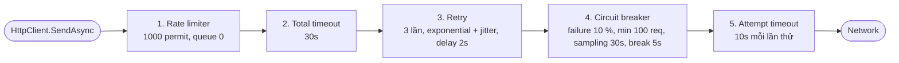

Retry & circuit breaker xử lý HTTP 5xx, 408, 429, `HttpRequestException`, `TimeoutRejectedException`.

```csharp
builder.Services.AddHttpClient<CatalogClient>(c => c.BaseAddress = new("https+http://catalog"))
    .AddStandardResilienceHandler(o =>
    {
        o.AttemptTimeout.Timeout       = TimeSpan.FromSeconds(2);
        o.TotalRequestTimeout.Timeout  = TimeSpan.FromSeconds(8);
        o.CircuitBreaker.SamplingDuration = TimeSpan.FromSeconds(10);  // nên ≥ 2 × AttemptTimeout (options có validate)
        o.Retry.DisableForUnsafeHttpMethods();   // KHÔNG retry POST/PUT/PATCH/DELETE nếu API không idempotent
    });

// Pipeline tuỳ biến cho thứ không phải HttpClient (vd: gọi SDK bên thứ ba) — Polly.Extensions
builder.Services.AddResiliencePipeline("psp", p => p
    .AddTimeout(TimeSpan.FromSeconds(5))
    .AddConcurrencyLimiter(permitLimit: 20, queueLimit: 10)   // bulkhead (Polly.RateLimiting)
    .AddCircuitBreaker(new CircuitBreakerStrategyOptions { FailureRatio = 0.5, MinimumThroughput = 10 }));

// Sử dụng
public sealed class PspGateway(ResiliencePipelineProvider<string> pipelines, IPspSdk sdk)
{
    private readonly ResiliencePipeline _pipeline = pipelines.GetPipeline("psp");
    public ValueTask<ChargeResult> ChargeAsync(ChargeRequest r, CancellationToken ct)
        => _pipeline.ExecuteAsync(async token => await sdk.ChargeAsync(r, token), ct);
}
```

> [!warning] Bẫy resilience
> - **Đừng stack** nhiều resilience handler trên một `HttpClient` (Microsoft khuyến cáo chỉ một handler; cần tuỳ biến thì `RemoveAllResilienceHandlers()` rồi `AddResilienceHandler`).
> - **Retry amplification:** gateway retry 3 × Ordering retry 3 × Catalog retry 3 = 27 request cho 1 click. Retry ở **một tầng** (thường tầng gần lỗi nhất), tầng khác chỉ timeout.
> - Retry POST không có idempotency key → tạo đơn trùng, trừ tiền hai lần.

☕ **Resilience4j** tương đương: `@CircuitBreaker`, `@Retry`, `@Bulkhead`, `@TimeLimiter`, `@RateLimiter` (annotation + AOP), cấu hình trong `application.yml`; Spring Cloud CircuitBreaker là lớp trừu tượng. Polly v8 dùng **builder tường minh**, không annotation.

### Observability

**Vấn đề:** một request đi qua gateway → Ordering → broker → Payment. Không có **trace ID chung** thì debug là đoán mò.

Ba trụ cột với **OpenTelemetry .NET**: **traces** (`System.Diagnostics.Activity` = span), **metrics** (`System.Diagnostics.Metrics.Meter`), **logs** (`ILogger` → OTel). .NET đã có sẵn API đo đạc trong BCL — OTel SDK chỉ thu thập và export, khác Java phải thêm Micrometer.

```csharp
// Shop.ServiceDefaults — rút gọn
builder.Logging.AddOpenTelemetry(l => { l.IncludeFormattedMessage = true; l.IncludeScopes = true; });

builder.Services.AddOpenTelemetry()
    .ConfigureResource(r => r.AddService(builder.Environment.ApplicationName))
    .WithMetrics(m => m
        .AddAspNetCoreInstrumentation()
        .AddHttpClientInstrumentation()
        .AddRuntimeInstrumentation()
        .AddMeter("Shop.Ordering"))                   // metric nghiệp vụ tự định nghĩa
    .WithTracing(t => t
        .AddSource(builder.Environment.ApplicationName)
        .AddSource("MassTransit")                     // span cho publish/consume
        .AddAspNetCoreInstrumentation(o => o.Filter = ctx => !ctx.Request.Path.StartsWithSegments("/health"))
        .AddHttpClientInstrumentation()
        .AddGrpcClientInstrumentation())
    .UseOtlpExporter();                               // đọc OTEL_EXPORTER_OTLP_ENDPOINT

// Metric + span nghiệp vụ
public sealed class OrderingMetrics
{
    private readonly Counter<long> _submitted;
    public OrderingMetrics(IMeterFactory meters)
        => _submitted = meters.Create("Shop.Ordering").CreateCounter<long>("orders.submitted");
    public void Submitted(string currency) => _submitted.Add(1, new KeyValuePair<string, object?>("currency", currency));
}
```

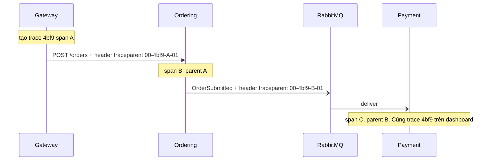

- **Trace context propagation** theo chuẩn **W3C Trace Context** (`traceparent`, `tracestate`) — ASP.NET Core và `HttpClient` tự propagate; MassTransit/Wolverine đưa vào message header. Broker tự viết thì phải tự inject/extract (`Propagators.DefaultTextMapPropagator`).
- **Correlation trong log:** `ILogger` + OTel tự gắn `TraceId`/`SpanId` → tìm mọi log của một request trên mọi service.
- **Local:** Aspire Dashboard. **Prod:** OTel Collector → Grafana (Tempo/Prometheus/Loki), Jaeger, Azure Monitor, AWS X-Ray/CloudWatch, Datadog…

☕ Spring Boot 3+: **Micrometer Observation + Micrometer Tracing** (thay Spring Cloud Sleuth), Actuator `/actuator/prometheus`, exporter OTLP. Khác biệt: .NET dùng `Activity`/`Meter` trong BCL làm API chuẩn; Java dùng Micrometer làm façade.

### Configuration & Secrets

**Vấn đề:** 5 service × 4 môi trường; secret không được nằm trong image hay git.

```csharp
// Options pattern + validate khi khởi động (fail fast thay vì lỗi lúc 2h sáng)
public sealed class PaymentOptions
{
    [Required] public string Provider { get; init; } = null!;
    [Range(1, 60)] public int CaptureTimeoutSeconds { get; init; } = 10;
}

builder.Services.AddOptions<PaymentOptions>()
    .BindConfiguration("Payment")
    .ValidateDataAnnotations()
    .ValidateOnStart();

// Nguồn config xếp lớp (sau ghi đè trước): appsettings.json → appsettings.{Env}.json → env vars → secret store
// K8s ConfigMap/Secret mount dạng env var: Payment__Provider=stripe  (dấu "__" = ":")
if (builder.Environment.IsProduction())
{
    // Azure: Azure.Extensions.AspNetCore.Configuration.Secrets + Azure.Identity (Managed Identity)
    builder.Configuration.AddAzureKeyVault(new Uri(builder.Configuration["KeyVault:Uri"]!), new DefaultAzureCredential());
    // AWS: Amazon.Extensions.Configuration.SystemsManager → builder.Configuration.AddSystemsManager("/shop/payment/");
}
```

| Nhu cầu | .NET | ☕ Spring |
| --- | --- | --- |
| Bind config vào class | `IOptions<T>` / `IOptionsMonitor<T>` (reload) | `@ConfigurationProperties` |
| Validate lúc start | `ValidateOnStart()` | `@Validated` trên properties class |
| Config tập trung | Azure App Configuration, AWS AppConfig, K8s ConfigMap | **Spring Cloud Config Server**, Spring Cloud Kubernetes |
| Secret | Key Vault, AWS Secrets Manager, K8s Secret (+ External Secrets Operator, CSI driver) | Spring Cloud Vault, Spring Cloud AWS |
| Dev local | `dotnet user-secrets` | `.env`, profile `application-local.yml` |

> [!tip] Không cần "Config Server" trên K8s
> Với K8s, ConfigMap/Secret + External Secrets Operator đã giải quyết bài toán Spring Cloud Config. Dùng `IOptionsMonitor<T>` + file mount nếu cần reload không restart.

### Health Checks

```csharp
builder.Services.AddHealthChecks()
    .AddCheck("self", () => HealthCheckResult.Healthy(), tags: ["live"])
    .AddDbContextCheck<OrderingDbContext>(tags: ["ready"]);   // Microsoft.Extensions.Diagnostics.HealthChecks.EntityFrameworkCore
    // .AddRabbitMQ(...)  — package cộng đồng AspNetCore.HealthChecks.Rabbitmq; MassTransit cũng tự đăng ký health check của bus

app.MapHealthChecks("/health/live",  new HealthCheckOptions { Predicate = r => r.Tags.Contains("live") });
app.MapHealthChecks("/health/ready", new HealthCheckOptions { Predicate = r => r.Tags.Contains("ready") });
```

```yaml
# Deployment K8s (trích)
livenessProbe:  { httpGet: { path: /health/live,  port: 8080 }, periodSeconds: 10 }
readinessProbe: { httpGet: { path: /health/ready, port: 8080 }, periodSeconds: 5 }
startupProbe:   { httpGet: { path: /health/live,  port: 8080 }, failureThreshold: 30, periodSeconds: 2 }
```

> [!warning] Liveness KHÔNG được kiểm tra dependency
> Nếu liveness check DB → DB chập chờn → K8s **restart toàn bộ pod** của mọi service → sự cố nhỏ thành sập toàn hệ thống. Liveness chỉ trả lời "process còn sống không?"; readiness mới trả lời "có nhận traffic được không?". Template Aspire chỉ map `/health` và `/alive` ở môi trường Development vì lý do bảo mật — ở prod hãy chủ động map, giới hạn truy cập (port nội bộ, `RequireHost`) và không lộ chi tiết.

☕ Spring Boot Actuator: `management.endpoint.health.probes.enabled=true` → `/actuator/health/liveness`, `/actuator/health/readiness`; **health groups** (`management.endpoint.health.group.readiness.include=db,rabbit`) ≈ lọc theo tag ở .NET.

### Security

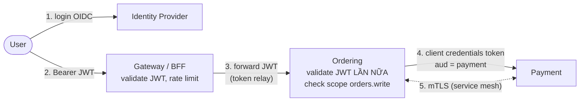

- **Zero trust:** mỗi service **tự validate JWT** (issuer, audience, expiry, signature) — không tin "đã qua gateway là an toàn" (lateral movement khi một pod bị chiếm).
- **User context** truyền xuôi bằng token relay; **service-to-service** không có user dùng **OAuth2 client credentials** (audience riêng cho từng service đích).
- **mTLS / service mesh** (Istio, Linkerd): mã hoá + xác thực danh tính workload ở tầng mạng, không đổi code; kết hợp với authz ở tầng ứng dụng.

```csharp
// Mỗi service
builder.Services.AddAuthentication(JwtBearerDefaults.AuthenticationScheme)
    .AddJwtBearer(o =>
    {
        o.Authority = builder.Configuration["Auth:Authority"];   // OIDC discovery → tự lấy signing keys
        o.Audience  = "ordering-api";
        o.MapInboundClaims = false;                              // giữ nguyên tên claim "sub", "scope"
    });
builder.Services.AddAuthorizationBuilder()
    .AddPolicy("orders.write", p => p.RequireClaim("scope", "orders.write"));

app.MapPost("/api/orders", CreateOrder).RequireAuthorization("orders.write");
```

Client credentials cho `HttpClient`: tự viết `DelegatingHandler` lấy + cache token, hoặc dùng thư viện như Duende.AccessTokenManagement (kiểm tra license hiện hành). ☕ Spring: `spring-boot-starter-oauth2-resource-server` + `OAuth2AuthorizedClientManager` (client credentials), Spring Cloud Gateway `TokenRelay` filter.

### Deployment

**Một service = một image = một pipeline.** Hai cách build image trong .NET:

```dockerfile
# Cách 1: multi-stage Dockerfile (kiểm soát tuyệt đối, cache layer restore)
FROM mcr.microsoft.com/dotnet/sdk:10.0 AS build
WORKDIR /src
COPY Directory.Packages.props Directory.Build.props ./
COPY src/Ordering/Ordering.Api/Ordering.Api.csproj src/Ordering/Ordering.Api/
COPY src/Ordering/Ordering.Domain/Ordering.Domain.csproj src/Ordering/Ordering.Domain/
COPY src/Ordering/Ordering.Infrastructure/Ordering.Infrastructure.csproj src/Ordering/Ordering.Infrastructure/
RUN dotnet restore src/Ordering/Ordering.Api/Ordering.Api.csproj
COPY src/ src/
RUN dotnet publish src/Ordering/Ordering.Api/Ordering.Api.csproj -c Release -o /app --no-restore /p:UseAppHost=false

# Chiseled: Ubuntu tối giản, không shell, không package manager, chạy non-root sẵn
FROM mcr.microsoft.com/dotnet/aspnet:10.0-noble-chiseled AS final
WORKDIR /app
COPY --from=build /app .
EXPOSE 8080
ENTRYPOINT ["dotnet", "Ordering.Api.dll"]
```

```bash
# Cách 2: không cần Dockerfile — SDK tự build image OCI (từ .NET 8 SDK, không cần Docker để build)
dotnet publish src/Ordering/Ordering.Api -c Release --os linux --arch x64 /t:PublishContainer \
  -p ContainerRepository=shop/ordering-api \
  -p ContainerImageTag=1.4.2 \
  -p ContainerFamily=noble-chiseled \
  -p ContainerRegistry=myregistry.azurecr.io
```

> [!info] Điểm .NET-specific khi deploy
> - Từ .NET 8, image Microsoft mặc định lắng nghe **port 8080** (không phải 80) và có user non-root `app`; SDK container mặc định chạy bằng user đó.
> - .NET 10: image mặc định chuyển sang **Ubuntu 24.04 (noble)**, không còn bản Debian.
> - Chiseled image **không có shell/curl** → không dùng `HEALTHCHECK curl` trong Dockerfile; dùng K8s probe. Cần ICU/tzdata thì dùng biến thể `-chiseled-extra`.
> - `/t:PublishContainer` không chạy được lệnh `RUN` — cần cài OS package thì quay về Dockerfile hoặc tự build base image.
> - Aspire có thể sinh manifest/Helm/compose để deploy (tính năng publisher thay đổi nhanh theo phiên bản — kiểm tra docs hiện hành). Aspire chủ yếu tỏa sáng ở **inner loop** (dev local).

☕ Spring: Cloud Native Buildpacks (`./mvnw spring-boot:build-image`) hoặc **Jib** ≈ `/t:PublishContainer`; layered jar ≈ cache layer restore.

### Testing Microservices

| Tầng | Mục tiêu | .NET | ☕ Java |
| --- | --- | --- | --- |
| Unit | Domain, handler | xUnit/NUnit, NSubstitute | JUnit 5, Mockito |
| Integration | Service + DB/broker thật | `WebApplicationFactory<Program>` + **Testcontainers for .NET** | `@SpringBootTest` + Testcontainers |
| **Component** | 1 service chạy thật, dependency ngoài bị stub | WebApplicationFactory + WireMock.Net + MassTransit test harness | `@SpringBootTest` + WireMock |
| **Contract** | Consumer và provider không phá nhau | **PactNet** (v5) + Pact Broker | Pact JVM hoặc **Spring Cloud Contract** (provider-driven, sinh stub) |
| End-to-end | Vài luồng sống còn | Aspire `DistributedApplicationTestingBuilder` / môi trường staging | Môi trường staging |

```csharp
// Consumer-driven contract test (Ordering là consumer của Catalog) — PactNet v5
public sealed class CatalogClientPactTests
{
    private readonly IPactBuilderV4 _pact = Pact.V4("Ordering", "Catalog", new PactConfig()).WithHttpInteractions();

    [Fact]
    public async Task Get_prices_returns_price_list()
    {
        _pact.UponReceiving("a request for prices of SKU-1")
            .Given("product SKU-1 exists")
            .WithRequest(HttpMethod.Get, "/api/products/prices")
            .WithQuery("sku", "SKU-1")
            .WillRespond()
            .WithStatus(HttpStatusCode.OK)
            .WithJsonBody(new[] { new { sku = Match.Type("SKU-1"), price = Match.Type(10.5m), currency = Match.Type("USD") } });

        await _pact.VerifyAsync(async ctx =>
        {
            var client = new CatalogClient(new HttpClient { BaseAddress = ctx.MockServerUri });
            var prices = await client.GetPricesAsync(["SKU-1"], CancellationToken.None);
            Assert.Single(prices);
        });
        // File pact JSON được publish lên Pact Broker; CI của Catalog chạy provider verification
        // → Catalog không deploy được nếu phá contract của Ordering ("can-i-deploy")
    }
}
```

Integration/component test: `WebApplicationFactory<Program>` + container SQL Server/RabbitMQ từ **Testcontainers for .NET** (API gần giống bản Java: `new MsSqlBuilder()...Build()`, `StartAsync()`), ghi đè connection string qua `builder.UseSetting(...)`; MassTransit có `AddMassTransitTestHarness()` để assert message đã publish/consume. Chi tiết → [[Testing-in-DotNet]] (sẽ viết).

### Migration from Monolith (Strangler Fig)

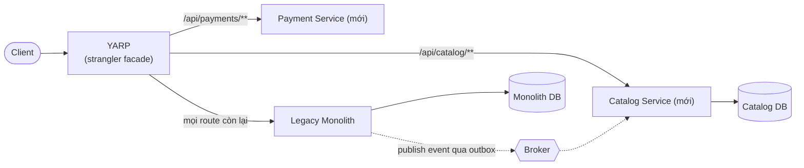

Các bước: (1) đặt YARP trước monolith, route 100 % về monolith; (2) chọn capability **ít phụ thuộc + nhiều giá trị** (thường là edge: Notification, Catalog read); (3) đồng bộ dữ liệu bằng event/CDC; (4) chuyển route dần (có thể theo % hoặc header); (5) xoá code cũ. Tách **dữ liệu** là phần khó nhất — đừng để service mới đọc thẳng DB monolith quá lâu. Chi tiết pattern → [[Monolithic-Architecture]] (Strangler Fig) và [[Structural-Patterns#Proxy]] (facade proxy là Proxy pattern ở mức kiến trúc). Anti-corruption layer khi gọi monolith → [[Structural-Patterns#Adapter]].

### Dapr (Sidecar Alternative)

**Dapr** (CNCF graduated) chạy một **sidecar** cạnh mỗi service, cung cấp "building blocks" qua HTTP/gRPC: service invocation (kèm mTLS, retry), pub/sub, state store, bindings, secrets, configuration, actors, workflow. Service gọi `localhost` sidecar thay vì SDK của broker cụ thể.

```csharp
// Dapr.Client / Dapr.AspNetCore
builder.Services.AddDaprClient();

// Publish: đổi RabbitMQ → Kafka chỉ bằng file component YAML, không đổi code
await dapr.PublishEventAsync("pubsub", "order-submitted", new OrderSubmitted(/* ... */), ct);

// Gọi service khác qua sidecar (discovery + mTLS + retry do Dapr lo)
var prices = await dapr.InvokeMethodAsync<List<ProductPrice>>(HttpMethod.Get, "catalog", "api/products/prices?sku=SKU-1", ct);
```

| ✅ | ❌ |
| --- | --- |
| Polyglot: Go, Java, .NET dùng chung một cách | Thêm sidecar → thêm hop, thêm thứ phải vận hành/nâng cấp |
| Đổi hạ tầng bằng config | API "mẫu số chung nhỏ nhất" — mất tính năng riêng của broker |
| Tách code khỏi SDK broker | Debug qua thêm một tầng |

Hợp khi tổ chức polyglot hoặc muốn platform team chuẩn hoá hạ tầng; team thuần .NET thường chọn MassTransit/Wolverine + Aspire là đủ.

---

## 4. Comparison — Đối chiếu Java / Spring Boot

### 4.1 Bảng ánh xạ Spring Cloud ↔ .NET ecosystem

| Nhu cầu | ☕ Spring Cloud / Java | 🟣 .NET | Ghi chú |
| --- | --- | --- | --- |
| API Gateway | Spring Cloud Gateway | **YARP**, Ocelot; managed: Azure APIM, AWS API Gateway | YARP là thư viện — gateway là một app ASP.NET Core |
| Service discovery | Eureka, Consul, Spring Cloud Kubernetes | K8s DNS, `Microsoft.Extensions.ServiceDiscovery` (Aspire), Consul | |
| Client-side LB | Spring Cloud LoadBalancer | ServiceDiscovery (round-robin), K8s Service | |
| Declarative HTTP client | OpenFeign, `@HttpExchange` (Spring 6) | Typed `HttpClient` + `IHttpClientFactory`; **Refit** nếu thích interface | |
| gRPC | grpc-java, grpc-spring | `Grpc.AspNetCore`, `Grpc.Net.ClientFactory` | gRPC là first-class trong ASP.NET Core |
| Resilience | Resilience4j, Spring Cloud CircuitBreaker | **Polly v8**, `Microsoft.Extensions.Http.Resilience` | Builder tường minh vs annotation |
| Messaging abstraction | Spring Cloud Stream, Spring Kafka, Spring AMQP | **MassTransit** (v9 thương mại), **Wolverine** (MIT), NServiceBus (thương mại), Brighter, raw client | |
| Outbox | Spring Modulith event registry, Debezium, Eventuate Tram | MassTransit EF outbox, Wolverine durable outbox, Debezium | |
| Saga / workflow | Axon, Eventuate Tram Sagas, Camunda, Temporal | MassTransit state machine, Wolverine/NServiceBus sagas, Dapr Workflow, Temporal .NET SDK | |
| Config tập trung | Spring Cloud Config, Spring Cloud Vault | Options pattern + Azure App Configuration / Key Vault / AWS SSM / K8s ConfigMap | |
| Tracing | Micrometer Tracing (trước: Sleuth) + OTel exporter | **OpenTelemetry .NET** trên `Activity` | |
| Metrics | Micrometer + Actuator Prometheus | `System.Diagnostics.Metrics` + OTel | |
| Health | Actuator health, probes, health groups | `AddHealthChecks`, `MapHealthChecks` + tag filter | |
| Contract test | Spring Cloud Contract, Pact JVM | **PactNet** | |
| Integration test | Testcontainers, `@ServiceConnection` | Testcontainers for .NET, `WebApplicationFactory` | |
| Local orchestration | Docker Compose support, Testcontainers dev-time | **Aspire AppHost + Dashboard** | Aspire mạnh hơn rõ rệt ở mảng này |
| Container image | Buildpacks, Jib | `dotnet publish /t:PublishContainer`, Dockerfile, chiseled | |
| Shared bootstrap | Spring Boot starters + auto-config | **ServiceDefaults** project (`AddServiceDefaults()`) | Một project bạn sở hữu, không phải "magic" auto-config |
| Modular monolith trước khi tách | Spring Modulith | Tự tổ chức + ArchUnitNET/NetArchTest | Xem [[Modular-Monolith]] |

```java
// ☕ Feign + Resilience4j — để so với typed client + AddStandardResilienceHandler
@FeignClient(name = "catalog")                  // name → Eureka/K8s discovery
public interface CatalogClient {
    @GetMapping("/api/products/prices")
    List<ProductPrice> getPrices(@RequestParam("sku") List<String> skus);
}

@Service
class PricingService {
    private final CatalogClient catalog;
    PricingService(CatalogClient catalog) { this.catalog = catalog; }

    @CircuitBreaker(name = "catalog", fallbackMethod = "cachedPrices")
    @Retry(name = "catalog")
    List<ProductPrice> prices(List<String> skus) { return catalog.getPrices(skus); }

    List<ProductPrice> cachedPrices(List<String> skus, Throwable t) { return List.of(); }
}
```

> [!warning] Bẫy khi chuyển từ Java sang .NET
> - **Không có "Spring Cloud cho .NET" một khối.** Bạn ghép từ thư viện: YARP + ServiceDiscovery + Polly + OTel + MassTransit/Wolverine. Aspire **ServiceDefaults** là chỗ gom các cấu hình đó — nó là code của bạn, sửa thoải mái, không phải auto-configuration ẩn.
> - **`new HttpClient()` trong vòng lặp** = socket exhaustion; `HttpClient` singleton tĩnh = không nhận DNS mới. Luôn dùng `IHttpClientFactory` (typed/named client). Java dev hay mắc vì quen `RestTemplate`/`WebClient` bean singleton.
> - **Annotation vs builder:** không có `@CircuitBreaker` trên method. Resilience gắn vào `HttpClient` (handler) hoặc `ResiliencePipeline` gọi tường minh — không có bẫy self-invocation, nhưng cũng không "tự áp" cho mọi method.
> - **License thay đổi:** MassTransit v9 và MediatR 13+ là thương mại. Một Java dev quen "mọi thứ Spring đều Apache 2.0" dễ kéo nhầm package thương mại vào dự án công ty — pin v8 hoặc chọn Wolverine/tự viết, và ghi lại quyết định trong ADR.
> - **Port 8080 & non-root** từ .NET 8: Helm chart cũ trỏ `containerPort: 80` sẽ fail readiness.
> - **`async` xuyên suốt:** consumer/handler chặn bằng `.Result` / `.Wait()` sẽ cạn thread pool dưới tải — tương đương block event loop trong WebFlux.
> - **Kafka trong .NET** ít "framework" hơn Spring Kafka: `Confluent.Kafka` là client mức thấp (tự lo commit offset, retry, DLQ) — MassTransit có Kafka rider nhưng mô hình khác RabbitMQ.

---

## 5. Trade-offs & Best Practices

### ✅ Ưu điểm
- **Deploy độc lập** → nhiều team release song song, lead time ngắn.
- **Scale có chọn lọc**: Catalog 20 pod, Payment 3 pod.
- **Cô lập lỗi** (khi giao tiếp async + resilience đúng): Notification chết không ảnh hưởng đặt hàng.
- **Ranh giới vật lý** bền hơn quy ước module; ownership rõ ràng.
- **Tự do công nghệ** cục bộ (DB phù hợp từng service: SQL cho Ordering, Mongo cho Shipping, Redis cho cache).

### ❌ Nhược điểm / Chi phí
- **Độ phức tạp vận hành**: N pipeline, N dashboard, N lần nâng cấp .NET/patch bảo mật.
- **Eventual consistency + saga**: logic nghiệp vụ phức tạp hơn, UX phải thiết kế cho trạng thái trung gian.
- **Latency & partial failure**: mỗi hop thêm ms và thêm một điểm hỏng.
- **Refactor ranh giới cực đắt**: di chuyển dữ liệu giữa DB, versioning contract.
- **Test khó hơn**: cần contract test, môi trường tích hợp.
- **Chi phí hạ tầng**: broker, observability stack, K8s, nhân sự platform.

### 🎯 Khi nào dùng — khi nào KHÔNG dùng

| Nên dùng khi | Không nên dùng khi |
| --- | --- |
| Nhiều team (thường ≥ 3–4) bị nghẽn bởi release chung | Một team nhỏ, sản phẩm mới chưa rõ domain |
| Các phần có nhu cầu scale/availability/compliance khác nhau rõ rệt (PCI cho Payment) | Ranh giới nghiệp vụ còn thay đổi hằng tháng |
| Đã có nền tảng: CI/CD tự động, K8s, observability, on-call | Chưa có CI/CD, deploy tay, không có monitoring |
| Đã có modular monolith và module nào đó cần tách vì lý do đo được | "Vì Netflix làm thế", "để CV đẹp" |
| Domain hiểu rõ, bounded context ổn định | Yêu cầu strong consistency xuyên nhiều thực thể ở hầu hết use case |

### 📋 Best practices
- [ ] Bắt đầu bằng [[Modular-Monolith]]; mỗi lần tách service có **ADR** ghi lý do đo được.
- [ ] Ranh giới = bounded context / business capability; **không** theo tầng kỹ thuật hay entity.
- [ ] **Database per service** (tối thiểu schema riêng + login riêng); tham chiếu chéo bằng ID.
- [ ] Lệnh ghi xuyên service đi bằng **message**; sync chỉ cho query, luôn có timeout.
- [ ] **Outbox** cho mọi publish sau khi ghi DB; **idempotent consumer** cho mọi handler.
- [ ] Contract là package riêng có **SemVer**; chỉ thay đổi additive; consumer là tolerant reader.
- [ ] `IHttpClientFactory` + **một** resilience handler mỗi client; không retry thao tác không idempotent.
- [ ] Mỗi service có **OpenTelemetry** (traces/metrics/logs) từ ngày đầu, export OTLP; propagate W3C trace context qua cả message.
- [ ] Health check tách **liveness** (không check dependency) và **readiness**.
- [ ] Mỗi service tự validate JWT; service-to-service dùng client credentials hoặc mTLS.
- [ ] Image non-root, chiseled; config qua env/secret store; `ValidateOnStart()`.
- [ ] Pipeline CI/CD độc lập + **contract test** chặn deploy khi phá consumer.
- [ ] Aspire AppHost cho dev local: một lệnh chạy toàn bộ hệ thống.
- [ ] Kiểm tra license (MassTransit v9, MediatR 13+, NServiceBus, Duende) trước khi đưa vào dự án.

### 🐞 Lỗi thường gặp

| Lỗi | Hậu quả | Cách sửa |
| --- | --- | --- |
| Shared database giữa service | Đổi schema phải deploy nhiều service; mất ownership | DB/schema riêng; dữ liệu cần thì sao chép qua event |
| `SaveChanges()` rồi `bus.Publish()` (dual-write) | Crash giữa chừng → mất event hoặc event "ma" | Transactional outbox |
| Consumer không idempotent | Message giao lại → trừ tiền 2 lần, gửi 2 email | Inbox table / unique constraint theo MessageId, idempotency key với PSP |
| Retry ở mọi tầng | Retry storm, khuếch đại tải lên service đang yếu | Retry một tầng, các tầng khác chỉ timeout; circuit breaker |
| Chuỗi gọi sync A→B→C→D | Availability nhân dồn, latency cộng dồn | Event + dữ liệu cục bộ, hoặc gộp service |
| Liveness probe check DB/broker | DB chập chờn → K8s restart hàng loạt pod | Liveness chỉ check process; dependency vào readiness |
| Chia sẻ `Shop.Domain.dll` giữa service | Coupling biên dịch → deploy lockstep | Chỉ chia sẻ contract (DTO/message), có version |
| Không propagate trace context qua broker | Trace đứt ở ranh giới async | Dùng MassTransit/Wolverine (tự làm) hoặc inject `traceparent` vào header |
| Đổi tên field trong event đang dùng | Consumer cũ deserialize lỗi, message vào DLQ hàng loạt | Additive change; breaking → event V2 publish song song |
| Saga không có timeout | Đơn kẹt "PendingPayment" mãi mãi | Schedule timeout event, chuyển trạng thái + compensation |
| Quá nhiều service nhỏ (nano-services) | Mỗi feature chạm 5 repo, overhead > giá trị | Gộp theo bounded context; 1 team ↔ vài service, không ngược lại |

---

## 6. Self-check — Câu hỏi tự kiểm tra

> [!question]- Câu 1: Tiêu chí quan trọng nhất để nói một hệ thống "là microservices" là gì? Distributed monolith khác ở đâu?
> **Independent deployability**: có thể thay đổi và deploy một service mà không phải deploy/phối hợp với service khác. Distributed monolith có nhiều process nhưng coupling chặt (shared DB, shared domain library, chuỗi sync, deploy lockstep) → trả đủ chi phí hệ phân tán mà không nhận lợi ích. Số lượng service hay kích thước code không phải tiêu chí.

> [!question]- Câu 2: Vì sao không dùng distributed transaction (2PC) giữa Ordering và Payment? Saga thay thế ra sao và thiếu gì so với ACID?
> 2PC cần mọi participant hỗ trợ XA và sống đồng thời, giữ lock trong lúc chờ coordinator → giảm availability, nhiều broker/NoSQL không hỗ trợ. Saga chia thành chuỗi local transaction, mỗi bước publish event/command; lỗi thì chạy compensating transaction. Saga **thiếu Isolation**: trạng thái trung gian nhìn thấy được → dùng semantic lock (status Pending), thiết kế bước pivot muộn, compensation idempotent.

> [!question]- Câu 3: Choreography hay orchestration cho luồng Order → Payment → Shipping có timeout và hoàn tiền?
> Orchestration (ví dụ MassTransit state machine trong Ordering): luồng có ≥ 3 bước, nhánh lỗi, compensation và timeout → cần một nơi giữ trạng thái và nhìn thấy toàn cảnh. Choreography phù hợp khi 2–3 bước, ít nhánh; nếu không, logic rải rác khó lần theo và dễ sinh vòng event.

> [!question]- Câu 4: `AddStandardResilienceHandler()` gồm những gì, theo thứ tự nào? Vì sao không nên để mặc định retry cho POST?
> Từ ngoài vào trong: rate limiter → total timeout (30s) → retry (3 lần, exponential + jitter) → circuit breaker → attempt timeout (10s). Mặc định retry mọi HTTP method; POST tạo đơn/trừ tiền nếu không idempotent sẽ bị nhân bản khi retry (request thực ra đã thành công nhưng response bị timeout). Dùng `options.Retry.DisableForUnsafeHttpMethods()` hoặc hỗ trợ idempotency key phía server.

> [!question]- Câu 5 (phỏng vấn): Màn hình "Lịch sử đơn hàng" cần dữ liệu từ Ordering, Payment, Shipping. Bạn thiết kế query thế nào?
> Hai lựa chọn: **API Composition** (BFF gọi song song 3 service, ghép kết quả, chịu lỗi từng phần) — đơn giản, dữ liệu tươi, nhưng availability bằng tích các service và không join/sort/phân trang tốt. **CQRS read model** — một projection lắng nghe `OrderSubmitted`, `PaymentCompleted`, `ShipmentDispatched` để dựng bảng denormalized phục vụ list/search; chịu eventual consistency và chi phí projection. Danh sách nhiều trang/filter → read model; trang chi tiết một đơn → composition. Không bao giờ: join thẳng DB của 3 service.

> [!question]- Câu 6 (phỏng vấn): Map Spring Cloud sang .NET — Gateway, Eureka, Feign, Resilience4j, Sleuth, Config Server, Spring Cloud Contract?
> Gateway → YARP; Eureka → K8s DNS / `Microsoft.Extensions.ServiceDiscovery` (Aspire) / Consul; Feign → typed `HttpClient` qua `IHttpClientFactory` (hoặc Refit); Resilience4j → Polly v8 + `Microsoft.Extensions.Http.Resilience`; Sleuth (nay là Micrometer Tracing) → OpenTelemetry .NET trên `Activity`; Config Server → Options pattern + K8s ConfigMap/Secret, Azure App Configuration/Key Vault, AWS SSM; Spring Cloud Contract → PactNet. Khác biệt chính: .NET ghép thư viện riêng lẻ, gom cấu hình trong ServiceDefaults; Aspire lo orchestration local.

---

## 7. Liên kết & Tham khảo
- **Bản đồ:** [[Architecture-Design-MOC]]
- **So sánh style & anti-pattern Distributed Monolith:** [[Architecture-Styles-Comparison#Microservices]] · [[Architecture-Styles-Comparison]]
- **Trước khi tách:** [[Modular-Monolith]] · [[Monolithic-Architecture]] (Strangler Fig) · [[Clean-Architecture-in-DotNet]] · [[Vertical-Slice-Architecture]]
- **Pattern bên trong một service:** [[DDD-Tactical-Patterns]] · [[CQRS-and-MediatR-Pattern]] · [[Domain-Events-and-Outbox]] · [[Repository-UnitOfWork-Specification]] · [[Result-Pattern-vs-Exceptions]]
- **Nguyên lý:** [[Coupling-and-Cohesion]] · [[Core-Design-Principles]] · [[SOLID-Principles]] · [[Design-Thinking-Process]]
- **Pattern GoF liên quan:** [[Structural-Patterns#Proxy]] (gateway, strangler facade) · [[Structural-Patterns#Adapter]] (anti-corruption layer) · [[Behavioral-Patterns#Chain of Responsibility]] (middleware, resilience pipeline)
- **Java → .NET:** [[Java-to-DotNet-Mental-Map]] · **POC:** [[POC-01-Ordering-Clean-Architecture]]
- **Sẽ viết:** [[Event-Driven-Architecture]] · [[Testing-in-DotNet]]
- **Nguồn:**
  - James Lewis & Martin Fowler — *Microservices* (martinfowler.com, 2014); Martin Fowler — *MicroservicePremium* (2015)
  - Microsoft — *.NET Microservices: Architecture for Containerized .NET Applications*; reference app **dotnet/eShop**
  - Chris Richardson — microservices.io (Database per Service, Saga, API Composition, Transactional Outbox, Idempotent Consumer)
  - Sam Newman — *Building Microservices* (2nd ed.) và *Monolith to Microservices*
  - Microsoft Learn — *Build resilient HTTP apps* (`Microsoft.Extensions.Http.Resilience`), YARP getting started, containerize với `dotnet publish`
  - aspire.dev — Service discovery, Service defaults
  - Docs MassTransit (v9 announcement), Wolverine, PactNet, OpenTelemetry .NET, Dapr
