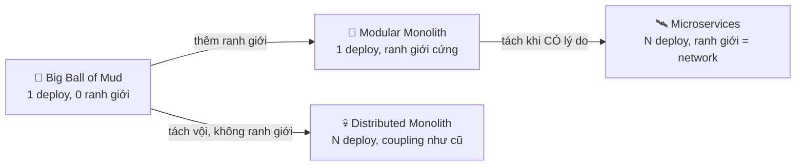
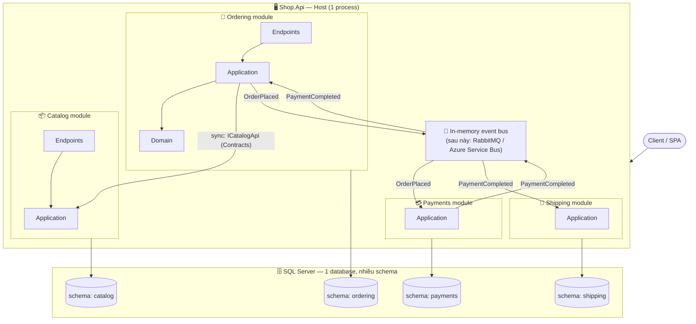
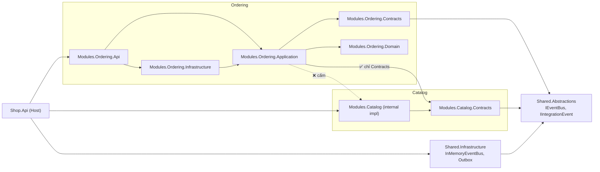
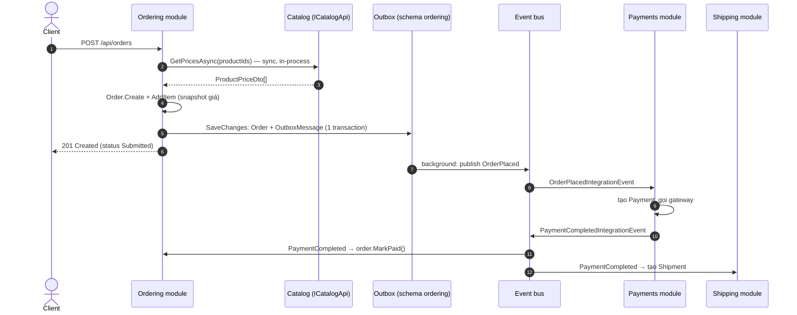
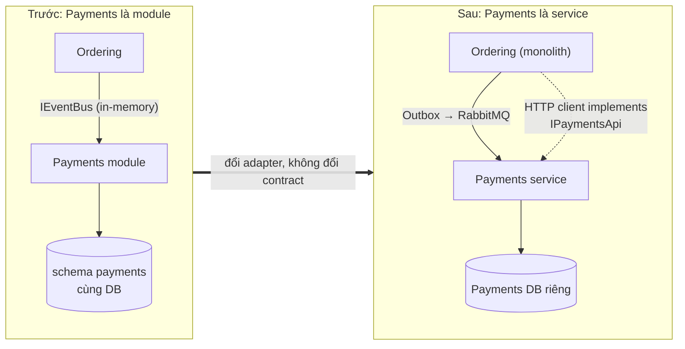

# Modular Monolith

> [!summary] TL;DR
> - **Modular Monolith** = **một** đơn vị deploy (1 process, thường 1 database server) nhưng chia thành **module độc lập theo nghiệp vụ** (≈ Bounded Context) với ranh giới được **cưỡng chế**: public contract, dữ liệu riêng, giao tiếp có kiểm soát.
> - Nằm giữa "big ball of mud" và microservices: có **modularity** của microservices mà **không trả "microservice premium"** (network, distributed transaction, ops).
> - Trong .NET: mỗi module có project riêng + `Contracts` public, **DbContext + SQL schema riêng**, gọi nhau qua **interface trong Contracts** (sync) hoặc **integration event** (async), kiểm tra ranh giới bằng **architecture test**.
> - Java đối chiếu: **Spring Modulith** (module theo package, `ApplicationModules.verify()`, `@ApplicationModuleListener`, Event Publication Registry).

---

## 1. Problem — Vấn đề cần giải quyết

### 1.1 Bối cảnh: hai cái hố hai bên đường



- **Big Ball of Mud** (Foote & Yoder, 1997): mọi thứ gọi mọi thứ, một bảng `Orders` được 12 service join tới, đổi một cột làm vỡ ba tính năng.
- **Microservices premium** (Martin Fowler, 2015): microservices kéo theo chi phí cố định — deploy tự động, monitoring phân tán, xử lý lỗi mạng, eventual consistency. Chỉ đáng trả khi hệ thống đủ phức tạp. Bài *MonolithFirst* (Fowler, 2015) quan sát rằng nhiều hệ microservices thành công **bắt đầu từ monolith**, vì ranh giới service rất khó đoán đúng từ đầu.
- **Simon Brown** (talk *Modular Monoliths*, GOTO Berlin 2018) nhấn mạnh: vấn đề thường là **thiếu modularity**, không phải do "là monolith"; tách ra microservices mà không có ranh giới tốt chỉ chuyển cục bùn lên network.
- **Shopify** (Kirsten Westeinde, *Deconstructing the Monolith*, 2019): codebase Rails khổng lồ được tổ chức lại **theo domain** (orders, shipping, billing…) thành component có public API và sở hữu dữ liệu, thay vì tách microservices; ban đầu đo độ cô lập bằng tool nội bộ (Wedge), sau đó công bố **Packwerk** để kiểm tra ranh giới tĩnh.

### 1.2 Pain points nếu không có nó

| Hướng đi | Pain point |
| --- | --- |
| Monolith phân tầng (Controllers/Services/Repositories cho cả hệ thống) | Thay đổi "Payment" chạm 4 thư mục; mọi service thấy mọi bảng; không ai dám xoá code |
| Microservices ngay từ đầu | Đoán sai boundary → gọi chéo đồng bộ chằng chịt, transaction phân tán, team 5 người vận hành 15 service |
| Monolith "chia folder" nhưng không cưỡng chế | Ranh giới mục rữa sau vài sprint vì `public` + join chéo bảng quá tiện |

### 1.3 Ý tưởng cốt lõi

1. **Chia theo nghiệp vụ (vertical), không theo kỹ thuật (horizontal)**: module = Bounded Context (Ordering, Catalog, Payments, Shipping) → [[DDD-Tactical-Patterns#3.10 Strategic DDD trong 5 phút]].
2. **Encapsulation thật**: module chỉ lộ **Contracts** (interface + DTO + integration event); mọi thứ khác `internal`.
3. **Dữ liệu riêng**: mỗi module sở hữu schema/bảng của nó; **không** join, **không** FK chéo module.
4. **Giao tiếp có kiểm soát**: gọi đồng bộ qua contract hoặc bất đồng bộ qua event.
5. **Cưỡng chế bằng máy**: project reference + architecture test chạy trong CI.

### 1.4 Đặt cạnh nhau

| Tiêu chí | Layered Monolith | **Modular Monolith** | Microservices |
| --- | --- | --- | --- |
| Đơn vị deploy | 1 | **1** | N |
| Ranh giới chính | Tầng kỹ thuật | **Module nghiệp vụ** | Service (process + network) |
| Dữ liệu | Chung, join tự do | **Schema riêng / module**, cùng DB server | DB riêng / service |
| Giao tiếp | Gọi method bất kỳ | **Contract in-process + event** | HTTP/gRPC + broker |
| Transaction | ACID mọi nơi | ACID **trong** module, eventual giữa module | ACID trong service, saga giữa service |
| Scale độc lập | ❌ | ❌ (scale cả khối) | ✅ |
| Chi phí vận hành | Thấp | **Thấp** | Cao |
| Refactor boundary | Dễ nhưng không có boundary | **Dễ** (cùng repo, compiler hỗ trợ) | Đắt (versioning, migration dữ liệu) |

---

## 2. Mental Model & Diagram

> [!info] Analogy — Chung cư vs khu nhà phố
> - **Modular monolith** = tòa chung cư: mỗi căn hộ (module) có **cửa khoá riêng**, đồng hồ điện nước riêng (schema riêng), giao tiếp qua chuông cửa/hộp thư (contract/event). Dùng chung móng, thang máy, bảo vệ (process, host, hạ tầng) → rẻ.
> - **Microservices** = khu nhà phố: mỗi nhà tự lo móng, điện, bảo vệ → tự do hơn nhưng đắt hơn nhiều.
> - **Big ball of mud** = nhà tập thể không vách ngăn: ai cũng đi xuyên phòng nhau.

### 2.1 Module map



### 2.2 Project dependency graph — ai được reference ai



> [!important] Quy tắc một câu
> **Module A chỉ được reference `B.Contracts`, không bao giờ reference phần ruột của B.** Host là nơi duy nhất reference tất cả (Composition Root).

---

## 3. Implementation & Code

### 3.1 Cấu trúc solution — hai lựa chọn

```text
src/
├── Bootstrapper/
│   └── Shop.Api/                         # Host: Program.cs, gọi AddXxxModule()
├── Shared/
│   ├── Shared.Abstractions/              # IIntegrationEvent, IEventBus, Result… (rất mỏng!)
│   └── Shared.Infrastructure/            # InMemoryEventBus, Outbox processor, middleware chung
└── Modules/
    ├── Ordering/                         # Lựa chọn A: tách project theo tầng (Clean Architecture/module)
    │   ├── Modules.Ordering.Contracts/   # PUBLIC: IOrderingApi, DTO, OrderPlacedIntegrationEvent
    │   ├── Modules.Ordering.Domain/
    │   ├── Modules.Ordering.Application/
    │   ├── Modules.Ordering.Infrastructure/  # OrderingDbContext (schema "ordering"), migrations
    │   └── Modules.Ordering.Api/         # endpoints + OrderingModule.cs (AddOrderingModule)
    ├── Catalog/                          # Lựa chọn B: 1 project + Contracts
    │   ├── Modules.Catalog.Contracts/
    │   └── Modules.Catalog/              # mọi class internal, chia folder theo feature
    ├── Payments/ …
    └── Shipping/ …
tests/
├── Modules.Ordering.Tests/               # unit + integration của riêng module
└── Architecture.Tests/                   # NetArchTest: kiểm tra ranh giới
```

| | **A. Nhiều project / module** | **B. Một project / module (+ Contracts)** |
| --- | --- | --- |
| Cưỡng chế | Compiler cưỡng chế cả tầng **bên trong** module | Chỉ cưỡng chế **giữa** module (`internal`) |
| Số project | 5 × số module → solution nặng | 2 × số module |
| Phù hợp | Module core phức tạp (Ordering) | Module CRUD/supporting (Catalog) |
| Bên trong | Clean Architecture | Thường [[Vertical-Slice-Architecture]] |

> [!tip] Có thể trộn
> Không bắt buộc mọi module cùng kiểu. Core domain dùng A + DDD đầy đủ; supporting module dùng B + transaction script. Ranh giới **giữa** module mới là thứ phải đồng nhất.

### 3.2 Đăng ký module vào Host

```csharp
// src/Modules/Ordering/Modules.Ordering.Api/OrderingModule.cs
using Microsoft.AspNetCore.Builder;
using Microsoft.AspNetCore.Routing;
using Microsoft.Extensions.Configuration;
using Microsoft.Extensions.DependencyInjection;
using Modules.Ordering.Application;
using Modules.Ordering.Infrastructure;

namespace Modules.Ordering.Api;

public static class OrderingModule
{
    // Điểm vào DUY NHẤT host biết về Ordering → mọi chi tiết đăng ký nằm trong module
    public static IServiceCollection AddOrderingModule(this IServiceCollection services, IConfiguration config)
    {
        services.AddOrderingApplication();            // handler, validator của module (internal)
        services.AddOrderingInfrastructure(config);   // DbContext, repository, event handler, ACL
        return services;
    }

    public static IEndpointRouteBuilder MapOrderingEndpoints(this IEndpointRouteBuilder app)
    {
        var group = app.MapGroup("/api/orders").WithTags("Ordering");
        group.MapPost("/", PlaceOrderEndpoint.Handle);
        group.MapGet("/{id:guid}", GetOrderEndpoint.Handle);
        return app;
    }
}
```

```csharp
// src/Bootstrapper/Shop.Api/Program.cs — Composition Root
var builder = WebApplication.CreateBuilder(args);

builder.Services.AddSharedInfrastructure();               // event bus, outbox, ProblemDetails…
builder.Services.AddCatalogModule(builder.Configuration);
builder.Services.AddOrderingModule(builder.Configuration);
builder.Services.AddPaymentsModule(builder.Configuration);
builder.Services.AddShippingModule(builder.Configuration);

var app = builder.Build();

app.MapCatalogEndpoints();
app.MapOrderingEndpoints();
app.MapPaymentsEndpoints();

app.Run();

public partial class Program { }   // cho WebApplicationFactory<Program> trong integration test
```

```csharp
// src/Modules/Ordering/Modules.Ordering.Infrastructure/DependencyInjection.cs
// Extension PUBLIC, nhưng mọi type nó đăng ký đều internal → host không chạm được vào DbContext của Ordering
public static class DependencyInjection
{
    public static IServiceCollection AddOrderingInfrastructure(this IServiceCollection services, IConfiguration config)
    {
        services.AddDbContext<OrderingDbContext>(options =>
            options.UseSqlServer(config.GetConnectionString("Shop"), sql =>
                // Mỗi module có bảng lịch sử migration riêng, nằm trong schema của module
                sql.MigrationsHistoryTable("__EFMigrationsHistory", OrderingDbContext.Schema)));

        services.AddScoped<IOrderRepository, OrderRepository>();
        services.AddScoped<IIntegrationEventHandler, PaymentCompletedHandler>();
        return services;
    }
}
```

### 3.3 Giao tiếp đồng bộ — qua public contract

Ordering cần giá và tên sản phẩm **ngay lúc đặt hàng** → gọi đồng bộ Catalog qua interface công khai.

```csharp
// src/Modules/Catalog/Modules.Catalog.Contracts/ICatalogApi.cs — PUBLIC
namespace Modules.Catalog.Contracts;

public interface ICatalogApi
{
    Task<IReadOnlyList<ProductPriceDto>> GetPricesAsync(IReadOnlyCollection<Guid> productIds, CancellationToken ct);
}

// DTO thuộc "Published Language" của Catalog: ổn định, kiểu primitive, không lộ entity
public sealed record ProductPriceDto(Guid ProductId, string Sku, string Name, decimal Price, string Currency, bool IsActive);
```

```csharp
// src/Modules/Catalog/Modules.Catalog/Api/CatalogApi.cs — INTERNAL, chỉ DI biết
internal sealed class CatalogApi(CatalogDbContext db) : ICatalogApi
{
    public async Task<IReadOnlyList<ProductPriceDto>> GetPricesAsync(
        IReadOnlyCollection<Guid> productIds, CancellationToken ct) =>
        await db.Products
            .AsNoTracking()
            .Where(p => productIds.Contains(p.Id))
            .Select(p => new ProductPriceDto(p.Id, p.Sku, p.Name, p.Price, p.Currency, p.IsActive))
            .ToListAsync(ct);
}

// Trong AddCatalogModule(): services.AddScoped<ICatalogApi, CatalogApi>();
```

```csharp
// src/Modules/Ordering/Modules.Ordering.Application/Orders/PlaceOrder/PlaceOrderHandler.cs
internal sealed class PlaceOrderHandler(
    ICatalogApi catalog,              // chỉ biết Contracts của Catalog
    IOrderRepository orders,
    TimeProvider clock) : IRequestHandler<PlaceOrderCommand, Guid>
{
    public async Task<Guid> Handle(PlaceOrderCommand cmd, CancellationToken ct)
    {
        var prices = (await catalog.GetPricesAsync(cmd.Lines.Select(l => l.ProductId).ToArray(), ct))
                     .ToDictionary(p => p.ProductId);

        var order = Order.Create(new CustomerId(cmd.CustomerId), cmd.Currency, clock.GetUtcNow());
        foreach (var line in cmd.Lines)
        {
            if (!prices.TryGetValue(line.ProductId, out var p) || !p.IsActive)
                throw new DomainException($"Product {line.ProductId} is not available.");

            // Snapshot giá vào Order: sau này Catalog đổi giá, đơn cũ KHÔNG đổi theo
            order.AddItem(new ProductId(p.ProductId), p.Sku, line.Quantity, new Money(p.Price, p.Currency));
        }

        orders.Add(order);
        return order.Id.Value;
    }
}
```

> [!warning] Sync call = coupling thời gian chạy
> Gọi đồng bộ in-process thì rẻ, nhưng khi tách Catalog ra service, lời gọi này thành HTTP → có latency và có thể fail. Giữ lời gọi đồng bộ ở mức **truy vấn** (query), **không** dùng để ra lệnh module khác thay đổi trạng thái. Lệnh/thay đổi → event.

### 3.4 Giao tiếp bất đồng bộ — integration events

| | **Domain event** | **Integration event** |
| --- | --- | --- |
| Phạm vi | Trong 1 module | Giữa các module |
| Nằm ở | `Modules.X.Domain` | `Modules.X.Contracts` (public) |
| Kiểu dữ liệu | Domain types (`OrderId`, `Money`) | Primitive, ổn định, có version |
| Khi nào publish | Trong/sau `SaveChanges` | **Sau commit** (qua outbox) |

```csharp
// src/Shared/Shared.Abstractions/Messaging.cs
namespace Shared.Abstractions;

public interface IIntegrationEvent
{
    Guid EventId { get; }
    DateTimeOffset OccurredAt { get; }
}

public interface IEventBus
{
    ValueTask PublishAsync(IIntegrationEvent integrationEvent, CancellationToken ct = default);
}

// Non-generic base để dispatcher lọc handler mà không cần reflection/dynamic
public interface IIntegrationEventHandler
{
    Type EventType { get; }
    Task HandleAsync(IIntegrationEvent integrationEvent, CancellationToken ct);
}

public abstract class IntegrationEventHandler<TEvent> : IIntegrationEventHandler
    where TEvent : IIntegrationEvent
{
    public Type EventType => typeof(TEvent);
    Task IIntegrationEventHandler.HandleAsync(IIntegrationEvent e, CancellationToken ct) => HandleAsync((TEvent)e, ct);
    public abstract Task HandleAsync(TEvent integrationEvent, CancellationToken ct);
}
```

```csharp
// src/Modules/Ordering/Modules.Ordering.Contracts/IntegrationEvents.cs — PUBLIC, primitive-only
namespace Modules.Ordering.Contracts;

public sealed record OrderPlacedIntegrationEvent(
    Guid EventId, DateTimeOffset OccurredAt,
    Guid OrderId, Guid CustomerId, decimal Total, string Currency) : IIntegrationEvent;
```

```csharp
// src/Shared/Shared.Infrastructure/Messaging/InMemoryEventBus.cs
using System.Threading.Channels;

namespace Shared.Infrastructure.Messaging;

internal sealed class InMemoryEventBus(Channel<IIntegrationEvent> channel) : IEventBus
{
    public ValueTask PublishAsync(IIntegrationEvent integrationEvent, CancellationToken ct = default) =>
        channel.Writer.WriteAsync(integrationEvent, ct);
}

// Đọc channel ở background → handler chạy NGOÀI request & transaction của publisher (giống broker thật)
internal sealed class IntegrationEventDispatcher(
    Channel<IIntegrationEvent> channel,
    IServiceScopeFactory scopeFactory,
    ILogger<IntegrationEventDispatcher> logger) : BackgroundService
{
    protected override async Task ExecuteAsync(CancellationToken stoppingToken)
    {
        await foreach (var evt in channel.Reader.ReadAllAsync(stoppingToken))
        {
            // Scope mới cho mỗi event: DbContext của module subscriber là Scoped
            await using var scope = scopeFactory.CreateAsyncScope();
            var handlers = scope.ServiceProvider.GetServices<IIntegrationEventHandler>()
                                .Where(h => h.EventType == evt.GetType());

            foreach (var handler in handlers)
            {
                try { await handler.HandleAsync(evt, stoppingToken); }
                catch (Exception ex)
                {
                    // In-memory: lỗi ở đây = MẤT event → production cần outbox/inbox + retry
                    logger.LogError(ex, "Handler {Handler} failed for {EventType} {EventId}",
                        handler.GetType().Name, evt.GetType().Name, evt.EventId);
                }
            }
        }
    }
}

// Đăng ký (AddSharedInfrastructure):
// services.AddSingleton(Channel.CreateUnbounded<IIntegrationEvent>());
// services.AddSingleton<IEventBus, InMemoryEventBus>();
// services.AddHostedService<IntegrationEventDispatcher>();
```

```csharp
// src/Modules/Payments/Modules.Payments/IntegrationEventHandlers/OrderPlacedHandler.cs
// Payments chỉ reference Modules.Ordering.Contracts
internal sealed class OrderPlacedHandler(PaymentsDbContext db, TimeProvider clock)
    : IntegrationEventHandler<OrderPlacedIntegrationEvent>
{
    public override async Task HandleAsync(OrderPlacedIntegrationEvent e, CancellationToken ct)
    {
        // Idempotent: at-least-once delivery → cùng event có thể đến 2 lần
        if (await db.Payments.AnyAsync(p => p.OrderId == e.OrderId, ct)) return;

        db.Payments.Add(Payment.Initiate(e.OrderId, e.Total, e.Currency, clock.GetUtcNow()));
        await db.SaveChangesAsync(ct);
    }
}
// services.AddScoped<IIntegrationEventHandler, OrderPlacedHandler>();
```



> [!tip] Chọn bus
> - Bắt đầu: in-memory (`Channel<T>`) như trên, hoặc publish qua MediatR `INotification` (lưu ý license MediatR 13+, xem [[CQRS-and-MediatR-Pattern]]).
> - Cần bền vững/retry: outbox per module + background publisher → [[Domain-Events-and-Outbox]].
> - Chuẩn bị tách service: **Wolverine**, **Rebus**, **Brighter** hoặc **MassTransit** (có in-memory transport để chuyển dần sang RabbitMQ/Azure Service Bus). ⚠️ MassTransit đã công bố chuyển v9 sang mô hình thương mại, v8 vẫn open source — kiểm tra điều khoản hiện hành.

### 3.5 Data isolation — mỗi module một `DbContext` + một schema

```csharp
// src/Modules/Ordering/Modules.Ordering.Infrastructure/Persistence/OrderingDbContext.cs
internal sealed class OrderingDbContext(DbContextOptions<OrderingDbContext> options) : DbContext(options)
{
    public const string Schema = "ordering";

    public DbSet<Order> Orders => Set<Order>();
    public DbSet<OutboxMessage> OutboxMessages => Set<OutboxMessage>();

    protected override void OnModelCreating(ModelBuilder modelBuilder)
    {
        // Mọi bảng của module nằm trong schema "ordering" → ordering.Orders, ordering.OrderItems…
        modelBuilder.HasDefaultSchema(Schema);
        modelBuilder.ApplyConfigurationsFromAssembly(typeof(OrderingDbContext).Assembly);
    }
}
```

```bash
# Migration theo từng module: chỉ định context + project chứa migration + startup project
dotnet ef migrations add InitialOrdering \
  --context OrderingDbContext \
  --project src/Modules/Ordering/Modules.Ordering.Infrastructure \
  --startup-project src/Bootstrapper/Shop.Api \
  --output-dir Persistence/Migrations
```

```sql
-- (Tuỳ chọn) Cưỡng chế ở tầng DB: mỗi module 1 user chỉ có quyền trên schema của nó
CREATE SCHEMA ordering;
CREATE USER ordering_app WITHOUT LOGIN;
GRANT SELECT, INSERT, UPDATE, DELETE ON SCHEMA::ordering TO ordering_app;
-- ordering_app không SELECT được catalog.Products → join chéo module sẽ fail ngay
```

| Mức cô lập | Mô tả | Chi phí | Khi nào |
| --- | --- | --- | --- |
| 1. Bảng riêng, cùng schema | Quy ước đặt tên | Thấp nhất, dễ vi phạm | Không khuyến nghị |
| **2. Schema riêng, cùng DB** | `HasDefaultSchema` + DbContext riêng | Thấp | **Mặc định** |
| 3. Schema riêng + DB user riêng | Cưỡng chế bằng quyền | Vừa | Team lớn, compliance |
| 4. Database riêng | Connection string riêng | Cao hơn (backup, transaction) | Chuẩn bị tách service |

> [!warning] Không join, không FK chéo module
> `ordering.OrderItems.ProductId` **không** có FK tới `catalog.Products`. Dữ liệu cần từ module khác: (a) **snapshot** lúc ghi (tên, giá), (b) gọi contract khi đọc, hoặc (c) **read model** cục bộ cập nhật bằng integration event (ví dụ `ordering.ProductSnapshots`). Báo cáo tổng hợp nhiều module → read model/reporting DB riêng, không phá ranh giới.

### 3.6 Transaction xuyên module — tránh

- "Cùng một database nên mở 1 transaction cho Ordering + Payments đi" → **không**. Ngày tách Payments ra, transaction đó thành distributed transaction.
- Mỗi command ghi vào **một module** (và thường một aggregate — [[DDD-Tactical-Patterns#3.3 Aggregate & Aggregate Root]]).
- Luồng nhiều bước (đặt hàng → thanh toán → giao hàng) = chuỗi event; cần bù trừ khi lỗi → **saga/process manager** (ví dụ `PaymentFailed` → `order.Cancel()`).
- Đảm bảo "lưu dữ liệu + phát event" nguyên tử bằng **outbox trong schema của module**; phía nhận dùng **inbox**/kiểm tra idempotent.

### 3.7 Cưỡng chế ranh giới — architecture tests

Lớp 1: **project reference** (compiler) + `internal`. Lớp 2: **architecture test** bắt những gì compiler không thấy (ví dụ Infrastructure của module A dùng namespace nội bộ của B qua reference vô tình, Domain phụ thuộc EF Core…).

```csharp
// tests/Architecture.Tests/ModuleBoundaryTests.cs
using System.Reflection;
using NetArchTest.Rules;

namespace Architecture.Tests;

public sealed class ModuleBoundaryTests
{
    private static readonly string[] Modules = ["Ordering", "Catalog", "Payments", "Shipping"];

    public static TheoryData<string> ModuleNames => new(Modules);

    [Theory]
    [MemberData(nameof(ModuleNames))]
    public void Module_should_only_depend_on_contracts_of_other_modules(string module)
    {
        var moduleAssemblies = AppDomain.CurrentDomain.GetAssemblies()
            .Where(a => a.GetName().Name!.StartsWith($"Modules.{module}", StringComparison.Ordinal)
                        && !a.GetName().Name!.EndsWith(".Contracts", StringComparison.Ordinal))
            .ToArray();

        // Namespace nội bộ của các module KHÁC (mọi thứ trừ .Contracts)
        string[] forbidden = Modules.Where(m => m != module)
            .SelectMany(m => new[] { $"Modules.{m}.Domain", $"Modules.{m}.Application",
                                     $"Modules.{m}.Infrastructure", $"Modules.{m}.Api" })
            .ToArray();

        var result = Types.InAssemblies(moduleAssemblies)
            .ShouldNot().HaveDependencyOnAny(forbidden)
            .GetResult();

        Assert.True(result.IsSuccessful,
            $"{module} vi phạm ranh giới: {string.Join(", ", result.FailingTypeNames ?? [])}");
    }

    [Fact]
    public void Domain_should_not_depend_on_EntityFrameworkCore()
    {
        var result = Types.InAssembly(typeof(Modules.Ordering.Domain.Orders.Order).Assembly)
            .ShouldNot().HaveDependencyOn("Microsoft.EntityFrameworkCore")
            .GetResult();

        Assert.True(result.IsSuccessful);
    }
}
```

> [!warning] Lưu ý về thư viện
> - `AppDomain.GetAssemblies()` chỉ trả assembly **đã load** — trong test thật nên liệt kê assembly tường minh (`typeof(OrderingModule).Assembly`, …) để chắc chắn không sót.
> - Package gốc **NetArchTest.Rules** có bản phát hành cuối khá lâu (1.3.2, 2021). Lựa chọn còn được bảo trì: fork **NetArchTest.eNhancedEdition** (API gần như tương thích) hoặc **ArchUnitNET** (port của ArchUnit). Kiểm tra trạng thái repo trước khi chọn.
> - Kiểu module B (1 project, `internal`) cần `InternalsVisibleTo` cho project test của chính module đó — **không** cấp cho module khác.

### 3.8 Testing theo module

| Loại test | Phạm vi | Công cụ |
| --- | --- | --- |
| Unit (domain) | Aggregate, VO, domain service của 1 module | xUnit, không DB |
| Integration (module) | Endpoint → handler → `OrderingDbContext` thật | `WebApplicationFactory<Program>` + Testcontainers (SQL Server) |
| Contract của module khác | Thay `ICatalogApi` bằng fake để test Ordering độc lập | `services.RemoveAll<ICatalogApi>(); services.AddSingleton<ICatalogApi, FakeCatalogApi>();` |
| Event | Assert Ordering publish `OrderPlacedIntegrationEvent`; Payments xử lý idempotent | Fake `IEventBus` ghi lại event |
| Architecture | Ranh giới module/tầng | NetArchTest / ArchUnitNET |

→ Chi tiết: [[Testing-in-DotNet]].

### 3.9 Lộ trình tách một module thành microservice



1. **Contracts đã ổn định** và chỉ chứa primitive → serialize được qua network.
2. Đổi `IEventBus` in-memory sang broker (cùng interface); outbox đã có sẵn → không mất event.
3. Lời gọi sync: thay implementation in-process bằng HTTP/gRPC client **implement cùng interface** contract:

   ```csharp
   internal sealed class CatalogApiHttpClient(HttpClient http) : ICatalogApi
   {
       public async Task<IReadOnlyList<ProductPriceDto>> GetPricesAsync(
           IReadOnlyCollection<Guid> productIds, CancellationToken ct)
       {
           var response = await http.PostAsJsonAsync("/internal/prices", productIds, ct);
           response.EnsureSuccessStatusCode();
           return await response.Content.ReadFromJsonAsync<List<ProductPriceDto>>(ct) ?? [];
       }
   }
   // services.AddHttpClient<ICatalogApi, CatalogApiHttpClient>(c => c.BaseAddress = new("http://catalog"))
   //         .AddStandardResilienceHandler();   // Microsoft.Extensions.Http.Resilience: retry, timeout, circuit breaker
   ```
4. Chuyển schema `payments` sang database riêng (schema đã tách → di chuyển dữ liệu đơn giản).
5. Deploy riêng, monitoring, tracing phân tán → [[Microservices-Architecture]].

> [!important] Tách vì lý do gì?
> Scale độc lập, team độc lập, công nghệ khác, yêu cầu compliance/isolation. **Không** tách chỉ vì "microservices hiện đại hơn". Nếu module không có lý do nào ở trên → giữ nguyên trong monolith.

---

## 4. Comparison — Đối chiếu Java / Spring Boot

**Spring Modulith** (dự án chính thức của Spring; tài liệu hiện hành ở dòng 2.x) là điểm so sánh tốt nhất: nó làm *bằng quy ước + kiểm tra lúc test* những gì .NET làm *bằng project reference + `internal`*.

| Khía cạnh | ☕ Spring Modulith | 🟣 .NET (tự xây) | Ghi chú |
| --- | --- | --- | --- |
| Định nghĩa module | **Package con trực tiếp** của package chứa `@SpringBootApplication` | Project (assembly) `Modules.X.*` | Java: 1 artifact; .NET: nhiều assembly |
| API công khai | Package gốc của module; sub-package (ví dụ `order.internal`) là nội bộ; mở thêm bằng `@NamedInterface` | Project `Modules.X.Contracts` | |
| Ẩn nội bộ | Package-private, hoặc public trong sub-package nhưng bị `verify()` bắt | `internal` (compiler cưỡng chế) | .NET mạnh hơn: lỗi compile thay vì test fail |
| Khai báo phụ thuộc cho phép | `@ApplicationModule(allowedDependencies = "order")` trên `package-info.java` | Project reference | |
| Kiểm tra ranh giới | `ApplicationModules.of(Application.class).verify()` (dựa trên ArchUnit, phát hiện vòng phụ thuộc + truy cập nội bộ) | NetArchTest / ArchUnitNET tự viết | |
| Event giữa module | `ApplicationEventPublisher` + **`@ApplicationModuleListener`** (= `@Async` + `@Transactional(REQUIRES_NEW)` + `@TransactionalEventListener`) | `IEventBus` + handler + outbox tự viết | |
| Đảm bảo không mất event | **Event Publication Registry** (`spring-modulith-starter-jpa`/`-jdbc`/`-mongodb`): ghi log publication trong transaction nghiệp vụ, đánh dấu completed khi listener thành công, resubmit qua `IncompleteEventPublications` | Outbox per module tự viết hoặc Wolverine/MassTransit outbox | Registry về bản chất là một outbox |
| Đẩy event ra broker | `@Externalized("topic::key")` + `spring-modulith-events-kafka`/`-amqp` | Outbox publisher → RabbitMQ/ASB | |
| Test một module | `@ApplicationModuleTest` (bootstrap riêng module), API `Scenario` cho event | `WebApplicationFactory` + fake contract | |
| Tài liệu kiến trúc | `Documenter` sinh C4/PlantUML từ model module | Tự vẽ (Mermaid) | |
| Data isolation | Không cưỡng chế sẵn — tự quy ước schema | Không cưỡng chế sẵn — `HasDefaultSchema` | Cả hai: kỷ luật của team |

```java
// ☕ Cấu trúc package = cấu trúc module
// com.shop                  ← @SpringBootApplication
// com.shop.ordering         ← module "ordering" (API công khai)
// com.shop.ordering.internal← nội bộ, module khác không được dùng
// com.shop.payments         ← module "payments"

// com/shop/payments/package-info.java
@org.springframework.modulith.ApplicationModule(allowedDependencies = "ordering")
package com.shop.payments;

// Event công khai của ordering
package com.shop.ordering;
public record OrderPlaced(UUID orderId, BigDecimal total, String currency) {}

// Payments lắng nghe — chạy async, transaction riêng, sau khi transaction của publisher commit
@Component
class PaymentInitiator {
    @ApplicationModuleListener
    void on(OrderPlaced event) {
        // idempotent: Event Publication Registry có thể republish khi restart
    }
}

// Kiểm tra ranh giới trong test
class ModularityTests {
    ApplicationModules modules = ApplicationModules.of(ShopApplication.class);

    @Test
    void verifiesModularStructure() {
        modules.verify();                                  // fail nếu truy cập internal / vòng phụ thuộc
    }

    @Test
    void writeDocumentation() {
        new Documenter(modules).writeDocumentation();     // sinh sơ đồ module
    }
}
```

> [!warning] Bẫy khi chuyển từ Java sang .NET
> - **Namespace ≠ package về mặt truy cập**: C# không có "namespace-private". `internal` theo **assembly** → muốn ẩn nội bộ module, module phải là assembly riêng (hoặc dùng architecture test).
> - **Không có Spring Modulith cho .NET** "chính chủ": phải tự ghép — project structure + `internal` + NetArchTest/ArchUnitNET + outbox (hoặc dùng framework như Wolverine). Đừng tìm một package "làm hết".
> - **`@ApplicationModuleListener` chạy sau commit và async** — bản tự viết ở .NET phải tự đảm bảo điều đó (dispatcher background + outbox). Publish event **trước** `SaveChanges` thành công là bug kinh điển: handler chạy, transaction gốc rollback.
> - **Một `DbContext` cho cả hệ thống** (thói quen một `EntityManagerFactory`) phá data isolation — mỗi module một `DbContext`.
> - **Scoped DbContext trong background handler**: không inject DbContext vào singleton; tạo scope mới cho mỗi event (như dispatcher ở 3.4).

---

## 5. Trade-offs & Best Practices

### ✅ Ưu điểm
- **Modularity thật** với chi phí vận hành của một ứng dụng: 1 pipeline, 1 deploy, debug một process.
- Refactor ranh giới **rẻ**: cùng repo, IDE rename, compiler bắt lỗi.
- Gọi giữa module là in-process → nhanh, không cần retry/circuit breaker (ở giai đoạn này).
- **Lộ trình mở** sang microservices cho đúng module cần tách, khi có lý do thật.
- Team có thể sở hữu module (ownership) ngay cả khi chưa tách deploy.

### ❌ Nhược điểm / Chi phí
- Không scale độc lập từng module; một memory leak làm sập cả hệ thống.
- Một deploy chung → release train chung; lỗi build của module này chặn module khác.
- Kỷ luật ranh giới cần **cưỡng chế liên tục** (test, review); không có thì trượt về big ball of mud.
- Eventual consistency giữa module ngay cả khi cùng DB — UX và nghiệp vụ phải chấp nhận.
- Nhiều project/DbContext/migration → solution phức tạp hơn layered monolith.

### 🎯 Khi nào dùng — khi nào KHÔNG dùng

| Nên dùng khi | Không nên dùng khi |
| --- | --- |
| Sản phẩm mới, domain chưa rõ, muốn để ngỏ đường tách service | App nhỏ, 1 bounded context, CRUD → layered/vertical slice đơn giản là đủ |
| Team 3–30 người, chưa có platform team cho microservices | Đã có yêu cầu scale/release độc lập rõ ràng cho từng phần |
| Đang có big ball of mud và muốn "gỡ rối" từng phần | Các phần cần công nghệ/runtime khác nhau (ML Python, xử lý realtime Go…) |
| Muốn áp DDD strategic mà chưa muốn trả microservice premium | Yêu cầu cô lập lỗi/security cứng giữa các phần (multi-tenant isolation, PCI scope) |

### 📋 Best practices
- [ ] Module theo **Bounded Context**, không theo tầng kỹ thuật hay theo bảng.
- [ ] Mỗi module: project `Contracts` public, phần còn lại `internal`.
- [ ] `Contracts` chỉ chứa interface, DTO và integration event kiểu **primitive**; không chứa entity, không chứa logic.
- [ ] Mỗi module một `DbContext` + `HasDefaultSchema` + bảng migration history riêng.
- [ ] Không FK, không join, không transaction xuyên module.
- [ ] Sync call chỉ cho **query**; thay đổi trạng thái module khác → integration event.
- [ ] Event handler **idempotent**; outbox ở phía publish.
- [ ] `Shared` **mỏng** (abstractions kỹ thuật) — không phải chỗ để nhét domain dùng chung.
- [ ] Architecture tests chạy trong CI.
- [ ] Mỗi module có `AddXxxModule()` + `MapXxxEndpoints()`; Host không biết chi tiết bên trong.

### 🐞 Lỗi thường gặp

| Lỗi | Hậu quả | Cách sửa |
| --- | --- | --- |
| Một `AppDbContext` chứa mọi bảng | Join chéo module "tiện tay", ranh giới chỉ còn trên giấy | DbContext + schema per module |
| Project `Shared.Domain` chứa `Customer`, `Product` dùng chung | Shared kernel phình to, mọi module coupling qua nó | Mỗi module tự model khái niệm theo context của nó; chia sẻ qua contract |
| Module A reference `Modules.B.Application` | Phụ thuộc vào chi tiết nội bộ, vòng phụ thuộc | Chỉ reference `B.Contracts`; architecture test |
| Publish integration event trước khi commit | Subscriber xử lý đơn không tồn tại (rollback) | Outbox, publish sau commit |
| Handler không idempotent | Tạo 2 Payment cho 1 Order khi event giao lại | Kiểm tra theo `OrderId`/`EventId`, inbox table |
| Chuỗi gọi sync A → B → C → A | Vòng phụ thuộc, khó tách, lỗi lan truyền | Đảo chiều bằng event; `verify`/arch test bắt vòng |
| Integration event chứa domain type (`OrderId`, `Money`) | Module nhận phải reference Domain của module gửi | Contract chỉ dùng primitive |
| Tách microservice "cho chắc" | Trả premium mà không có lợi ích | Tách khi có lý do đo được (scale, team, compliance) |

---

## 6. Self-check — Câu hỏi tự kiểm tra

> [!question]- Modular monolith khác layered monolith "chia folder theo feature" ở điểm nào?
> Ở **cưỡng chế ranh giới** và **sở hữu dữ liệu**. Chia folder không ngăn được việc gọi lớp nội bộ hay join bảng của nhau. Modular monolith có public contract, `internal`, DbContext/schema riêng, không join chéo, và architecture test trong CI.

> [!question]- Khi nào module gọi đồng bộ qua contract, khi nào dùng integration event?
> Đồng bộ cho **truy vấn** cần kết quả ngay (lấy giá sản phẩm khi đặt hàng). Event cho **thông báo điều đã xảy ra** để module khác tự thay đổi trạng thái (OrderPlaced → Payments tạo Payment). Không dùng sync call để ra lệnh module khác ghi dữ liệu — tạo coupling thời gian và transaction xuyên module.

> [!question]- Ordering và Payments dùng chung một SQL Server. Vì sao không mở một transaction cho cả hai?
> Vì sẽ khoá chặt hai module vào cùng database và cùng transaction — ngày tách Payments ra service thì không còn ACID, phải viết lại thành saga. Ngoài ra transaction rộng hơn → lock nhiều hơn. Dùng outbox + event + bù trừ ngay từ đầu, boundary transaction trùng boundary module.

> [!question]- Integration event khác domain event ở điểm nào, và vì sao contract chỉ nên chứa primitive?
> Domain event là nội bộ một module, dùng domain types, có thể dispatch trong cùng transaction. Integration event là **contract công khai** giữa module, publish sau commit (qua outbox), phải ổn định và có version. Chỉ dùng primitive để module nhận không phải reference Domain của module gửi và để event serialize được khi đi qua broker sau này.

> [!question]- Spring Modulith `verify()` và cách .NET cưỡng chế ranh giới khác nhau thế nào?
> Spring Modulith coi package con trực tiếp của main package là module, phát hiện vi phạm (truy cập sub-package internal, vòng phụ thuộc, phụ thuộc không khai báo) **lúc chạy test** bằng ArchUnit. .NET dùng **assembly + `internal` + project reference** → phần lớn vi phạm là **lỗi compile**; phần còn lại (ví dụ Domain phụ thuộc EF Core) bắt bằng NetArchTest/ArchUnitNET.

> [!question]- (Phỏng vấn) CTO muốn chuyển monolith 6 năm tuổi sang 20 microservices trong 1 năm. Bạn đề xuất gì?
> Gợi ý: (1) đo pain thật (deploy chậm? scale? team chặn nhau?); (2) xác định bounded context bằng event storming; (3) **modular hoá trong monolith trước** — tách module, contract, schema, architecture test (cách Shopify làm); (4) đo coupling giữa module; (5) chỉ tách module có lý do rõ (scale/team/compliance), dùng outbox + broker, strangler fig; (6) trích dẫn MonolithFirst/Microservice Premium. Kết quả có thể là 3–4 service + một modular monolith khoẻ, thay vì 20 service phân tán vẫn coupling.

---

## 7. Liên kết & Tham khảo
- **Note liên quan:** [[DDD-Tactical-Patterns]] · [[Clean-Architecture-in-DotNet]] · [[CQRS-and-MediatR-Pattern]] · [[Java-to-DotNet-Mental-Map]]
- **Cùng nhóm kiến trúc:** [[Vertical-Slice-Architecture]] · [[Architecture-Styles-Comparison]] · [[Microservices-Architecture]] · [[Event-Driven-Architecture]]
- **Pattern dùng trong note:** [[Domain-Events-and-Outbox]] · [[Repository-UnitOfWork-Specification]] · [[Structural-Patterns#Facade]] (module API) · [[Structural-Patterns#Adapter]] (thay implementation khi tách service)
- **Nguyên lý nền:** [[Coupling-and-Cohesion]] · [[SOLID-Principles]] · [[Core-Design-Principles]]
- **Đọc tiếp (planned):** [[Dependency-Injection-DotNet-vs-Spring]] · [[Testing-in-DotNet]] · [[EF-Core-vs-JPA-Hibernate]]
- **MOC:** [[Architecture-Design-MOC]] · [[Roadmap-DotNet]]
- **Nguồn:**
  - Martin Fowler — *MonolithFirst* (06/2015), *MicroservicePremium* (05/2015)
  - Brian Foote & Joseph Yoder — *Big Ball of Mud* (1997)
  - Simon Brown — *Modular Monoliths*, GOTO Berlin 2018
  - Kirsten Westeinde (Shopify Engineering) — *Deconstructing the Monolith* (02/2019); Shopify — *Enforcing Modularity in Rails Apps with Packwerk*
  - Kamil Grzybek — GitHub `kgrzybek/modular-monolith-with-ddd` (module facade, integration events, outbox/inbox, schema per module, NetArchTest)
  - Spring Modulith reference — *Fundamentals*, *Working with Application Events*
  - NetArchTest.Rules (NuGet), NetArchTest.eNhancedEdition (GitHub)
