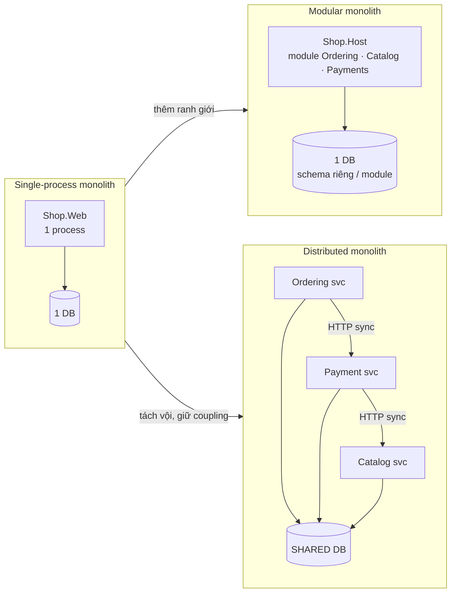
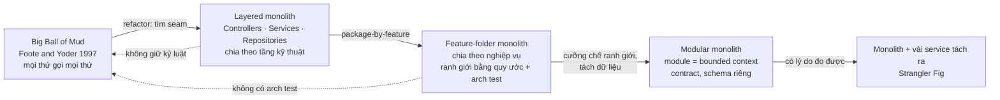
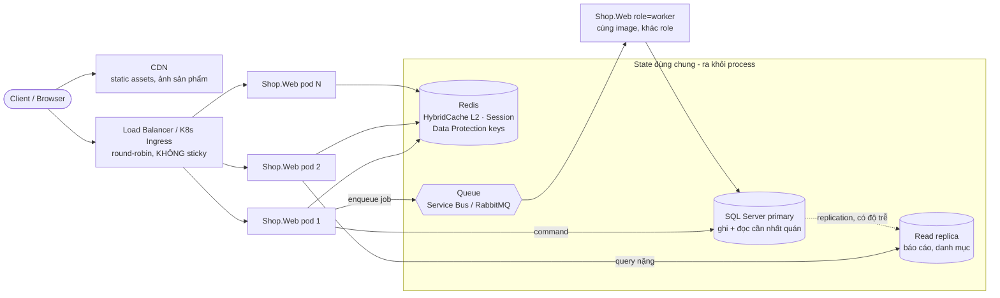
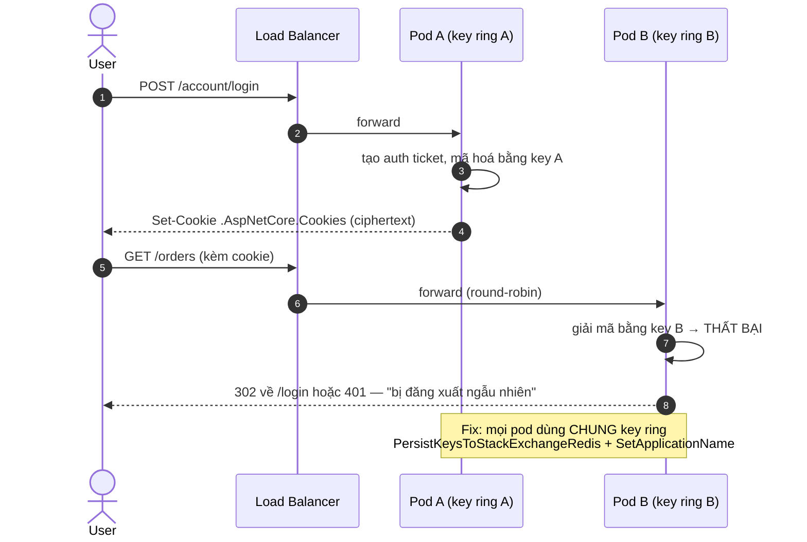
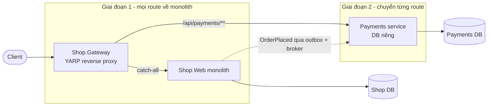

# Monolithic Architecture (Kiến trúc nguyên khối)

> [!summary] TL;DR
> - **Là gì:** toàn bộ chức năng được **build và deploy thành một đơn vị** (1 artifact, thường chạy 1 process, thường 1 database). "Monolith" nói về **đơn vị deploy**, không nói về chất lượng code bên trong.
> - **Monolith ≠ tệ.** Kẻ thù thật là **Big Ball of Mud** (không có ranh giới) và **Distributed Monolith** (N service nhưng phải deploy cùng nhau). Một monolith có cấu trúc tốt là lựa chọn mặc định hợp lý — *MonolithFirst* (Fowler).
> - **Scale được:** monolith stateless + load balancer + Redis (cache, Data Protection keys) + read replica + tách background work → chịu tải rất xa trước khi cần microservices.
> - **Gotcha .NET số 1:** chạy ≥ 2 instance mà không **chia sẻ Data Protection key ring** → cookie auth / antiforgery / TempData lỗi **ngẫu nhiên**.
> - **Rời monolith** chỉ khi có tín hiệu đo được (team giẫm chân, cần scale/deploy riêng một phần, compliance), và làm **dần dần**: Strangler Fig (YARP phía trước) + Branch by Abstraction (bên trong code).

---

## 1. Problem — Vấn đề cần giải quyết

### 1.1 Bối cảnh

Hệ thống **Ordering** khởi đầu: 4 dev, 1 repo, 1 ASP.NET Core app, 1 SQL Server. Sau 2 năm: 25 dev, 300 endpoint, Black Friday tải ×15, CI mất 40 phút, cứ mỗi lần release Payments thì Catalog cũng phải deploy lại. Câu hỏi thường gặp: *"Có phải do monolith không? Có nên chuyển microservices không?"* Note này trả lời: **monolith là gì thật sự, nó mạnh ở đâu, scale nó thế nào cho đúng, và khi nào/how để rời nó.**

> [!info] Định nghĩa dùng trong note này
> Sam Newman (*Monolith to Microservices*, 2019) xem monolith là **đơn vị deploy**: khi mọi chức năng **phải được deploy cùng nhau**, đó là monolith. Định nghĩa này quan trọng vì nó bao luôn cả trường hợp "nhiều service nhưng phải deploy lockstep".

### 1.2 Ba loại monolith (theo Sam Newman)

| Loại | Mô tả | Đánh giá |
| --- | --- | --- |
| **Single-process monolith** | Toàn bộ code chạy trong **một process**, deploy một lần. Dạng phổ biến nhất. Bên trong có thể là spaghetti hoặc rất gọn. | Mặc định hợp lý cho đa số hệ thống mới |
| **Modular monolith** | Biến thể của single-process: chia **module** độc lập theo nghiệp vụ, vẫn deploy chung. → chi tiết: [[Modular-Monolith]] | Newman đánh giá cao, nhiều tổ chức bỏ qua lựa chọn này |
| **Distributed monolith** | Nhiều service chạy trên mạng nhưng **phải deploy cùng nhau**, chung DB, gọi đồng bộ dày đặc. | "Tệ nhất của cả hai thế giới" — chịu chi phí hệ phân tán *và* coupling của monolith → mục "Anti-pattern: Distributed Monolith" trong [[Architecture-Styles-Comparison]] |

Newman còn nhắc **third-party black-box system** (ERP, CRM mua về — bạn không sửa được code) như một dạng "monolith" phải tích hợp quanh nó.



### 1.3 Pain points thật khi monolith lớn dần (và nguyên nhân gốc)

| Triệu chứng | Nguyên nhân gốc thường gặp | Có phải lỗi của "monolith"? |
| --- | --- | --- |
| Build + test + deploy mất 40+ phút | Test suite không phân tầng, build lại mọi thứ, migration chạy lúc startup | ⚠️ Một phần — giải được nhiều bằng CI tốt |
| Sửa Payments làm vỡ Catalog | **Coupling creep**: không có ranh giới, join chéo bảng, `public` khắp nơi | ❌ Do thiếu modularity, không do monolith |
| Phải scale **cả app** chỉ vì Catalog bị đọc nhiều | Đơn vị scale = đơn vị deploy | ✅ Đây là giới hạn cố hữu (nhưng thường **rẻ hơn** bạn nghĩ) |
| Một memory leak trong module báo cáo làm sập checkout | Chung process, chung heap, chung thread pool | ✅ Cố hữu — giảm bằng tách worker process |
| Một stack công nghệ duy nhất (.NET 10 cho mọi thứ) | Một runtime | ✅ Cố hữu — thường là **ưu điểm** cho team nhỏ |
| 5 team chờ nhau trên một release train, merge conflict | **Conway's Law**: tổ chức nhiều team, kiến trúc một khối | ✅ Đây là lý do mạnh nhất để tách |

### 1.4 Ý tưởng cốt lõi

1. **Giữ đơn vị deploy đơn giản**, đầu tư vào **cấu trúc bên trong** (layer → module) để tránh Big Ball of Mud.
2. **Scale ngang** bằng cách làm app **stateless**, đẩy state ra Redis/DB — không cần chia nhỏ để scale.
3. **Tách khi và chỉ khi** có tín hiệu đo được, theo lối **tiến hoá dần** (Strangler Fig), không "big bang rewrite".

---

## 2. Mental Model & Diagram

> [!info] Analogy — Nhà hàng một bếp
> - **Monolith** = một nhà hàng có **một bếp lớn**: đầu bếp đứng cạnh nhau, gọi nhau là nghe (in-process call), một sổ kho chung (1 DB, ACID). Đông khách → **mở thêm chi nhánh y hệt** (scale ngang) chứ không cần tách bếp.
> - **Big Ball of Mud** = bếp không phân khu: dao thớt dùng lẫn, ai cũng lấy đồ trong tủ của người khác.
> - **Modular monolith** = bếp phân khu (nướng, salad, bánh) có quầy giao nhận rõ ràng.
> - **Microservices** = mỗi món là một bếp riêng ở một toà nhà riêng, liên lạc bằng điện thoại — linh hoạt nhưng mỗi cuộc gọi có thể rớt.

### 2.1 Phổ cấu trúc bên trong: từ bùn đến module

Monolith **không** có nghĩa một cấu trúc. Cùng là "1 deployable", chất lượng bên trong trải dài một phổ:



- **Big Ball of Mud** (Brian Foote & Joseph Yoder, PLoP 1997): hệ thống có cấu trúc phát triển theo kiểu "chữa cháy", thông tin chia sẻ bừa bãi, kiến trúc ban đầu bị bào mòn. Bài báo lập luận rằng đây là kiến trúc **thực tế phổ biến nhất** — không vì ai chọn nó, mà vì áp lực thời gian + "piecemeal growth" không được dọn dẹp. Các pattern đi kèm đáng nhớ: *Throwaway Code*, *Piecemeal Growth*, *Keep It Working*, *Shearing Layers*, *Sweeping It Under the Rug*, *Reconstruction*.
- **Layered monolith**: dễ hiểu nhưng low cohesion theo feature (đổi "Payment" chạm 4 thư mục) → [[Architecture-Styles-Comparison#Layered (N-tier)]], [[Clean-Architecture-in-DotNet]].
- **Modular monolith**: đích đến nên nhắm cho monolith sống lâu → [[Modular-Monolith]].

### 2.2 Monolith được scale đúng cách — request flow



> [!important] Mấu chốt
> Mọi instance **giống hệt nhau** và **không giữ state riêng** (session, cache "nguồn chân lý", file upload, key mã hoá). Bất kỳ request nào cũng có thể rơi vào bất kỳ pod nào. Đó là điều kiện để "thêm pod = thêm capacity".

### 2.3 Gotcha Data Protection — vì sao lỗi xảy ra *ngẫu nhiên*



Theo tài liệu "Host ASP.NET Core in a web farm": mặc định key ring lưu **cục bộ** trên mỗi node → node này không giải mã được dữ liệu node kia mã hoá. Triệu chứng **gián đoạn**: mất đăng nhập, OAuth/OIDC báo *"Correlation failed"*, session/TempData mất dữ liệu, POST fail vì **antiforgery**. Trong container còn tệ hơn: key nằm trong filesystem của container → **mất khi pod restart**, mọi user bị đăng xuất sau mỗi lần deploy.

---

## 3. Implementation & Code

### 3.1 Một monolith .NET "khoẻ mạnh" — cấu trúc solution

Không cần 5 project/module như [[Modular-Monolith]]. Một monolith gọn vẫn có thể: **1 deployable**, chia **feature folder theo nghiệp vụ**, ranh giới canh bằng **architecture test**.

```text
Shop/
├── Directory.Build.props              # net10.0, Nullable, TreatWarningsAsErrors, analyzers
├── Dockerfile
├── src/
│   ├── Shop.Domain/                   # (tuỳ chọn) entity + value object thuần: Order, OrderItem, Money
│   └── Shop.Web/                      # ★ ĐƠN VỊ DEPLOY DUY NHẤT
│       ├── Program.cs                 # composition root, chọn role web/worker
│       ├── Features/                  # chia theo NGHIỆP VỤ, không theo tầng
│       │   ├── Ordering/
│       │   │   ├── PlaceOrder.cs      # endpoint + handler + validator cùng file/thư mục
│       │   │   ├── GetOrderById.cs
│       │   │   └── OrderingEndpoints.cs
│       │   ├── Catalog/
│       │   │   ├── GetProduct.cs      # HybridCache
│       │   │   └── UpdatePrice.cs     # invalidate cache theo tag
│       │   ├── Payments/
│       │   │   ├── IPaymentProcessor.cs        # seam cho Branch by Abstraction (mục 3.8)
│       │   │   └── InProcessPaymentProcessor.cs
│       │   └── Shipping/
│       ├── Infrastructure/
│       │   ├── Persistence/           # ShopDbContext (primary), ShopReadDbContext (replica)
│       │   ├── Caching/
│       │   └── Messaging/             # Outbox, queue publisher
│       └── BackgroundJobs/            # chỉ chạy khi Role = worker
└── tests/
    ├── Shop.Tests/                    # WebApplicationFactory + Testcontainers
    └── Shop.ArchitectureTests/        # NetArchTest: feature không gọi ruột feature khác
```

> [!tip] Tại sao feature folder thay vì Controllers/Services/Repositories?
> Khi một ngày phải tách **Payments** ra service, bạn muốn nó **nằm ở một chỗ** để "nhấc" ra. Package-by-layer rải Payments khắp 4 thư mục → seam vô hình. Xem [[Vertical-Slice-Architecture]], [[Coupling-and-Cohesion]].

### 3.2 `Program.cs` — monolith sẵn sàng scale ngang

```bash
dotnet add src/Shop.Web package Microsoft.EntityFrameworkCore.SqlServer
dotnet add src/Shop.Web package Microsoft.Extensions.Caching.StackExchangeRedis
dotnet add src/Shop.Web package Microsoft.Extensions.Caching.Hybrid
dotnet add src/Shop.Web package Microsoft.AspNetCore.DataProtection.StackExchangeRedis
dotnet add src/Shop.Web package Microsoft.Extensions.Diagnostics.HealthChecks.EntityFrameworkCore
```

```csharp
// src/Shop.Web/Program.cs
using Microsoft.AspNetCore.DataProtection;
using Microsoft.AspNetCore.Diagnostics.HealthChecks;
using Microsoft.EntityFrameworkCore;
using Shop.Web.BackgroundJobs;
using Shop.Web.Features.Catalog;
using Shop.Web.Features.Ordering;
using Shop.Web.Infrastructure.Persistence;
using StackExchange.Redis;

var builder = WebApplication.CreateBuilder(args);
var config = builder.Configuration;

// Cùng 1 image, 2 vai trò: "web" nhận HTTP, "worker" chạy job nền (mục 3.5)
var role = config["Shop:Role"] ?? "web";

// ── 1. Database: primary cho ghi, replica cho đọc nặng ─────────────────────────
builder.Services.AddDbContext<ShopDbContext>(o =>
    o.UseSqlServer(config.GetConnectionString("ShopPrimary"),
        sql => sql.EnableRetryOnFailure()));

builder.Services.AddDbContext<ShopReadDbContext>(o =>
    o.UseSqlServer(config.GetConnectionString("ShopReplica"))
     .UseQueryTrackingBehavior(QueryTrackingBehavior.NoTracking)); // chỉ đọc → tắt change tracking

// ── 2. Redis: một multiplexer dùng chung (thread-safe, nên là singleton) ──────
var redis = ConnectionMultiplexer.Connect(config.GetConnectionString("Redis")!);
builder.Services.AddSingleton<IConnectionMultiplexer>(redis);

// IDistributedCache → Redis. HybridCache tự dùng nó làm L2; Session cũng dùng nó.
builder.Services.AddStackExchangeRedisCache(o =>
{
    o.Configuration = config.GetConnectionString("Redis");
    o.InstanceName = "shop:";
});
builder.Services.AddHybridCache(o =>
{
    o.DefaultEntryOptions = new()
    {
        Expiration = TimeSpan.FromMinutes(10),          // L2 (Redis)
        LocalCacheExpiration = TimeSpan.FromSeconds(30) // L1 (RAM từng pod) — NGẮN, xem 3.4
    };
});

// ── 3. Data Protection: CHUNG key ring cho mọi pod (gotcha số 1) ───────────────
builder.Services.AddDataProtection()
    .SetApplicationName("shop-web")                               // phải giống nhau trên mọi instance/deploy
    .PersistKeysToStackExchangeRedis(redis, "shop:dataprotection-keys");
    // Production: thêm ProtectKeysWith*(...) để mã hoá key at-rest (Key Vault / certificate)

// ── 4. Health checks: liveness rẻ, readiness kiểm tra phụ thuộc ───────────────
builder.Services.AddHealthChecks()
    .AddDbContextCheck<ShopDbContext>(tags: ["ready"]);

// ── 5. Feature registrations ──────────────────────────────────────────────────
builder.Services.AddOrderingFeature();
builder.Services.AddCatalogFeature();
builder.Services.AddProblemDetails();

if (role == "worker")
    builder.Services.AddHostedService<OutboxPublisherJob>();   // KHÔNG chạy trên pod web

var app = builder.Build();

// Sau LB/Ingress: lấy đúng scheme + client IP từ X-Forwarded-* (cấu hình KnownProxies cho production,
// hoặc env ASPNETCORE_FORWARDEDHEADERS_ENABLED=true trong container)
app.UseForwardedHeaders();
app.UseExceptionHandler();

app.MapHealthChecks("/healthz/live", new HealthCheckOptions { Predicate = _ => false }).ShortCircuit();
app.MapHealthChecks("/healthz/ready", new HealthCheckOptions
{
    Predicate = check => check.Tags.Contains("ready")
}).ShortCircuit();

if (role == "web")
{
    app.MapOrderingEndpoints();
    app.MapCatalogEndpoints();
}

app.Run();

public partial class Program;   // cho WebApplicationFactory<Program>
```

> [!warning] Liveness KHÔNG nên kiểm tra database
> Nếu liveness gọi DB và DB chậm 30 giây, Kubernetes sẽ **restart toàn bộ pod** → thundering herd khi chúng khởi động lại, làm DB càng chết. Liveness = "process còn sống"; readiness = "sẵn sàng nhận traffic" (DB, cache warm-up). Đây đúng là mẫu `Predicate = _ => false` trong tài liệu Microsoft.

### 3.3 Read replica — tách DbContext, chặn ghi nhầm

EF Core **không** có sẵn cơ chế tự route đọc/ghi như Spring `AbstractRoutingDataSource`. Cách rõ ràng nhất: **hai DbContext type**, dùng chung model.

```csharp
// src/Shop.Web/Infrastructure/Persistence/ShopDbContext.cs
public class ShopDbContext : DbContext
{
    public ShopDbContext(DbContextOptions<ShopDbContext> options) : base(options) { }

    // protected ctor non-generic → cho phép lớp con truyền DbContextOptions<ShopReadDbContext>
    protected ShopDbContext(DbContextOptions options) : base(options) { }

    public DbSet<Order> Orders => Set<Order>();
    public DbSet<Product> Products => Set<Product>();
    public DbSet<OutboxMessage> OutboxMessages => Set<OutboxMessage>();   // dùng ở mục 3.5

    protected override void OnModelCreating(ModelBuilder modelBuilder)
        => modelBuilder.ApplyConfigurationsFromAssembly(typeof(ShopDbContext).Assembly);
}

// Replica: cùng model, nhưng cấm SaveChanges — lỗi lập trình bị phát hiện ngay, không âm thầm ghi vào replica
public sealed class ShopReadDbContext(DbContextOptions<ShopReadDbContext> options) : ShopDbContext(options)
{
    public override int SaveChanges(bool acceptAllChangesOnSuccess)
        => throw new InvalidOperationException("ShopReadDbContext là read-only (replica).");

    public override Task<int> SaveChangesAsync(bool acceptAllChangesOnSuccess, CancellationToken ct = default)
        => throw new InvalidOperationException("ShopReadDbContext là read-only (replica).");
}
```

> [!warning] Replication lag & "read-your-writes"
> Replica trễ vài ms đến vài giây. User vừa đặt hàng xong, trang "Đơn của tôi" đọc từ replica → **không thấy đơn**. Quy tắc: màn hình ngay sau thao tác ghi và mọi kiểm tra nghiệp vụ (tồn kho, số dư) đọc **primary**; replica cho báo cáo, danh mục, tìm kiếm. Đây chính là CQRS cấp 2 → [[CQRS-and-MediatR-Pattern]].

### 3.4 Caching với `HybridCache` — L1 trong pod, L2 Redis

```csharp
// src/Shop.Web/Features/Catalog/GetProduct.cs
using Microsoft.Extensions.Caching.Hybrid;

namespace Shop.Web.Features.Catalog;

public sealed record ProductDto(Guid Id, string Sku, string Name, decimal Price, string Currency);

internal static class GetProduct
{
    public static async Task<IResult> Handle(
        Guid id, HybridCache cache, ShopReadDbContext db, CancellationToken ct)
    {
        // GetOrCreateAsync: L1 (MemoryCache) → L2 (Redis) → factory (DB)
        // Stampede protection: 100 request cùng key trên CÙNG pod → chỉ 1 lần gọi DB
        var product = await cache.GetOrCreateAsync(
            $"catalog:product:{id}",
            async token => await db.Products
                .Where(p => p.Id == id)
                .Select(p => new ProductDto(p.Id, p.Sku, p.Name, p.Price.Amount, p.Price.Currency))
                .FirstOrDefaultAsync(token),
            tags: ["catalog", $"product:{id}"],
            cancellationToken: ct);

        return product is null ? TypedResults.NotFound() : TypedResults.Ok(product);
    }
}

// src/Shop.Web/Features/Catalog/UpdatePrice.cs — ghi primary rồi invalidate
internal static class UpdatePrice
{
    public sealed record Request(decimal Amount, string Currency);

    public static async Task<IResult> Handle(
        Guid id, Request req, ShopDbContext db, HybridCache cache, CancellationToken ct)
    {
        var product = await db.Products.FindAsync([id], ct);
        if (product is null) return TypedResults.NotFound();

        product.ChangePrice(new Money(req.Amount, req.Currency));   // invariant ở Domain
        await db.SaveChangesAsync(ct);

        await cache.RemoveByTagAsync($"product:{id}", ct);          // L2 + L1 của POD NÀY
        return TypedResults.NoContent();
    }
}
```

> [!important] Giới hạn cần nhớ của `HybridCache`
> - Theo docs: khi invalidate theo key/tag, entry bị vô hiệu ở **server hiện tại** và ở **L2**, nhưng **L1 của các server khác không bị ảnh hưởng** → pod khác có thể trả giá cũ tới hết `LocalCacheExpiration`. Vì vậy L1 nên **ngắn** (giây), hoặc dữ liệu nhạy cảm (giá khi checkout) đọc thẳng DB.
> - Stampede protection chỉ trong **một instance** — N pod vẫn có thể gọi DB N lần cho cùng key.
> - Nếu chỉ đăng ký `AddDistributedMemoryCache`, HybridCache **không** dùng nó làm L2 → không chia sẻ giữa pod. Phải là Redis/SQL Server/Postgres out-of-process.

### 3.5 Background work trong monolith nhiều instance

```csharp
// ❌ SAI: job định kỳ trong BackgroundService, chạy trên MỌI pod web
//    3 pod → email "đơn chưa thanh toán" gửi 3 lần; 3 pod cùng xử lý 1 outbox row
public sealed class UnpaidOrderReminderJob(IServiceScopeFactory scopes) : BackgroundService
{
    protected override async Task ExecuteAsync(CancellationToken stoppingToken)
    {
        using var timer = new PeriodicTimer(TimeSpan.FromMinutes(5));
        while (await timer.WaitForNextTickAsync(stoppingToken))
        {
            await using var scope = scopes.CreateAsyncScope();
            // ... gửi nhắc nhở cho mọi đơn chưa thanh toán → TRÙNG LẶP × số pod
        }
    }
}
```

```csharp
// ✅ ĐÚNG (một trong các cách): role "worker" chạy riêng 1 Deployment, replicas: 1
//    + xử lý outbox an toàn khi có nhiều worker nhờ khoá hàng (UPDLOCK, READPAST)
public sealed class OutboxPublisherJob(IServiceScopeFactory scopes, ILogger<OutboxPublisherJob> logger)
    : BackgroundService
{
    protected override async Task ExecuteAsync(CancellationToken stoppingToken)
    {
        using var timer = new PeriodicTimer(TimeSpan.FromSeconds(2));
        while (await timer.WaitForNextTickAsync(stoppingToken))
        {
            try
            {
                await using var scope = scopes.CreateAsyncScope();   // DbContext là Scoped
                var db = scope.ServiceProvider.GetRequiredService<ShopDbContext>();

                // SQL Server: READPAST bỏ qua hàng đang bị worker khác khoá → competing consumers an toàn
                var batch = await db.OutboxMessages
                    .FromSql($"SELECT TOP (50) * FROM OutboxMessages WITH (UPDLOCK, READPAST, ROWLOCK) WHERE ProcessedAt IS NULL ORDER BY OccurredAt")
                    .ToListAsync(stoppingToken);
                // ... publish lên broker, đánh dấu ProcessedAt, SaveChanges (trong transaction)
            }
            catch (Exception ex) when (ex is not OperationCanceledException)
            {
                logger.LogError(ex, "Outbox batch failed");   // nuốt lỗi để vòng lặp không chết
            }
        }
    }
}
```

| Cách | Khi nào | Ghi chú |
| --- | --- | --- |
| **Role worker** (cùng image, `Shop__Role=worker`) | Đa số trường hợp | Vẫn là monolith: 1 codebase, 1 artifact, 2 kiểu process |
| **Queue + competing consumers** | Job theo sự kiện (gửi mail, xuất hoá đơn) | Bền vững qua restart, retry; consumer phải **idempotent** |
| **Distributed lock** (Redis/SQL) | Job định kỳ "chỉ một lần trên cụm" | Thư viện cộng đồng như `DistributedLock`; Java: ShedLock |
| **Hangfire / Quartz.NET clustered** | Cần dashboard, cron, retry | Lưu job trong DB, tự điều phối giữa node; kiểm tra license (Hangfire Pro thương mại) |
| `Channel<T>` in-process | Fire-and-forget nhẹ, mất được | **Mất khi pod chết** — không dùng cho việc quan trọng |

→ Outbox chi tiết: [[Domain-Events-and-Outbox]].

### 3.6 Deployment — một Docker image, rolling update

```dockerfile
# Dockerfile — multi-stage cho ASP.NET Core (.NET 10)
FROM mcr.microsoft.com/dotnet/sdk:10.0 AS build
WORKDIR /src
# Copy csproj trước → layer restore được cache khi chỉ code thay đổi
COPY Directory.Build.props ./
COPY src/Shop.Domain/Shop.Domain.csproj src/Shop.Domain/
COPY src/Shop.Web/Shop.Web.csproj src/Shop.Web/
RUN dotnet restore src/Shop.Web/Shop.Web.csproj
COPY src/ src/
RUN dotnet publish src/Shop.Web/Shop.Web.csproj -c Release -o /app/publish --no-restore /p:UseAppHost=false

FROM mcr.microsoft.com/dotnet/aspnet:10.0 AS final
WORKDIR /app
COPY --from=build /app/publish .
# Từ .NET 8: image có user non-root "app" (UID qua $APP_UID) và mặc định lắng nghe cổng 8080
USER $APP_UID
EXPOSE 8080
ENTRYPOINT ["dotnet", "Shop.Web.dll"]
```

> [!tip] Không muốn viết Dockerfile?
> .NET SDK hỗ trợ build image trực tiếp: `dotnet publish src/Shop.Web -c Release -t:PublishContainer` (≈ Spring Boot `bootBuildImage` / Jib).

**Kubernetes — chỉ những điểm riêng cho .NET monolith:**

| Vấn đề | Cách làm |
| --- | --- |
| Probe | `livenessProbe: /healthz/live`, `readinessProbe: /healthz/ready`, `containerPort: 8080` (không phải 80 như image .NET ≤ 7) |
| Rolling update | `maxUnavailable: 0`, `maxSurge: 1` — pod mới phải **ready** trước khi pod cũ bị gỡ |
| Graceful shutdown | Host .NET xử lý SIGTERM, chờ request đang chạy; chỉnh `HostOptions.ShutdownTimeout` < `terminationGracePeriodSeconds` |
| **EF migrations** | ❌ `Database.Migrate()` lúc startup (N pod chạy migration đồng thời). ✅ chạy **một lần** trước deploy: K8s Job / bước CI với `dotnet ef migrations bundle` |
| Schema khi rolling | Bản cũ và bản mới **chạy song song** vài phút → migration phải **backward compatible** (expand → deploy → contract): thêm cột nullable trước, xoá cột cũ ở release sau |
| Blue-green | Hai Deployment + đổi Service selector; nhớ cả hai màu dùng **chung key ring + chung `SetApplicationName`**, nếu không chuyển màu = đăng xuất mọi người |
| Worker | Deployment thứ hai, cùng image, `env: Shop__Role=worker`, `replicas: 1` (hoặc nhiều nếu đã có competing consumers) |

### 3.7 Giữ monolith khoẻ — architecture test cho feature folder

```csharp
// tests/Shop.ArchitectureTests/FeatureBoundaryTests.cs
using NetArchTest.Rules;

namespace Shop.ArchitectureTests;

public sealed class FeatureBoundaryTests
{
    private static readonly System.Reflection.Assembly WebAssembly = typeof(Program).Assembly;

    [Theory]
    [InlineData("Catalog", "Ordering")]   // Catalog không được biết gì về Ordering
    [InlineData("Catalog", "Payments")]
    [InlineData("Shipping", "Payments")]
    public void Feature_should_not_depend_on_other_feature(string feature, string forbidden)
    {
        var result = Types.InAssembly(WebAssembly)
            .That().ResideInNamespace($"Shop.Web.Features.{feature}")
            .ShouldNot().HaveDependencyOn($"Shop.Web.Features.{forbidden}")
            .GetResult();

        Assert.True(result.IsSuccessful,
            $"{feature} → {forbidden}: {string.Join(", ", result.FailingTypeNames ?? [])}");
    }

    [Fact]
    public void Domain_should_not_depend_on_AspNetCore_or_EfCore()
    {
        var result = Types.InAssembly(typeof(Shop.Domain.Orders.Order).Assembly)
            .ShouldNot().HaveDependencyOnAny("Microsoft.AspNetCore", "Microsoft.EntityFrameworkCore")
            .GetResult();

        Assert.True(result.IsSuccessful);
    }
}
```

**Checklist "sức khoẻ" chạy trong CI:** architecture test · thời gian build/test theo dõi theo tuần (cảnh báo khi > 10–15 phút) · test chia tầng (unit nhanh chạy mỗi PR, integration Testcontainers song song) · đo coupling (số dependency chéo feature) · `TreatWarningsAsErrors`. Lưu ý trạng thái bảo trì của NetArchTest → xem cảnh báo trong [[Modular-Monolith#3.7 Cưỡng chế ranh giới — architecture tests]].

### 3.8 Rời monolith dần dần — Strangler Fig + Branch by Abstraction

**Strangler Fig** (Martin Fowler, bài gốc 2004 "Strangler Application", viết lại 2024 thành "Strangler Fig Application"): như cây sung bóp cổ mọc quanh cây chủ rồi thay thế nó — hệ thống mới mọc **bên cạnh** hệ thống cũ, **chuyển dần** từng phần chức năng, cần chấp nhận **transitional architecture** (code tạm để hai hệ thống cùng sống) và sẽ xoá sau.



```bash
dotnet new web -n Shop.Gateway
dotnet add Shop.Gateway package Yarp.ReverseProxy
```

```csharp
// Shop.Gateway/Program.cs — đúng mẫu "Get started with YARP"
var builder = WebApplication.CreateBuilder(args);
builder.Services.AddReverseProxy()
    .LoadFromConfig(builder.Configuration.GetSection("ReverseProxy"));

var app = builder.Build();
app.MapReverseProxy();
app.Run();
```

```json
// Shop.Gateway/appsettings.json — route cụ thể đi service mới, phần còn lại về monolith
{
  "ReverseProxy": {
    "Routes": {
      "payments": {
        "ClusterId": "payments-service",
        "Match": { "Path": "/api/payments/{**catch-all}" }
      },
      "legacy": {
        "ClusterId": "monolith",
        "Order": 1000,
        "Match": { "Path": "{**catch-all}" }
      }
    },
    "Clusters": {
      "payments-service": {
        "Destinations": { "d1": { "Address": "http://payments:8080/" } }
      },
      "monolith": {
        "Destinations": { "d1": { "Address": "http://shop-web:8080/" } }
      }
    }
  }
}
```

> [!info] Strangler Fig đã có sẵn "đường ray" trong hệ sinh thái .NET
> Microsoft dùng chính kỹ thuật này cho **incremental migration ASP.NET Framework → ASP.NET Core**: app Core mới đứng trước, route chưa chuyển được YARP forward về app Framework cũ. Tức là YARP-as-strangler là con đường Microsoft chính thức khuyến nghị, không phải mẹo tự chế.

**Branch by Abstraction** (Paul Hammant đặt tên, ghi nhận Stacy Curl; Fowler bliki 2014) — xử lý phần **bên trong** code, khi lời gọi không đi qua HTTP từ client mà là **in-process call** từ module khác (ví dụ Ordering gọi Payments):

1. Tạo abstraction bao quanh chức năng cũ → 2. chuyển mọi client sang gọi qua abstraction → 3. viết implementation mới (gọi service mới) → 4. bật dần (feature flag) → 5. xoá implementation cũ (và có thể cả abstraction). Mọi bước đều **merge vào main, releasable** — không có long-lived branch.

```csharp
// Bước 1: seam
public interface IPaymentProcessor
{
    Task<PaymentResult> AuthorizeAsync(Guid orderId, Money amount, CancellationToken ct);
}

public sealed record PaymentResult(bool Succeeded, string? TransactionId, string? Error);

// Implementation cũ — code đang chạy trong monolith
// (stub minh hoạ: khi viết thật phải dùng db/gateway, nếu không TreatWarningsAsErrors sẽ báo CS9113 "parameter is unread")
internal sealed class InProcessPaymentProcessor(ShopDbContext db, IPaymentGatewayClient gateway) : IPaymentProcessor
{
    public Task<PaymentResult> AuthorizeAsync(Guid orderId, Money amount, CancellationToken ct) => /* ... */
        throw new NotImplementedException();
}

// Bước 3: implementation mới — gọi Payments service qua HTTP
internal sealed class PaymentsServiceClient(HttpClient http) : IPaymentProcessor
{
    public async Task<PaymentResult> AuthorizeAsync(Guid orderId, Money amount, CancellationToken ct)
    {
        var response = await http.PostAsJsonAsync("/api/payments/authorize",
            new { orderId, amount = amount.Amount, currency = amount.Currency }, ct);
        response.EnsureSuccessStatusCode();   // 5xx/timeout đã được resilience handler retry trước đó
        return await response.Content.ReadFromJsonAsync<PaymentResult>(ct)
               ?? new PaymentResult(false, null, "Empty response");
    }
}

// Bước 4: router chọn implementation theo feature flag — client (Ordering) không hề biết
internal sealed class PaymentProcessorRouter(
    [FromKeyedServices("legacy")] IPaymentProcessor legacy,
    [FromKeyedServices("service")] IPaymentProcessor service,
    IFeatureManager features) : IPaymentProcessor
{
    public async Task<PaymentResult> AuthorizeAsync(Guid orderId, Money amount, CancellationToken ct)
        => await features.IsEnabledAsync("UsePaymentsService")
            ? await service.AuthorizeAsync(orderId, amount, ct)
            : await legacy.AuthorizeAsync(orderId, amount, ct);
}

// Đăng ký (.NET 8+ keyed services + package Microsoft.FeatureManagement.AspNetCore, using Microsoft.FeatureManagement):
// services.AddFeatureManagement();
// services.AddKeyedScoped<IPaymentProcessor, InProcessPaymentProcessor>("legacy");
// services.AddHttpClient<PaymentsServiceClient>(c => c.BaseAddress = new("http://payments:8080"))
//         .AddStandardResilienceHandler();
// services.AddKeyedScoped<IPaymentProcessor>("service", (sp, _) => sp.GetRequiredService<PaymentsServiceClient>());
// services.AddScoped<IPaymentProcessor, PaymentProcessorRouter>();
```

**Tách service đầu tiên — chọn cái gì?**

| Tiêu chí | Ứng viên tốt | Ứng viên tệ |
| --- | --- | --- |
| Coupling với phần còn lại | Ít phụ thuộc vào, ít bị phụ thuộc (Notifications, Catalog search) | Ordering core — mọi thứ gọi vào |
| Dữ liệu | Bảng riêng, ít join | Bảng `Orders` bị 12 chỗ join |
| Lý do tách | Có tín hiệu thật: scale riêng, team riêng, PCI scope (Payments) | "Cho hiện đại" |
| Rủi ro | Lỗi không làm mất tiền/đơn hàng | Luồng checkout ngày đầu |

Fowler (*MonolithFirst*) gợi ý **bóc từ rìa** (peel off at the edges); lõi có thể vẫn là monolith rất lâu — và điều đó bình thường.

> [!warning] Anti-pattern khi tách
> - **Tách theo tầng kỹ thuật** (`DataService`, `ValidationService`, `NotificationService` dùng chung cho mọi thứ) → mọi feature chạm mọi service.
> - **Service mới đọc/ghi thẳng DB của monolith** → distributed monolith ngay lập tức. Dữ liệu phải **chuyển chủ sở hữu**: service mới là nơi duy nhất ghi bảng đó; monolith lấy qua API/event.
> - **Big-bang rewrite** ("dừng feature 12 tháng để viết lại") — Strangler Fig tồn tại chính là để tránh việc này.
> - **Tách khi monolith còn là Big Ball of Mud** → modular hoá **trong** monolith trước ([[Modular-Monolith]]).

---

## 4. Comparison — Đối chiếu Java / Spring Boot

| Khía cạnh | ☕ Java / Spring Boot | 🟣 C# / ASP.NET Core | Ghi chú |
| --- | --- | --- | --- |
| Artifact deploy | **Fat/executable JAR** (`spring-boot-maven-plugin` repackage, nested jars), chạy `java -jar` | Thư mục `dotnet publish` (dll + deps, framework-dependent) hoặc `PublishSingleFile`/Native AOT | Cả hai: 1 deployable. .NET không có khái niệm "fat jar" nhưng image container là đơn vị thực tế |
| Build image | Buildpacks `bootBuildImage`, Jib, layered jar | Dockerfile multi-stage hoặc `dotnet publish -t:PublishContainer` | |
| Embedded server | Tomcat/Jetty/Undertow nhúng | Kestrel nhúng | |
| Session phân tán | **Spring Session** + `spring-session-data-redis` (`@EnableRedisHttpSession`) | `AddSession()` + `AddStackExchangeRedisCache` (`IDistributedCache`) | |
| Cookie đăng nhập | Thường chỉ là **session id** (`JSESSIONID`/`SESSION`), state nằm server-side | Cookie auth chứa **auth ticket đã mã hoá** bằng Data Protection | ⚠️ Gốc rễ của gotcha key ring |
| Khoá mã hoá dùng chung | Tự cấu hình (JWT secret, remember-me key) | **Data Protection key ring**: `PersistKeysTo*` + `SetApplicationName` | |
| Cache | `@Cacheable` + `RedisCacheManager`, Caffeine L1 | `HybridCache` (L1 + L2, stampede protection), `IDistributedCache` | .NET: gọi tường minh, không annotation/proxy |
| Job định kỳ trên cụm | `@Scheduled` chạy **mọi instance** → **ShedLock** / Quartz clustered | `BackgroundService` chạy **mọi instance** → role worker / distributed lock / Hangfire / Quartz.NET | Cùng một cái bẫy |
| Health | Actuator `/actuator/health/liveness`, `/readiness` (health groups) | `MapHealthChecks` + tag/`Predicate` | |
| Sau load balancer | `server.forward-headers-strategy=framework` | `UseForwardedHeaders` / `ASPNETCORE_FORWARDEDHEADERS_ENABLED` | |
| Read replica | `AbstractRoutingDataSource` + `@Transactional(readOnly = true)` | Hai `DbContext` (primary / replica) | .NET không route ngầm theo transaction |
| Migration | Flyway / Liquibase (thường chạy lúc startup) | EF migrations bundle chạy như Job | Cả hai: cẩn thận nhiều instance |
| Strangler gateway | **Spring Cloud Gateway**; Netflix **Zuul 1** đã bị gỡ khỏi Spring Cloud (từ train 2020.0) | **YARP** (`Yarp.ReverseProxy`) | YARP là thư viện — gateway là một ASP.NET Core app bạn tự code tiếp |
| Feature flag | Unleash, FF4J, Togglz | `Microsoft.FeatureManagement` | Cho Branch by Abstraction |
| Architecture test | ArchUnit | NetArchTest / ArchUnitNET | |

```java
// ☕ Spring Session: chỉ một annotation, cookie chỉ mang session id
@Configuration
@EnableRedisHttpSession
class SessionConfig { }

// ☕ Job định kỳ chỉ chạy 1 instance nhờ ShedLock
@Scheduled(cron = "0 */5 * * * *")
@SchedulerLock(name = "unpaidOrderReminder", lockAtMostFor = "4m")
public void remindUnpaidOrders() { /* ... */ }
```

> [!warning] Bẫy khi chuyển từ Java sang .NET
> - **Cookie ≠ session id**: dân Spring quen "scale ngang thì gắn Spring Session + Redis là xong". Trong ASP.NET Core, **cookie authentication, antiforgery, TempData** đều dựa vào **Data Protection**, độc lập với session. Gắn Redis cho session **không** giải quyết; phải `PersistKeysToStackExchangeRedis` (hoặc Blob/DbContext) + `SetApplicationName`.
> - **Redis không bền mặc định**: docs cảnh báo Redis mất dữ liệu khi restart nếu không bật persistence → Data Protection sinh key mới → cookie cũ vô hiệu. Dùng Redis có persistence, hoặc lưu key trong DB/Blob.
> - **Đặt `PersistKeysTo*` tường minh thì key không còn được mã hoá at-rest mặc định** → thêm `ProtectKeysWith*`.
> - **Không có `@Transactional(readOnly = true)` để route sang replica** — chọn DbContext tường minh.
> - **Cổng 8080 & non-root**: image .NET 8+ lắng nghe 8080 (trước là 80) và có user `app`; manifest K8s/compose copy từ hồi .NET 6 sẽ map sai cổng.
> - **YARP không phải Spring Cloud Gateway "đóng hộp"**: không có sẵn service discovery Eureka hay filter DSL phong phú; bạn cấu hình route/cluster/transform và viết middleware ASP.NET Core như bình thường.

---

## 5. Trade-offs & Best Practices

### ✅ Ưu điểm (thật, không phải "chỉ cho dự án nhỏ")
- **Deploy & debug đơn giản**: 1 pipeline, 1 artifact, F5 là chạy cả hệ thống; stack trace xuyên suốt, không cần distributed tracing để biết lỗi ở đâu.
- **In-process call**: nanosecond thay vì millisecond, không timeout/retry/circuit breaker, không versioning API nội bộ.
- **ACID transaction** trên toàn bộ dữ liệu: "trừ tồn kho + tạo đơn" trong một `SaveChanges` — không saga, không eventual consistency.
- **Refactor xuyên codebase rẻ**: IDE rename, compiler bắt lỗi; dời ranh giới module trong một PR.
- **Chi phí vận hành thấp**: ít hạ tầng, ít người on-call, observability đơn giản.
- **Nhanh cho team nhỏ**: tối ưu time-to-market khi domain còn đang được khám phá — đúng tinh thần [[Core-Design-Principles#YAGNI]].

### ❌ Nhược điểm / Chi phí (khi lớn)
- **Đơn vị scale = đơn vị deploy**: Catalog nóng thì phải nhân bản cả Payments, báo cáo… (thường vẫn chấp nhận được về chi phí).
- **Blast radius**: memory leak, thread-pool starvation, `async void` crash ở một feature làm sập tất cả.
- **Build/test/deploy chậm dần** nếu không đầu tư CI.
- **Coupling creep**: không có rào cản vật lý → ranh giới chỉ còn là kỷ luật.
- **Một runtime, một phiên bản framework**: nâng .NET 10 → 12 là một dự án cho toàn hệ thống.
- **Team contention**: nhiều team → release train chung, merge conflict, ownership mờ (Conway's Law).

### 🎯 Khi nào dùng — khi nào KHÔNG dùng

| Nên dùng khi | Không nên dùng khi |
| --- | --- |
| Sản phẩm mới, domain chưa rõ, cần feedback nhanh | Nhiều team (thường > 3–4 team) cần release độc lập và đã chạm trần phối hợp |
| Team 1–20 dev, ít platform/DevOps capacity | Một phần hệ thống có yêu cầu scale khác **hàng bậc** (×100) và chi phí nhân bản cả app là đáng kể |
| Cần nhất quán mạnh (ACID) giữa nhiều khái niệm | Yêu cầu cô lập cứng (PCI scope, multi-tenant isolation, sandbox code bên thứ ba) |
| Tải có thể đáp ứng bằng scale ngang + cache + replica | Cần runtime khác cho một phần (ML Python, stream xử lý realtime) |
| Đang có Big Ball of Mud → modular hoá tại chỗ | — |

### Decision table — giữ monolith hay tách?

| Tín hiệu quan sát được | Giữ monolith, sửa tại chỗ | Cân nhắc tách (Strangler) |
| --- | --- | --- |
| CI 40 phút | ✅ Tối ưu test, build incremental, song song hoá | Chỉ khi đã tối ưu mà vẫn chặn nhiều team |
| Hay vỡ chéo giữa feature | ✅ Modular hoá + architecture test | ❌ Tách lúc này = distributed monolith |
| CPU cao giờ cao điểm | ✅ HPA thêm pod, cache, replica, profiling | Khi một phần cần scale khác hẳn và đo được chi phí lãng phí |
| Job nền làm chậm API | ✅ Tách **process** worker (cùng codebase) | Hiếm khi cần service riêng |
| 5 team, 1 release train, chờ nhau | ⚠️ Modular monolith + ownership trước | ✅ Tín hiệu mạnh — tách theo ranh giới team/bounded context |
| Payments phải vào PCI scope riêng | — | ✅ Lý do compliance rõ ràng |
| "Microservices mới hiện đại" | ✅ Giữ | ❌ Không phải lý do |

### 📋 Best practices
- [ ] App **stateless**: không lưu session/file/cache-nguồn-chân-lý trong RAM/disk của pod.
- [ ] Data Protection: **chung key ring** (`PersistKeysTo*`) + **`SetApplicationName`** cố định + `ProtectKeysWith*`.
- [ ] Không bật sticky session để "chữa cháy"; nếu dùng SignalR scale-out thì xử lý theo hướng dẫn riêng (backplane / Azure SignalR).
- [ ] `HybridCache` với L1 ngắn; dữ liệu cần chính xác (giá lúc checkout, tồn kho) đọc primary.
- [ ] Replica chỉ cho đọc chấp nhận trễ; `ShopReadDbContext` chặn `SaveChanges`.
- [ ] Job định kỳ không chạy trên mọi pod web — role worker / lock / scheduler clustered.
- [ ] Liveness không gọi DB; readiness gọi DB/Redis; `ShortCircuit()` cho endpoint health.
- [ ] Migration chạy **một lần** trước deploy, theo kiểu expand/contract.
- [ ] Feature folder theo nghiệp vụ + architecture test trong CI; theo dõi thời gian CI như một metric.
- [ ] Ghi ADR khi quyết định giữ/tách — kèm tín hiệu đo được.

### 🐞 Lỗi thường gặp

| Lỗi | Hậu quả | Cách sửa |
| --- | --- | --- |
| Scale lên 3 pod, giữ Data Protection mặc định | User bị đăng xuất ngẫu nhiên, "Correlation failed", antiforgery fail | `PersistKeysToStackExchangeRedis` + `SetApplicationName` |
| Key ring trong filesystem container | Mỗi lần deploy/restart mọi cookie vô hiệu | Lưu key ngoài container (Redis bền / Blob / DB) |
| Bật sticky session thay vì sửa state | Phân tải lệch, pod chết = mất session, che giấu bug | Stateless + distributed cache/session |
| `IMemoryCache` làm cache chính khi nhiều pod | Mỗi pod một phiên bản dữ liệu, invalidate không lan | `HybridCache` + Redis L2, L1 ngắn |
| `Database.Migrate()` trong `Program.cs` | N pod migrate đồng thời, lock, deploy treo | Migration bundle / K8s Job trước rollout |
| Xoá/đổi tên cột cùng release | Pod bản cũ đang chạy lỗi SQL giữa rolling update | Expand → deploy → contract qua 2 release |
| `BackgroundService` cron trên mọi pod | Gửi email trùng, xử lý trùng | Role worker, distributed lock, queue |
| Liveness probe kiểm tra DB | DB chậm → K8s restart hàng loạt | Liveness không có check phụ thuộc |
| Tách service theo tầng kỹ thuật / dùng chung DB | Distributed monolith | Tách theo bounded context, service sở hữu dữ liệu |
| Big-bang rewrite | Hai hệ thống song song nhiều năm, feature đóng băng | Strangler Fig + Branch by Abstraction |

---

## 6. Self-check — Câu hỏi tự kiểm tra

> [!question]- "Monolith" được định nghĩa theo tiêu chí gì? Vì sao một hệ 10 service vẫn có thể là monolith?
> Theo đơn vị deploy: nếu mọi chức năng phải được deploy cùng nhau thì đó là monolith (Sam Newman). 10 service chung database, gọi đồng bộ dày đặc và phải release lockstep là **distributed monolith** — chịu chi phí mạng/vận hành của hệ phân tán mà vẫn coupling như monolith.

> [!question]- Phân biệt Big Ball of Mud, layered monolith và modular monolith.
> Cả ba đều có thể là 1 deployable. Big Ball of Mud (Foote & Yoder 1997): không có cấu trúc chủ đích, mọi thứ phụ thuộc mọi thứ. Layered: chia theo tầng kỹ thuật — có cấu trúc nhưng low cohesion theo feature. Modular: chia theo nghiệp vụ/bounded context với public contract, dữ liệu riêng, ranh giới được cưỡng chế bằng compiler + architecture test.

> [!question]- Scale ngang ASP.NET Core monolith lên 4 pod, cần kiểm tra những gì?
> (1) Data Protection key ring dùng chung + `SetApplicationName` (cookie auth, antiforgery, TempData). (2) Session/cache ra Redis (`IDistributedCache`, `HybridCache` L2) — không dựa sticky session. (3) Không lưu file upload trên disk pod. (4) Job định kỳ không chạy ×4. (5) Migration chạy một lần, schema tương thích ngược khi rolling. (6) Forwarded headers sau LB. (7) Health live/ready tách biệt. (8) Connection pool DB: 4 pod × pool size không vượt giới hạn DB.

> [!question]- Vì sao `HybridCache.RemoveByTagAsync` không đủ để đảm bảo mọi pod thấy giá mới ngay?
> Vì invalidate chỉ áp dụng cho L1 của **pod hiện tại** và L2 (Redis); L1 trong RAM của pod khác vẫn giữ bản cũ tới khi `LocalCacheExpiration` hết hạn. Giải pháp: L1 ngắn, dữ liệu nhạy cảm đọc DB, hoặc thêm cơ chế phát thông báo invalidate (pub/sub) / dùng thư viện có backplane.

> [!question]- (Phỏng vấn) Strangler Fig và Branch by Abstraction khác nhau thế nào? Khi nào dùng cái nào?
> Strangler Fig làm việc ở **biên ngoài**: chặn request (gateway như YARP) và chuyển dần route sang hệ thống mới. Branch by Abstraction làm việc **bên trong codebase**: tạo abstraction quanh một thành phần, cho hai implementation cùng tồn tại, chuyển dần (thường qua feature flag) rồi xoá cái cũ — giữ trunk luôn releasable. Thực tế dùng **cả hai**: route HTTP từ client đi qua strangler; lời gọi in-process từ Ordering sang Payments đi qua branch by abstraction.

> [!question]- (Phỏng vấn) CTO nói: "Monolith của ta chậm, chuyển microservices đi." Bạn hỏi lại gì và đề xuất gì?
> Hỏi: "chậm" là gì — latency, throughput, hay tốc độ release? Đo ở đâu? Nếu là latency/throughput: profiling, cache, replica, scale ngang, tách worker — rẻ hơn nhiều. Nếu là tốc độ release do nhiều team: modular hoá trong monolith, ownership, CI nhanh, rồi mới tách các phần có lý do (scale khác biệt, compliance, team) bằng Strangler Fig từ rìa. Nhắc *MonolithFirst* và chi phí "microservice premium"; tránh tách theo tầng và chung DB.

---

## 7. Liên kết & Tham khảo
- **Bản đồ:** [[Architecture-Design-MOC]]
- **So sánh & cùng nhóm:** [[Architecture-Styles-Comparison]] (bảng so sánh tổng hợp, [[Architecture-Styles-Comparison#Modular Monolith]], [[Architecture-Styles-Comparison#Microservices]]) · [[Modular-Monolith]] · [[Microservices-Architecture]] · [[Vertical-Slice-Architecture]] · [[Clean-Architecture-in-DotNet]]
- **Nguyên lý nền:** [[Coupling-and-Cohesion]] · [[Core-Design-Principles]] · [[SOLID-Principles]] · [[Design-Thinking-Process]] · [[Code-Smells-and-Refactoring]]
- **Pattern dùng trong note:** [[Domain-Events-and-Outbox]] · [[CQRS-and-MediatR-Pattern]] (read replica = CQRS cấp 2) · [[Structural-Patterns]] (Facade/Adapter cho seam) · [[DDD-Tactical-Patterns]]
- **Thực hành:** [[POC-01-Ordering-Clean-Architecture]] · [[Java-to-DotNet-Mental-Map]]
- **Đọc tiếp (planned):** [[Event-Driven-Architecture]] · [[Dependency-Injection-DotNet-vs-Spring]] · [[Testing-in-DotNet]]
- **Nguồn:**
  - Martin Fowler — *MonolithFirst* (06/2015), *Strangler Fig Application* (bản viết lại 08/2024), *Branch By Abstraction* (01/2014)
  - Brian Foote & Joseph Yoder — *Big Ball of Mud* (PLoP 1997; *Pattern Languages of Program Design 4*, 2000)
  - Sam Newman — *Monolith to Microservices* (O'Reilly, 2019) — tham khảo qua ghi chú tóm tắt sách và các talk GOTO/QCon
  - Microsoft — *.NET Microservices: Architecture for Containerized .NET Applications*, chương "Containerizing monolithic applications"
  - Microsoft Learn — *Host ASP.NET Core in a web farm*, *Configure ASP.NET Core Data Protection*, *Key storage providers*, *HybridCache library*, *Health checks*, *Get started with YARP*, *Default ASP.NET Core port changed from 80 to 8080*
