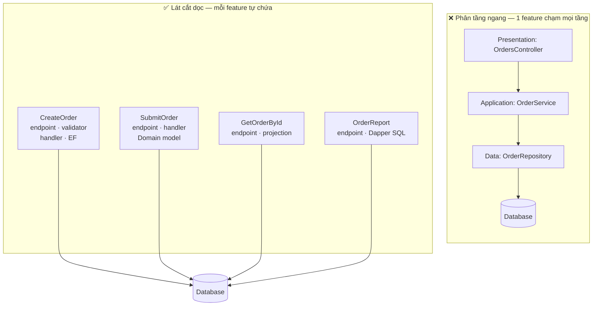
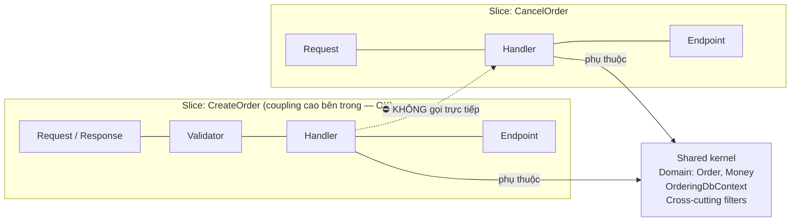
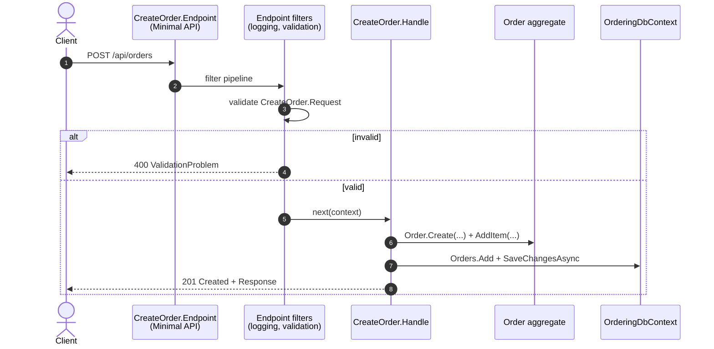
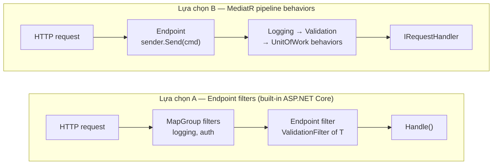
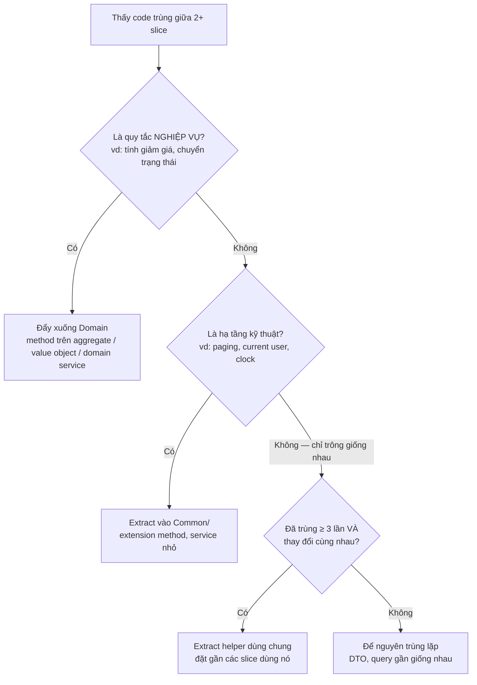
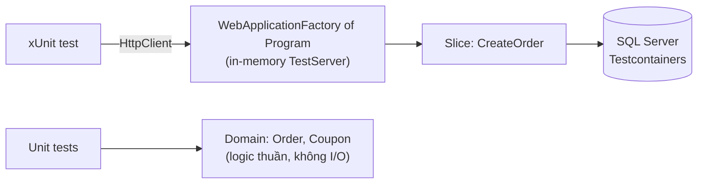
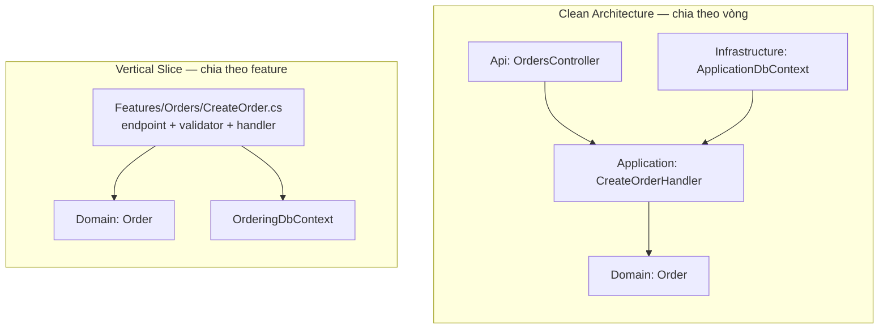
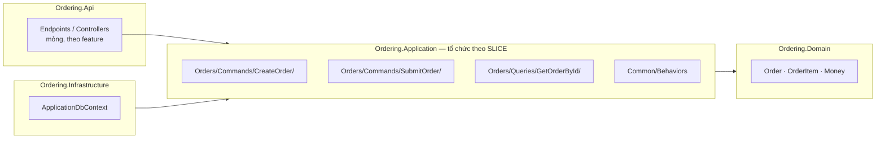

# Vertical Slice Architecture (VSA)

> [!summary] TL;DR
> - **Là gì:** tổ chức code theo **use case / feature** ("lát cắt dọc" xuyên từ HTTP xuống DB) thay vì theo **tầng kỹ thuật** (Controllers/, Services/, Repositories/). Ý tưởng được **Jimmy Bogard** (tác giả MediatR, AutoMapper) phổ biến qua bài *Vertical Slice Architecture* (19/04/2018).
> - **Câu thần chú:** *"Minimize coupling between slices, and maximize coupling in a slice"* — giảm phụ thuộc **giữa** các slice, chấp nhận (thậm chí khuyến khích) gắn chặt **bên trong** một slice.
> - **1 slice = Request + Validator + Handler + Endpoint + data access** đặt cạnh nhau (thường 1 file). Handler được phép dùng thẳng `DbContext` — không bắt buộc Repository/Service dùng chung.
> - ⚠️ VSA **không** có nghĩa là "không có domain model". Logic phức tạp vẫn được **đẩy xuống Domain** khi xuất hiện code smell — VSA đòi hỏi team **giỏi refactor**.

> [!example] Domain xuyên suốt
> Dùng lại domain **Ordering** (`Order`, `OrderItem`, `Money`, `OrderStatus`, `Entity` với `DomainEvents`) từ [[Clean-Architecture-in-DotNet]]. So sánh trực tiếp với cách tổ chức trong [[CQRS-and-MediatR-Pattern]].

---

## 1. Problem — Vấn đề cần giải quyết

### 1.1 Bối cảnh: một feature "rải" qua 5 thư mục

Bạn được giao: *"Thêm API áp mã giảm giá (coupon) cho đơn hàng"*. Trong kiến trúc phân tầng (N-layer hoặc Clean Architecture thuần), bạn phải chạm vào:

```text
Controllers/OrdersController.cs            ← thêm action ApplyCoupon
Services/IOrderService.cs                  ← thêm method vào interface
Services/OrderService.cs                   ← implement (class đã 1.500 dòng)
Repositories/IOrderRepository.cs          ← thêm GetWithItemsAndCouponAsync
Repositories/OrderRepository.cs           ← implement
Dtos/ApplyCouponRequest.cs, OrderDto.cs    ← thêm field
Validators/ApplyCouponRequestValidator.cs
Mappings/OrderProfile.cs                   ← AutoMapper
```

→ **8 file, 6 thư mục** cho **1** thay đổi nghiệp vụ. Pull request chạm vào các file "dùng chung" mà 20 use case khác cũng phụ thuộc.

### 1.2 Pain points

| Vấn đề | Giải thích |
| --- | --- |
| **Low cohesion theo feature** | Code thay đổi *cùng nhau* (vì cùng một yêu cầu nghiệp vụ) lại nằm *xa nhau* → vi phạm tinh thần "thứ cùng thay đổi thì để cùng chỗ" (Common Closure). Xem [[Coupling-and-Cohesion]]. |
| **Abstraction dùng chung bị phình** | `IOrderRepository` có 25 method, mỗi method chỉ 1 use case dùng → interface là "túi đựng đồ" chứ không phải abstraction. |
| **Sửa một chỗ, vỡ chỗ khác** | Thêm `Include(o => o.Coupon)` vào `GetByIdAsync` dùng chung → 15 màn hình khác bỗng load thêm dữ liệu. |
| **Mock-heavy tests** | Test `OrderService` phải mock repository, mapper, clock, email… — test kiểm tra *cách gọi* thay vì *hành vi*. |
| **Một kiểu cho tất cả** | Use case đọc đơn giản cũng phải đi qua Service → Repository → Mapper như use case ghi phức tạp. |
| **Merge conflict** | 3 dev làm 3 feature khác nhau cùng sửa `OrderService.cs`. |

### 1.3 Ý tưởng cốt lõi

1. **Đơn vị tổ chức code là request (use case)**, không phải tầng kỹ thuật. Mỗi request là một "lát cắt" độc lập.
2. **Mỗi slice tự quyết cách cài đặt**: slice đơn giản dùng Transaction Script + `DbContext`; slice phức tạp gọi domain model giàu nghiệp vụ; slice báo cáo dùng Dapper/SQL thô. Không ép "một kiểu cho tất cả".
3. **Thêm feature = thêm code mới**, ít khi sửa code dùng chung (gần với Open/Closed ở mức kiến trúc — xem [[SOLID-Principles]]).
4. **CQRS là mặc định tự nhiên**: mỗi slice đã là một command hoặc một query riêng.
5. **Chia sẻ code là quyết định có chủ đích** (sau khi thấy trùng lặp thật), không phải mặc định ban đầu.

---

## 2. Mental Model & Diagram

### 2.1 Horizontal layers vs Vertical slices



> [!info] Analogy — Bếp nhà hàng
> **Phân tầng** giống bếp chia theo *công đoạn*: một tổ chỉ thái, một tổ chỉ chiên, một tổ chỉ bày đĩa — món nào cũng phải đi qua cả 3 tổ, đổi công thức 1 món phải họp cả 3 tổ.
> **Vertical slice** giống bếp chia theo *món*: mỗi đầu bếp lo trọn một món từ sơ chế đến bày đĩa. Dao, thớt, tủ lạnh (DbContext, Domain, logging) vẫn **dùng chung** — nhưng công thức thì không.

### 2.2 Coupling: giữa các slice vs trong một slice



- **Trong slice**: request, validator, handler biết nhau rõ ràng, thay đổi cùng nhau — gom lại là đúng.
- **Giữa các slice**: không gọi handler của nhau, không dùng chung DTO. Chỉ phụ thuộc vào **shared kernel ổn định** (domain, DbContext, hạ tầng cross-cutting).

### 2.3 Vòng đời một request trong một slice



---

## 3. Implementation & Code

### 3.1 Cấu trúc thư mục — "pure VSA" trong 1 project

```text
Ordering.Api/
├── Program.cs
├── Common/                              # shared kernel — chỉ thứ thật sự dùng chung
│   ├── Endpoints/IEndpoint.cs           # contract + auto-discovery
│   ├── Filters/ValidationFilter.cs      # cross-cutting (IEndpointFilter)
│   └── Errors/GlobalExceptionHandler.cs
├── Domain/                              # rich domain model, KHÔNG phụ thuộc web/EF
│   ├── Common/Entity.cs
│   └── Orders/Order.cs, OrderItem.cs, Money.cs, OrderStatus.cs
├── Infrastructure/
│   └── Persistence/
│       ├── OrderingDbContext.cs
│       └── Configurations/OrderConfiguration.cs
└── Features/                            # ⭐ mỗi file (hoặc thư mục) = 1 slice
    ├── Orders/
    │   ├── CreateOrder.cs
    │   ├── SubmitOrder.cs
    │   ├── ApplyCoupon.cs
    │   ├── CancelOrder.cs
    │   ├── GetOrderById.cs
    │   └── SearchOrders.cs
    ├── Payments/
    │   └── CapturePayment.cs
    └── Reports/
        └── DailySales/                  # slice lớn → tách thành thư mục
            ├── DailySales.cs
            └── DailySalesSql.cs         # Dapper + SQL viết tay
```

> [!tip] File hay thư mục?
> Bắt đầu với **1 file / slice** (dễ đọc từ trên xuống). Khi file > ~200–300 dòng hoặc có nhiều type phụ, tách thành **thư mục / slice**. Quy ước quan trọng hơn hình thức: *mở 1 chỗ là thấy toàn bộ use case*.

### 3.2 Packages

```bash
dotnet add package Microsoft.EntityFrameworkCore.SqlServer
dotnet add package FluentValidation.DependencyInjectionExtensions
# Tuỳ chọn: MediatR (13+ cần license key — kiểm tra điều khoản hiện hành), Carter, FastEndpoints
```

### 3.3 Contract `IEndpoint` + auto-discovery

```csharp
// Common/Endpoints/IEndpoint.cs
using System.Reflection;
using Microsoft.Extensions.DependencyInjection.Extensions;

namespace Ordering.Api.Common.Endpoints;

// Mỗi slice tự khai báo route của mình → Program.cs không phải sửa khi thêm feature
public interface IEndpoint
{
    void MapEndpoint(IEndpointRouteBuilder app);
}

public static class EndpointExtensions
{
    public static IServiceCollection AddEndpoints(this IServiceCollection services, Assembly assembly)
    {
        // DefinedTypes bao gồm cả nested type (CreateOrder.Endpoint) và type internal
        var descriptors = assembly.DefinedTypes
            .Where(t => t is { IsAbstract: false, IsInterface: false } && t.IsAssignableTo(typeof(IEndpoint)))
            .Select(t => ServiceDescriptor.Transient(typeof(IEndpoint), t));

        services.TryAddEnumerable(descriptors);
        return services;
    }

    public static WebApplication MapEndpoints(this WebApplication app)
    {
        // RouteGroupBuilder cũng là IEndpointRouteBuilder → gắn prefix/filter chung cho mọi slice
        var api = app.MapGroup("/api");

        foreach (var endpoint in app.Services.GetRequiredService<IEnumerable<IEndpoint>>())
            endpoint.MapEndpoint(api);

        return app;
    }
}
```

### 3.4 ⭐ Một slice hoàn chỉnh — `Features/Orders/CreateOrder.cs`

```csharp
// Features/Orders/CreateOrder.cs
using FluentValidation;
using Microsoft.AspNetCore.Http.HttpResults;
using Ordering.Api.Common.Endpoints;
using Ordering.Api.Domain.Orders;
using Ordering.Api.Infrastructure.Persistence;

namespace Ordering.Api.Features.Orders;

// static class đóng vai "namespace" cho slice: CreateOrder.Request, CreateOrder.Validator…
// → tên type ngắn gọn mà không đụng hàng với slice khác (UpdateOrder.Request)
public static class CreateOrder
{
    // ---------- 1. Contract (Request / Response) — CHỈ slice này dùng ----------
    public sealed record Request(Guid CustomerId, IReadOnlyList<LineItem> Items);
    public sealed record LineItem(string Sku, int Quantity, decimal UnitPrice, string Currency);
    public sealed record Response(Guid OrderId, decimal Total);

    // ---------- 2. Validator — input validation (format, required, range) ----------
    public sealed class Validator : AbstractValidator<Request>
    {
        public Validator()
        {
            RuleFor(x => x.CustomerId).NotEmpty();
            RuleFor(x => x.Items).NotEmpty().WithMessage("Đơn hàng phải có ít nhất 1 sản phẩm.");
            RuleForEach(x => x.Items).ChildRules(item =>
            {
                item.RuleFor(i => i.Sku).NotEmpty().MaximumLength(50);
                item.RuleFor(i => i.Quantity).GreaterThan(0);
                item.RuleFor(i => i.UnitPrice).GreaterThanOrEqualTo(0);
                item.RuleFor(i => i.Currency).NotEmpty().Length(3);
            });
        }
    }

    // ---------- 3. Endpoint — routing + metadata ----------
    internal sealed class Endpoint : IEndpoint
    {
        public void MapEndpoint(IEndpointRouteBuilder app) =>
            app.MapPost("/orders", Handle)
               .WithName(nameof(CreateOrder))
               .WithTags("Orders");
    }

    // ---------- 4. Handler — dùng thẳng DbContext, không Repository/Service trung gian ----------
    // Minimal API tự bind: Request từ body, các tham số còn lại từ DI, CancellationToken từ request
    internal static async Task<Results<Created<Response>, ValidationProblem>> Handle(
        Request request,
        IValidator<Request> validator,
        OrderingDbContext db,
        TimeProvider clock,
        CancellationToken ct)
    {
        var validation = await validator.ValidateAsync(request, ct);
        if (!validation.IsValid)
            return TypedResults.ValidationProblem(validation.ToDictionary());

        // Invariant nghiệp vụ vẫn nằm trong Domain — slice chỉ điều phối
        var order = Order.Create(request.CustomerId, clock.GetUtcNow());
        foreach (var item in request.Items)
            order.AddItem(item.Sku, item.Quantity, new Money(item.UnitPrice, item.Currency));

        db.Orders.Add(order);
        await db.SaveChangesAsync(ct);   // slice tự quyết transaction boundary của mình

        return TypedResults.Created($"/api/orders/{order.Id}", new Response(order.Id, order.Total));
    }
}
```

> [!important] Điểm cần chú ý trong code
> - `Results<Created<Response>, ValidationProblem>` (typed results) → OpenAPI tự biết endpoint trả 201 hoặc 400, compiler kiểm tra kiểu trả về.
> - Handler là **static method** với tham số inject — không cần class, không cần interface, không cần mock. Muốn test? → integration test (mục 3.8).
> - `Request`/`Response` **không** tái sử dụng cho slice khác, dù trông giống nhau. Trùng lặp DTO là chủ đích, vì hai use case sẽ tiến hoá khác nhau.
> - Không có `IOrderRepository`. `DbContext` **đã là** Unit of Work + Repository (xem [[Repository-UnitOfWork-Specification]]).

### 3.5 Slice đọc — query projection, không đi qua Domain

```csharp
// Features/Orders/GetOrderById.cs
using Microsoft.AspNetCore.Http.HttpResults;
using Microsoft.EntityFrameworkCore;
using Ordering.Api.Common.Endpoints;
using Ordering.Api.Infrastructure.Persistence;

namespace Ordering.Api.Features.Orders;

public static class GetOrderById
{
    public sealed record Response(Guid Id, string Status, decimal Total, IReadOnlyList<Line> Items);
    public sealed record Line(string Sku, int Quantity, decimal UnitPrice, string Currency);

    internal sealed class Endpoint : IEndpoint
    {
        public void MapEndpoint(IEndpointRouteBuilder app) =>
            app.MapGet("/orders/{id:guid}", Handle).WithTags("Orders");
    }

    internal static async Task<Results<Ok<Response>, NotFound>> Handle(
        Guid id, OrderingDbContext db, CancellationToken ct)
    {
        // Projection: SELECT đúng cột cần, không change-tracking, không load aggregate
        var dto = await db.Orders
            .Where(o => o.Id == id)
            .Select(o => new Response(
                o.Id,
                o.Status.ToString(),
                o.Items.Sum(i => i.UnitPrice.Amount * i.Quantity), // o.Total không map → EF không dịch được
                o.Items.Select(i => new Line(i.Sku, i.Quantity, i.UnitPrice.Amount, i.UnitPrice.Currency)).ToList()))
            .FirstOrDefaultAsync(ct);

        return dto is null ? TypedResults.NotFound() : TypedResults.Ok(dto);
    }
}
```

→ Đây là **CQRS cấp 1 "miễn phí"**: slice ghi dùng aggregate, slice đọc project thẳng ra DTO. Slice báo cáo nặng có thể dùng Dapper (→ [[Dapper-for-Read-Side]]) mà không ảnh hưởng slice nào khác.

### 3.6 `Program.cs` — không đổi khi thêm feature

```csharp
// Program.cs
using FluentValidation;
using Microsoft.EntityFrameworkCore;
using Ordering.Api.Common.Endpoints;
using Ordering.Api.Common.Errors;
using Ordering.Api.Infrastructure.Persistence;

var builder = WebApplication.CreateBuilder(args);

builder.Services.AddDbContext<OrderingDbContext>(o =>
    o.UseSqlServer(builder.Configuration.GetConnectionString("Ordering")));
builder.Services.AddSingleton(TimeProvider.System);
builder.Services.AddValidatorsFromAssemblyContaining<Program>();   // quét mọi CreateOrder.Validator, …
builder.Services.AddEndpoints(typeof(Program).Assembly);
builder.Services.AddProblemDetails();
builder.Services.AddExceptionHandler<GlobalExceptionHandler>();
builder.Services.AddOpenApi();

var app = builder.Build();

app.UseExceptionHandler();
app.MapOpenApi();
app.MapEndpoints();   // mọi slice tự đăng ký route

app.Run();
```

### 3.7 Cross-cutting concerns — 2 lựa chọn

Vấn đề: validation, logging, transaction, authorization không nên copy vào từng slice. VSA có 2 "đường ống" để bọc:



#### A) `IEndpointFilter` — không cần thư viện

```csharp
// Common/Filters/ValidationFilter.cs
using FluentValidation;

namespace Ordering.Api.Common.Filters;

// Filter generic: tìm argument kiểu TRequest trong danh sách tham số của handler rồi validate
internal sealed class ValidationFilter<TRequest> : IEndpointFilter
{
    public async ValueTask<object?> InvokeAsync(EndpointFilterInvocationContext context, EndpointFilterDelegate next)
    {
        var validator = context.HttpContext.RequestServices.GetService<IValidator<TRequest>>();
        var request = context.Arguments.OfType<TRequest>().FirstOrDefault();

        if (validator is null || request is null)
            return await next(context);

        var result = await validator.ValidateAsync(request, context.HttpContext.RequestAborted);

        // Không gọi next → handler không chạy (short-circuit), giống ValidationBehavior của MediatR
        return result.IsValid
            ? await next(context)
            : TypedResults.ValidationProblem(result.ToDictionary());
    }
}
```

Slice dùng filter — handler giờ chỉ còn nghiệp vụ:

```csharp
internal sealed class Endpoint : IEndpoint
{
    public void MapEndpoint(IEndpointRouteBuilder app) =>
        app.MapPost("/orders", Handle)
           .AddEndpointFilter<ValidationFilter<Request>>()
           .ProducesValidationProblem()          // khai báo cho OpenAPI vì handler không trả ValidationProblem nữa
           .WithTags("Orders");
}

internal static async Task<Created<Response>> Handle(
    Request request, OrderingDbContext db, TimeProvider clock, CancellationToken ct)
{
    var order = Order.Create(request.CustomerId, clock.GetUtcNow());
    foreach (var item in request.Items)
        order.AddItem(item.Sku, item.Quantity, new Money(item.UnitPrice, item.Currency));

    db.Orders.Add(order);
    await db.SaveChangesAsync(ct);
    return TypedResults.Created($"/api/orders/{order.Id}", new Response(order.Id, order.Total));
}
```

> [!info] Thứ tự chạy của endpoint filter
> Theo Microsoft Learn: phần code **trước** `next` chạy theo thứ tự đăng ký (FIFO), phần **sau** `next` chạy ngược lại (FILO) — giống "búp bê Nga" của MediatR behaviors. Filter gắn trên `MapGroup("/api")` áp cho mọi endpoint trong group.
>
> .NET 10 còn có validation built-in cho Minimal API (`builder.Services.AddValidation()`, dựa trên DataAnnotations) — đủ cho rule đơn giản; FluentValidation vẫn mạnh hơn cho rule phức tạp/async.

#### B) MediatR — khi cần pipeline độc lập với HTTP

```csharp
// Cùng slice, phiên bản MediatR: handler chạy được cả từ HTTP, background job, message consumer
public static class CreateOrder
{
    public sealed record Command(Guid CustomerId, IReadOnlyList<LineItem> Items) : IRequest<Guid>;
    public sealed record LineItem(string Sku, int Quantity, decimal UnitPrice, string Currency);

    public sealed class Handler(OrderingDbContext db, TimeProvider clock) : IRequestHandler<Command, Guid>
    {
        public async Task<Guid> Handle(Command cmd, CancellationToken ct)
        {
            var order = Order.Create(cmd.CustomerId, clock.GetUtcNow());
            foreach (var i in cmd.Items)
                order.AddItem(i.Sku, i.Quantity, new Money(i.UnitPrice, i.Currency));

            db.Orders.Add(order);
            await db.SaveChangesAsync(ct);
            return order.Id;
        }
    }

    internal sealed class Endpoint : IEndpoint
    {
        public void MapEndpoint(IEndpointRouteBuilder app) =>
            app.MapPost("/orders", async (Command cmd, ISender sender, CancellationToken ct) =>
            {
                var id = await sender.Send(cmd, ct);   // ValidationBehavior, LoggingBehavior… chạy ở đây
                return TypedResults.Created($"/api/orders/{id}", id);
            }).WithTags("Orders");
    }
}
```

| Tiêu chí | `IEndpointFilter` | MediatR behaviors |
| --- | --- | --- |
| Phụ thuộc | Built-in ASP.NET Core | Thư viện ngoài (13+ thương mại — kiểm tra điều khoản hiện hành) |
| Phạm vi | Chỉ request HTTP | Mọi nơi gọi `Send` (HTTP, worker, gRPC, consumer) |
| Truy cập | `HttpContext`, arguments | Chỉ request object |
| Indirection | Thấp — đọc endpoint là thấy | Cao hơn — `Send` không Ctrl+Click tới handler |
| Hợp với | API thuần, slice đơn giản | Nhiều entry point, pipeline phức tạp (UoW, retry, outbox) |

### 3.8 REPR pattern & thư viện hỗ trợ

**REPR = Request – EndPoint – Response** (Steve "Ardalis" Smith phổ biến, đọc là "reaper"): mỗi endpoint là một class/đơn vị nhỏ có request và response riêng — thay cho Controller gom 15 action. REPR là cách **tổ chức tầng web** khớp tự nhiên với VSA (VSA thì rộng hơn: xuyên tới data access).

| Thư viện | Ý tưởng | Giấy phép (tại thời điểm viết) |
| --- | --- | --- |
| **Minimal API + `IEndpoint` tự viết** | Như mục 3.3 | Built-in |
| **FastEndpoints** | Class `Endpoint<TRequest, TResponse>` với `Configure()` + `HandleAsync()`; tích hợp validation, auth, versioning — "nudges" theo REPR | MIT |
| **Carter** | `ICarterModule.AddRoutes(IEndpointRouteBuilder)` — gom route theo module, `AddCarter()` + `MapCarter()` | MIT |
| **Ardalis.ApiEndpoints** | Endpoint kế thừa `ControllerBase` (vẫn MVC) | MIT |

```csharp
// FastEndpoints — cùng use case theo phong cách REPR
public sealed class CreateOrderEndpoint(OrderingDbContext db, TimeProvider clock)
    : Endpoint<CreateOrderRequest, CreateOrderResponse>
{
    public override void Configure()
    {
        Post("/api/orders");
        AllowAnonymous();   // demo — thực tế cấu hình policy
    }

    public override async Task HandleAsync(CreateOrderRequest req, CancellationToken ct)
    {
        var order = Order.Create(req.CustomerId, clock.GetUtcNow());
        // ... AddItem
        db.Orders.Add(order);
        await db.SaveChangesAsync(ct);
        await Send.OkAsync(new CreateOrderResponse(order.Id, order.Total), ct);
    }
}
```

> [!warning] API FastEndpoints thay đổi theo major version
> Các bản mới dùng `Send.OkAsync(...)`; bản cũ dùng `SendAsync(...)`. Luôn đối chiếu docs đúng version đang dùng. Licensing của các thư viện OSS .NET đã thay đổi nhiều trong 2025 (MediatR, AutoMapper, MassTransit…) → kiểm tra lại trước khi chọn.

### 3.9 Chia sẻ code — khi nào extract, khi nào đẩy xuống Domain

VSA không cấm dùng chung; nó chỉ đảo **mặc định**: *mặc định không chia sẻ, chia sẻ khi có lý do.*



> [!tip] Nguyên tắc
> - Sandi Metz: *"duplication is far cheaper than the wrong abstraction"* — abstraction sai giữa các slice tạo coupling ngầm, khó gỡ hơn nhiều so với vài dòng trùng.
> - **Rule of Three**: lần 1 viết, lần 2 chấp nhận trùng, lần 3 mới cân nhắc extract.
> - Trùng về **cú pháp** ≠ trùng về **tri thức**. Hai DTO giống nhau hôm nay nhưng phục vụ 2 màn hình khác nhau → để riêng. Hai chỗ cùng tính "phí ship theo vùng" → đó là tri thức nghiệp vụ, phải về một chỗ (DRY đúng nghĩa — xem [[Core-Design-Principles]]).

#### ❌ Before — Transaction Script phình to trong slice

```csharp
// Features/Orders/ApplyCoupon.cs — handler bắt đầu "biết quá nhiều"
internal static async Task<Results<NoContent, NotFound, ProblemHttpResult>> Handle(
    Guid orderId, Request request, OrderingDbContext db, TimeProvider clock, CancellationToken ct)
{
    var order = await db.Orders.Include(o => o.Items).FirstOrDefaultAsync(o => o.Id == orderId, ct);
    if (order is null) return TypedResults.NotFound();

    var coupon = await db.Coupons.FirstOrDefaultAsync(c => c.Code == request.Code, ct);
    if (coupon is null) return TypedResults.Problem("Coupon không tồn tại", statusCode: 422);

    // 🚩 Smell: quy tắc nghiệp vụ nằm ở handler — CreateOrder, SubmitOrder, Checkout cũng sẽ copy y hệt
    if (order.Status != OrderStatus.Draft) return TypedResults.Problem("Chỉ áp coupon cho đơn Draft", statusCode: 422);
    if (coupon.ExpiresAt < clock.GetUtcNow()) return TypedResults.Problem("Coupon hết hạn", statusCode: 422);
    if (order.Total < coupon.MinimumOrderAmount) return TypedResults.Problem("Chưa đủ giá trị tối thiểu", statusCode: 422);

    order.DiscountAmount = Math.Min(order.Total * coupon.Percent / 100m, coupon.MaxDiscount); // 🚩 public setter
    await db.SaveChangesAsync(ct);
    return TypedResults.NoContent();
}
```

#### ✅ After — đẩy invariant xuống aggregate, slice chỉ điều phối

```csharp
// Domain/Orders/Order.cs (trích) — quy tắc sống MỘT chỗ, test bằng unit test thuần
public void ApplyCoupon(Coupon coupon, DateTimeOffset now)
{
    EnsureDraft();
    coupon.EnsureUsableFor(Total, now);              // hết hạn, giá trị tối thiểu… do Coupon tự kiểm
    Discount = coupon.CalculateDiscount(Total);      // Money/decimal — private set
    Raise(new CouponAppliedDomainEvent(Id, coupon.Code));
}

// Features/Orders/ApplyCoupon.cs — handler mỏng lại
internal static async Task<Results<NoContent, NotFound>> Handle(
    Guid orderId, Request request, OrderingDbContext db, TimeProvider clock, CancellationToken ct)
{
    var order = await db.Orders.Include(o => o.Items).FirstOrDefaultAsync(o => o.Id == orderId, ct);
    var coupon = await db.Coupons.FirstOrDefaultAsync(c => c.Code == request.Code, ct);
    if (order is null || coupon is null) return TypedResults.NotFound();

    order.ApplyCoupon(coupon, clock.GetUtcNow());   // DomainException → GlobalExceptionHandler map 422
    await db.SaveChangesAsync(ct);
    return TypedResults.NoContent();
}
```

> Bogard nhấn mạnh: mỗi slice có thể **bắt đầu bằng Transaction Script** và **refactor dần** sang domain model khi code smell xuất hiện (Feature Envy, Long Method, Duplicated Code — xem [[Code-Smells-and-Refactoring]]). Đây là lý do VSA cần team có kỹ năng refactor.

### 3.10 Testing slices — integration-first

VSA khuyến khích test **hành vi qua HTTP** với DB thật, thay vì unit test handler với 5 mock:



```csharp
// tests/Ordering.Api.Tests/OrderingApiFactory.cs — xUnit v3
using Microsoft.AspNetCore.Hosting;
using Microsoft.AspNetCore.Mvc.Testing;
using Microsoft.Extensions.DependencyInjection;
using Ordering.Api.Infrastructure.Persistence;
using Testcontainers.MsSql;

namespace Ordering.Api.Tests;

public sealed class OrderingApiFactory : WebApplicationFactory<Program>, IAsyncLifetime
{
    // DB thật trong Docker → bắt được lỗi mapping, constraint, SQL dịch sai mà InMemory provider bỏ qua
    private readonly MsSqlContainer _sql = new MsSqlBuilder()
        .WithImage("mcr.microsoft.com/mssql/server:2022-latest")
        .Build();

    public async ValueTask InitializeAsync()
    {
        await _sql.StartAsync();
        using var scope = Services.CreateScope();   // truy cập Services lần đầu → host được build
        await scope.ServiceProvider.GetRequiredService<OrderingDbContext>().Database.EnsureCreatedAsync();
    }

    // Override config thay vì gỡ/đăng ký lại DbContext → không vướng thay đổi đăng ký options của EF Core 9+
    protected override void ConfigureWebHost(IWebHostBuilder builder) =>
        builder.UseSetting("ConnectionStrings:Ordering", _sql.GetConnectionString());

    public override async ValueTask DisposeAsync()
    {
        await base.DisposeAsync();
        await _sql.DisposeAsync();
    }
}
```

```csharp
// tests/Ordering.Api.Tests/Features/Orders/CreateOrderTests.cs
using System.Net;
using System.Net.Http.Json;
using Ordering.Api.Features.Orders;

namespace Ordering.Api.Tests.Features.Orders;

public sealed class CreateOrderTests(OrderingApiFactory factory) : IClassFixture<OrderingApiFactory>
{
    private readonly HttpClient _client = factory.CreateClient();

    [Fact]
    public async Task Valid_request_returns_201_with_total()
    {
        var request = new CreateOrder.Request(Guid.NewGuid(), [new("SKU-1", 2, 50_000m, "VND")]);

        var response = await _client.PostAsJsonAsync("/api/orders", request);

        Assert.Equal(HttpStatusCode.Created, response.StatusCode);
        var body = await response.Content.ReadFromJsonAsync<CreateOrder.Response>();
        Assert.Equal(100_000m, body!.Total);
    }

    [Fact]
    public async Task Empty_items_returns_400()
    {
        var response = await _client.PostAsJsonAsync("/api/orders", new CreateOrder.Request(Guid.NewGuid(), []));
        Assert.Equal(HttpStatusCode.BadRequest, response.StatusCode);
    }
}
```

> [!note] `Program` và `WebApplicationFactory`
> Với top-level statements, `Program` từng là `internal` nên phải thêm `public partial class Program { }`. Từ **.NET 10**, ASP.NET Core có source generator tự sinh khai báo public này nếu bạn chưa khai báo. Nếu gặp lỗi CS0122, kiểm tra target framework hoặc thêm dòng đó thủ công.

**Chiến lược test cho VSA:**
- **Integration test cho mỗi slice** (happy path + 1–2 lỗi chính) — đây là "unit" thật sự của VSA.
- **Unit test cho Domain** (logic thuần, nhanh, nhiều case biên).
- Reset dữ liệu giữa test bằng **Respawn** hoặc transaction rollback. Chi tiết → [[Testing-in-DotNet]].

---

## 4. Comparison — VSA vs Clean Architecture, và Java / Spring

### 4.1 VSA vs [[Clean-Architecture-in-DotNet]]

| Khía cạnh | 🧅 Clean Architecture (thuần) | 🍰 Vertical Slice Architecture |
| --- | --- | --- |
| Trục tổ chức chính | Tầng kỹ thuật (Domain, Application, Infrastructure, Api) | Feature / use case |
| Đơn vị ranh giới | Project `.csproj` + Dependency Rule | Slice (file/thư mục) + quy ước "không gọi chéo" |
| Truy cập dữ liệu | Qua port (`IApplicationDbContext`, `IOrderRepository`) | Thẳng `DbContext`, Dapper, SQL — tuỳ slice |
| Abstraction | Đặt trước (interface cho mọi dependency ngoài) | Thêm khi cần (YAGNI) |
| Domain logic | Luôn ở Domain project | Bắt đầu Transaction Script, refactor xuống Domain khi cần |
| Thêm 1 feature | Chạm 3–4 project | Thêm 1 file (+ có thể sửa Domain) |
| Thay DB/ORM | Dễ hơn về lý thuyết (sau port) | Phải sửa từng slice dùng `DbContext` |
| Test chủ đạo | Unit test handler (mock port) + domain | Integration test slice + unit test domain |
| Rủi ro chính | Over-engineering, ceremony, "lasagna" quá nhiều lớp | Trùng lặp mất kiểm soát, slice phình thành "big ball of mud" nếu không refactor |
| Kỹ năng đòi hỏi | Hiểu DIP, layering | Nhận diện code smell, refactor có kỷ luật |



### 4.2 Hybrid: Clean Architecture **+** VSA bên trong Application (cách vault này đang làm)

Các note [[Clean-Architecture-in-DotNet]] và [[CQRS-and-MediatR-Pattern]] thực chất đã dùng **hybrid**: giữ ranh giới project (Domain không phụ thuộc EF/web), nhưng **bên trong Application thì tổ chức theo feature** (`Orders/Commands/CreateOrder/` chứa Command + Handler + Validator cạnh nhau).



| Cách tổ chức | Khi nào hợp |
| --- | --- |
| **Pure VSA (1 project)** | Service nhỏ–vừa, team nhỏ, nhiều CRUD + vài luồng phức tạp, ưu tiên tốc độ thay đổi |
| **Hybrid Clean + VSA** | Domain phức tạp, cần Domain "sạch" được compiler bảo vệ, nhiều entry point (API, worker, consumer), team lớn |
| **Pure Clean (layer-first trong Application)** | Hiếm khi tốt nhất — thường chỉ còn trong dự án cũ |

> [!tip] VSA và [[Modular-Monolith]]
> VSA trả lời câu hỏi *"bên trong một module, code tổ chức thế nào?"*. Modular Monolith trả lời *"hệ thống chia thành những module nào, chúng giao tiếp ra sao?"*. Hai thứ kết hợp rất tốt: mỗi module (Ordering, Payments, Shipping) bên trong là các vertical slice.

### 4.3 Đối chiếu Java / Spring Boot

| Khái niệm .NET | ☕ Spring Boot tương đương | Ghi chú |
| --- | --- | --- |
| Features/Orders/CreateOrder.cs | **Package-by-feature**: `com.shop.ordering.orders.createorder` | Ngược với package-by-layer (`controller/`, `service/`, `repository/`) |
| `internal` + nested types | **package-private** (không có modifier) | Java package-private mạnh hơn trong việc giấu type trong feature package |
| Minimal API `MapPost` + handler | `@RestController` nhỏ 1 use case, hoặc **`RouterFunction`** (functional endpoints) | `RouterFunction` gần Minimal API nhất |
| `IEndpoint` auto-discovery | Component scanning `@RestController` | Spring scan sẵn, .NET tự viết hoặc dùng Carter/FastEndpoints |
| FluentValidation validator | Bean Validation (`@Valid`, `@NotNull`) trên record | |
| `IEndpointFilter` | `HandlerInterceptor` / `OncePerRequestFilter` / `@ControllerAdvice` | |
| MediatR behavior | Spring AOP `@Around` | Xem [[CQRS-and-MediatR-Pattern]] |
| Handler dùng thẳng `DbContext` | Handler dùng thẳng `JdbcClient` / `EntityManager` / Spring Data repo riêng cho feature | |
| Ranh giới module + kiểm tra | **Spring Modulith** (`ApplicationModules.of(App.class).verify()`) | .NET: NetArchTest / ArchUnitNET |
| `WebApplicationFactory` + Testcontainers | `@SpringBootTest(webEnvironment = RANDOM_PORT)` + Testcontainers | Gần như 1-1 |

```java
// Package-by-feature trong Spring Boot — tương đương CreateOrder.cs
package com.shop.ordering.orders.createorder;

@RestController
@RequestMapping("/api/orders")
class CreateOrderEndpoint {                       // package-private: feature khác không thấy

    record Request(@NotNull UUID customerId, @NotEmpty List<@Valid LineItem> items) {}
    record LineItem(@NotBlank String sku, @Positive int quantity, @PositiveOrZero BigDecimal unitPrice) {}
    record Response(UUID orderId, BigDecimal total) {}

    private final OrderJpaRepository orders;      // repository riêng cho nhu cầu của slice
    private final Clock clock;

    CreateOrderEndpoint(OrderJpaRepository orders, Clock clock) { this.orders = orders; this.clock = clock; }

    @PostMapping
    @Transactional
    ResponseEntity<Response> handle(@Valid @RequestBody Request req) {
        var order = Order.create(req.customerId(), Instant.now(clock));
        req.items().forEach(i -> order.addItem(i.sku(), i.quantity(), Money.of(i.unitPrice())));
        orders.save(order);
        return ResponseEntity.created(URI.create("/api/orders/" + order.getId()))
                             .body(new Response(order.getId(), order.total()));
    }
}
```

> [!info] Spring Modulith — bạn đồng hành của package-by-feature
> Spring Modulith coi mỗi **sub-package trực tiếp** của package chứa `@SpringBootApplication` là một application module; sub-package bên trong (ví dụ `order.internal`) được xem là nội bộ, và `ApplicationModules.of(...).verify()` phát hiện truy cập trái phép trong test. Đây là cấp **module** — VSA là cấp **feature bên trong module**.

> [!warning] Bẫy khi chuyển từ Java sang .NET
> - **`internal` ≠ package-private.** `internal` là phạm vi *assembly* (cả project), không phải *namespace*. Trong pure VSA 1 project, mọi slice đều thấy `internal` của nhau → phải dựa vào **quy ước + architecture test**, không phải compiler. Muốn compiler chặn → tách project (module).
> - **Spring scan controller tự động; Minimal API thì không.** Quên đăng ký route → endpoint "biến mất" mà không lỗi build. Dùng auto-discovery (`IEndpoint`, Carter) hoặc test smoke cho mọi route.
> - **`@Transactional` không tồn tại ở đây.** Mỗi slice tự `SaveChangesAsync` (1 lần = 1 transaction), hoặc dùng UnitOfWork behavior/filter. Đừng gọi `SaveChanges` nhiều lần rồi tưởng là atomic.
> - **Nested type trong static class** (`CreateOrder.Request`) là idiom phổ biến của VSA .NET; Java thường dùng nested `record` trong class controller — tương tự, nhưng nhớ JSON schema/OpenAPI sẽ hiển thị tên type lồng (có thể cần custom schema id).

---

## 5. Trade-offs & Best Practices

### ✅ Ưu điểm
- **High cohesion theo feature**: đọc 1 file hiểu trọn use case; onboarding nhanh, PR nhỏ và tập trung.
- **Thay đổi cục bộ**: sửa slice A gần như không thể làm vỡ slice B → ít regression, ít merge conflict.
- **Tự do kỹ thuật theo slice**: EF cho ghi, Dapper cho báo cáo, cache cho query nóng — không cần "thống nhất toàn hệ thống".
- **Ít ceremony**: bỏ được Service/Repository/Mapper trung gian không mang giá trị.
- **CQRS tự nhiên**, dễ tách module/microservice sau này (slice đã có ranh giới rõ).
- **Test có giá trị**: integration test kiểm tra hành vi thật, ít test "gãy vì refactor".

### ❌ Nhược điểm / Chi phí
- **Trùng lặp** DTO, query, mapping — cần kỷ luật để không trùng *tri thức nghiệp vụ*.
- **Phụ thuộc kỹ năng refactor**: team không nhận ra code smell → slice thành Transaction Script khổng lồ, logic nghiệp vụ copy khắp nơi.
- **Ranh giới mềm**: không có compiler canh như Clean Architecture nhiều project → cần architecture test, code review.
- **Domain dễ bị bỏ quên**: "dùng thẳng DbContext" dễ trượt thành anemic model + public setter.
- **Đổi hạ tầng tốn hơn**: thay ORM phải sửa nhiều slice (trade-off có chủ đích — hiếm khi xảy ra).
- **Integration test chậm hơn** unit test → cần Testcontainers + chạy song song hợp lý.

### 🎯 Khi nào dùng — khi nào KHÔNG dùng

| Nên dùng khi | Không nên dùng khi |
| --- | --- |
| API nhiều use case độc lập, thay đổi thường xuyên | Team chưa có kỹ năng refactor / không review code nghiêm túc |
| Mức phức tạp khác nhau giữa các use case (CRUD + vài luồng khó) | Domain cực phức tạp cần ranh giới compiler-enforced → dùng hybrid với Clean |
| Muốn giảm ceremony của Clean Architecture thuần | Thư viện/SDK dùng lại (không có "use case" theo request) |
| Bên trong mỗi module của [[Modular-Monolith]] | Hệ thống mà logic chung chiếm phần lớn (engine tính toán, rule engine) |
| Microservice nhỏ–vừa | Team muốn "thay DB bất cứ lúc nào" là yêu cầu thật (hiếm) |

### 📋 Best practices
- [ ] **1 request = 1 slice**, đặt tên theo ý định nghiệp vụ: `SubmitOrder`, `ApplyCoupon` — không phải `UpdateOrder`.
- [ ] Slice **không gọi slice khác** (không `sender.Send` lồng nhau, không gọi `OtherSlice.Handle`). Logic chung → Domain hoặc `Common/`.
- [ ] **Không chia sẻ Request/Response** giữa các slice.
- [ ] Invariant nghiệp vụ **luôn** trong Domain (aggregate/value object), kể cả khi handler dùng thẳng `DbContext`.
- [ ] Cross-cutting (validation, logging, auth, transaction) đặt ở **filter / behavior / group**, không copy vào slice.
- [ ] Mỗi slice có **ít nhất 1 integration test** qua HTTP với DB thật.
- [ ] Viết **architecture test** (NetArchTest/ArchUnitNET): `Domain` không reference `Features`, `Features.X` không reference `Features.Y`.
- [ ] Query: projection ra DTO, `AsNoTracking` khi cần entity, Dapper cho báo cáo.
- [ ] Áp **Rule of Three** trước khi extract abstraction dùng chung.
- [ ] Ghi quy ước vào `README`/ADR: slice nằm đâu, khi nào tách thư mục, khi nào đẩy xuống Domain.

### 🐞 Lỗi thường gặp

| Lỗi | Hậu quả | Cách sửa |
| --- | --- | --- |
| Copy quy tắc nghiệp vụ (giảm giá, chuyển trạng thái) vào nhiều handler | Sửa 1 chỗ quên 4 chỗ → bug nghiệp vụ | Đẩy xuống method của aggregate (`order.ApplyCoupon`) |
| Tạo `Shared/OrderDto` cho mọi slice | Coupling ngầm: đổi field cho màn A làm vỡ màn B | DTO riêng mỗi slice |
| Slice A gọi `SliceB.Handle()` / `Send(new OtherCommand())` | Chuỗi phụ thuộc ẩn, transaction lồng nhau | Domain service hoặc domain event (→ [[Domain-Events-and-Outbox]]) |
| Entity public setter vì "handler dùng DbContext trực tiếp mà" | Anemic model, invariant bị phá ở bất kỳ slice nào | Private setter + method nghiệp vụ |
| Validator `internal` mà dùng `AddValidatorsFromAssembly` mặc định | Validation âm thầm không chạy | `public` validator hoặc `includeInternalTypes: true` |
| Quên map route khi không có auto-discovery | Endpoint 404 dù code đúng | `IEndpoint` scanning / Carter / smoke test |
| Gọi `SaveChangesAsync` nhiều lần trong 1 slice | Ghi một nửa khi lỗi giữa chừng | 1 lần `SaveChanges`, hoặc transaction tường minh (→ [[EF-Core-Transactions-and-Concurrency]]) |
| Dùng EF InMemory provider để test slice | Test xanh nhưng production lỗi (không có constraint, SQL dịch khác) | Testcontainers SQL Server / SQLite |

---

## 6. Self-check — Câu hỏi tự kiểm tra

> [!question]- "Minimize coupling between slices, maximize coupling in a slice" — nghĩa là gì trong thực tế?
> Giữa các slice: không dùng chung DTO, không gọi handler của nhau, chỉ phụ thuộc shared kernel ổn định (Domain, DbContext, hạ tầng cross-cutting). Trong slice: request, validator, handler, endpoint, query đặt cạnh nhau và gắn chặt — vì chúng **thay đổi cùng nhau** theo một yêu cầu nghiệp vụ. Đó là áp dụng cohesion/coupling theo trục *feature* thay vì trục *kỹ thuật*.

> [!question]- VSA có nghĩa là bỏ Domain model và viết hết logic trong handler không?
> Không. Slice **có thể bắt đầu** bằng Transaction Script, nhưng khi xuất hiện smell (trùng quy tắc, handler dài, Feature Envy) thì logic phải được đẩy xuống aggregate/value object/domain service. Bogard nói rõ VSA giả định team biết refactor; không có kỹ năng đó thì VSA dễ thành big ball of mud.

> [!question]- Cross-cutting concern trong VSA đặt ở đâu? So sánh `IEndpointFilter` và MediatR behavior.
> Đặt ở pipeline, không ở từng slice. `IEndpointFilter` là built-in, chỉ áp cho HTTP, truy cập được `HttpContext` và arguments, gắn theo endpoint hoặc `MapGroup`. MediatR behavior áp cho mọi lời gọi `Send` (HTTP, worker, consumer), độc lập HTTP, nhưng thêm indirection và (từ 13+) có điều khoản thương mại.

> [!question]- Vì sao VSA ưu tiên integration test thay vì unit test handler?
> Handler trong VSA mỏng và gắn trực tiếp với `DbContext` — mock `DbContext` vừa khó vừa ít giá trị (test kiểm tra cách gọi, không phải hành vi). Integration test qua `WebApplicationFactory` + DB thật (Testcontainers) kiểm tra cả routing, binding, validation, mapping EF, SQL — đúng "unit of behavior". Logic nghiệp vụ thuần thì vẫn unit test ở Domain.

> [!question]- Hybrid "Clean Architecture + VSA" là gì và khi nào chọn nó thay vì pure VSA?
> Giữ các project Domain/Application/Infrastructure/Api với Dependency Rule (compiler canh Domain sạch), nhưng bên trong Application tổ chức theo feature (`Orders/Commands/CreateOrder/` gồm command + handler + validator). Chọn khi domain phức tạp, team lớn, có nhiều entry point, hoặc cần ranh giới compiler-enforced. Pure VSA hợp với service nhỏ–vừa, ưu tiên tốc độ thay đổi.

> [!question]- (Phỏng vấn) Một Spring developer hỏi: "VSA khác gì package-by-feature mà tôi vẫn làm?"
> Về tổ chức thư mục thì rất giống: package-by-feature là nền. VSA đi xa hơn ở 3 điểm: (1) đơn vị là **từng request/use case**, không chỉ từng feature lớn (`orders`); (2) chủ động **bỏ abstraction dùng chung** (service/repository chung) — mỗi slice tự chọn cách truy cập dữ liệu; (3) đi kèm **CQRS tự nhiên** và chiến lược refactor xuống domain khi cần. Ở cấp module, Spring Modulith tương ứng với Modular Monolith; VSA là cách tổ chức bên trong từng module.

---

## 7. Liên kết & Tham khảo

- **Note liên quan:** [[Clean-Architecture-in-DotNet]] · [[CQRS-and-MediatR-Pattern]] · [[Architecture-Styles-Comparison]] · [[Modular-Monolith]] · [[Coupling-and-Cohesion]] · [[Code-Smells-and-Refactoring]] · [[DDD-Tactical-Patterns]] · [[Repository-UnitOfWork-Specification]] · [[Java-to-DotNet-Mental-Map]] · [[POC-01-Ordering-Clean-Architecture]]
- **Đọc tiếp:** [[Domain-Events-and-Outbox]] · [[Result-Pattern-vs-Exceptions]] · [[Testing-in-DotNet]] · [[Dapper-for-Read-Side]] · [[EF-Core-Transactions-and-Concurrency]] · [[Structural-Patterns#Decorator]] (filter/behavior là Decorator)
- **MOC:** [[Architecture-Design-MOC]]
- **Nguồn:**
  - Jimmy Bogard — *Vertical Slice Architecture* (2018)
  - Microsoft Learn — *Filters in Minimal API apps*; *Integration tests in ASP.NET Core*
  - Steve Smith (Ardalis) — *MVC Controllers are Dinosaurs – Embrace API Endpoints* (REPR)
  - FastEndpoints docs & GitHub · Carter GitHub
  - Spring Modulith reference — *Fundamentals*
