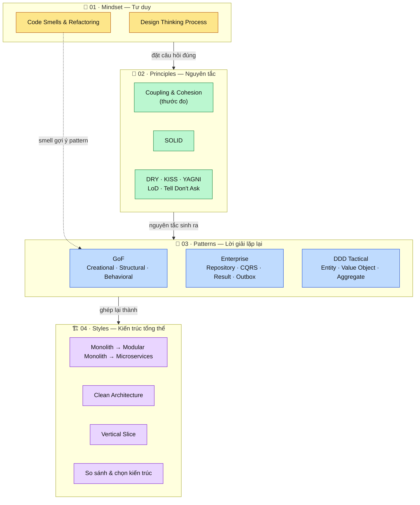
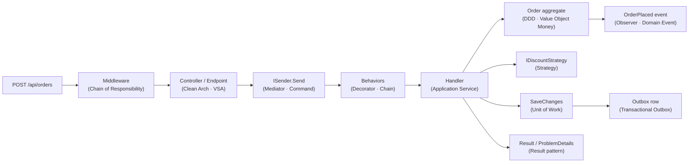

# 🏛️ Architecture & Design — Bản đồ kiến thức

> [!summary] Cách dùng trang này
> - **Học lần đầu:** đi theo [[#🧭 Lộ trình đọc]], từ **Tư duy → Nguyên tắc → Pattern → Kiến trúc**.
> - **Đang code và bí:** tra bảng [[#🔎 Gặp vấn đề gì → dùng gì?]] rồi nhảy thẳng đến đúng mục.
> - **Ôn tập:** mỗi note đều có mục **Self-check** ở cuối, hãy trả lời trước khi mở đáp án.

---

## 🗺️ Bức tranh tổng thể



> [!info] Mental model
> **Nguyên tắc** là *la bàn* (hướng nào là tốt). **Pattern** là *bản đồ đã có người đi* (lời giải đã được kiểm chứng cho một vấn đề lặp lại). **Kiến trúc** là *quy hoạch cả thành phố* (các pattern ghép lại ở quy mô hệ thống).
> Pattern không phải mục tiêu: **luôn bắt đầu từ vấn đề**, sau đó mới tìm pattern.

---

## 🧭 Lộ trình đọc

| # | Note | Trả lời câu hỏi | Thời gian |
| --- | --- | --- | --- |
| 1 | [[Design-Thinking-Process]] | Trước khi gõ code, tôi cần nghĩ những gì, theo thứ tự nào? | 45' |
| 2 | [[Coupling-and-Cohesion]] | Làm sao biết một thiết kế là "tốt" hay "tệ"? | 30' |
| 3 | [[SOLID-Principles]] | 5 nguyên tắc nền tảng của OOP design, áp dụng trong .NET ra sao? | 60' |
| 4 | [[Core-Design-Principles]] | DRY, KISS, YAGNI… và khi chúng mâu thuẫn thì chọn bên nào? | 45' |
| 5 | [[Code-Smells-and-Refactoring]] | Code "có mùi" trông như thế nào, sửa an toàn ra sao? | 60' |
| 6 | [[Behavioral-Patterns]] | Strategy, Chain, Observer, State… (nhóm hay dùng nhất) | 90' |
| 7 | [[Structural-Patterns]] | Decorator, Adapter, Facade, Proxy | 60' |
| 8 | [[Creational-Patterns]] | Factory, Builder, Singleton qua DI | 45' |
| 9 | [[DDD-Tactical-Patterns]] | Entity, Value Object, Aggregate: mô hình hoá nghiệp vụ | 90' |
| 10 | [[Repository-UnitOfWork-Specification]] | Có cần Repository khi đã có EF Core? | 45' |
| 11 | [[CQRS-and-MediatR-Pattern]] | Tách đọc/ghi, pipeline behaviors | 60' |
| 12 | [[Result-Pattern-vs-Exceptions]] | Báo lỗi nghiệp vụ bằng exception hay Result? | 45' |
| 13 | [[Domain-Events-and-Outbox]] | Phát sự kiện mà không mất dữ liệu (dual-write problem) | 60' |
| 14 | [[Clean-Architecture-in-DotNet]] | Chia solution .NET thành các tầng thế nào? | 60' |
| 15 | [[Vertical-Slice-Architecture]] | Tổ chức theo feature thay vì theo tầng | 45' |
| 16 | [[Monolithic-Architecture]] | Monolith có thật sự "xấu"? Scale và tách nó thế nào? | 45' |
| 17 | [[Modular-Monolith]] | Chia module trước khi nghĩ tới microservices | 60' |
| 18 | [[Microservices-Architecture]] | Saga, API Gateway, Circuit Breaker… và hệ sinh thái .NET thay cho Spring Cloud | 120' |
| 19 | [[Architecture-Styles-Comparison]] | Dự án của tôi nên chọn kiến trúc nào? | 45' |

> [!tip] Mẹo học
> Đọc 1 note thì áp dụng ngay 1 thứ vào [[POC-01-Ordering-Clean-Architecture]], rồi ghi một dòng vào Dev log. Không áp dụng thì sau một tuần bạn sẽ quên phần lớn.

---

## 🔎 Gặp vấn đề gì → dùng gì?

> [!example] Bảng tra cứu theo **triệu chứng**. Đây là cách người có kinh nghiệm "nghĩ ra" pattern.

### Logic & hành vi
| Triệu chứng trong code | Hướng giải quyết | Xem |
| --- | --- | --- |
| `switch`/`if-else` theo loại (loại khách hàng, phương thức thanh toán…) lặp lại nhiều nơi | Strategy / đa hình | [[Behavioral-Patterns#Strategy]] |
| Đối tượng đổi hành vi theo trạng thái (Draft, Submitted, Paid…), `if (Status == ...)` khắp nơi | State pattern hoặc state machine | [[Behavioral-Patterns#State]] |
| Request phải qua nhiều bước kiểm tra/xử lý tuần tự, có thể dừng giữa chừng | Chain of Responsibility (middleware, pipeline) | [[Behavioral-Patterns#Chain of Responsibility]] |
| Một việc xảy ra thì nhiều nơi khác cần phản ứng (gửi mail, trừ kho, cộng điểm) | Observer / Domain Events | [[Behavioral-Patterns#Observer]] · [[Domain-Events-and-Outbox]] |
| Các bước thuật toán giống nhau, chỉ khác vài bước | Template Method (ưu tiên composition) | [[Behavioral-Patterns#Template Method]] |
| Cần đóng gói một hành động để xếp hàng, retry, log, undo | Command | [[Behavioral-Patterns#Command]] |

### Tạo đối tượng
| Triệu chứng | Hướng giải quyết | Xem |
| --- | --- | --- |
| Constructor quá nhiều tham số, nhiều tham số tuỳ chọn | Builder | [[Creational-Patterns#Builder]] |
| Tạo object cần điều kiện hoặc phải validate, `new` rải rác | Static Factory / Named Constructor (`Order.Create`) | [[Creational-Patterns#Static Factory Method & Named Constructors]] |
| Chọn implementation lúc runtime theo cấu hình hoặc input | Factory Method + DI | [[Creational-Patterns#Factory Method]] |
| Cần đúng 1 instance dùng chung | Singleton **qua DI** (`AddSingleton`), không dùng `static` | [[Creational-Patterns#Singleton]] |

### Cấu trúc & tích hợp
| Triệu chứng | Hướng giải quyết | Xem |
| --- | --- | --- |
| Muốn thêm logging/caching/retry mà không sửa class gốc | Decorator (Scrutor) / Pipeline Behavior | [[Structural-Patterns#Decorator]] · [[CQRS-and-MediatR-Pattern]] |
| SDK bên thứ 3 có API "xấu" hoặc lệch model của mình | Adapter / Anti-Corruption Layer | [[Structural-Patterns#Adapter]] |
| Client phải gọi 5 service theo đúng thứ tự mới làm xong 1 việc | Facade (hoặc Application Service/Handler) | [[Structural-Patterns#Facade]] |
| Cần chặn/kiểm soát truy cập vào object (lazy load, auth, remote) | Proxy | [[Structural-Patterns#Proxy]] |

### Dữ liệu & domain
| Triệu chứng | Hướng giải quyết | Xem |
| --- | --- | --- |
| Dùng `string`/`decimal` trần cho email, tiền, số điện thoại; validate lặp lại | Value Object (Primitive Obsession) | [[DDD-Tactical-Patterns]] · [[Code-Smells-and-Refactoring]] |
| Entity chỉ có getter/setter, logic nằm hết trong Service | Rich Domain Model | [[DDD-Tactical-Patterns]] |
| Không biết transaction nên bao trùm những gì | Aggregate boundary | [[DDD-Tactical-Patterns]] |
| Query phức tạp lặp lại ở nhiều handler | Specification | [[Repository-UnitOfWork-Specification]] |
| Màn hình đọc chậm vì phải đi qua domain model | CQRS: Query projection / Dapper | [[CQRS-and-MediatR-Pattern]] |
| Lưu DB xong nhưng publish message thất bại → dữ liệu lệch | Transactional Outbox | [[Domain-Events-and-Outbox]] |
| Exception bị dùng để điều khiển luồng nghiệp vụ bình thường | Result pattern | [[Result-Pattern-vs-Exceptions]] |

### Cấu trúc hệ thống
| Triệu chứng | Hướng giải quyết | Xem |
| --- | --- | --- |
| Nghiệp vụ dính chặt EF Core/ASP.NET, khó test | Clean Architecture / Dependency Inversion | [[Clean-Architecture-in-DotNet]] · [[SOLID-Principles#Dependency Inversion Principle (DIP)]] |
| Sửa 1 feature phải mở 6 thư mục ở 4 tầng | Vertical Slice | [[Vertical-Slice-Architecture]] |
| Monolith thành "big ball of mud", các team giẫm chân nhau | Modular Monolith | [[Modular-Monolith]] |
| Sửa 1 chỗ phải sửa theo 10 chỗ khác (Shotgun Surgery) | Tăng cohesion, gom thay đổi về một chỗ | [[Coupling-and-Cohesion]] · [[Code-Smells-and-Refactoring]] |
| Monolith build/deploy chậm, một module lỗi kéo sập cả app | Scale đúng cách, sau đó mới tính tách bằng Strangler Fig | [[Monolithic-Architecture]] |
| Đang tính tách microservices | Đọc trước khi quyết | [[Architecture-Styles-Comparison]] · [[Microservices-Architecture]] |
| Giao dịch trải qua nhiều service (đặt hàng → thanh toán → giao hàng) | Saga (choreography / orchestration) | [[Microservices-Architecture#Saga]] |
| Service gọi service khác bị treo, lỗi dây chuyền | Timeout · Retry · Circuit Breaker · Bulkhead | [[Microservices-Architecture#Resilience — Timeout, Retry, Circuit Breaker, Bulkhead]] |
| Client phải gọi nhiều service, lộ topology nội bộ | API Gateway / BFF | [[Microservices-Architecture#API Gateway & BFF]] |

---

## 🔗 Một use case chạm vào những khái niệm nào?

Ví dụ: use case **"Khách đặt hàng có mã giảm giá"** trong POC.



---

## 📂 Mục lục theo thư mục

### 🧠 01 · Mindset
- [[Design-Thinking-Process]]: quy trình tư duy, checklist trước khi code, ADR mini, ví dụ thiết kế tính năng coupon
- [[Code-Smells-and-Refactoring]]: catalog smell, mỗi smell kèm refactoring và pattern tương ứng, quy trình refactor an toàn

### 📐 02 · Principles
- [[Coupling-and-Cohesion]]: các loại coupling/cohesion, connascence, metric instability
- [[SOLID-Principles]]: SRP · OCP · LSP · ISP · DIP, phân biệt DIP, DI và IoC
- [[Core-Design-Principles]]: DRY · KISS · YAGNI · SoC · Composition over Inheritance · LoD · Tell Don't Ask · Fail Fast…

### 🧩 03 · Patterns
- **GoF:** [[Creational-Patterns]] · [[Structural-Patterns]] · [[Behavioral-Patterns]]
- **Enterprise:** [[Repository-UnitOfWork-Specification]] · [[CQRS-and-MediatR-Pattern]] · [[Result-Pattern-vs-Exceptions]] · [[Domain-Events-and-Outbox]]
- **DDD:** [[DDD-Tactical-Patterns]]

### 🏗️ 04 · Styles
- **Cách deploy:** [[Monolithic-Architecture]] → [[Modular-Monolith]] → [[Microservices-Architecture]]
- **Cách tổ chức code:** [[Clean-Architecture-in-DotNet]] · [[Vertical-Slice-Architecture]]
- **Chọn kiến trúc:** [[Architecture-Styles-Comparison]]

---

## 📊 Trạng thái các note

```dataview
TABLE WITHOUT ID file.link AS "Note", type AS "Loại", status AS "Trạng thái", file.folder AS "Thư mục"
FROM "02-Architecture-Design"
WHERE type != "moc"
SORT file.folder ASC, file.name ASC
```

## 🌱 Sẽ viết sau (Just-In-Time)
[[Event-Driven-Architecture]] · [[Dependency-Injection-DotNet-vs-Spring]] · [[EF-Core-Transactions-and-Concurrency]] · [[Dapper-for-Read-Side]] · [[Testing-in-DotNet]]

---
↩️ [[Home]] · [[Roadmap-DotNet]] · [[Java-to-DotNet-Mental-Map]]
