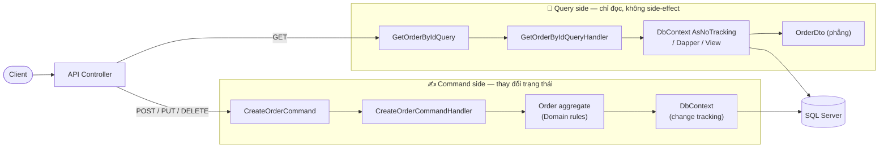
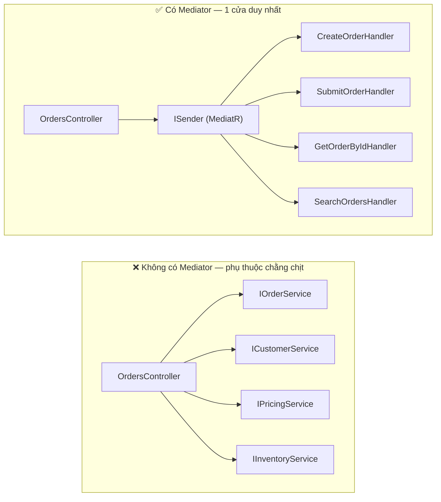
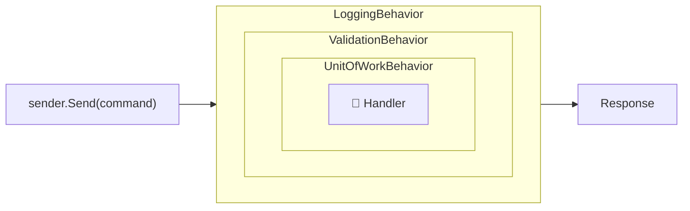
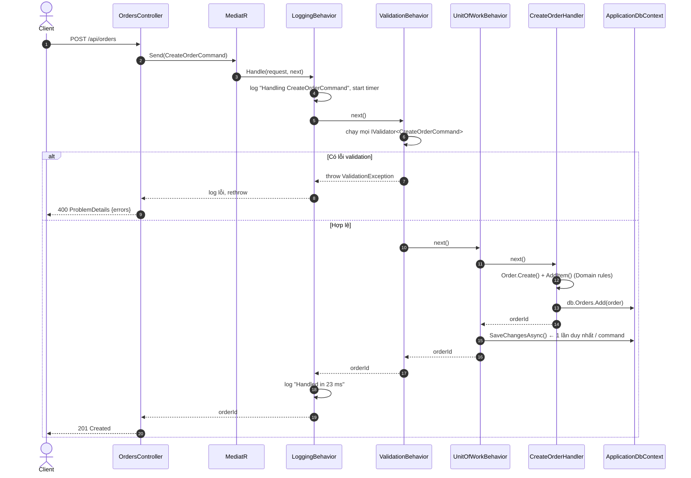
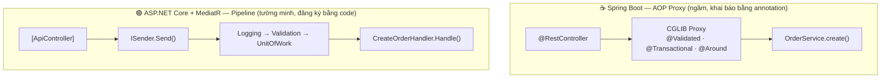

# CQRS & MediatR Pattern

> [!summary] TL;DR
> - **CQRS** (Command Query Responsibility Segregation): tách thao tác **ghi** (Command — thay đổi trạng thái) và **đọc** (Query — chỉ trả dữ liệu) thành hai model/luồng xử lý riêng.
> - **MediatR**: thư viện hiện thực **Mediator pattern** trong-process. Controller chỉ `Send(request)`, MediatR tìm đúng **Handler** để xử lý.
> - **Pipeline Behavior**: "middleware" bọc quanh mọi Handler → nơi đặt Validation, Logging, Transaction **một lần cho tất cả** use case. Tương đương Spring AOP `@Around`.
> - ⚠️ **CQRS ≠ MediatR ≠ Event Sourcing ≠ 2 database.** MediatR chỉ là một *công cụ tiện lợi* để làm CQRS.

---

## 1. Problem — Vấn đề cần giải quyết

### 1.1 Bối cảnh: "God Service"

```csharp
public class OrderService   // quen thuộc phải không? 😅
{
    public OrderDto Get(Guid id) { ... }
    public PagedList<OrderDto> Search(OrderFilter f) { ... }
    public OrderSummaryDto GetDashboard(...) { ... }
    public Guid Create(CreateOrderRequest r) { /* validate, log, begin tx, ..., commit */ }
    public void Submit(Guid id) { /* validate, log, begin tx, ..., commit */ }
    public void Cancel(Guid id, string reason) { /* validate, log, begin tx, ..., commit */ }
    // ... 30 method nữa, constructor inject 12 dependency
}
```

### 1.2 Pain points

| Vấn đề | Giải thích |
| --- | --- |
| **Một model cho cả đọc và ghi** | Ghi cần entity giàu nghiệp vụ, bảo vệ invariant. Đọc cần DTO phẳng, join nhiều bảng, phân trang. Ép chung một model → cả hai đều khó chịu. |
| **Cross-cutting concern lặp lại** | Mỗi method đều copy: validate → log → mở transaction → try/catch → commit. |
| **Class phình to, vi phạm SRP** | 1 class thay đổi vì 30 lý do khác nhau; merge conflict liên tục. |
| **Controller phụ thuộc nhiều service** | `OrdersController(IOrderService, ICustomerService, IPricingService, …)` |
| **Tối ưu đọc bị cản** | Query phải đi qua entity + change tracking dù chỉ cần đọc vài cột. |

### 1.3 Ý tưởng cốt lõi

1. **CQS** (Bertrand Meyer, mức *method*): "Một method hoặc là thay đổi trạng thái (command), hoặc là trả dữ liệu (query), không bao giờ cả hai."
2. **CQRS** (Greg Young, mức *kiến trúc*): áp dụng CQS cho cả hệ thống → luồng ghi và luồng đọc có model, handler, thậm chí storage riêng.
3. **Mỗi use case = 1 class request + 1 class handler** → nhỏ, dễ test, đúng SRP.
4. **Mediator** đứng giữa → người gửi không cần biết ai xử lý; có chỗ để chèn pipeline.

### 1.4 Các "cấp độ" CQRS — đừng nhảy cóc!

| Cấp | Mô tả | Độ phức tạp | Khi nào |
| --- | --- | --- | --- |
| **1. Tách handler** | Cùng DB, cùng DbContext. Command dùng entity; Query project thẳng ra DTO | ⭐ | **Mặc định — note này tập trung vào cấp này** |
| **2. Tách read model** | Cùng DB nhưng Query đọc từ view / bảng denormalized / Dapper | ⭐⭐ | Màn hình đọc phức tạp, cần hiệu năng |
| **3. Tách database** | Write DB (SQL) + Read DB (Elasticsearch/Redis/Mongo), đồng bộ qua event → **eventual consistency** | ⭐⭐⭐⭐ | Tải đọc ≫ tải ghi, quy mô lớn |
| **+ Event Sourcing** | Lưu chuỗi event thay vì trạng thái hiện tại | ⭐⭐⭐⭐⭐ | Cần audit hoàn chỉnh, domain đặc thù (tài chính, ledger) |

---

## 2. Mental Model & Diagram

### 2.1 Tách luồng Command và Query



### 2.2 Mediator pattern: trước và sau



> [!info] Analogy — Tổng đài viên
> Bạn gọi tổng đài (Mediator) nói "tôi muốn đổi địa chỉ giao hàng" (Request). Tổng đài tự chuyển đến đúng phòng ban (Handler).
> Trước khi chuyển, tổng đài **ghi âm cuộc gọi** (Logging), **xác minh danh tính** (Validation)… — đó là **Pipeline Behaviors**.

### 2.3 Pipeline Behaviors — mô hình "búp bê Nga" (Russian doll)



Mỗi behavior nhận `next` (delegate gọi lớp bên trong). Nó có thể:
- làm gì đó **trước** `next()` (log bắt đầu, validate),
- **không gọi** `next()` (validate fail → throw, cache hit → trả luôn),
- làm gì đó **sau** `next()` (SaveChanges, log thời gian chạy),
- bọc `next()` trong `try/catch` hoặc transaction.

### 2.4 Toàn bộ vòng đời một Command



---

## 3. Implementation & Minimal Code Example

### 3.0 Packages & ⚠️ lưu ý giấy phép

```bash
dotnet add src/Ordering.Application package MediatR
dotnet add src/Ordering.Application package FluentValidation.DependencyInjectionExtensions
```

> [!warning] MediatR đã chuyển sang mô hình thương mại (2025)
> - **MediatR ≤ 12.x**: Apache 2.0, miễn phí hoàn toàn.
> - **MediatR 13+**: thuộc Lucky Penny Software, cần **license key** (`cfg.LicenseKey = ...`); có bản Community miễn phí cho cá nhân/công ty nhỏ theo điều kiện doanh thu.
> - 👉 Kiểm tra điều khoản hiện hành tại trang chủ MediatR trước khi dùng cho dự án công ty. Học tập: dùng 12.x hoặc bản Community đều được.
> - Lựa chọn thay thế: `Mediator` (martinothamar — source generator, MIT, nhanh hơn), **Wolverine**, hoặc **tự viết** (xem mục 5).
> - API ở note này tương thích MediatR 12.x; khác biệt với 13+ chủ yếu là license key.

### 3.1 Cấu trúc thư mục trong Application (theo feature)

```text
Ordering.Application/
├── Common/
│   ├── Behaviors/
│   │   ├── LoggingBehavior.cs
│   │   ├── ValidationBehavior.cs
│   │   └── UnitOfWorkBehavior.cs
│   ├── Exceptions/NotFoundException.cs
│   ├── Interfaces/IApplicationDbContext.cs
│   └── Messaging/ICommand.cs, IQuery.cs
├── Orders/
│   ├── Commands/
│   │   └── CreateOrder/
│   │       ├── CreateOrderCommand.cs
│   │       ├── CreateOrderCommandHandler.cs
│   │       └── CreateOrderCommandValidator.cs
│   └── Queries/
│       └── GetOrderById/
│           ├── GetOrderByIdQuery.cs
│           ├── GetOrderByIdQueryHandler.cs
│           └── OrderDto.cs
└── DependencyInjection.cs
```

### 3.2 Marker interfaces — để phân biệt Command và Query

```csharp
// src/Ordering.Application/Common/Messaging/Messaging.cs
using MediatR;

namespace Ordering.Application.Common.Messaging;

/// Marker không generic — để behavior kiểm tra nhanh "request này có phải Command?"
public interface ICommandBase { }

/// Command: thay đổi trạng thái. Nên trả về "ít" (Id, Unit) — không trả nguyên entity.
public interface ICommand<TResponse> : IRequest<TResponse>, ICommandBase { }

/// Query: chỉ đọc, KHÔNG được có side-effect.
public interface IQuery<TResponse> : IRequest<TResponse> { }
```

> [!tip] Vì sao cần marker?
> `UnitOfWorkBehavior` chỉ nên `SaveChanges` cho **Command**. Query đi qua sẽ bỏ qua bước đó.
> Ngoài ra đọc code thấy ngay `: ICommand<Guid>` hay `: IQuery<OrderDto>` — tự document.

```csharp
// src/Ordering.Application/Common/Exceptions/NotFoundException.cs
namespace Ordering.Application.Common.Exceptions;

public sealed class NotFoundException(string entity, object key)
    : Exception($"{entity} '{key}' was not found.");
```

### 3.3 Command + Handler + Validator

```csharp
// .../Orders/Commands/CreateOrder/CreateOrderCommand.cs
using Ordering.Application.Common.Messaging;

namespace Ordering.Application.Orders.Commands.CreateOrder;

// record: bất biến, so sánh theo giá trị, ASP.NET bind JSON body trực tiếp vào đây
public sealed record CreateOrderCommand(Guid CustomerId, IReadOnlyList<CreateOrderItem> Items)
    : ICommand<Guid>;

public sealed record CreateOrderItem(string Sku, int Quantity, decimal UnitPrice, string Currency);
```

```csharp
// .../Orders/Commands/CreateOrder/CreateOrderCommandHandler.cs
using MediatR;
using Ordering.Application.Common.Interfaces;
using Ordering.Domain.Orders;

namespace Ordering.Application.Orders.Commands.CreateOrder;

public sealed class CreateOrderCommandHandler(IApplicationDbContext db, TimeProvider clock)
    : IRequestHandler<CreateOrderCommand, Guid>
{
    public Task<Guid> Handle(CreateOrderCommand request, CancellationToken cancellationToken)
    {
        // Handler = "nhạc trưởng": gọi Domain làm nghiệp vụ, KHÔNG tự viết if/else nghiệp vụ
        var order = Order.Create(request.CustomerId, clock.GetUtcNow());

        foreach (var item in request.Items)
            order.AddItem(item.Sku, item.Quantity, new Money(item.UnitPrice, item.Currency));

        db.Orders.Add(order);

        // KHÔNG gọi SaveChanges ở đây — UnitOfWorkBehavior (3.6) sẽ gọi 1 lần sau khi handler xong
        return Task.FromResult(order.Id);
    }
}
```

```csharp
// .../Orders/Commands/CreateOrder/CreateOrderCommandValidator.cs
using FluentValidation;

namespace Ordering.Application.Orders.Commands.CreateOrder;

public sealed class CreateOrderCommandValidator : AbstractValidator<CreateOrderCommand>
{
    public CreateOrderCommandValidator()
    {
        RuleFor(x => x.CustomerId).NotEmpty();

        RuleFor(x => x.Items)
            .NotEmpty().WithMessage("Đơn hàng phải có ít nhất 1 sản phẩm.");

        RuleForEach(x => x.Items).ChildRules(item =>
        {
            item.RuleFor(i => i.Sku).NotEmpty().MaximumLength(50);
            item.RuleFor(i => i.Quantity).GreaterThan(0);
            item.RuleFor(i => i.UnitPrice).GreaterThanOrEqualTo(0);
            item.RuleFor(i => i.Currency).NotEmpty().Length(3);
        });
    }
}
```

> [!important] Hai loại validation — đừng nhầm
> | | **Input validation** | **Business invariant** |
> |---|---|---|
> | Ở đâu | FluentValidation (Application) | Entity / Value Object (Domain) |
> | Kiểm tra gì | Format, required, độ dài, range | Quy tắc nghiệp vụ: "chỉ Draft mới sửa được" |
> | Lỗi trả về | 400 Bad Request + danh sách field lỗi | 422 / 409 + thông điệp nghiệp vụ |
> | Bỏ qua được không? | Có (gọi Domain từ background job) | **Không bao giờ** — Domain luôn tự bảo vệ |
>
> Trùng lặp nhẹ (Quantity > 0 ở cả hai) là **chấp nhận được**: validator cho UX tốt (trả hết lỗi 1 lần), Domain là chốt chặn cuối.

### 3.4 Query + Handler — tối ưu cho đọc

```csharp
// .../Orders/Queries/GetOrderById/GetOrderByIdQuery.cs
using Ordering.Application.Common.Messaging;

namespace Ordering.Application.Orders.Queries.GetOrderById;

public sealed record GetOrderByIdQuery(Guid Id) : IQuery<OrderDto>;

public sealed record OrderDto(Guid Id, Guid CustomerId, string Status, decimal Total, IReadOnlyList<OrderItemDto> Items);
public sealed record OrderItemDto(string Sku, int Quantity, decimal UnitPrice, string Currency);
```

```csharp
// .../Orders/Queries/GetOrderById/GetOrderByIdQueryHandler.cs
using MediatR;
using Microsoft.EntityFrameworkCore;
using Ordering.Application.Common.Exceptions;
using Ordering.Application.Common.Interfaces;
using Ordering.Domain.Orders;

namespace Ordering.Application.Orders.Queries.GetOrderById;

public sealed class GetOrderByIdQueryHandler(IApplicationDbContext db)
    : IRequestHandler<GetOrderByIdQuery, OrderDto>
{
    public async Task<OrderDto> Handle(GetOrderByIdQuery request, CancellationToken cancellationToken)
    {
        // Projection thẳng ra DTO:
        //  - EF chỉ SELECT đúng các cột cần → nhanh
        //  - Kết quả là DTO (không phải entity) → không bị change-tracking, không cần AsNoTracking()
        //  - KHÔNG đi qua Domain logic — Query không cần bảo vệ invariant
        var dto = await db.Orders
            .Where(o => o.Id == request.Id)
            .Select(o => new OrderDto(
                o.Id,
                o.CustomerId,
                o.Status.ToString(),
                o.Items.Sum(i => i.UnitPrice.Amount * i.Quantity), // không dùng o.Total: property không map, EF không dịch sang SQL được
                o.Items.Select(i => new OrderItemDto(i.Sku, i.Quantity, i.UnitPrice.Amount, i.UnitPrice.Currency)).ToList()))
            .FirstOrDefaultAsync(cancellationToken);

        return dto ?? throw new NotFoundException(nameof(Order), request.Id);
    }
}
```

> [!tip] CQRS cấp 2 — Query không bắt buộc dùng EF
> Màn hình báo cáo phức tạp? Query handler có thể inject `IDbConnectionFactory` và dùng **Dapper** với SQL viết tay. Command side vẫn dùng EF + Domain. Đây là sức mạnh thật sự của việc tách đọc/ghi.

### 3.5 Pipeline Behaviors

#### a) LoggingBehavior

```csharp
// src/Ordering.Application/Common/Behaviors/LoggingBehavior.cs
using System.Diagnostics;
using MediatR;
using Microsoft.Extensions.Logging;

namespace Ordering.Application.Common.Behaviors;

public sealed class LoggingBehavior<TRequest, TResponse>(ILogger<LoggingBehavior<TRequest, TResponse>> logger)
    : IPipelineBehavior<TRequest, TResponse>
    where TRequest : notnull
{
    public async Task<TResponse> Handle(
        TRequest request, RequestHandlerDelegate<TResponse> next, CancellationToken cancellationToken)
    {
        var requestName = typeof(TRequest).Name;
        var startedAt = Stopwatch.GetTimestamp();

        // ⚠️ Chỉ log TÊN request, không log nguyên payload (có thể chứa PII, mật khẩu, số thẻ…)
        logger.LogInformation("Handling {RequestName}", requestName);
        try
        {
            var response = await next();   // MediatR 13+: có thể truyền next(cancellationToken)
            logger.LogInformation("Handled {RequestName} in {ElapsedMs:0.0} ms",
                requestName, Stopwatch.GetElapsedTime(startedAt).TotalMilliseconds);
            return response;
        }
        catch (Exception ex)
        {
            logger.LogError(ex, "{RequestName} failed after {ElapsedMs:0.0} ms",
                requestName, Stopwatch.GetElapsedTime(startedAt).TotalMilliseconds);
            throw;   // không nuốt exception — để GlobalExceptionHandler map ra HTTP
        }
    }
}
```

#### b) ValidationBehavior (FluentValidation)

```csharp
// src/Ordering.Application/Common/Behaviors/ValidationBehavior.cs
using FluentValidation;
using MediatR;

namespace Ordering.Application.Common.Behaviors;

public sealed class ValidationBehavior<TRequest, TResponse>(IEnumerable<IValidator<TRequest>> validators)
    : IPipelineBehavior<TRequest, TResponse>
    where TRequest : notnull
{
    public async Task<TResponse> Handle(
        TRequest request, RequestHandlerDelegate<TResponse> next, CancellationToken cancellationToken)
    {
        // DI tự inject MỌI validator đăng ký cho TRequest (0, 1 hoặc nhiều)
        if (!validators.Any()) return await next();

        var context = new ValidationContext<TRequest>(request);
        var failures = new List<FluentValidation.Results.ValidationFailure>();

        // Chạy TUẦN TỰ (không Task.WhenAll): nếu validator có rule async truy vấn DB,
        // chạy song song trên cùng một DbContext (Scoped) sẽ gây lỗi "A second operation was started..."
        foreach (var validator in validators)
        {
            var result = await validator.ValidateAsync(context, cancellationToken);
            failures.AddRange(result.Errors);
        }

        if (failures.Count != 0)
            throw new ValidationException(failures);   // FluentValidation.ValidationException

        return await next();
    }
}
```

#### c) UnitOfWorkBehavior — SaveChanges 1 lần cho mỗi Command

```csharp
// src/Ordering.Application/Common/Behaviors/UnitOfWorkBehavior.cs
using MediatR;
using Ordering.Application.Common.Interfaces;
using Ordering.Application.Common.Messaging;

namespace Ordering.Application.Common.Behaviors;

public sealed class UnitOfWorkBehavior<TRequest, TResponse>(IApplicationDbContext db)
    : IPipelineBehavior<TRequest, TResponse>
    where TRequest : notnull
{
    public async Task<TResponse> Handle(
        TRequest request, RequestHandlerDelegate<TResponse> next, CancellationToken cancellationToken)
    {
        if (request is not ICommandBase)
            return await next();                     // Query → không ghi gì cả

        var response = await next();                 // Handler chỉ thay đổi entity trong memory
        await db.SaveChangesAsync(cancellationToken); // EF gói mọi thay đổi vào 1 transaction ngầm
        return response;
    }
}
```

> [!note] `SaveChangesAsync()` tự nó đã là một transaction
> EF Core bọc toàn bộ INSERT/UPDATE/DELETE của **một lần** `SaveChanges` trong 1 transaction. Vì vậy với mô hình
> "handler chỉ sửa entity, behavior SaveChanges 1 lần" thì **không cần** mở transaction thủ công.

#### d) (Nâng cao) TransactionBehavior — khi cần transaction tường minh

Dùng khi một command phải gọi `SaveChanges` **nhiều lần** (ví dụ: lưu order → lấy giá trị DB sinh → lưu tiếp; hoặc domain event handler cũng ghi DB) và tất cả phải cùng commit/rollback.

Vì behavior này dùng API riêng của EF (`Database.BeginTransaction`, Execution Strategy) → nó là **chi tiết hạ tầng** → đặt ở **Infrastructure** (Clean Architecture!).

```csharp
// src/Ordering.Infrastructure/Behaviors/TransactionBehavior.cs
using MediatR;
using Microsoft.EntityFrameworkCore;
using Ordering.Application.Common.Messaging;
using Ordering.Infrastructure.Persistence;

namespace Ordering.Infrastructure.Behaviors;

internal sealed class TransactionBehavior<TRequest, TResponse>(ApplicationDbContext db)
    : IPipelineBehavior<TRequest, TResponse>
    where TRequest : notnull
{
    public async Task<TResponse> Handle(
        TRequest request, RequestHandlerDelegate<TResponse> next, CancellationToken cancellationToken)
    {
        if (request is not ICommandBase) return await next();
        if (db.Database.CurrentTransaction is not null) return await next(); // đã có tx bên ngoài

        // Khi bật EnableRetryOnFailure(), EF BẮT BUỘC transaction tự mở phải nằm trong execution strategy,
        // nếu không sẽ ném InvalidOperationException. Strategy có thể chạy lại cả khối khi gặp lỗi tạm thời.
        var strategy = db.Database.CreateExecutionStrategy();

        return await strategy.ExecuteAsync(async () =>
        {
            await using var transaction = await db.Database.BeginTransactionAsync(cancellationToken);

            var response = await next();
            await db.SaveChangesAsync(cancellationToken);
            await transaction.CommitAsync(cancellationToken);   // lỗi trước dòng này → tự rollback khi dispose

            return response;
        });
    }
}
```

> [!warning] Retry chạy lại cả handler
> Nếu strategy retry, `next()` bị gọi lại → handler phải **idempotent** và không được có side-effect ngoài DB (gửi email, gọi API thanh toán) bên trong khối này. Side-effect ngoài → dùng **Outbox pattern**. → [[Domain-Events-and-Outbox]]

### 3.6 Đăng ký DI — thứ tự behaviors quan trọng!

```csharp
// src/Ordering.Application/DependencyInjection.cs
using FluentValidation;
using Microsoft.Extensions.DependencyInjection;
using Ordering.Application.Common.Behaviors;

namespace Ordering.Application;

public static class DependencyInjection
{
    public static IServiceCollection AddApplication(this IServiceCollection services)
    {
        var assembly = typeof(DependencyInjection).Assembly;

        services.AddMediatR(cfg =>
        {
            cfg.RegisterServicesFromAssembly(assembly);    // quét mọi IRequestHandler<,> trong assembly
            // cfg.LicenseKey = "...";                     // MediatR 13+

            // THỨ TỰ ĐĂNG KÝ = THỨ TỰ BỌC (cái đầu tiên ở ngoài cùng)
            cfg.AddOpenBehavior(typeof(LoggingBehavior<,>));     // 1. ngoài cùng: log cả lỗi validation
            cfg.AddOpenBehavior(typeof(ValidationBehavior<,>));  // 2. chặn request sai trước khi đụng DB
            cfg.AddOpenBehavior(typeof(UnitOfWorkBehavior<,>));  // 3. trong cùng: sát handler
        });

        // Quét mọi AbstractValidator<T> (public) trong assembly
        services.AddValidatorsFromAssembly(assembly);

        return services;
    }
}
```

> [!question]- Đổi thứ tự Validation và UnitOfWork thì sao?
> Nếu UnitOfWork ở ngoài Validation: request sai vẫn ném exception trước khi SaveChanges nên *kết quả* giống nhau,
> nhưng về ý nghĩa thì validation phải là "cổng" đầu tiên. Nếu dùng TransactionBehavior ở ngoài Validation → mở transaction DB **vô ích** cho request sai. Nguyên tắc: **rẻ và hay fail → đặt ngoài; đắt (DB/transaction) → đặt trong**.

### 3.7 Biến exception thành HTTP response (tầng API)

```csharp
// src/Ordering.Api/Infrastructure/GlobalExceptionHandler.cs
using FluentValidation;
using Microsoft.AspNetCore.Diagnostics;
using Microsoft.AspNetCore.Mvc;
using Ordering.Application.Common.Exceptions;
using Ordering.Domain.Common;

namespace Ordering.Api.Infrastructure;

internal sealed class GlobalExceptionHandler(IProblemDetailsService problemDetails, ILogger<GlobalExceptionHandler> logger)
    : IExceptionHandler
{
    public async ValueTask<bool> TryHandleAsync(HttpContext httpContext, Exception exception, CancellationToken ct)
    {
        var (status, title) = exception switch
        {
            ValidationException => (StatusCodes.Status400BadRequest, "Validation failed"),
            NotFoundException   => (StatusCodes.Status404NotFound, "Resource not found"),
            DomainException     => (StatusCodes.Status422UnprocessableEntity, "Business rule violated"),
            _                   => (StatusCodes.Status500InternalServerError, "An unexpected error occurred")
        };

        if (status >= 500) logger.LogError(exception, "Unhandled exception");

        var problem = new ProblemDetails
        {
            Status = status,
            Title = title,
            Detail = status >= 500 ? null : exception.Message   // không lộ stack trace/chi tiết lỗi 500
        };

        if (exception is ValidationException ve)
        {
            problem.Extensions["errors"] = ve.Errors
                .GroupBy(e => e.PropertyName)
                .ToDictionary(g => g.Key, g => g.Select(e => e.ErrorMessage).ToArray());
        }

        httpContext.Response.StatusCode = status;
        return await problemDetails.TryWriteAsync(new ProblemDetailsContext
        {
            HttpContext = httpContext,
            ProblemDetails = problem,
            Exception = exception
        });
    }
}
```

Response mẫu khi gửi `{"customerId": "00000000-0000-0000-0000-000000000000", "items": []}`:

```json
{
  "type": "https://tools.ietf.org/html/rfc9110#section-15.5.1",
  "title": "Validation failed",
  "status": 400,
  "errors": {
    "CustomerId": ["'Customer Id' must not be empty."],
    "Items": ["Đơn hàng phải có ít nhất 1 sản phẩm."]
  }
}
```

### 3.8 Notifications — publish 1 sự kiện, nhiều handler

```csharp
// Request: 1 request → ĐÚNG 1 handler.   Notification: 1 notification → 0..N handler.
public sealed record OrderSubmittedNotification(Guid OrderId) : INotification;

public sealed class SendConfirmationEmail(IEmailSender email) : INotificationHandler<OrderSubmittedNotification>
{
    public Task Handle(OrderSubmittedNotification n, CancellationToken ct)
        => email.SendAsync("customer@shop.local", "Order received", $"Order {n.OrderId}", ct);
}

public sealed class ReserveInventory : INotificationHandler<OrderSubmittedNotification>
{
    public Task Handle(OrderSubmittedNotification n, CancellationToken ct) => Task.CompletedTask; // ...
}

// Gửi: await publisher.Publish(new OrderSubmittedNotification(order.Id), ct);   // IPublisher
```

> Thường dùng để phát **Domain Events** sau `SaveChanges` (qua `SaveChangesInterceptor`). Chi tiết → [[Domain-Events-and-Outbox]].

### 3.9 Test nhanh

```csharp
// Validator — dùng FluentValidation.TestHelper
[Fact]
public void Should_fail_when_items_empty()
{
    var validator = new CreateOrderCommandValidator();
    var result = validator.TestValidate(new CreateOrderCommand(Guid.NewGuid(), []));
    result.ShouldHaveValidationErrorFor(x => x.Items);
}

// Handler — test như class bình thường, không cần MediatR
// (dùng EF Core SQLite in-memory hoặc Testcontainers cho IApplicationDbContext)
```

---

## 4. Comparison — Đối chiếu Java / Spring Boot

### 4.1 Bảng ánh xạ

| Khái niệm .NET | ☕ Spring Boot tương đương | Ghi chú |
| --- | --- | --- |
| `IRequest<T>` / `IRequestHandler<,>` | **Không có sẵn.** Tự viết `Command<R>` + `CommandHandler<C,R>`; hoặc **Axon** (`CommandGateway`, `QueryGateway`); hoặc **PipelinR** (port của MediatR) | Spring "thích" gọi thẳng `@Service` |
| `ISender.Send()` | `CommandBus.send()` tự viết / `commandGateway.send()` (Axon) | |
| `IPipelineBehavior<,>` | **Spring AOP `@Around` advice**, PipelinR `Command.Middleware` | Behavior = AOP tường minh, không dùng proxy |
| `ValidationBehavior` + FluentValidation | `@Validated` trên class + `@Valid` trên tham số + Bean Validation (Hibernate Validator) | Spring validate qua AOP proxy (`MethodValidationPostProcessor`) |
| `UnitOfWorkBehavior` / `TransactionBehavior` | **`@Transactional`** | Spring khai báo, .NET viết behavior 1 lần |
| `LoggingBehavior` | `@Around` aspect / Micrometer Observation | |
| `INotification` + `IPublisher.Publish` | `ApplicationEventPublisher` + `@EventListener` | `@TransactionalEventListener(phase = AFTER_COMMIT)` rất tiện — .NET phải tự làm qua interceptor/outbox |
| `RegisterServicesFromAssembly` | `@ComponentScan` | |
| `GlobalExceptionHandler` + ProblemDetails | `@RestControllerAdvice` + `ProblemDetail` (Spring 6) | Cả hai đều hỗ trợ RFC 9457 |
| Query projection ra DTO | Spring Data **Projection** (interface/record DTO) hoặc JPQL `select new ...` | |

### 4.2 Cùng một luồng, hai cách "bọc" cross-cutting concern



### 4.3 Tự viết "MediatR mini" trên Spring Boot

```java
// Command & Handler contract
public interface Command<R> {}
public interface CommandHandler<C extends Command<R>, R> { R handle(C command); }

// Bus: tự map Command class → Handler bean khi khởi động
@Component
public class CommandBus {
    private final Map<Class<?>, CommandHandler<?, ?>> handlers = new HashMap<>();

    public CommandBus(List<CommandHandler<?, ?>> all) {
        for (CommandHandler<?, ?> h : all) {
            Class<?>[] types = GenericTypeResolver.resolveTypeArguments(
                AopUtils.getTargetClass(h), CommandHandler.class);   // lấy <C, R> qua reflection
            handlers.put(types[0], h);
        }
    }

    @SuppressWarnings("unchecked")
    public <R, C extends Command<R>> R send(C command) {
        var handler = (CommandHandler<C, R>) handlers.get(command.getClass());
        if (handler == null) throw new IllegalStateException("No handler for " + command.getClass());
        return handler.handle(command);
    }
}

// Use case — cross-cutting bằng annotation (AOP)
public record CreateOrderCommand(@NotNull UUID customerId, @NotEmpty List<Item> items) implements Command<UUID> {}

@Service
@Validated
public class CreateOrderHandler implements CommandHandler<CreateOrderCommand, UUID> {
    @Override
    @Transactional                                     // ≈ UnitOfWorkBehavior
    public UUID handle(@Valid CreateOrderCommand cmd) { // ≈ ValidationBehavior
        Order order = Order.create(cmd.customerId());
        // ... repository.save(order); Hibernate tự flush khi commit
        return order.getId();
    }
}
```

> [!warning] Bẫy khi chuyển từ Java sang .NET
> - **JPA tự flush, EF Core thì không**: trong `@Transactional`, Hibernate dirty-checking tự `UPDATE` khi commit. EF Core có change-tracking tương tự nhưng **chỉ ghi khi gọi `SaveChangesAsync()`** → vì vậy mới cần `UnitOfWorkBehavior`.
> - **Self-invocation**: Spring AOP không áp dụng khi gọi `this.otherMethod()`. Tương tự, gọi thẳng `handler.Handle()` (không qua `ISender.Send`) sẽ **bỏ qua toàn bộ pipeline**.
> - **Generic type erasure vs reified generics**: Java phải dùng `GenericTypeResolver` để "đào" kiểu generic. .NET giữ nguyên thông tin generic lúc runtime → DI resolve `IValidator<CreateOrderCommand>` trực tiếp, `IPipelineBehavior<,>` open generic hoạt động tự nhiên.
> - **Validation exception**: Spring ném `ConstraintViolationException` / `MethodArgumentNotValidException`; ở đây là `FluentValidation.ValidationException` — nhớ map trong `GlobalExceptionHandler`.

---

## 5. Trade-offs & Best Practices

### ✅ Ưu điểm
- **SRP tuyệt đối**: mỗi use case 1 file handler nhỏ, dễ đọc, dễ review, ít merge conflict.
- **Cross-cutting concern viết 1 lần**: thêm audit/caching/retry/authorization cho *mọi* use case chỉ bằng 1 behavior.
- **Tối ưu đọc/ghi độc lập**: Query dùng projection/Dapper, Command dùng Domain model giàu nghiệp vụ.
- **Controller cực mỏng**, dễ chuyển sang Minimal API, gRPC, background worker (cùng gửi command).
- **Test dễ**: handler là class thuần với dependency rõ ràng.

### ❌ Nhược điểm / Chi phí
- **Indirection**: `Ctrl+Click` vào `Send(command)` không nhảy tới handler → khó lần theo luồng (mẹo: đặt handler cùng file/thư mục với command).
- **Ceremony**: 3–4 file cho 1 use case đơn giản.
- **"Magic" ẩn**: người mới không biết request đi qua những behavior nào.
- **Giấy phép**: MediatR 13+ là thương mại.
- **Lạm dụng**: dùng MediatR như "service locator" — handler gọi `Send()` handler khác lồng nhau → luồng rối, transaction lồng nhau.
- Overhead hiệu năng (reflection, allocation) — **không đáng kể** so với I/O DB, nhưng tồn tại.

### 🎯 Khi nào dùng — khi nào KHÔNG dùng

| Nên dùng khi | Không nên dùng khi |
| --- | --- |
| Dự án theo Clean Architecture, nhiều use case | CRUD vài endpoint — dùng thẳng service/minimal API |
| Có nhiều cross-cutting concern cần áp dụng đồng nhất | Team chưa quen, deadline gấp |
| Đọc và ghi có yêu cầu khác nhau rõ rệt | Microservice siêu nhỏ |
| Muốn chuẩn bị cho CQRS cấp 2/3 sau này | Chỉ để "trông chuyên nghiệp" 🙂 |

> [!tip] CQRS không cần MediatR
> Bạn hoàn toàn có thể inject thẳng `CreateOrderCommandHandler` vào controller, và dùng **Decorator pattern** (thư viện Scrutor: `services.Decorate<...>()`) thay cho Pipeline Behavior. Vẫn là CQRS, không phụ thuộc thư viện thương mại.

### 📋 Best practices
- [ ] **1 request ↔ 1 handler.** Handler **không** `Send()` command khác; logic dùng chung → Domain Service hoặc private method.
- [ ] Command trả về **ít nhất có thể** (`Guid`, `Unit`); muốn xem dữ liệu → client gọi Query.
- [ ] Query **tuyệt đối không side-effect** (không `SaveChanges`, không gửi mail).
- [ ] Query dùng **projection `Select` ra DTO** (hoặc `AsNoTracking()` nếu cần entity).
- [ ] Đặt Command + Handler + Validator **cùng thư mục** feature.
- [ ] Luôn truyền `CancellationToken`.
- [ ] Behavior: rẻ & dễ fail đặt ngoài, đắt (DB/transaction) đặt trong.
- [ ] Không log toàn bộ payload request (PII).
- [ ] Command quan trọng (thanh toán) → hỗ trợ **idempotency key** để client retry an toàn.
- [ ] Đặt tên theo **ý định nghiệp vụ**: `SubmitOrder`, `CancelOrder` — không phải `UpdateOrder`.

### 🐞 Lỗi thường gặp

| Lỗi | Hậu quả | Cách sửa |
| --- | --- | --- |
| Validator khai báo `internal` | `AddValidatorsFromAssembly` mặc định **không quét** type internal → validation âm thầm không chạy | Để `public`, hoặc `AddValidatorsFromAssembly(asm, includeInternalTypes: true)` |
| Quên `RegisterServicesFromAssembly` đúng assembly | `No handler was found for request` | Trỏ vào assembly Application |
| `Task.WhenAll` validators có rule async truy vấn DB | `InvalidOperationException: A second operation was started on this context` | Chạy tuần tự |
| Handler tự `SaveChanges` + UnitOfWorkBehavior cũng `SaveChanges` | Ghi 2 lần, khó hiểu | Thống nhất 1 quy ước cho cả team |
| `UpdateOrderCommand` chung chung với 20 field nullable | Mất ý nghĩa nghiệp vụ, validation rối | Tách theo ý định: `ChangeShippingAddress`, `ApplyDiscount` |
| Trả Entity từ Query | Lộ domain, lỗi serialize vòng lặp, lazy-load bất ngờ | Trả DTO |

---

## 6. Self-check — Câu hỏi tự kiểm tra

> [!question]- CQS và CQRS khác nhau thế nào?
> CQS là nguyên tắc ở mức **method** (một method chỉ command hoặc query). CQRS áp dụng ở mức **kiến trúc**: tách model/handler/storage cho đọc và ghi.

> [!question]- Dùng CQRS thì bắt buộc phải có 2 database và Event Sourcing?
> Không. Cấp 1 (cùng DB, tách handler & model) đã là CQRS và là điểm khởi đầu được khuyến nghị. 2 DB và Event Sourcing là các bước nâng cao, mang theo eventual consistency và độ phức tạp lớn.

> [!question]- Behavior đăng ký trước thì chạy ở vòng ngoài hay vòng trong?
> Vòng **ngoài**. Thứ tự đăng ký Logging → Validation → UnitOfWork nghĩa là Logging bọc ngoài cùng, UnitOfWork sát Handler.

> [!question]- Vì sao `TransactionBehavior` dùng `ApplicationDbContext` lại nên nằm ở Infrastructure?
> Vì nó dùng API riêng của EF Core (`Database.BeginTransactionAsync`, `CreateExecutionStrategy`) — chi tiết hạ tầng. Đặt ở Application sẽ buộc Application biết về chi tiết đó.

> [!question]- Request và Notification trong MediatR khác nhau ra sao?
> Request (`IRequest`) có đúng **1** handler và có thể trả kết quả (`Send`). Notification (`INotification`) có **0..N** handler, không trả kết quả (`Publish`) — dùng cho sự kiện.

> [!question]- (Phỏng vấn) Pipeline Behavior tương ứng với gì trong Spring? Khác biệt chính?
> Tương ứng Spring AOP (`@Around`, `@Transactional`, `@Validated`). Khác biệt: Spring dùng proxy + annotation (ngầm, theo từng bean/method); MediatR behavior là chuỗi decorator tường minh áp lên **mọi** request đi qua `ISender`, đăng ký bằng code, không có bẫy self-invocation nhưng cũng bị bỏ qua nếu gọi handler trực tiếp.

---

## 7. Liên kết & Tham khảo
- **Note liên quan:** [[Clean-Architecture-in-DotNet]] · [[Java-to-DotNet-Mental-Map]] · [[POC-01-Ordering-Clean-Architecture]]
- **Đọc tiếp (chưa viết):** [[Domain-Events-and-Outbox]] · [[Result-Pattern-vs-Exceptions]] · [[Decorator-Pattern-with-Scrutor]] · [[EF-Core-Transactions-and-Concurrency]] · [[Dapper-for-Read-Side]]
- **Nguồn:**
  - Martin Fowler — *CQRS* (bliki)
  - Microsoft — *.NET Microservices: Architecture for Containerized .NET Applications*, chương DDD/CQRS
  - MediatR wiki (Behaviors), FluentValidation docs
  - EF Core docs — *Connection Resiliency* (execution strategy + user-initiated transactions)
