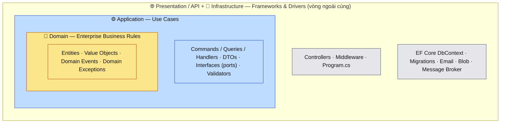
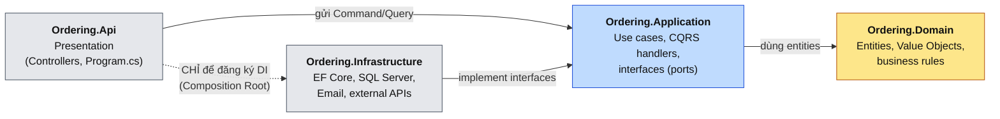
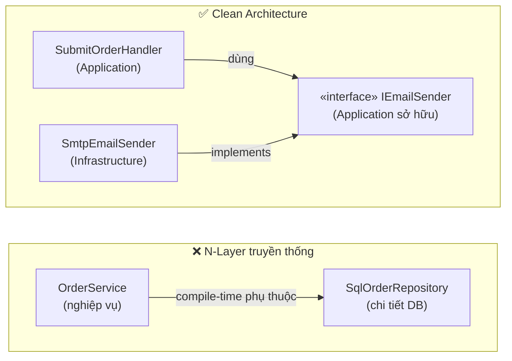
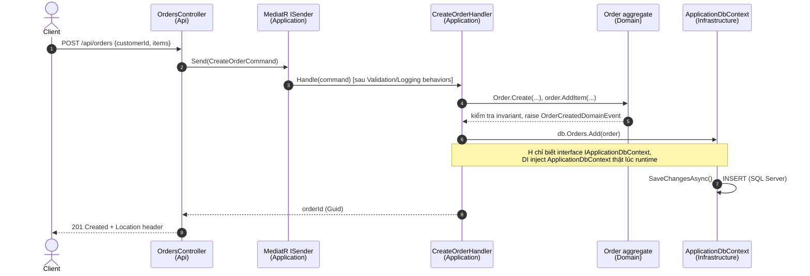

# Clean Architecture trong .NET

> [!summary] TL;DR
> - **Là gì:** Cách tổ chức solution thành các vòng đồng tâm — **Domain** ở lõi, **Application** bao quanh, **Infrastructure** và **Presentation/API** ở ngoài cùng.
> - **Quy tắc duy nhất phải nhớ — Dependency Rule:** *mũi tên phụ thuộc (project reference / `using`) chỉ được hướng VÀO TRONG*. Lõi nghiệp vụ không biết gì về EF Core, SQL Server, ASP.NET, SMTP…
> - **Trong .NET:** mỗi vòng = 1 project (`.csproj`). Compiler tự chặn vi phạm vì project bên trong **không có reference** ra ngoài.

> [!example] Domain xuyên suốt các ví dụ
> Toàn bộ vault dùng chung domain **Ordering** (Đặt hàng): `Order`, `OrderItem`, `Money`, `OrderStatus`.
> Code thực hành nằm ở [[POC-01-Ordering-Clean-Architecture]].

---

## 1. Problem — Vấn đề cần giải quyết

### 1.1 Bối cảnh: kiến trúc N-Layer "truyền thống"

Bạn đã quen mô hình này từ Spring Boot:

```text
Controller  →  Service  →  Repository  →  Database
```

Nhìn thì gọn, nhưng **chiều phụ thuộc** là: `Service` (nghiệp vụ) phụ thuộc vào `Repository` (truy cập dữ liệu) → nghiệp vụ phụ thuộc vào chi tiết kỹ thuật.

### 1.2 Pain points khi dự án lớn dần

| Triệu chứng | Nguyên nhân gốc |
| --- | --- |
| `OrderService` 2.000 dòng, inject cả `DbContext`, `HttpClient`, `SmtpClient`, `IConfiguration` | Không có ranh giới: nghiệp vụ trộn lẫn với hạ tầng |
| Muốn unit test logic "tính tổng đơn hàng" phải dựng DB / mock 7 dependency | Logic nghiệp vụ không tách khỏi I/O |
| Đổi SQL Server → PostgreSQL, hoặc EF Core → Dapper phải sửa cả tầng Service | Nghiệp vụ biết về ORM (`IQueryable`, `Include`, attribute `[Table]`) |
| Logic kiểm tra "đơn đã submit thì không được thêm hàng" nằm rải rác ở Controller, Service, cả JavaScript | Entity "thiếu máu" (anemic) — chỉ có getter/setter |
| Upgrade framework (ASP.NET Core 8 → 10) đụng vào code nghiệp vụ | Nghiệp vụ dính attribute/kiểu của framework |

### 1.3 Ý tưởng cốt lõi

1. **Nghiệp vụ là thứ quý nhất và ổn định nhất** → đặt ở trung tâm, không phụ thuộc vào ai.
2. **Framework, DB, UI, email… là "chi tiết" (details)** → đặt ở vòng ngoài, có thể thay thế.
3. Khi lõi cần dùng chi tiết (ví dụ cần lưu DB, gửi mail), lõi **định nghĩa interface (port)**, vòng ngoài **implement (adapter)**. Đây chính là chữ **D** trong SOLID — *Dependency Inversion Principle*.

---

## 2. Mental Model & Diagram

### 2.1 Các vòng đồng tâm



> [!info] Analogy — Bộ não và các giác quan
> **Domain** là bộ não (quy tắc kinh doanh). **Application** là "kịch bản hành động" (khi khách đặt hàng thì làm các bước gì).
> **Infrastructure/API** là tay chân, mắt tai — có thể thay (đổi DB như đổi kính) mà não không cần học lại.

### 2.2 Dependency Rule — sơ đồ phụ thuộc giữa các project



**Đọc sơ đồ:**
- Mũi tên = "project A **có `<ProjectReference>`** tới project B" = "A biết B tồn tại".
- **Domain không có mũi tên đi ra** → không reference bất kỳ project nào (lý tưởng: không cả NuGet package nặng).
- **Application chỉ biết Domain.** Không biết EF Core cụ thể là SQL Server hay Postgres.
- **Infrastructure → Application**: vì nó cần thấy *interface* (ví dụ `IEmailSender`) để implement.
- **Api → Infrastructure** (nét đứt): chỉ được dùng ở `Program.cs` để gọi `builder.Services.AddInfrastructure(...)`. Controller **không** được `new SqlConnection()` hay inject `ApplicationDbContext` trực tiếp.

### 2.3 Dependency Inversion — "đảo ngược" là đảo cái gì?



- **Luồng chạy (runtime):** Handler → gọi → SmtpEmailSender (vẫn từ trong ra ngoài).
- **Luồng phụ thuộc (compile-time):** SmtpEmailSender → phụ thuộc → interface trong Application (từ ngoài vào trong).
- ⇒ Hai chiều **ngược nhau** — đó là chữ "Inversion". Interface **thuộc về bên sử dụng** (Application), không thuộc về bên cung cấp (Infrastructure).

### 2.4 Một request đi qua các tầng như thế nào?



---

## 3. Chi tiết từng tầng

### 3.1 Bảng tổng quan

| Tầng | Trách nhiệm | ✅ Chứa | ⛔ KHÔNG được chứa | Reference tới |
| --- | --- | --- | --- | --- |
| **Domain** | Quy tắc nghiệp vụ cốt lõi, đúng với *mọi* ứng dụng dùng domain này | Entity, Aggregate Root, Value Object, Domain Event, Domain Exception, Enum, Domain Service | EF attribute, `DbContext`, DTO, `HttpContext`, logging, MediatR | *(không gì cả)* |
| **Application** | Điều phối use case: "khi user làm X thì hệ thống thực hiện các bước gì" | Command/Query + Handler, DTO, Interface (port) cho hạ tầng, Validator, Pipeline Behavior, Application Exception | SQL, connection string, `SqlServer` provider, Controller, implementation gửi mail | Domain |
| **Infrastructure** | Hiện thực kỹ thuật cho các port | `DbContext`, `IEntityTypeConfiguration`, Migrations, Interceptors, Repository impl, Email/Blob/Queue client | Logic nghiệp vụ (if/else về giá, trạng thái đơn…) | Application (→ Domain bắc cầu) |
| **Presentation / API** | Nhận request, trả response, cấu hình app | Controller / Minimal API endpoint, Middleware, Exception Handler, Auth config, `Program.cs` | Logic nghiệp vụ, query EF trực tiếp | Application, Infrastructure (chỉ cho DI) |

### 3.2 💎 Domain — trái tim của hệ thống

**Nguyên tắc vàng: Rich Domain Model, không phải Anemic Model.**

- Entity **tự bảo vệ trạng thái** của nó (invariant): setter là `private`, thay đổi trạng thái qua method có tên nghiệp vụ (`Submit()`, `AddItem()`), không phải `order.Status = 2`.
- **Value Object** (dùng `record`): so sánh theo giá trị, bất biến (immutable), tự validate khi khởi tạo. Ví dụ `Money`, `Address`, `Email`.
- **Aggregate Root**: cửa ngõ duy nhất để sửa các entity con. Không ai được `orderItem.Quantity = 5` trực tiếp — phải qua `order.AddItem(...)`.
- **Domain Event**: "điều gì đó quan trọng đã xảy ra" (`OrderSubmitted`). Domain chỉ *ghi nhận*, việc *phát đi* do Infrastructure làm.

> [!tip] Domain có nên reference MediatR để dùng `INotification` cho Domain Event không?
> Nhiều template làm vậy cho tiện. Cách "sạch" hơn: Domain tự định nghĩa `IDomainEvent` (interface rỗng),
> Infrastructure/Application sẽ bọc nó lại khi publish. Domain giữ được **zero dependency**.

### 3.3 ⚙️ Application — kịch bản use case

- Mỗi use case = 1 Command hoặc 1 Query + 1 Handler → chi tiết ở [[CQRS-and-MediatR-Pattern]].
- **Định nghĩa interface (port)** cho mọi thứ cần từ thế giới bên ngoài: `IApplicationDbContext`, `IEmailSender`, `ICurrentUser`…
- Thời gian: **không** gọi `DateTime.UtcNow` trực tiếp → inject `TimeProvider` (có sẵn từ .NET 8) để test được.
- Trả về **DTO**, không trả Entity ra ngoài (tránh lộ cấu trúc nội bộ và lỗi serialize vòng lặp).

### 3.4 🔌 Infrastructure — chi tiết kỹ thuật

- `ApplicationDbContext : DbContext, IApplicationDbContext`
- Mapping bằng **Fluent API** (`IEntityTypeConfiguration<T>`) thay vì attribute → Domain sạch hoàn toàn.
- `SaveChangesInterceptor` để tự set `CreatedAt/UpdatedBy`, dispatch Domain Events.
- Một file `DependencyInjection.cs` chứa extension method `AddInfrastructure()` — gom toàn bộ đăng ký DI của tầng này.
- Đánh dấu implementation là `internal sealed` — bên ngoài chỉ thấy interface (tương tự package-private bên Java).

### 3.5 🌐 Presentation / API — cửa ngõ

- Controller **mỏng**: nhận request → `sender.Send(command)` → map kết quả ra HTTP status. Không có `if` nghiệp vụ.
- `Program.cs` là **Composition Root** — nơi duy nhất "biết hết" mọi tầng để ráp DI lại với nhau.
- Xử lý exception tập trung bằng `IExceptionHandler` + `ProblemDetails` (RFC 9457).

---

## 4. Implementation — Thiết lập Solution trong .NET

### 4.1 Cấu trúc thư mục đề xuất

```text
Ordering/
├── Ordering.slnx                       # .NET 10 SDK mặc định tạo .slnx (XML gọn hơn .sln)
├── Directory.Build.props               # cấu hình chung cho mọi project
├── .editorconfig
├── src/
│   ├── Ordering.Domain/
│   │   ├── Common/                     # Entity base, IDomainEvent, DomainException
│   │   └── Orders/                     # Order, OrderItem, Money, OrderStatus, Events/
│   ├── Ordering.Application/
│   │   ├── Common/
│   │   │   ├── Behaviors/              # Logging, Validation, UnitOfWork
│   │   │   ├── Interfaces/             # IApplicationDbContext, IEmailSender
│   │   │   ├── Exceptions/             # NotFoundException
│   │   │   └── Messaging/              # ICommand, IQuery
│   │   ├── Orders/
│   │   │   ├── Commands/CreateOrder/   # Command + Handler + Validator cạnh nhau
│   │   │   └── Queries/GetOrderById/   # Query + Handler + DTO
│   │   └── DependencyInjection.cs      # AddApplication()
│   ├── Ordering.Infrastructure/
│   │   ├── Persistence/
│   │   │   ├── ApplicationDbContext.cs
│   │   │   ├── Configurations/         # OrderConfiguration, OrderItemConfiguration
│   │   │   ├── Interceptors/
│   │   │   └── Migrations/
│   │   ├── Email/                      # SmtpEmailSender
│   │   └── DependencyInjection.cs      # AddInfrastructure()
│   └── Ordering.Api/
│       ├── Controllers/                # hoặc Endpoints/ nếu dùng Minimal API
│       ├── Infrastructure/             # GlobalExceptionHandler (thuộc tầng web)
│       ├── appsettings.json
│       └── Program.cs                  # Composition Root
└── tests/
    ├── Ordering.Domain.UnitTests/
    ├── Ordering.Application.UnitTests/
    ├── Ordering.Api.IntegrationTests/  # WebApplicationFactory + Testcontainers
    └── Ordering.ArchitectureTests/     # NetArchTest — tự động canh Dependency Rule
```

> [!tip] Tổ chức theo **feature** bên trong Application (`Orders/Commands/CreateOrder/`)
> thay vì theo **loại kỹ thuật** (`Commands/`, `Handlers/`, `Validators/`).
> Khi sửa 1 use case, mọi file liên quan nằm cạnh nhau → giảm nhảy qua lại.

### 4.2 Lệnh CLI tạo solution (chạy được trên cả PowerShell và Bash)

```bash
mkdir Ordering
cd Ordering
dotnet new sln -n Ordering

# 1) Tạo các project
dotnet new classlib -n Ordering.Domain         -o src/Ordering.Domain
dotnet new classlib -n Ordering.Application    -o src/Ordering.Application
dotnet new classlib -n Ordering.Infrastructure -o src/Ordering.Infrastructure
dotnet new webapi   -n Ordering.Api           -o src/Ordering.Api --use-controllers

dotnet new xunit -n Ordering.Domain.UnitTests      -o tests/Ordering.Domain.UnitTests
dotnet new xunit -n Ordering.Application.UnitTests -o tests/Ordering.Application.UnitTests
dotnet new xunit -n Ordering.ArchitectureTests     -o tests/Ordering.ArchitectureTests

# 2) Thêm vào solution
dotnet sln add src/Ordering.Domain src/Ordering.Application src/Ordering.Infrastructure src/Ordering.Api
dotnet sln add tests/Ordering.Domain.UnitTests tests/Ordering.Application.UnitTests tests/Ordering.ArchitectureTests

# 3) Project references — ĐÂY CHÍNH LÀ DEPENDENCY RULE
dotnet add src/Ordering.Application    reference src/Ordering.Domain
dotnet add src/Ordering.Infrastructure reference src/Ordering.Application
dotnet add src/Ordering.Api            reference src/Ordering.Application src/Ordering.Infrastructure

dotnet add tests/Ordering.Domain.UnitTests      reference src/Ordering.Domain
dotnet add tests/Ordering.Application.UnitTests reference src/Ordering.Application
dotnet add tests/Ordering.ArchitectureTests     reference src/Ordering.Api

# 4) NuGet packages theo đúng tầng
dotnet add src/Ordering.Application    package MediatR
dotnet add src/Ordering.Application    package FluentValidation.DependencyInjectionExtensions
dotnet add src/Ordering.Application    package Microsoft.EntityFrameworkCore            # chỉ abstraction DbSet (xem 4.6)
dotnet add src/Ordering.Infrastructure package Microsoft.EntityFrameworkCore.SqlServer
dotnet add src/Ordering.Api            package Microsoft.EntityFrameworkCore.Design     # cho lệnh dotnet ef
dotnet add tests/Ordering.ArchitectureTests package NetArchTest.Rules

# 5) Xoá file Class1.cs mặc định trong các classlib, rồi build
dotnet build
```

> [!warning] Domain KHÔNG cài package nào
> Nếu thấy mình muốn `dotnet add src/Ordering.Domain package ...` — dừng lại và tự hỏi: thứ này có phải là *chi tiết* không?

### 4.3 `Directory.Build.props` — cấu hình chung (đặt ở thư mục gốc)

```xml
<Project>
  <PropertyGroup>
    <TargetFramework>net10.0</TargetFramework>
    <Nullable>enable</Nullable>                       <!-- bật nullable reference types -->
    <ImplicitUsings>enable</ImplicitUsings>
    <TreatWarningsAsErrors>true</TreatWarningsAsErrors> <!-- warning nullable = lỗi build -->
    <LangVersion>latest</LangVersion>
  </PropertyGroup>
</Project>
```

> [!note]
> MSBuild tự động import file này cho mọi `.csproj` nằm bên dưới. Xoá dòng `<TargetFramework>` trong từng `.csproj`
> để tránh cấu hình bị ghi đè. Tương tự **parent POM** bên Maven.
> Nâng cao: thêm `Directory.Packages.props` (Central Package Management) để quản lý version NuGet một chỗ — giống `<dependencyManagement>` của Maven.

### 4.4 Code tối giản từng tầng

#### 💎 Domain

```csharp
// src/Ordering.Domain/Common/Entity.cs
namespace Ordering.Domain.Common;

public interface IDomainEvent { }

public sealed class DomainException(string message) : Exception(message);

public abstract class Entity
{
    private readonly List<IDomainEvent> _domainEvents = [];

    // Guid v7 (.NET 9+): có thứ tự theo thời gian → index B-tree ít bị phân mảnh hơn Guid v4
    public Guid Id { get; protected init; } = Guid.CreateVersion7();

    public IReadOnlyCollection<IDomainEvent> DomainEvents => _domainEvents.AsReadOnly();

    protected void Raise(IDomainEvent domainEvent) => _domainEvents.Add(domainEvent);
    public void ClearDomainEvents() => _domainEvents.Clear();
}
```

```csharp
// src/Ordering.Domain/Orders/Money.cs — Value Object
namespace Ordering.Domain.Orders;

public sealed record Money
{
    public decimal Amount { get; }
    public string Currency { get; }

    public Money(decimal amount, string currency)
    {
        // Value Object tự validate → không bao giờ tồn tại một Money "sai"
        if (amount < 0) throw new DomainException("Amount cannot be negative.");
        if (string.IsNullOrWhiteSpace(currency) || currency.Length != 3)
            throw new DomainException("Currency must be a 3-letter ISO code.");

        Amount = amount;
        Currency = currency.ToUpperInvariant();
    }
}
```

```csharp
// src/Ordering.Domain/Orders/Order.cs — Aggregate Root
using Ordering.Domain.Common;

namespace Ordering.Domain.Orders;

public enum OrderStatus { Draft, Submitted, Paid, Cancelled }

public sealed record OrderCreatedDomainEvent(Guid OrderId) : IDomainEvent;
public sealed record OrderSubmittedDomainEvent(Guid OrderId) : IDomainEvent;

public sealed class Order : Entity
{
    private readonly List<OrderItem> _items = [];   // EF Core map qua backing field này

    public Guid CustomerId { get; private set; }
    public OrderStatus Status { get; private set; }
    public DateTimeOffset CreatedAt { get; private set; }
    public IReadOnlyCollection<OrderItem> Items => _items.AsReadOnly();
    public decimal Total => _items.Sum(i => i.LineTotal);   // tính toán, không lưu DB

    private Order() { } // dành cho EF Core materialize — code nghiệp vụ không gọi được

    // Factory method: cách DUY NHẤT để tạo Order hợp lệ
    public static Order Create(Guid customerId, DateTimeOffset now)
    {
        if (customerId == Guid.Empty) throw new DomainException("CustomerId is required.");

        var order = new Order { CustomerId = customerId, Status = OrderStatus.Draft, CreatedAt = now };
        order.Raise(new OrderCreatedDomainEvent(order.Id));
        return order;
    }

    public void AddItem(string sku, int quantity, Money unitPrice)
    {
        EnsureDraft();
        if (quantity <= 0) throw new DomainException("Quantity must be positive.");

        var existing = _items.FirstOrDefault(i => i.Sku == sku);
        if (existing is not null) { existing.IncreaseQuantity(quantity); return; }

        _items.Add(new OrderItem(sku, quantity, unitPrice));
    }

    public void Submit()
    {
        EnsureDraft();
        if (_items.Count == 0) throw new DomainException("Cannot submit an empty order.");

        Status = OrderStatus.Submitted;
        Raise(new OrderSubmittedDomainEvent(Id));
    }

    private void EnsureDraft()
    {
        if (Status != OrderStatus.Draft)
            throw new DomainException($"Order is {Status}; only Draft orders can be modified.");
    }
}

public sealed class OrderItem
{
    public Guid Id { get; private set; } = Guid.CreateVersion7();
    public string Sku { get; private set; } = default!;
    public int Quantity { get; private set; }
    public Money UnitPrice { get; private set; } = default!;
    public decimal LineTotal => UnitPrice.Amount * Quantity;

    private OrderItem() { } // EF Core

    // internal: chỉ Order (cùng assembly Domain) mới tạo/sửa được OrderItem
    internal OrderItem(string sku, int quantity, Money unitPrice)
    {
        Sku = sku;
        Quantity = quantity;
        UnitPrice = unitPrice;
    }

    internal void IncreaseQuantity(int quantity) => Quantity += quantity;
}
```

> [!check] Điều đáng chú ý
> - Không có `using Microsoft.EntityFrameworkCore` hay attribute `[Key]`, `[Table]` nào.
> - Mọi quy tắc ("chỉ Draft mới được sửa", "không submit đơn rỗng") nằm **trong entity** → test bằng unit test thuần, không cần DB.

#### ⚙️ Application — port cho persistence

```csharp
// src/Ordering.Application/Common/Interfaces/IApplicationDbContext.cs
using Microsoft.EntityFrameworkCore;
using Ordering.Domain.Orders;

namespace Ordering.Application.Common.Interfaces;

public interface IApplicationDbContext
{
    DbSet<Order> Orders { get; }
    Task<int> SaveChangesAsync(CancellationToken cancellationToken = default);
}

// Port cho dịch vụ bên ngoài — Application định nghĩa, Infrastructure implement
public interface IEmailSender
{
    Task SendAsync(string to, string subject, string body, CancellationToken ct = default);
}
```

Handler (use case) — xem bản đầy đủ có Validation & Pipeline tại [[CQRS-and-MediatR-Pattern]]:

```csharp
// src/Ordering.Application/Orders/Commands/SubmitOrder/SubmitOrderCommand.cs
public sealed record SubmitOrderCommand(Guid OrderId) : IRequest;

public sealed class SubmitOrderCommandHandler(IApplicationDbContext db, IEmailSender email)
    : IRequestHandler<SubmitOrderCommand>
{
    public async Task Handle(SubmitOrderCommand request, CancellationToken ct)
    {
        var order = await db.Orders.Include(o => o.Items)
                        .FirstOrDefaultAsync(o => o.Id == request.OrderId, ct)
                    ?? throw new NotFoundException(nameof(Order), request.OrderId);

        order.Submit();                       // nghiệp vụ nằm ở Domain, Handler chỉ điều phối
        await db.SaveChangesAsync(ct);        // bản tối giản; ở note CQRS, việc này chuyển sang UnitOfWorkBehavior
        await email.SendAsync("sales@shop.local", "New order", $"Order {order.Id} submitted", ct);
    }
}
```

#### 🔌 Infrastructure

```csharp
// src/Ordering.Infrastructure/Persistence/ApplicationDbContext.cs
using Microsoft.EntityFrameworkCore;
using Ordering.Application.Common.Interfaces;
using Ordering.Domain.Orders;

namespace Ordering.Infrastructure.Persistence;

public sealed class ApplicationDbContext(DbContextOptions<ApplicationDbContext> options)
    : DbContext(options), IApplicationDbContext
{
    public DbSet<Order> Orders => Set<Order>();

    protected override void OnModelCreating(ModelBuilder modelBuilder)
        // Tự quét mọi IEntityTypeConfiguration<T> trong assembly này
        => modelBuilder.ApplyConfigurationsFromAssembly(typeof(ApplicationDbContext).Assembly);
}
```

```csharp
// src/Ordering.Infrastructure/Persistence/Configurations/OrderConfiguration.cs
using Microsoft.EntityFrameworkCore;
using Microsoft.EntityFrameworkCore.Metadata.Builders;
using Ordering.Domain.Orders;

namespace Ordering.Infrastructure.Persistence.Configurations;

internal sealed class OrderConfiguration : IEntityTypeConfiguration<Order>
{
    public void Configure(EntityTypeBuilder<Order> builder)
    {
        builder.ToTable("Orders");
        builder.HasKey(o => o.Id);
        // Id do Domain tự sinh (Guid v7) → báo EF đừng coi "Id đã có giá trị" là entity cũ
        builder.Property(o => o.Id).ValueGeneratedNever();
        builder.Property(o => o.Status).HasConversion<string>().HasMaxLength(20);

        builder.Ignore(o => o.DomainEvents);   // không lưu event vào bảng

        builder.HasMany(o => o.Items)
               .WithOne()
               .HasForeignKey("OrderId")       // shadow property: Domain không cần biết FK
               .OnDelete(DeleteBehavior.Cascade);

        // EF đọc/ghi qua field _items, không qua property read-only Items
        builder.Navigation(o => o.Items).UsePropertyAccessMode(PropertyAccessMode.Field);
    }
}

internal sealed class OrderItemConfiguration : IEntityTypeConfiguration<OrderItem>
{
    public void Configure(EntityTypeBuilder<OrderItem> builder)
    {
        builder.ToTable("OrderItems");
        builder.HasKey(i => i.Id);
        builder.Property(i => i.Id).ValueGeneratedNever();
        builder.Property(i => i.Sku).HasMaxLength(50).IsRequired();

        // Value Object → Complex Type (EF Core 8+): lưu thành các cột trong cùng bảng
        builder.ComplexProperty(i => i.UnitPrice, money =>
        {
            money.Property(m => m.Amount).HasColumnName("UnitPrice").HasPrecision(18, 2);
            money.Property(m => m.Currency).HasColumnName("Currency").HasMaxLength(3);
        });
    }
}
```

```csharp
// src/Ordering.Infrastructure/DependencyInjection.cs
using Microsoft.EntityFrameworkCore;
using Microsoft.Extensions.Configuration;
using Microsoft.Extensions.DependencyInjection;
using Ordering.Application.Common.Interfaces;
using Ordering.Infrastructure.Email;
using Ordering.Infrastructure.Persistence;

namespace Ordering.Infrastructure;

public static class DependencyInjection
{
    public static IServiceCollection AddInfrastructure(this IServiceCollection services, IConfiguration configuration)
    {
        var connectionString = configuration.GetConnectionString("Default")
            ?? throw new InvalidOperationException("Connection string 'Default' not found.");

        services.AddDbContext<ApplicationDbContext>(options =>
            options.UseSqlServer(connectionString, sql => sql.EnableRetryOnFailure()));

        // Map interface (Application) → implementation (Infrastructure), CÙNG một instance Scoped
        services.AddScoped<IApplicationDbContext>(sp => sp.GetRequiredService<ApplicationDbContext>());

        services.AddSingleton(TimeProvider.System);
        services.AddTransient<IEmailSender, SmtpEmailSender>();

        return services;
    }
}
```

#### 🌐 API — Composition Root & Controller mỏng

```csharp
// src/Ordering.Api/Program.cs
using Ordering.Api.Infrastructure;
using Ordering.Application;
using Ordering.Infrastructure;

var builder = WebApplication.CreateBuilder(args);

builder.Services
    .AddApplication()                              // MediatR, FluentValidation, Behaviors
    .AddInfrastructure(builder.Configuration);     // EF Core, Email...

builder.Services.AddControllers();
builder.Services.AddProblemDetails();
builder.Services.AddExceptionHandler<GlobalExceptionHandler>();  // xem note CQRS mục 3.7
builder.Services.AddOpenApi();

var app = builder.Build();

app.UseExceptionHandler();
if (app.Environment.IsDevelopment()) app.MapOpenApi();
app.MapControllers();

app.Run();

public partial class Program;   // để WebApplicationFactory<Program> dùng trong integration test
```

```csharp
// src/Ordering.Api/Controllers/OrdersController.cs
using MediatR;
using Microsoft.AspNetCore.Mvc;
using Ordering.Application.Orders.Commands.CreateOrder;
using Ordering.Application.Orders.Queries.GetOrderById;

namespace Ordering.Api.Controllers;

[ApiController]
[Route("api/orders")]
public sealed class OrdersController(ISender sender) : ControllerBase
{
    [HttpPost]
    public async Task<IActionResult> Create(CreateOrderCommand command, CancellationToken ct)
    {
        var id = await sender.Send(command, ct);
        return CreatedAtAction(nameof(GetById), new { id }, new { id });
    }

    [HttpGet("{id:guid}")]
    public async Task<ActionResult<OrderDto>> GetById(Guid id, CancellationToken ct)
        => Ok(await sender.Send(new GetOrderByIdQuery(id), ct));
}
```

> [!info] Controller chỉ biết `ISender` — không biết `DbContext`, không biết `OrderService`.

### 4.5 Migrations

```bash
dotnet tool install --global dotnet-ef

dotnet ef migrations add InitialCreate --project src/Ordering.Infrastructure --startup-project src/Ordering.Api --output-dir Persistence/Migrations
dotnet ef database update --project src/Ordering.Infrastructure --startup-project src/Ordering.Api
```

- `--project`: nơi chứa `DbContext` & nơi sinh file migration (Infrastructure).
- `--startup-project`: nơi có `Program.cs` + `appsettings.json` (Api) để EF đọc connection string.

### 4.6 Quyết định thiết kế: `IApplicationDbContext` hay `Repository + UnitOfWork`?

| Tiêu chí | `IApplicationDbContext` (expose `DbSet<T>`) | `IOrderRepository` + `IUnitOfWork` |
| --- | --- | --- |
| Độ thuần khiết | Application phụ thuộc package `Microsoft.EntityFrameworkCore` (chỉ abstraction) | Application không biết EF tồn tại |
| Lượng code | Ít — dùng thẳng LINQ, `Include`, projection | Nhiều — mỗi query mới cần thêm method repo |
| Query phức tạp (read side) | Rất linh hoạt | Repo phình to (`GetByCustomerAndStatusPagedSorted…`) |
| Đổi ORM | Khó hơn (thực tế hiếm khi đổi) | Dễ hơn |
| Dùng bởi | Jason Taylor's CleanArchitecture template | Ardalis template, phong cách DDD thuần |

> [!tip] Khuyến nghị thực dụng
> - Bắt đầu với **`IApplicationDbContext`** cho học tập & dự án vừa — `DbContext` bản thân đã là Unit of Work, `DbSet` đã là Repository.
> - **Tránh Generic Repository** (`IRepository<T>` bọc lại `DbSet<T>` với `GetAll/Add/Update/Delete`) — vừa mất tính năng của EF, vừa không thêm giá trị.
> - Nếu theo DDD chặt: dùng **Repository cho mỗi Aggregate Root** ở phía *write*, còn phía *read* (Query) đọc thẳng DbContext/Dapper.

### 4.7 Architecture Tests — để compiler + test canh gác Dependency Rule

```csharp
// tests/Ordering.ArchitectureTests/LayerDependencyTests.cs
using NetArchTest.Rules;

namespace Ordering.ArchitectureTests;

public class LayerDependencyTests
{
    private const string ApplicationNs    = "Ordering.Application";
    private const string InfrastructureNs = "Ordering.Infrastructure";
    private const string ApiNs            = "Ordering.Api";

    [Fact]
    public void Domain_ShouldNotDependOn_AnyOtherLayer_OrEfCore()
    {
        var result = Types.InAssembly(typeof(Ordering.Domain.Orders.Order).Assembly)
            .ShouldNot()
            .HaveDependencyOnAny(ApplicationNs, InfrastructureNs, ApiNs, "Microsoft.EntityFrameworkCore")
            .GetResult();

        Assert.True(result.IsSuccessful, string.Join(", ", result.FailingTypeNames ?? []));
    }

    [Fact]
    public void Application_ShouldNotDependOn_Infrastructure_Or_Api()
    {
        var result = Types.InAssembly(typeof(Ordering.Application.DependencyInjection).Assembly)
            .ShouldNot()
            .HaveDependencyOnAny(InfrastructureNs, ApiNs)
            .GetResult();

        Assert.True(result.IsSuccessful, string.Join(", ", result.FailingTypeNames ?? []));
    }

    [Fact]
    public void Controllers_ShouldNotDependOn_Infrastructure()
    {
        var result = Types.InAssembly(typeof(Program).Assembly)
            .That().HaveNameEndingWith("Controller")
            .ShouldNot().HaveDependencyOn(InfrastructureNs)
            .GetResult();

        Assert.True(result.IsSuccessful, string.Join(", ", result.FailingTypeNames ?? []));
    }
}
```

> [!note] Vì sao cần test khi project reference đã chặn rồi?
> Project reference chặn được Domain → Infrastructure, nhưng **không chặn** được Controller (trong Api) dùng thẳng `ApplicationDbContext` (vì Api có reference tới Infrastructure). Test thứ 3 bắt lỗi đó.

---

## 5. Comparison — Đối chiếu Java / Spring Boot

### 5.1 Bảng ánh xạ

| Khía cạnh | ☕ Java / Spring Boot | 🟣 C# / ASP.NET Core |
| --- | --- | --- |
| Tên gọi gần nhất | **Hexagonal / Ports & Adapters** (Alistair Cockburn) | Clean Architecture / Onion — cùng một tinh thần |
| Tách tầng vật lý | Maven multi-module / Gradle subprojects | Nhiều `.csproj` trong `.sln/.slnx` |
| Khai báo phụ thuộc giữa tầng | `<dependency>` giữa các module | `<ProjectReference>` |
| Cấu hình build chung | Parent POM, `<dependencyManagement>` | `Directory.Build.props`, `Directory.Packages.props` |
| Kiểm tra kiến trúc tự động | **ArchUnit** | **NetArchTest** / ArchUnitNET |
| Composition Root | `@SpringBootApplication` + component scan + `@Configuration` | `Program.cs` + extension `AddApplication()/AddInfrastructure()` |
| Đăng ký bean/service | Tự động (`@Component`, `@Service` + scan) | **Tường minh** (`services.AddScoped<I, T>()`) — không scan mặc định |
| Ẩn implementation | package-private | `internal` (phạm vi **assembly**, không phải namespace) |
| Mapping entity ↔ DB | Annotation `@Entity`, `@Table`, `@Column` **trên chính class** | Fluent API `IEntityTypeConfiguration<T>` **ở Infrastructure** |
| Value Object | `@Embeddable` / Java `record` | `record` + `ComplexProperty` / `OwnsOne` |
| Repository | Spring Data `JpaRepository<T, ID>` | `DbSet<T>` (đã là repository) |
| Xử lý exception tập trung | `@RestControllerAdvice` + `@ExceptionHandler` | `IExceptionHandler` + `ProblemDetails` |
| Thời gian testable | `java.time.Clock` inject | `TimeProvider` inject |

### 5.2 Khác biệt quan trọng nhất: annotation JPA "làm bẩn" Domain

Trong Spring, cách phổ biến là gắn `@Entity` thẳng lên domain class:

```java
@Entity                       // ← Domain đã phụ thuộc jakarta.persistence
@Table(name = "orders")
public class Order {
    @Id private UUID id;
    @OneToMany(cascade = ALL, orphanRemoval = true) private List<OrderItem> items;
    protected Order() {}      // JPA yêu cầu
}
```

Người theo Hexagonal thuần sẽ phải tạo **2 class**: `Order` (domain) + `OrderJpaEntity` (persistence) + mapper qua lại → rất nhiều boilerplate.

**Trong .NET:** EF Core Fluent API cho phép **một class `Order` duy nhất** vừa là domain model, vừa được map xuống DB mà **không dính attribute nào** — cấu hình nằm hết ở Infrastructure. Đây là lý do Clean Architecture trong .NET thường "nhẹ" hơn bên Java.

### 5.3 ArchUnit (Java) ↔ NetArchTest (.NET)

```java
// Java — ArchUnit
@AnalyzeClasses(packages = "com.example.ordering")
class LayerTest {
    @ArchTest
    static final ArchRule layers = layeredArchitecture().consideringAllDependencies()
        .layer("Domain").definedBy("..domain..")
        .layer("Application").definedBy("..application..")
        .layer("Infrastructure").definedBy("..infrastructure..")
        .layer("Web").definedBy("..web..")
        .whereLayer("Web").mayNotBeAccessedByAnyLayer()
        .whereLayer("Infrastructure").mayOnlyBeAccessedByLayers("Web")
        .whereLayer("Application").mayOnlyBeAccessedByLayers("Infrastructure", "Web")
        .whereLayer("Domain").mayOnlyBeAccessedByLayers("Application", "Infrastructure", "Web");
}
```

> [!warning] Bẫy khi chuyển từ Java sang .NET
> - **Không có component scan mặc định**: tạo class `SmtpEmailSender` mà quên `services.AddTransient<IEmailSender, SmtpEmailSender>()` → lỗi runtime `Unable to resolve service`. (Muốn scan thì dùng thư viện **Scrutor**.)
> - **`internal` ≠ package-private**: `internal` là "trong cùng assembly (project)", nên 2 namespace khác nhau trong cùng project vẫn thấy nhau.
> - **EF Core không tự flush**: JPA trong `@Transactional` tự flush khi commit; EF Core **bắt buộc gọi `SaveChangesAsync()`** — quên là dữ liệu không được ghi.
> - **Single-module Spring app** chỉ dựa vào package → dễ vi phạm. Ở .NET, tách project là cách *mặc định*, compiler chặn giúp bạn miễn phí.

---

## 6. Trade-offs & Best Practices

### ✅ Ưu điểm
- **Testability:** Domain + Application test được bằng unit test thuần, chạy trong mili-giây.
- **Bảo vệ nghiệp vụ** khỏi thay đổi công nghệ (upgrade .NET, đổi DB, đổi message broker).
- **Ranh giới rõ ràng** → onboarding nhanh: "logic giá ở đâu?" → Domain. "Câu SQL ở đâu?" → Infrastructure.
- **Dependency Rule được compiler cưỡng chế** nhờ project reference.
- Nền tảng tự nhiên cho CQRS, DDD, và tách microservice sau này.

### ❌ Nhược điểm / Chi phí
- **Nhiều file, nhiều project, nhiều "ceremony"** — một tính năng CRUD đơn giản cũng phải đi qua 4 tầng.
- **Indirection:** đọc code phải nhảy Controller → Command → Handler → Entity → Configuration.
- **Dễ over-engineering:** interface cho mọi thứ, mapping DTO ↔ Entity ↔ ViewModel ở khắp nơi.
- Đường cong học tập cho junior (DIP, aggregate, value object…).

### 🎯 Khi nào dùng — khi nào KHÔNG dùng

| Nên dùng khi | Không nên dùng khi |
| --- | --- |
| Nghiệp vụ phức tạp, nhiều quy tắc, sống lâu (3+ năm) | App CRUD đơn giản, admin tool nội bộ |
| Team nhiều người, cần ranh giới rõ | Prototype / MVP cần ra mắt trong 2 tuần |
| Cần test nghiệp vụ kỹ (tài chính, đặt hàng, bảo hiểm) | Service nhỏ chỉ làm proxy/ETL |
| Có khả năng đổi hạ tầng hoặc nhiều "đầu vào" (API + worker + gRPC) | Script, Azure Function đơn lẻ |

> [!tip] Lựa chọn thay thế
> **Vertical Slice Architecture**: tổ chức theo feature (mỗi feature 1 thư mục chứa từ endpoint đến DB), ít tầng hơn.
> Có thể kết hợp: Clean Architecture cho cấu trúc project + Vertical Slice trong tầng Application (chính là cách tổ chức `Orders/Commands/CreateOrder/` ở trên). → [[Vertical-Slice-Architecture]]

### 📋 Best practices checklist
- [ ] Domain không reference project/package nào (kiểm bằng architecture test).
- [ ] Entity có setter `private`, thay đổi trạng thái qua method nghiệp vụ.
- [ ] Interface đặt ở tầng **sử dụng** (Application), implementation ở Infrastructure.
- [ ] Mỗi tầng có 1 `DependencyInjection.cs` với extension `AddXxx()`.
- [ ] Controller không chứa logic, không inject `DbContext`.
- [ ] API trả DTO, **không** trả Entity, **không** trả `IQueryable`.
- [ ] Dùng `TimeProvider`, không gọi `DateTime.Now` trong Domain/Application.
- [ ] Implementation trong Infrastructure là `internal sealed` khi có thể.
- [ ] Truyền `CancellationToken` từ Controller xuống tận EF Core.

### 🐞 Lỗi thường gặp

| Lỗi | Hậu quả | Cách sửa |
| --- | --- | --- |
| Entity "thiếu máu" — logic nằm hết trong Handler | Clean Arch chỉ còn là "N-Layer nhiều project hơn" | Đưa invariant vào entity/value object |
| Application reference Infrastructure "cho nhanh" | Phá vỡ toàn bộ kiến trúc | Tạo interface ở Application |
| Project `Common`/`Shared` chứa đủ thứ | Thành bãi rác, mọi tầng phụ thuộc nó | Đặt code vào đúng tầng sở hữu |
| Generic Repository bọc EF | Mất `Include`, projection, tracking control | Dùng `DbSet` hoặc repo theo Aggregate |
| Mapping 3 lớp DTO → Command → Entity → DTO cho mọi thứ | Boilerplate khổng lồ | Command *chính là* request DTO; query project thẳng ra DTO |
| Quên `ValueGeneratedNever()` khi Id sinh ở Domain | EF tưởng entity con mới là entity cũ → `UPDATE` thay vì `INSERT` → `DbUpdateConcurrencyException` | Cấu hình `ValueGeneratedNever()` |

---

## 7. Self-check — Câu hỏi tự kiểm tra

> [!question]- Dependency Rule phát biểu thế nào? "Phụ thuộc" ở đây cụ thể là gì trong .NET?
> Source code dependency chỉ hướng vào trong. Trong .NET = `<ProjectReference>` và `using` namespace. Domain không reference ai; Application chỉ reference Domain; Infrastructure reference Application; Api reference Application (+ Infrastructure chỉ cho DI).

> [!question]- Tại sao `IEmailSender` nằm ở Application mà không nằm ở Infrastructure?
> Vì theo DIP, interface thuộc về bên **sử dụng** (client). Nếu đặt ở Infrastructure, Application phải reference Infrastructure để thấy interface → vi phạm Dependency Rule.

> [!question]- Api reference Infrastructure — có vi phạm Dependency Rule không?
> Không, vì Api và Infrastructure đều ở vòng ngoài cùng; Api chỉ dùng nó tại Composition Root (`Program.cs`) để ráp DI. Cần architecture test để đảm bảo Controller không dùng trực tiếp Infrastructure. (Purist có thể tách thêm project `Ordering.Bootstrapper`.)

> [!question]- Business rule "không submit đơn rỗng" nên nằm ở FluentValidation validator hay ở Entity?
> Ở **Entity** (`Order.Submit()`), vì đó là invariant của domain — phải đúng bất kể ai gọi (API, background job, test). FluentValidation dùng cho *input validation* (format, required, length) ở biên Application.

> [!question]- (Phỏng vấn) Clean Architecture khác Hexagonal và Onion thế nào?
> Cùng một ý tưởng cốt lõi: tách lõi nghiệp vụ khỏi hạ tầng bằng Dependency Inversion. Hexagonal nhấn mạnh Ports & Adapters (driving/driven); Onion nhấn mạnh các vòng đồng tâm với Domain Model ở giữa; Clean Architecture của Uncle Bob tổng hợp cả hai, đặt tên rõ các vòng (Entities, Use Cases, Interface Adapters, Frameworks & Drivers).

---

## 8. Liên kết & Tham khảo
- **Note liên quan:** [[CQRS-and-MediatR-Pattern]] · [[Java-to-DotNet-Mental-Map]] · [[POC-01-Ordering-Clean-Architecture]]
- **Đọc tiếp (chưa viết):** [[DDD-Tactical-Patterns]] · [[Vertical-Slice-Architecture]] · [[Dependency-Injection-DotNet-vs-Spring]] · [[EF-Core-vs-JPA-Hibernate]] · [[SOLID-Principles]] · [[Domain-Events-and-Outbox]]
- **Nguồn:**
  - Robert C. Martin — *Clean Architecture* (2017) & bài blog gốc 2012
  - Microsoft Learn — *Common web application architectures*
  - Template: `jasontaylordev/CleanArchitecture`, `ardalis/CleanArchitecture`
