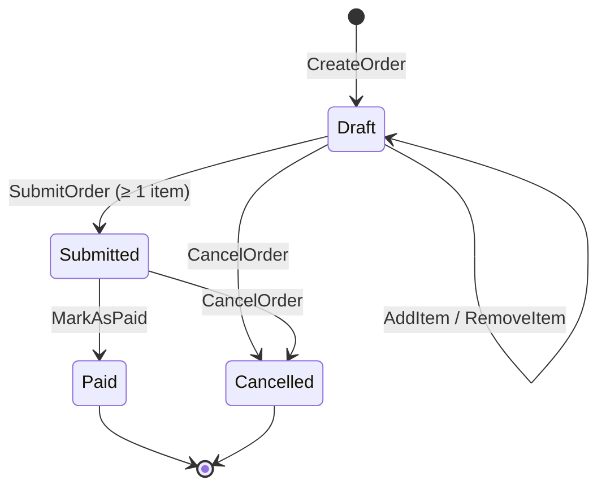
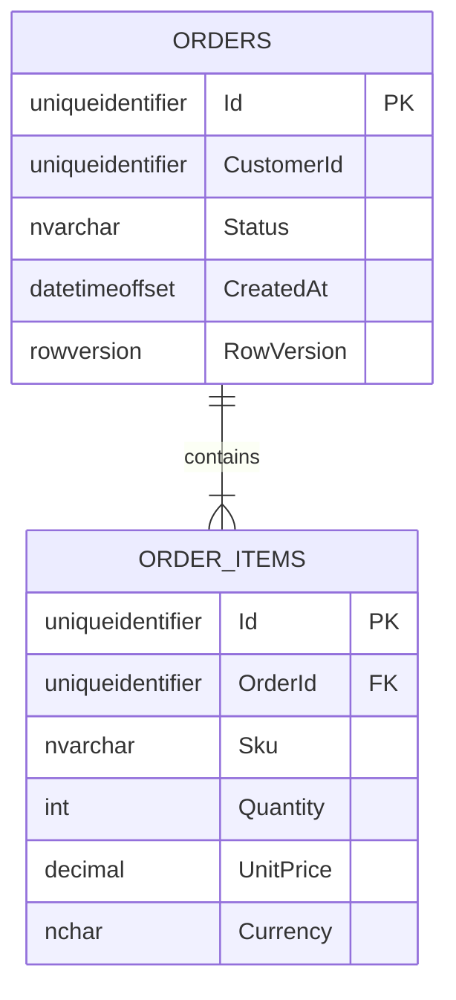

# POC-01 — Ordering API (Clean Architecture + CQRS + EF Core)

> [!summary] Mục tiêu
> Dự án thực hành **duy nhất, xuyên suốt** cho Phase 2–5 của [[Roadmap-DotNet]]. Mọi code mẫu trong vault đều dùng domain này, nên học xong note nào → code ngay vào đây.
> Code để ở repo riêng (không để trong vault) — ghi link vào frontmatter `repo`.

## 1. Phạm vi nghiệp vụ

## 2. Use cases (backlog)

| # | Use case | Loại | Học được gì | Xong |
| --- | --- | --- | --- | --- |
| 1 | `CreateOrder` | Command | Aggregate factory, Value Object, Validation behavior | ☐ |
| 2 | `GetOrderById` | Query | Projection ra DTO, NotFound → 404 | ☐ |
| 3 | `AddItemToOrder` | Command | Invariant "chỉ Draft mới sửa", `ValueGeneratedNever` | ☐ |
| 4 | `SubmitOrder` | Command | Domain Event, Notification handler | ☐ |
| 5 | `CancelOrder` | Command | State machine, 422 Business rule | ☐ |
| 6 | `SearchOrders` (paging, filter, sort) | Query | Dapper / `IQueryable` động, paging | ☐ |
| 7 | Concurrency: 2 người sửa cùng đơn | — | `rowversion`, 409 Conflict | ☐ |
| 8 | Outbox gửi email sau khi Submit | — | Outbox pattern, `BackgroundService` | ☐ |

## 3. Checklist kỹ thuật
- [ ] Solution 4 project + 3 test project đúng như [[Clean-Architecture-in-DotNet#4.1 Cấu trúc thư mục đề xuất]]
- [ ] SQL Server chạy bằng Docker: `docker run -e "ACCEPT_EULA=Y" -e "MSSQL_SA_PASSWORD=<mật-khẩu-dev>" -p 1433:1433 -d mcr.microsoft.com/mssql/server:2022-latest`
- [ ] Migrations đầu tiên
- [ ] 3 Pipeline Behaviors (Logging, Validation, UnitOfWork) — [[CQRS-and-MediatR-Pattern#3.5 Pipeline Behaviors]]
- [ ] GlobalExceptionHandler + ProblemDetails
- [ ] Architecture tests xanh
- [ ] Integration test với `WebApplicationFactory` + Testcontainers
- [ ] Dockerfile multi-stage + chạy CI (Jenkins / GitHub Actions)

## 4. Nhật ký học (Dev log)
%% Ghi ngắn: ngày — làm gì — vướng gì — học được gì. Đây là nguồn để viết note mới. %%
- 2026-11-13 — Khởi tạo POC, viết note Clean Architecture & CQRS.
